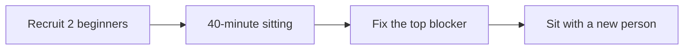

The sitting script and triage rules are in
[`docs/BEGINNER_TEST.md`](https://github.com/TLE47/Mechatronics-Roadmap/blob/main/docs/BEGINNER_TEST.md).
Publish aggregates only: no names, no screenshots of the participant, and no quotes without consent.

**A one-off observation is not a pilot row.** The pilot's row is a record written by
`scripts/pilot_sitting.py` — one `sitting.json` per participant, closed from their export — and
[`docs/PILOT.md`](https://github.com/TLE47/Mechatronics-Roadmap/blob/main/docs/PILOT.md) §6 says what
does not count as a pilot. The fields below **are** that record's fields, on purpose: the same stop
kinds, the same minute/page/tried/resolved columns, the same graded-loop answers. An observation that
turns into a sitting can then be filed as one without translating it, and the top-10 table groups both
the same way.

A closed record renders this body rather than being retyped:

```bash
python3 scripts/pilot_sitting.py --issue pilot-data/2026-10-24-ab --out sitting.md
```

It prints the body (and writes the same text with `--out`), refuses a record whose evidence does not
support its claims — the same rules as `--check` — and prints a suggested title.



### 1. Participant background (no identifying details)

The record keeps these as `background.*`. Answer each one — "not asked" is not an answer, and a blank
reads as "no" in the aggregate later.

| Question | Record field | Answer |
| :--- | :--- | :--- |
| Has written code before? | `background.has_coded` | yes / no |
| Has wired a circuit before? | `background.has_wired` | yes / no |
| Maths beyond school arithmetic? | `background.beyond_school_maths` | yes / no |
| Has used a browser-based code editor before? | `background.used_browser_editor` | yes / no |
| Device and browser | `device` | |

### 2. Reaching Lesson 1

| Question | Record field | Answer |
| :--- | :--- | :--- |
| Found the first lesson without help? | `reached_lesson_1` | yes / no |
| Time to the first lesson page | `minutes_to_lesson_1` | `__ min` |
| First confusion (quote) | `first_confusion` | |

### 3. Stops

One row per place they stopped for more than 20 seconds — including the stalls that resolved, because a
stall that ends in success is still where people stop. `kind` is exactly the record's vocabulary:
`link` (a link they could not find or follow), `setup` (browser, device, storage), `tool` (the
workbench itself), `instruction` (the page did not say what to do), `maths`, `error` (a message they
could not act on), `bug`.

| Minute | Page or lesson | What they tried | kind | Resolved by |
| ---: | :--- | :--- | :--- | :--- |
| e.g. 6 | README | scrolled looking for "Start" | link | author pointed at the heading |
| | | | | |

### 4. Time, help and the graded loop

Active minutes come from the export's sittings (run `python3 scripts/pilot_preflight.py <export>` while
the participant is still there); elapsed minutes come from your timer; overhead is the difference.

| Question | Record field | Answer |
| :--- | :--- | :--- |
| Export read by the preflight? | — | yes / no |
| Active minutes · elapsed minutes · overhead | `active_minutes` · `elapsed_minutes` · `overhead_minutes` | `__` · `__` · `__` |
| In-course hints used | `hints_used` | 0–3 |
| Help type | `help` | none · hint_1 · hint_2 · solution · person |
| Outside hints from you | `person_hints` | 0–3 |
| Reached **Run & Verify**? | `run_verify` | yes / no |
| Understood the failure message? | `understood_error` | yes / partly / no — quote it |
| Knew what to do next? | `knew_next` | yes / no |
| Finished Step 1? | `finished` · `finished_minutes` | yes / no — `__` min |

### 5. The one fix they asked for

>

### 6. What changed because of this sitting

- [ ] Page copy updated
- [ ] Generated count or link fixed
- [ ] Error message rewritten
- [ ] Regression test added (name it)
- [ ] Nothing yet — blocked on a decision

| Question | Record field | Answer |
| :--- | :--- | :--- |
| Course bug found? | `course_bug.yes` | yes / no |
| Which page | `course_bug.page` | |

### 7. Limits of this sitting

- Self-selected participant:
- Author present and observing: yes
- Anything learned from watching rather than counting:
