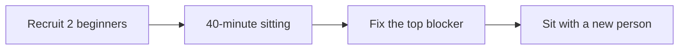

The sitting script and triage rules are in
[`docs/BEGINNER_TEST.md`](https://github.com/TLE47/Mechatronics-Roadmap/blob/main/docs/BEGINNER_TEST.md).
Publish aggregates only: no names, no screenshots of the participant, and no quotes without consent.

### 1. Participant background (no identifying details)
- [ ] Never written code
- [ ] Never wired a circuit
- [ ] School arithmetic only
- [ ] Has used a browser-based code editor before
- Device and browser:

### 2. Reaching Lesson 1
| Question | Answer |
| :--- | :--- |
| Found the Lesson 1 link without help? | yes / no |
| Time to first lesson page | `__ min` |
| First confusion (quote) | |

### 3. Stuck points
One row per stop over 20 seconds. `kind` is `link`, `tool`, `install`, `instruction`, `maths`,
`error message`, or `bug`.

| Minute | Lesson / page | What they tried | Kind | Resolved by |
| ---: | :--- | :--- | :--- | :--- |
| e.g. 6 | README | scrolled looking for "Start" | link | author pointed at heading |
| | | | | |

### 4. The graded loop
| Question | Answer |
| :--- | :--- |
| Reached **Run & Verify Output**? | yes / no |
| Understood the failure message? | yes / partly / no — quote it |
| Knew what to do next? | yes / no |
| Finished Step 1? | yes / no — `__ min` |

### 5. The one fix they asked for
>

### 6. What changed because of this sitting
- [ ] Page copy updated
- [ ] Generated count or link fixed
- [ ] Error message rewritten
- [ ] Regression test added (name it)
- [ ] Nothing yet — blocked on a decision

### 7. Limits of this sitting
- Self-selected participant:
- Author present and observing: yes
- Anything learned from watching rather than counting:
