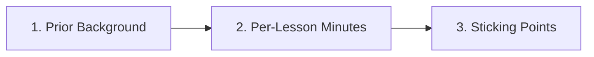

### 1. Prior Background (Check all that apply)
- [ ] Zero prior programming experience
- [ ] Some Python or other programming experience
- [ ] Zero prior electronics / breadboard experience
- [ ] High-school algebra & basic right-triangle trig only

### 2. Measured Completion Times (Minutes per Lesson, Including Exercise & Self-Check)
| Lesson ID | Measured Time (minutes) | Used Hints? (`0`, `1`, `2`, `3`, or `Solution`) | Simulator Used (`Tab 9 Pyodide`, `Local Python`, `Falstad`, `Wokwi`) |
| :--- | :--- | :--- | :--- |
| e.g. `P.1` | `38 min` | `Hint 1` | `Tab 9 Pyodide` |
| e.g. `P.2` | `42 min` | `0` | `Tab 9 Pyodide` |
| e.g. `S0.1` | `50 min` | `Hint 2` | `Falstad` |

### 3. Where Did You Get Stuck or Slow Down?
- **Lesson ID & section**:
- **What felt unclear or took longer than expected**:
