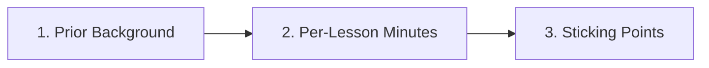

### 1. Prior Background (Check all that apply)
- [ ] Zero prior programming experience
- [ ] Some Python or other programming experience
- [ ] Zero prior electronics / breadboard experience
- [ ] High-school algebra & basic right-triangle trig only

### 2. Focused Lesson Times (Minutes per Lesson, Including Exercise & Self-Check)

Focused means time with the lesson open. Do **not** include tool setup, debugging a broken
environment, or re-reading an earlier page here; those go in section 3.

| Lesson ID | Focused minutes | Used Hints? (`0`, `1`, `2`, `3`, or `Solution`) | Where it ran (`Run Python Lessons`, `Local Python`, `Falstad`, `Wokwi`) |
| :--- | :--- | :--- | :--- |
| e.g. `P.1` | `38 min` | `Hint 1` | `Run Python Lessons` |
| e.g. `P.2` | `42 min` | `0` | `Run Python Lessons` |
| e.g. `S0.1` | `50 min` | `Hint 2` | `Falstad` |

### 3. Session Overhead (Not Counted in Section 2)

| Lesson ID | Elapsed minutes | Setup / tool recovery | Debugging / re-reading | What happened |
| :--- | :--- | :--- | :--- | :--- |
| e.g. `P.1` | `75 min` | `10 min` | `27 min` | npm/Arduino install failed once; re-read the loop example |
| | | | | |

### 4. Where Did You Get Stuck or Slow Down?
- **Lesson ID & section**:
- **What felt unclear or took longer than expected**:
