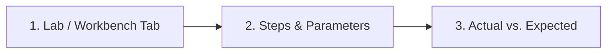

### 1. Lab Script or Workbench Tab
- **Lab folder or Workbench Tab** (e.g. `Tab 9: In-Browser Python Runner`, `Tab 3: 25 kHz FOC`, `05-control-and-estimation/lab`):
- **Operating System / Browser / Python or Node version**:

### 2. Steps to Reproduce
1.
2.
3.

### 3. Actual Output vs. Expected Output
```text
Paste terminal traceback, console error, or mismatched simulation output here
```
