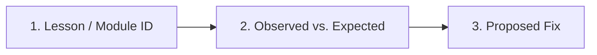

### 1. Lesson or Module Identifier
- **Lesson / Module ID** (e.g. `Lesson P.3`, `Lesson S0.5`, `Lesson 01.2`, `05-control.T1.05a`):
- **File path & section heading**:

### 2. What Did You Observe vs. What Is Stated?
- **Current text / expected output in the file**:
- **Actual output / datasheet value / calculation**:

### 3. Steps or Snippet to Reproduce
```python
# Paste the minimal calculation or command here
```

### 4. Suggested Fix (Optional)
- Describe how the equation, code, or hardware note should be updated:
