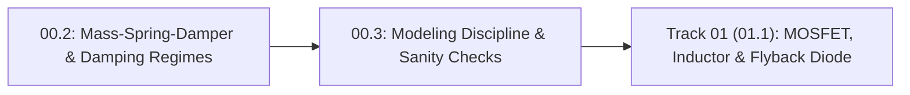

# Lesson 00.3: Engineering Modeling Discipline — 4-Step Workflow, Dimensional Checks and Sign Conventions

<!-- run-callout:start -->
> **Step 3 of 10 · Make a joint move: foundations**
>
> **Run this in the workbench.** [Open MechaLab with `00.3` loaded](https://tle47.github.io/Mechatronics-Roadmap/?lesson=00.3) - it opens on the **Run Python Lessons** tab with that entry selected. Starter code, hints and the graded check are ready; this page is the reading copy, and nothing you type here is saved.
<!-- run-callout:end -->

## Goal
Apply a repeatable **4-step engineering modeling workflow** (**Diagram $\rightarrow$ Symbolic Equations $\rightarrow$ Code $\rightarrow$ Sanity Check**) and catch bugs before powering hardware by verifying **dimensional unit consistency** and **extreme-case sign conventions** ($\theta = 0^\circ$ vs. $90^\circ$) in Python.

- **New ideas (max 2):**
  1. **The 4-step engineering problem-solving workflow (Diagram $\rightarrow$ Symbolic Equations $\rightarrow$ Code $\rightarrow$ Sanity Check)**: Never type numbers or code before drawing the coordinate axes and writing symbolic variable names with SI units.
  2. **Dimensional unit consistency and extreme-case sign checks ($\theta = 0^\circ$ vs. $90^\circ$)**: Verifying that the units on both sides of `=` match and testing equations at known boundary angles (`0 rad` and `pi/2 rad`) using `assert`.
- **New syntax:** None (`assert` and `math.cos` from Track P).
- **Target time (unmeasured — [log yours](../.github/ISSUE_TEMPLATE/beginner-timing-log.md)):** Typical: 1.0–1.5 hours | Slow-learner: 2.0–3.0 hours

---

## Prerequisites
- [Lesson P.7: Base SI Units & Metric Prefixes (`M`, `k`, `m`, `µ`)](../track-p/P.7-si-units-and-metric-prefixes.md)
- [Lesson P.9: Rearranging Physics Formulas & Linear Range Scaling](../track-p/P.9-rearranging-formulas-and-scaling.md)
- [Lesson P.12: Forces, Newton's Second Law & Lever Torque](../track-p/P.12-forces-and-lever-torque.md)
- [Lesson 00.1: Cross-Domain Power (`P = Effort * Flow`) & First-Order Lag](00.1-effort-flow-and-first-order-lag.md)
- [Lesson 00.2: Second-Order Motion — Springs, Dampers & Damping Regimes](00.2-mass-spring-damper-oscillations.md)



---

## Learn

<!-- figure: model-checks | Four checks, in order, before a model’s number is trusted. -->


### Idea 1: The 4-step engineering problem-solving workflow (Diagram -> Symbolic Equations -> Code -> Sanity Check)
- **Primary resource:** [The Physics Classroom — Drawing Free-Body Diagrams](https://www.physicsclassroom.com/class/newtlaws/Lesson-2/Drawing-Free-Body-Diagrams) `[HTTP 200 — Verified by scripts/check_links.py]`
  - **What to read:** Read exact headings **`Drawing Free-Body Diagrams`** and **`Practice`**.
  - **What to skip:** Skip inclined-plane friction examples for now.
  - **Key takeaway:** Professional mechatronics engineers never guess formulas by plugging raw numbers straight into code. Instead, follow a strict **4-step workflow** on every problem:
    1. **Sketch a Free-Body / Circuit Diagram** with a clearly labeled **Sign Convention** (for example: counter-clockwise `+CCW` is positive angle $+\theta$ and positive torque $+\tau$).
    2. **Write Symbolic Equations** using descriptive SI variable names (`m_kg`, `length_m`, `theta_rad`) rather than magic numbers.
    3. **Translate to Code** after converting all inputs to base SI units (`m`, `kg`, `s`, `A`, `V`, `Ω`, `rad`).
    4. **Run Automated Sanity Checks (`assert`)** at extreme boundary cases before powering a motor.

### Idea 2: Dimensional unit consistency and extreme-case sign checks ($\theta = 0^\circ$ vs. $90^\circ$)
- **Primary resource:** [Math is Fun — Metric System of Measurement](https://www.mathsisfun.com/measure/metric-system.html) `[HTTP 200 — Verified by scripts/check_links.py]`
  - **What to read:** Review exact headings **`Metric System of Measurement`**, **`Meter`**, **`Kilogram`**, and **`Second`**.
  - **What to skip:** Skip liter volume conversions.
  - **Key takeaway:** Two fast sanity checks catch $90\%$ of robotics math bugs in seconds:
    - **Dimensional unit consistency:** Every term added or equated must have the exact same SI units. If a formula for torque (`N·m`) accidentally computes $m \cdot g / L$ (`N/m`), the units don't match—so the formula is guaranteed wrong!
    - **Extreme-case boundary & sign checks:** Test your function at $\theta = 0\text{ rad}$ ($0^\circ$, horizontal arm where gravity lever arm is full length $L$, requiring maximum positive holding torque $+m g L$) and $\theta = \frac{\pi}{2}\text{ rad}$ ($90^\circ$, straight up where gravity pulls straight through the pivot and holding torque is $0.0\text{ N}\cdot\text{m}$).
  - **Alternative resource:** [HyperPhysics — Torque and Equilibrium](http://hyperphysics.phy-astr.gsu.edu/hbase/torq.html) `[HTTP 200 — Verified by scripts/check_links.py]` — Review exact heading **`Torque = Force applied x lever arm`**.

### Bridge Notes
Why do **sign convention** and **dimensional consistency** matter so much when software meets hardware?
Suppose you mount a motor on a robot shoulder where angle $\theta$ is measured counter-clockwise (`+CCW`) from the horizontal $+x$ axis (`Lesson P.12`). Gravity pulls the arm **downward** (clockwise, $-\text{CW}$) with torque $\tau_{\text{gravity}} = -m \cdot g \cdot L \cdot \cos(\theta)$. Therefore, to hold the arm stationary, the motor must apply an equal and opposite **upward (`+CCW`) holding torque**:

$$
\tau_{\text{hold}}(\theta) = +m \cdot g \cdot L \cdot \cos(\theta)
$$

If a programmer gets the **sign convention** backward (`-m * g * L * cos(theta)` instead of `+`), the motor pushes the arm *downward* with gravity instead of fighting gravity—slamming the arm into the table! And if a programmer writes $\sin(\theta)$ instead of $\cos(\theta)$, testing two extreme boundary cases immediately catches the bug:
- **Boundary Check 1 ($\theta = 0\text{ rad}$, horizontal):** $\cos(0) = 1 \implies \tau_{\text{hold}}(0) = +m g L$ (maximum positive holding torque; $\sin(0)$ would wrongly give $0$!).
- **Boundary Check 2 ($\theta = \pi/2\text{ rad}$, vertical):** $\cos(\pi/2) = 0 \implies \tau_{\text{hold}}(\pi/2) = 0.0\text{ N}\cdot\text{m}$.

---

## Do it yourself

- **What is simulated and in which tool:**
  - **In Python 3:** Complete `holding_torque_nm` (`TODO 1`) using base SI units (`length_mm / 1000.0` and `math.radians(angle_deg)`) with the `+CCW` sign convention, and complete `run_sanity_checks` (`TODO 2`) to verify both extreme boundary cases ($\theta = 0^\circ \rightarrow +1.962\text{ N}\cdot\text{m}$ and $\theta = 90^\circ \rightarrow 0.000\text{ N}\cdot\text{m}$) with `assert`.
- **What is real-hardware only:** Physical runaway of a robot arm when motor power leads or encoder phase wires are swapped backward without a software sign check.

### Starter Code (runs as-is — fill in the TODOs)
Save as `modeling_sanity_checks.py` and run `python3 modeling_sanity_checks.py`:

```python
import math


def holding_torque_nm(mass_kg, length_mm, angle_deg, g=9.81):
    # TODO 1: Work in base SI units first: the length converted from millimetres to metres and
    #         the angle converted from degrees to radians. Then return the holding torque with
    #         the +CCW sign convention: gravity's lever arm is the horizontal reach.
    return 0.0


def run_sanity_checks():
    t_horiz = holding_torque_nm(mass_kg=0.5, length_mm=400.0, angle_deg=0.0)
    t_60deg = holding_torque_nm(mass_kg=0.5, length_mm=400.0, angle_deg=60.0)
    t_vert = holding_torque_nm(mass_kg=0.5, length_mm=400.0, angle_deg=90.0)

    # TODO 2: Two asserts. At 0 deg the holding torque is positive and within 1e-4 of 1.962 newton-metres;
    #         at 90 deg it is within 1e-6 of zero. Compare the absolute differences, so a sign
    #         slip on either side fails the check.
    return t_horiz, t_60deg, t_vert


t0, t60, t90 = run_sanity_checks()
print(f"Boundary 0 deg (horizontal): tau_hold = +{t0:.3f} N*m")
print(f"Midpoint 60 deg            : tau_hold = +{t60:.3f} N*m")
print(f"Boundary 90 deg (vertical) : tau_hold = +{t90:.3f} N*m")
print("All dimensional and extreme-case sign checks PASSED!")
```

### Expected Output
When `TODO 1` and `TODO 2` are completed, running the script prints:

**Spacing is not graded here:** the three `tau_hold` rows line up because the labels are padded by hand (`"Midpoint 60 deg            : "` carries twelve literal spaces) before `tau_hold = +{t:.3f} N*m`. The runner compares your words and numbers and ignores indentation, column padding and blank lines, so a ragged print carrying the right values still passes; the values themselves are checked by the instructor behavioral tests.

```text
Boundary 0 deg (horizontal): tau_hold = +1.962 N*m
Midpoint 60 deg            : tau_hold = +0.981 N*m
Boundary 90 deg (vertical) : tau_hold = +0.000 N*m
All dimensional and extreme-case sign checks PASSED!
```

### Hint Ladder

<details>
<summary><strong>Hint 1 (Concept nudge)</strong></summary>

In `TODO 1`, convert `length_mm` to meters first (`length_m = length_mm / 1000.0`) so the units are `kg * (m/s^2) * m = N*m` (not `N*mm`, which would be $1{,}000\times$ too large!). Then convert `angle_deg` to radians with `math.radians(angle_deg)` and multiply by `math.cos(theta_rad)`.
</details>

<details>
<summary><strong>Hint 2 (Formula / structure)</strong></summary>

```python
def holding_torque_nm(mass_kg, length_mm, angle_deg, g=9.81):
    length_m = length_mm / 1000.0
    theta_rad = math.radians(angle_deg)
    return mass_kg * g * length_m * math.cos(theta_rad)
```
</details>

<details>
<summary><strong>Full Solution</strong></summary>

```python
import math


def holding_torque_nm(mass_kg, length_mm, angle_deg, g=9.81):
    length_m = length_mm / 1000.0
    theta_rad = math.radians(angle_deg)
    return mass_kg * g * length_m * math.cos(theta_rad)


def run_sanity_checks():
    t_horiz = holding_torque_nm(mass_kg=0.5, length_mm=400.0, angle_deg=0.0)
    t_60deg = holding_torque_nm(mass_kg=0.5, length_mm=400.0, angle_deg=60.0)
    t_vert = holding_torque_nm(mass_kg=0.5, length_mm=400.0, angle_deg=90.0)

    assert t_horiz > 0.0 and abs(t_horiz - 1.962) < 1e-4
    assert abs(t_vert - 0.0) < 1e-6
    return t_horiz, t_60deg, t_vert


t0, t60, t90 = run_sanity_checks()
print(f"Boundary 0 deg (horizontal): tau_hold = +{t0:.3f} N*m")
print(f"Midpoint 60 deg            : tau_hold = +{t60:.3f} N*m")
print(f"Boundary 90 deg (vertical) : tau_hold = +{t90:.3f} N*m")
print("All dimensional and extreme-case sign checks PASSED!")
```
</details>

---

## Common mistakes & troubleshooting
- **Plugging millimeters (`400`) directly into a formula expecting meters (`0.400`):** This dimensional bug makes your computed torque $1{,}000\times$ too high (`1962 N·m` instead of `1.962 N·m`). Always include the unit suffix in every variable name (`length_mm` vs. `length_m`).
- **Using $\sin(\theta)$ instead of $\cos(\theta)$ when $\theta$ is measured from horizontal:** Checking $\theta = 0^\circ$ immediately catches this because a horizontal arm obviously requires maximum torque, whereas $\sin(0^\circ) = 0$.

---

## Check yourself

1. **Dimensional consistency check:** A classmate proposes the formula $\omega_n = \sqrt{m / k}$ for the natural frequency of a spring-mass system (where $m$ is in `kg` and $k$ is in `N/m` = `kg/s^2`). Check the units of $\sqrt{m / k}$—does it give `1/s` (`rad/s`), or is it upside down?
   <details>
   <summary><strong>Answer</strong></summary>

   It is **upside down!** $\frac{m}{k}$ has units $\frac{\text{kg}}{\text{kg/s}^2} = \text{s}^2$, so $\sqrt{m/k}$ has units of **seconds (`s`)**, not `1/s`! Flipping it to $\omega_n = \sqrt{k / m}$ gives $\sqrt{\frac{\text{kg/s}^2}{\text{kg}}} = \frac{1}{\text{s}}$ (`rad/s`).
   </details>

2. **Sign convention check:** If $+\theta$ is measured counter-clockwise (`+CCW`) from the horizontal $+x$ axis and the arm is at $\theta = 0^\circ$, in which direction (`+CCW` or `-CW`) does gravity pull the arm, and in which direction must the motor push to hold it still?
   <details>
   <summary><strong>Answer</strong></summary>

   Gravity pulls the arm **downward (`-CW`, negative torque)**, so the motor must apply an upward **`+CCW` (positive) holding torque** $+m g L$.
   </details>

---

## Recap
- Follow the **4-step workflow** on every engineering calculation: **1. Diagram & Sign Convention $\rightarrow$ 2. Symbolic Equations $\rightarrow$ 3. SI-Unit Code $\rightarrow$ 4. Extreme-Case Sanity Checks**.
- Always verify **dimensional consistency** (matching SI units on both sides of `=`) and test boundary angles ($\theta = 0^\circ$ and $\theta = 90^\circ$) with `assert`.

### You're done with Track 00 (Tier 1) when...
- [ ] Your `modeling_sanity_checks.py` script passes all `assert` checks and prints `+1.962 N*m`, `+0.981 N*m`, and `+0.000 N*m`.
- [ ] You can spot an upside-down formula by checking its SI units.

<!-- next-step:start -->
👉 **Next:** [Step 3 · Make a joint move: foundations — 00-foundations.T1.00a: Running Python, Variables, Loops, Functions & Tracebacks](../modules/00-foundations.T1.00a.md)
<!-- next-step:end -->
