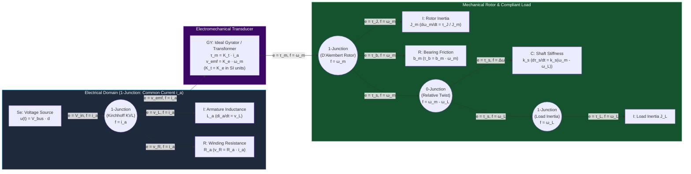

# Track 00: Mathematical, Signal & Physical Foundations

> **Prerequisite for:** All subsequent tracks ([Track 01](../01-electronics-and-power/README.md) through [Track 08](../08-capstone-projects/README.md))  
> **Core Principle:** Every physical transducer, power converter, mechanical linkage, and feedback controller is governed by the same underlying mathematical structures: conservation of energy across generalized power ports, differential equations on manifolds, and discrete-time sampling theory.

---

## 1. Module Overview & System Context

Engineers who treat mechanics, electronics, and software as separate languages fail at their interfaces. When a DC motor drives a compliant harmonic gear train, the mechanical torsional resonance reflects directly back into the electrical armature circuit as a complex impedance zero/pole pair. Similarly, sampling a continuous sensor without understanding continuous-to-discrete spectral folding ($s \mapsto z$) guarantees aliasing that no digital filter can undo.

This foundational module establishes the four pillars required before touching hardware:
1. **Linear Algebra, Matrix Calculus & Lie Groups ($SO(3), SE(3)$)** for spatial kinematics and optimization.
2. **Differential Equations, Laplace & $Z$-Transforms** for continuous/discrete system dynamics.
3. **Energy-Based Multi-Domain Modeling (Bond Graphs & Port-Hamiltonian Systems)** to unify electrical, mechanical, fluid, and thermal domains.
4. **Probability, Stochastic Processes & Spectral Estimation** for sensor noise, system identification, and Kalman filtering.

---

## 2. Unified Multi-Domain Energy Architecture

### 2.1 Generalized Effort, Flow, Momentum & Displacement

All physical domains share a dual pair of power variables whose product equals instantaneous power $P(t) = e(t) \cdot f(t)$:

| Physical Domain | Effort $e(t)$ | Flow $f(t)$ | Generalized Momentum $p(t) = \int e\,dt$ | Generalized Displacement $q(t) = \int f\,dt$ | Capacitive Storage ($C$) | Inertive Storage ($I$) | Resistive Dissipation ($R$) |
| :--- | :--- | :--- | :--- | :--- | :--- | :--- | :--- |
| **Translational Mechanics** | Force $F$ [N] | Velocity $v$ [m/s] | Linear Momentum $p$ [N·s] | Position $x$ [m] | Compliance $1/k$ [m/N] | Mass $m$ [kg] | Viscous Damper $b$ [N·s/m] |
| **Rotational Mechanics** | Torque $\tau$ [N·m] | Angular Velocity $\omega$ [rad/s] | Angular Momentum $L$ [N·m·s] | Angle $\theta$ [rad] | Torsional Compliance $1/k_\theta$ | Rotational Inertia $J$ [kg·m²] | Rotational Damper $b_\theta$ |
| **Electrical Circuits** | Voltage $v$ [V] | Current $i$ [A] | Flux Linkage $\lambda$ [Wb] | Charge $q$ [C] | Capacitance $C$ [F] | Inductance $L$ [H] | Resistance $R$ [$\Omega$] |
| **Hydraulic / Pneumatic** | Pressure $P$ [Pa] | Volumetric Flow $Q$ [m³/s] | Pressure Momentum $\Gamma$ [Pa·s] | Volume $V$ [m³] | Fluid Compressibility $C_f$ | Fluid Inertance $I_f$ | Orifice Resistance $R_f$ |
| **Thermal (Pseudo-Bond)** | Temperature $T$ [K] | Heat Flow $\dot{Q}$ [W] or Entropy Flow $\dot{S}$ | — | Thermal Energy $Q$ [J] | Thermal Capacity $C_{th}$ [J/K] | *None (Diffusion only)* | Thermal Resistance $R_{th}$ [K/W] |

### 2.2 Bond Graph & Port-Hamiltonian Coupling Diagram

---

## 3. Core Mathematical Foundations

### 3.1 Applied Linear Algebra, SVD & Matrix Calculus
* **Singular Value Decomposition (SVD):** Every matrix $A \in \mathbb{R}^{m \times n}$ factors as $A = U \Sigma V^\top$. In mechatronics, SVD governs:
  * **Manipulator Jacobian Conditioning:** The ratio $\kappa(J) = \sigma_{\max}(J)/\sigma_{\min}(J)$ measures proximity to kinematic singularities and bounds force-to-torque amplification.
  * **Observability & Controllability Gramians:** Small singular values of the observability matrix $\mathcal{O}$ indicate weakly observable state directions in Kalman filters.
  * **Total Least Squares & Damped Least Squares (Levenberg-Marquardt):** Regularized inverse $J^\dagger_\lambda = J^\top (J J^\top + \lambda^2 I)^{-1}$, mapping singular values $\sigma_i \mapsto \frac{\sigma_i}{\sigma_i^2 + \lambda^2}$.
* **Symmetric Positive-Definite (SPD) Matrices & Cholesky Factorization:** Mass matrices $M(q) \succ 0$, covariance matrices $P \succ 0$, and quadratic cost matrices $Q \succeq 0, R \succ 0$ must be factored via Cholesky ($P = L L^\top$) or Joseph-form updates in embedded code to prevent numerical loss of positive definiteness.
* **Matrix Calculus Identities for Optimization & Jacobians:**

$$
\frac{\partial}{\partial x}\left(\frac{1}{2} x^\top Q x + c^\top x\right) = Q x + c \quad (\text{for } Q = Q^\top)
$$

$$
\frac{d}{dt}\left(R(t)\right) = \hat{\omega}(t) R(t) \quad \text{where } \hat{\omega} = [\omega]_\times \in \mathfrak{so}(3)
$$

### 3.2 Lie Groups $SO(3)$ and $SE(3)$ for 3D Rigid-Body Motion
Euler angles ($\phi, \theta, \psi$) suffer from gimbal lock at $\theta = \pm \pi/2$ and lack a global metric structure. Production robotics and strapdown navigation operate directly on matrix Lie groups:

1. **The Rotation Group $SO(3)$ and Lie Algebra $\mathfrak{so}(3)$:**

$$
SO(3) = \{ R \in \mathbb{R}^{3\times 3} \mid R^\top R = I,\ \det(R) = +1 \}, \quad \mathfrak{so}(3) = \{ [\omega]_\times \in \mathbb{R}^{3\times 3} \mid [\omega]_\times^\top = -[\omega]_\times \}
$$

   where the hat operator $[\cdot]_\times : \mathbb{R}^3 \to \mathfrak{so}(3)$ maps $\omega = [\omega_x, \omega_y, \omega_z]^\top$ to the skew-symmetric cross-product matrix:

$$
[\omega]_\times = \begin{bmatrix} 0 & -\omega_z & \omega_z \\ \omega_z & 0 & -\omega_x \\ -\omega_y & \omega_x & 0 \end{bmatrix} \quad \text{(corrected: } [\omega]_\times = \begin{bmatrix} 0 & -\omega_z & \omega_y \\ \omega_z & 0 & -\omega_x \\ -\omega_y & \omega_x & 0 \end{bmatrix}\text{)}
$$

2. **Exponential Map (Rodrigues' Formula) & Logarithmic Map:**
   For rotation vector $\phi = \theta u \in \mathbb{R}^3$ ($\|u\|_2 = 1$, $\theta = \|\phi\|_2$):

$$
\exp([\phi]_\times) = I + \frac{\sin\theta}{\theta}[\phi]_\times + \frac{1 - \cos\theta}{\theta^2}[\phi]_\times^2 \in SO(3)
$$

   *Implementation Rule:* For $\theta < 10^{-4}\text{ rad}$, use the Taylor expansion $\frac{\sin\theta}{\theta} \approx 1 - \frac{\theta^2}{6} + \frac{\theta^4}{120}$ and $\frac{1-\cos\theta}{\theta^2} \approx \frac{1}{2} - \frac{\theta^2}{24} + \frac{\theta^4}{720}$ to prevent $0/0$ floating-point `NaN`.
3. **Unit Quaternions $\mathbb{S}^3$ (Hamilton Convention $q = [q_w, q_x, q_y, q_z]^\top$):**
   Double cover of $SO(3)$ ($q$ and $-q$ represent the same rotation). Kinematic propagation under body angular velocity $\omega_b$:

$$
\dot{q} = \frac{1}{2} q \otimes \begin{bmatrix} 0 \\ \omega_b \end{bmatrix}, \quad q_{k+1} = q_k \otimes \exp_q\left(\frac{1}{2}\omega_b \Delta t\right)
$$

4. **The Special Euclidean Group $SE(3)$ and Lie Algebra $\mathfrak{se}(3)$:**

$$
T = \begin{bmatrix} R & p \\ 0_{1\times 3} & 1 \end{bmatrix} \in SE(3), \quad [\mathcal{V}]_\wedge = \begin{bmatrix} [\omega]_\times & v \\ 0_{1\times 3} & 0 \end{bmatrix} \in \mathfrak{se}(3)
$$

   where $\mathcal{V} = [\omega^\top, v^\top]^\top \in \mathbb{R}^6$ is a spatial twist, and the Adjoint map $\text{Ad}_T \in \mathbb{R}^{6\times 6}$ transforms twists and wrenches ($\mathcal{F} = [\tau^\top, f^\top]^\top$, via $\text{Ad}_T^\top$) between coordinate frames:

$$
\text{Ad}_T = \begin{bmatrix} R & 0_{3\times 3} \\ [p]_\times R & R \end{bmatrix}
$$

### 3.3 Continuous-to-Discrete Systems & Sampling Theory
A continuous LTI state-space model $\dot{x}(t) = A_c x(t) + B_c u(t)$ sampled under a Zero-Order Hold (ZOH) with period $T_s$ yields the exact discrete-time system $x_{k+1} = A_d x_k + B_d u_k$:

$$
A_d = e^{A_c T_s}, \quad B_d = \left(\int_0^{T_s} e^{A_c \tau}\,d\tau\right) B_c
$$

Computed simultaneously in one matrix exponential via Van Loan's block matrix method:

$$
\exp\left(\begin{bmatrix} A_c & B_c \\ 0 & 0 \end{bmatrix} T_s\right) = \begin{bmatrix} A_d & B_d \\ 0 & I \end{bmatrix}
$$

#### Continuous-to-Discrete Filter & Controller Discretization Comparison

| Discretization Method | Mapping $s \leftarrow f(z)$ | Stability Preservation | Frequency Warping / Phase Accuracy | Primary Mechatronics Use Case |
| :--- | :--- | :--- | :--- | :--- |
| **Forward Euler** | $s \leftarrow \frac{z - 1}{T_s}$ | Unstable for lightly damped poles unless $T_s \ll 1/\lvert\lambda_{\max}\rvert$ | Adds phase lead; expands unit circle | Simple low-bandwidth integrators; quick explicit ODE steps |
| **Backward Euler** | $s \leftarrow \frac{z - 1}{z T_s}$ | Unconditionally stable (maps LHP inside unit disk) | Adds artificial numerical damping | Stiff mechanical contact simulation; derivative term smoothing |
| **Tustin (Bilinear)** | $s \leftarrow \frac{2}{T_s}\frac{z - 1}{z + 1}$ | Exact LHP $\leftrightarrow$ Unit Disk bijection | Compresses $\omega \in [0,\infty) \to [0, \pi/T_s)$ | General digital PI/lead-lag compensators |
| **Tustin with Pre-Warping** | $s \leftarrow \frac{\omega_0}{\tan(\omega_0 T_s / 2)}\frac{z - 1}{z + 1}$ | Exact LHP $\leftrightarrow$ Unit Disk bijection | Exact gain & phase match at critical frequency $\omega_0$ | Structural notch filters and resonant current controllers |
| **Zero-Order Hold (ZOH)** | Exact step-invariant match | Preserves pole locations ($z_i = e^{s_i T_s}$) | Introduces effective $T_s/2$ delay ($\Delta \phi = -\omega T_s / 2$) | Plant discretization for DAC/PWM-driven actuators |

### 3.4 Probability, Stochastic Processes & Noise Characterization
* **Continuous vs. Discrete White Noise:** If continuous process noise $w(t)$ has power spectral density $Q_c$ ($\mathbb{E}[w(t)w(\tau)^\top] = Q_c \delta(t-\tau)$), its discrete covariance over step $T_s$ is:

$$
Q_d = \int_0^{T_s} e^{A_c \tau} Q_c e^{A_c^\top \tau}\,d\tau \approx Q_c T_s \quad (\text{first-order approximation for small } T_s)
$$

  *Critical Pitfall:* Note the scaling with $\sqrt{T_s}$ in standard deviation! A sensor datasheet specifying noise density $n_d$ in $\frac{\text{units}}{\sqrt{\text{Hz}}}$ sampled with front-end bandwidth $f_{BW}$ produces discrete sample variance $\sigma_d^2 = n_d^2 \cdot f_{BW}$ (or $n_d^2 / (2 T_s)$ for Nyquist-limited sampling).
* **Power Spectral Density (PSD) & Welch's Method:** Non-parametric estimation of $S_{xx}(f)$ and cross-spectrum $S_{yu}(f)$ using overlapping Hann-windowed FFT segments to compute empirical frequency response functions $\hat{G}(j\omega) = \frac{\hat{S}_{yu}(j\omega)}{\hat{S}_{uu}(j\omega)}$ and coherence $\gamma^2(\omega) = \frac{|\hat{S}_{yu}(j\omega)|^2}{\hat{S}_{uu}(j\omega)\hat{S}_{yy}(j\omega)} \in [0, 1]$.

---

## 4. Reference Implementation: Coupled Electromechanical State-Space Derivation

Consider the compliant motor-load bond graph from §2.2. Select the four energy-storage state variables:
* $x_1 = i_a$ (armature current in inductor $L_a$)
* $x_2 = \omega_m$ (motor rotor angular velocity in inertia $J_m$)
* $x_3 = \theta_m - \theta_L$ (torsional twist across compliant shaft $k_s$)
* $x_4 = \omega_L$ (load angular velocity in inertia $J_L$)

With control input $u = V_{in}$ and external load disturbance torque $d = \tau_{ext}$, the state-space equations $\dot{x} = A_c x + B_c u + E_c d$ are directly read from the bond graph junctions:

$$
\frac{d}{dt}\begin{bmatrix} i_a \\ \omega_m \\ \theta_m - \theta_L \\ \omega_L \end{bmatrix} = \begin{bmatrix} -\frac{R_a}{L_a} & -\frac{K_e}{L_a} & 0 & 0 \\ \frac{K_t}{J_m} & -\frac{b_m}{J_m} & -\frac{k_s}{J_m} & -\frac{b_s}{J_m} \\ 0 & 1 & 0 & -1 \\ 0 & \frac{b_s}{J_L} & \frac{k_s}{J_L} & -\frac{b_L + b_s}{J_L} \end{bmatrix} \begin{bmatrix} i_a \\ \omega_m \\ \theta_m - \theta_L \\ \omega_L \end{bmatrix} + \begin{bmatrix} \frac{1}{L_a} \\ 0 \\ 0 \\ 0 \end{bmatrix} V_{in} + \begin{bmatrix} 0 \\ 0 \\ 0 \\ -\frac{1}{J_L} \end{bmatrix} \tau_{ext}
$$

From the mechanical subsystem alone (neglecting internal shaft damping $b_s \to 0$ and bearing friction $b_m, b_L \to 0$), the transfer function from electromagnetic torque $\tau_m = K_t i_a$ to **collocated motor velocity** $\omega_m(s)$ vs. **non-collocated load velocity** $\omega_L(s)$ reveals the classic two-mass resonance phenomenon:

$$
\frac{\omega_m(s)}{\tau_m(s)} = \frac{1}{(J_m + J_L)s} \cdot \frac{s^2 + \omega_{ar}^2}{s^2 + \omega_r^2}, \qquad \frac{\omega_L(s)}{\tau_m(s)} = \frac{1}{(J_m + J_L)s} \cdot \frac{\omega_{ar}^2}{s^2 + \omega_r^2}
$$

where:
* **Anti-Resonance Frequency (Collocated Zero):** $\omega_{ar} = \sqrt{\frac{k_s}{J_L}}$
* **Resonance Frequency (System Pole):** $\omega_r = \sqrt{k_s \left(\frac{1}{J_m} + \frac{1}{J_L}\right)} = \omega_{ar}\sqrt{1 + \frac{J_L}{J_m}}$

> **Design Insight:** A collocated encoder on the motor shaft sees an alternating pole-zero pattern ($\omega_{ar} < \omega_r$), keeping phase between $-90^\circ$ and $+90^\circ$ (passive/phase-stabilizable). A non-collocated encoder on the load side sees only the complex pole pair at $\omega_r$ without the stabilizing zero, introducing an immediate $-180^\circ$ phase cliff that severely limits closed-loop bandwidth!

---

## 5. Failure Modes, Pitfalls & Anti-Patterns

1. **Euler-Angle Singularity & Unwrapping Bugs:** Wrapping raw encoder or IMU heading angles to $[-\pi, \pi)$ inside a PID error calculation (`err = ref - meas`) causes a violent $2\pi$ torque spike when crossing the $\pm\pi$ boundary. Always compute angular error on $SO(2)$ via `atan2(sin(ref - meas), cos(ref - meas))` or on $SO(3)$ via $\log(R_{meas}^\top R_{ref})^\vee$.
2. **Inconsistent SI Units in Electromechanical Constants:** Motor vendors frequently specify torque constant $K_t$ in $\text{N}\cdot\text{m / A}_{\text{rms}}$ and back-EMF constant $K_v$ in $\text{RPM / V}_{\text{line-to-line, peak}}$. In consistent SI units ($\text{N}\cdot\text{m/A}$ and $\text{V/(rad/s)}$ in the same reference frame), power conservation ($P_{elec} = P_{mech} \implies e^\top i = \tau \omega$) mandates $K_t \equiv K_e$. Failing to convert line-to-neutral vs. line-to-line and RMS vs. peak introduces factors of $\sqrt{3}$ or $\sqrt{3/2}$ errors in torque estimation.
3. **Discretizing Resonant Notch Filters Without Pre-Warping:** Applying standard Tustin transform to a narrow continuous notch filter centered at $\omega_0 = 2\pi \cdot 850\text{ Hz}$ when sampling at $f_s = 4\text{ kHz}$ shifts the digital notch frequency to $\frac{2}{T_s}\arctan\left(\frac{\omega_0 T_s}{2}\right) \approx 2\pi \cdot 762\text{ Hz}$—completely missing the structural resonance!
4. **Catastrophic Cancellation in Single-Precision (`float32`) IIR Filters:** High-$Q$ biquad filters or integrators running at $f_s = 20\text{ kHz}$ with cutoff $f_c = 1\text{ Hz}$ place poles at $z = e^{-2\pi f_c / f_s} \approx 0.9996858$. In Direct Form I/II using IEEE-754 `float32` (24-bit mantissa), coefficient quantization shifts the pole onto or outside the unit circle. Use Transposed Direct Form II, state-space form, or `float64`/32-bit fixed-point accumulator registers for low-frequency poles at high sample rates.

---

## 6. Curated Learning Resources

### Authoritative Textbooks
* **Karnopp, D. C., Margolis, D. L., & Rosenberg, R. C.** — *System Dynamics: Modeling, Simulation, and Control of Mechatronic Systems* (6th ed., Wiley, 2012). The definitive reference on Bond Graph modeling across mechanical, electrical, hydraulic, and thermal domains.
* **Strang, G.** — *Linear Algebra and Learning from Data* (Wellesley-Cambridge Press, 2019) & **Trefethen, L. N., & Bau, D.** — *Numerical Linear Algebra* (SIAM, 1997). Essential for SVD, conditioning, QR, and Cholesky numerical stability.
* **Sola, J., Deray, J., & Atchuthan, D.** — *"A micro Lie theory for state estimation in robotics"* (`arXiv:1812.01537`, 2018). The clearest, most actionable reference on $SO(3)$, $SE(3)$, exponential/logarithmic maps, and right/left Jacobians on manifolds.
* **Oppenheim, A. V., & Schafer, R. W.** — *Discrete-Time Signal Processing* (3rd ed., Pearson, 2009). Sampling theorem, $Z$-transform, FIR/IIR filter structures, fixed-point quantization effects, and spectral estimation.
* **Åström, K. J., & Wittenmark, B.** — *Computer-Controlled Systems: Theory and Design* (3rd ed., Dover, 2011). Discretization of continuous systems, ZOH, aliasing, and sampled-data stochastic systems.

### Open-Source Software & Libraries
* **Eigen (`C++`)** — Header-only linear algebra and `Eigen::Geometry` (`Quaterniond`, `AngleAxisd`, `Isometry3d`).
* **Sophus (`C++` / Python)** — Lie groups (`SO2`, `SE2`, `SO3`, `SE3`) built atop Eigen with automatic differentiation support.
* **Python Control Systems Library (`control`) & SciPy (`scipy.signal`)** — Continuous/discrete state-space (`c2d`), Bode/Nyquist, Welch PSD (`scipy.signal.welch`), and filter design (`scipy.signal.iirnotch`, `bilinear`).
* **OpenModelica / Modia.jl** — Acausal equation-based multi-domain physical modeling.

---

## 7. Hands-On Lab & Milestone Gate

### Lab 00: Multi-Domain Voice-Coil / Two-Mass Actuator Simulation & Spectral Identification

1. **Objective:** Model, discretize, and identify a coupled electromechanical two-mass resonant actuator in Python/C++ before building hardware.
2. **Tasks:**
   * Implement the 4-state coupled electromechanical model ($i_a, \omega_m, \Delta\theta, \omega_L$) using physical parameters: $R_a = 0.8\ \Omega$, $L_a = 1.2\text{ mH}$, $K_t = 0.12\text{ N}\cdot\text{m/A}$, $J_m = 4.5\times 10^{-5}\text{ kg}\cdot\text{m}^2$, $J_L = 1.8\times 10^{-4}\text{ kg}\cdot\text{m}^2$, $k_s = 120\text{ N}\cdot\text{m/rad}$, $b_s = 0.008\text{ N}\cdot\text{m}\cdot\text{s/rad}$.
   * Compute exact ZOH discretization at $f_s = 10\text{ kHz}$ via matrix exponential.
   * Inject a band-limited multisine or Schroeder-phased chirp voltage input plus realistic ADC current quantization noise ($12\text{-bit}$ over $\pm 20\text{ A}$) and encoder quantization ($14\text{-bit}$ per revolution).
   * Estimate the empirical transfer function $\hat{G}_{\omega_m / V}(j\omega)$ and coherence $\gamma^2(\omega)$ using Welch's method, and design a pre-warped Tustin biquad notch filter in `float32` that suppresses the structural resonance peak by $\ge 20\text{ dB}$.
3. **Quantitative Acceptance Criteria:**

| Metric | Target Requirement | Verification Method |
| :--- | :--- | :--- |
| **Energy Conservation Check** | $\left\lvert\int_0^T V_{in} i_a\,dt - \left(\Delta E_{stored} + \int_0^T P_{dissipated}\,dt\right)\right\rvert < 10^{-9}\text{ J}$ | Continuous RK45 energy balance audit |
| **Analytical vs. Identified Resonance** | $\lvert\hat{\omega}_{ar} - \omega_{ar}\rvert / \omega_{ar} < 0.5\%$ and $\lvert\hat{\omega}_r - \omega_r\rvert / \omega_r < 0.5\%$ | Welch FRF peak/trough extraction with $\gamma^2(\omega) > 0.98$ |
| **Notch Filter Suppression** | Resonant peak attenuated by $\ge 20\text{ dB}$ in `float32` Transposed Direct Form II | Closed-loop step response & Bode magnitude verification |
| **$SO(3)$ Singularity Immunity** | $\exp([\phi]_\times)$ and $\log(R)$ round-trip error $< 10^{-14}\text{ rad}$ across $\theta \in [0, \pi]$ including $\theta = 10^{-8}$ and $\theta = \pi - 10^{-7}$ | Unit test suite across 10,000 random & edge-case axes |
