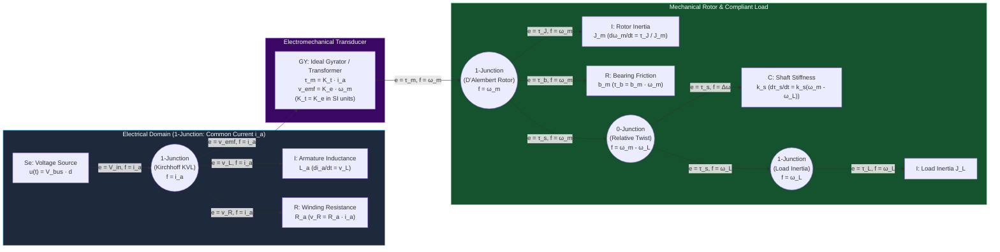

# Track 00: Foundations, Bench Intuition & Multi-Domain Mathematics

> **Part of the [MechaLab Multi-Pass Tiered Roadmap](../README.md)**  
> **Prerequisite for:** All subsequent tracks ([Track 01](../01-electronics-and-power/README.md) through [Track 08](../08-capstone-projects/README.md))  
> **Core Principle:** Every physical transducer, power converter, mechanical linkage, and feedback controller is governed by the same underlying structures: conservation of energy across generalized power ports, differential equations, and discrete-time sampling theory.

---

## 🔄 Linear Level-Up Navigation (Follow Your Current Pass Across Track 00 → Track 08)

**⚠️ Tier-First Learning Rule (Do NOT Complete Track 00 All at Once!):**
`00-foundations` is **interleaved by Tier** across your learning journey—it is **not** a standalone prerequisite course that you finish from Tier 1 to Tier 3 before touching hardware! Instead:
- **In Tier 1:** Complete the **Tier 1 Foundations Bridge Ladder** ([`T1.00a`](../modules/00-foundations.T1.00a.md)–[`T1.00e`](../modules/00-foundations.T1.00e.md)) and **§1 Tier 1 Foundations (`00-foundations.T1.01`)**, then **immediately move horizontally to [Track 01 · Tier 1](../01-electronics-and-power/README.md#tier-1-beginner--intuitive)** through **Track 08 · Tier 1 Boss**.
- **In Tier 2:** Only after finishing the Tier 1 Boss (`07-systems.T1.08`), return here for the **Tier 2 Foundations Bridge Ladder** ([`T2.00a`](../modules/00-foundations.T2.00a.md)–[`T2.00f`](../modules/00-foundations.T2.00f.md)) and **§2 Tier 2 Foundations (`00-foundations.T2.01`)**, then **move horizontally to [Track 01 · Tier 2](../01-electronics-and-power/README.md#tier-2-intermediate--applied)** through **Track 08 · Tier 2 Boss**.
- **In Tier 3:** Only after finishing the Tier 2 Boss (`07-systems.T2.08`), return here for the **Tier 3 Foundations Bridge** ([`T3.00a`](../modules/00-foundations.T3.00a.md)) and **§4 Tier 3 Foundations (`00-foundations.T3.01`)**, then **move horizontally to [Track 01 · Tier 3](../01-electronics-and-power/README.md#tier-3-advanced--production)** through **Track 08 · Tier 3 Capstones I–V**.

| Pass / Level | Current Track 00 Section | Next Linear Step in This Pass |
| :--- | :--- | :--- |
| **🛠️ Stage 0: Level 0 On-Ramp** | [§0 Global Level 0 Prerequisite Track (No Prior EE)](#level-0-global-prerequisite-on-ramp-intuition--bench-tools) | [Proceed to Track 00 · Tier 1 ↓](#tier-1-beginner--intuitive) |
| **🟢 Pass 1: Tier 1 (Beginner)** | [§1 Tier 1: Calculus as `while` Loops, 2D Rotations & RC Smoothing](#tier-1-beginner--intuitive) | [**Next in Pass 1 → Track 01 (Tier 1: Breadboard H-Bridges)**](../01-electronics-and-power/README.md#tier-1-beginner--intuitive) |
| **🔵 Pass 2: Tier 2 (Applied)** | [§2 Tier 2: State-Space Matrices, Quaternions & Tustin Biquads](#tier-2-intermediate--applied) | [**Next in Pass 2 → Track 01 (Tier 2: 4-Layer KiCad & Kelvin Shunts)**](../01-electronics-and-power/README.md#tier-2-intermediate--applied) |
| **🌉 Bridge Concept** | [§3 Bridging the Gap: Moving Average → Pre-Warped TDF-II Biquad](#bridging-the-gap-maker-to-custom) | [Inspect Tier 3 Production Mastery ↓](#tier-3-advanced--production) |
| **🟣 Pass 3: Tier 3 (Production)** | [§4 Tier 3: Bond Graphs, Lie Groups SO(3)/SE(3) & Van Loan ZOH](#tier-3-advanced--production) | [**Next in Pass 3 → Track 01 (Tier 3: <2 nH Inverter & SAR Buckets)**](../01-electronics-and-power/README.md#tier-3-advanced--production) |

---

## Level 0: Global Prerequisite On-Ramp (Intuition & Bench Tools)

If you come from a strong computing/software background with no formal Electrical Engineering (EE) training, **start here** before touching SPICE, KiCad, or matrix calculus.

### [0.1 Everyday Analogies (Hydraulic, Mechanical & Software Mental Models)]
- **Core Summary:** Maps invisible electrical quantities—Voltage ($V$), Current ($I$), Resistance ($R$), Capacitance ($C$), Inductance ($L$), Frequency ($f$), and State Vectors ($x$)—to tangible water-pipe hydraulics and computer architecture concepts (like L1 RAM caches and program state structs).

| Concept | Physical / Hydraulic Analogy | Software / Computing Mental Model | Key Equation & Physical Meaning |
| :--- | :--- | :--- | :--- |
| **Voltage ($V$)** [Volts] | **Water Pressure Difference** between two points in a pipe | Potential energy difference (`delta`) relative to a chosen `0 V` reference (`GND`) | $V_{AB} = V_A - V_B$. Voltage *pushes* charge; voltage itself never "flows." |
| **Current ($I$)** [Amps] | **Flow Rate** (Liters/second) through a pipe cross-section | Throughput (packets/sec) passing through a channel | $I = \frac{dq}{dt}$. Current flows *through* components in a closed loop and returns to the source. |
| **Resistance ($R$)** $\Omega$ | **Narrow Pipe Constriction** dissipating pressure as heat | Rate-limiting throttle that converts energy into heat | $V = I R$, $P_{\text{heat}} = I^2 R$. Double the current $\implies 4\times$ the heat! |
| **Capacitance ($C$)** [Farads] | **Flexible Rubber Diaphragm** in a pipe (stores pressure) | Local L1 burst cache right next to a CPU core | $I = C\frac{dV}{dt}$. Resists sudden changes in **voltage**. Supplies instant nanosecond current bursts to ICs. |
| **Inductance ($L$)** [Henries] | **Heavy Paddlewheel / Flywheel** in a pipe (stores flow momentum) | In-flight pipeline momentum that refuses to stop instantaneously | $V = L\frac{dI}{dt}$. Resists sudden changes in **current**. Opening a switch on a spinning motor coil forces $\frac{dI}{dt} \to -\infty$, causing a high-voltage spark unless given a flyback path! |
| **Frequency ($f$) & Phase ($\phi$)** | **Pushing a Playground Swing** at its natural rhythm vs. out of sync | Polling/update rate vs. end-to-end pipeline latency ($\Delta\phi = -360^\circ f \Delta t_{\text{delay}}$) | Even $500\ \mu\text{s}$ of sensor/filter delay adds $-18^\circ$ of phase lag at $100\text{ Hz}$, eroding stability. |
| **State Vector ($x$)** | **Snapshot of all stored energy** (spring stretch + mass velocity + coil current) | Minimal `struct State` needed to resume a simulation from a checkpoint | If a component stores energy ($C$, $L$, mass $m$, inertia $J$, spring $k$), it adds 1 variable to $x$. |

- **Curated Free Resources:**
  - 🔗 [Falstad Interactive Circuit Simulator (falstad.com)](https://www.falstad.com/circuit/) — *Browser-based real-time circuit simulator that visualizes voltage as color and current as animated dots so you can build immediate physical intuition.*
  - 🔗 [The Evolution of Mechatronics Engineering: Industry 3.0, 4.0, 5.0 & Physical AI (Technologies 2026 — Open Access)](https://doi.org/10.3390/technologies14020081) & [The Mechatronics Handbook (R. H. Bishop — Free 1st-Ed. PDF)](http://www.sze.hu/~szenasy/Szenzorok%20%E9s%20aktu%E1torok/Szenzakt%20jegyzetek/Mechatronics_handbook%5B1%5D.pdf) — *Traces how mechatronics evolved from the 1969 Yaskawa coinage and V-Model co-design to Cyber-Physical Systems and Embodied AI.*
  - 🔗 [SparkFun: Voltage, Current, Resistance, and Ohm's Law](https://learn.sparkfun.com/tutorials/voltage-current-resistance-and-ohms-law) & [All About Circuits Vol. I: Direct Current (Open-Source Textbook)](https://www.allaboutcircuits.com/textbook/direct-current/) — *Illustrated water-tank analogies and passive circuit laws designed for software learners with zero prior hardware background.*
- **🧪 Hands-On Exercise:**
  - *Task:* Open the [Falstad Circuit Simulator](https://www.falstad.com/circuit/), wire a $12\text{ V}$ voltage source in series with a switch, a $1\text{ mH}$ inductor, and a $6\ \Omega$ resistor ($I = 2\text{ A}$ steady state), and open the switch abruptly with and without a parallel flyback diode. Compute the theoretical voltage spike $V_L = L\frac{\Delta I}{\Delta t}$ if $5\text{ A}$ through $1\text{ mH}$ turns off in $100\text{ ns}$ ($50,000\text{ V}$).
  - *📚 What to Learn & Resource Links for This Exercise:* Study SI prefixes ($\text{mH} = 10^{-3}\text{ H}, \text{ns} = 10^{-9}\text{ s}$) in [`00-foundations.T1.00c`](../modules/00-foundations.T1.00c.md), Ohm's law in [`01-electronics.T1.01a`](../modules/01-electronics.T1.01a.md), and inductive flyback $V_L = L\frac{dI}{dt}$ in [`01-electronics.T1.01d`](../modules/01-electronics.T1.01d.md), plus the [Falstad Circuit Simulator Inductors Guide](https://www.falstad.com/circuit/) and [All About Circuits Vol. I (Inductance)](https://www.allaboutcircuits.com/textbook/direct-current/).
- **🧠 Knowledge Check:**
  <details>
  <summary><b>Click to toggle quiz questions & answers</b></summary>
  
  **Q1:** Using the hydraulic/computing analogy, why must a $100\text{ nF}$ decoupling capacitor be placed within $1\text{–}2\text{ mm}$ of a microcontroller's `VCC` pin even when the main bench supply has a large $1,000\ \mu\text{F}$ capacitor $20\text{ cm}$ away?
  * **Answer / Explanation:** Long wires and PCB traces have stray inductance ($L$), which acts like heavy water momentum resisting sudden changes in flow ($V = L\frac{dI}{dt}$). When CPU logic gates switch in $1\text{ ns}$, the distant supply cannot deliver current across the inductive wire fast enough; the local $100\text{ nF}$ capacitor acts like an **L1 RAM cache**, supplying instant charge locally so `VCC` never droops.
  
  **Q2:** How many independent variables belong in the state vector $x$ of a DC motor (armature inductance $L_a$, rotor inertia $J_m$) driving a load ($J_L$) through a flexible shaft ($k_s$) if we care about shaft twist $\Delta\theta = \theta_m - \theta_L$?
  * **Answer & Explanation:** Four state variables: $x = [i_a, \omega_m, \theta_m - \theta_L, \omega_L]^\top$, corresponding to the four independent energy storage elements: magnetic energy $\frac{1}{2}L_a i_a^2$, rotor kinetic energy $\frac{1}{2}J_m \omega_m^2$, shaft elastic potential energy $\frac{1}{2}k_s(\theta_m - \theta_L)^2$, and load kinetic energy $\frac{1}{2}J_L \omega_L^2$.
  </details>

---

### [0.2 Practical Bench Tools (Hands-On Before SPICE or KiCad)]
- **Core Summary:** Introduces the essential physical debugging instruments—solderless breadboards, Digital Multimeter (DMM) continuity checks, Constant-Current/Constant-Voltage (CC/CV) bench power supplies as a hardware `try/catch` block, and USB logic analyzers vs. oscilloscopes.

$$
V_{\text{load}} = V_{\text{supply}} - I_{\text{load}}R_{\text{breadboard}}, \qquad \tau_{RC} = R \cdot C
$$

- **Curated Free Resources:**
  - 🔗 [SparkFun: How to Use a Breadboard](https://learn.sparkfun.com/tutorials/how-to-use-a-breadboard) — *Shows cutaway photos of internal 5-pin spring clips and explains why breadboards fail at high current or high frequency.*
  - 🔗 [SparkFun: How to Use a Multimeter](https://learn.sparkfun.com/tutorials/how-to-use-a-multimeter) — *Covers the pre-power continuity beep test, measuring voltage in parallel, and avoiding blown current fuses.*
  - 🔗 [sigrok PulseView Open-Source Logic Analyzer Documentation](https://sigrok.org/wiki/PulseView) — Free software toolchain for decoding digital I2C, SPI, UART, and PWM waveforms with a \$15 USB logic analyzer.
- **🧪 Hands-On Exercise:**
  - *Task:* Wire a $1\text{ k}\Omega$ resistor and $100\text{ nF}$ capacitor as a low-pass filter on a breadboard. Perform a DMM continuity beep check between `VCC` and `GND`, power the circuit from a bench supply set to $5.0\text{ V}$ and a $0.05\text{ A}$ ($50\text{ mA}$) CC limit, and measure the $0\text{–}63.2\%$ rise time ($\tau = R C = 100\ \mu\text{s}$) on an oscilloscope.
  - *📚 What to Learn & Resource Links for This Exercise:* Study SI unit multiplication ($\text{k}\Omega \times \text{nF} = \mu\text{s}$) in [`00-foundations.T1.00c`](../modules/00-foundations.T1.00c.md), DMM continuity & CC/CV bench supply protection in [`01-electronics.T1.01c`](../modules/01-electronics.T1.01c.md), and RC time constants in [`01-electronics.T1.01d`](../modules/01-electronics.T1.01d.md), plus [SparkFun Multimeter Tutorial](https://learn.sparkfun.com/tutorials/how-to-use-a-multimeter).
- **🧠 Knowledge Check:**
  <details>
  <summary><b>Click to toggle quiz questions & answers</b></summary>
  
  **Q1:** Why is forgetting the red multimeter lead plugged into the `10A` current jack while probing across a $24\text{ V}$ battery rail one of the most dangerous beginner bench mistakes?
  * **Answer / Explanation:** The `10A` jack connects directly to `COM` through a near-zero-ohm ($\sim 0.01\ \Omega$) metal shunt bar. Touching the probes across a $24\text{ V}$ voltage source creates a dead short circuit ($I = 24\text{ V} / 0.01\ \Omega = 2,400\text{ A}$!), instantly blowing the multimeter's internal fuse or arcing the probe tips. Always keep the red lead in the high-impedance ($10\text{ M}\Omega$) `V/Ω` jack.
  
  **Q2:** When should you reach for an **Oscilloscope** versus a **USB Logic Analyzer** when debugging an embedded robot joint?
  * **Answer & Explanation:** Use a **Logic Analyzer** when you need to inspect multi-channel digital protocol timing and decode hundreds of `SPI`, `I2C`, `UART`, or `CAN` packets. Use an **Oscilloscope** when you need to see analog signal integrity: power-rail droop during motor startup, MOSFET drain-source voltage ringing, or ADC RC filter settling.
  </details>

---

### [0.3 Starter Hardware (`ESP32` / `Arduino` / `STM32 Nucleo`)]
- **Core Summary:** Connects software variables to the physical world using the three core microcontroller peripherals: digital GPIO with pull-up/pull-down resistors, $20\text{ kHz}$ hardware timer PWM driving a low-side N-MOSFET + flyback diode, and 12-bit ADC voltage dividers.

$$
V_{\text{avg}} = D \cdot V_{\text{bus}}, \qquad \text{ADC}_{\text{code}} = \left\lfloor 4095 \cdot \frac{V_{\text{in}}}{3.3\text{ V}} \right\rfloor
$$

- **Curated Free Resources:**
  - 🔗 [Paul McWhorter: Arduino & ESP32 for Beginners (YouTube Course)](https://www.youtube.com/@paulmcwhorter) & [Wokwi Online ESP32, STM32 & Arduino Simulator (wokwi.com)](https://wokwi.com/) — *Patient hands-on beginner video series paired with an interactive browser simulator for GPIO, PWM, and ADCs with zero hardware cost.*
  - 🔗 [STM32 Step-by-Step Official Beginner Wiki (wiki.st.com)](https://wiki.st.com/stm32mcu/wiki/STM32StepByStep:STM32_step_by_step_overview) — *Official hands-on tutorial series covering STM32 Nucleo pin configuration, hardware timers, PWM, and ADCs.*
  - 🔗 [SparkFun: Pull-Up Resistors Tutorial](https://learn.sparkfun.com/tutorials/pull-up-resistors) — *Explains why floating CMOS inputs toggle randomly from* $60\text{ Hz}$ *room hum and how to size pull-up resistors.*
- **🧪 Hands-On Exercise:**
  - *Task:* Wire a $10\text{ k}\Omega$ potentiometer across `3.3V` and `GND`, read its wiper with a 12-bit ADC pin ($0\text{–}4095$) on an `ESP32` or `STM32 Nucleo`, and map that value to a $20\text{ kHz}$ hardware PWM output driving an N-MOSFET (`AO3400` / `IRLZ44N`) + `1N5819` Schottky flyback diode to control a $12\text{ V}$ DC motor smoothly.
  - *📚 What to Learn & Resource Links for This Exercise:* Study linear scaling in [`00-foundations.T1.00d`](../modules/00-foundations.T1.00d.md), MOSFET low-side PWM switching in [`01-electronics.T1.01b`](../modules/01-electronics.T1.01b.md), and fixed-width C integer types in [`04-embedded.T1.04a`](../modules/04-embedded.T1.04a.md), plus the [Wokwi Online ESP32/STM32 Simulator](https://wokwi.com/) and [STM32 Step-by-Step PWM/ADC Wiki](https://wiki.st.com/stm32mcu/wiki/STM32StepByStep:STM32_step_by_step_overview).
- **🧠 Knowledge Check:**
  <details>
  <summary><b>Click to toggle quiz questions & answers</b></summary>
  
  **Q1:** Why does a digital input pin wired to a pushbutton without a pull-up or pull-down resistor randomly flip between `0` and `1` when you wave your hand near the wire?
  * **Answer / Explanation:** A CMOS input gate is a tiny insulated capacitor with megaohms/gigaohms of input impedance. When the button is open, the pin is completely unanchored ("floating") and acts as an antenna that capacitively couples to $50/60\text{ Hz}$ AC mains fields and static charge on your hand.
  
  **Q2:** Why do we choose $20\text{–}25\text{ kHz}$ for motor PWM instead of the default $490\text{ Hz}$ or $1\text{ kHz}$ used by `analogWrite()` on hobby boards?
  * **Answer & Explanation:** First, human hearing extends up to $\sim 20\text{ kHz}$, so switching at $1\text{ kHz}$ makes the motor laminations vibrate like a loudspeaker with a piercing audible whine. Second, a small low-inductance brushless motor has an electrical time constant $\tau_e = L/R \approx 100\text{–}500\ \mu\text{s}$; at $1\text{ kHz}$ ($1,000\ \mu\text{s}$ period), current spikes and decays completely on every cycle instead of staying smooth.
  </details>

---

## Tier 1 (Beginner / Intuitive)

> **Goal of Pass 1 (Track 00):** Translate continuous calculus and physics into familiar software loops (`x += v * dt`), 2D geometry, and a 1-line digital low-pass filter so you can immediately move to **Track 01 (Tier 1)** and spin motors.

### [1.1 Differential Equations as Discrete `while` Loops]
- **Core Summary:** Shows that any physical Ordinary Differential Equation (ODE) $\dot{x} = f(x, u)$ is simply a discrete software `while` loop updating a state struct by $\Delta t$, where updating velocity before position (Semi-Implicit / Symplectic Euler) preserves mechanical energy:

$$
m\ddot{x} + b\dot{x} + kx = F_{\text{cmd}}, \qquad a_k = \frac{F_{\text{cmd}} - b\,v_k - k\,x_k}{m}, \quad v_{k+1} = v_k + a_k \Delta t, \quad x_{k+1} = x_k + v_{k+1} \Delta t
$$

  ```python
  # 1-DOF Mass-Spring-Damper in 3 Lines of Code (m*x_ddot + b*x_dot + k*x = F_cmd)
  a = (F_cmd - b * v - k * x) / m   # Newton's 2nd Law: F_net / m
  v = v + a * dt                    # Semi-implicit (symplectic) Euler velocity step
  x = x + v * dt                    # Position update using NEW velocity
  ```
- **Curated Free Resources:**
  - 🔗 [myPhysicsLab Interactive Spring-Mass & ODE Simulations (myphysicslab.com)](https://www.myphysicslab.com/) — *Interactive browser physics simulations with complete open-source equations and time-stepping solvers.*
  - 🔗 [3Blue1Brown: Differential Equations Overview (3blue1brown.com)](https://www.3blue1brown.com/topics/differential-equations) — *Visualizes phase portraits, state vectors, and discrete time-stepping trajectories.*
- **🧪 Hands-On Exercise:**
  - *Task:* Write a 25-line Python script simulating an undamped spring-mass oscillator ($m=1\text{ kg}, k=100\text{ N/m}, b=0, \Delta t = 0.01\text{ s}$) for $1,000$ steps using **Explicit Euler** (`x_new = x + v_old * dt`) vs. **Semi-Implicit Euler** (`x_new = x + v_new * dt`), and plot total mechanical energy $E = \frac{1}{2}mv^2 + \frac{1}{2}kx^2$ for both. (Note: When running the Track 00 reference suite `python3 00-foundations/lab/lab00_two_mass_and_so3.py`, note that the script bundles tests for all three passes—Section 2 covers Tier 2 two-mass ODE energy conservation, Section 3 covers Tier 2 digital biquad notch filtering, and Section 1 covers Tier 3 $SO(3)$ 3D rotations—so in Pass 1 you only need to write the 25-line 1-DOF Euler script above!)
  - *📚 What to Learn & Resource Links for This Exercise:* Complete the Tier 1 Foundations Bridge Ladder [`00-foundations.T1.00a`](../modules/00-foundations.T1.00a.md) (*Python `while` Loops*), [`00-foundations.T1.00b`](../modules/00-foundations.T1.00b.md) (*NumPy & Matplotlib Plotting*), and [`00-foundations.T1.00e`](../modules/00-foundations.T1.00e.md) (Discrete Kinematics, $F=ma$ & Spring Energy), and review [myPhysicsLab Spring-Mass Energy Derivations](https://www.myphysicslab.com/springs/single-spring-en.html).
- **🧠 Knowledge Check:**
  <details>
  <summary><b>Click to toggle quiz questions & answers</b></summary>
  
  **Q1:** In your Python simulation above, why does Explicit Euler's total mechanical energy grow exponentially until the oscillation explodes, whereas Semi-Implicit Euler's energy stays bounded forever?
  * **Answer / Explanation:** Explicit Euler steps along the tangent line of the constant-energy ellipse in $(x, v)$ phase space, stepping slightly *outside* the ellipse on every tick with Jacobian determinant $\det(J) = 1 + \frac{k}{m}\Delta t^2 > 1$. Semi-Implicit Euler uses the updated velocity $v_{k+1}$ to step $x_{k+1}$, yielding $\det(J) \equiv 1$ (area-preserving / symplectic).
  
  **Q2:** If a spring-mass joint has mass $m = 0.5\text{ kg}$ and stiffness $k = 200\text{ N/m}$, what is its natural oscillation frequency in radians/sec ($\omega_n$) and in Hertz ($f_n$)?
  * **Answer & Explanation:** $\omega_n = \sqrt{\frac{k}{m}} = \sqrt{\frac{200}{0.5}} = 20\text{ rad/s}$, which corresponds to $f_n = \frac{\omega_n}{2\pi} = \frac{20}{6.2832} \approx 3.18\text{ Hz}$.
  </details>

---

### 1.2 2D Coordinate Frames & Rotation Matrices ($SO(2)$)
- **Core Summary:** Introduces 2D rigid transformations using orthogonal $2\times 2$ rotation matrices $R(\theta)$ where $R(\theta)^{-1} = R(\theta)^\top$, and enforces safe angular error wrapping across the $\pm 180^\circ$ ($\pm\pi$) boundary via `atan2(sin(err), cos(err))`.

$$
R(\theta) = \begin{bmatrix} \cos\theta & -\sin\theta \\ \sin\theta & \cos\theta \end{bmatrix}, \qquad e_\theta = \text{atan2}\big(\sin(\theta_{\text{ref}} - \theta_{\text{meas}}), \cos(\theta_{\text{ref}} - \theta_{\text{meas}})\big) \in (-\pi, \pi]
$$

- **Curated Free Resources:**
  - 🔗 [3Blue1Brown: Linear Transformations and Matrices (Essence of Linear Algebra)](https://www.3blue1brown.com/lessons/linear-transformations) — *Builds instant visual intuition for how the columns of* $R(\theta)$ *track where the basis vectors* $\hat{i}$ *and* $\hat{j}$ *land.*
  - 🔗 [Modern Robotics Ch. 3.1–3.2: Rigid-Body Motions in the Plane (Lynch & Park)](https://hades.mech.northwestern.edu/index.php/Modern_Robotics) — *Free textbook chapter and video introducing* $SO(2)$ *rotation matrices and homogeneous transforms.*
- **🧪 Hands-On Exercise:**
  - *Task:* Write a 10-line test comparing naive angle subtraction `err = ref - meas` against `err = math.atan2(math.sin(ref - meas), math.cos(ref - meas))` when `ref = +179°` ($+3.124\text{ rad}$) and the encoder crosses $180^\circ$ to `meas = -179°` ($-3.124\text{ rad}$).
  - *📚 What to Learn & Resource Links for This Exercise:* Study radians, unit-circle trigonometry, and four-quadrant `math.atan2(y, x)` in [`00-foundations.T1.00d`](../modules/00-foundations.T1.00d.md), plus [3Blue1Brown Linear Transformations](https://www.3blue1brown.com/lessons/linear-transformations) and [Lynch & Park *Modern Robotics* Ch. 3.1–3.2](https://hades.mech.northwestern.edu/index.php/Modern_Robotics).
- **🧠 Knowledge Check:**
  <details>
  <summary><b>Click to toggle quiz questions & answers</b></summary>
  
  **Q1:** In the scenario above (`ref = +179°`, `meas = -179°`), what angular error is produced by naive subtraction `ref - meas` versus `atan2(sin(ref - meas), cos(ref - meas))`, and what happens to a physical motor?
  * **Answer / Explanation:** Physically, the rotor is only $2^\circ$ away from the target (`-179°` is $2^\circ$ past `+179°`). Naive subtraction computes $+179^\circ - (-179^\circ) = +358^\circ$, commanding the motor to spin violent full speed the wrong way all the way around a $358^\circ$ circle! `atan2(sin(358°), cos(358°))` returns the shortest signed angular distance: $-2^\circ$.
  
  **Q2:** Why does the inverse of any valid rotation matrix $R$ equal its transpose $R^\top$ without needing `numpy.linalg.inv()`?
  * **Answer & Explanation:** The columns of $R$ are mutually perpendicular unit vectors (orthonormal basis), so their dot products satisfy $R^\top R = I \implies R^{-1} = R^\top$. Transposing a $2\times 2$ or $3\times 3$ matrix takes zero divisions and never suffers from matrix inversion singularities.
  </details>

---

### [1.3 Time vs. Frequency Intuition & First-Order RC Smoothing]
- **Core Summary:** Connects hardware RC low-pass filters ($\tau = RC, f_c = \frac{1}{2\pi RC}$) to the 1-line software Exponential Moving Average (`y_filt += alpha * (x_raw - y_filt)`), highlighting the fundamental trade-off between noise attenuation and phase lag inside a feedback loop.

$$
y_k = y_{k-1} + \alpha(u_k - y_{k-1}), \qquad \alpha = \frac{\Delta t}{\tau + \Delta t} = \frac{2\pi f_c \Delta t}{1 + 2\pi f_c \Delta t}
$$

- **Curated Free Resources:**
  - 🔗 [The Scientist and Engineer's Guide to DSP — Ch. 19: Recursive Filters (dspguide.com)](https://www.dspguide.com/ch19/2.htm) — *Free online chapter deriving single-pole recursive smoothing filters and time constants.*
  - 🔗 [Interactive Digital Low-Pass Filter Frequency & Phase Applet (Falstad)](https://www.falstad.com/afepsilon/) — *Explore how lowering cutoff frequency* $f_c$ *increases phase lag.*
- **🧪 Hands-On Exercise:**
  - *Task:* Open **Tab 2: Two-Mass & Notch Bode** in the MechaLab Workbench (or write a Python script) to inject a noisy $10\text{ Hz}$ sine wave + $200\text{ Hz}$ vibration into an exponential filter with $f_c = 15\text{ Hz}$, and measure the time delay (phase lag in degrees) between the clean $10\text{ Hz}$ input and filtered output.
  - *📚 What to Learn & Resource Links for This Exercise:* Study Python time-series arrays in [`00-foundations.T1.00b`](../modules/00-foundations.T1.00b.md), RC cutoff frequency $f_c = \frac{1}{2\pi RC}$ in [`01-electronics.T1.01d`](../modules/01-electronics.T1.01d.md), and [The Scientist and Engineer's Guide to DSP Ch. 19 (Recursive Filters)](https://www.dspguide.com/ch19/2.htm).
- **🧠 Knowledge Check:**
  <details>
  <summary><b>Click to toggle quiz questions & answers</b></summary>
  
  **Q1:** Exactly how many degrees of phase lag does a 1st-order RC low-pass filter introduce right at its $-3\text{ dB}$ cutoff frequency $f = f_c$?
  * **Answer / Explanation:** Since $H(jf_c) = \frac{1}{1 + j(f_c/f_c)} = \frac{1}{1 + j}$, the magnitude is $\frac{1}{\sqrt{2}} \approx 0.707$ ($-3.01\text{ dB}$) and the phase angle is $-\arctan(1) = -45^\circ$. If you place a low-pass filter with $f_c$ near your PID loop's crossover frequency, that $-45^\circ$ of phase lag will wipe out your phase margin and cause sustained oscillation!
  
  **Q2:** You sample an analog thermistor at $f_s = 100\text{ Hz}$ ($\Delta t = 0.01\text{ s}$) and want a smoothing cutoff frequency of $f_c = 1.59\text{ Hz}$ ($\tau = \frac{1}{2\pi f_c} = 0.10\text{ s}$). What value of $\alpha$ should you use in `y += alpha * (x - y)`?
  * **Answer & Explanation:** $\alpha = \frac{\Delta t}{\tau + \Delta t} = \frac{0.01}{0.10 + 0.01} = \frac{1}{11} \approx 0.0909$.
  </details>

### ✅ Tier 1 Milestone Gate (`Track 00 · Pass 1`)
* Complete the 3 exercises above (or verify the **Two-Mass Resonance** preset in **Tab 2** of the interactive workbench).
* **Next Linear Step in Pass 1:** [**Proceed to Track 01 (Tier 1: Breadboard H-Bridges, Logic Levels & Decoupling) →**](../01-electronics-and-power/README.md#tier-1-beginner--intuitive)

---

## Tier 2 (Intermediate / Applied)

> **Goal of Pass 2 (Track 00):** When you return to Track 00 after finishing your first Tier 1 robot, upgrade your ad-hoc scalar equations into **State-Space Matrices ($\dot{x} = Ax + Bu$)**, **Two-Mass Torsional Resonance**, **Unit Quaternions**, and **Pre-Warped Tustin Biquad Notch Filters**.

### 2.1 State-Space Modeling ($\dot{x} = A_c x + B_c u$) & Two-Mass Resonance
- **Core Summary:** Models a motor rotor ($J_m$) coupled to a load inertia ($J_L$) through a compliant shaft/gearbox ($k_s$) as a 4-state matrix system exhibiting an anti-resonance zero $\omega_{ar} = \sqrt{k_s/J_L}$ and a structural resonance pole $\omega_r = \sqrt{k_s(1/J_m + 1/J_L)}$.

$$
\omega_{ar} = \sqrt{\frac{k_s}{J_L}}, \qquad \omega_r = \omega_{ar}\sqrt{1 + \frac{J_L}{J_m}}
$$

- **Curated Free Resources:**
  - 🔗 [Control Bootcamp: State-Space Equations (Prof. Steve Brunton, YouTube)](https://www.youtube.com/playlist?list=PLMrJAkhIeNNR20Mz-VpzgfQs5zrYi085m) & [Data-Driven Science and Engineering (Brunton & Kutz, 2nd Ed. Free PDF — databookuw.com)](https://www.databookuw.com/) — *Clear walkthrough converting multi-DOF mechanical ODEs into* $\dot{x} = Ax + Bu$ *matrix form, plus SVD, DMD, and SINDy.*
  - 🔗 [Åström & Murray: Feedback Systems — Ch. 5 & 6: Linear Systems (fbswiki.org)](https://fbswiki.org/wiki/index.php/Main_Page) & [Control of Mechatronic Systems (P. O. J. Kaltjob)](https://www.wiley.com/en-us/Control+of+Mechatronic+Systems-p-9781119505792) — *Open-access textbook chapters on state-space matrices, eigenvalues, and discrete-time digital implementation.*
- **🧪 Hands-On Exercise:**
  - *Task:* Open **Tab 2: Two-Mass & Notch Bode** in the MechaLab Workbench, drag the Load-to-Motor Inertia Ratio $J_L / J_m$ and Shaft Stiffness $k_s$ sliders, and observe how the motor encoder Bode plot (Cyan) exhibits an anti-resonance dip at $f_{ar}$ followed by a resonance peak at $f_r$, whereas the load tip (Amber) has only the resonance peak.
  - *📚 What to Learn & Resource Links for This Exercise:* Complete the Tier 2 Foundations Bridge modules [`00-foundations.T2.00a`](../modules/00-foundations.T2.00a.md) (*State Update Matrices*), [`00-foundations.T2.00c`](../modules/00-foundations.T2.00c.md) (2nd-Order ODEs, $\omega_n$ & $\zeta$), [`00-foundations.T2.00d`](../modules/00-foundations.T2.00d.md) (*Phasors & Bode Plots*), and [`00-foundations.T2.00e`](../modules/00-foundations.T2.00e.md) (State-Space $\dot{x} = Ax + Bu$), plus [Steve Brunton's Control Bootcamp](https://www.youtube.com/playlist?list=PLMrJAkhIeNNR20Mz-VpzgfQs5zrYi085m).
- **🧠 Knowledge Check:**
  <details>
  <summary><b>Click to toggle quiz questions & answers</b></summary>
  
  **Q1:** Physically, what is happening inside the two-mass system at the **anti-resonance frequency** $\omega_{ar} = \sqrt{k_s / J_L}$ where the motor shaft velocity drops nearly to zero even though the motor is applying sinusoidal torque?
  * **Answer / Explanation:** At $\omega = \omega_{ar}$, the load inertia $J_L$ and compliant shaft $k_s$ act like a tuned dynamic vibration absorber oscillating $180^\circ$ out of phase with the motor torque—exerting an equal and opposite reaction torque through the shaft that holds the motor rotor almost stationary while the load oscillates!
  
  **Q2:** For a joint with motor inertia $J_m = 10^{-4}\text{ kg}\cdot\text{m}^2$, reflected load inertia $J_L = 3 \times 10^{-4}\text{ kg}\cdot\text{m}^2$, and torsional stiffness $k_s = 300\text{ N}\cdot\text{m/rad}$, what are $\omega_{ar}$ and $\omega_r$?
  * **Answer & Explanation:** $\omega_{ar} = \sqrt{\frac{300}{3 \times 10^{-4}}} = \sqrt{10^6} = 1,000\text{ rad/s}$ ($159.2\text{ Hz}$), and $\omega_r = 1,000\sqrt{1 + \frac{3}{1}} = 2,000\text{ rad/s}$ ($318.3\text{ Hz}$).
  </details>

---

### 2.2 3D Rotations Without Gimbal Lock: Unit Quaternions ($\mathbb{S}^3$)
- **Core Summary:** Replaces gimbal-locking 3D Euler angles with 4D unit quaternions $q = [q_w, q_x, q_y, q_z]^\top \in \mathbb{S}^3$ ($\|q\|\kern0pt_2 = 1$), enabling smooth 3D attitude integration and spherical interpolation (`SLERP`).

$$
q_{k+1} = \text{normalize}\!\left(q_k + \frac{\Delta t}{2}\,q_k \otimes \begin{bmatrix}0\\\omega_b\end{bmatrix}\right), \qquad q_{\text{err}} = q_{\text{des}}^{-1} \otimes q_{\text{meas}}
$$

- **Curated Free Resources:**
  - 🔗 [Visualizing Quaternions Interactive Sandbox (3Blue1Brown & Ben Eater — eater.net)](https://eater.net/quaternions) — *Interactive 3D browser visualization of quaternion hypersphere rotations.*
  - 🔗 [Joan Solà: Quaternion Kinematics for the Error-State Kalman Filter — §1–2](https://arxiv.org/abs/1711.02508) — Concise reference sheet for Hamilton quaternion product (⊗), rotation action $q \otimes v \otimes q^{*}$, and kinematic integration.
- **🧪 Hands-On Exercise:**
  - *Task:* Write a Python function `quat_multiply(q1, q2)` and verify that rotating the vector $v = [1, 0, 0]^\top$ by $90^\circ$ around the $Z$-axis ($q = [\cos 45^\circ, 0, 0, \sin 45^\circ]^\top$) via $q \otimes [0, v] \otimes q^*$ lands at $[0, 1, 0]^\top$ with zero gimbal lock at $\pm 90^\circ$ pitch.
  - *📚 What to Learn & Resource Links for This Exercise:* Study 3D vectors, dot/cross products, and basis transforms in [`00-foundations.T2.00b`](../modules/00-foundations.T2.00b.md), plus [3Blue1Brown & Ben Eater's Interactive Quaternion Visualizer (`eater.net/quaternions`)](https://eater.net/quaternions) and [Joan Solà's *Quaternion Kinematics for the ESKF* §1–2 (`arXiv:1711.02508`)](https://arxiv.org/abs/1711.02508).
- **🧠 Knowledge Check:**
  <details>
  <summary><b>Click to toggle quiz questions & answers</b></summary>
  
  **Q1:** Why do the two unit quaternions $+q$ and $-q$ represent the **exact same physical 3D orientation**, and what bug does this "double cover" cause in a naive attitude PD controller if you don't check the sign of $q_{\text{err},w}$?
  * **Answer / Explanation:** In the sandwich product $v' = q \otimes v \otimes q^*$, negating $q \to -q$ multiplies the expression by $(-1)(-1) = +1$, leaving $v'$ unchanged; however, $-q$ represents rotating the long way around by $360^\circ - \theta$. If $q_{\text{err},w} < 0$ and your controller uses $[q_x, q_y, q_z]$ without negating $q_{\text{err}}$, the robot will violently spin $359^\circ$ the wrong way instead of nudging $1^\circ$ (**the unwinding phenomenon**)!
  
  **Q2:** Why does a standard Roll-Pitch-Yaw ($Z\text{-}Y\text{-}X$) Euler angle representation lock up when the pitch angle $\theta = \pm 90^\circ$?
  * **Answer & Explanation:** When the middle gimbal (pitch) rotates by $90^\circ$, the outer yaw axis ($Z$) and inner roll axis ($X$) become physically parallel in 3D space—losing one degree of rotational freedom so infinite combinations of $\text{yaw} \pm \text{roll}$ describe the same orientation and the kinematic Jacobian becomes singular ($\det = \cos 90^\circ = 0$).
  </details>

---

### [2.3 Continuous-to-Discrete Filter Design: Pre-Warped Tustin Biquads]
- **Core Summary:** Designs surgical 2nd-order digital notch filters in **Transposed Direct Form II (`TDF-II`)** using the frequency-pre-warped bilinear (Tustin) transform so the digital zero lands precisely on the mechanical resonance frequency $\omega_n$.

$$
H_{\text{notch}}(s) = \frac{s^2 + \frac{\omega_n}{Q_{\text{zero}}}s + \omega_n^2}{s^2 + \frac{\omega_n}{Q_{\text{pole}}}s + \omega_n^2} \xrightarrow{s \leftarrow \frac{\omega_n}{\tan(\omega_n T_s/2)}\frac{z-1}{z+1}} H(z) = \frac{b_0 + b_1 z^{-1} + b_2 z^{-2}}{1 + a_1 z^{-1} + a_2 z^{-2}}
$$

- **Curated Free Resources:**
  - 🔗 [Julius O. Smith III: Introduction to Digital Filters — Biquad Sections & TDF-II (Stanford CCRMA)](https://ccrma.stanford.edu/~jos/filters/) — *Free online textbook detailing biquad filter structures and numerical precision in floating-point DSP.*
  - 🔗 [Robert Bristow-Johnson's Audio EQ & Biquad Cookbook (w3.org)](https://www.w3.org/TR/audio-eq-cookbook/) — *Closed-form coefficient formulas for digital notch, low-pass, and peaking biquads.*
- **🧪 Hands-On Exercise:**
  - *Task:* Use **Tab 2: Two-Mass & Notch Bode Simulator** to tune $f_{\text{notch}}$ and $Q_n$ on the **CNC Ballscrew** preset ($f_r = 290.6\text{ Hz}$), confirming that the resonant peak drops by $\ge 25\text{ dB}$ and the time-domain step response ringing disappears.
  - *📚 What to Learn & Resource Links for This Exercise:* Study Bode magnitude/phase in [`00-foundations.T2.00d`](../modules/00-foundations.T2.00d.md), Tustin discretization in [`00-foundations.T2.00e`](../modules/00-foundations.T2.00e.md), and frequency pre-warping $\omega_a = \frac{2}{T_s}\tan(\omega_n T_s/2)$ + biquad filters in [`00-foundations.T2.00f`](../modules/00-foundations.T2.00f.md), plus [Stanford CCRMA Digital Filters (`ccrma.stanford.edu/~jos/filters/`)](https://ccrma.stanford.edu/~jos/filters/).
- **🧠 Knowledge Check:**
  <details>
  <summary><b>Click to toggle quiz questions & answers</b></summary>
  
  **Q1:** For a notch filter with numerator $s^2 + \omega_n^2$ discretized via pre-warped Tustin at sample period $T_s$, why does the middle numerator coefficient satisfy $b_1 = -2 b_0 \cos(\omega_n T_s)$?
  * **Answer / Explanation:** Substituting the pre-warped scale $K = \frac{\omega_n}{\tan(\omega_n T_s/2)}$ into the numerator ratio $\frac{K^2 - \omega_n^2}{K^2 + \omega_n^2}$ and applying the trigonometric identity $\frac{1 - \tan^2(\theta/2)}{1 + \tan^2(\theta/2)} = \cos\theta$ places the complex conjugate zeros directly on the unit circle at $z = e^{\pm j\omega_n T_s}$, guaranteeing exact zero transmission at $\omega_n$!
  
  **Q2:** What must be true about the denominator poles of a discrete biquad filter $1 + a_1 z^{-1} + a_2 z^{-2}$ for the filter to be BIBO stable?
  * **Answer & Explanation:** Both roots of $z^2 + a_1 z + a_2 = 0$ must lie strictly **inside the unit circle** ($|z_p| < 1$), which is equivalent to the Jury stability triangle conditions: $|a_2| < 1$ and $|a_1| < 1 + a_2$.
  </details>

### ✅ Tier 2 Milestone Gate (`Track 00 · Pass 2`)
* Verify your pre-warped Tustin biquad notch tuning in **Tab 2** ($\ge 25\text{ dB}$ attenuation at $f_r$).
* **Next Linear Step in Pass 2:** [**Proceed to Track 01 (Tier 2: 4-Layer KiCad PCBs, Gate Drivers & Kelvin Shunts) →**](../01-electronics-and-power/README.md#tier-2-intermediate--applied)

---

## Bridging the Gap: Maker to Custom

### From an $N$-Sample Moving Average to a Pre-Warped `TDF-II` Biquad Notch
* **How Beginners Do It (Tier 1 Maker Approach):** When a motor vibrates or buzzes, beginners wrap the velocity/current measurement in a 16-sample moving average (`sum(last_16) / 16`) or heavy low-pass filter. At $1\text{ kHz}$, a 16-sample moving average injects $(16-1)/2 = 7.5\text{ ms}$ of pure group delay—destroying phase margin and causing violent low-frequency limit cycles!
* **How Production Engineers Do It (Tier 2/3 Custom Approach):**
  1. Identify the exact structural resonance frequency $f_r$ from an FFT / Bode sweep (e.g., $f_r = 259\text{ Hz}$).
  2. Compute exact discrete biquad coefficients using **Pre-Warped Tustin** substitution $s \leftarrow \frac{\omega_n}{\tan(\omega_n T_s / 2)}\frac{z-1}{z+1}$ so the digital notch lands exactly on $f_r$ instead of warping lower in frequency.
  3. Execute the filter in **Transposed Direct Form II (`TDF-II`)** using 2 state variables (`s1, s2`) in 5 floating-point multiply-accumulates per tick—surgically carving out the $259\text{ Hz}$ resonance while leaving phase below $50\text{ Hz}$ virtually untouched:

$$
H(z) = \frac{b_0 + b_1 z^{-1} + b_2 z^{-2}}{1 + a_1 z^{-1} + a_2 z^{-2}}, \qquad y_k = b_0 x_k + s_{1,k}, \quad s_{1,k+1} = b_1 x_k - a_1 y_k + s_{2,k}, \quad s_{2,k+1} = b_2 x_k - a_2 y_k
$$

  ```cpp
  float y = b0 * x + s1;
  s1 = b1 * x - a1 * y + s2;
  s2 = b2 * x - a2 * y;
  ```

---

## Tier 3 (Advanced / Production)

> **Goal of Pass 3 (Track 00):** Full mathematical mastery for production robotics and high-rate control: Bond Graph & Port-Hamiltonian energy modeling, SVD conditioning, Matrix Lie Groups $SO(3)/SE(3)$, Van Loan exact ZOH discretization, and stochastic Welch spectral estimation.
> * [**Next Linear Step in Pass 3 → Track 01 (Tier 3: 6-Layer <2 nH Inverter & SAR Charge Buckets)**](../01-electronics-and-power/README.md#tier-3-advanced--production)

### [4.1 Unified Multi-Domain Energy Architecture (Bond Graphs & Port-Hamiltonians)]
- **Core Summary:** Unifies electrical, mechanical, hydraulic, and thermal subsystems through generalized power conjugates $P(t) = e(t) \cdot f(t)$ and Port-Hamiltonian energy-balance equations $\dot{x} = (J(x) - R(x))\nabla\mathcal{H}(x) + g(x)u$ with skew-symmetric interconnection $J(x) = -J(x)^\top$ and dissipative $R(x) \succeq 0$.

| Physical Domain | Effort $e(t)$ | Flow $f(t)$ | Generalized Momentum $p(t) = \int e\,dt$ | Generalized Displacement $q(t) = \int f\,dt$ | Capacitive Storage ($C$) | Inertive Storage ($I$) | Resistive Dissipation ($R$) |
| :--- | :--- | :--- | :--- | :--- | :--- | :--- | :--- |
| **Translational Mechanics** | Force $F$ [N] | Velocity $v$ [m/s] | Linear Momentum $p$ [N·s] | Position $x$ [m] | Compliance $1/k$ [m/N] | Mass $m$ [kg] | Viscous Damper $b$ [N·s/m] |
| **Rotational Mechanics** | Torque $\tau$ [N·m] | Angular Velocity $\omega$ [rad/s] | Angular Momentum $L$ [N·m·s] | Angle $\theta$ [rad] | Torsional Compliance $1/k_\theta$ | Rotational Inertia $J$ [kg·m²] | Rotational Damper $b_\theta$ |
| **Electrical Circuits** | Voltage $v$ [V] | Current $i$ [A] | Flux Linkage $\lambda$ [Wb] | Charge $q$ [C] | Capacitance $C$ [F] | Inductance $L$ [H] | Resistance $R$ $\Omega$ |
| **Hydraulic / Pneumatic** | Pressure $P$ [Pa] | Volumetric Flow $Q$ [m³/s] | Pressure Momentum $\Gamma$ [Pa·s] | Volume $V$ [m³] | Fluid Compressibility $C_f$ | Fluid Inertance $I_f$ | Orifice Resistance $R_f$ |
| **Thermal (Pseudo-Bond)** | Temperature $T$ [K] | Heat Flow $\dot{Q}$ [W] or Entropy Flow $\dot{S}$ | — | Thermal Energy $Q$ [J] | Thermal Capacity $C_{th}$ [J/K] | *None (Diffusion only)* | Thermal Resistance $R_{th}$ [K/W] |



- **Curated Free Resources:**
  - 🔗 [Port-Hamiltonian Systems Theory: An Introductory Overview (van der Schaft & Jeltsema)](https://www.rug.nl/research/portal/files/14407027/PortHamiltonianSystems.pdf) & [OpenModelica Acausal Multi-Domain Modeling Environment (openmodelica.org)](https://openmodelica.org/) — *Comprehensive open-access monograph on passivity-based Port-Hamiltonian modeling paired with the open-source Modelica multi-domain simulator.*
  - 🔗 [Intelligence as Computation (Oliver Brock, arXiv:2412.14701)](https://arxiv.org/abs/2412.14701) & [MIT 2.14 / 2.003 System Dynamics & Bond Graph Lecture Notes (MIT OCW)](https://ocw.mit.edu/courses/2-003sc-engineering-dynamics-fall-2011/) — *Unifies digital, analog, mechanical, and morphological computation with multi-domain energy conservation.*
- **🧪 Hands-On Exercise:**
  - *Task:* Run `python3 00-foundations/lab/lab00_two_mass_and_so3.py` and verify the energy conservation audit: $\left|\int_0^T V_{\text{in}}i_a\,dt - (\Delta \mathcal{H}\kern0pt_{\text{stored}} + \int_0^T P_{\text{dissipated}}\,dt)\right| < 10^{-9}\text{ J}$.
  - *📚 What to Learn & Resource Links for This Exercise:* Study Hamiltonian energy conservation and skew-symmetric interconnection matrices in [`00-foundations.T3.00a`](../modules/00-foundations.T3.00a.md) (`## 3. Formalization` Item 3), plus [van der Schaft & Jeltsema *Port-Hamiltonian Systems Theory*](https://www.rug.nl/research/portal/files/14407027/PortHamiltonianSystems.pdf).
- **🧠 Knowledge Check:**
  <details>
  <summary><b>Click to toggle quiz questions & answers</b></summary>
  
  **Q1:** Why must a motor's torque constant $K_t$ $\text{N}\cdot\text{m/A}$ and back-EMF constant $K_e$ $\text{V}/(\text{rad/s})$ be numerically **identical** ($K_t \equiv K_e$) when expressed in consistent SI units?
  * **Answer / Explanation:** An ideal electromagnetic airgap stores no net energy over a cycle; by Conservation of Power across the gyrator port, instantaneous electrical power converted by back-EMF must equal instantaneous mechanical power: $e_{\text{bemf}} \cdot i = \tau_m \cdot \omega_m \implies (K_e \omega_m)i = (K_t i)\omega_m \implies K_t \equiv K_e$.
  
  **Q2:** In a Port-Hamiltonian system $\dot{x} = (J(x) - R(x))\nabla\mathcal{H}(x) + g(x)u$, why does the skew-symmetry property $J(x) = -J(x)^\top$ guarantee that internal interconnection forces do zero net work?
  * **Answer & Explanation:** For any vector $v = \nabla\mathcal{H}(x)$, the quadratic form $v^\top J(x) v$ is a scalar equal to its own transpose: $(v^\top J v)^\top = v^\top J^\top v = -v^\top J v \implies v^\top J(x) v \equiv 0$. Thus $\dot{\mathcal{H}} = -\nabla\mathcal{H}^\top R(x)\nabla\mathcal{H} + u^\top y \le u^\top y$ (strictly passive).
  </details>

---

### 4.2 Applied Linear Algebra, SVD & Lie Groups ($SO(3), SE(3)$)
- **Core Summary:** Formulates singularity-free 3D rigid-body calculus on the Special Orthogonal group $SO(3)$ and Special Euclidean group $SE(3)$ using Rodrigues' exponential map $\exp([\phi]\kern0pt_\times)$ with small-angle Taylor series guards ($\theta < 10^{-4}\text{ rad}$), logarithmic maps, and the $6\times 6$ Adjoint representation $\text{Ad}\kern0pt_T$.

$$
\exp([\phi]_\times) = I + \frac{\sin\theta}{\theta}[\phi]_\times + \frac{1 - \cos\theta}{\theta^2}[\phi]_\times^2 \in SO(3), \qquad \text{Ad}_T = \begin{bmatrix} R & 0_{3\times 3} \\ [p]_\times R & R \end{bmatrix}
$$

- **Curated Free Resources:**
  - 🔗 [A Micro Lie Theory for State Estimation in Robotics (Joan Solà et al., arXiv:1812.01537)](https://arxiv.org/abs/1812.01537) — *Essential open-access reference deriving* $SO(3)/SE(3)$ *exponential maps, Adjoints, and Left/Right Jacobians.*
  - 🔗 [State Estimation for Robotics — Ch. 7: Matrix Lie Groups (Prof. Tim Barfoot, Free PDF)](http://asrl.utias.utoronto.ca/~tdb/bib/barfoot_ser17.pdf) — *Rigorous derivations of* $\mathfrak{so}(3)$ *and* $\mathfrak{se}(3)$ *series expansions and identities.*
- **🧪 Hands-On Exercise:**
  - *Task:* Implement `so3_exp(phi)` and `so3_log(R)` in Python with the $\theta < 10^{-4}\text{ rad}$ Taylor branch and verify that $\|\log(\exp([\phi]\kern0pt_\times))^\vee - \phi\|\kern0pt_2 < 10^{-14}\text{ rad}$ across $10,000$ random vectors including $\theta = 0$ and $\theta = \pi - 10^{-7}$.
  - *📚 What to Learn & Resource Links for This Exercise:* Study the skew-symmetric hat map $[\omega]_\times$, cubic identity $[\hat{u}]_\times^3 = -[\hat{u}]_\times$, and Rodrigues' rotation formula in [`00-foundations.T3.00a`](../modules/00-foundations.T3.00a.md) (`## 3. Formalization` Items 1–2), plus [Joan Solà *Micro Lie Theory* (`arXiv:1812.01537`)](https://arxiv.org/abs/1812.01537) and [Tim Barfoot *State Estimation for Robotics* Ch. 7](http://asrl.utias.utoronto.ca/~tdb/bib/barfoot_ser17.pdf).
- **🧠 Knowledge Check:**
  <details>
  <summary><b>Click to toggle quiz questions & answers</b></summary>
  
  **Q1:** Why does evaluating $\frac{1 - \cos\theta}{\theta^2}$ directly in IEEE-754 floating point fail as $\theta \to 0$, and what are the first two terms of its Taylor series?
  * **Answer / Explanation:** For $\theta < 10^{-4}\text{ rad}$, $\cos\theta \approx 1 - \frac{\theta^2}{2}$ rounds to `1.0` in single precision, causing catastrophic cancellation in $1 - \cos\theta = 0$ and `0.0 / 0.0 = NaN` at $\theta = 0$. Expanding $\cos\theta = 1 - \frac{\theta^2}{2!} + \frac{\theta^4}{4!} - \dots$ yields $\frac{1-\cos\theta}{\theta^2} = \frac{1}{2} - \frac{\theta^2}{24} + \frac{\theta^4}{720}$.
  
  **Q2:** When transforming a 6D spatial wrench $\mathcal{F}\kern0pt_b = [\tau_b^\top, f_b^\top]^\top$ from body frame $\{b\}$ to space frame $\{s\}$ using $T_{sb} \in SE(3)$, why do we multiply by $\text{Ad}\kern0pt_{T_{bs}}^\top$ rather than $\text{Ad}\kern0pt_{T_{sb}}$?
  * **Answer & Explanation:** Mechanical power $\langle \mathcal{F}, \mathcal{V} \rangle = \tau^\top \omega + f^\top v$ is frame-invariant: $\mathcal{F}\kern0pt_s^\top \mathcal{V}\kern0pt_s = \mathcal{F}\kern0pt_b^\top \mathcal{V}\kern0pt_b$. Since twists transform covariantly via $\mathcal{V}\kern0pt_b = \text{Ad}\kern0pt_{T_{bs}}\mathcal{V}\kern0pt_s$, substituting gives $\mathcal{F}\kern0pt_s^\top \mathcal{V}\kern0pt_s = \mathcal{F}\kern0pt_b^\top (\text{Ad}\kern0pt_{T_{bs}}\mathcal{V}\kern0pt_s) = (\text{Ad}\kern0pt_{T_{bs}}^\top \mathcal{F}\kern0pt_b)^\top \mathcal{V}\kern0pt_s \implies \mathcal{F}\kern0pt_s = \text{Ad}\kern0pt_{T_{bs}}^\top \mathcal{F}\kern0pt_b$ (wrenches transform contravariantly as dual covectors).
  </details>

---

### [4.3 Continuous-to-Discrete Systems, Van Loan ZOH & Stochastic Processes]
- **Core Summary:** Computes exact Zero-Order Hold (ZOH) discrete state-space matrices $(A_d, B_d)$ simultaneously via Van Loan's block matrix exponential, maps continuous process noise PSD $Q_c$ to discrete covariance $Q_d$, and extracts empirical Frequency Response Functions $\hat{G}(j\omega) = \hat{S}\kern0pt_{yu}/\hat{S}\kern0pt_{uu}$ via Welch's overlapping windowed FFT method.

$$
\exp\!\left(\begin{bmatrix} A_c & B_c \\ 0 & 0 \end{bmatrix} T_s\right) = \begin{bmatrix} A_d & B_d \\ 0 & I \end{bmatrix}, \qquad \gamma^2(\omega) = \frac{|\hat{S}_{yu}(j\omega)|^2}{\hat{S}_{uu}(j\omega)\hat{S}_{yy}(j\omega)} \in [0, 1]
$$

| Discretization Method | Mapping $s \leftarrow f(z)$ | Stability Preservation | Frequency Warping / Phase Accuracy | Primary Mechatronics Use Case |
| :--- | :--- | :--- | :--- | :--- |
| **Forward Euler** | $s \leftarrow \frac{z - 1}{T_s}$ | Unstable for lightly damped poles unless $T_s \ll 1/\lvert\lambda_{\max}\rvert$ | Adds phase lead; expands unit circle | Simple low-bandwidth integrators; quick explicit ODE steps |
| **Backward Euler** | $s \leftarrow \frac{z - 1}{z T_s}$ | Unconditionally stable (maps LHP inside unit disk) | Adds artificial numerical damping | Stiff mechanical contact simulation; derivative term smoothing |
| **Tustin (Bilinear)** | $s \leftarrow \frac{2}{T_s}\frac{z - 1}{z + 1}$ | Exact LHP $\leftrightarrow$ Unit Disk bijection | Compresses $\omega \in [0,\infty) \to [0, \pi/T_s)$ | General digital PI/lead-lag compensators |
| **Tustin with Pre-Warping** | $s \leftarrow \frac{\omega_0}{\tan(\omega_0 T_s / 2)}\frac{z - 1}{z + 1}$ | Exact LHP $\leftrightarrow$ Unit Disk bijection | Exact gain & phase match at critical frequency $\omega_0$ | Structural notch filters and resonant current controllers |
| **Zero-Order Hold (ZOH)** | Exact step-invariant match | Preserves pole locations ($z_i = e^{s_i T_s}$) | Introduces effective $T_s/2$ delay ($\Delta \phi = -\omega T_s / 2$) | Plant discretization for DAC/PWM-driven actuators |

- **Curated Free Resources:**
  - 🔗 [Computer-Controlled Systems: Theory and Design (Åström & Wittenmark)](https://www.control.lth.se/education/engineering-program/frtn01-real-time-systems/) — *Lecture slides and derivations of ZOH sampling, Van Loan matrix exponentials, and discrete noise covariances.*
  - 🔗 [SciPy `scipy.signal.welch` & `csd` Spectral Estimation Documentation](https://docs.scipy.org/doc/scipy/reference/generated/scipy.signal.welch.html) — *Open-source reference for Hann-windowed cross-spectral density and coherence estimation.*
- **🧪 Hands-On Exercise:**
  - *Task:* Discretize the 4-state electromechanical plant below at $T_s = 250\ \mu\text{s}$ ($4\text{ kHz}$) using `scipy.linalg.expm` on Van Loan's $(n+m)\times(n+m)$ block matrix and verify that it matches the analytical integral $B_d = A_c^{-1}(A_d - I)B_c$.
  - *📚 What to Learn & Resource Links for This Exercise:* Study continuous state-space discretization in [`00-foundations.T2.00e`](../modules/00-foundations.T2.00e.md), Gaussian covariance propagation in [`00-foundations.T2.00f`](../modules/00-foundations.T2.00f.md), and matrix exponential Taylor/Padé properties in [`00-foundations.T3.00a`](../modules/00-foundations.T3.00a.md), plus [SciPy `linalg.expm` & `signal.welch` Docs](https://docs.scipy.org/doc/scipy/reference/generated/scipy.signal.welch.html).
- **🧠 Knowledge Check:**
  <details>
  <summary><b>Click to toggle quiz questions & answers</b></summary>
  
  **Q1:** Why is Van Loan's block matrix exponential

$$
\exp\!\left(\begin{bmatrix}A_c & B_c\\0 & 0\end{bmatrix}T_s\right)
$$

  preferred over the formula $B_d = A_c^{-1}(A_d - I)B_c$ when discretizing mechanical robot models?

  * **Answer / Explanation:** Free rigid-body position states have pure integrators ($\ddot{q} = u / J$), which place zero eigenvalues at the origin of $A_c$! Because $A_c$ is singular ($\det(A_c) = 0$), $A_c^{-1}$ does not exist. Van Loan's block matrix exponential requires **no matrix inversion** of $A_c$ and works for any singular or nilpotent plant.
  
  **Q2:** An accelerometer datasheet specifies a noise density of $n_d = 100\ \mu\text{g}/\sqrt{\text{Hz}}$. If your analog anti-aliasing filter has an effective noise bandwidth $\text{ENBW} = 400\text{ Hz}$, what is the discrete RMS noise $\sigma_d$ on each ADC sample?
  * **Answer & Explanation:** $\sigma_d = n_d \sqrt{\text{ENBW}} = (100\ \mu\text{g}/\sqrt{\text{Hz}}) \times \sqrt{400\text{ Hz}} = 100\ \mu\text{g} \times 20 = 2,000\ \mu\text{g} = 2.0\text{ mg} \approx 0.0196\text{ m/s}^2$.
  </details>

---

### [4.4 Reference Derivation: Coupled 4-State Electromechanical State-Space Model]
- **Core Summary:** Couples the armature circuit ($L_a, R_a$), gyrator ($K_t = K_e$), motor rotor ($J_m$), compliant shaft ($k_s, b_s$), and load ($J_L$) into a single 4-state matrix equation explaining why collocated motor encoders are phase-stabilizable while non-collocated load encoders suffer a $-180^\circ$ phase cliff:

$$
\frac{d}{dt}\begin{bmatrix} i_a \\ \omega_m \\ \theta_m - \theta_L \\ \omega_L \end{bmatrix} = \begin{bmatrix} -\frac{R_a}{L_a} & -\frac{K_e}{L_a} & 0 & 0 \\ \frac{K_t}{J_m} & -\frac{b_m}{J_m} & -\frac{k_s}{J_m} & -\frac{b_s}{J_m} \\ 0 & 1 & 0 & -1 \\ 0 & \frac{b_s}{J_L} & \frac{k_s}{J_L} & -\frac{b_L + b_s}{J_L} \end{bmatrix} \begin{bmatrix} i_a \\ \omega_m \\ \theta_m - \theta_L \\ \omega_L \end{bmatrix} + \begin{bmatrix} \frac{1}{L_a} \\ 0 \\ 0 \\ 0 \end{bmatrix} V_{in} + \begin{bmatrix} 0 \\ 0 \\ 0 \\ -\frac{1}{J_L} \end{bmatrix} \tau_{ext}
$$

$$
\frac{\omega_m(s)}{\tau_m(s)} = \frac{1}{(J_m + J_L)s} \cdot \frac{s^2 + \omega_{ar}^2}{s^2 + \omega_r^2}, \qquad \frac{\omega_L(s)}{\tau_m(s)} = \frac{1}{(J_m + J_L)s} \cdot \frac{\omega_{ar}^2}{s^2 + \omega_r^2}
$$

- **Curated Free Resources:**
  - 🔗 [Collocated vs. Non-Collocated Control of Flexible Mechanical Systems (Preumont, Active Vibration Control)](https://www.ulb.ac.be/scmero/documents/books/振动控制.pdf) — *Explains interlaced pole-zero patterns in collocated actuator-sensor pairs.*
- **🧪 Hands-On Exercise:**
  - *Task:* Open **Tab 2: Two-Mass & Notch Bode** and compare the phase curve of the Collocated Motor Encoder (Cyan, which dips to $-90^\circ$, jumps back to $+90^\circ$ at $f_{ar}$, and returns to $-90^\circ$ at $f_r$) against the Non-Collocated Load Tip (Amber, which plunges straight to $-270^\circ$ at $f_r$).
  - *📚 What to Learn & Resource Links for This Exercise:* Review Bode phase lag and transfer-function zeros/poles in [`00-foundations.T2.00d`](../modules/00-foundations.T2.00d.md) and [`00-foundations.T2.00e`](../modules/00-foundations.T2.00e.md), and Port-Hamiltonian electromechanical coupling in [`00-foundations.T3.00a`](../modules/00-foundations.T3.00a.md).
- **🧠 Knowledge Check:**
  <details>
  <summary><b>Click to toggle quiz questions & answers</b></summary>
  
  **Q1:** Why does closing a high-gain PID loop solely on a **non-collocated load encoder** (mounted after a flexible belt or harmonic drive) go unstable at a much lower bandwidth than closing the loop on the **collocated motor shaft encoder**?
  * **Answer / Explanation:** The non-collocated transfer function $\omega_L(s)/\tau_m(s)$ lacks the numerator zero $s^2 + \omega_{ar}^2$. At the resonance frequency $\omega_r$, its phase plunges by $-180^\circ$ (from $-90^\circ$ to $-270^\circ$) right while the magnitude spikes by $+20\text{ dB}$, violating the Nyquist stability criterion as soon as loop gain approaches unity near $\omega_r$.
  
  **Q2:** How do modern industrial servo drives combine **both** encoders (a high-resolution motor encoder + a load-side secondary encoder) to get high stiffness without instability?
  * **Answer / Explanation:** By feeding the fast **velocity and derivative (P/D) loops** from the phase-stable **collocated motor encoder** (plus a biquad notch at $\omega_r$), while feeding only the slow **integral (I) or low-bandwidth outer position correction** from the accurate **load-side encoder** ("dual-loop feedback").
  </details>

---

## 5. Failure Modes, Pitfalls & Anti-Patterns

1. **Euler-Angle Singularity & Unwrapping Bugs:** Always compute angular error on $SO(2)$ via `atan2(sin(ref - meas), cos(ref - meas))` or on $SO(3)$ via $\log(R_{meas}^\top R_{ref})^\vee$.
2. **Inconsistent SI Units in Electromechanical Constants:** Convert all motor constants to SI ($\text{N}\cdot\text{m/A}$ and $\text{V}\cdot\text{s/rad}$) where $K_t \equiv K_e$.
3. **Discretizing Resonant Notch Filters Without Pre-Warping:** Always pre-warp Tustin by $\frac{\omega_0}{\tan(\omega_0 T_s / 2)}$.
4. **Catastrophic Cancellation in Single-Precision (`float32`) IIR Filters:** Always use **Transposed Direct Form II (`TDF-II`)**.

---

## 6. Tier 3 Production Lab & Milestone Gate (`Lab 00`)

| Metric | Target Requirement | Verification Method |
| :--- | :--- | :--- |
| **Energy Conservation Check** | $\left\lvert\int_0^T V_{in} i_a\,dt - \left(\Delta E_{stored} + \int_0^T P_{dissipated}\,dt\right)\right\rvert < 10^{-9}\text{ J}$ | Continuous RK45 / Störmer-Verlet energy balance audit |
| **Analytical vs. Identified Resonance** | $\lvert\hat{\omega}\kern0pt_{ar} - \omega_{ar}\rvert / \omega_{ar} < 0.5\%$ and $\lvert\hat{\omega}\kern0pt_r - \omega_r\rvert / \omega_r < 0.5\%$ | Welch FRF peak/trough extraction with $\gamma^2(\omega) > 0.98$ |
| **Notch Filter Suppression** | Resonant peak attenuated by $\ge 20\text{ dB}$ in `float32` Transposed Direct Form II | Closed-loop step response & Bode magnitude verification (Tab 2 Simulator) |
| **$SO(3)$ Singularity Immunity** | $\exp([\phi]\kern0pt_\times)$ and $\log(R)$ round-trip error $< 10^{-14}\text{ rad}$ across $\theta \in [0, \pi]$ | Unit test suite across 10,000 random & edge-case axes |

---

## 7. Track 00 Bridge Modules & Fast-Track Skip/Gate Tests (`modules/`)

- **Tier 1 (Level -1 Onboarding → Step 1.1):** [`00-foundations.T1.00a`](../modules/00-foundations.T1.00a.md) · [`00-foundations.T1.00b`](../modules/00-foundations.T1.00b.md) · [`00-foundations.T1.00c`](../modules/00-foundations.T1.00c.md) · [`00-foundations.T1.00d`](../modules/00-foundations.T1.00d.md) · [`00-foundations.T1.00e`](../modules/00-foundations.T1.00e.md) *(Ladder Gate Test)*
- **Tier 2 (State-Space, ODEs, Bode & DSP → Step 2.1):** [`00-foundations.T2.00a`](../modules/00-foundations.T2.00a.md) · [`00-foundations.T2.00b`](../modules/00-foundations.T2.00b.md) · [`00-foundations.T2.00c`](../modules/00-foundations.T2.00c.md) · [`00-foundations.T2.00d`](../modules/00-foundations.T2.00d.md) · [`00-foundations.T2.00e`](../modules/00-foundations.T2.00e.md) · [`00-foundations.T2.00f`](../modules/00-foundations.T2.00f.md) *(Ladder Gate Test)*
- **Tier 3 ($SO(3)$ Hat/Vee & Matrix Exponential → Step 3.1):** [`00-foundations.T3.00a`](../modules/00-foundations.T3.00a.md) *(Ladder Gate Test)*

