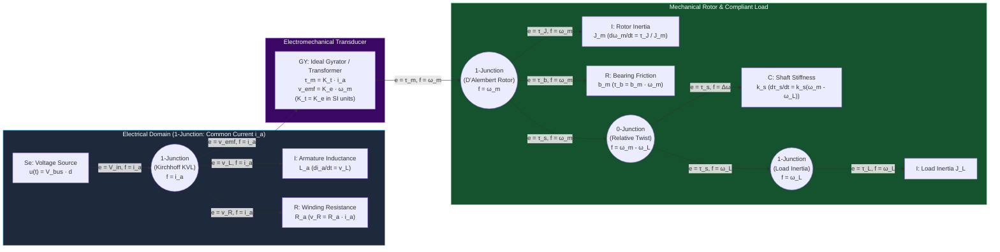

# Track 00: Foundations, Bench Intuition & Multi-Domain Mathematics

> **Part of the [MechaLab Multi-Pass Tiered Roadmap](../README.md)**  
> **Prerequisite for:** All subsequent tracks ([Track 01](../01-electronics-and-power/README.md) through [Track 08](../08-capstone-projects/README.md))  
> **Core Principle:** Every physical transducer, power converter, mechanical linkage, and feedback controller is governed by the same underlying structures: conservation of energy across generalized power ports, differential equations, and discrete-time sampling theory.

---

## 🔄 Linear Level-Up Navigation (Follow Your Current Pass Across Track 00 → Track 08)

Instead of trying to master graduate-level $SO(3)$ Lie groups before ever wiring a motor, complete **only your current Tier section** below, check off its milestone, and jump straight to **Track 01 in the same Tier**:

| Pass / Level | Current Track 00 Section | Next Linear Step in This Pass |
| :--- | :--- | :--- |
| **🛠️ Stage 0: Level 0 On-Ramp** | [§0 Global Level 0 Prerequisite Track (No Prior EE)](#level-0-global-prerequisite-on-ramp-intuition--bench-tools) | [Proceed to Track 00 · Tier 1 ↓](#tier-1-beginner--intuitive) |
| **🟢 Pass 1: Tier 1 (Beginner)** | [§1 Tier 1: Calculus as `while` Loops, 2D Rotations & RC Smoothing](#tier-1-beginner--intuitive) | [**Next in Pass 1 → Track 01 (Tier 1: Breadboard H-Bridges)**](../01-electronics-and-power/README.md#tier-1-beginner--intuitive) |
| **🔵 Pass 2: Tier 2 (Applied)** | [§2 Tier 2: State-Space Matrices, Quaternions & Tustin Biquads](#tier-2-intermediate--applied) | [**Next in Pass 2 → Track 01 (Tier 2: 4-Layer KiCad & Kelvin Shunts)**](../01-electronics-and-power/README.md#tier-2-intermediate--applied) |
| **🌉 Bridge Concept** | [§3 Bridging the Gap: Moving Average $\to$ Pre-Warped TDF-II Biquad](#bridging-the-gap-maker-to-custom) | [Inspect Tier 3 Production Mastery ↓](#tier-3-advanced--production) |
| **🟣 Pass 3: Tier 3 (Production)** | [§4 Tier 3: Bond Graphs, Lie Groups $SO(3)/SE(3)$ & Van Loan ZOH](#tier-3-advanced--production) | [**Next in Pass 3 → Track 01 (Tier 3: $<2\text{ nH}$ Inverter & SAR Buckets)**](../01-electronics-and-power/README.md#tier-3-advanced--production) |

---

## Level 0: Global Prerequisite On-Ramp (Intuition & Bench Tools)

If you come from a strong computing/software background with no formal Electrical Engineering (EE) training, **start here** before touching SPICE, KiCad, or matrix calculus.

### 0.1 Everyday Analogies (Hydraulic, Mechanical & Software Mental Models)

| Concept | Physical / Hydraulic Analogy | Software / Computing Mental Model | Key Equation & Physical Meaning |
| :--- | :--- | :--- | :--- |
| **Voltage ($V$)** [Volts] | **Water Pressure Difference** between two points in a pipe | Potential energy difference (`delta`) relative to a chosen `0 V` reference (`GND`) | $V_{AB} = V_A - V_B$. Voltage *pushes* charge; voltage itself never "flows." |
| **Current ($I$)** [Amps] | **Flow Rate** (Liters/second) through a pipe cross-section | Throughput (packets/sec) passing through a channel | $I = \frac{dq}{dt}$. Current flows *through* components in a closed loop and returns to the source. |
| **Resistance ($R$)** [$\Omega$] | **Narrow Pipe Constriction** dissipating pressure as heat | Rate-limiting throttle that converts energy into heat | $V = I R$, $P_{\text{heat}} = I^2 R$. Double the current $\implies 4\times$ the heat! |
| **Capacitance ($C$)** [Farads] | **Flexible Rubber Diaphragm** in a pipe (stores pressure) | Local L1 burst cache right next to a CPU core | $I = C\frac{dV}{dt}$. Resists sudden changes in **voltage**. Supplies instant nanosecond current bursts to ICs. |
| **Inductance ($L$)** [Henries] | **Heavy Paddlewheel / Flywheel** in a pipe (stores flow momentum) | In-flight pipeline momentum that refuses to stop instantaneously | $V = L\frac{dI}{dt}$. Resists sudden changes in **current**. Opening a switch on a spinning motor coil forces $\frac{dI}{dt} \to -\infty$, causing a high-voltage spark unless given a flyback path! |
| **Frequency ($f$) & Phase ($\phi$)** | **Pushing a Playground Swing** at its natural rhythm vs. out of sync | Polling/update rate vs. end-to-end pipeline latency ($\Delta\phi = -360^\circ f \Delta t_{\text{delay}}$) | Even $500\ \mu\text{s}$ of sensor/filter delay adds $-18^\circ$ of phase lag at $100\text{ Hz}$, eroding stability. |
| **State Vector ($x$)** | **Snapshot of all stored energy** (spring stretch + mass velocity + coil current) | Minimal `struct State` needed to resume a simulation from a checkpoint | If a component stores energy ($C$, $L$, mass $m$, inertia $J$, spring $k$), it adds 1 variable to $x$. |

### 0.2 Practical Bench Tools (Hands-On Before SPICE or KiCad)
1. **Solderless Breadboards:**
   * **Internal Wiring:** Each 5-hole vertical column is a single spring clip; top/bottom horizontal rails (`+` red, `-` blue) distribute power.
   * **Physical Limits:** Each spring clip has $\sim 0.1\ \Omega$ contact resistance and $\sim 5\text{–}10\text{ pF}$ capacitance to adjacent rows. Never run $>1.5\text{ A}$ motor phase currents through a breadboard (the plastic melts!) or $>10\text{ MHz}$ SPI clocks across long jumper wires.
2. **Digital Multimeter (DMM):**
   * **Rule #1 (Continuity Beep Check):** Before powering *any* circuit, switch to Continuity mode and probe between `VCC` and `GND`. A beep means a dead short; fix it before turning on power.
   * **Rule #2 (Voltage in Parallel, Current in Series):** Measure voltage *across* two nodes with the red probe in the `V/Ω` jack. Never leave the red probe in the `10A` or `mA` current jack when probing voltage—that shorts your power supply through the meter's internal shunt fuse!
3. **Current-Limited Bench Power Supply (CC/CV Mode):**
   * Think of Constant-Current (CC) limiting as a **hardware `try/catch` block**. When bringing up a $12\text{ V}$ microcontroller + gate driver board for the first time, set voltage to $12.0\text{ V}$ and current limit to $0.15\text{ A}$ ($150\text{ mA}$). If a chip is wired backward, the supply safely drops its output voltage to $0.8\text{ V}$ at $150\text{ mA}$ instead of vaporizing silicon.
4. **USB Logic Analyzer & Entry Oscilloscope:**
   * A $15 USB 8-channel logic analyzer (`sigrok` / `PulseView`) decodes digital `I2C`, `SPI`, `UART`, and `PWM` duty cycles.
   * A 4-channel entry oscilloscope (`Rigol DHO804` / `Siglent SDS804X HD`) reveals the *analog truth*: power-rail droop during motor startup, RC charging curves, and switch bounce.

### 0.3 Starter Hardware (`ESP32` / `Arduino` / `STM32 Nucleo`)
* **Actionable Milestone (Level 0 Gate):**
  1. Wire a $10\text{ k}\Omega$ potentiometer across `3.3V` and `GND` on a breadboard; read the wiper voltage with a 12-bit `ADC` pin ($0\text{–}4095$) on an `ESP32` or `STM32 Nucleo`.
  2. Configure a $20\text{ kHz}$ hardware PWM output driving a logic-level N-channel MOSFET (`IRLZ44N` / `AO3400`) + flyback diode (`1N5819` Schottky across the motor terminals) to vary the speed of a $12\text{ V}$ DC fan/motor smoothly without audible whine.
  3. Capture the $20\text{ kHz}$ PWM waveform and measure the `3.3V` rail ripple on your oscilloscope/multimeter.

---

## Tier 1 (Beginner / Intuitive)

> **Goal of Pass 1 (Track 00):** Translate continuous calculus and physics into familiar software loops (`x += v * dt`), 2D geometry, and a 1-line digital low-pass filter so you can immediately move to **Track 01 (Tier 1)** and spin motors.

### 1.1 Differential Equations as Discrete `while` Loops
As a software engineer, you already know differential equations: an Ordinary Differential Equation (ODE) $\dot{x} = f(x, u)$ is simply a rule that computes the **rate of change** of your `State` struct on every clock tick $\Delta t$.
* **Derivative ($\frac{dx}{dt}$):** Finite difference `(x_now - x_prev) / dt`.
* **Integral ($\int e\,dt$):** Running accumulator `integral += error * dt`.
* **1-DOF Mass-Spring-Damper in 6 Lines of Code ($m\ddot{x} + b\dot{x} + kx = F$):**
  ```python
  # State vector: position x [m], velocity v [m/s]
  a = (F_cmd - b * v - k * x) / m   # Newton's 2nd Law: F_net / m
  v = v + a * dt                    # Semi-implicit (symplectic) Euler velocity step
  x = x + v * dt                    # Position update using new velocity
  ```

### 1.2 2D Coordinate Frames & Rotation Matrices ($SO(2)$)
Before 3D Lie groups, master 2D rigid transformations for planar robot arms and mobile robots:
* Rotating a 2D vector $[x, y]^\top$ by angle $\theta$ uses an orthogonal $2\times 2$ matrix $R(\theta)$ where $R(\theta)^{-1} = R(\theta)^\top$ (the transpose *is* the inverse!):

$$
R(\theta) = \begin{bmatrix} \cos\theta & -\sin\theta \\ \sin\theta & \cos\theta \end{bmatrix}, \qquad \text{atan2}(\sin(\theta_{\text{ref}} - \theta_{\text{meas}}), \cos(\theta_{\text{ref}} - \theta_{\text{meas}})) \in (-\pi, \pi]
$$

* **Crucial Beginner Rule:** Never compute angular error as `ref - meas` with modulo `% 360`—crossing the $180^\circ / -180^\circ$ wrap-around boundary causes a violent $360^\circ$ motor kick! Always wrap angular error using `atan2(sin(err), cos(err))`.

### 1.3 Time vs. Frequency Intuition & First-Order RC Smoothing
Raw ADC readings and encoder velocity differences are noisy.
* **Hardware RC Low-Pass Filter:** A resistor $R$ in series with a capacitor $C$ to ground smooths voltage spikes with time constant $\tau = R C$ and cutoff frequency $f_c = \frac{1}{2\pi R C}$.
* **Software Exponential Moving Average (1st-Order Digital IIR Low-Pass):**
  ```c
  // alpha in (0, 1): alpha = dt / (rc + dt) where rc = 1.0f / (2.0f * PI * f_cutoff)
  y_filt += alpha * (x_raw - y_filt);
  ```
* **The Fundamental Trade-Off:** Lowering $f_c$ removes more noise, but adds **phase lag** ($45^\circ$ lag at $f = f_c$). Too much filtering inside a feedback loop makes a robot oscillate!

### ✅ Tier 1 Milestone Gate (`Track 00 · Pass 1`)
* Write a 50-line Python script (or inspect **Tab 2: Two-Mass & Notch Bode** in the interactive workbench) that simulates a mass-spring-damper step response at $\Delta t = 1\text{ ms}$, injects synthetic white Gaussian noise onto the position measurement, and compares raw finite-difference velocity against an Exponential Moving Average filter.
* **Next Linear Step in Pass 1:** [**Proceed to Track 01 (Tier 1: Breadboard H-Bridges, Logic Levels & Decoupling) →**](../01-electronics-and-power/README.md#tier-1-beginner--intuitive)

---

## Tier 2 (Intermediate / Applied)

> **Goal of Pass 2 (Track 00):** When you return to Track 00 after finishing your first Tier 1 robot, upgrade your ad-hoc scalar equations into **State-Space Matrices ($\dot{x} = Ax + Bu$)**, **Two-Mass Torsional Resonance**, **Unit Quaternions**, and **Pre-Warped Tustin Biquad Notch Filters**.

### 2.1 State-Space Modeling ($\dot{x} = A_c x + B_c u$) & Two-Mass Resonance
Real robot joints are not rigid single masses. A motor rotor ($J_m$) connected through a belt, harmonic flexspline, or shaft of stiffness $k_s$ to an arm link ($J_L$) forms a **4-state coupled electromechanical system** (derived in full in §4.4 below) with two critical frequencies:
* **Anti-Resonance Frequency (Collocated Zero):** $\omega_{ar} = \sqrt{\frac{k_s}{J_L}}$ (the load oscillates out-of-phase and absorbs all motor torque).
* **Resonance Frequency (System Pole):** $\omega_r = \sqrt{k_s\left(\frac{1}{J_m} + \frac{1}{J_L}\right)} = \omega_{ar}\sqrt{1 + \frac{J_L}{J_m}}$ (severe mechanical vibration peak).

### 2.2 3D Rotations Without Gimbal Lock: Unit Quaternions ($\mathbb{S}^3$)
3D Euler angles (roll-pitch-yaw) lose a degree of freedom at $\text{pitch} = \pm 90^\circ$ (gimbal lock). In Tier 2, represent 3D attitude using a 4D unit vector $q = [q_w, q_x, q_y, q_z]^\top$ ($\|q\|_2 = 1$) updated from gyroscope body rates $\omega_b = [\omega_x, \omega_y, \omega_z]^\top$:

$$
q_{k+1} = \text{normalize}\left(q_k + \frac{\Delta t}{2} \, q_k \otimes \begin{bmatrix} 0 \\ \omega_b \end{bmatrix}\right)
$$

### 2.3 Continuous-to-Discrete Filter Design: Pre-Warped Tustin Biquads
To cancel a mechanical resonance at $\omega_n = \omega_r$ without adding phase lag at low frequencies, we cascade a **2nd-order Biquad Notch Filter**:

$$
H_{\text{notch}}(s) = \frac{s^2 + \frac{\omega_n}{Q}s + \omega_n^2}{s^2 + \frac{\omega_n}{\zeta_{\text{pole}}}s + \omega_n^2} \xrightarrow{\text{Pre-Warped Tustin}} H(z) = \frac{b_0 + b_1 z^{-1} + b_2 z^{-2}}{1 + a_1 z^{-1} + a_2 z^{-2}}
$$

### ✅ Tier 2 Milestone Gate (`Track 00 · Pass 2`)
* Use the **Tab 2: Two-Mass & Notch Bode Simulator** (or Python `scipy.signal`) to sweep shaft stiffness $k_s$, verify $\omega_r > \omega_{ar}$, and tune a pre-warped Tustin biquad notch filter centered at $f_n = f_r$ to flatten the resonance peak by $\ge 20\text{ dB}$.
* **Next Linear Step in Pass 2:** [**Proceed to Track 01 (Tier 2: 4-Layer KiCad PCBs, Gate Drivers & Kelvin Shunts) →**](../01-electronics-and-power/README.md#tier-2-intermediate--applied)

---

## Bridging the Gap: Maker to Custom

### From an $N$-Sample Moving Average to a Pre-Warped `TDF-II` Biquad Notch
* **How Beginners Do It (Tier 1 Maker Approach):** When a motor vibrates or buzzes, beginners wrap the velocity/current measurement in a 16-sample moving average (`sum(last_16) / 16`) or heavy low-pass filter. At $1\text{ kHz}$, a 16-sample moving average injects $(16-1)/2 = 7.5\text{ ms}$ of pure group delay—destroying phase margin and causing violent low-frequency limit cycles!
* **How Production Engineers Do It (Tier 2/3 Custom Approach):**
  1. Identify the exact structural resonance frequency $f_r$ from an FFT / Bode sweep (e.g., $f_r = 259\text{ Hz}$).
  2. Compute exact discrete biquad coefficients using **Pre-Warped Tustin** substitution $s \leftarrow \frac{\omega_n}{\tan(\omega_n T_s / 2)}\frac{z-1}{z+1}$ so the digital notch lands exactly on $f_r$ instead of warping lower in frequency.
  3. Execute the filter in **Transposed Direct Form II (`TDF-II`)** using 2 state variables (`s1, s2`) in 5 floating-point multiply-accumulates per tick—surgically carving out the $259\text{ Hz}$ resonance while leaving phase below $50\text{ Hz}$ virtually untouched:
  ```cpp
  float y = b0 * x + s1;
  s1 = b1 * x - a1 * y + s2;
  s2 = b2 * x - a2 * y;
  ```

---

## Tier 3 (Advanced / Production)

> **Goal of Pass 3 (Track 00):** Full mathematical mastery for production robotics and high-rate control: Bond Graph & Port-Hamiltonian energy modeling, SVD conditioning, Matrix Lie Groups $SO(3)/SE(3)$, Van Loan exact ZOH discretization, and stochastic Welch spectral estimation.
> * [**Next Linear Step in Pass 3 → Track 01 (Tier 3: 6-Layer $<2\text{ nH}$ Inverter & SAR Charge Buckets)**](../01-electronics-and-power/README.md#tier-3-advanced--production)

### 4.1 Unified Multi-Domain Energy Architecture (Bond Graphs & Port-Hamiltonians)

Engineers who treat mechanics, electronics, and software as separate languages fail at their interfaces. When a DC motor drives a compliant harmonic gear train, the mechanical torsional resonance reflects directly back into the electrical armature circuit as a complex impedance zero/pole pair. Similarly, sampling a continuous sensor without understanding continuous-to-discrete spectral folding ($s \mapsto z$) guarantees aliasing that no digital filter can undo.

#### Generalized Effort, Flow, Momentum & Displacement

All physical domains share a dual pair of power variables whose product equals instantaneous power $P(t) = e(t) \cdot f(t)$:

| Physical Domain | Effort $e(t)$ | Flow $f(t)$ | Generalized Momentum $p(t) = \int e\,dt$ | Generalized Displacement $q(t) = \int f\,dt$ | Capacitive Storage ($C$) | Inertive Storage ($I$) | Resistive Dissipation ($R$) |
| :--- | :--- | :--- | :--- | :--- | :--- | :--- | :--- |
| **Translational Mechanics** | Force $F$ [N] | Velocity $v$ [m/s] | Linear Momentum $p$ [N·s] | Position $x$ [m] | Compliance $1/k$ [m/N] | Mass $m$ [kg] | Viscous Damper $b$ [N·s/m] |
| **Rotational Mechanics** | Torque $\tau$ [N·m] | Angular Velocity $\omega$ [rad/s] | Angular Momentum $L$ [N·m·s] | Angle $\theta$ [rad] | Torsional Compliance $1/k_\theta$ | Rotational Inertia $J$ [kg·m²] | Rotational Damper $b_\theta$ |
| **Electrical Circuits** | Voltage $v$ [V] | Current $i$ [A] | Flux Linkage $\lambda$ [Wb] | Charge $q$ [C] | Capacitance $C$ [F] | Inductance $L$ [H] | Resistance $R$ [$\Omega$] |
| **Hydraulic / Pneumatic** | Pressure $P$ [Pa] | Volumetric Flow $Q$ [m³/s] | Pressure Momentum $\Gamma$ [Pa·s] | Volume $V$ [m³] | Fluid Compressibility $C_f$ | Fluid Inertance $I_f$ | Orifice Resistance $R_f$ |
| **Thermal (Pseudo-Bond)** | Temperature $T$ [K] | Heat Flow $\dot{Q}$ [W] or Entropy Flow $\dot{S}$ | — | Thermal Energy $Q$ [J] | Thermal Capacity $C_{th}$ [J/K] | *None (Diffusion only)* | Thermal Resistance $R_{th}$ [K/W] |

#### Bond Graph & Port-Hamiltonian Coupling Diagram



### 4.2 Applied Linear Algebra, SVD & Lie Groups ($SO(3), SE(3)$)

#### Singular Value Decomposition (SVD) & Matrix Calculus
* **Singular Value Decomposition (SVD):** Every matrix $A \in \mathbb{R}^{m \times n}$ factors as $A = U \Sigma V^\top$. In mechatronics, SVD governs:
  * **Manipulator Jacobian Conditioning:** The ratio $\kappa(J) = \sigma_{\max}(J)/\sigma_{\min}(J)$ measures proximity to kinematic singularities and bounds force-to-torque amplification.
  * **Observability & Controllability Gramians:** Small singular values of the observability matrix $\mathcal{O}$ indicate weakly observable state directions in Kalman filters.
  * **Total Least Squares & Damped Least Squares (Levenberg-Marquardt):** Regularized inverse $J^\dagger_\lambda = J^\top (J J^\top + \lambda^2 I)^{-1}$, mapping singular values $\sigma_i \mapsto \frac{\sigma_i}{\sigma_i^2 + \lambda^2}$.
* **Symmetric Positive-Definite (SPD) Matrices & Cholesky Factorization:** Mass matrices $M(q) \succ 0$, covariance matrices $P \succ 0$, and quadratic cost matrices $Q \succeq 0, R \succ 0$ must be factored via Cholesky ($P = L L^\top$) or Joseph-form updates in embedded code to prevent numerical loss of positive definiteness.
* **Matrix Calculus Identities for Optimization & Jacobians:**

$$
\frac{\partial}{\partial x}\left(\frac{1}{2} x^\top Q x + c^\top x\right) = Q x + c \quad (\text{for } Q = Q^\top), \qquad \frac{d}{dt}\left(R(t)\right) = \hat{\omega}(t) R(t) \quad \text{where } \hat{\omega} = [\omega]_\times \in \mathfrak{so}(3)
$$

#### Lie Groups $SO(3)$ and $SE(3)$ for 3D Rigid-Body Motion
1. **The Rotation Group $SO(3)$ and Lie Algebra $\mathfrak{so}(3)$:**

$$
SO(3) = \{ R \in \mathbb{R}^{3\times 3} \mid R^\top R = I,\ \det(R) = +1 \}, \quad \mathfrak{so}(3) = \{ [\omega]_\times \in \mathbb{R}^{3\times 3} \mid [\omega]_\times^\top = -[\omega]_\times \}
$$

   where the hat operator $[\cdot]_\times : \mathbb{R}^3 \to \mathfrak{so}(3)$ maps $\omega = [\omega_x, \omega_y, \omega_z]^\top$ to the skew-symmetric cross-product matrix:

$$
[\omega]_\times = \begin{bmatrix} 0 & -\omega_z & \omega_y \\ \omega_z & 0 & -\omega_x \\ -\omega_y & \omega_x & 0 \end{bmatrix}
$$

2. **Exponential Map (Rodrigues' Formula) & Logarithmic Map:**
   For rotation vector $\phi = \theta u \in \mathbb{R}^3$ ($\|u\|_2 = 1$, $\theta = \|\phi\|_2$):

$$
\exp([\phi]_\times) = I + \frac{\sin\theta}{\theta}[\phi]_\times + \frac{1 - \cos\theta}{\theta^2}[\phi]_\times^2 \in SO(3)
$$

   *Implementation Rule:* For $\theta < 10^{-4}\text{ rad}$, use the Taylor expansion $\frac{\sin\theta}{\theta} \approx 1 - \frac{\theta^2}{6} + \frac{\theta^4}{120}$ and $\frac{1-\cos\theta}{\theta^2} \approx \frac{1}{2} - \frac{\theta^2}{24} + \frac{\theta^4}{720}$ to prevent $0/0$ floating-point `NaN`.
3. **The Special Euclidean Group $SE(3)$ and Lie Algebra $\mathfrak{se}(3)$:**

$$
T = \begin{bmatrix} R & p \\ 0_{1\times 3} & 1 \end{bmatrix} \in SE(3), \quad [\mathcal{V}]_\wedge = \begin{bmatrix} [\omega]_\times & v \\ 0_{1\times 3} & 0 \end{bmatrix} \in \mathfrak{se}(3), \quad \text{Ad}_T = \begin{bmatrix} R & 0_{3\times 3} \\ [p]_\times R & R \end{bmatrix}
$$

### 4.3 Continuous-to-Discrete Systems, Van Loan ZOH & Stochastic Processes
A continuous LTI state-space model $\dot{x}(t) = A_c x(t) + B_c u(t)$ sampled under a Zero-Order Hold (ZOH) with period $T_s$ yields the exact discrete-time system $x_{k+1} = A_d x_k + B_d u_k$, computed simultaneously via Van Loan's block matrix method:

$$
\exp\left(\begin{bmatrix} A_c & B_c \\ 0 & 0 \end{bmatrix} T_s\right) = \begin{bmatrix} A_d & B_d \\ 0 & I \end{bmatrix}
$$

| Discretization Method | Mapping $s \leftarrow f(z)$ | Stability Preservation | Frequency Warping / Phase Accuracy | Primary Mechatronics Use Case |
| :--- | :--- | :--- | :--- | :--- |
| **Forward Euler** | $s \leftarrow \frac{z - 1}{T_s}$ | Unstable for lightly damped poles unless $T_s \ll 1/\lvert\lambda_{\max}\rvert$ | Adds phase lead; expands unit circle | Simple low-bandwidth integrators; quick explicit ODE steps |
| **Backward Euler** | $s \leftarrow \frac{z - 1}{z T_s}$ | Unconditionally stable (maps LHP inside unit disk) | Adds artificial numerical damping | Stiff mechanical contact simulation; derivative term smoothing |
| **Tustin (Bilinear)** | $s \leftarrow \frac{2}{T_s}\frac{z - 1}{z + 1}$ | Exact LHP $\leftrightarrow$ Unit Disk bijection | Compresses $\omega \in [0,\infty) \to [0, \pi/T_s)$ | General digital PI/lead-lag compensators |
| **Tustin with Pre-Warping** | $s \leftarrow \frac{\omega_0}{\tan(\omega_0 T_s / 2)}\frac{z - 1}{z + 1}$ | Exact LHP $\leftrightarrow$ Unit Disk bijection | Exact gain & phase match at critical frequency $\omega_0$ | Structural notch filters and resonant current controllers |
| **Zero-Order Hold (ZOH)** | Exact step-invariant match | Preserves pole locations ($z_i = e^{s_i T_s}$) | Introduces effective $T_s/2$ delay ($\Delta \phi = -\omega T_s / 2$) | Plant discretization for DAC/PWM-driven actuators |

* **Continuous vs. Discrete White Noise:** If continuous process noise $w(t)$ has power spectral density $Q_c$, its discrete covariance over step $T_s$ is $Q_d = \int_0^{T_s} e^{A_c \tau} Q_c e^{A_c^\top \tau}\,d\tau \approx Q_c T_s$. Note the scaling with $\sqrt{T_s}$ in standard deviation: a sensor datasheet specifying noise density $n_d$ in $\frac{\text{units}}{\sqrt{\text{Hz}}}$ sampled with front-end bandwidth $f_{BW}$ produces discrete sample variance $\sigma_d^2 = n_d^2 \cdot f_{BW}$.
* **Power Spectral Density (PSD) & Welch's Method:** Non-parametric estimation of $S_{xx}(f)$ and cross-spectrum $S_{yu}(f)$ using overlapping Hann-windowed FFT segments to compute empirical frequency response functions $\hat{G}(j\omega) = \frac{\hat{S}_{yu}(j\omega)}{\hat{S}_{uu}(j\omega)}$ and coherence $\gamma^2(\omega) = \frac{|\hat{S}_{yu}(j\omega)|^2}{\hat{S}_{uu}(j\omega)\hat{S}_{yy}(j\omega)} \in [0, 1]$.

### 4.4 Reference Derivation: Coupled 4-State Electromechanical State-Space Model

Selecting the four energy-storage state variables $x = [i_a, \omega_m, \theta_m - \theta_L, \omega_L]^\top$ with control input $u = V_{in}$ and external load disturbance $d = \tau_{ext}$:

$$
\frac{d}{dt}\begin{bmatrix} i_a \\ \omega_m \\ \theta_m - \theta_L \\ \omega_L \end{bmatrix} = \begin{bmatrix} -\frac{R_a}{L_a} & -\frac{K_e}{L_a} & 0 & 0 \\ \frac{K_t}{J_m} & -\frac{b_m}{J_m} & -\frac{k_s}{J_m} & -\frac{b_s}{J_m} \\ 0 & 1 & 0 & -1 \\ 0 & \frac{b_s}{J_L} & \frac{k_s}{J_L} & -\frac{b_L + b_s}{J_L} \end{bmatrix} \begin{bmatrix} i_a \\ \omega_m \\ \theta_m - \theta_L \\ \omega_L \end{bmatrix} + \begin{bmatrix} \frac{1}{L_a} \\ 0 \\ 0 \\ 0 \end{bmatrix} V_{in} + \begin{bmatrix} 0 \\ 0 \\ 0 \\ -\frac{1}{J_L} \end{bmatrix} \tau_{ext}
$$

From the mechanical subsystem alone ($b_s, b_m, b_L \to 0$), the transfer function from electromagnetic torque $\tau_m = K_t i_a$ to **collocated motor velocity** $\omega_m(s)$ vs. **non-collocated load velocity** $\omega_L(s)$ reveals:

$$
\frac{\omega_m(s)}{\tau_m(s)} = \frac{1}{(J_m + J_L)s} \cdot \frac{s^2 + \omega_{ar}^2}{s^2 + \omega_r^2}, \qquad \frac{\omega_L(s)}{\tau_m(s)} = \frac{1}{(J_m + J_L)s} \cdot \frac{\omega_{ar}^2}{s^2 + \omega_r^2}
$$

> **Design Insight:** A collocated encoder on the motor shaft sees an alternating pole-zero pattern ($\omega_{ar} < \omega_r$), keeping phase between $-90^\circ$ and $+90^\circ$ (passive/phase-stabilizable). A non-collocated encoder on the load side sees only the complex pole pair at $\omega_r$ without the stabilizing zero, introducing an immediate $-180^\circ$ phase cliff that severely limits closed-loop bandwidth!

---

## 5. Failure Modes, Pitfalls & Anti-Patterns

1. **Euler-Angle Singularity & Unwrapping Bugs:** Wrapping raw encoder or IMU heading angles to $[-\pi, \pi)$ inside a PID error calculation (`err = ref - meas`) causes a violent $2\pi$ torque spike when crossing the $\pm\pi$ boundary. Always compute angular error on $SO(2)$ via `atan2(sin(ref - meas), cos(ref - meas))` or on $SO(3)$ via $\log(R_{meas}^\top R_{ref})^\vee$.
2. **Inconsistent SI Units in Electromechanical Constants:** Motor vendors frequently specify torque constant $K_t$ in $\text{N}\cdot\text{m / A}_{\text{rms}}$ and back-EMF constant $K_v$ in $\text{RPM / V}_{\text{line-to-line, peak}}$. In consistent SI units, power conservation ($P_{elec} = P_{mech} \implies e^\top i = \tau \omega$) mandates $K_t \equiv K_e$.
3. **Discretizing Resonant Notch Filters Without Pre-Warping:** Applying standard Tustin transform to a narrow continuous notch filter centered at $\omega_0 = 2\pi \cdot 850\text{ Hz}$ when sampling at $f_s = 4\text{ kHz}$ shifts the digital notch frequency to $\frac{2}{T_s}\arctan\left(\frac{\omega_0 T_s}{2}\right) \approx 2\pi \cdot 762\text{ Hz}$—completely missing the structural resonance!
4. **Catastrophic Cancellation in Single-Precision (`float32`) IIR Filters:** High-$Q$ biquad filters running at $f_s = 20\text{ kHz}$ with low cutoff place poles near $z = 1$. In Direct Form I/II using `float32`, coefficient quantization shifts the pole outside the unit circle. Always use **Transposed Direct Form II (`TDF-II`)** or `float64`.

---

## 6. Curated Learning Resources

* **Karnopp, D. C., Margolis, D. L., & Rosenberg, R. C.** — *System Dynamics: Modeling, Simulation, and Control of Mechatronic Systems* (6th ed., Wiley, 2012).
* **Strang, G.** — *Linear Algebra and Learning from Data* (2019) & **Trefethen, L. N., & Bau, D.** — *Numerical Linear Algebra* (SIAM, 1997).
* **Sola, J., Deray, J., & Atchuthan, D.** — *"A micro Lie theory for state estimation in robotics"* (`arXiv:1812.01537`, 2018).
* **Oppenheim, A. V., & Schafer, R. W.** — *Discrete-Time Signal Processing* (3rd ed., Pearson, 2009).
* **Åström, K. J., & Wittenmark, B.** — *Computer-Controlled Systems: Theory and Design* (3rd ed., Dover, 2011).

---

## 7. Tier 3 Production Lab & Milestone Gate (`Lab 00`)

| Metric | Target Requirement | Verification Method |
| :--- | :--- | :--- |
| **Energy Conservation Check** | $\left\lvert\int_0^T V_{in} i_a\,dt - \left(\Delta E_{stored} + \int_0^T P_{dissipated}\,dt\right)\right\rvert < 10^{-9}\text{ J}$ | Continuous RK45 energy balance audit |
| **Analytical vs. Identified Resonance** | $\lvert\hat{\omega}_{ar} - \omega_{ar}\rvert / \omega_{ar} < 0.5\%$ and $\lvert\hat{\omega}_r - \omega_r\rvert / \omega_r < 0.5\%$ | Welch FRF peak/trough extraction with $\gamma^2(\omega) > 0.98$ |
| **Notch Filter Suppression** | Resonant peak attenuated by $\ge 20\text{ dB}$ in `float32` Transposed Direct Form II | Closed-loop step response & Bode magnitude verification (Tab 2 Simulator) |
| **$SO(3)$ Singularity Immunity** | $\exp([\phi]_\times)$ and $\log(R)$ round-trip error $< 10^{-14}\text{ rad}$ across $\theta \in [0, \pi]$ | Unit test suite across 10,000 random & edge-case axes |
