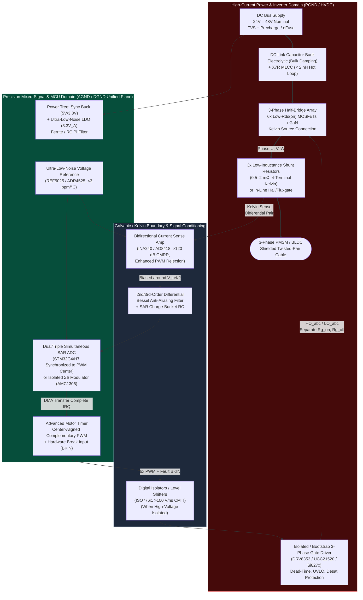

# Track 01: Mixed-Signal Electronics, Power Stages & High-Speed PCB Design

> **Part of the [MechaLab Multi-Pass Tiered Roadmap](../README.md)**  
> **Prerequisites:** [Track 00: Foundations, Bench Intuition & Multi-Domain Mathematics](../00-foundations/README.md)  
> **Feeds Into:** [Track 03: Sensors & Actuators](../03-sensors-and-actuators/README.md), [Track 04: Embedded & Real-Time](../04-embedded-and-realtime/README.md), [Track 07: Systems, HIL & Production](../07-systems-hil-and-production/README.md)  
> **Core Principle:** At $20\text{–}100\text{ kHz}$ PWM switching frequencies and $>50\text{ V/ns}$ slew rates, there is no such thing as an ideal wire or a "ground node." Every PCB trace is a coupled RLC transmission line, and precision microvolt sensing survives next to kilowatt switching stages only through deliberate loop-inductance minimization, return-current control, and differential signal conditioning.

---

## 🔄 Linear Level-Up Navigation (Follow Your Current Pass Across Track 00 → Track 08)

Complete **only your current Tier section** below, verify its hands-on milestone, and proceed directly to **Track 02 in the same Tier**:

| Pass / Level | Previous Step in Pass | Current Track 01 Section | Next Linear Step in This Pass |
| :--- | :--- | :--- | :--- |
| **🟢 Pass 1: Tier 1 (Beginner)** | [← Track 00 (Tier 1)](../00-foundations/README.md#tier-1-beginner--intuitive) | [§1 Tier 1: Breadboard H-Bridges (`DRV8833`), Logic Levels & Decoupling](#tier-1-beginner--intuitive) | [**Next in Pass 1 → Track 02 (Tier 1: 2D Planar IK & Gear Ratios)**](../02-mechanics-kinematics-dynamics/README.md#tier-1-beginner--intuitive) |
| **🔵 Pass 2: Tier 2 (Applied)** | [← Track 00 (Tier 2)](../00-foundations/README.md#tier-2-intermediate--applied) | [§2 Tier 2: 4-Layer KiCad PCBs, Gate Drivers & Kelvin Shunts](#tier-2-intermediate--applied) | [**Next in Pass 2 → Track 02 (Tier 2: Exact Constraint, `CadQuery` & URDF)**](../02-mechanics-kinematics-dynamics/README.md#tier-2-intermediate--applied) |
| **🌉 Bridge Concept** | — | [§3 Bridging the Gap: `L298N`/`INA219` Breakouts → `DRV8353` + `INA240` Kelvin PCB](#bridging-the-gap-maker-to-custom) | [Inspect Tier 3 Production Mastery ↓](#tier-3-advanced--production) |
| **🟣 Pass 3: Tier 3 (Production)** | [← Track 00 (Tier 3)](../00-foundations/README.md#tier-3-advanced--production) | [§4 Tier 3: <2 nH 48 V/30 A 6-Layer Inverter & SAR Charge Buckets](#tier-3-advanced--production) | [**Next in Pass 3 → Track 02 (Tier 3: Screw PoE, Flexures & O(n) RNEA)**](../02-mechanics-kinematics-dynamics/README.md#tier-3-advanced--production) |

---

## Tier 1 (Beginner / Intuitive)

> **Goal of Pass 1 (Track 01):** Learn how low-voltage logic safely controls higher-voltage motor power without browning out or frying your microcontroller, using breadboard-friendly MOSFETs and modern H-bridge breakout modules (`DRV8833` / `TB6612FNG`).

### 1.1 Logic Levels ($3.3\text{ V}$ vs. $5\text{ V}$) & Open-Drain Pull-Ups
- **Core Summary:** Explains why applying $5\text{ V}$ signals to non-$5\text{V}$-tolerant $3.3\text{ V}$ microcontroller pins (`ESP32`, `RP2040`, `STM32` analog pins) forward-biases internal ESD protection diodes to `VDD`, and how open-drain buses (`I2C`) and `BSS138` level shifters safely bridge voltage domains.

$$
I_{\text{ESD}\_\text{fault}} = \frac{V_{\text{in}} - (V_{DD} + 0.6\text{ V})}{R_{\text{source}}}, \qquad t_{r,\text{I2C}} \approx 0.8473 \cdot R_{\text{pullup}} C_{\text{bus}}
$$

- **Curated Free Resources:**
  - 🔗 [SparkFun: Logic Levels (3.3V vs. 5V CMOS/TTL Thresholds)](https://learn.sparkfun.com/tutorials/logic-levels) — *Clear visual guide to* $V_{IH}$ *,* $V_{IL}$ *,* $V_{OH}$ *,* $V_{OL}$ *thresholds and ESD clamping diodes.*
  - 🔗 [SparkFun: Bi-Directional Logic Level Converter Hookup Guide](https://learn.sparkfun.com/tutorials/bi-directional-logic-level-converter-hookup-guide) — *Explains how a single `BSS138` N-MOSFET and two pull-up resistors shift bidirectional I2C signals between* $3.3\text{ V}$ *and* $5\text{ V}$ *.*
  - 🔗 [Texas Instruments SLVA689: I2C Bus Pullup Resistor Calculation](https://www.ti.com/lit/pdf/slva689) — *Derives the minimum and maximum pull-up resistor values for* $100\text{ kHz}$ *and* $400\text{ kHz}$ *I2C buses.*
- **🧪 Hands-On Exercise:**
  - *Task:* Probe the `SCL` and `SDA` lines of a $400\text{ kHz}$ I2C sensor on your oscilloscope first with the MCU's weak internal $45\text{ k}\Omega$ pull-ups (observing rounded shark-fin edges that fail timing), and then after adding external $3.3\text{ k}\Omega$ pull-up resistors to `3.3V` (observing crisp $<200\text{ ns}$ rise times).
- **🧠 Knowledge Check:**
  

  
<b>Click to toggle quiz questions & answers</b>

  
  **Q1:** Why do `I2C` pins (`SDA` and `SCL`) use **Open-Drain** outputs with external pull-up resistors instead of standard Push-Pull outputs that actively drive both `3.3V` and `0V`?
  * **Answer / Explanation:** Multiple devices share the same `SDA`/`SCL` wires. If Device A used a Push-Pull output driving `3.3V` while Device B drove `0V` (for instance, during an `ACK` bit or clock stretching), a dead short circuit would occur between `3.3V` and `GND` through the two chips! Open-drain transistors can only pull **down** to `GND`, so multiple chips can safely pull low simultaneously ("wired-AND").
  
  **Q2:** Your I2C bus wire + sensor pins have a total stray capacitance of $C_{\text{bus}} = 100\text{ pF}$. If you rely only on an internal MCU pull-up resistor of $R_{\text{pullup}} = 40\text{ k}\Omega$, what is the $0\text{–}70\%$ rise time ($t_r \approx 1.2 R C$), and why does $400\text{ kHz}$ Fast-Mode I2C fail?
  * **Answer & Explanation:** $t_r \approx 1.2 \times 40,000\ \Omega \times 100\times 10^{-12}\text{ F} = 4.8\ \mu\text{s}$ ($4,800\text{ ns}$). However, a $400\text{ kHz}$ I2C clock has a total period of only $2.5\ \mu\text{s}$ (and the I2C spec requires $t_r \le 300\text{ ns}$)! The clock signal never even reaches logic HIGH before the next falling edge. Replacing $40\text{ k}\Omega$ with $2.2\text{ k}\Omega$ reduces $t_r$ to $\sim 260\text{ ns}$.
  

---

### [1.2 Low-Side MOSFET Switching, Flyback Diodes & H-Bridge Breakouts]
- **Core Summary:** Demonstrates how a logic-level N-MOSFET or 4-switch H-bridge (`DRV8833` / `TB6612FNG`) amplifies milliamp MCU PWM signals into multi-amp bidirectional motor currents while safely recirculating inductive turn-off currents through flyback/freewheeling diodes.

$$
V_{\text{motor}} = (D_A - D_B)V_{\text{bus}}, \qquad P_{\text{cond}} = I_{\text{motor}}^2 R_{DS(\text{on})}
$$

- **Curated Free Resources:**
  - 🔗 [Texas Instruments SLVA959: Brushed DC Motor Driver Basics (H-Bridge Decay Modes)](https://www.ti.com/lit/pdf/slva959) — *Illustrates Forward, Reverse, Fast Decay (Coast), and Slow Decay (Brake) current loops inside an H-bridge.*
  - 🔗 [Adafruit DRV8833 DC/Stepper Motor Driver Breakout Guide](https://learn.adafruit.com/adafruit-drv8833-dc-stepper-motor-driver-breakout-board) & [Practical Electronics for Inventors (Scherz & Monk)](https://www.mhprofessional.com/practical-electronics-for-inventors-fifth-edition-9781264268856-usa) — *Beginner wiring guide showing `AIN1/AIN2` PWM inputs, current limiting, and `nFAULT` protection.*
- **🧪 Hands-On Exercise:**
  - *Task:* Wire a `DRV8833` or `TB6612FNG` breakout on a breadboard to drive a $12\text{ V}$ gearmotor using $20\text{ kHz}$ PWM. Compare the stopping distance of the output shaft when switching PWM to **Coast** (`IN1=0, IN2=0`) versus **Active Dynamic Brake** (`IN1=1, IN2=1`).
- **🧠 Knowledge Check:**
  

  
<b>Click to toggle quiz questions & answers</b>

  
  **Q1:** When using a single N-channel MOSFET on the low side to PWM-control a $12\text{ V}$ unidirectional motor or solenoid, which way must the parallel **flyback diode** stripe (cathode) point?
  * **Answer / Explanation:** The cathode (stripe) must connect to the **$+12\text{ V}$ supply rail** and the anode to the **MOSFET drain** (reverse-biased during normal operation). If you install it forward-biased, it shorts $+12\text{ V}$ straight into the MOSFET! When the MOSFET turns OFF, the inductor current continues flowing upward through the motor and loops safely through the forward-biased flyback diode back to $+12\text{ V}$.
  
  **Q2:** You try to switch $5\text{ A}$ with an older `IRFZ44N` MOSFET (standard $10\text{ V}$ gate threshold, $V_{GS(\text{th})} = 2\text{–}4\text{ V}$) driven directly from a $3.3\text{ V}$ ESP32 pin, and the MOSFET immediately smokes! Why?
  * **Answer / Explanation:** $V_{GS(\text{th})}$ is the voltage where the MOSFET *barely begins* to conduct $250\ \mu\text{A}$—not where it is fully turned on! At $V_{GS} = 3.3\text{ V}$, a standard $10\text{ V}$-gate MOSFET is stuck in its high-resistance linear (ohmic) region ($R_{DS} \approx 2\ \Omega$), burning $P = I^2 R = 50\text{ W}$ of heat. Driving directly from $3.3\text{ V}$ requires a true logic-level FET (`AO3400` / `IRLZ44N`) specified for $R_{DS(\text{on})}$ at $V_{GS} = 2.5\text{ V}$, or a gate driver IC.
  

---

### [1.3 Why Motors Reboot Microcontrollers (Star Grounding & Decoupling)]
- **Core Summary:** Diagnoses and cures the #1 beginner robotics failure—MCU brown-out resets during motor reversals—by separating noisy motor return currents from logic ground (Star Grounding) and pairing a $470\ \mu\text{F}$ bulk electrolytic reservoir on `VMOT` with a $100\text{ nF}$ ceramic bypass cap on `3.3V`.

$$
\Delta V_{\text{GND}\_\text{bounce}} = I_{\text{stall}}R_{\text{wire}} + L_{\text{wire}}\frac{dI_{\text{motor}}}{dt}, \qquad C_{\text{bulk}} \ge \frac{I_{\text{surge}}\Delta t_{\text{surge}}}{\Delta V_{\text{droop}}}
$$

- **Curated Free Resources:**
  - 🔗 [Analog Devices MT-101: Decoupling Techniques (Bulk vs. Ceramic Bypass)](https://www.analog.com/media/en/training-seminars/tutorials/MT-101.pdf) — *Explains why electrolytic and ceramic capacitors work together across low and high frequencies.*
  - 🔗 [Pololu: Dealing with Motor Noise & Power Supply Voltage Spikes](https://www.pololu.com/docs/0J15/9) — *Practical guide showing how to place* $0.1\ \mu\text{F}$ *ceramic caps across motor terminals and bulk caps across `VMOT`.*
- **🧪 Hands-On Exercise:**
  - *Task:* Command a $12\text{ V}$ DC motor to slam from $+100\%$ forward to $-100\%$ reverse every $500\text{ ms}$ while monitoring the MCU's `3.3V` pin relative to MCU `GND` with an oscilloscope set to Single-Shot trigger at $3.0\text{ V}$. Verify that adding a $470\ \mu\text{F}$ bulk capacitor at the H-bridge and star-grounding reduces the $3.3\text{ V}$ glitch to $<50\text{ mV}$.
- **🧠 Knowledge Check:**
  

  
<b>Click to toggle quiz questions & answers</b>

  
  **Q1:** Why does a motor draw **twice** its normal stall current ($I_{\text{reverse}} = 2 \cdot I_{\text{stall}}$) when you abruptly command an H-bridge from $+100\%$ full forward to $-100\%$ full reverse?
  * **Answer / Explanation:** While spinning full forward, the rotor generates a back-EMF $V_{\text{bemf}} \approx +V_{\text{bus}}$. When the H-bridge suddenly flips the terminal polarity to $-V_{\text{bus}}$, the motor's back-EMF and the supply voltage **add in series** across the winding resistance $R_m$: $I_{\text{reverse}} = \frac{V_{\text{bus}} + V_{\text{bemf}}}{R_m} \approx \frac{2 V_{\text{bus}}}{R_m} = 2 I_{\text{stall}}$!
  
  **Q2:** Why shouldn't you daisy-chain the ground wire from your bench power supply to the motor driver `GND` first, and then run a thin jumper from the motor driver `GND` to your microcontroller `GND`?
  * **Answer & Explanation:** In that daisy-chain, all $3\text{ A}$ of choppy motor PWM return current flows through the shared wire segment between the power supply and the motor driver. With $0.15\ \Omega$ + $150\text{ nH}$ of breadboard jumper impedance, the motor driver's "ground" node bounces by $\pm 1.5\text{ V}$ relative to true supply ground—shaking the MCU's logic reference and corrupting UART/ADC signals.
  

### ✅ Tier 1 Milestone Gate (`Track 01 · Pass 1`)
* Complete your glitch-free breadboard H-bridge reversal test with $<100\text{ mV}$ ripple on the `3.3V` rail.
* **Next Linear Step in Pass 1:** [**Proceed to Track 02 (Tier 1: 2D Planar Kinematics, Gear Ratios & Bearings) →**](../02-mechanics-kinematics-dynamics/README.md#tier-1-beginner--intuitive)

---

## Tier 2 (Intermediate / Applied)

> **Goal of Pass 2 (Track 01):** Graduate from solderless breadboards and maker breakout modules to designing and SMD-soldering your own **4-layer KiCad PCB** with dedicated 3-phase gate drivers (`DRV8323`/`DRV8353`), 4-terminal Kelvin current shunts (`INA240`), and active RC anti-aliasing filters.

### [2.1 Schematic Capture, SMD Footprints & 4-Layer KiCad PCB Layout]
- **Core Summary:** Introduces custom PCB engineering in KiCad using a 4-layer stackup (`L1: Signal/Power` $\to$ `L2: Unbroken Solid GND` $\to$ `L3: Power Pours` $\to$ `L4: Signals`), Design Rule Checks (DRC), thermal via stitching under MOSFET pads, and desktop SMD reflow assembly (`0603`, `SOIC`, `QFN`).

$$
L_{\text{loop}} \approx \mu_0 \frac{h_{\text{prepreg}}}{w_{\text{trace}}}\ell, \qquad R_{\theta,\text{via}\_\text{array}} = \frac{R_{\theta,\text{single}\_\text{via}}}{N_{\text{vias}}}
$$

- **Curated Free Resources:**
  - 🔗 [KiCad Official Getting Started & Layout Documentation (docs.kicad.org)](https://docs.kicad.org/) & [LTspice Free SPICE Simulator (Analog Devices)](https://www.analog.com/en/resources/design-tools-and-calculators/ltspice-simulator.html) — *Step-by-step workflow from SPICE gate-drive simulation and schematic symbols to 4-layer routing, DRC verification, and Gerber/BOM generation.*
  - 🔗 [Phil's Lab STM32 & Mixed-Signal KiCad Hardware Design Tutorials (YouTube)](https://www.youtube.com/c/PhilsLab) & [The Art of Electronics (Horowitz & Hill)](https://artofelectronics.net/) — *Detailed video walkthroughs of 4-layer stackups, grounding, decoupling placement, and JLCPCB SMT assembly.*
- **🧪 Hands-On Exercise:**
  - *Task:* Open **Tab 6: 3D CAD & 48V PCB** in the MechaLab Workbench and compare the **2-Layer Poor Layout (5.2 nH)** preset against the **6-Layer Production Stackup (1.6 nH)** to see how placing a solid ground plane $0.1\text{–}0.2\text{ mm}$ underneath the power loop cuts voltage overshoot from $62.4\text{ V}$ to $53.1\text{ V}$.
- **🧠 Knowledge Check:**
  

  
<b>Click to toggle quiz questions & answers</b>

  
  **Q1:** Why is a **4-layer PCB** (`Sig / GND / PWR / Sig`) vastly superior to a 2-layer PCB for a mixed-signal motor controller, even though it only costs ~\$2–\$5 more at prototype fabs?
  * **Answer / Explanation:** On a 2-layer board, routing gate and sensor traces on the bottom layer inevitably slices slots through your ground plane—forcing high-frequency return currents to detour around the slots and creating large radiating magnetic loops. Dedicating Layer 2 to an **unbroken solid ground plane** just $0.1\text{–}0.2\text{ mm}$ beneath Layer 1 shrinks loop inductance by $5\text{–}8\times$ and shields sensitive analog traces.
  
  **Q2:** Why must you place an array of small plated through-hole **thermal vias** ($0.3\text{ mm}$ drill) directly inside the exposed drain/ground pad of a surface-mount power MOSFET or gate driver?
  * **Answer / Explanation:** FR-4 fiberglass epoxy is a thermal insulator ($k \approx 0.3\text{ W/(m}\cdot\text{K)}$), whereas copper conducts heat $>1,000\times$ better ($k \approx 385\text{ W/(m}\cdot\text{K)}$). An array of $9\text{–}16$ copper-plated thermal vias pipes heat vertically from the top MOSFET pad down to the inner and bottom $2\text{ oz}$ copper planes, cutting junction-to-ambient thermal resistance $R_{\theta\text{JA}}$ in half.
  

---

### [2.2 Gate Driver Bootstrap Circuits & Shoot-Through Dead-Time]
- **Core Summary:** Explains how a floating bootstrap capacitor ($C_{\text{boot}}$) and diode generate a gate voltage $+10\text{–}12\text{ V}$ above the switching node to turn on high-side N-MOSFETs, how gate resistors ($R_g$) control switching slew rate $I_g = Q_g/t_r$, and how hardware dead-time prevents high-side/low-side shoot-through.

$$
I_{\text{gate}} = \frac{Q_{g,\text{total}}}{t_{\text{rise}}}, \qquad C_{\text{boot}} \ge \frac{10 \cdot Q_{g,\text{total}}}{\Delta V_{\text{boot}\_\text{droop}}}, \qquad t_{\text{dead}} > t_{d(\text{off})} + t_f - t_{d(\text{on})}
$$

- **Curated Free Resources:**
  - 🔗 [Texas Instruments SLUA618: Fundamentals of MOSFET and IGBT Gate Driver Circuits](https://www.ti.com/lit/pdf/slua618) — *Industry-standard engineering guide covering gate charge curves, Miller plateau, bootstrap sizing, and dead-time.*
  - 🔗 [Infineon AN-978: HV Floating MOS-Gate Driver ICs (Bootstrap Design)](https://www.infineon.com/dgdl/Infineon-HV_Floating_MOS_Gate_Drivers-ApplicationNotes-v01_00-EN.pdf?fileId=5546d4626c1f3dc3016c47de609d140a) — *Detailed calculation walkthrough for bootstrap diodes and capacitors.*
- **🧪 Hands-On Exercise:**
  - *Task:* Given an Infineon `ISC030N08NM6` MOSFET with total gate charge $Q_g = 36\text{ nC}$, calculate the peak gate current $I_g$ required to switch it in $t_r = 20\text{ ns}$ ($I_g = 36\text{ nC} / 20\text{ ns} = 1.8\text{ A}$) and verify this against the `DRV8353RS` gate driver settings in [`08-capstone-projects/eda-capstone1-foc-drive/foc_thermal_and_bom.json`](../08-capstone-projects/eda-capstone1-foc-drive/foc_thermal_and_bom.json).
- **🧠 Knowledge Check:**
  

  
<b>Click to toggle quiz questions & answers</b>

  
  **Q1:** When probing a MOSFET's Gate-to-Source voltage $V_{GS}(t)$ during turn-on with an oscilloscope, why does the voltage ramp up to $\sim 4.5\text{ V}$, pause completely flat for $10\text{–}20\text{ ns}$ (**the Miller Plateau**), and then finish ramping up to $10\text{ V}$?
  * **Answer / Explanation:** During that flat plateau, the MOSFET's Drain-to-Source voltage $V_{DS}$ is rapidly slewing from $48\text{ V}$ down to $0\text{ V}$. Because of the gate-to-drain feedback capacitance $C_{gd}$ (Miller capacitance), $100\%$ of the gate driver current $I_g = C_{gd}\frac{dV_{DG}}{dt}$ is temporarily consumed discharging $C_{gd}$ rather than raising $V_{GS}$!
  
  **Q2:** What happens if you make dead-time $t_{\text{dead}}$ **too short** (e.g., $10\text{ ns}$) versus **too long** (e.g., $2,000\text{ ns}$) on a $48\text{ V} / 30\text{ A}$ inverter?
  * **Answer & Explanation:** If $t_{\text{dead}}$ is **too short**, the turning-on MOSFET conducts before the turning-off MOSFET finishes closing, causing violent **shoot-through** across the $48\text{ V}$ bus. If $t_{\text{dead}}$ is **too long**, the $30\text{ A}$ phase current is forced to flow through the MOSFET's lossy internal silicon body diode ($V_{SD} \approx 1.0\text{ V}$ vs. $I\cdot R_{DS(\text{on})} = 0.07\text{ V}$) for $2\ \mu\text{s}$ per edge, generating severe heat and distorting low-speed sinusoidal zero-crossings!
  

---

### [2.3 4-Terminal Kelvin Current Shunts & Differential Sense Amplifier (`INA240`)]
- **Core Summary:** Routes clean millivolt current measurements from $1\text{ m}\Omega$ shunts using 4-terminal Kelvin sense traces into a bidirectional PWM-rejection instrumentation amplifier (`INA240A2`, gain $20\text{ V/V}$) biased around $V_{\text{ref}}/2 = 1.65\text{ V}$.

$$
V_{\text{ADC}} = \frac{V_{\text{ref}}}{2} + G_{\text{INA240}}\cdot (I_{\text{phase}}R_{\text{shunt}}), \qquad I_{\max} = \pm\frac{V_{\text{ref}}/2}{G \cdot R_{\text{shunt}}}
$$

- **Curated Free Resources:**
  - 🔗 [Texas Instruments SBOA170: Optimizing Kelvin Connections for Low-Side Current Sensing](https://www.ti.com/lit/pdf/sboa170) — *PCB footprint diagrams showing exactly how to split the inner sense pads on a 2-pad or 4-pad shunt resistor.*
  - 🔗 [TI INA240 Zero-Drift Current-Sense Amplifier with Enhanced PWM Rejection Datasheet](https://www.ti.com/lit/ds/symlink/ina240.pdf) — *Explains common-mode transient rejection and bidirectional reference biasing.*
- **🧪 Hands-On Exercise:**
  - *Task:* Calculate the full-scale measurable current range $I_{\max}$ for a $1.0\text{ m}\Omega$ shunt amplified by an `INA240A2` ($G = 20\text{ V/V}$) powered from a $3.30\text{ V}$ ADC reference biased at $1.65\text{ V}$ ($I_{\max} = \pm \frac{1.65\text{ V}}{20 \times 0.001\ \Omega} = \pm 82.5\text{ A}$, or $40.1\text{ mA}$ per 12-bit LSB).
- **🧠 Knowledge Check:**
  

  
<b>Click to toggle quiz questions & answers</b>

  
  **Q1:** Why must the two Kelvin sense traces (`SH_P` and `SH_N`) from the shunt resistor to the `INA240` inputs be routed right next to each other as a tightly coupled **differential pair** on an inner layer shielded by ground planes?
  * **Answer / Explanation:** Any external magnetic field $\frac{d\Phi}{dt}$ from the nearby $30\text{ A}$ switching stage induces a noise voltage proportional to the loop area *between* the `SH_P` and `SH_N` traces. Routing them tightly side-by-side (minimum spacing) ensures any coupled EMI appears equally on both wires as common-mode noise, which the `INA240`'s $120\text{ dB}$ CMRR subtracts out!
  
  **Q2:** Why does a standard manganin shunt resistor have a temperature coefficient of $< 50\text{ ppm}/^\circ\text{C}$, whereas trying to use a PCB copper trace as a "free" shunt resistor drifts wildly?
  * **Answer & Explanation:** Pure copper has a temperature coefficient of resistance $\alpha_{\text{Cu}} \approx +3,930\text{ ppm}/^\circ\text{C}$ ($+0.393\%/^\circ\text{C}$). A $50^\circ\text{C}$ rise in PCB temperature under load changes a copper trace's resistance by nearly $+20\%$, ruining torque accuracy!
  

### ✅ Tier 2 Milestone Gate (`Track 01 · Pass 2`)
* Inspect the **Tab 6: 3D CAD & 48V PCB** solver and the reference KiCad netlist [`capstone1_foc_48v30a.net`](../08-capstone-projects/eda-capstone1-foc-drive/capstone1_foc_48v30a.net).
* **Next Linear Step in Pass 2:** [**Proceed to Track 02 (Tier 2: Exact Constraint, `CadQuery` & URDF/MuJoCo) →**](../02-mechanics-kinematics-dynamics/README.md#tier-2-intermediate--applied)

---

## Bridging the Gap: Maker to Custom

### From an `L298N` + `INA219` Breakout Pair to a Custom `DRV8353` + `INA240` Kelvin PCB

| Feature | Tier 1 Maker Breakout (`L298N` + `INA219`) | Tier 2/3 Custom Engineering (`DRV8353RS` + `ISC030N08NM6` + `INA240`) |
| :--- | :--- | :--- |
| **Switch Technology & Voltage Drop** | Bipolar Darlington transistors drop **$2.5\text{–}4.0\text{ V}$**, burning $8\text{ W}$ of heat at just $2\text{ A}$! | Trench MOSFETs with $R_{DS(\text{on})} = 2.4\text{ m}\Omega$ drop only **$48\text{ mV}$ at $20\text{ A}$** ($0.96\text{ W}$ conduction loss). |
| **Current Sensing Bandwidth & Lag** | `INA219` reads over $400\text{ kHz}$ `I2C` with millisecond conversion delay—useless for $25\text{ kHz}$ FOC. | Analog `INA240A2` ($400\text{ kHz}$ bandwidth, PWM rejection) feeds simultaneous SAR ADCs in $<400\text{ ns}$. |
| **Commutation Loop Inductance ($L_{\text{loop}}$)** | $30\text{–}80\text{ nH}$ across header pins & jumper wires; rings violently above $10\text{ kHz}$. | **$< 2.0\text{ nH}$** via top-layer X7R MLCC array + immediate Layer-2 solid ground return plane. |

---

## Tier 3 (Advanced / Production)

> **Goal of Pass 3 (Track 01):** Master production-grade mixed-signal and power hardware: $<2\text{ nH}$ 6-layer switching loops, Si/SiC/GaN gate-drive design, Bessel anti-aliasing filters, SAR ADC charge buckets, and coupled electro-thermal Cauer/Foster verification.
> * [**Next Linear Step in Pass 3 → Track 02 (Tier 3: Screw PoE, `Ti-6Al-4V` Flexures & O(n) RNEA)**](../02-mechanics-kinematics-dynamics/README.md#tier-3-advanced--production)

### [4.1 Mixed-Signal & Power Hardware Architecture]
- **Core Summary:** Partitions a $48\text{ V} / 30\text{ A}$ motor drive across high-$dI/dt$ power switching, Kelvin differential signal conditioning, and ultra-low-noise synchronous SAR ADC conversion over an unbroken solid reference plane:

- **Curated Free Resources:**
  - 🔗 [Analog Devices MT-031: Grounding Data Converters and Solving the Mystery of "AGND" and "DGND"](https://www.analog.com/media/en/training-seminars/tutorials/MT-031.pdf) — *Explains why splitting ground planes with slots often increases EMI and how to partition return currents over a unified solid ground plane.*
- **🧪 Hands-On Exercise:**
  - *Task:* Trace the high-$dI/dt$ commutation loop in the diagram above (`X7R MLCC` $\to$ High-Side FET $\to$ Low-Side FET $\to$ `1 mΩ Shunt` $\to$ Layer-2 Ground Return) and verify that zero switching current crosses under the `REF5025` / `STM32G474` analog reference region.
- **🧠 Knowledge Check:**
  

  
<b>Click to toggle quiz questions & answers</b>

  
  **Q1:** Why do modern mixed-signal layout guidelines warn **against** cutting a physical gap between `AGND` and `DGND` and tying them together with a ferrite bead on a multi-layer motor-control PCB?
  * **Answer / Explanation:** Any digital or gate-drive signal trace that crosses over a gap in the reference plane has its return current blocked, forcing the return current into a huge perimeter loop that radiates severe EMI. Moreover, a ferrite bead between `AGND` and `DGND` develops several volts of high-frequency potential difference during switching edges, violating the MCU's absolute maximum rating ($|V_{\text{SSA}} - V_{\text{SSD}}| \le 0.3\text{ V}$) and latching up the ADC! Spatial placement partitioning over a **single unbroken Layer-2 ground plane** keeps return currents naturally confined under their own traces.
  
  **Q2:** Why does a hot-plugged $48\text{ V}$ Li-Ion battery pack often spark and spike a ceramic-only (`MLCC`) DC bus input to $>85\text{ V}$ on connection, and how do you damp it?
  * **Answer & Explanation:** The battery cable inductance $L_{\text{cable}} \approx 500\text{ nH}$ and ultra-low-ESR ceramic capacitor bank $C_{\text{MLCC}}$ form an undamped series LC tank with step overshoot $V_{\text{peak}} \approx 2 V_{\text{bat}} = 96\text{ V}$! Placing a bulk electrolytic capacitor (or dedicated RC snubber / precharge resistor) in parallel provides series damping resistance $R_{\text{ESR}} \ge \sqrt{L_{\text{cable}}/C_{\text{MLCC}}}$ that absorbs the inrush ring.
  

---

### [4.2 Precision Analog Front-End (AFE) & SAR ADC Charge-Bucket Engineering]
- **Core Summary:** Designs low-noise, linear-phase 2nd-order Bessel anti-aliasing filters and sizes SAR ADC RC charge buckets ($C_{\text{filt}} \ge 20\,C_{\text{sh}}$ using `C0G/NP0` dielectric) so switching charge kickback from the ADC's internal sampling switch settles to $< 0.25\text{ LSB}$ within the $70\text{ ns}$ acquisition window.

$$
\Delta V_{\text{kick}} \approx \frac{C_{\text{sh}}}{C_{\text{filt}} + C_{\text{sh}}}\Delta V_{\text{step}}, \qquad t_{\text{acq}} \ge \ln(2^{N+1})\cdot R_{\text{filt}}C_{\text{sh}}
$$

| Filter Topology | Magnitude Response | Step Response Overshoot | Group Delay $\tau_g(\omega) = -\frac{d\phi}{d\omega}$ | Mechatronics Application |
| :--- | :--- | :--- | :--- | :--- |
| **Butterworth** | Maximally flat passband | Moderate ($\sim 4.3\%$ for 2nd-order) | Nonlinear near cutoff | General data acquisition, vibration spectral analysis |
| **Bessel (Thomson)** | Gradual roll-off in transition band | **Zero / Minimal overshoot ($<0.5\%$)** | **Maximally flat group delay (linear phase)** | **Fast closed-loop current, force, and position control paths** |
| **Chebyshev Type I** | Equiripple passband, steep roll-off | High overshoot & ringing | Severe group-delay peaking near $f_c$ | Avoid inside high-bandwidth feedback loops |

- **Curated Free Resources:**
  - 🔗 [Texas Instruments SBAA586: Charge-Bucket Circuit Design for SAR ADCs](https://www.ti.com/lit/pdf/sbaa586) — *Derives step-by-step equations for sizing* $R_{\text{filt}}$ *and* $C_{\text{filt}}$ *in front of high-speed SAR ADC inputs.*
  - 🔗 [Analog Devices Filter Wizard Interactive Browser Design Tool](https://tools.analog.com/en/filterwizard/) — *Interactive web tool for designing Sallen-Key and Multiple-Feedback Bessel anti-aliasing filters.*
- **🧪 Hands-On Exercise:**
  - *Task:* Run `python3 01-electronics-and-power/lab/lab01_power_and_afe.py` to verify that our $R_{\text{filt}} = 22\ \Omega$, $C_{\text{filt}} = 1.5\text{ nF}$ (`NP0`) charge bucket driving the STM32G474's $C_{\text{sh}} = 5\text{ pF}$ SAR ADC settles to $< 0.1\text{ LSB}$ within $t_{\text{acq}} = 70\text{ ns}$ while keeping Bessel AAF phase lag $< 2.5^\circ$ at $2.5\text{ kHz}$.
- **🧠 Knowledge Check:**
  

  
<b>Click to toggle quiz questions & answers</b>

  
  **Q1:** What happens inside an STM32 SAR ADC at the exact instant the sampling switch closes if you connect a high-impedance sensor ($R_{\text{source}} = 10\text{ k}\Omega$) directly to the ADC pin with **no** external charge-bucket capacitor $C_{\text{filt}}$?
  * **Answer / Explanation:** When the internal sampling switch closes, the discharged internal $5\text{–}10\text{ pF}$ sampling capacitor $C_{\text{sh}}$ yanks charge from the pin, causing an immediate voltage droop ("charge kickback"). Recharging $10\text{ pF}$ through $10\text{ k}\Omega$ to 12-bit accuracy ($\ln(2^{13}) \approx 9$ time constants) requires $9 \times 10\text{ k}\Omega \times 10\text{ pF} = 900\text{ ns}$—more than $10\times$ longer than the $70\text{ ns}$ high-speed sampling window, resulting in huge gain and cross-channel crosstalk errors!
  
  **Q2:** Why must the charge-bucket capacitor $C_{\text{filt}}$ ($1.5\text{ nF}$) and Bessel filter capacitors be specified as **Class-I `C0G / NP0`** ceramic rather than `X7R` or `X5R`?
  * **Answer & Explanation:** Class-II dielectrics (`X7R`/`X5R`) are ferroelectric: their capacitance changes nonlinearly with applied DC voltage (generating Total Harmonic Distortion) and they are **piezoelectric**—mechanical vibration from the motor physically flexes the PCB and injects microphonic noise voltages directly into the ADC! `C0G/NP0` has zero voltage coefficient, zero piezoelectric microphonics, and $< \pm 30\text{ ppm}/^\circ\text{C}$ drift.
  

---

### [4.3 Power Electronics, Gate Drives & Inverter Thermal Network]
- **Core Summary:** Models high-frequency switching transients ($V_{\text{peak}} = V_{\text{bus}} + L_{\text{loop}}\frac{dI}{dt}$), Miller $C_{gd}\frac{dV}{dt}$ shoot-through immunity, and solves the coupled fixed-point electro-thermal equation linking temperature-dependent $R_{DS(\text{on})}(T_j)$ to total conduction, switching, output-capacitance ($C_{oss}$), and reverse-recovery ($Q_{rr}$) losses.

$$
V_{\text{peak}} = V_{\text{bus}} + L_{\text{loop}} \frac{dI}{dt}, \qquad P_{\text{total}} = I_{\text{rms}}^2 R_{DS(\text{on})}(T_j) + \frac{1}{2} V_{\text{bus}} I_{\text{load}} (t_r + t_f) f_{sw} + \frac{1}{2} C_{oss} V_{\text{bus}}^2 f_{sw} + V_{\text{bus}} Q_{rr} f_{sw}
$$

$$
R_{DS(\text{on})}(T_j) \approx R_{DS(\text{on})}(25^\circ\text{C}) \cdot \left(1 + \alpha_T (T_j - 25^\circ\text{C})\right), \qquad T_j = T_{\text{ambient}} + P_{\text{total}} \cdot R_{\theta\text{JA}}
$$

- **Curated Free Resources:**
  - 🔗 [Infineon Application Note: MOSFET Power Losses Calculation Using the Data-Sheet Parameters](https://www.infineon.com/dgdl/Infineon-ApplicationNote_MOSFET_Power_Losses_Calculation_Using_the_DataSheet_Parameters-AN-v01_00-EN.pdf?fileId=db3a30431add1d95011ae08005a90294) — *Complete industry derivation of conduction, switching, gate-charge, and reverse-recovery losses.*
  - 🔗 [Texas Instruments SLUA887: Understanding & Preventing dV/dt Turn-On (Miller Shoot-Through)](https://www.ti.com/lit/pdf/slua887) — *Derives the condition* $R_{g,\text{off}} C_{gd}\frac{dV}{dt} < V_{GS(\text{th})}$ *and asymmetric gate drive techniques.*
- **🧪 Hands-On Exercise:**
  - *Task:* Open **Tab 6: 3D CAD & 48V PCB** in the MechaLab Workbench, select the **30A Peak Torque Thermal Load** preset, and observe how the fixed-point thermal solver iterates $T_j \leftrightarrow R_{DS(\text{on})}(T_j)$ to converge to $T_j = 80.5^\circ\text{C}$ and $\eta = 99.11\%$. Try increasing Heatsink Thermal Resistance $R_{\theta\text{JA}}$ until you observe thermal runaway!
- **🧠 Knowledge Check:**
  

  
<b>Click to toggle quiz questions & answers</b>

  
  **Q1:** What is **$C_{gd}\frac{dV}{dt}$ Induced Turn-On ("Miller Shoot-Through")**, and why do high-speed gate drivers use a smaller turn-off gate resistance $R_{g,\text{off}} < R_{g,\text{on}}$ (or a dedicated active Miller clamp)?
  * **Answer / Explanation:** While the low-side MOSFET is supposed to be held OFF ($V_{GS} = 0\text{ V}$), the high-side MOSFET turns ON and yanks the phase node from $0\text{ V}$ to $48\text{ V}$ at $\frac{dV_{DS}}{dt} = 10\text{ V/ns}$. That rapid $\frac{dV}{dt}$ injects a displacement current $I_{\text{Miller}} = C_{gd}\frac{dV}{dt}$ through the low-side FET's gate-drain capacitor into its gate node; if $I_{\text{Miller}} \cdot R_{g,\text{off}} > V_{GS(\text{th})}$, the low-side FET spuriously turns back ON and shorts the bus! Keeping $R_{g,\text{off}}$ tiny clamps the gate firmly to `GND`.
  
  **Q2:** For a $48\text{ V}$ inverter switching $30\text{ A}$ in $t_f = 15\text{ ns}$ ($\frac{dI}{dt} = 2.0\text{ A/ns}$), what is the maximum allowable total commutation loop inductance $L_{\text{loop}}$ if the peak drain-source voltage must stay below $52\text{ V}$?
  * **Answer & Explanation:** $V_{\text{peak}} - V_{\text{bus}} = L_{\text{loop}}\frac{dI}{dt} \le 52\text{ V} - 48\text{ V} = 4.0\text{ V} \implies L_{\text{loop}} \le \frac{4.0\text{ V}}{2.0\text{ A/ns}} = 2.0\text{ nH}$.
  

---

### [4.4 Reference 6-Layer Mixed-Signal Motor-Drive PCB Stackup]
- **Core Summary:** Defines the production 6-layer stackup used in **Capstone I** (`L1: 2oz Power/AFE` / `L2: Solid GND` / `L3: Stripline Diff Pairs` / `L4: Power Pours` / `L5: Flux-Canceling Bus Return` / `L6: 2oz Heatsink Baseplate`) achieving $L_{\text{loop}} = 1.6\text{ nH}$.

| Layer | Copper Weight | Function & Routing Rules | Dielectric Spacing |
| :--- | :--- | :--- | :--- |
| **L1 (Top)** | $2\text{ oz}$ ($70\ \mu\text{m}$) | High-current power switches, MLCC hot-loop decoupling, short gate traces, critical AFE components | $0.15\text{ mm}$ prepreg to L2 |
| **L2 (Inner 1)** | $1\text{ oz}$ ($35\ \mu\text{m}$) | **UNBROKEN Solid Ground Reference Plane (`GND`)** — Never split this plane under signal traces! | $0.35\text{ mm}$ core to L3 |
| **L3 (Inner 2)** | $1\text{ oz}$ ($35\ \mu\text{m}$) | High-speed digital (SPI, CAN-FD, Encoder diff pairs), Kelvin sense differential pairs (shielded between L2 & L4) | $0.20\text{ mm}$ prepreg to L4 |
| **L4 (Inner 3)** | $1\text{ oz}$ ($35\ \mu\text{m}$) | Solid Reference / Power Pours (`3V3_D`, `3V3_A`, `5V`, `12V_GATE`) with stitching vias to L2 | $0.35\text{ mm}$ core to L5 |
| **L5 (Inner 4)** | $2\text{ oz}$ ($70\ \mu\text{m}$) | High-current `V_BUS` / `PGND` return polygon directly beneath L1 power stage for flux cancellation | $0.15\text{ mm}$ prepreg to L6 |
| **L6 (Bottom)** | $2\text{ oz}$ ($70\ \mu\text{m}$) | Secondary power pours, thermal via pads bonded through TIM to aluminum baseplate/heatsink | — |

- **Curated Free Resources:**
  - 🔗 [Rick Hartley: How to Achieve Proper Grounding & Multi-Layer Stackup Design (Altium / IPC Lecture)](https://www.youtube.com/watch?v=ySuUZEjARPY) — *World-renowned lecture explaining why energy travels in the dielectric fields between layers and why Layer 2 must be a solid reference plane.*
- **🧪 Hands-On Exercise:**
  - *Task:* Inspect `08-capstone-projects/eda-capstone1-foc-drive/generate_foc_pcb_and_bom.py` and verify how the $0.15\text{ mm}$ prepreg spacing between L1 and L2 reduces the high-frequency commutation loop inductance to $1.6\text{ nH}$.
- **🧠 Knowledge Check:**
  

  
<b>Click to toggle quiz questions & answers</b>

  
  **Q1:** Why do we route the sensitive Kelvin current-sense differential pairs (`SH_A_P/N`) on **Layer 3** sandwiched between solid reference planes on **Layer 2** and **Layer 4** ("stripline" routing)?
  * **Answer / Explanation:** Sandwiched between two solid copper planes (`L2` and `L4`) stitched with ground vias, Layer 3 forms a Faraday shield that blocks electric and magnetic field coupling from the $48\text{ V}/30\text{ A}$ power MOSFETs switching on Layer 1.
  
  **Q2:** Why do Class-II ceramic capacitors (`X7R`/`X5R`) in tiny `0402` or `0603` packages lose $70\text{–}85\%$ of their rated capacitance when biased at $48\text{ V}$ DC, and how do we compensate on Layer 1?
  * **Answer & Explanation:** High electric field stress ($\text{V}/\mu\text{m}$) across thin barium-titanate dielectric layers locks the ferroelectric domains in place, collapsing differential capacitance $dQ/dV$. We compensate by selecting larger `1206` or `1210` packages rated at $100\text{ V}$ (`X7R`) and placing an array of parallel capacitors so the *derated* capacitance at $48\text{ V}$ still exceeds our ripple target.
  

---

## 5. Failure Modes, Pitfalls & Anti-Patterns

1. **Bootstrap Capacitor Starvation at 100% Duty Cycle:** Clamp PWM duty cycle to $95\text{–}98\%$ maximum or use a gate driver with an internal trickle charge pump (`DRV8353`).
2. **MLCC DC Bias Derating:** Use `1206`/`1210` $100\text{ V}$ X7R capacitors for $48\text{ V}$ hot-loop decoupling and `NP0/C0G` in analog filter paths.
3. **Inductive Kickback on Hot-Plug Battery Connection:** Damp low-ESR MLCC banks with a parallel electrolytic bulk capacitor or active precharge circuit.
4. **Common-Source Inductance ($L_{CS}$) Oscillation:** Always branch the gate-driver return directly at the MOSFET Kelvin Source pin.

---

## 6. Tier 3 Production Lab & Milestone Gate (`Lab 01`)

| Metric | Target Requirement | Verification Method |
| :--- | :--- | :--- |
| **Half-Bridge Voltage Overshoot** | $V_{DS,\text{peak}} < 58\text{ V}$ at $V_{\text{bus}} = 48\text{ V}$, $I_D = 30\text{ A}$, $t_{sw} \le 25\text{ ns}$ | Double-Pulse Test (DPT) in SPICE & Tab 6 PCB Simulator ($L_{\text{loop}} \le 2\text{ nH}$) |
| **Current AFE Phase Lag & Settling** | Phase lag $< 2.5^\circ$ at $2.5\text{ kHz}$; ADC sample error $< 0.25\text{ LSB}$ (12-bit) | 2nd-order Bessel AFE + SAR charge bucket ($C_{\text{filt}} \ge 20 C_{sh}$) |
| **Current Noise Floor (PWM Active)** | $< 15\text{ mA}\kern0pt_{\text{rms}}$ at ADC output with $48\text{ V}$ bus switching at $40\text{ kHz}$ | 10,000-sample DMA capture at PWM center trigger |
| **Thermal Rise at Continuous Load** | $\Delta T_{\text{PCB/Case}} < 40^\circ\text{C}$ ($T_j < 125^\circ\text{C}$) at $15\text{ A}\kern0pt_{\text{rms}}$ continuous ($30\text{ A}$ peak) | Coupled Cauer thermal solver & thermal camera soak test |
