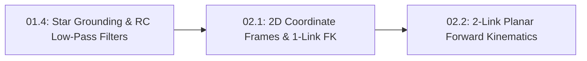

# Lesson 02.1: 2D Coordinate Frames and 1-Link Planar Arm Forward Kinematics

<!-- run-callout:start -->
> **Step 5 of 10 · Build the arm: mechanics**
>
> **Run this in the workbench.** [Open MechaLab with `02.1` loaded](https://tle47.github.io/Mechatronics-Roadmap/?lesson=02.1) - it opens on the **Run Python Lessons** tab with that entry selected. Starter code, hints and the graded check are ready; this page is the reading copy, and nothing you type here is saved.
<!-- run-callout:end -->

## Goal
Define a 2D **coordinate frame** (`Origin (0, 0)`, $+x$ right, $+y$ up, $+\theta$ counter-clockwise `CCW`) at a robot shoulder joint, and compute **1-link planar forward kinematics** ($x = L_1 \cos\theta_1$, $y = L_1 \sin\theta_1$) and its circular **workspace** boundary in Python.

- **New ideas (max 2):**
  1. **World vs. joint coordinate frames and right-hand counter-clockwise (`CCW`) angle sign convention**: Anchoring a fixed reference grid `(0, 0)` at the robot base with $+x$ horizontal right, $+y$ vertical up, and $+\theta_1$ rotating counter-clockwise from $+x$.
  2. **1-link planar forward kinematics ($x = L_1 \cos\theta_1$, $y = L_1 \sin\theta_1$) and circular workspace boundary**: Mapping known joint angle $\theta_1$ (`rad`) and link length $L_1$ (`m`) to tip Cartesian coordinates $(x, y)$ on a circle of radius $r = \sqrt{x^2 + y^2} = L_1$.
- **New syntax:** None (`math.cos`, `math.sin`, `math.radians`, `math.hypot` from Track P).
- **Target time (unmeasured — [log yours](../.github/ISSUE_TEMPLATE/beginner-timing-log.md)):** Typical: 1.0–1.5 hours | Slow-learner: 2.0–3.0 hours

---

## Prerequisites
- [Lesson P.6: Importing Standard Modules (`math`) & Automated Verification (`assert`)](../track-p/P.6-modules-and-automated-asserts.md)
- [Lesson P.10: Radians, Right-Triangle Trig (`sin`, `cos`) & `atan2(y, x)`](../track-p/P.10-radians-and-right-triangle-trig.md)
- [Lesson 00.3: Engineering Modeling Discipline — 4-Step Workflow, Dimensional Checks & Sign Conventions](../00-foundations/00.3-modeling-discipline-and-sanity-checks.md)



---

## Learn

### Idea 1: World vs. joint coordinate frames and right-hand counter-clockwise (CCW) angle sign convention
- **Primary resource:** [Math is Fun — Cartesian Coordinates](https://www.mathsisfun.com/data/cartesian-coordinates.html) `[HTTP 200 — Verified by scripts/check_links.py]`
  - **What to read:** Read exact headings **`Cartesian Coordinates`**, **`X and Y Axis`**, **`Writing Coordinates`**, and **`Four Quadrants`**.
  - **What to skip:** Skip 3D `(x, y, z)` coordinates (covered in Pass 2).
  - **Key takeaway:** Before writing a single line of robot arm math, you must fix a **coordinate frame** (reference axes):
    - **Origin `(0, 0)`:** Placed directly at the center of the stationary shoulder motor shaft.
    - **$+x$ axis:** Points horizontally to the **right** ($0^\circ = 0\text{ rad}$).
    - **$+y$ axis:** Points vertically **straight up** ($+90^\circ = +\pi/2\text{ rad}$).
    - **Positive angle $+\theta_1$:** Rotates **counter-clockwise (`+CCW`)** from $+x$ toward $+y$.

### Idea 2: 1-link planar forward kinematics ($x = L_1 \cos\theta_1$, $y = L_1 \sin\theta_1$) and circular workspace boundary
- **Primary resource:** [Math is Fun — Sine, Cosine and Tangent](https://www.mathsisfun.com/sine-cosine-tangent.html) `[HTTP 200 — Verified by scripts/check_links.py]`
  - **What to read:** Review exact headings **`Right Triangle`** and **`Sine, Cosine and Tangent`** (connecting hypotenuse $L_1$ and angle $\theta_1$ to horizontal $x$ and vertical $y$).
  - **What to skip:** Skip secant/cosecant/cotangent identities.
  - **Key takeaway:** **Forward Kinematics (`FK`)** answers the question: "Given the motor's joint angle $\theta_1$, where is the tip of the arm $(x, y)$ in the world coordinate frame?" For a single rigid link of length $L_1$ rotating around the origin `(0, 0)`, right-triangle trigonometry (`Lesson P.10`) gives $x = L_1 \cdot \cos(\theta_1)$ and $y = L_1 \cdot \sin(\theta_1)$. Because $\cos^2(\theta_1) + \sin^2(\theta_1) = 1$, the tip's distance from the shoulder is always $\sqrt{x^2 + y^2} = L_1$. The set of all points the tip can reach is called the robot's **workspace**—for a 1-link arm, a circle of radius $L_1$!
  - **Alternative resource:** [PhET — Trig Tour](https://phet.colorado.edu/en/simulations/trig-tour) `[verify in-app]` — Drag the unit-circle point `[verify in-app]` through all four quadrants to see $(x, y) = (\cos\theta, \sin\theta)$ change signs.

### Bridge Notes
In robotics, **Forward Kinematics (`FK`)** always flows from **joint space** (the angles measured by motor encoders, like $\theta_1$) to **Cartesian world space** (the $(x, y)$ coordinates in meters inside the room's fixed **coordinate frame**). By anchoring the world origin `(0, 0)` at the shoulder shaft with $+x$ pointing horizontally right, $+y$ pointing vertically up, and positive angle $+\theta_1$ rotating counter-clockwise (`CCW`), right-triangle trigonometry gives the tip position for any link length $L_1$:

$$
x = L_1 \cdot \cos(\theta_1), \qquad y = L_1 \cdot \sin(\theta_1), \qquad r = \sqrt{x^2 + y^2} = L_1
$$

Applying the 4-step modeling discipline from `Lesson 00.3`, we always check the four cardinal boundary angles (`0 deg`, `+90 deg`, `+180 deg`, and `-90 deg`) for a link of length $L_1 = 0.25\text{ m}$ ($250\text{ mm}$) to confirm that the signs of $x$ and $y$ match each quadrant and that the distance from the origin is always $r = 0.250\text{ m}$:

| Joint Angle $\theta_1$ (Degrees) | Joint Angle $\theta_1$ (Radians) | Tip $x = L_1 \cos\theta_1$ (`m`) | Tip $y = L_1 \sin\theta_1$ (`m`) | Radius $r = \sqrt{x^2 + y^2}$ (`m`) |
| :--- | :--- | :--- | :--- | :--- |
| **`0 deg` (Right `+x`)** | $0.000\text{ rad}$ | $+0.250\text{ m}$ | $+0.000\text{ m}$ | $0.250\text{ m}$ |
| **`+90 deg` (Up `+y`)** | $+1.571\text{ rad}$ | $+0.000\text{ m}$ | $+0.250\text{ m}$ | $0.250\text{ m}$ |
| **`+180 deg` (Left `-x`)** | $+3.142\text{ rad}$ | $-0.250\text{ m}$ | $+0.000\text{ m}$ | $0.250\text{ m}$ |
| **`-90 deg` (Down `-y`)** | $-1.571\text{ rad}$ | $+0.000\text{ m}$ | $-0.250\text{ m}$ | $0.250\text{ m}$ |

Notice that a 1-link arm only has **1 degree of freedom (`1-DOF`)** ($\theta_1$), so its **workspace** is strictly the 1D circular boundary of radius $r = L_1$; to reach inside the circle at varying radii, we will add a second link in `Lesson 02.2`!

---

## Do it yourself

- **What is simulated and in which tool:**
  - **In Python 3:** Complete `fk_1link` (`TODO 1`) to compute $(x, y)$ from link length $L_1$ (`m`) and joint angle $\theta_1$ (`deg`), and complete `verify_circular_workspace` (`TODO 2`) using `assert` to confirm that $\sqrt{x^2 + y^2} = L_1$ at every angle.
- **What is real-hardware only:** Mechanical hard-stop brackets and cable-wrap limits that restrict a physical shoulder joint to less than a full $360^\circ$ rotation.

### Starter Code (runs as-is — fill in the TODOs)
Save as `fk_1link.py` and run `python3 fk_1link.py`:

```python
import math


def fk_1link(l1_m, theta1_deg):
    # TODO 1: Convert theta1_deg to radians (t1_rad = math.radians(theta1_deg))
    #         and return (l1_m * math.cos(t1_rad), l1_m * math.sin(t1_rad))
    return 0.0, 0.0


def verify_circular_workspace(l1_m, angle_list_deg):
    results = []
    for deg in angle_list_deg:
        x, y = fk_1link(l1_m, deg)
        r = math.sqrt(x * x + y * y)
        # TODO 2: Assert that abs(r - l1_m) < 1e-6 so every point lies on the circle r = l1_m
        results.append((deg, x, y, r))
    return results


samples = verify_circular_workspace(0.25, [0.0, 60.0, 90.0, 180.0])
for deg, x_m, y_m, r_m in samples:
    print(f"theta1={deg:5.1f} deg -> x={x_m:+6.3f} m, y={y_m:+6.3f} m (radius={r_m:.3f} m)")
```

### Expected Output
When `TODO 1` and `TODO 2` are completed, running the script prints:

```text
theta1=  0.0 deg -> x=+0.250 m, y=+0.000 m (radius=0.250 m)
theta1= 60.0 deg -> x=+0.125 m, y=+0.217 m (radius=0.250 m)
theta1= 90.0 deg -> x=+0.000 m, y=+0.250 m (radius=0.250 m)
theta1=180.0 deg -> x=-0.250 m, y=+0.000 m (radius=0.250 m)
```

### Hint Ladder

<details>
<summary><strong>Hint 1 (Concept nudge)</strong></summary>

In `TODO 1`, convert degrees to radians first (`t1_rad = math.radians(theta1_deg)`), then compute `x = l1_m * math.cos(t1_rad)` and `y = l1_m * math.sin(t1_rad)`. In `TODO 2`, write `assert abs(r - l1_m) < 1e-6`.
</details>

<details>
<summary><strong>Hint 2 (Formula / structure)</strong></summary>

```python
def fk_1link(l1_m, theta1_deg):
    t1_rad = math.radians(theta1_deg)
    return l1_m * math.cos(t1_rad), l1_m * math.sin(t1_rad)
```
</details>

<details>
<summary><strong>Full Solution</strong></summary>

```python
import math


def fk_1link(l1_m, theta1_deg):
    t1_rad = math.radians(theta1_deg)
    return l1_m * math.cos(t1_rad), l1_m * math.sin(t1_rad)


def verify_circular_workspace(l1_m, angle_list_deg):
    results = []
    for deg in angle_list_deg:
        x, y = fk_1link(l1_m, deg)
        r = math.sqrt(x * x + y * y)
        assert abs(r - l1_m) < 1e-6
        results.append((deg, x, y, r))
    return results


samples = verify_circular_workspace(0.25, [0.0, 60.0, 90.0, 180.0])
for deg, x_m, y_m, r_m in samples:
    print(f"theta1={deg:5.1f} deg -> x={x_m:+6.3f} m, y={y_m:+6.3f} m (radius={r_m:.3f} m)")
```
</details>

---

## Common mistakes & troubleshooting
- **Swapping $\cos$ and $\sin$ (`x = L1 * sin(theta1)`):** Check $\theta_1 = 0^\circ$! Along the horizontal $+x$ axis, $x$ must be $+L_1$ and $y$ must be $0$, which requires $x = L_1 \cos\theta_1$ and $y = L_1 \sin\theta_1$.
- **Measuring $\theta_1$ clockwise (`CW`) in one function and counter-clockwise (`CCW`) in another:** Always stick to the right-hand standard: $+x$ right, $+y$ up, $+\theta_1$ counter-clockwise (`CCW`).

---

## Check yourself

1. **Quadrant II coordinates:** A 1-link arm of length $L_1 = 0.20\text{ m}$ rotates counter-clockwise to $\theta_1 = +135^\circ$ (pointing up and to the left in Quadrant II). What are the signs (`+` or `-`) of $x$ and $y$?
   <details>
   <summary><strong>Answer</strong></summary>

   In Quadrant II (left of the origin, above the horizontal axis), **$x$ is negative (`-`)** ($-0.141\text{ m}$) and **$y$ is positive (`+`)** ($+0.141\text{ m}$).
   </details>

2. **Why a 1-link arm cannot reach inside its circle:** Can a rigid 1-link arm of fixed length $L_1 = 0.25\text{ m}$ place its tip at $(x, y) = (0.10\text{ m}, 0.10\text{ m})$?
   <details>
   <summary><strong>Answer</strong></summary>

   **No!** The point $(0.10, 0.10)$ is at radius $r = \sqrt{0.10^2 + 0.10^2} \approx 0.141\text{ m} \ne 0.25\text{ m}$. A 1-link arm can only reach points on its circular workspace rim $r = 0.25\text{ m}$; reaching interior radii requires a 2-link arm with an elbow joint (`Lesson 02.2`).
   </details>

---

## Recap
- A standard 2D **coordinate frame** places `(0, 0)` at the shoulder pivot with $+x$ right, $+y$ up, and $+\theta$ counter-clockwise (`CCW`).
- **1-link forward kinematics (`FK`)** maps joint angle $\theta_1$ to tip coordinates $(x, y) = (L_1 \cos\theta_1, L_1 \sin\theta_1)$ along a circular **workspace** of radius $L_1$.

### You're ready to move on when...
- [ ] Your `fk_1link.py` script passes all `assert` checks and prints the exact 4 coordinate lines.
- [ ] You can immediately state $(x, y)$ at $\theta_1 = 0^\circ, +90^\circ, +180^\circ, -90^\circ$ without a calculator.

<!-- next-step:start -->
👉 **Next:** [Step 5 · Build the arm: mechanics — Lesson 02.2: 2-Link Planar Arm Forward Kinematics (theta_1, theta_2 -> x, y)](02.2-2link-planar-forward-kinematics.md)
<!-- next-step:end -->
