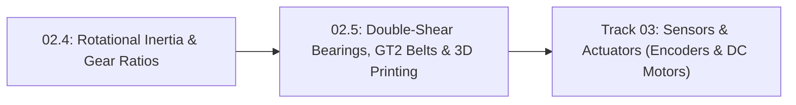

# Lesson 02.5: Practical Robot Mechanisms — Double-Shear Bearings, Timing Belts and 3D-Printed Parts

## Goal
Design reliable beginner robot joints that don't bend, wobble, or snap by supporting rotating shafts in **double shear** with ball bearings, sizing **GT2 timing belt** pulleys ($N = N_{\text{driven}} / N_{\text{driver}}$, pitch radius $r_p = \frac{N_{\text{teeth}} \cdot p}{2\pi}$) in Python, and orienting 3D-printed brackets with proper **clearance fits** (`+0.20 mm`).

- **New ideas (max 2):**
  1. **Cantilevered vs. double-shear shaft support**: Supporting both ends of a joint pin with radial ball bearings (like a `608` skate bearing) instead of hanging an arm off one unsupported (**cantilevered**) motor shaft.
  2. **GT2 timing belt pulley ratios and 3D-print layer-line load orientation (`0.20 mm` clearance)**: Using a $2.0\text{ mm}$-pitch toothed belt to transmit zero-backlash torque from a base-mounted motor, while orienting 3D-printed layer lines parallel to tension and adding clearance so printed holes fit real shafts.
- **New syntax:** None (`math.pi` from Lesson P.6).
- **Estimated time (untimed guesses):** Typical: 1.5–2.0 hours | Slow-learner: 2.5–3.0 hours

---

## Prerequisites
- [Lesson P.7: Base SI Units & Metric Prefixes (`M`, `k`, `m`, `µ`)](../track-p/P.7-si-units-and-metric-prefixes.md)
- [Lesson P.12: Forces, Newton's Second Law & Lever Torque](../track-p/P.12-forces-and-lever-torque.md)
- [Lesson 02.4: Rotational Dynamics, Gear Ratios & Reflected Inertia](02.4-rotational-inertia-and-gear-ratios.md)



---

## Learn

### Idea 1: Cantilevered vs. double-shear shaft support (why hanging a load off a bare motor shaft bends it)
- **Primary resource:** [Wikipedia — Ball bearing ("Common designs" & "Deep-groove")](https://en.wikipedia.org/wiki/Ball_bearing) `[HTTP 200 — Verified by scripts/check_links.py]`
  - **What to read:** Read exact headings **`Ball bearing`**, **`Common designs`**, and **`Deep-groove`**.
  - **What to skip:** Skip axial preload life-fatigue equations (covered in Pass 2).
  - **Key takeaway:** The #1 mechanical mistake in beginner robotics is bolting a long robot arm directly onto a motor's bare $4\text{ mm}$ output shaft with nothing supporting the far end. That one-sided overhang is called a **cantilevered** shaft: any sideways weight or belt tension acts on a lever arm that bends the shaft and crushes the tiny internal motor bushings! Supporting the shaft on **both sides** of the rotating link inside two ball bearings (such as ubiquitous **`608` deep-groove ball bearings**: $8\text{ mm}$ inner bore, $22\text{ mm}$ outer diameter, $7\text{ mm}$ width) places the pin in **double shear**—splitting the load across two supports and making the joint over $16\times$ stiffer!

### Idea 2: GT2 timing belt pulley ratios and 3D-print layer-line load orientation (0.20 mm clearance)
- **Primary resource:** [Wikipedia — Toothed belt ("Design and application")](https://en.wikipedia.org/wiki/Toothed_belt) `[HTTP 200 — Verified by scripts/check_links.py]`
  - **What to read:** Read exact headings **`Toothed belt`** and **`Design and application`**.
  - **What to skip:** Skip automotive camshaft history.
  - **Key takeaway:** In `Lesson 02.4`, we saw that keeping heavy motors near the shoulder base dramatically lowers arm inertia $I_{\text{rot}} = m r^2$. A fiberglass-reinforced **`GT2` timing belt** (**timing belt pitch** $p = 2.0\text{ mm}$ between teeth) lets a base-mounted motor drive a distant elbow pulley with **near-zero backlash**! A driver pulley with $N_{\text{driver}}$ teeth and driven pulley with $N_{\text{driven}}$ teeth have:
    - **Pulley Circumference:** $C_{\text{pulley}} = N_{\text{teeth}} \cdot p$
    - **Pitch Radius:** $r_p = \frac{N_{\text{teeth}} \cdot p}{2\pi}$
    - **Reduction Ratio:** $N = \frac{N_{\text{driven}}}{N_{\text{driver}}}$
  - **Alternative resource:** [Wikipedia — Fused filament fabrication ("Process" & "Physics of the process")](https://en.wikipedia.org/wiki/Fused_filament_fabrication) `[HTTP 200 — Verified by scripts/check_links.py]` — Read exact headings **`Fused filament fabrication`** and **`Process`** to see why 3D prints are strong along continuous horizontal (`X-Y`) filament lines and weak between stacked vertical (`Z`) layers, and why melted plastic holes shrink slightly inward (requiring a `+0.20 mm` clearance fit for free-spinning bolts and `+0.10 mm` for a snug bearing press-fit).

### Bridge Notes
When designing a 3D-printed robot joint driven by a **`GT2` timing belt** ($p = 2.0\text{ mm}$ tooth pitch), always support the joint pin in **double shear** between two radial ball bearings rather than leaving it on a one-sided **cantilevered** motor shaft:
1. **Pulley Pitch Radius & Belt Tension Force (Why Double Shear Is Essential):**
   A pulley with $N_{\text{teeth}}$ teeth has circumference $N_{\text{teeth}} \cdot p$, so its effective lever arm (**pitch radius** $r_p$) and the belt tension pull $\Delta F_{\text{belt}}$ required to transmit torque $\tau_{\text{pulley}}$ are:

$$
r_p = \frac{N_{\text{teeth}} \cdot p}{2\pi}, \qquad N_{\text{ratio}} = \frac{N_{\text{driven}}}{N_{\text{driver}}}, \qquad \Delta F_{\text{belt}} = \frac{\tau_{\text{pulley}}}{r_p}
$$

   For example, a $20$-tooth `GT2` driver pulley ($p = 2.0\text{ mm}$) driving a $60$-tooth joint pulley gives a $N = \frac{60}{20} = 3.0:1$ reduction with driven pitch radius $r_{p,2} = \frac{60 \times 2.0}{2\pi} \approx 19.10\text{ mm}$ ($0.01910\text{ m}$), producing $\Delta F_{\text{belt}} = \frac{1.50}{0.01910} = 78.5\text{ N}$ of sideways pull that a double-shear bearing pair carries effortlessly.

2. **3D-Printed Layer-Line Orientation & Hole Clearance Fits (`0.20 mm` clearance):**
   Print structural links flat on the bed so filament strands run parallel to tension, and add **`+0.20 mm` diameter clearance** (`3.20 mm` CAD hole for an `M3` bolt) for a free-sliding **clearance fit** and **`+0.10 mm`** (`22.10 mm` CAD bore for a $22.00\text{ mm}$ `608` bearing) for a snug press fit.

---

## Do it yourself

- **What is simulated and in which tool:**
  - **In Python 3:** Complete `gt2_belt_drive` (`TODO 1`) to calculate the reduction ratio $N$, driven pulley pitch radius $r_p$ (in `mm`), and belt tension force $\Delta F_{\text{belt}} = \tau_{\text{out}} / r_{p,\text{m}}$ (in `N`), and complete `cad_hole_diameters_mm` (`TODO 2`) to apply the `+0.10 mm` bearing press-fit and `+0.20 mm` bolt clearance-fit rules.
- **What is real-hardware only:** Snapping a physical 3D-printed bracket along its weak `Z`-axis layer lines vs. testing a part printed flat on the `X-Y` build plate.

### Starter Code (runs as-is — fill in the TODOs)
Save as `belts_and_clearances.py` and run `python3 belts_and_clearances.py`:

```python
import math


def gt2_belt_drive(n_driver_teeth, n_driven_teeth, tau_out_nm, pitch_mm=2.0):
    # TODO 1: Compute:
    #   ratio_n = n_driven_teeth / n_driver_teeth
    #   r_driven_mm = (n_driven_teeth * pitch_mm) / (2.0 * math.pi)
    #   r_driven_m  = r_driven_mm / 1000.0
    #   belt_force_n = tau_out_nm / r_driven_m
    ratio_n = 0.0
    r_driven_mm = 0.0
    belt_force_n = 0.0
    return ratio_n, r_driven_mm, belt_force_n


def cad_hole_diameters_mm(bearing_od_mm=22.0, bolt_od_mm=3.0):
    # TODO 2: Add +0.10 mm for a 3D-printed bearing press-fit bore and
    #         +0.20 mm for a free-sliding M3 bolt clearance fit
    bearing_bore_mm = 0.0
    bolt_clearance_hole_mm = 0.0
    return bearing_bore_mm, bolt_clearance_hole_mm


ratio, r_mm, f_belt = gt2_belt_drive(20, 60, tau_out_nm=1.50)
bore_608, hole_m3 = cad_hole_diameters_mm(22.0, 3.0)

print(f"GT2 20T->60T ratio = {ratio:.1f}:1 | Driven pitch radius = {r_mm:.2f} mm | Belt pull = {f_belt:.1f} N")
print(f"CAD 608 bearing bore = {bore_608:.2f} mm | CAD M3 clearance hole = {hole_m3:.2f} mm")
```

### Expected Output
When `TODO 1` and `TODO 2` are completed, running the script prints:

```text
GT2 20T->60T ratio = 3.0:1 | Driven pitch radius = 19.10 mm | Belt pull = 78.5 N
CAD 608 bearing bore = 22.10 mm | CAD M3 clearance hole = 3.20 mm
```

### Hint Ladder

<details>
<summary><strong>Hint 1 (Concept nudge)</strong></summary>

In `TODO 1`, the driven pulley's circumference is `n_driven_teeth * pitch_mm` (`60 * 2.0 = 120.0 mm`), so its pitch radius is `120.0 / (2 * math.pi) = 19.0986 mm` (`0.0190986 m`). Divide `tau_out_nm` (`1.50 N*m`) by `r_driven_m` in meters to get `78.5 N`.
</details>

<details>
<summary><strong>Hint 2 (Formula / structure)</strong></summary>

```python
def gt2_belt_drive(n_driver_teeth, n_driven_teeth, tau_out_nm, pitch_mm=2.0):
    ratio_n = n_driven_teeth / n_driver_teeth
    r_driven_mm = (n_driven_teeth * pitch_mm) / (2.0 * math.pi)
    r_driven_m = r_driven_mm / 1000.0
    belt_force_n = tau_out_nm / r_driven_m
    return ratio_n, r_driven_mm, belt_force_n
```
</details>

<details>
<summary><strong>Full Solution</strong></summary>

```python
import math


def gt2_belt_drive(n_driver_teeth, n_driven_teeth, tau_out_nm, pitch_mm=2.0):
    ratio_n = n_driven_teeth / n_driver_teeth
    r_driven_mm = (n_driven_teeth * pitch_mm) / (2.0 * math.pi)
    r_driven_m = r_driven_mm / 1000.0
    belt_force_n = tau_out_nm / r_driven_m
    return ratio_n, r_driven_mm, belt_force_n


def cad_hole_diameters_mm(bearing_od_mm=22.0, bolt_od_mm=3.0):
    bearing_bore_mm = bearing_od_mm + 0.10
    bolt_clearance_hole_mm = bolt_od_mm + 0.20
    return bearing_bore_mm, bolt_clearance_hole_mm


ratio, r_mm, f_belt = gt2_belt_drive(20, 60, tau_out_nm=1.50)
bore_608, hole_m3 = cad_hole_diameters_mm(22.0, 3.0)

print(f"GT2 20T->60T ratio = {ratio:.1f}:1 | Driven pitch radius = {r_mm:.2f} mm | Belt pull = {f_belt:.1f} N")
print(f"CAD 608 bearing bore = {bore_608:.2f} mm | CAD M3 clearance hole = {hole_m3:.2f} mm")
```
</details>

---

## Common mistakes & troubleshooting
- **Tensioning a GT2 timing belt onto an unsupported cantilevered motor shaft:** Notice in our calculation above that just $1.50\text{ N}\cdot\text{m}$ of joint torque creates **$78.5\text{ N}$ ($\sim 8\text{ kg}$ of sideways pull!)** on the belt! Always support the pulley shaft in **double shear** with two bearings so that $78.5\text{ N}$ sideways pull goes into the frame bearings instead of bending the motor shaft.
- **Printing a long robot arm link standing vertically (`Z`-axis) on the 3D printer bed:** Bending loads will peel the horizontal layer lines apart like a stack of crackers. Always print structural links lying flat on the `X-Y` build plate so continuous filament strands run the full length of the arm.

---

## Check yourself

1. **Cantilevered vs. Double Shear:** Why is capturing both ends of a joint pin in two bearings (**double shear**) vastly stronger than supporting the pin from one side only (**cantilevered**)?
   <details>
   <summary><strong>Answer</strong></summary>

   In **double shear**, radial loads are shared across two bearing supports on either side of the link with minimal bending lever arm, preventing the shaft from tilting, binding, or bending under load.
   </details>

2. **GT2 pulley pitch diameter:** What is the circumference and pitch diameter ($2 r_p$) of a $40$-tooth `GT2` pulley ($p = 2.0\text{ mm}$)?
   <details>
   <summary><strong>Answer</strong></summary>

   - Circumference: $40 \times 2.0\text{ mm} = \mathbf{80.0\text{ mm}}$.
   - Pitch diameter: $\frac{80.0\text{ mm}}{\pi} \approx \mathbf{25.46\text{ mm}}$ (pitch radius $r_p \approx 12.73\text{ mm}$).
   </details>

---

## Recap
- Support rotating joint shafts on both ends in **double shear** with radial ball bearings (`608`) rather than hanging loads on a **cantilevered** motor shaft.
- A **`GT2` timing belt** ($p = 2.0\text{ mm}$ **timing belt pitch**) transmits low-backlash motion with ratio $N = N_{\text{driven}} / N_{\text{driver}}$ and pitch radius $r_p = \frac{N_{\text{teeth}} \cdot p}{2\pi}$; orient 3D-printed links flat on the bed and include a **`+0.20 mm` clearance fit** on bolt holes.

### You're ready to move on when...
- [ ] Your `belts_and_clearances.py` script prints `3.0:1`, `19.10 mm`, `78.5 N`, `22.10 mm`, and `3.20 mm`.
- [ ] You completed all Track 02 Tier 1 mechanics lessons (`02.1–02.5`) and can explain why double-shear bearings and `+0.20 mm` 3D-printed clearance holes prevent binding.
- **Next lesson:** [Lesson 03.1: Quadrature Encoders (4x Counting) & 12-Bit Magnetic Angle Sensors](../03-sensors-and-actuators/03.1-quadrature-and-magnetic-encoders.md)
