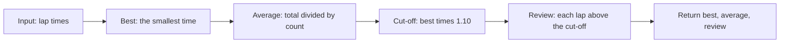

# Lesson 02.6: Think in Comments — Draft the Logic Before You Type Code

<!-- run-callout:start -->
> **Step 5 of 10 · Build the arm: mechanics**
>
> **Run this in the workbench.** [Open MechaLab with `02.6` loaded](https://tle47.github.io/Mechatronics-Roadmap/?lesson=02.6) - it opens on the **Run Python Lessons** tab with that entry selected. Starter code, hints and the graded check are ready; this page is the reading copy, and nothing you type here is saved.
<!-- run-callout:end -->

## Goal
Solve a small robot problem the way an engineer does: **write the thinking down as comments first**, turn each comment into one line of code, and check the edges before believing the answer. The problem is a lap report for a test robot: how fast was the best lap, what was the average, and which laps were more than 10% slower than the best?

- **New ideas (max 2):**
  1. **Comments as a plan:** Before typing code, write the problem as ordered comments — what goes in, what comes out, what "empty" means, and what the expected output looks like. A comment you cannot turn into one line is a question you have not answered yet.
  2. **First draft, then edges:** Write the simplest version that works for the normal case (`[12.4, 11.8, 13.9, 12.1]`), run it, then deliberately try the awkward cases (one lap, an empty list, a tie for fastest). A program is not finished when it works once; it is finished when you can say which cases you checked.
- **New syntax:** None. You already have `def`, lists, `min`, `sum`, `len`, and f-strings. This lesson is about the order you use them in.
- **Target time (unmeasured — [log yours](../.github/ISSUE_TEMPLATE/beginner-timing-log.md)):** Typical: 1.5–2.0 hours | Slow-learner: 2.5–3.0 hours

### Requirements (what counts as complete)

Your finished program must satisfy **all** of these conditions:

- [ ] **Runs:** every TODO is completed and the script finishes without a Python error.
- [ ] **Types and given values:** keep the names, types, and units the starter gives; leave any value a TODO does not name unchanged.
- [ ] **Required end state:** `lap_report` returns the fastest lap, the average lap, and the list of laps slower than `best * (1 + slow_margin)`.
- [ ] **Empty input:** `lap_report([])` returns `(0.0, 0.0, [])` instead of crashing on `min([])`.
- [ ] **Exact strings:** the two printed lines match the Expected Output block spelling and spacing.
- [ ] **Alternate inputs:** the checked call changes the lap list, so a hard-coded answer fails.

## Prerequisites

- [Lesson P.6: Modules, Assert Statements & Reading a Traceback](../track-p/P.6-modules-and-automated-asserts.md)
- [Lesson 02.1: 2D Coordinate Frames and 1-Link Planar Arm Forward Kinematics](02.1-1d-link-fk-and-coord-frames.md)
- You can read a list and a `for` loop without looking them up.

## Learn

### Idea 1: Comments are the plan — inputs, edges, expected output, then code

- **Primary resource:** [Lesson P.6: Modules, Assert Statements & Reading a Traceback](../track-p/P.6-modules-and-automated-asserts.md)
- **What to read:** the section that shows what a passing self-check looks like, and the traceback lines that name the failing line.
- **What to skip:** the import mechanics; this lesson only uses names you already have.
- **Key takeaway:** A comment that names the input, the output, the edge and the check is a plan you can code one line at a time.

A beginner often opens the editor and starts typing `def` because that feels like starting. Then the hard questions arrive halfway through the function: what if the list is empty? Is "slow" measured from the best lap or the average? Should the slow laps be printed or returned? Each question forces a rewrite.

An engineer answers those questions **before** the code, in ordinary language, at the top of the file:

```text
# Input: a list of lap times in seconds.
# Output: the best lap, the average lap, and the laps more than 10% slower than the best.
# Edge: an empty list has no best lap, so return zeros and no laps.
# Check: [12.4, 11.8, 13.9, 12.1] -> best 11.8, average 12.55, review 13.9.
```

This is not busywork. Each line is a test you can grade yourself against:

- **Input and output** decide the function's signature and what it returns. Here the function takes `times` and returns three things, so the caller unpacks three names.
- **Edge** decides the branch you would otherwise forget. `min([])` raises an error, so the empty case must return before it.
- **Check** gives you a concrete expected answer. Without it, "it ran" is the only thing you can say, and "it ran" is not the same as "it is right".

The rule of thumb: **one comment, one line of code.** If a comment needs three lines, it is really two or three steps; split it. If a line of code has no comment above it, ask whether you can explain why it exists. Code says *what*; the comment above it says *why this step is here*.

### Idea 2: First draft on paper, then make the edges fail

- **Primary resource:** [Lesson 02.1: 2D Coordinate Frames and 1-Link Planar Arm Forward Kinematics](02.1-1d-link-fk-and-coord-frames.md)
- **What to read:** the worked example that turns a formula into a short function, and the check it prints at the end.
- **What to skip:** the coordinate-frame derivation; this lesson is about the order of the steps, not the geometry.
- **Key takeaway:** A first draft is finished only when you have tried the empty case, the one-item case, the tie and the boundary.

The first draft is allowed to be incomplete; it is not allowed to be vague. Write it in this order:

1. **Restate the problem in one sentence.** "Given lap times, report the best, the average, and the laps that were much slower."
2. **Name the pieces.** `times`, `best`, `average`, `slow_margin`, `slow`.
3. **Write the steps as comments.** Find the best. Add them up and divide. Compare each lap with a cut-off. Handle the empty list first.
4. **Turn each comment into code, top to bottom.** Run after each step, not after all of them.
5. **Try to break it.** One lap. Empty list. Two laps tied for best. A lap exactly at the cut-off.

Step 5 is where the learning happens. A program that passes the example is a hypothesis; the edges are the experiment. When an edge fails, you have found a question your plan did not answer — go back to the comments, answer it there, and only then change the code.

The cut-off deserves a second look because it is easy to get subtly wrong. "10% slower than the best" means `best * 1.10`, not `best + 10` and not 10% slower than the average. A lap exactly on the cut-off is **not** more than 10% slower, so the comparison is `>`, not `>=`. Writing that sentence as a comment before the code is how you catch it:

```text
# A lap is slow when it is strictly greater than best * (1 + slow_margin).
```



<!-- figure: signal-chain | The plan in one line: what goes in, what comes out, the edge, and the check. -->

### Bridge Notes

The same four comments work on every arm lesson. In Lesson 02.1 the input is a joint angle and a link length, the output is the tip position, the edge is a link of zero length, and the check is the angle-zero case you can work out by hand. Writing those four lines first turns a page of formulas into a short list of jobs: one line turns the angle into a direction, one scales the link, and one adds the base. The comments are also the debugging order. When the tip position is wrong, you can ask which comment failed instead of rereading the whole function. A first draft in comments is cheap to change: moving a step or adding the edge case is one line of prose, not a rewrite of working code. The habit carries into every later lesson: inputs, output, edge, check — then code, one comment at a time.

## Do it yourself

### Starter Code (runs as-is — fill in the TODOs)

Save as `lap_report.py` and run `python3 lap_report.py`:

- **What is simulated and in which tool:**
  - **In Python 3:** the lap report and its edge cases, run in the workbench's Python tab with the checked call.
- **What is real-hardware only:** timing a real robot's laps with a stopwatch or an encoder, and the mechanical reasons one lap is slower than another.

```python
# The plan, in comments, before any code:
# 1. The best lap is the smallest time in the list.
# 2. The average is the sum of the times divided by how many there are.
# 3. A lap needs review when it is strictly more than 10% slower than the best.
# 4. An empty list has no best lap: return zeros and no laps instead of crashing.

LAP_TIMES_S = [12.4, 11.8, 13.9, 12.1]


def lap_report(times, slow_margin=0.10):
    # TODO 1: Handle the empty list first, then fill in the three results the plan describes.
    #         Compute them from the function's parameters and the starter values; do not return a hard-coded answer.
    best = 0.0  # s, the fastest lap
    average = 0.0  # s, the mean lap time
    slow = []
    return best, average, slow


best, average, slow = lap_report(LAP_TIMES_S)
print(f"Best lap = {best:.1f} s | Average = {average:.2f} s")
print("Laps to review: " + ", ".join(f"{time:.1f} s" for time in slow))
```

**What each name means** (read this beside the code):

1. **Inputs** — `times` is a list of lap times in seconds; `slow_margin` is the fraction that counts as "much slower" (0.10 means 10%).
2. **Results** — `best` is the fastest lap, `average` is the mean lap, and `slow` is the list of laps above the cut-off, in the order they were run.
3. **Given values** — keep `LAP_TIMES_S` and the default `slow_margin` unchanged; the checked call supplies its own list.

### Expected Output

When `TODO 1` is completed, running the script prints:

```text
Best lap = 11.8 s | Average = 12.55 s
Laps to review: 13.9 s
```

### Hint Ladder

<details>
<summary><strong>Hint 1 (Concept nudge)</strong></summary>

Do the empty case before anything else: `if not times: return 0.0, 0.0, []`. Then `best = min(times)` and `average = sum(times) / len(times)`. The cut-off is `best * (1 + slow_margin)`; a lap is in `slow` when `time > cutoff`.
</details>

<details>
<summary><strong>Hint 2 (Formula / structure)</strong></summary>

```python
def lap_report(times, slow_margin=0.10):
    if not times:
        return 0.0, 0.0, []
    best = min(times)
    average = sum(times) / len(times)
    cutoff = best * (1.0 + slow_margin)
    slow = [time for time in times if time > cutoff]
    return best, average, slow
```
</details>

<details>
<summary><strong>Full Solution</strong></summary>

```python
LAP_TIMES_S = [12.4, 11.8, 13.9, 12.1]


def lap_report(times, slow_margin=0.10):
    if not times:
        return 0.0, 0.0, []
    best = min(times)
    average = sum(times) / len(times)
    cutoff = best * (1.0 + slow_margin)
    slow = [time for time in times if time > cutoff]
    return best, average, slow


best, average, slow = lap_report(LAP_TIMES_S)
print(f"Best lap = {best:.1f} s | Average = {average:.2f} s")
print("Laps to review: " + ", ".join(f"{time:.1f} s" for time in slow))
```
</details>

---

## Common mistakes & troubleshooting

- **Writing the code first and the comments afterwards.** The comments then describe what you happened to write, mistakes included. Write the plan first; the code is the part you can throw away and retype.
- **Returning a hard-coded answer.** `return 11.8, 12.55, [13.9]` passes the example and fails the moment the checked call changes the list. Compute from `times`.
- **Using `best + 10` for "10% slower".** Percentages scale with the value: `best * 1.10`. A 10-second lap gets a 1-second allowance; a 20-second lap gets 2 seconds.
- **Forgetting the empty list.** `min([])` raises `ValueError`. The `if not times` line is not defensive decoration; it is the answer to the "Edge" comment.
- **Using `>=` on the cut-off.** A lap exactly 10% slower is not *more than* 10% slower. The word "more" is the specification.

## Check yourself

1. **Why write the expected output before the code?**

<details>
<summary><strong>Answer</strong></summary>

Because it turns "it ran" into a prediction you can be wrong about. A predicted output is a test; an unpredicted output is only a description of what the program did.
</details>

2. **Which case should you handle first in `lap_report`, and why?**

<details>
<summary><strong>Answer</strong></summary>

The empty list. The smallest value, the mean and the cut-off all assume at least one lap, so the case that breaks that assumption must return before they run.
</details>

3. **A lap takes 13.0 s and the best is 11.8 s. Is it in the review list?**

<details>
<summary><strong>Answer</strong></summary>

Yes. The cut-off is `11.8 * 1.10 = 12.98`, and `13.0 > 12.98`. A lap of exactly `12.98` would not be included, because the rule is *more than* 10% slower.
</details>

## Recap

- Write the plan as comments: **input, output, edge, check**. One comment, one line of code.
- Draft the simple case first, then try the edges: empty, one item, a tie, the boundary.
- Percentage cut-offs scale with the value (`best * (1 + margin)`), and "more than" means `>`.
- A program is finished when you can name the cases you checked, not when it runs once.

### You're ready to move on when...

- [ ] `lap_report.py` prints `Best lap = 11.8 s | Average = 12.55 s` and `Laps to review: 13.9 s`.
- [ ] You can explain, in one sentence each, why the empty list is handled first and why the comparison is `>`.
- [ ] You wrote the four plan comments for the next exercise before writing any of its code.

<!-- next-step:start -->
👉 **Next:** [Step 5 · Build the arm: mechanics — 02-mechanics.T1.02a: Free-Body Diagrams, Gravity Lever-Arm Torque & Gear Speed/Torque Power Scaling](../modules/02-mechanics.T1.02a.md)
<!-- next-step:end -->
