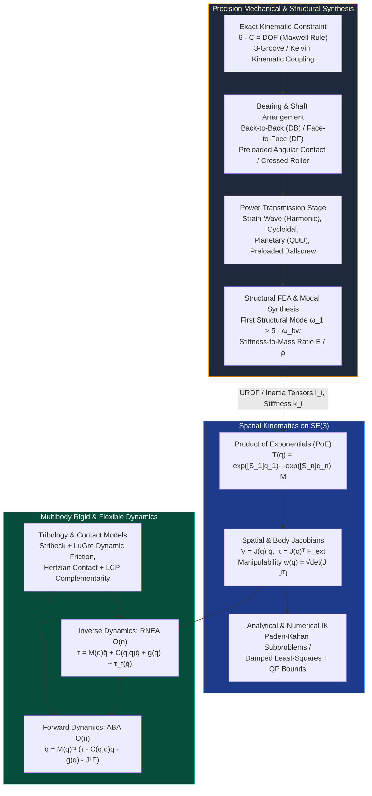

# Track 02: Precision Mechanical Design, Kinematics & Multibody Dynamics

> **Part of the [MechaLab Multi-Pass Tiered Roadmap](../README.md)**  
> **Prerequisites:** [Track 00: Foundations, Bench Intuition & Multi-Domain Mathematics](../00-foundations/README.md)  
> **Feeds Into:** [Track 03: Sensors & Actuators](../03-sensors-and-actuators/README.md), [Track 05: Control & Estimation](../05-control-and-estimation/README.md), [Track 06: Robotics & Autonomy](../06-robotics-and-autonomy/README.md)  
> **Core Principle:** Software cannot compensate for non-repeatable mechanical hysteresis, lost motion, or structural compliance inside the control bandwidth. Precision mechanical engineering eliminates friction and backlash through exact kinematic constraint, preloaded rolling elements, or monolithic flexures—and provides the exact differential equations that model-based controllers exploit.

---

## 🔄 Linear Level-Up Navigation (Follow Your Current Pass Across Track 00 → Track 08)

Complete **only your current Tier section** below, verify its hands-on milestone, and proceed directly to **Track 03 in the same Tier**:

| Pass / Level | Previous Step in Pass | Current Track 02 Section | Next Linear Step in This Pass |
| :--- | :--- | :--- | :--- |
| **🟢 Pass 1: Tier 1 (Beginner)** | [← Track 01 (Tier 1)](../01-electronics-and-power/README.md#tier-1-beginner--intuitive) | [§1 Tier 1: 2D Planar Kinematics, Gear Ratios (N² Inertia) & Bearings](#tier-1-beginner--intuitive) | [**Next in Pass 1 → Track 03 (Tier 1: Encoders & `SimpleFOC`)**](../03-sensors-and-actuators/README.md#tier-1-beginner--intuitive) |
| **🔵 Pass 2: Tier 2 (Applied)** | [← Track 01 (Tier 2)](../01-electronics-and-power/README.md#tier-2-intermediate--applied) | [§2 Tier 2: Maxwell Exact Constraint, `CadQuery` & URDF/MuJoCo](#tier-2-intermediate--applied) | [**Next in Pass 2 → Track 03 (Tier 2: Clarke/Park & Velocity PLL)**](../03-sensors-and-actuators/README.md#tier-2-intermediate--applied) |
| **🌉 Bridge Concept** | — | [§3 Bridging the Gap: 200:1 Hobby Servos → 8:1 Backdrivable QDD Planetary](#bridging-the-gap-maker-to-custom) | [Inspect Tier 3 Production Mastery ↓](#tier-3-advanced--production) |
| **🟣 Pass 3: Tier 3 (Production)** | [← Track 01 (Tier 3)](../01-electronics-and-power/README.md#tier-3-advanced--production) | [§4 Tier 3: Screw PoE on SE(3), `Ti-6Al-4V` Flexures & O(n) RNEA](#tier-3-advanced--production) | [**Next in Pass 3 → Track 03 (Tier 3: 40 kHz Decoupled FOC & SVPWM)**](../03-sensors-and-actuators/README.md#tier-3-advanced--production) |

---

## Tier 1 (Beginner / Intuitive)

> **Goal of Pass 1 (Track 02):** Ramp smoothly from **1-Link Planar Forward Kinematics (`02.1`)** $\to$ **2-Link Planar Forward Kinematics (`02.2`)** $\to$ **2-Link Planar Inverse Kinematics (`02.3`)**, then master **Rotational Inertia & Gear Ratios ($N^2$ reflected inertia, `02.4`)** and **Double-Shear Bearings, Timing Belts & 3D-Printed Parts (`02.5`)**.

### 🟢 Track 02 — Tier 1 Beginner Lessons (`02.1`–`02.5`)

| Lesson | Topic | New Ideas (Max 2, Enforced in Front Matter) | Simulator / Tool | Typical Time | Slow-Learner Time |
| :--- | :--- | :--- | :--- | :--- | :--- |
| **[Lesson 02.1](02.1-1d-link-fk-and-coord-frames.md)** | **2D Coordinate Frames & 1-Link Planar Arm Forward Kinematics** | 1. World vs. joint coordinate frames & right-hand CCW angle sign convention<br>2. 1-link planar forward kinematics ($x = L\cos\theta$, $y = L\sin\theta$) & circular workspace | Python (futurecoder.io) | 1.0–1.5 hrs | 2.0–3.0 hrs |
| **[Lesson 02.2](02.2-2link-planar-forward-kinematics.md)** | **2-Link Planar Arm Forward Kinematics ($\theta_1, \theta_2 \to x, y$)** | 1. Absolute link angle ($\theta_{12} = \theta_1 + \theta_2$) from relative elbow angle $\theta_2$<br>2. Chaining tip-to-tail vectors for 2-link forward kinematics & annular reach envelope | Python (futurecoder.io) | 1.5–2.0 hrs | 2.5–3.5 hrs |
| **[Lesson 02.3](02.3-2link-planar-inverse-kinematics.md)** | **2-Link Planar Arm Inverse Kinematics ($x, y \to \theta_1, \theta_2$) & Reachability** | 1. Law of Cosines for elbow angle & reachability clamping<br>2. Elbow-down vs. elbow-up geometric solutions & shoulder angle via `math.atan2` | Python (futurecoder.io) | 1.5–2.0 hrs | 2.5–3.5 hrs |
| **[Lesson 02.4](02.4-rotational-inertia-and-gear-ratios.md)** | **Rotational Dynamics ($\tau_{\text{net}} = I_{\text{rot}}\alpha$), Gear Ratios ($N$) & Reflected Inertia** | 1. Rotational Newton's Second Law ($\tau_{\text{net}} = I_{\text{rot}}\alpha$) & moment of inertia ($I_{\text{rot}} = mr^2$)<br>2. Gear reduction ratio ($N$) & reflected rotor inertia ($I_{\text{reflected}} = N^2 I_{\text{motor}}$) | Python (futurecoder.io) | 1.5–2.0 hrs | 2.5–3.5 hrs |
| **[Lesson 02.5](02.5-bearings-belts-and-3d-printing.md)** | **Practical Robot Mechanisms — Double-Shear Bearings, Timing Belts & 3D Printing** | 1. Cantilevered vs. double-shear shaft support<br>2. GT2 timing belt pulley ratios ($N = N_{\text{driven}}/N_{\text{driver}}$) & 3D-printed layer orientation | Python (futurecoder.io) | 1.0–1.5 hrs | 2.0–3.0 hrs |

---

### [1.1 1-Link FK to 2-Link Planar Forward & Inverse Kinematics (Law of Cosines)]
- **Core Summary:** Ramps from a single rotating link ($x = L_1\cos q_1, y = L_1\sin q_1$ in **[Lesson 02.1](02.1-1d-link-fk-and-coord-frames.md)**) to chaining a second link at cumulative angle $q_{12} = q_1 + q_2$ (**[Lesson 02.2](02.2-2link-planar-forward-kinematics.md)**), and then solves closed-form Inverse Kinematics (`target x, y -> shoulder/elbow angles` in **[Lesson 02.3](02.3-2link-planar-inverse-kinematics.md)**) using the Law of Cosines and two-argument `atan2(y, x)`.

$$
x = L_1 \cos(q_1) + L_2 \cos(q_1 + q_2), \qquad y = L_1 \sin(q_1) + L_2 \sin(q_1 + q_2)
$$

$$
\cos(q_2) = \frac{x^2 + y^2 - L_1^2 - L_2^2}{2 L_1 L_2}, \quad q_2 = \pm \arccos(\cos q_2), \quad q_1 = \text{atan2}(y, x) - \text{atan2}(L_2 \sin q_2, L_1 + L_2 \cos q_2)
$$

- **Curated Free Resources:**
  - 🔗 [Modern Robotics — Ch. 1, 2 & 6: Planar Kinematics & Inverse Kinematics (Lynch & Park Free PDF & Videos)](https://hades.mech.northwestern.edu/index.php/Modern_Robotics) — *Clear geometric derivations of 2R planar forward/inverse kinematics and elbow-up vs. elbow-down solutions.*
  - 🔗 [MathsIsFun: Law of Cosines](https://www.mathsisfun.com/algebra/trig-cosine-law.html) — *Step-by-step geometric derivation of the Law of Cosines used for the elbow angle* $q_2$.
  - 🔗 [Red Blob Games: Interactive 2D Coordinate Transforms & Kinematics](https://www.redblobgames.com/) — *Browser-based visual tutorials for trigonometry and linkage reachability.*
- **🧪 Hands-On Exercise:**
  - *Task:* Complete **[Lesson 02.1](02.1-1d-link-fk-and-coord-frames.md)**, **[Lesson 02.2](02.2-2link-planar-forward-kinematics.md)**, and **[Lesson 02.3](02.3-2link-planar-inverse-kinematics.md)**—clamping `cos_q2 = max(-1.0, min(1.0, raw_cos_q2))` before calling `math.acos()` so floating-point roundoff at full arm extension ($r = L_1 + L_2$) never throws a `ValueError: math domain error`.
  - *📚 What to Learn & Resource Links for This Exercise:* Study radians, unit-circle trigonometry, and four-quadrant `math.atan2(y, x)` in **[Lesson P.10](../track-p/P.10-radians-and-right-triangle-trig.md)** and [`02-mechanics.T1.02a`](../modules/02-mechanics.T1.02a.md).
- **🧠 Knowledge Check:**
  <details>
  <summary><b>Click to toggle quiz questions & answers</b></summary>
  
  **Q1:** Why are there **two** valid Inverse Kinematics solutions ($+q_2$ and $-q_2$) for almost every reachable point $(x, y)$ inside the workspace of a 2-link planar arm, and why shouldn't your controller flip between them mid-trajectory?
  * **Answer / Explanation:** The two signs $\pm\arccos(\cos q_2)$ correspond to the **"Elbow-Down"** ($q_2 > 0$) and **"Elbow-Up"** ($q_2 < 0$) postures that reach the exact same $(x, y)$ tip coordinates. Flipping sign mid-move commands an instantaneous jump across the singular straight-arm boundary, causing a violent joint torque spike!
  
  **Q2:** For a 2-link arm with $L_1 = 0.20\text{ m}$ and $L_2 = 0.12\text{ m}$, what is the inner dead-zone radius $r_{\min}$ around the shoulder origin $(0,0)$ that the hand can **never** reach?
  * **Answer & Explanation:** Even when the elbow folds completely back on itself ($q_2 = 180^\circ$), the minimum reach is $r_{\min} = |L_1 - L_2| = |0.20 - 0.12| = 0.08\text{ m}$ ($8\text{ cm}$). The reachable workspace is an annulus $r \in [0.08\text{ m}, 0.32\text{ m}]$.
  </details>

---

### 1.2 Torque, Speed, Gear Ratios & Why Reflected Inertia Scales by $N^2$
- **Core Summary:** Explains why a gearbox of ratio $N:1$ multiplies output torque by $N\eta$ and divides speed by $N$, but multiplies the motor rotor's apparent inertia at the joint output by **$N^2$** ($J_{\text{refl}} = N^2 J_{\text{rotor}}$).

$$
\omega_{\text{out}} = \frac{\omega_m}{N}, \qquad \tau_{\text{out}} = N\eta\tau_m, \qquad J_{\text{reflected}} = N^2 J_{\text{rotor}}
$$

- **Curated Free Resources:**
  - 🔗 [MIT 2.007 Design and Manufacturing I — Gear Ratios & Transmission Matching (MIT OCW)](https://ocw.mit.edu/courses/2-007-design-and-manufacturing-i-spring-2009/) — *Introductory mechanical engineering course notes on speed-torque trade-offs and inertia matching.*
  - 🔗 [Underactuated Robotics — Appendix: Actuators & Reflected Inertia (Russ Tedrake, MIT)](https://underactuated.mit.edu/) — *Explains why high-* $N$ *gearboxes dominate joint dynamics and ruin impact robustness.*
- **🧪 Hands-On Exercise:**
  - *Task:* Complete **[Lesson 02.4 (`02.4-rotational-inertia-and-gear-ratios.md`)](02.4-rotational-inertia-and-gear-ratios.md)** and compare the reflected inertia $J_{\text{refl}} = N^2 J_{\text{rotor}}$ across $N \in \{1, 10, 100\}$.
  - *📚 What to Learn & Resource Links for This Exercise:* Study lever torque in **[Lesson P.12](../track-p/P.12-forces-and-lever-torque.md)** and rotational dynamics + $N^2$ reflected inertia in **[Lesson 02.4](02.4-rotational-inertia-and-gear-ratios.md)** and [`02-mechanics.T1.02a`](../modules/02-mechanics.T1.02a.md).
- **🧠 Knowledge Check:**
  <details>
  <summary><b>Click to toggle quiz questions & answers</b></summary>
  
  **Q1:** If a robot arm link has inertia $J_{\text{load}} = 0.02\text{ kg}\cdot\text{m}^2$ and the motor rotor has inertia $J_m = 2 \times 10^{-4}\text{ kg}\cdot\text{m}^2$, what gear ratio $N^*$ balances reflected motor inertia against load inertia ($N^2 J_m = J_{\text{load}}$) to maximize peak output angular acceleration?
  * **Answer / Explanation:** Output acceleration is $\alpha_L = \frac{N\tau_m}{J_{\text{load}} + N^2 J_m}$. Peak acceleration occurs at the **Inertia Matching Condition** where reflected rotor inertia equals load inertia: $N^2 J_m = J_{\text{load}} \implies N^* = \sqrt{\frac{J_{\text{load}}}{J_m}} = \sqrt{\frac{0.02}{2\times 10^{-4}}} = \sqrt{100} = 10:1$. Above $N=10$, most of the motor's torque is spent accelerating its own spinning rotor!
  
  **Q2:** Why does a high-ratio ($200:1$) geared servo strip its teeth when the robot's leg hits the ground at $2\text{ m/s}$, even if the motor power is turned completely OFF?
  * **Answer & Explanation:** When the foot hits the ground, the output shaft stops abruptly, which requires decelerating the motor rotor $200\times$ faster. The reflected inertial reaction torque across the gear teeth scales by $N^2 = 200^2 = 40,000\times J_m$, easily exceeding the strength of small gear teeth regardless of electrical current!
  </details>

---

### [1.3 Practical 3D-Printed Joints, Radial Bearings & GT2 Timing Belts]
- **Core Summary:** Teaches foundational mechanical assembly rules for makers (**[Lesson 02.5](02.5-bearings-belts-and-3d-printing.md)**): supporting joint shafts in **double shear** with two spaced radial ball bearings (`608` / `6804`), calculating `GT2` timing-belt tooth ratios and center distances, and orienting 3D-printed FDM layer lines so tensile loads pull along continuous filament strands.

$$
\tau_{\text{bending}} = F_{\text{load}} \cdot d_{\text{overhang}}, \qquad N_{\text{belt}} = \frac{N_{\text{driven}}}{N_{\text{driver}}}, \qquad p_{\text{GT2}} = 2.0\text{ mm/tooth}
$$

- **Curated Free Resources:**
  - 🔗 [MIT FUNdaMENTALS of Design — Topic 3 & 8: Structural Loops, Shafts & Bearings (Prof. Alex Slocum)](https://pergatory.mit.edu/resources/FUNdaMENTALS.html) — *Illustrated golden rules for supporting shafts in double shear vs. cantilevered overhang.*
  - 🔗 [Wikipedia: Fused Filament Fabrication (Process & Layer Adhesion)](https://en.wikipedia.org/wiki/Fused_filament_fabrication) — *Shows why FDM parts are strongest along continuous X-Y filament loops.*
  - 🔗 [Gates GT2 / PowerGrip Timing Belt Design Manual](https://www.gates.com/) — *Covers minimum pulley tooth engagement (*$\ge 6$ *teeth in mesh) and preload tensioning.*
- **🧪 Hands-On Exercise:**
  - *Task:* Complete **[Lesson 02.5 (`02.5-bearings-belts-and-3d-printing.md`)](02.5-bearings-belts-and-3d-printing.md)** to compare the parasitic bending torque $\tau_{\text{bend}} = F \cdot d_{\text{overhang}}$ on a cantilevered motor shaft against a double-shear bearing mount (which splits radial load $F/2$ per bearing and eliminates shaft overhang bending), and size an $80$-tooth `GT2` closed-loop belt for a $20\text{T} \to 60\text{T}$ ($3:1$) pulley stage.
  - *Canonical First-Use 3D Slicing (`OrcaSlicer` / `PrusaSlicer`) & Bearing Fit Recipe (for Tier 1 3D-Printed Links):*
    - **Slicer Settings:** Orient the link flat on the build plate ($X\text{-}Y$ plane perpendicular to the joint rotation axis); set **$0.20\text{ mm}$ layer height**, **$4$ perimeter wall loops** (wall thickness dominates bending stiffness much more than infill!), **$5$ top/bottom shell layers**, and **$40\%$ Gyroid infill** in `PLA+` or `PETG`.
    - **Dimensional Fit Clearances:** FDM holes shrink slightly inward. For a `608` radial ball bearing ($22.00\text{ mm}$ OD, $8.00\text{ mm}$ ID, $7.00\text{ mm}$ width), model the housing bore at **$22.10\text{ mm}$ (`+0.10 mm` radial press-fit)** with a $0.5\text{ mm} \times 45^\circ$ lead-in chamfer, model the rotating shaft pin at **$7.95\text{ mm}$ (`-0.05 mm` snug fit)**, and model free-running M3 clearance holes at **$3.25\text{ mm}$ (`+0.25 mm`)**.
  - *📚 What to Learn & Resource Links for This Exercise:* Study lever torque in **[Lesson P.12](../track-p/P.12-forces-and-lever-torque.md)** and double-shear bearings + `GT2` timing belts in **[Lesson 02.5](02.5-bearings-belts-and-3d-printing.md)** and [`02-mechanics.T1.02a`](../modules/02-mechanics.T1.02a.md).
- **🧠 Knowledge Check:**
  <details>
  <summary><b>Click to toggle quiz questions & answers</b></summary>
  
  **Q1:** When 3D-printing a structural robot arm link or motor bracket on an FDM printer (`PLA`/`PETG`), how should you orient the part on the build plate relative to the primary tension/bending forces?
  * **Answer / Explanation:** FDM prints are anisotropic: inter-layer adhesion along the vertical $Z$-axis is $40\text{–}60\%$ weaker than continuous filament strands in the $X\text{-}Y$ plane, and delaminates brittlely under tension. Always orient the part so tensile and bending stresses run **parallel to the $X\text{-}Y$ filament perimeters**, and use steel bolts/dowels across $Z$-layers for shear compression.
  
  **Q2:** Why do `GT2` timing belts used in robotics have internal **fiberglass cords** rather than stretchy polyurethane/rubber alone, and why shouldn't you bend them backward over a tiny $<10\text{ mm}$ idler roller?
  * **Answer / Explanation:** Fiberglass tensile cords give the belt high axial stiffness with near-zero stretch so belt tension doesn't introduce position slop. However, fiberglass filaments fracture under tight reverse-bending radii, causing the belt to snap prematurely.
  </details>

### ✅ Tier 1 Milestone Gate (`Track 02 · Pass 1`)
* Complete **[Lesson 02.1](02.1-1d-link-fk-and-coord-frames.md)** through **[Lesson 02.5](02.5-bearings-belts-and-3d-printing.md)** and verify your 2-DOF planar inverse kinematics trajectory tracker and workspace bounds check.
* **Next Linear Step in Pass 1:** [**Proceed to Track 03 (Tier 1: Encoders & Open-Loop BLDC with `SimpleFOC`) →**](../03-sensors-and-actuators/README.md#tier-1-beginner--intuitive)

---

## Tier 2 (Intermediate / Applied)

> **Goal of Pass 2 (Track 02):** Upgrade from flexible 3D-printed brackets and ad-hoc trigonometry to **Maxwell's Exact Constraint (`6 - C = DOF`)**, programmatic CAD (`CadQuery`), Duplex Angular-Contact Bearings, Manipulator Jacobians ($\tau = J^\top F$), and physical **URDF / MuJoCo MJCF** validation.
> **📚 Required Foundations & Bridge Modules for Pass 2 (Track 02):** Complete Tier 2 Foundations [`00-foundations.T2.00a`](../modules/00-foundations.T2.00a.md) (*Matrices, Determinants & Singularities*) and [`00-foundations.T2.00b`](../modules/00-foundations.T2.00b.md) (3D Cross Products $\vec{\tau} = \vec{r}\times\vec{F}$ & Change of Basis) plus the Track 02 Tier 2 Bridge [`02-mechanics.T2.02a`](../modules/02-mechanics.T2.02a.md).

### 2.1 Maxwell's Rule of Exact Constraint ($6 - C = \text{DOF}$) & Abbe Error
- **Core Summary:** Eliminates mechanical binding, thermal warping, and measurement offset errors by constraining exactly $C = 6 - \text{DOF}$ independent points (such as a 3-2-1 Kelvin Kinematic Coupling) and aligning encoders coaxial with the load axis (Abbe's Principle).

$$
\text{DOF} = 6 - \sum_{i=1}^m c_i, \qquad \varepsilon_{\text{Abbe}} = L_{\text{offset}}\cdot\sin(\theta_{\text{parasitic}})
$$

- **Curated Free Resources:**
  - 🔗 [Precision Machine Design: Exact Constraint & Kinematic Couplings (Prof. Alex Slocum, MIT)](https://pergatory.mit.edu/resources/FUNdaMENTALS.html) — *Explains 3-vee and Kelvin 3-2-1 kinematic couplings, Hertzian contact stresses, and thermal centers.*
- **🧪 Hands-On Exercise:**
  - *Task:* Open **Tab 6: 3D CAD & 48V PCB** in the MechaLab Workbench, select the **440C Kelvin 3-2-1 Coupling** preset, and inspect the 3D wireframe of the tetrahedral socket ($3$ contacts), V-groove ($2$ contacts), and flat pad ($1$ contact) along with the Hertzian contact stress calculation under preload.
  - *📚 What to Learn & Resource Links for This Exercise:* Study 3D orthogonal basis frames in Foundations [`00-foundations.T2.00b`](../modules/00-foundations.T2.00b.md) and Maxwell's exact constraint rule ($6 - C = \text{DOF}$) + Hertzian stress in [`02-mechanics.T3.02a`](../modules/02-mechanics.T3.02a.md), plus [Slocum *Precision Machine Design* / MIT 2.75 Notes](https://ocw.mit.edu/courses/2-75-precision-machine-design-fall-2001/).
- **🧠 Knowledge Check:**
  <details>
  <summary><b>Click to toggle quiz questions & answers</b></summary>
  
  **Q1:** In a **Kelvin 3-2-1 Kinematic Coupling** (3 balls resting in a concave tetrahedron, a V-groove, and a flat plate), what happens when the top aluminum plate warms up by $20^\circ\text{C}$ and expands while the bottom steel base stays cool?
  * **Answer / Explanation:** The coupling **never binds or warps**! The ball in the tetrahedral socket defines the fixed origin $(0,0,0)$; the second ball slides freely along the axis of the V-groove to accommodate thermal expansion along that line; and the third ball glides freely in 2D across the flat pad. The thermal center stays locked with sub-micron repeatability.
  
  **Q2:** A linear stage has its optical scale mounted $L_{\text{offset}} = 80\text{ mm}$ below the tool tip. If the carriage pitches by a tiny parasitic angle $\theta = 0.01^\circ$ ($174.5\ \mu\text{rad}$) as it travels, how much **Abbe position error** occurs at the tool tip even though the encoder reads zero error?
  * **Answer & Explanation:** $\varepsilon_{\text{Abbe}} = L_{\text{offset}} \cdot \theta = 80\text{ mm} \times 174.5 \times 10^{-6}\text{ rad} = 0.014\text{ mm} = 14.0\ \mu\text{m}$—over $140\times$ larger than a $0.1\ \mu\text{m}$ optical encoder's resolution!
  </details>

---

### 2.2 Manipulator Jacobians: Velocity Mapping & Virtual Work ($\tau = J^\top F$)
- **Core Summary:** Derives the manipulator Jacobian matrix $J(q) = \frac{\partial x}{\partial q}$, proving by the Principle of Virtual Work ($\delta W = \tau^\top \delta q = F^\top \delta x = F^\top J(q)\delta q$) that $J(q)^\top$ maps Cartesian end-effector forces $F_{\text{ext}}$ directly to joint torques $\tau = J(q)^\top F_{\text{ext}}$.

$$
\dot{x} = J(q)\dot{q}, \qquad \tau = J(q)^\top F_{\text{ext}}, \qquad w(q) = \sqrt{\det\big(J(q)J(q)^\top\big)}
$$

- **Curated Free Resources:**
  - 🔗 [Modern Robotics — Ch. 5: Velocity Kinematics and Statics (Lynch & Park)](https://hades.mech.northwestern.edu/index.php/Modern_Robotics) — *Derives the Jacobian, force-torque duality* $\tau = J^\top F$ *, and manipulability ellipsoids.*
  - 🔗 [Robotic Manipulation — Ch. 3: Basic Pick and Place & Jacobians (Russ Tedrake, MIT)](https://manipulation.csail.mit.edu/) — *Shows how Jacobian Transpose control provides smooth Cartesian compliance.*
- **🧪 Hands-On Exercise:**
  - *Task:* For a 2-link planar arm, differentiate $(x, y)$ with respect to $(q_1, q_2)$ to write the $2\times 2$ Jacobian $J(q)$, compute its determinant $\det(J(q)) = L_1 L_2 \sin(q_2)$, and verify that $\det(J) = 0$ precisely when the elbow is fully straight ($q_2 = 0$) or folded ($q_2 = \pi$).
  - *📚 What to Learn & Resource Links for This Exercise:* Study $2\times 2$ matrix determinants and singular matrices in Foundations [`00-foundations.T2.00a`](../modules/00-foundations.T2.00a.md), 3D cross products in [`00-foundations.T2.00b`](../modules/00-foundations.T2.00b.md), and velocity Jacobians $\dot{x} = J(q)\dot{q}$ + virtual work $\tau = J(q)^\top F$ in [`02-mechanics.T2.02a`](../modules/02-mechanics.T2.02a.md), plus [Lynch & Park *Modern Robotics* Ch. 5 (Velocity Kinematics & Statics)](https://hades.mech.northwestern.edu/index.php/Modern_Robotics).
- **🧠 Knowledge Check:**
  <details>
  <summary><b>Click to toggle quiz questions & answers</b></summary>
  
  **Q1:** When a 2-link robot arm is nearly fully extended ($q_2 \approx 0$, so $\sin q_2 \approx 0$), what happens to the joint torques $\tau = J(q)^\top F_{\text{ext}}$ if an external radial force pushes straight inward along the arm toward the shoulder?
  * **Answer / Explanation:** Because the force vector $F_{\text{ext}}$ lies in the null space of $J(q)^\top$ at a singularity, $\tau = J(q)^\top F_{\text{ext}} \approx 0$! Physically, the aligned mechanical links carry $100\%$ of the radial load in structural compression directly into the shoulder bearings without requiring motor holding torque.
  
  **Q2:** What does Yoshikawa's **Manipulability Index** $w(q) = \sqrt{\det(J(q)J(q)^\top)}$ measure geometrically?
  * **Answer & Explanation:** It is proportional to the **volume of the velocity manipulability ellipsoid**—the set of all Cartesian tip velocities $\dot{x}$ achievable by unit joint velocity norm $\|\dot{q}\|_2 = 1$. As the robot approaches any kinematic singularity, the ellipsoid flattens into a pancake and $w(q) \to 0$.
  </details>

---

### [2.3 Programmatic CAD (`CadQuery`) & Validating URDF / MuJoCo Inertias]
- **Core Summary:** Generates parametric `.step` and `.stl` mechanical parts in Python (`CadQuery`) and validates exported `URDF` and `MuJoCo` link inertia tensors against Sylvester's positive-definite criterion and the principal inertia triangle inequality $I_1 + I_2 \ge I_3$.

$$
I_C = R\,\text{diag}(I_1, I_2, I_3)R^\top \succ 0, \qquad I_1 + I_2 \ge I_3, \qquad I_O = I_C + m\big((r^\top r)\mathbf{1}_3 - r r^\top\big)
$$

- **Canonical First-Use `CadQuery` Parametric Link Walkthrough (`pip install cadquery`):**
  ```python
  import cadquery as cq

  # Create a 100 mm x 28 mm x 8 mm link with two 22.10 mm (608 bearing press-fit) bores spaced 100 mm apart:
  link = (
      cq.Workplane("XY")
      .slot2D(128.0, 28.0)
      .extrude(8.0)
      .faces(">Z").workplane()
      .pushPoints([(-50.0, 0.0), (50.0, 0.0)])
      .hole(22.10)
  )
  cq.exporters.export(link, "link_100mm.step")
  cq.exporters.export(link, "link_100mm.stl")
  ```
- **Curated Free Resources:**
  - 🔗 [CadQuery Python Parametric CAD Documentation (cadquery.readthedocs.io)](https://cadquery.readthedocs.io/) — *Open-source Python library built on OpenCascade for code-first mechanical design.*
  - 🔗 [FreeCAD 1.0+ Open-Source Parametric 3D Modeler & FEM Workbench (freecad.org)](https://www.freecad.org/) — *Full-featured open-source 3D CAD with integrated CalculiX Finite Element Analysis (FEA) and Assembly4/Ondsel solvers.*
  - 🔗 [OpenSCAD — The Programmers Solid 3D CAD Modeller (openscad.org)](https://openscad.org/) — *Script-only constructive solid geometry (CSG) compiler ideal for rapid 3D-printed brackets, gears, and sensor mounts.*
  - 🔗 [MuJoCo Modeling & XML Reference Guide (mujoco.readthedocs.io)](https://mujoco.readthedocs.io/en/stable/modeling.html) — *Details inertial frame conventions, `<inertial>` tags, and reflected rotor `armature`.*
- **🧪 Hands-On Exercise:**
  - *Task:* Run `python3 02-mechanics-kinematics-dynamics/cad/validate_cad_parts.py` and `python3 08-capstone-projects/models/validate_models.py` (or inspect **Tab 5** and **Tab 6**) to verify watertight STEP/STL topology and SPD inertia invariants across all capstone robots.
  - *📚 What to Learn & Resource Links for This Exercise:* Study eigenvalues and positive-definite matrices in Foundations [`00-foundations.T2.00e`](../modules/00-foundations.T2.00e.md) and parallel-axis inertia tensors + triangle-inequality validation in [`02-mechanics.T2.02a`](../modules/02-mechanics.T2.02a.md) (`## 3. Formalization` Item 3 & `## 4. Worked example`), plus [CadQuery Documentation (`cadquery.readthedocs.io`)](https://cadquery.readthedocs.io/).
- **🧠 Knowledge Check:**
  <details>
  <summary><b>Click to toggle quiz questions & answers</b></summary>
  
  **Q1:** A common bug when exporting a link's inertia tensor from SolidWorks/Fusion360 into a `URDF` `<inertial>` tag is copying the inertia matrix $I_O$ evaluated about the **Joint Origin** instead of $I_C$ evaluated about the **Link Center of Mass (CoM)**. How much error does this introduce for a slender link of mass $m$ and length $L$?
  * **Answer / Explanation:** By the Parallel Axis Theorem, $I_{\text{origin}} = I_{\text{CoM}} + m\left(\frac{L}{2}\right)^2 = \frac{1}{12}mL^2 + \frac{1}{4}mL^2 = \frac{1}{3}mL^2$—which is **$400\%$ ($4\times$) larger** than the true CoM inertia $\frac{1}{12}mL^2$! Because URDF `<inertial>` already shifts the CoM via `<origin xyz="..."/>`, entering $I_{\text{origin}}$ double-counts the parallel-axis offset!
  
  **Q2:** In a MuJoCo `.xml` joint definition, what does the `armature="0.012"` attribute represent physically, and why does omitting it make high-gear-ratio simulations numerically unstable?
  * **Answer & Explanation:** `armature` represents the **reflected rotor inertia** $J_{\text{refl}} = N^2 J_{\text{rotor}}$ added directly to the diagonal of the joint-space mass matrix $M_{ii}(q) \leftarrow M_{ii}(q) + N^2 J_{\text{rotor}}$. Without it, lightweight distal links (like a wrist or ankle) have near-zero inertia, causing $\ddot{q} = M(q)^{-1}\tau$ to explode with huge condition numbers $\kappa(M)$.
  </details>

### ✅ Tier 2 Milestone Gate (`Track 02 · Pass 2`)
* Verify all URDF/MuJoCo models in **Tab 5** and CAD wireframes in **Tab 6**.
* **Next Linear Step in Pass 2:** [**Proceed to Track 03 (Tier 2: Clarke/Park Transforms, Type-II PLLs & Allan Variance) →**](../03-sensors-and-actuators/README.md#tier-2-intermediate--applied)

---

## Bridging the Gap: Maker to Custom

### From 200:1 Hobby Servos to an 8:1 Backdrivable Quasi-Direct-Drive (QDD) Planetary Actuator

| Characteristic | Tier 1 Maker Approach (Hobby RC Servo / 200:1 Worm/Spur Gear) | Tier 2/3 Custom Approach (8:1 QDD Planetary + Frameless Outrunner PMSM) |
| :--- | :--- | :--- |
| **Reflected Inertia ($N^2 J_m$)** | $200^2 = 40,000\times$ rotor inertia—impossible to backdrive; shatters gears on sudden ground impact. | $8^2 = 64\times$ rotor inertia—over $90\%$ backdrivable; absorbs impacts smoothly via motor current control. |
| **Torque Sensing** | Blind to external forces unless an expensive external strain-gauge load cell is bolted to the tip. | Motor phase current $i_q$ maps linearly to joint output torque ($\tau = N \eta K_t i_q$) with $>1\text{ kHz}$ bandwidth! |
| **Pin Support** | Cantilevered brass pins in thin plastic cases ($>2^\circ$ backlash). | Hardened steel planet pins supported on **both ends (double shear)** inside a `7075-T6` aluminum carrier (`08-capstone-projects/cad/qdd_planetary_carrier.step`). |

---

## Tier 3 (Advanced / Production)

> **Goal of Pass 3 (Track 02):** Production-grade mechanical synthesis and multibody dynamics: monolithic `Ti-6Al-4V` Paros-Weisbord flexures, Hertzian contact stress, Screw Theory Product of Exponentials (PoE) on $SE(3)$, Christoffel passivity skew-symmetry ($\dot{M}-2C$), and Featherstone's $O(n)$ RNEA/CRBA/ABA algorithms.
> **📚 Required Foundations & Bridge Modules for Pass 3 (Track 02):** Complete Tier 3 Foundations [`00-foundations.T3.00a`](../modules/00-foundations.T3.00a.md) ($SO(3)$ Hat/Vee Maps, Rodrigues' Formula & Port-Hamiltonian Passivity) and **Step 3.1 (`00-foundations.T3.01`)** (Lie Groups $SO(3)/SE(3)$ & Adjoints) plus the Track 02 Tier 3 Bridge [`02-mechanics.T3.02a`](../modules/02-mechanics.T3.02a.md).
> * [**Next Linear Step in Pass 3 → Track 03 (Tier 3: 25–40 kHz Decoupled d-q FOC, SVPWM & Harmonic LUT)**](../03-sensors-and-actuators/README.md#tier-3-advanced--production)

### [4.1 Mechanical Transmission & Multibody Computation Pipeline]
- **Core Summary:** Integrates exact kinematic constraint, preloaded bearing arrangements, Screw PoE kinematics on $SE(3)$, and Featherstone's $\mathcal{O}(n)$ spatial dynamics:



- **Curated Free Resources:**
  - 🔗 [Pinocchio C++/Python Fast Rigid Body Dynamics Library Docs (stack-of-tasks.github.io/pinocchio)](https://stack-of-tasks.github.io/pinocchio/) — *Production C++/Python library implementing analytical* $SE(3)$ *kinematics, RNEA, ABA, and analytical derivatives.*
  - 🔗 [Genesis Universal Physics Engine (Genesis-Embodied-AI/Genesis)](https://github.com/Genesis-Embodied-AI/Genesis) — *100% Python/Taichi GPU physics engine capable of* $43\text{M FPS}$ *rigid-body, MPM, FEM, and soft-body simulation.*
  - 🔗 [NVIDIA Isaac Lab / Isaac Sim (isaac-sim.github.io/IsaacLab)](https://isaac-sim.github.io/IsaacLab/) — *GPU-accelerated multibody physics and photorealistic USD simulation for sim-to-real locomotion and manipulation.*
- **🧪 Hands-On Exercise:**
  - *Task:* Trace how the modal eigenfrequency requirement $\omega_1 > 5\,\omega_{\text{bw}}$ in the diagram above sets the minimum structural stiffness-to-mass ratio $E/\rho$ of a robot arm link.
  - *📚 What to Learn & Resource Links for This Exercise:* Study natural frequency $\omega_n = \sqrt{k/m}$ in Foundations [`00-foundations.T2.00c`](../modules/00-foundations.T2.00c.md), two-mass resonance in **Step 2.1 (`00-foundations.T2.01`)**, and flexure stiffness scaling in [`02-mechanics.T3.02a`](../modules/02-mechanics.T3.02a.md).
- **🧠 Knowledge Check:**
  <details>
  <summary><b>Click to toggle quiz questions & answers</b></summary>
  
  **Q1:** When mounting a pair of angular-contact ball bearings on a short robot joint hub that must resist heavy overturning bending moments, why do we choose a **Back-to-Back (`DB` / O-arrangement)** instead of a Face-to-Face (`DF` / X-arrangement)?
  * **Answer / Explanation:** In a **Back-to-Back (`DB`)** arrangement, the contact-angle load lines diverge outward away from each other along the shaft axis, creating a wide **effective moment arm** $L_{\text{eff}} > L_{\text{physical}}$ that resists overturning moments with high tilting stiffness. In a Face-to-Face (`DF`) arrangement, the load lines converge inward toward a single point, giving poor overturning moment stiffness.
  
  **Q2:** Why do aluminum (`6061-T6`), titanium (`Ti-6Al-4V`), and steel (`4140`) all have nearly the **exact same specific stiffness** $E / \rho \approx 25\text{–}26 \times 10^6\text{ m}^2/\text{s}^2$, and how do you actually raise the natural frequency $\omega_1$ of a metal link without switching to carbon fiber?
  * **Answer / Explanation:** Because $E/\rho$ is nearly constant across common structural metals, a solid bar of steel and a solid bar of aluminum of identical geometry have almost the exact same natural frequency! You raise $\omega_1 \propto \sqrt{EI / (\rho A)}$ by maximizing the **area moment of inertia $I$ per unit cross-sectional area $A$**—using thin-walled hollow tubes, I-beams, or pocketed ribs made of lower-density aluminum or titanium so the wall thickness stays manufacturable without buckling.
  </details>

---

### [4.2 Exact Kinematic Constraint, Abbe Principle & Monolithic Flexures]
- **Core Summary:** Designs zero-backlash, zero-friction monolithic `Ti-6Al-4V` circular notch flexure hinges using the Paros-Weisbord stiffness formula $k_\theta = \frac{2Ebt^{5/2}}{9\pi\sqrt{R}}$ while bounding peak outer-fiber bending stress $\sigma_{\max} = K_t \frac{6M_{\max}}{bt^2}$ below the $10^7$-cycle endurance limit.

$$
k_\theta \approx \frac{2 E b t^{5/2}}{9 \pi \sqrt{R}}, \qquad \sigma_{\max} = K_t \frac{6 M_{\max}}{b t^2}, \qquad K_t \approx \frac{1 + 2.7 t / (2R)}{\left(1 + t / (2R)\right)^2}
$$

- **Curated Free Resources:**
  - 🔗 [Compliant Mechanisms Lecture Series & Reference Resources (BYU Compliant Mechanisms Research)](https://compliantmechanisms.byu.edu/) — *Open educational resources on flexure hinges, pseudo-rigid-body models, and fatigue design.*
  - 🔗 [Paros & Weisbord (1965): How to Design Flexure Hinges (classic derivation notes)](https://pergatory.mit.edu/resources/FUNdaMENTALS.html) — *Derives the circular notch compliance equations used in precision wafer stages and FTS diamond turning.*
- **🧪 Hands-On Exercise:**
  - *Task:* Open **Tab 6: 3D CAD & 48V PCB** in the MechaLab Workbench, select **Ti-6Al-4V Notch Flexure**, and adjust Web Thickness $t$ from $0.4\text{ mm}$ to $1.2\text{ mm}$. Verify the $t^{5/2}$ scaling of rotational stiffness $k_\theta$ and inspect the generated CAD file [`cad/notch_flexure_hinge.step`](cad/notch_flexure_hinge.step).
  - *📚 What to Learn & Resource Links for This Exercise:* Study Paros-Weisbord circular notch flexure equations $K_\theta = \frac{2 E b t^{5/2}}{9\pi R^{1/2}}$ and parasitic stage resonance in [`02-mechanics.T3.02a`](../modules/02-mechanics.T3.02a.md) (`## 3. Formalization` Item 1 & `## 4. Worked example`), plus [Stuart T. Smith *Flexures: Elements of Elastic Mechanisms*](https://books.google.com/books/about/Flexures.html?id=6GFf8QhMM4IC).
- **🧠 Knowledge Check:**
  <details>
  <summary><b>Click to toggle quiz questions & answers</b></summary>
  
  **Q1:** Why is **Titanium `Ti-6Al-4V` (Grade 5)** or **Beryllium Copper (`C17200`)** strongly preferred over standard `6061-T6` aluminum or `304` stainless steel for monolithic flexure hinges?
  * **Answer / Explanation:** The maximum elastic deflection angle of a flexure before permanent yielding is proportional to the material's **yield-strength-to-modulus ratio** $\frac{\sigma_y}{E}$. `Ti-6Al-4V` combines a very high fatigue endurance limit ($\sigma_e \approx 500\text{ MPa}$, $\sigma_y \approx 880\text{ MPa}$) with a relatively low Young's modulus ($E = 114\text{ GPa}$), giving $\sigma_y / E \approx 7.7 \times 10^{-3}$—nearly $2\times$ higher elastic stroke than aluminum or steel without fatigue cracking!
  
  **Q2:** If a CNC mill cuts a circular flexure web to $t = 0.55\text{ mm}$ instead of the nominal $t = 0.50\text{ mm}$ ($+10\%$ thickness error), by what percentage does the rotational stiffness $k_\theta$ increase?
  * **Answer & Explanation:** Since $k_\theta \propto t^{5/2} = t^{2.5}$, a $1.10\times$ thickness change scales stiffness by $(1.10)^{2.5} = 1.269 \implies \mathbf{+26.9\%}$! That extreme sensitivity is why precision flexures are cut via wire-EDM ($\pm 2\ \mu\text{m}$ tolerance) rather than conventional milling.
  </details>

---

### 4.3 Spatial Kinematics via Screw Theory ($SE(3)$) & $O(n)$ Multibody Dynamics
- **Core Summary:** Formulates 3D serial-chain forward kinematics and space/body Jacobians via the Product of Exponentials ($\text{PoE}$) screw formula, proves the passivity skew-symmetry property $x^\top(\dot{M}(q) - 2C(q,\dot{q}))x = 0$, and executes Featherstone's $\mathcal{O}(n)$ Recursive Newton-Euler Algorithm (RNEA) in 6D Plücker coordinates.

$$
T(q) = e^{[\mathcal{S}_1]q_1}\cdots e^{[\mathcal{S}_n]q_n} M, \qquad J_{s,i}(q) = \text{Ad}_{\left(e^{[\mathcal{S}_1]q_1}\cdots e^{[\mathcal{S}_{i-1}]q_{i-1}}\right)}(\mathcal{S}_i)
$$

$$
\mathcal{V}_i = \text{Ad}_{T_{i,i-1}}\mathcal{V}_{i-1} + \mathcal{S}_i\dot{q}_i, \qquad \mathcal{F}_i = \text{Ad}_{T_{i+1,i}}^\top \mathcal{F}_{i+1} + \mathcal{G}_i\dot{\mathcal{V}}_i - \text{ad}_{\mathcal{V}_i}^\top(\mathcal{G}_i\mathcal{V}_i), \qquad \tau_i = \mathcal{S}_i^\top \mathcal{F}_i
$$

- **Curated Free Resources:**
  - 🔗 [Roy Featherstone: Spatial Vector Algebra & Rigid Body Dynamics Algorithms](https://royfeatherstone.org/spatial/) — *Direct tutorials and 6D spatial vector code from the author of Rigid Body Dynamics Algorithms.*
  - 🔗 [Modern Robotics — Ch. 4 & Ch. 8: Product of Exponentials & Newton-Euler Dynamics (Lynch & Park)](https://hades.mech.northwestern.edu/index.php/Modern_Robotics) — *Step-by-step derivations and open-source Python (`modern_robotics`) implementations of PoE and RNEA.*
- **🧪 Hands-On Exercise:**
  - *Task:* Run `python3 02-mechanics-kinematics-dynamics/lab/lab02_poe_and_rnea.py` to execute the 6-DOF Screw PoE Forward Kinematics, Space/Body Jacobian, and $\mathcal{O}(n)$ RNEA solver, verifying $\|\tau_{\text{RNEA}} - \tau_{\text{Lagrange}}\|_\infty < 10^{-11}\text{ N}\cdot\text{m}$ and passivity $|x^\top(\dot{M} - 2C)x| < 10^{-12}$.
  - *📚 What to Learn & Resource Links for This Exercise:* Study $SO(3)$ hat/vee maps and Rodrigues' rotation formula in Foundations [`00-foundations.T3.00a`](../modules/00-foundations.T3.00a.md), $SE(3)$ Adjoint transforms in **Step 3.1 (`00-foundations.T3.01`)**, and Screw PoE + two-pass $\mathcal{O}(n)$ RNEA in [`02-mechanics.T3.02a`](../modules/02-mechanics.T3.02a.md) (`## 3. Formalization` Items 2–3), plus [Lynch & Park *Modern Robotics* Ch. 4 & Ch. 8](https://hades.mech.northwestern.edu/index.php/Modern_Robotics) and [Featherstone *Rigid Body Dynamics Algorithms*](https://royfeatherstone.org/spatial/).
- **🧠 Knowledge Check:**
  <details>
  <summary><b>Click to toggle quiz questions & answers</b></summary>
  
  **Q1:** How can you use your $\mathcal{O}(n)$ Inverse Dynamics function $\text{RNEA}(q, \dot{q}, \ddot{q}, g)$ as a black box to construct the $n\times n$ joint-space **Mass Matrix** $M(q)$ column by column?
  * **Answer / Explanation:** Since $\tau = M(q)\ddot{q} + C(q,\dot{q})\dot{q} + g(q)$, setting velocity $\dot{q} = 0$, gravity $g = 0$, and joint acceleration $\ddot{q} = e_j$ (the $j$-th unit vector with $1$ in entry $j$ and $0$ elsewhere) makes $\text{RNEA}(q, 0, e_j, 0) = M(q)e_j$, which returns the exact $j$-th column of $M(q)$! (Featherstone's Composite Rigid Body Algorithm `CRBA` optimizes this further by accumulating composite spatial inertias inward in a single pass.)
  
  **Q2:** Why is the **Christoffel Passivity Skew-Symmetry Property** $x^\top(\dot{M}(q) - 2C(q,\dot{q}))x = 0$ essential when proving the stability of nonlinear robot trajectory-tracking controllers (like Slotine-Li adaptive control)?
  * **Answer & Explanation:** When differentiating the kinetic-energy Lyapunov function $V(t) = \frac{1}{2}s^\top M(q)s$, the time derivative of the changing mass matrix introduces $\frac{1}{2}s^\top \dot{M}(q)s$. Using $M\dot{s} + Cs = \dots$, the internal Coriolis/centrifugal term combines to form $\frac{1}{2}s^\top(\dot{M} - 2C)s \equiv 0$, proving that fictitious Coriolis forces are workless and never inject energy into the tracking error!
  </details>

---

## 5. Failure Modes, Pitfalls & Anti-Patterns

1. **Non-Physical Spatial Inertia Matrices in URDFs:** Every link inertia tensor must satisfy Sylvester SPD ($I_1, I_2, I_3 > 0$) and the triangle inequality ($I_{xx} + I_{yy} \ge I_{zz}$).
2. **Harmonic Drive $2\omega_{\text{in}}$ Resonance:** Elliptical wave generators excite torsional resonance when $2 f_{\text{motor}}$ crosses the joint's natural frequency ($\sim 40\text{–}120\text{ Hz}$).
3. **Cantilevered Motor Shaft Fatigue Failure:** Always support belt/gear pulleys in double shear with an external bearing block.
4. **Discontinuous Coulomb Friction $\text{sign}(\dot{q})$:** Use smooth Stribeck regularization $\tanh(\dot{q}/v_\epsilon)$ or the dynamic LuGre bristle model to prevent numerical chattering at zero velocity.

---

## 6. Tier 3 Production Lab, CAD Artifacts & Milestone Gate (`Lab 02`)

* **Ti-6Al-4V Circular Notch Flexure Hinge:** [`cad/notch_flexure_hinge.step`](cad/notch_flexure_hinge.step) and [`cad/notch_flexure_hinge.stl`](cad/notch_flexure_hinge.stl)
* **440C Kelvin 3-2-1 Kinematic Coupling Base Plate:** [`cad/kelvin_kinematic_coupling.step`](cad/kelvin_kinematic_coupling.step) and [`cad/kelvin_kinematic_coupling.stl`](cad/kelvin_kinematic_coupling.stl)
* **Engineering Mass/Inertia/Stress Manifest:** [`cad/cad_manifest.json`](cad/cad_manifest.json)

| Metric | Target Requirement | Verification Method |
| :--- | :--- | :--- |
| **First Structural Eigenfrequency** | $f_1 > 250\text{ Hz}$ (for $50\text{ Hz}$ closed-loop bandwidth target) | Modal FEA & Tab 6 CAD Flexure Solver |
| **PoE vs. Analytical FK/Jacobian Match** | $\|T_{\text{PoE}}(q) - T_{\text{Analytical}}(q)\|_F < 10^{-12}$ | Automated test suite over 1,000 random configurations |
| **RNEA Inverse Dynamics Accuracy** | $\|\tau_{\text{RNEA}} - \tau_{\text{Lagrange}}\|_\infty < 10^{-11}\text{ N}\cdot\text{m}$ | Randomized state/acceleration trajectory benchmark |
| **Passivity Skew-Symmetry Identity** | $\lvert x^\top(\dot{M} - 2C)x\rvert < 10^{-9}$ across all configurations | Numerical derivative check along free-fall trajectory |

---

## 7. Track 02 Bridge Modules & Fast-Track Skip/Gate Tests (`modules/`)

- **Tier 1 (Free-Body Diagrams, Inertia & $N^2$ Gear Ratio Reflection → Step 1.3):** [`02-mechanics.T1.02a`](../modules/02-mechanics.T1.02a.md) *(Ladder Gate Test)*
- **Tier 2 (3D Homogeneous Transforms $SE(3)$ & Velocity Jacobian → Step 2.3):** [`02-mechanics.T2.02a`](../modules/02-mechanics.T2.02a.md) *(Ladder Gate Test)*
- **Tier 3 (6D Spatial Twists/Wrenches, Paros-Weisbord Flexures & Two-Pass RNEA → Step 3.3):** [`02-mechanics.T3.02a`](../modules/02-mechanics.T3.02a.md) *(Ladder Gate Test)*


- **Handoff to Track 03 — first bridge page:** [`03-sensors.T2.03a`](../modules/03-sensors.T2.03a.md)
