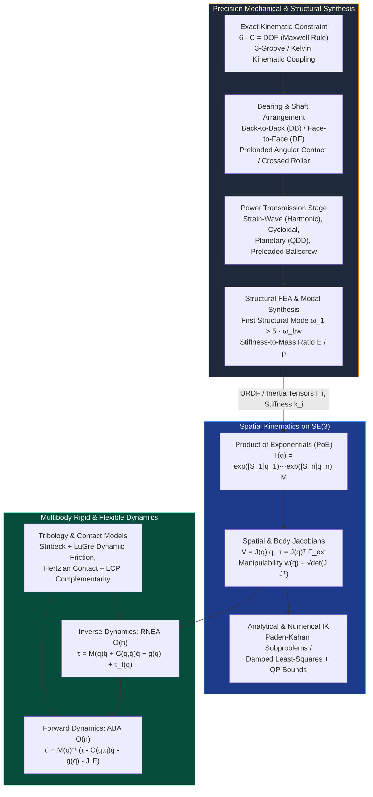

# Track 02: Precision Mechanical Design, Kinematics & Multibody Dynamics

> **Prerequisites:** [Track 00: Mathematical, Signal & Physical Foundations](../00-foundations/README.md)  
> **Feeds Into:** [Track 03: Sensors & Actuators](../03-sensors-and-actuators/README.md), [Track 05: Control & Estimation](../05-control-and-estimation/README.md), [Track 06: Robotics & Autonomy](../06-robotics-and-autonomy/README.md)  
> **Core Principle:** Software cannot compensate for non-repeatable mechanical hysteresis, lost motion, or structural compliance inside the control bandwidth. Precision mechanical engineering eliminates friction and backlash through exact kinematic constraint, preloaded rolling elements, or monolithic flexures—and provides the exact differential equations that model-based controllers exploit.

---

## 1. Module Overview & System Context

Many robotics and mechatronics failures diagnosed as "control tuning issues" are actually **mechanical design flaws**: cantilevered motor shafts bending under radial belt loads, over-constrained linear rails binding as the aluminum frame expands thermally, or spur-gear backlash exciting limit cycles inside a high-gain PID loop.

This track unites two critical mechanical disciplines:
1. **Precision Machine Design & Transmission Engineering:** Exact kinematic constraint (Maxwell/Blanding rules), bearing arrangement design, flexural mechanisms, Hertzian contact stress, and zero-backlash transmissions (harmonic, cycloidal, planetary, ballscrew, cable-capstan).
2. **Spatial Kinematics & Multibody Dynamics:** Screw theory and Product of Exponentials (PoE) on $SE(3)$, manipulator Jacobians, Euler-Lagrange vs. Newton-Euler formulations, $O(n)$ Recursive Newton-Euler (RNEA) and Articulated-Body (ABA) algorithms, and structural modal analysis.

---

## 2. Mechanical Transmission & Multibody Computation Pipeline

---

## 3. Principles of Precision Machine Design

### 3.1 Exact Kinematic Constraint (Maxwell's Criterion)
A free rigid body in 3D space has 6 Degrees of Freedom (DOF). By James Clerk Maxwell's principle of exact constraint, constraining $C$ degrees of freedom requires **exactly $C$ point contacts**:
$$\text{DOF} = 6 - C$$
* **Over-Constraint ($C > 6 - \text{DOF}$):** Standard bolted flanges or two parallel fully-constrained linear guide rails create statically indeterminate stress paths. Any machining tolerance error ($\pm 10\ \mu\text{m}$) or thermal gradient ($\Delta L = \alpha L \Delta T$, where aluminum $\alpha \approx 23\ \mu\text{m}/(\text{m}\cdot\text{K})$ vs. steel $\alpha \approx 11.5\ \mu\text{m}/(\text{m}\cdot\text{K})$) induces parasitic internal forces, binding friction, and geometric warping.
* **Kinematic Couplings:** A **Kelvin Coupling** (concave tetrahedron + V-groove + flat plate mating with three spheres, $3+2+1=6$ constraints) or a **Maxwell Three-Groove Coupling** (three spheres mating with three radial V-grooves at $120^\circ$, $2+2+2=6$ constraints) achieves sub-micron ($< 0.2\ \mu\text{m}$) repeatability while remaining immune to differential thermal expansion.
* **Abbe's Principle (First Principle of Machine Design & Metrology):**
  $$\varepsilon_{\text{Abbe}} = L_{\text{offset}} \cdot \sin(\theta_{\text{pitch/yaw}}) \approx L_{\text{offset}} \cdot \theta$$
  The measuring scale (encoder/interferometer) must be collinear with the functional point of displacement. If an encoder is offset by $L_{\text{offset}} = 100\text{ mm}$ from the tool tip and the linear stage exhibits just $10\text{ arcsec}$ ($48.5\ \mu\text{rad}$) of angular pitch error, the unmeasured Abbe error at the tool is $4.85\ \mu\text{m}$.

### 3.2 Bearing Arrangements, Preload & Flexural Mechanisms
1. **Rolling-Element Bearing Arrangements:**
   * Never support a precision shaft facing reversing axial/moment loads on a single deep-groove radial ball bearing (which has internal radial/axial clearance).
   * Use **Duplex Angular-Contact Ball Bearings** in Back-to-Back (`DB` / O-arrangement, high moment stiffness) or Face-to-Face (`DF` / X-arrangement, more tolerant of misalignment), or **Crossed-Roller Bearings** (compact single-ring high tilting stiffness for robot joints).
   * Apply controlled axial preload $F_{\text{preload}}$ to eliminate balls/rollers unloading under external moment, removing the deadband stiffness discontinuity at zero crossing.
2. **Monolithic Flexures (Compliant Mechanisms):**
   For short-stroke precision motion ($< 5\text{ mm}$), replace bearings entirely with EDM-cut or milled Titanium (`Ti-6Al-4V`) or 7075-T6 Aluminum notch hinges and double-parallelogram leaf flexures. Flexures exhibit **zero friction, zero backlash, zero wear, and infinite resolution**. For a symmetric circular notch hinge of thickness $t$, cutting radius $R$, and width $b$ ($t \ll R$), Paros-Weisbord yields rotational stiffness:
   $$k_\theta \approx \frac{2 E b t^{5/2}}{9 \pi \sqrt{R}}$$

### 3.3 Mechanical Transmissions & Reflected Inertia Matching
For a transmission with reduction ratio $N = \omega_{\text{motor}} / \omega_{\text{load}} > 1$ and forward efficiency $\eta$, the equations of motion reflected to the **joint (load) output side** are:

$$\left(J_{\text{load}} + N^2 J_{\text{rotor}}\right) \ddot{q}_{\text{load}} = N \eta \tau_{\text{motor}} - \tau_{\text{ext}}$$

* **Reflected Rotor Inertia ($J_{\text{refl}} = N^2 J_{\text{rotor}}$):** Scales with the **square** of the gear ratio! A high gear ratio ($N = 100$) multiplies a tiny rotor inertia by $10,000\times$. During an unexpected high-speed impact (e.g., a legged robot foot hitting the ground), this massive reflected inertia $N^2 J_{\text{rotor}}$ acts like a rigid wall before any force sensor or current controller can react, snapping gear teeth.
* **Quasi-Direct-Drive (QDD) Paradigm:** Combine a large-gap-radius torque motor ($\tau \propto R_{\text{gap}}^2 L_{\text{stack}}$) with a single-stage planetary gear ($N = 5:1$ to $10:1$). Reflected inertia stays small, mechanical backdrivability exceeds $90\%$, and motor phase current $i_q$ maps directly to output joint torque without needing fragile joint torque sensors.

| Transmission Type | Typical Ratio $N$ | Backlash | Torsional Stiffness | Backdrivability | Primary Use Case |
| :--- | :--- | :--- | :--- | :--- | :--- |
| **Single-Stage Planetary (QDD)** | $4:1 - 10:1$ | $3 - 10\text{ arcmin}$ | High | **Excellent ($>90\%$)** | Dynamic quadrupeds, humanoids, exoskeletons |
| **Strain-Wave (Harmonic Drive)** | $30:1 - 160:1$ | **Zero ($<0.5\text{ arcmin}$)** | Moderate (nonlinear hysteresis & kinematic error at $2\omega$) | Poor–Moderate | Industrial/surgical serial robot arms, space mechanisms |
| **Cycloidal (RV) Reducer** | $30:1 - 200:1$ | $< 1\text{ arcmin}$ | **Very High (high shock load capacity)** | Moderate | Heavy-payload industrial robot base/shoulder axes |
| **Preloaded Ballscrew** | $2 - 20\text{ mm/rev}$ | Zero (with double-nut preload) | Very High | High | CNC linear axes, high-force linear electric actuators |
| **Cable-Capstan Drive** | $5:1 - 30:1$ | **Zero** | High (with pre-tensioned tungsten/UHMWPE cable) | **Near 100%** | Haptic interfaces, surgical teleoperation (da Vinci) |

---

## 4. Spatial Kinematics via Screw Theory ($SE(3)$)

Rather than error-prone Denavit-Hartenberg (DH) tables with ambiguous frame assignment rules, modern robotics uses the **Product of Exponentials (PoE)** formulation (Lynch & Park):

1. **Zero Configuration ($q = 0$):** Define a single fixed base frame $\{s\}$, end-effector frame $\{b\}$, and record the constant home matrix $M \in SE(3)$.
2. **Screw Axes in Space Frame:** For each joint $i \in \{1,\dots,n\}$, define the unit screw axis $\mathcal{S}_i = (\omega_i, v_i) \in \mathbb{R}^6$:
   * **Revolute Joint:** $\|\omega_i\|_2 = 1$, and $v_i = -\omega_i \times q_{\text{point},i}$ where $q_{\text{point},i}$ is any point on the joint axis measured in $\{s\}$ at $q=0$.
   * **Prismatic Joint:** $\omega_i = 0$, and $\|v_i\|_2 = 1$ along the translation axis.
3. **Forward Kinematics Map:**
   $$T(q) = e^{[\mathcal{S}_1]q_1} e^{[\mathcal{S}_2]q_2} \cdots e^{[\mathcal{S}_n]q_n} M \in SE(3)$$
4. **Space Jacobian $J_s(q) \in \mathbb{R}^{6 \times n}$:**
   The $i$-th column of the space Jacobian is simply the $i$-th screw axis transformed by the Adjoint of the preceding joint exponentials:
   $$J_{s,1}(q) = \mathcal{S}_1, \qquad J_{s,i}(q) = \text{Ad}_{\left(e^{[\mathcal{S}_1]q_1}\cdots e^{[\mathcal{S}_{i-1}]q_{i-1}}\right)} \left(\mathcal{S}_i\right) \quad (i = 2,\dots,n)$$
   And the body Jacobian is $J_b(q) = \text{Ad}_{T^{-1}(q)} J_s(q)$.

---

## 5. Multibody Dynamics: Euler-Lagrange, RNEA & ABA

### 5.1 The Manipulator Equation & Structural Passivity Properties
For an $n$-DOF rigid-body system with generalized coordinates $q \in \mathbb{R}^n$, total kinetic energy $\mathcal{T}(q,\dot{q}) = \frac{1}{2}\dot{q}^\top M(q)\dot{q}$ and potential energy $\mathcal{V}(q)$, the Euler-Lagrange equation $\frac{d}{dt}\frac{\partial \mathcal{L}}{\partial \dot{q}} - \frac{\partial \mathcal{L}}{\partial q} = \tau_{\text{gen}}$ yields:

$$M(q)\ddot{q} + C(q,\dot{q})\dot{q} + g(q) + \tau_{\text{friction}}(\dot{q}) = \tau + J(q)^\top \mathcal{F}_{\text{ext}}$$

When the Coriolis/centrifugal matrix $C(q,\dot{q})$ is constructed using **Christoffel symbols of the first kind**:

$$C_{ij}(q,\dot{q}) = \sum_{k=1}^n \frac{1}{2}\left(\frac{\partial M_{ij}}{\partial q_k} + \frac{\partial M_{ik}}{\partial q_j} - \frac{\partial M_{jk}}{\partial q_i}\right)\dot{q}_k$$

the matrix $\dot{M}(q) - 2C(q,\dot{q})$ is **skew-symmetric**:
$$x^\top \left(\dot{M}(q) - 2C(q,\dot{q})\right) x = 0 \quad \forall x \in \mathbb{R}^n$$
This skew-symmetry is the mathematical statement of **conservation of mechanical energy** (workless Coriolis forces) and is the cornerstone of Lyapunov passivity-based nonlinear robot control!

### 5.2 $O(n)$ Featherstone Algorithms for Real-Time Execution
Evaluating symbolic $M(q)$ and inverting it naively scales as $O(n^3)$ and generates tens of thousands of floating-point operations. Production controllers use Featherstone's spatial vector algorithms:
* **RNEA (Recursive Newton-Euler Algorithm) — $O(n)$ Inverse Dynamics:**
  1. *Forward Pass (base $i=1 \to n$):* Propagate link spatial velocities $\mathcal{V}_i$ and accelerations $\dot{\mathcal{V}}_i$ outward (setting base acceleration $\dot{\mathcal{V}}_0 = -a_{\text{gravity}}$ automatically accounts for gravity $g(q)$!).
  2. *Backward Pass (tip $i=n \to 1$):* Propagate spatial wrenches $\mathcal{F}_i = I_i \dot{\mathcal{V}}_i + \mathcal{V}_i \times^* (I_i \mathcal{V}_i)$ inward and project onto joint axes $\tau_i = \mathcal{S}_i^\top \mathcal{F}_i$.
* **CRBA (Composite-Rigid-Body Algorithm) + Sparse $LTL^\top$ — $O(n d^2)$ Mass Matrix:** Computes $M(q)$ and factors it exploiting kinematic tree sparsity.
* **ABA (Articulated-Body Algorithm) — $O(n)$ Forward Dynamics:** Computes $\ddot{q}$ in three linear passes without ever forming or inverting $M(q)$.

---

## 6. Failure Modes, Pitfalls & Anti-Patterns

1. **Non-Physical Spatial Inertia Matrices in URDFs:** Every rigid body's rotational inertia tensor about its center of mass must satisfy not only positive definiteness ($I_x, I_y, I_z > 0$) but also the **triangle inequality**: $I_{xx} + I_{yy} \ge I_{zz}$ (and cyclic permutations). Hand-edited URDFs that violate this cause $M(q)$ to lose positive definiteness, blowing up physics simulators (MuJoCo/Drake) and MPC solvers with `Cholesky failure`.
2. **Harmonic Drive Kinematic & Torsional Resonance ($2\omega_{\text{in}}$):** Because the elliptical wave generator contacts the flexspline at two lobes per revolution, harmonic drives generate a strong torque/velocity ripple at **twice the motor electrical rotation frequency** ($2 \cdot f_{\text{motor}}$). When $2 f_{\text{motor}}$ crosses the joint's torsional natural frequency ($\sim 40\text{–}120\text{ Hz}$), severe structural vibration occurs unless damped via motor current shaping or dual-encoder feedback.
3. **Cantilevered Motor Shaft Fatigue Failure:** Standard brushless/stepper motor shafts ($5\text{–}8\text{ mm}$ diameter supported on small internal deep-groove bearings) are not designed to take high radial tension from timing belts or spur gears. Always support the drive pulley with an external bearing block straddling the load (double-shear support) rather than cantilevering off the motor nose.
4. **Discontinuous Coulomb Friction $\text{sign}(\dot{q})$ in Simulation & Feedforward:** Using a naive discontinuous $\tau_f = F_c \text{sign}(\dot{q})$ causes numerical chattering at $\dot{q} \approx 0$. Use either the smooth Stribeck regularization $\tau_f(\dot{q}) = \left(F_c + (F_s - F_c)e^{-(\dot{q}/v_s)^2}\right)\tanh(\dot{q}/v_\epsilon) + b\dot{q}$ or the dynamic **LuGre bristled friction model** ($\dot{z} = \dot{q} - \frac{\sigma_0 |\dot{q}|}{g(\dot{q})}z$).

---

## 7. Curated Learning Resources

### Authoritative Textbooks
* **Slocum, A. H.** — *Precision Machine Design* (Prentice Hall / SME, 1992). The legendary bible of exact kinematic constraint, Abbe error, thermal growth, bearings, flexures, and structural loops.
* **Smith, S. T.** — *Flexures: Elements of Elastic Mechanisms* (CRC Press, 2000) & **Howell, L. L.** — *Compliant Mechanisms* (Wiley, 2001).
* **Lynch, K. M., & Park, F. C.** — *Modern Robotics: Mechanics, Planning, and Control* (Cambridge University Press, 2017; free PDF and open-source code in Python/C++/MATLAB). The gold standard for Screw Theory and PoE kinematics/dynamics.
* **Featherstone, R.** — *Rigid Body Dynamics Algorithms* (Springer, 2008). Spatial vector algebra, RNEA, CRBA, ABA, and constrained multibody systems.
* **Murray, R. M., Li, Z., & Sastry, S. S.** — *A Mathematical Introduction to Robotic Manipulation* (CRC Press, 1994).
* **Shigley, J. E. (Budynas & Nisbett)** — *Shigley's Mechanical Engineering Design* (11th ed., McGraw-Hill, 2020). Fatigue, shaft sizing, Hertzian contact stress, fasteners, and AGMA gear design.

### Open-Source Toolchains
* **FreeCAD 1.0+ & CadQuery / Build123d (Python)** — Parametric MCAD and programmatic Python script-driven mechanical part generation.
* **Gmsh + CalculiX / Elmer FEM** — Open-source meshing, static stress analysis, and structural modal eigenvalue extraction.
* **Pinocchio (`C++` / Python)** — Ultra-fast $O(n)$ spatial rigid-body algorithms (RNEA, ABA, analytical derivatives $\partial \tau / \partial q, \partial \tau / \partial \dot{q}$ in $< 5\ \mu\text{s}$ for a 7-DOF arm).
* **MuJoCo & Drake** — Research-grade multibody contact physics and trajectory optimization engines.

---

## 8. Hands-On Lab & Milestone Gate

### Lab 02: 2-DOF Planar / Spatial Serial Arm — CAD, Modal FEA, PoE Kinematics & $O(n)$ RNEA

1. **Objective:** Design a 2-DOF QDD serial robotic leg/arm linkage, verify its first structural mode via FEA, and implement from-scratch PoE kinematics and RNEA/CRBA dynamics verified against `Pinocchio`.
2. **Tasks:**
   * Model a 2-DOF linkage in FreeCAD/CadQuery using double-supported angular-contact joint housings; export STEP and mesh in Gmsh + CalculiX to extract the first 4 structural eigenmodes.
   * Implement `forward_kinematics_poe(q)`, `space_jacobian(q)`, `dls_inverse_kinematics(T_target, q_init)`, and `rnea_inverse_dynamics(q, dq, ddq, f_ext)` in C++/Python.
   * Verify the skew-symmetry identity $x^\top(\dot{M}(q) - 2C(q,\dot{q}))x = 0$ via finite differences and compare RNEA torques against `Pinocchio` across 1,000 random state trajectories.
3. **Quantitative Acceptance Criteria:**

| Metric | Target Requirement | Verification Method |
| :--- | :--- | :--- |
| **First Structural Eigenfrequency** | $f_1 > 250\text{ Hz}$ (for $50\text{ Hz}$ closed-loop bandwidth target) at worst-case full extension | CalculiX modal FEA eigenvalue solve |
| **PoE vs. Pinocchio FK/Jacobian Match** | $\|T_{\text{PoE}}(q) - T_{\text{Pinocchio}}(q)\|_F < 10^{-12}$ and $\|J_s - J_{s,\text{Pin}}\|_F < 10^{-12}$ | Automated test suite over 1,000 random $q \in [-\pi, \pi]^n$ |
| **RNEA Inverse Dynamics Accuracy** | $\|\tau_{\text{RNEA}} - \tau_{\text{Pinocchio}}\|_\infty < 10^{-11}\text{ N}\cdot\text{m}$ | Randomized state/acceleration trajectory benchmark |
| **Passivity Skew-Symmetry Identity** | $\lvert x^\top(\dot{M} - 2C)x\rvert < 10^{-9}$ across all configurations | Numerical derivative check along simulated free-fall trajectory |

### 8.1 Executable Parametric CAD Generator & 3D STEP/STL Artifacts
Run [cad/cad_parametric_parts.py](cad/cad_parametric_parts.py) and [cad/validate_cad_parts.py](cad/validate_cad_parts.py) to generate and verify watertight 2-manifold STL and ISO 10303-21 STEP models:
* **Ti-6Al-4V Circular Notch Flexure Hinge:** [cad/notch_flexure_hinge.step](cad/notch_flexure_hinge.step) and [cad/notch_flexure_hinge.stl](cad/notch_flexure_hinge.stl)
* **440C Kelvin 3-2-1 Kinematic Coupling Base Plate:** [cad/kelvin_kinematic_coupling.step](cad/kelvin_kinematic_coupling.step) and [cad/kelvin_kinematic_coupling.stl](cad/kelvin_kinematic_coupling.stl)
* **Engineering Mass/Inertia/Stress Manifest:** [cad/cad_manifest.json](cad/cad_manifest.json)

