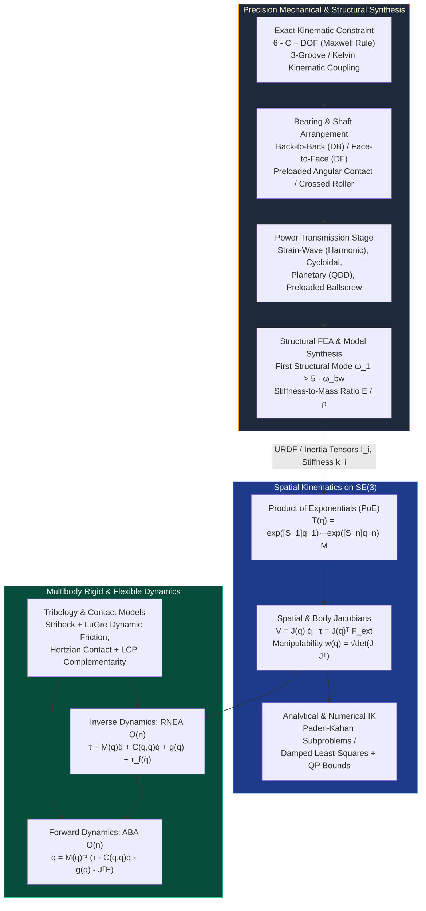

# Track 02: Precision Mechanical Design, Kinematics & Multibody Dynamics

> **Part of the [MechaLab Multi-Pass Tiered Roadmap](../README.md)**  
> **Prerequisites:** [Track 00: Foundations, Bench Intuition & Multi-Domain Mathematics](../00-foundations/README.md)  
> **Feeds Into:** [Track 03: Sensors & Actuators](../03-sensors-and-actuators/README.md), [Track 05: Control & Estimation](../05-control-and-estimation/README.md), [Track 06: Robotics & Autonomy](../06-robotics-and-autonomy/README.md)  
> **Core Principle:** Software cannot compensate for non-repeatable mechanical hysteresis, lost motion, or structural compliance inside the control bandwidth. Precision mechanical engineering eliminates friction and backlash through exact kinematic constraint, preloaded rolling elements, or monolithic flexures—and provides the exact differential equations that model-based controllers exploit.

---

## 🔄 Linear Level-Up Navigation (Follow Your Current Pass Across Track 00 → Track 08)

Complete **only your current Tier section** below, verify its hands-on milestone, and proceed directly to **Track 03 in the same Tier**:

| Pass / Level | Previous Step in Pass | Current Track 02 Section | Next Linear Step in This Pass |
| :--- | :--- | :--- | :--- |
| **🟢 Pass 1: Tier 1 (Beginner)** | [← Track 01 (Tier 1)](../01-electronics-and-power/README.md#tier-1-beginner--intuitive) | [§1 Tier 1: 2D Planar Kinematics, Gear Ratios ($N^2$ Inertia) & Bearings](#tier-1-beginner--intuitive) | [**Next in Pass 1 → Track 03 (Tier 1: Encoders & `SimpleFOC`)**](../03-sensors-and-actuators/README.md#tier-1-beginner--intuitive) |
| **🔵 Pass 2: Tier 2 (Applied)** | [← Track 01 (Tier 2)](../01-electronics-and-power/README.md#tier-2-intermediate--applied) | [§2 Tier 2: Maxwell Exact Constraint, `CadQuery` & URDF/MuJoCo](#tier-2-intermediate--applied) | [**Next in Pass 2 → Track 03 (Tier 2: Clarke/Park & Velocity PLL)**](../03-sensors-and-actuators/README.md#tier-2-intermediate--applied) |
| **🌉 Bridge Concept** | — | [§3 Bridging the Gap: 200:1 Hobby Servos $\to$ 8:1 Backdrivable QDD Planetary](#bridging-the-gap-maker-to-custom) | [Inspect Tier 3 Production Mastery ↓](#tier-3-advanced--production) |
| **🟣 Pass 3: Tier 3 (Production)** | [← Track 01 (Tier 3)](../01-electronics-and-power/README.md#tier-3-advanced--production) | [§4 Tier 3: Screw PoE on $SE(3)$, `Ti-6Al-4V` Flexures & $O(n)$ RNEA](#tier-3-advanced--production) | [**Next in Pass 3 → Track 03 (Tier 3: $40\text{ kHz}$ Decoupled FOC & SVPWM)**](../03-sensors-and-actuators/README.md#tier-3-advanced--production) |

---

## Tier 1 (Beginner / Intuitive)

> **Goal of Pass 1 (Track 02):** Master 2D planar robot arm kinematics (Forward & Inverse Kinematics using basic trigonometry), understand how gear ratios scale torque vs. reflected inertia ($N^2$), and learn how to support rotating shafts properly with radial ball bearings and timing belts.

### 1.1 2-Link Planar Forward & Inverse Kinematics (Law of Cosines)
Before 6-DOF spatial screw theory, any 2-DOF planar arm (or 1-leg hopping robot in the sagittal plane) with link lengths $L_1, L_2$ and joint angles $q_1, q_2$ is governed by simple trigonometry:
* **Forward Kinematics (`joint angles -> tip x, y`):**

$$
x = L_1 \cos(q_1) + L_2 \cos(q_1 + q_2), \qquad y = L_1 \sin(q_1) + L_2 \sin(q_1 + q_2)
$$

* **Analytical Inverse Kinematics (`target x, y -> joint angles` via Law of Cosines):**

$$
\cos(q_2) = \frac{x^2 + y^2 - L_1^2 - L_2^2}{2 L_1 L_2}, \quad q_2 = \pm \arccos(\cos q_2), \quad q_1 = \text{atan2}(y, x) - \text{atan2}(L_2 \sin q_2, L_1 + L_2 \cos q_2)
$$

### 1.2 Torque, Speed, Gear Ratios & Why Reflected Inertia Scales by $N^2$
* A gearbox of ratio $N:1$ (e.g., $N=10$) divides output speed by $N$ ($\omega_{\text{out}} = \omega_m / N$) and multiplies output torque by $N\eta$ ($\tau_{\text{out}} = N\eta\tau_m$).
* **The Hidden Trap ($J_{\text{refl}} = N^2 J_{\text{rotor}}$):** Because kinetic energy $\frac{1}{2}J_m \omega_m^2 = \frac{1}{2}(N^2 J_m)\omega_{\text{out}}^2$ must be conserved, the motor rotor's inertia felt at the output shaft is multiplied by **$N^2$**! A $200:1$ gearbox makes a tiny rotor feel **$40,000\times$ heavier** at the output—turning the joint into an un-backdrivable brick that snaps gear teeth on impact.

### 1.3 Practical 3D-Printed Joints, Radial Bearings & GT2 Timing Belts
* **Never Cantilever a Motor Shaft:** Hanging a heavy arm link or tight GT2 timing belt directly off a bare $5\text{ mm}$ motor shaft bends the shaft and ruins the internal motor bearings. Always capture the far end of the joint shaft in a second `608` or `6704` ball bearing (**double-shear support**).

### ✅ Tier 1 Milestone Gate (`Track 02 · Pass 1`)
* Write a Python/TypeScript function (or test **Tab 5: URDF / MuJoCo & STO** in the workbench) that computes 2-link/3-link forward and inverse kinematics for a figure-8 end-effector path and verifies that no target point violates the workspace radius $r \le L_1 + L_2$.
* **Next Linear Step in Pass 1:** [**Proceed to Track 03 (Tier 1: Encoders & Open-Loop BLDC with `SimpleFOC`) →**](../03-sensors-and-actuators/README.md#tier-1-beginner--intuitive)

---

## Tier 2 (Intermediate / Applied)

> **Goal of Pass 2 (Track 02):** Upgrade from flexible 3D-printed brackets and ad-hoc trigonometry to **Maxwell's Exact Constraint (`6 - C = DOF`)**, programmatic CAD (`CadQuery`), Duplex Angular-Contact Bearings, Manipulator Jacobians ($\tau = J^\top F$), and physical **URDF / MuJoCo MJCF** validation.

### 2.1 Maxwell's Rule of Exact Constraint ($6 - C = \text{DOF}$) & Abbe Error
* A rigid body in 3D has 6 DOF. Over-constraining a mechanism (e.g., bolting two parallel linear rails solidly without a compliance degree of freedom) causes binding whenever temperature changes by even $5^\circ\text{C}$.
* **Kelvin 3-2-1 Kinematic Coupling:** Three spherical balls resting in a concave tetrahedron ($3$ points), a V-groove ($2$ points), and a flat ($1$ point) constrain exactly $3+2+1=6$ DOF with sub-micron repeatability and zero thermal stress.

### 2.2 Manipulator Jacobians: Velocity Mapping & Virtual Work ($\tau = J^\top F$)
The Jacobian matrix $J(q) = \frac{\partial x}{\partial q}$ bridges joint space and Cartesian space in both directions:

$$
\dot{x} = J(q)\dot{q} \quad (\text{Velocity Kinematics}), \qquad \tau = J(q)^\top F_{\text{ext}} \quad (\text{Static Force/Torque Duality})
$$

This equation ($\tau = J^\top F$) is the secret behind sensorless Cartesian compliance: you can make a robot hand behave like a 3D Cartesian spring in $(x,y,z)$ purely by commanding joint torques $\tau = J(q)^\top \big(K_p (x_{\text{des}} - x) - K_d \dot{x}\big)$ without ever computing Inverse Kinematics!

### 2.3 Programmatic CAD (`CadQuery`) & Validating URDF / MuJoCo Inertias
* Instead of clicking manually in GUI CAD, write parametric Python scripts (`CadQuery` / `Build123d`) to generate STEP/STL parts (`02-mechanics-kinematics-dynamics/cad/`) and export exact mass $m$, center-of-mass, and $3\times 3$ rotational inertia tensors $I$ into `.urdf` and MuJoCo `.xml` models.
* **The Inertia Triangle Inequality:** Every physical 3D rigid body's principal moments of inertia ($I_1, I_2, I_3$) must satisfy $I_1 > 0$ **and** $I_1 + I_2 \ge I_3$.

### ✅ Tier 2 Milestone Gate (`Track 02 · Pass 2`)
* Inspect the URDF/MuJoCo models in [`08-capstone-projects/models/`](../08-capstone-projects/models/) and **Tab 5: URDF / MuJoCo & STO** in the interactive workbench, verifying that all link inertia tensors pass Sylvester's criterion ($\det(I) > 0$) and the triangle inequality ($I_{xx} + I_{yy} \ge I_{zz}$).
* **Next Linear Step in Pass 2:** [**Proceed to Track 03 (Tier 2: Clarke/Park Transforms, Type-II PLLs & Allan Variance) →**](../03-sensors-and-actuators/README.md#tier-2-intermediate--applied)

---

## Bridging the Gap: Maker to Custom

### From 200:1 Hobby Servos to an 8:1 Backdrivable Quasi-Direct-Drive (QDD) Planetary Actuator

| Characteristic | Tier 1 Maker Approach (Hobby RC Servo / 200:1 Worm/Spur Gear) | Tier 2/3 Custom Approach (8:1 QDD Planetary + Frameless Outrunner PMSM) |
| :--- | :--- | :--- |
| **Reflected Inertia ($N^2 J_m$)** | $200^2 = 40,000\times$ rotor inertia—impossible to backdrive; shatters gears on sudden ground impact. | $8^2 = 64\times$ rotor inertia—over $90\%$ backdrivable; absorbs impacts smoothly via motor current control. |
| **Torque Sensing** | Blind to external forces unless an expensive external strain-gauge load cell is bolted to the tip. | Motor phase current $i_q$ maps linearly to joint output torque ($\tau = N \eta K_t i_q$) with $>1\text{ kHz}$ bandwidth! |
| **Pin Support** | Cantilevered brass pins in thin plastic cases ($>2^\circ$ backlash). | Hardened steel planet pins supported on **both ends (double shear)** inside a `7075-T6` aluminum carrier (`08-capstone-projects/cad/qdd_planetary_carrier.step`). |

---

## Tier 3 (Advanced / Production)

> **Goal of Pass 3 (Track 02):** Production-grade mechanical synthesis and multibody dynamics: monolithic `Ti-6Al-4V` Paros-Weisbord flexures, Hertzian contact stress, Screw Theory Product of Exponentials (PoE) on $SE(3)$, Christoffel passivity skew-symmetry ($\dot{M}-2C$), and Featherstone's $O(n)$ RNEA/CRBA/ABA algorithms.
> * [**Next Linear Step in Pass 3 → Track 03 (Tier 3: $25\text{–}40\text{ kHz}$ Decoupled $d$-$q$ FOC, SVPWM & Harmonic LUT)**](../03-sensors-and-actuators/README.md#tier-3-advanced--production)

### 4.1 Mechanical Transmission & Multibody Computation Pipeline

### 4.2 Exact Kinematic Constraint, Abbe Principle & Monolithic Flexures

* **Abbe's Principle:** $\varepsilon_{\text{Abbe}} = L_{\text{offset}} \cdot \sin(\theta_{\text{pitch/yaw}}) \approx L_{\text{offset}} \cdot \theta$. Always align the measuring encoder collinear with the load displacement axis.
* **Paros-Weisbord Circular Notch Flexure Hinge:** For short-stroke precision motion ($<5\text{ mm}$), monolithic EDM-cut `Ti-6Al-4V` flexures exhibit zero friction, zero backlash, and infinite resolution. For web thickness $t$, cutting radius $R$, and width $b$ ($t \ll R$):

$$
k_\theta \approx \frac{2 E b t^{5/2}}{9 \pi \sqrt{R}}, \qquad \sigma_{\max} = K_t \frac{6 M_{\max}}{b t^2} \quad \text{where } K_t \approx \frac{1 + 2.7 t / (2R)}{\left(1 + t / (2R)\right)^2}
$$

* **Transmission Comparison:**

| Transmission Type | Typical Ratio $N$ | Backlash | Torsional Stiffness | Backdrivability | Primary Use Case |
| :--- | :--- | :--- | :--- | :--- | :--- |
| **Single-Stage Planetary (QDD)** | $4:1 - 10:1$ | $3 - 10\text{ arcmin}$ | High | **Excellent ($>90\%$)** | Dynamic quadrupeds, humanoids, exoskeletons |
| **Strain-Wave (Harmonic Drive)** | $30:1 - 160:1$ | **Zero ($<0.5\text{ arcmin}$)** | Moderate (2$\omega$ ripple) | Poor–Moderate | Industrial/surgical serial robot arms |
| **Cycloidal (RV) Reducer** | $30:1 - 200:1$ | $< 1\text{ arcmin}$ | **Very High** | Moderate | Heavy-payload industrial robot base/shoulder axes |
| **Preloaded Ballscrew** | $2 - 20\text{ mm/rev}$ | Zero (preloaded) | Very High | High | CNC linear axes, high-force linear actuators |
| **Cable-Capstan Drive** | $5:1 - 30:1$ | **Zero** | High | **Near 100%** | Haptic interfaces, surgical teleoperation |

### 4.3 Spatial Kinematics via Screw Theory ($SE(3)$) & $O(n)$ Multibody Dynamics

* **Product of Exponentials (PoE) Forward Kinematics & Space Jacobian:**

$$
T(q) = e^{[\mathcal{S}_1]q_1} e^{[\mathcal{S}_2]q_2} \cdots e^{[\mathcal{S}_n]q_n} M \in SE(3), \qquad J_{s,i}(q) = \text{Ad}_{\left(e^{[\mathcal{S}_1]q_1}\cdots e^{[\mathcal{S}_{i-1}]q_{i-1}}\right)} \left(\mathcal{S}_i\right)
$$

* **Manipulator Equation & Christoffel Passivity Skew-Symmetry:**

$$
M(q)\ddot{q} + C(q,\dot{q})\dot{q} + g(q) + \tau_{\text{friction}}(\dot{q}) = \tau + J(q)^\top \mathcal{F}_{\text{ext}}, \qquad x^\top \left(\dot{M}(q) - 2C(q,\dot{q})\right) x = 0 \quad \forall x \in \mathbb{R}^n
$$

* **Featherstone's $O(n)$ Recursive Newton-Euler Algorithm (RNEA):**
  1. *Outward Kinematic Pass ($i = 1 \to n$):* Propagate spatial velocities $\mathcal{V}_i$ and accelerations $\dot{\mathcal{V}}_i$ ($\dot{\mathcal{V}}_0 = -a_{\text{gravity}}$).
  2. *Inward Wrench Pass ($i = n \to 1$):* Propagate spatial wrenches $\mathcal{F}_i = I_i \dot{\mathcal{V}}_i + \mathcal{V}_i \times^* (I_i \mathcal{V}_i)$ and project onto joint axes $\tau_i = \mathcal{S}_i^\top \mathcal{F}_i$.

---

## 5. Failure Modes, Pitfalls & Anti-Patterns

1. **Non-Physical Spatial Inertia Matrices in URDFs:** Every link inertia tensor must satisfy Sylvester SPD ($I_1, I_2, I_3 > 0$) and the triangle inequality ($I_{xx} + I_{yy} \ge I_{zz}$).
2. **Harmonic Drive $2\omega_{\text{in}}$ Resonance:** Elliptical wave generators excite torsional resonance when $2 f_{\text{motor}}$ crosses the joint's natural frequency ($\sim 40\text{–}120\text{ Hz}$).
3. **Cantilevered Motor Shaft Fatigue Failure:** Always support belt/gear pulleys in double shear with an external bearing block.
4. **Discontinuous Coulomb Friction $\text{sign}(\dot{q})$:** Use smooth Stribeck regularization $\tanh(\dot{q}/v_\epsilon)$ or the dynamic LuGre bristle model to prevent numerical chattering at zero velocity.

---

## 6. Tier 3 Production Lab, CAD Artifacts & Milestone Gate (`Lab 02`)

* **Ti-6Al-4V Circular Notch Flexure Hinge:** [`cad/notch_flexure_hinge.step`](cad/notch_flexure_hinge.step) and [`cad/notch_flexure_hinge.stl`](cad/notch_flexure_hinge.stl)
* **440C Kelvin 3-2-1 Kinematic Coupling Base Plate:** [`cad/kelvin_kinematic_coupling.step`](cad/kelvin_kinematic_coupling.step) and [`cad/kelvin_kinematic_coupling.stl`](cad/kelvin_kinematic_coupling.stl)
* **Engineering Mass/Inertia/Stress Manifest:** [`cad/cad_manifest.json`](cad/cad_manifest.json)

| Metric | Target Requirement | Verification Method |
| :--- | :--- | :--- |
| **First Structural Eigenfrequency** | $f_1 > 250\text{ Hz}$ (for $50\text{ Hz}$ closed-loop bandwidth target) | Modal FEA & Tab 6 CAD Flexure Solver |
| **PoE vs. Pinocchio FK/Jacobian Match** | $\|T_{\text{PoE}}(q) - T_{\text{Pinocchio}}(q)\|_F < 10^{-12}$ | Automated test suite over 1,000 random configurations |
| **RNEA Inverse Dynamics Accuracy** | $\|\tau_{\text{RNEA}} - \tau_{\text{Pinocchio}}\|_\infty < 10^{-11}\text{ N}\cdot\text{m}$ | Randomized state/acceleration trajectory benchmark |
| **Passivity Skew-Symmetry Identity** | $\lvert x^\top(\dot{M} - 2C)x\rvert < 10^{-9}$ across all configurations | Numerical derivative check along free-fall trajectory |
