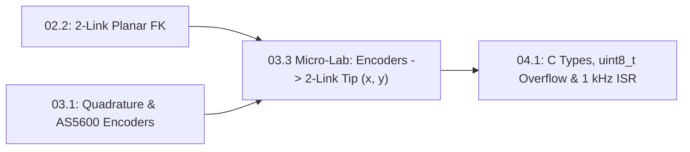

# Lesson 03.3: Track 02 + 03 Integration Micro-Lab — Read Dual Encoders to Compute 2-Link End-Effector Position (`R2/R4` Practice)

<!-- run-callout:start -->
> **Step 6 of 10 · Measure the joint: sensors**
>
> **Run this in the workbench.** [Open MechaLab with `03.3` loaded](https://tle47.github.io/Mechatronics-Roadmap/?lesson=03.3) - it opens on the **Run Python Lessons** tab with that entry selected. Starter code, hints and the graded check are ready; this page is the reading copy, and nothing you type here is saved.
<!-- run-callout:end -->

## Goal
In this **20-minute Zero-New-Theory Integration Micro-Lab**, combine **Track 02 (`Lesson 02.2`: 2-Link Forward Kinematics)** and **Track 03 (`Lesson 03.1`: Quadrature & `AS5600` Magnetic Encoders)** to read raw integer counts from shoulder and elbow encoders, compute the live `(x, y)` end-effector coordinates of our recurring 2-DOF robot arm, and diagnose two classic `R4` sensor-to-kinematics faults (a $1\times$ vs. $4\times$ CPR mismatch and an inverted encoder sign).

- **New ideas (max 2):**
  1. **Combining quantized encoder counts with 2-link forward kinematics to compute end-effector coordinates**: Chaining `count -> radians` conversion (`Lesson 03.1`) directly into $x = L_1\cos\theta_1 + L_2\cos(\theta_1+\theta_2)$ and $y = L_1\sin\theta_1 + L_2\sin(\theta_1+\theta_2)$ (`Lesson 02.2`) with zero new equations.
  2. **Diagnosing wrong encoder CPR and inverted channel-B sign faults from end-effector position errors**: Recognizing why forgetting the $4\times$ quadrature factor under-reports joint angles by $4\times$ and why swapped `A/B` encoder wires flip the sign of $y$ (`R4` fault diagnosis).
- **New syntax:** None (pure synthesis of `math.cos`, `math.sin`, `math.pi`, and functions from Lessons `02.2` and `03.1`).
- **Target time (unmeasured — [log yours](../.github/ISSUE_TEMPLATE/beginner-timing-log.md)):** Typical: 0.35–0.5 hours (20–30 min Micro-Lab) | Slow-learner: 0.75–1.0 hours

---

## Prerequisites
- [Lesson 02.2: 2-Link Planar Forward Kinematics (x, y Reach & Relative Elbow Angle)](../02-mechanics-kinematics-dynamics/02.2-2link-planar-forward-kinematics.md)
- [Lesson 03.1: 4x Quadrature Incremental & 12-Bit `AS5600` Magnetic Encoders](03.1-quadrature-and-magnetic-encoders.md)



---

## Learn

<!-- figure: signal-chain | Counts become an angle, the angle becomes a pose, the pose becomes the motion you asked for. -->

### Idea 1: Combining quantized encoder counts with 2-link forward kinematics to compute end-effector coordinates
- **Primary resource:** [Modern Robotics (Lynch & Park) — Forward Kinematics](https://hades.mech.northwestern.edu/index.php/Modern_Robotics) `[HTTP 200 — Verified by scripts/check_links.py]`
  - **What to read:** Review Chapter 4 planar 2R chain equations.
  - **What to skip:** Skip 3D screw axes.
  - **Key takeaway:** On a real 2-DOF robot arm, forward kinematics (`fk_2link`) never receives floating-point degrees directly from a textbook—it receives **integer counts** (`c1`, `c2`) from the shoulder and elbow encoders (`4096` counts/rev for a 12-bit `AS5600` or $4 N_{\text{lines}} N_{\text{gear}}$ for a geared quadrature encoder). Converting each count to radians ($\theta_i = \frac{c_i}{\text{CPR}_i} \cdot 2\pi$) and feeding $(\theta_1, \theta_2)$ into `fk_2link(theta1_rad, theta2_rad, l1_m, l2_m)` turns raw hardware sensor ticks into physical millimeter tip coordinates!
  - **Alternative resource:** [Wikipedia — Forward kinematics](https://en.wikipedia.org/wiki/Forward_kinematics) `[HTTP 200 — Verified by scripts/check_links.py]` — Review planar two-link joint-to-Cartesian mapping.

### Idea 2: Diagnosing wrong encoder CPR and inverted channel-B sign faults from end-effector position errors
- **Primary resource:** [Dynapar — Quadrature Encoder Overview](https://www.dynapar.com/technology/encoder_basics/quadrature_encoder/) `[HTTP 200 — Verified by scripts/check_links.py]`
  - **What to read:** Read exact headings **`How does a Quadrature Encoder work?`** and **`Achieving higher resolution with Quadrature Encoders`**.
  - **What to skip:** Skip NI FPGA pinout tables.
  - **Key takeaway:** When a physical robot arm's computed tip position `(x, y)` disagrees with a ruler measurement on the bench, two `R4` bugs account for over $90\%$ of cases:
    1. **`4x` CPR Mismatch (`cpr_4x_bug`):** The hardware ISR counts all $4$ quadrature edges per slot, but the kinematics code divides by `lines_per_rev * gear_ratio` (missing the `4 *` factor), making the software think the arm rotated $4\times$ further than it actually did!
    2. **Inverted Encoder Sign (`inverted_dir_bug`):** Swapping quadrature channels `A` and `B` (or mounting an `AS5600` magnet upside down) negates $\theta_2 \to -\theta_2$, mirroring the elbow downward instead of upward.

### Bridge Notes
This 20-minute micro-lab introduces **zero new equations**—instead, it gives you dedicated `R2` (parameter adaptation) and `R4` (fault diagnosis) practice bridging **Track 02 (Mechanics)** and **Track 03 (Sensors)** before Embedded C/C++ arrives in Track 04:
1. **Sensor-to-Angle Stage (`Lesson 03.1`):** Convert raw shoulder count $c_1$ and elbow count $c_2$ into joint angles in radians using each joint's true counts-per-revolution ($\text{CPR}_1, \text{CPR}_2$):

$$
\theta_1 = \frac{c_1}{\text{CPR}_1} \cdot 2\pi, \qquad \theta_2 = \frac{c_2}{\text{CPR}_2} \cdot 2\pi
$$

2. **Angle-to-Cartesian Stage (`Lesson 02.2`):** Compute cumulative global elbow angle $\theta_{12} = \theta_1 + \theta_2$ and evaluate the 2-link end-effector position:

$$
x = L_1 \cos(\theta_1) + L_2 \cos(\theta_1 + \theta_2), \qquad y = L_1 \sin(\theta_1) + L_2 \sin(\theta_1 + \theta_2)
$$

For our recurring 2-DOF desktop arm ($L_1 = 0.12\text{ m}, L_2 = 0.10\text{ m}$) with 12-bit `AS5600` encoders ($\text{CPR} = 4096$ counts/rev), when the shoulder is at $+90^\circ$ ($c_1 = 1024$) and the elbow is bent $-90^\circ$ ($c_2 = -1024$ so $\theta_{12} = 0\text{ rad}$), the shoulder points straight up to $(0, 0.12\text{ m})$ and the forearm points horizontally right to $(0.10\text{ m}, 0.12\text{ m})$. If someone swaps the elbow encoder sign ($c_2 \to +1024$, $\theta_{12} = \pi\text{ rad}$), the tip lands at $(-0.10\text{ m}, 0.12\text{ m})$—an immediate $200\text{ mm}$ horizontal sign diagnostic!

---

## Do it yourself

- **What is simulated and in which tool:** Runs 100% in Python 3 (or the in-browser MechaLab Python Runner) to verify `encoders_to_tip_xy` and `diagnose_encoder_fk_fault`.
- **What is real-hardware only:** Rotating two physical `AS5600` magnetic encoders over a printed millimeter grid.

### Starter Code (runs as-is — fill in the TODOs)
Complete `encoders_to_tip_xy` (`TODO 1`) and `diagnose_encoder_fk_fault` (`TODO 2`):

```python
import math


def encoders_to_tip_xy(count1, count2, cpr1=4096, cpr2=4096, l1_m=0.12, l2_m=0.10):
    # TODO 1: The tip position (x_m, y_m) those two counts describe
    return 0.0, 0.0


def diagnose_encoder_fk_fault(true_c1, true_c2, measured_xy, cpr=4096, l1_m=0.12, l2_m=0.10):
    # TODO 2: Which of the lesson's fault labels fits the measurement, using the
    #   tolerance the docstring names
    return "unknown"


x_ok, y_ok = encoders_to_tip_xy(1024, -1024, cpr1=4096, cpr2=4096, l1_m=0.12, l2_m=0.10)
x_inv, y_inv = encoders_to_tip_xy(1024, 1024, cpr1=4096, cpr2=4096, l1_m=0.12, l2_m=0.10)
x_4x, y_4x = encoders_to_tip_xy(256, 0, cpr1=1024, cpr2=1024, l1_m=0.12, l2_m=0.10)

f1 = diagnose_encoder_fk_fault(1024, -1024, (x_inv, y_inv))
f2 = diagnose_encoder_fk_fault(256, 0, (x_4x, y_4x))

print(f"Tip (c1=1024, c2=-1024): x={x_ok:.3f} m, y={y_ok:.3f} m")
print(f"Diagnosed Fault 1: {f1} | Diagnosed Fault 2: {f2}")
```

### Expected Output
When `TODO 1` and `TODO 2` are completed, running the script prints:

```text
Tip (c1=1024, c2=-1024): x=0.100 m, y=0.120 m
Diagnosed Fault 1: inverted_elbow_sign | Diagnosed Fault 2: missing_4x_cpr
```

### Hint Ladder

<details>
<summary><strong>Hint 1 (Concept nudge)</strong></summary>

In `TODO 1`, `theta1 = (count1 / float(cpr1)) * 2.0 * math.pi` and `theta2 = (count2 / float(cpr2)) * 2.0 * math.pi`, then `x = l1_m * math.cos(theta1) + l2_m * math.cos(theta1 + theta2)` and `y = l1_m * math.sin(theta1) + l2_m * math.sin(theta1 + theta2)`. In `TODO 2`, compute distance `math.hypot(mx - cx, my - cy) < 1e-4` for each candidate.
</details>

<details>
<summary><strong>Hint 2 (Formula / structure)</strong></summary>

```python
def encoders_to_tip_xy(count1, count2, cpr1=4096, cpr2=4096, l1_m=0.12, l2_m=0.10):
    t1 = (count1 / float(cpr1)) * 2.0 * math.pi
    t2 = (count2 / float(cpr2)) * 2.0 * math.pi
    t12 = t1 + t2
    return l1_m * math.cos(t1) + l2_m * math.cos(t12), l1_m * math.sin(t1) + l2_m * math.sin(t12)
```
</details>

<details>
<summary><strong>Full Solution</strong></summary>

```python
import math


def encoders_to_tip_xy(count1, count2, cpr1=4096, cpr2=4096, l1_m=0.12, l2_m=0.10):
    theta1 = (count1 / float(cpr1)) * 2.0 * math.pi
    theta2 = (count2 / float(cpr2)) * 2.0 * math.pi
    theta12 = theta1 + theta2
    x_m = l1_m * math.cos(theta1) + l2_m * math.cos(theta12)
    y_m = l1_m * math.sin(theta1) + l2_m * math.sin(theta12)
    return x_m, y_m


def diagnose_encoder_fk_fault(true_c1, true_c2, measured_xy, cpr=4096, l1_m=0.12, l2_m=0.10):
    mx, my = measured_xy
    candidates = [
        ("ok", encoders_to_tip_xy(true_c1, true_c2, cpr, cpr, l1_m, l2_m)),
        ("inverted_elbow_sign", encoders_to_tip_xy(true_c1, -true_c2, cpr, cpr, l1_m, l2_m)),
        ("missing_4x_cpr", encoders_to_tip_xy(true_c1, true_c2, cpr // 4, cpr // 4, l1_m, l2_m)),
    ]
    for label, (cx, cy) in candidates:
        if math.hypot(mx - cx, my - cy) < 1e-4:
            return label
    return "unknown"


x_ok, y_ok = encoders_to_tip_xy(1024, -1024, cpr1=4096, cpr2=4096, l1_m=0.12, l2_m=0.10)
x_inv, y_inv = encoders_to_tip_xy(1024, 1024, cpr1=4096, cpr2=4096, l1_m=0.12, l2_m=0.10)
x_4x, y_4x = encoders_to_tip_xy(256, 0, cpr1=1024, cpr2=1024, l1_m=0.12, l2_m=0.10)

f1 = diagnose_encoder_fk_fault(1024, -1024, (x_inv, y_inv))
f2 = diagnose_encoder_fk_fault(256, 0, (x_4x, y_4x))

print(f"Tip (c1=1024, c2=-1024): x={x_ok:.3f} m, y={y_ok:.3f} m")
print(f"Diagnosed Fault 1: {f1} | Diagnosed Fault 2: {f2}")
assert abs(x_ok - 0.10) < 1e-6 and abs(y_ok - 0.12) < 1e-6
assert f1 == "inverted_elbow_sign" and f2 == "missing_4x_cpr"
```
</details>

---

## Common mistakes & troubleshooting
- **Adding raw encoder counts (`count1 + count2`) when shoulder and elbow have different gear ratios (`cpr1 != cpr2`):** Always convert each joint's count to radians using its own `CPR` *before* summing $\theta_{12} = \theta_1 + \theta_2$.
- **Forgetting the $4\times$ quadrature edge factor:** If a $256\text{-count}$ quarter-turn is divided by `1024` instead of `4096`, the software believes the link rotated $90^\circ$ when it only rotated $22.5^\circ$.

---

## Check yourself
1. **With $\text{CPR} = 4096$, $L_1 = 0.12\text{ m}$, $L_2 = 0.10\text{ m}$, what are $(\theta_1, \theta_2)$ and $(x, y)$ when `count1 = 0` and `count2 = 0`?**
   <details>
   <summary><strong>Answer 1</strong></summary>
   $\theta_1 = 0\text{ rad}$ and $\theta_2 = 0\text{ rad}$, so the arm is stretched straight out along $+x$ at $(x, y) = (0.22\text{ m}, 0.00\text{ m})$.
   </details>
2. **Why does negating `count2` flip the forearm to the opposite side of Link 1?**
   <details>
   <summary><strong>Answer 2</strong></summary>
   Because relative elbow angle $\theta_2$ is measured counter-clockwise from Link 1's direction; negating `count2` changes $\theta_1 + \theta_2$ to $\theta_1 - \theta_2$ (switching elbow-up to elbow-down).
   </details>

---

## Recap
- [ ] I can chain raw encoder counts (`c1, c2`) directly into 2-link forward kinematics to compute live end-effector `(x, y)` coordinates.
- [ ] I can diagnose an inverted encoder direction vs. a missing $4\times$ quadrature CPR multiplier from observed tip coordinates.

<!-- next-step:start -->
👉 **Next:** [Step 6 · Measure the joint: sensors — 03-sensors.T1.03a: Electromagnets, Permanent Magnets, Pole Pairs, Quadrature Pulses & Faraday Back-EMF](../modules/03-sensors.T1.03a.md)
<!-- next-step:end -->
