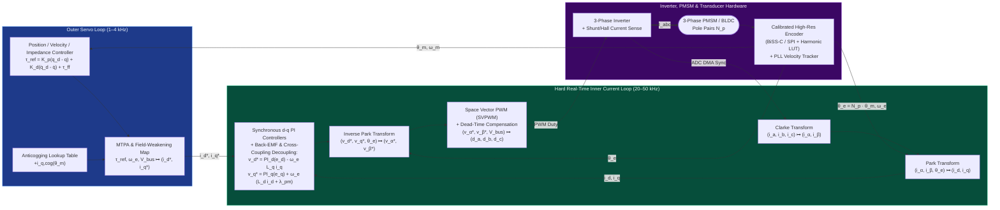

# Track 03: Sensors, Metrology, Actuators & Field-Oriented Drive Systems

> **Prerequisites:** [Track 01: Mixed-Signal & Power Electronics](../01-electronics-and-power/README.md), [Track 02: Precision Mechanics, Kinematics & Dynamics](../02-mechanics-kinematics-dynamics/README.md)  
> **Feeds Into:** [Track 04: Embedded & Real-Time](../04-embedded-and-realtime/README.md), [Track 05: Control & Estimation](../05-control-and-estimation/README.md)  
> **Core Principle:** A closed-loop system is fundamentally bounded by the noise floor, bandwidth, and non-linearity of its sensors and the torque-ripple and saturation limits of its actuators. Calibrating transducer systematics and executing deterministic Field-Oriented Control (FOC) transforms raw electromagnetic hardware into an ideal linear torque source.

---

## 1. Module Overview & System Context

In high-performance mechatronics, actuators and sensors cannot be treated as ideal black boxes ($\tau = \tau_{\text{cmd}}$, $y = x$). Off-axis magnetic encoders exhibit up to $\pm 0.5^\circ$ of cyclical harmonic error that injects false velocity oscillations into a $d$-$q$ motor drive. Uncalibrated MEMS gyroscopes drift by degrees per minute and rectify high-frequency structural vibrations into DC bias shifts. Permanent Magnet Synchronous Motors (PMSMs) lose torque efficiency and saturate their stator teeth if cross-coupling inductance terms ($\omega_e L_d i_d, \omega_e L_q i_q$) and dead-time voltage drops are ignored.

This track covers:
1. **Sensor Metrology, Error Budgets & Calibration** (Allan variance, ellipsoid magnetometer/accelerometer calibration, encoder harmonic compensation).
2. **Position, Velocity, Inertial & Force/Torque Transducers** (Optical/Magnetic/Inductive encoders, Resolvers, MEMS IMUs, 6-axis strain/capacitive F/T sensors).
3. **Electromechanical, Piezoelectric & Fluid Actuators** (PMSM/BLDC, Hybrid Closed-Loop Steppers, Voice Coils, Piezo stacks, Electro-Hydrostatic Actuators).
4. **Complete Field-Oriented Control (FOC) Architecture** (Clarke/Park transforms, $d$-$q$ decoupling, Space Vector PWM, MTPA, Field Weakening, Anticogging, and Sensorless Observers).

---

## 2. Field-Oriented Control (FOC) & Metrology Architecture

---

## 3. Sensor Physics, Metrology & Calibration

### 3.1 Metrology Vocabulary & Error Budgeting
* **Accuracy vs. Precision (Repeatability) vs. Resolution:**
  * *Accuracy:* Closeness of agreement between a measured value and the true NIST-traceable reference value (bounded by systematic bias, scale-factor error, and nonlinearity).
  * *Repeatability (Precision):* Closeness of agreement between independent measurements under identical conditions (bounded by random thermal/flicker noise and mechanical hysteresis). **Feedback control can only be as good as sensor repeatability; systematic accuracy can be calibrated out in software via Lookup Tables (LUTs) or polynomials.**
  * *Effective Resolution:* Peak-to-peak or RMS noise floor expressed in physical units ($\sigma_x = \text{Noise Density} \times \sqrt{\text{BW}}$), which is almost always $2\text{–}4\text{ bits}$ worse than the raw digital register width (e.g., a "24-bit" load-cell ADC typically achieves $18.5\text{–}20\text{ bits}$ noise-free resolution).

### 3.2 Rotary & Linear Position Encoders

| Encoder Technology | Typical Resolution | Max Speed / Bandwidth | Interface Protocol | Primary Error Sources & Mitigation |
| :--- | :--- | :--- | :--- | :--- |
| **Optical Incremental (Transmissive/Reflective)** | $1,000 - 10,000\text{ CPR}$ ($\times 4$ quadrature) | $> 1\text{ MHz}$ edge rate | RS-422 Differential `A/A-, B/B-, Z/Z-` | Disk eccentricity ($1\times$ mechanical harmonic); requires homing to index `Z` on boot |
| **Optical Sin/Cos Interpolated** | $20 - 26\text{ bits}$ effective ($1\text{ V}_{\text{pp}}$ analog sin/cos) | $500\text{ kHz}$ analog | Differential $1\text{ V}_{\text{pp}}$ + EnDat 2.2 / BiSS-C | Lissajous offset, amplitude mismatch, and quadrature phase error; corrected via Heydemann calibration |
| **On-Axis / Off-Axis Magnetic (Hall / AMR / TMR)** | $14 - 18\text{ bits}$ absolute | $10 - 50\text{ kHz}$ SPI / ABZ | SPI / BiSS-C / SSI | Strong $1\times, 2\times, 4\times$ spatial harmonics from magnet tilt & dipole distortion; calibrate via constant-speed harmonic LUT |
| **Inductive (IncOder / PCB Eddy-Current)** | $16 - 22\text{ bits}$ absolute | $10 - 40\text{ kHz}$ | BiSS-C / SPI | Immune to oil, dust, and stray magnetic fields; ideal for harsh robotic joints |
| **Electromagnetic Resolver** | $12 - 16\text{ bits}$ (via RDC like `AD2S1210`) | Extreme temp/shock ($>150^\circ\text{C}$, $50g$) | $2\text{–}10\text{ kHz}$ sine excitation + sin/cos envelope | Phase shift between excitation and secondary windings; tracking loop lag under high angular acceleration |

#### Velocity Estimation: Never Use Naive Finite Differences!
Computing velocity via $\hat{\omega}_k = \frac{\theta_k - \theta_{k-1}}{T_s}$ amplifies encoder quantization noise $\Delta q = \frac{2\pi}{2^N}$ by $1/T_s$. At $f_s = 25\text{ kHz}$ ($T_s = 40\ \mu\text{s}$) with a 14-bit encoder ($\Delta q = 3.83\times 10^{-4}\text{ rad}$), a single-count toggle produces a velocity spike of **$\pm 9.6\text{ rad/s}$ ($91\text{ RPM}$)**!
* **Production Solution — Angle Tracking Observer (ATO / Type-II Phase-Locked Loop):**
  $$\begin{aligned}
  e_\theta &= \text{wrap}_{[-\pi,\pi)}(\theta_{\text{meas}} - \hat{\theta}) = \text{atan2}(\sin(\theta_{\text{meas}} - \hat{\theta}), \cos(\theta_{\text{meas}} - \hat{\theta})) \\
  \dot{\hat{\omega}} &= K_i e_\theta \\
  \dot{\hat{\theta}} &= \hat{\omega} + K_p e_\theta
  \end{aligned}$$
  Selecting $K_p = 2\zeta\omega_n$ and $K_i = \omega_n^2$ provides zero-lag tracking for constant velocities (Type-II system) while filtering quantization noise above $\omega_n$.

### 3.3 MEMS Inertial Measurement Units (IMUs) & Allan Variance
A 6-DOF MEMS IMU measurement model includes deterministic scale-factor/cross-axis matrix $M$, misalignment $R_{\text{mis}}$, bias $b(t)$, $g$-sensitivity (for gyros), and stochastic noise:
$$\tilde{\omega}(t) = M_g \omega_{\text{true}}(t) + b_g(t) + G_g a_{\text{true}}(t) + \eta_g(t)$$

The **Allan Deviation $\sigma_A(\tau)$** (log-log plot of cluster variance vs. averaging time $\tau$ from a static $12\text{-hour}$ temperature-controlled log) separates the underlying stochastic processes required to populate your Kalman Filter covariance matrices ($Q, R$):

| Noise Process | Allan Deviation Log-Log Slope | Extraction Point on $\sigma_A(\tau)$ Curve | Continuous Kalman Covariance Parameter |
| :--- | :--- | :--- | :--- |
| **Quantization Noise ($Q_n$)** | $-1$ | Read at $\tau = \sqrt{3}$ | Fixed by ADC bit depth |
| **Angle / Velocity Random Walk (ARW / VRW, White Noise $N$)** | $-\frac{1}{2}$ | Read directly at $\tau = 1\text{ s}$ | Continuous white noise PSD $\sigma_g^2 = N^2$ |
| **Bias Instability ($B$, $1/f$ Flicker Noise)** | $0$ (Flat minimum floor) | Minimum of curve divided by $\sqrt{\frac{2\ln 2}{\pi}} \approx 0.664$ | Bounds best achievable static bias convergence |
| **Rate Random Walk (RRW, Brownian Bias Drift $K$)** | $+\frac{1}{2}$ | Read at $\tau = 3\text{ s}$ on the $+1/2$ slope | Bias random walk PSD $\sigma_{bg}^2 = K^2$ |

* **Vibration Rectification Error (VRE):** Nonlinear mechanical stiffness in MEMS proof-mass suspensions rectifies high-frequency symmetric structural vibrations ($1\text{–}10\text{ kHz}$ motor/propeller harmonics) into a false **DC accelerometer/gyro bias shift**. Always sample IMUs at their internal native ODR ($4\text{–}32\text{ kHz}$), apply digital anti-aliasing before downsampling, and mechanically isolate the IMU only if the elastomeric mount's corner frequency is well above the rigid-body control bandwidth (typically $> 150\text{ Hz}$).

---

## 4. Electromechanical Actuators & Field-Oriented Control (FOC)

### 4.1 Mathematical Derivation of PMSM Dynamics in the $d$-$q$ Frame
A 3-phase Permanent Magnet Synchronous Motor has phase voltages $v_{abc} = [v_a, v_b, v_c]^\top$ and currents $i_{abc} = [i_a, i_b, i_c]^\top$ (with $i_a + i_b + i_c = 0$ for an isolated neutral star winding).

1. **Amplitude-Invariant Clarke Transform ($\{a,b,c\} \to \{\alpha,\beta\}$ Stationary Frame):**
   $$\begin{bmatrix} i_\alpha \\ i_\beta \end{bmatrix} = \frac{2}{3}\begin{bmatrix} 1 & -\frac{1}{2} & -\frac{1}{2} \\ 0 & \frac{\sqrt{3}}{2} & -\frac{\sqrt{3}}{2} \end{bmatrix}\begin{bmatrix} i_a \\ i_b \\ i_c \end{bmatrix} = \begin{bmatrix} i_a \\ \frac{1}{\sqrt{3}}(i_a + 2i_b) \end{bmatrix}$$
2. **Park Transform ($\{\alpha,\beta\} \to \{d,q\}$ Rotor Flux Frame at Electrical Angle $\theta_e = N_p \theta_m$):**
   $$\begin{bmatrix} i_d \\ i_q \end{bmatrix} = \begin{bmatrix} \cos\theta_e & \sin\theta_e \\ -\sin\theta_e & \cos\theta_e \end{bmatrix}\begin{bmatrix} i_\alpha \\ i_\beta \end{bmatrix}$$
3. **Stator Voltage Equations in Synchronous $d$-$q$ Frame:**
   $$\begin{aligned}
   v_d &= R_s i_d + L_d \frac{di_d}{dt} - \underbrace{\omega_e L_q i_q}_{\text{Cross-Coupling}} \\
   v_q &= R_s i_q + L_q \frac{di_q}{dt} + \underbrace{\omega_e L_d i_d + \omega_e \lambda_{pm}}_{\text{Cross-Coupling + Back-EMF}}
   \end{aligned}$$
4. **Electromagnetic Torque Equation:**
   $$\tau_e = \frac{3}{2} N_p \Big(\underbrace{\lambda_{pm} i_q}_{\text{Alignment Torque}} + \underbrace{(L_d - L_q) i_d i_q}_{\text{Reluctance Torque}}\Big)$$
   * For a **Surface-Mounted PMSM (SPMSM)**, $L_d = L_q = L_s$, so reluctance torque vanishes and **Maximum Torque Per Ampere (MTPA)** simply sets $i_d^* = 0$ and $i_q^* = \frac{\tau_{\text{ref}}}{\frac{3}{2} N_p \lambda_{pm}}$.
   * For an **Interior PMSM (IPMSM)** ($L_q > L_d$), setting a negative $i_d^* < 0$ harvests reluctance torque along the MTPA trajectory:
     $$i_d^* = -\frac{\lambda_{pm}}{4(L_q - L_d)} - \sqrt{\frac{\lambda_{pm}^2}{16(L_q - L_d)^2} + \frac{i_q^{*2}}{2}}$$

### 4.2 Pole-Zero Cancellation Current PI Tuning & Feedforward Decoupling
Once the nonlinear cross-coupling terms are cancelled via feedforward:
$$v_d^* = u_d - \hat{\omega}_e \hat{L}_q i_q, \qquad v_q^* = u_q + \hat{\omega}_e (\hat{L}_d i_d + \hat{\lambda}_{pm})$$
the remaining $d$ and $q$ plants are pure decoupled first-order RL circuits $G_{d,q}(s) = \frac{1}{L_{d,q} s + R_s}$. Choosing the PI gains via internal model pole-zero cancellation for target current bandwidth $\omega_{bw,i}$ ($\text{rad/s}$, typically $\omega_{bw,i} \le 2\pi \cdot \frac{f_{sw}}{10}$):
$$K_{p,d} = L_d \omega_{bw,i}, \quad K_{i,d} = R_s \omega_{bw,i}, \qquad K_{p,q} = L_q \omega_{bw,i}, \quad K_{i,q} = R_s \omega_{bw,i}$$
yields an exact first-order closed-loop response $\frac{I_{d,q}(s)}{I_{d,q}^*(s)} = \frac{\omega_{bw,i}}{s + \omega_{bw,i}}$!

### 4.3 Space Vector PWM (SVPWM) & Circular Voltage Limiting
Standard sinusoidal PWM saturates at phase peak voltage $V_{\max,\text{SPWM}} = \frac{V_{\text{bus}}}{2}$. **Space Vector PWM** (or equivalently, Min-Max Zero-Sequence Injection) shifts the neutral-point common-mode voltage, expanding the linear modulation hexagon inscribed circle by $\frac{2}{\sqrt{3}} \approx 1.1547$ (+15.5% more speed/voltage before overmodulation):
$$V_{\max,\text{SVPWM}} = \sqrt{v_d^{*2} + v_q^{*2}} \le \frac{V_{\text{bus}}}{\sqrt{3}} \approx 0.57735 \, V_{\text{bus}}$$
**Fast Embedded Min-Max SVPWM Implementation (Zero Trigonometry):**
Given inverse Clarke phase voltages $v_a^*, v_b^*, v_c^*$ normalized by $V_{\text{bus}}$:
$$v_{\text{offset}} = -\frac{1}{2}\big(\max(v_a^*, v_b^*, v_c^*) + \min(v_a^*, v_b^*, v_c^*)\big), \qquad d_{a,b,c} = \frac{1}{2} + \frac{v_{a,b,c}^* + v_{\text{offset}}}{V_{\text{bus}}} \in [0, 1]$$

---

## 5. Failure Modes, Pitfalls & Anti-Patterns

1. **Sampling ADC Currents During PWM Switching Edges:** If the ADC conversion is not hardware-synchronized to the exact center of the low-side MOSFET on-time (when all three low-side switches are conducting at the PWM timer peak/trough), switching ringing corrupts the current sample. Always trigger the ADC directly from the timer's Update/CCR4 event (`TIM1_TRGO2`) and verify alignment on an oscilloscope by toggling a debug GPIO inside the ADC DMA ISR.
2. **Missing Integrator Anti-Windup During Voltage Circle Saturation:** When $\sqrt{v_d^{*2} + v_q^{*2}} > V_{\text{bus}}/\sqrt{3}$, scaling down $(v_d^*, v_q^*)$ without back-calculating or clamping the $d$ and $q$ PI integrators causes catastrophic windup and phase current overshoot upon deceleration. Prioritize $v_d^*$ when clamping ($|v_d^*| \le V_{\max}$, then $|v_q^*| \le \sqrt{V_{\max}^2 - v_d^{*2}}$) so rotor flux orientation is never lost.
3. **Electrical Zero Offset Error ($\theta_{e,\text{offset}}$):** An error $\Delta\theta_e$ in aligning the encoder zero to the motor's phase-$A$ magnetic axis scales true torque by $\cos(\Delta\theta_e)$ and injects unwanted flux-weakening/strengthening current $i_d = I_s \sin(\Delta\theta_e)$. Always calibrate electrical offset by commanding a positive+negative $d$-axis current sweep ($i_d = I_{\text{align}}, i_q = 0$) in both directions and averaging the settled angles to cancel friction hysteresis.
4. **6th-Harmonic Torque Ripple from Dead-Time & Cogging:** Inverter dead-time injects a step voltage error $\Delta v_{a,b,c} = -V_{\text{bus}} \frac{t_{\text{dead}}}{T_{sw}}\text{sign}(i_{a,b,c})$, which transforms into a **6th electrical harmonic** ($6\omega_e$) torque ripple in the $d$-$q$ frame. Combine feedforward dead-time current-sign compensation with a position-indexed **Anticogging Lookup Table** mapped during a slow constant-velocity calibration sweep.

---

## 6. Curated Learning Resources

### Authoritative Textbooks & Papers
* **Krause, P. C., Wasynczuk, O., Sudhoff, S. D., & Pekarek, S. D.** — *Analysis of Electric Machinery and Drive Systems* (3rd ed., Wiley-IEEE Press, 2013). The definitive reference on reference-frame theory, PMSM/induction machine modeling, and inverter dynamics.
* **De Doncker, R., Pulle, D. W. J., & Veltman, A.** — *Advanced Electrical Drives: Analysis, Modeling, Control* (2nd ed., Springer, 2020).
* **Katz, B.** — *"A Low Cost Modular Actuator for Dynamic Robots"* (MIT Master's Thesis, 2018). The seminal thesis introducing the MIT Mini-Cheetah Quasi-Direct-Drive (QDD) actuator and embedded FOC architecture.
* **Piccoli, M., & Yim, M.** — *"Anticogging: Torque Ripple Suppression, Modeling, and Parameter Selection"* (*IJRR*, 2016).
* **IEEE Std 1293-2018** — *IEEE Standard Specification Format Guide and Test Procedure for Linear, Single-Axis, Non-Gyroscopic Accelerometers* (Allan variance and inertial error modeling).

### Open-Source Firmware & Hardware Projects
* **ODrive (`ODriveRobotics`) & VESC (`vedderb/bldc`)** — Production open-source FOC motor controllers (study their ADC/TIM trigger architectures, anticogging, and sensorless observers).
* **SimpleFOC** — Accessible pedagogical C++ FOC library for rapid prototyping.
* **MIT Mini-Cheetah Actuator Firmware (`bgkatz/3phase_integrated`)** — Concise STM32F446 FOC + CAN torque control reference implementation.
* **AllanTools (Python)** — Overlapping Allan deviation, Modified Allan deviation, and Hadamard variance computation.

---

## 7. Hands-On Lab & Milestone Gate

### Lab 03: Sensor Metrology Calibration & 25 kHz Closed-Loop FOC Drive Bring-Up

1. **Objective:** Characterize an IMU and magnetic encoder on the bench, calibrate out systematic spatial harmonics, and close a $25\text{ kHz}$ $d$-$q$ current loop + $2.5\text{ kHz}$ impedance/velocity loop on a 3-phase PMSM.
2. **Tasks:**
   * Record a 4-hour static IMU log and extract $N$ (ARW/VRW) and $K$ (Bias Random Walk) via overlapping Allan deviation.
   * Run a bidirectional slow constant-velocity sweep ($0.5\text{ rad/s}$) of a magnetic encoder against an optical reference (or back-EMF phase integration) to fit a 64-point cubic-spline or 8-harmonic Fourier Lookup Table for angle linearization and anticogging.
   * Measure stator $R_s, L_d, L_q, \lambda_{pm}$ via automated step/sine voltage injection, auto-tune $d$-$q$ PI gains for $2.0\text{ kHz}$ current bandwidth, and verify step response and torque linearity.
3. **Quantitative Acceptance Criteria:**

| Metric | Target Requirement | Verification Method |
| :--- | :--- | :--- |
| **Calibrated Encoder Nonlinearity (INL)** | Peak-to-peak error $< \pm 0.04^\circ$ mechanical across full $360^\circ$ rotation | Cross-check against $\ge 20\text{-bit}$ optical reference or constant-inertia coast-down test |
| **Current Loop Bandwidth ($-3\text{ dB}$)** | $f_{-3\text{dB}} \ge 2.0\text{ kHz}$ with overshoot $< 4\%$ and zero steady-state error | $i_q^*$ step response ($0 \to 5\text{ A}$, $90\%$ rise time $\le 180\ \mu\text{s}$) & swept-sine Bode plot |
| **$d$-$q$ Axis Cross-Coupling Rejection** | Peak $\lvert i_d \rvert$ perturbation $< 0.15\text{ A}$ during $0 \to 10\text{ A}$ $i_q^*$ step at $2,000\text{ RPM}$ | High-speed DMA telemetry log at $25\text{ kHz}$ |
| **Cogging Torque Ripple Suppression** | Peak-to-peak velocity ripple reduced by $\ge 75\%$ at $10\text{ RPM}$ with Anticogging LUT enabled | PLL velocity spectrum FFT at $1\times, 6\times, N_{\text{slots}}\times$ harmonics |
