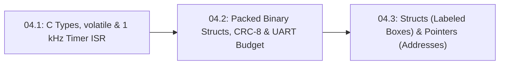

# Lesson 04.2: Packed Binary Telemetry Structs (`struct.pack`), CRC-8 & UART Bandwidth Budgets

<!-- run-callout:start -->
> **Step 7 of 10 · Run it in real time: embedded C**
>
> **Run this in the workbench.** [Open MechaLab with `04.2` loaded](https://tle47.github.io/Mechatronics-Roadmap/?lesson=04.2) - it opens on the **Run Python Lessons** tab with that entry selected. Starter code, hints and the graded check are ready; this page is the reading copy, and nothing you type here is saved.
<!-- run-callout:end -->

## Goal
Pack and unpack a compact **binary telemetry struct** between microcontroller C/C++ (`struct __attribute__((packed))`) and Python (`struct.pack` / `struct.unpack`), verify **8N1 UART serial bandwidth budgets** ($10\text{ bits/byte}$), and protect each frame with a **`0xAA` sync byte** and a true polynomial **CRC-8 (`0x07`)** checksum that catches multi-bit errors that fool a simple XOR checksum.

- **New ideas (max 2):**
  1. **Packed binary C structs (`__attribute__((packed))` and Python `struct.pack`/`unpack`) and 8N1 UART bandwidth budgets**: Why sending raw binary numbers (`<BHHfB`, $10\text{ bytes} = 100\text{ bits}$ at 8N1) is $5\times$ smaller than ASCII text, and why a $20\text{-byte}$ frame at $1\text{ kHz}$ ($200\text{ kbit/s}$) overflows a $115.2\text{ kbaud}$ link and requires $\ge 230.4\text{ kbaud}$ (or $500\text{ kbaud}$).
  2. **Sync headers (`0xAA`), byte-wise XOR checksums, and polynomial CRC-8 (`0x07`) for corrupted-frame rejection**: Why a naive byte-wise XOR checksum (`xor_chk ^= b`) is blinded when the same bit flips in two different bytes, and how a shift-register **CRC-8 (`0x07` polynomial)** catches both single-bit and paired two-byte bit flips.
- **New syntax:** Python `import struct`, `struct.pack("<BHHf", ...)`, `struct.unpack("<BHHfB", ...)`, and bitwise shift/XOR (`<<`, `^`).
- **Target time (unmeasured — [log yours](../.github/ISSUE_TEMPLATE/beginner-timing-log.md)):** Typical: 1.5–2.0 hours | Slow-learner: 2.5–3.5 hours

---

## Prerequisites
- [Lesson P.6: Loading Modules (`import`) & Automated Self-Checks (`assert`)](../track-p/P.6-modules-and-automated-asserts.md)
- [Lesson S0.8: 10-Bit ADC (`analogRead`) & Serial Monitor](../stage-0/S0.8-adc-analog-read-and-serial-monitor.md)
- [Lesson 04.1: Fixed-Width C/C++ Types (`uint16_t`), `volatile` ISR Flags & 1 kHz Timer Loops](04.1-c-types-and-hardware-timer-isr.md)



---

## Learn

<!-- figure: frame-layout | Sync, length, payload, checksum: the receiver’s whole contract in four fields. -->


### Idea 1: Packed binary C structs (`__attribute__((packed))` and Python `struct.pack`/`unpack`) and 8N1 UART bandwidth budgets
- **Primary resource:** [Python 3 Documentation — `struct` — Interpret bytes as packed binary data](https://docs.python.org/3/library/struct.html) `[HTTP 200 — Verified by scripts/check_links.py]`
  - **What to read:** Read exact headings **`Functions and Exceptions`** and **`Format Characters`** (`<` little-endian, `B`=`uint8_t`, `H`=`uint16_t`, `f`=`float`).
  - **What to skip:** Skip native `@` pointer alignment tables.
  - **Key takeaway:** On a standard **8N1 UART serial link**, every byte requires **$10\text{ bits}$ on the wire** ($1\text{ start bit} + 8\text{ data bits} + 1\text{ stop bit}$). At rate $f_{\text{tx}}\text{ Hz}$, a frame of $N_{\text{bytes}}$ demands a minimum raw wire bit rate of $R_{\text{req}} = 10 \cdot N_{\text{bytes}} \cdot f_{\text{tx}}$. At $1\text{ kHz}$, a **$10\text{-byte}$ binary struct** requires $100\text{ kbit/s}$ (fitting inside $115{,}200\text{ baud}$ at $86.8\%$ utilization), whereas a **$20\text{-byte}$ binary struct** at $1\text{ kHz}$ requires **$200\text{ kbit/s}$**—which exceeds $115{,}200\text{ baud}$ ($173.6\%$ utilization, guaranteeing TX buffer overflow and dropped frames) and therefore requires $\ge 230{,}400\text{ baud}$ or $500{,}000\text{ baud}$!
  - **Alternative resource:** [Wikipedia — C data types ("Basic types")](https://en.wikipedia.org/wiki/C_data_types) `[HTTP 200 — Verified by scripts/check_links.py]` — Compare byte widths of `uint8_t`, `uint16_t`, and `float`.

### Idea 2: Sync headers (`0xAA`), byte-wise XOR checksums, and polynomial CRC-8 (`0x07`) for corrupted-frame rejection
- **Primary resource:** [Wikipedia — Cyclic redundancy check ("Computation")](https://en.wikipedia.org/wiki/Cyclic_redundancy_check) `[HTTP 200 — Verified by scripts/check_links.py]`
  - **What to read:** Read exact headings **`Introduction`** and **`Computation`**.
  - **What to skip:** Skip Galois field ring proofs.
  - **Key takeaway:** A simple byte-wise **XOR checksum** (`xor_chk ^= b`) catches any single-bit flip, but if motor PWM noise flips the *same bit position* in two different bytes (`b[3] ^= 1` and `b[5] ^= 1`), the two XOR flips cancel out (`1 ^ 1 = 0`) and the corrupted frame slips through! A true **polynomial CRC-8** (`crc8_ccitt` with generator polynomial $x^8 + x^2 + x + 1 \implies \text{0x07}$) shifts and mixes bits across every byte position, catching single-bit flips, burst errors, and paired two-byte bit flips.
  - **Alternative resource:** [Wikipedia — Checksum ("Simple checksums")](https://en.wikipedia.org/wiki/Checksum) `[HTTP 200 — Verified by scripts/check_links.py]` — Contrast simple longitudinal parity (XOR) checksums with cyclic redundancy checks.

### Bridge Notes
In C/C++ firmware on an `ESP32` or `STM32`, marking a `struct` with `__attribute__((packed))` prevents the compiler from inserting hidden alignment padding bytes between fields, so its memory layout in SRAM matches Python's little-endian `struct.pack("<BHHfB", ...)` format string (`<` = little-endian byte order, `B` = `uint8_t`, `H` = `uint16_t`, `f` = 32-bit IEEE-754 `float`) byte-for-byte:

```cpp
struct __attribute__((packed)) TelemetryFrame10B {
    uint8_t  sync;      // 'B' (1 byte):  0xAA header
    uint16_t tick_ms;   // 'H' (2 bytes): 0..65535 ms
    uint16_t enc_raw;   // 'H' (2 bytes): 0..4095 AS5600 count
    float    vel_rad_s; // 'f' (4 bytes): IEEE-754 float32
    uint8_t  crc8;      // 'B' (1 byte):  CRC-8-CCITT (poly 0x07) of first 9 bytes
}; // Total = 1 + 2 + 2 + 4 + 1 = 10 bytes (100 UART bits at 8N1)
```

Before claiming "zero dropped frames" at $f_{\text{tx}} = 1000\text{ Hz}$, always check the **8N1 UART bandwidth budget** ($10\text{ bits/byte}$ including start and stop bits) so the serial wire rate stays safely below your configured baud rate:

$$
R_{\text{wire}} = 10 \cdot N_{\text{bytes}} \cdot f_{\text{tx}}, \qquad U_{\text{uart}} = \frac{R_{\text{wire}}}{\text{Baud Rate}} \le 0.88
$$

A $10\text{-byte}$ binary struct at $1\text{ kHz}$ requires $100\text{ kbit/s}$ ($86.8\%$ of $115{,}200\text{ baud}$, taking $868.1\ \mu\text{s}$ per frame), whereas a $20\text{-byte}$ binary struct at $1\text{ kHz}$ requires $200\text{ kbit/s}$ ($173.6\%$ of $115{,}200\text{ baud}$), which continuously overflows the transmit ring buffer unless you increase the UART speed to $\ge 230{,}400\text{ baud}$ or $500{,}000\text{ baud}$. Finally, while a simple byte-wise **XOR checksum** (`chk ^= b`) catches single-bit errors, appending a shift-register polynomial **CRC-8 (`0x07`)** (`crc8_ccitt`) mixes bit positions across every payload byte so paired two-byte bit flips are immediately rejected.

---

## Do it yourself

- **What is simulated and in which tool:**
  - **In Python 3 (or the in-browser MechaLab Python Runner):** Complete `crc8_ccitt` (`TODO 1`), `pack_telemetry_10b` (`TODO 2`), and `uart_bandwidth_ok` (`TODO 3`) to verify a 10-byte `<BHHfB` frame, prove that `crc8_ccitt` catches a paired 2-byte bit flip that fools an XOR checksum, and check 8N1 UART bandwidth limits at $1\text{ kHz}$.
- **What is real-hardware only:** Electrical crosstalk from unshielded motor phase wires flipping physical bits on a $3.3\text{ V}$ UART line.

### Starter Code (runs as-is — fill in the TODOs)
Save as `packed_telemetry_and_crc.py` and run `python3 packed_telemetry_and_crc.py`:

```python
import struct


def xor_checksum(data_bytes):
    chk = 0
    for b in data_bytes:
        chk ^= b
    return chk


def crc8_ccitt(data_bytes):
    # TODO 1: Implement CRC-8-CCITT (polynomial 0x07, init 0x00):
    #         For each byte b in data_bytes: crc ^= b, then loop 8 times:
    #         crc = ((crc << 1) ^ 0x07) & 0xFF if (crc & 0x80) else (crc << 1) & 0xFF
    crc = 0
    return crc


def pack_telemetry_10b(tick_ms, enc_raw, vel_rad_s):
    # TODO 2: Pack 9-byte body = struct.pack("<BHHf", 0xAA, tick_ms, enc_raw, vel_rad_s)
    #         and append struct.pack("<B", crc8_ccitt(body))
    return b"\x00" * 10


def unpack_and_verify_10b(frame_10b):
    sync, tick_ms, enc_raw, vel_rad_s, rx_crc = struct.unpack("<BHHfB", frame_10b)
    ok = (sync == 0xAA) and (rx_crc == crc8_ccitt(frame_10b[:9]))
    return ok, tick_ms, enc_raw, vel_rad_s


def uart_bandwidth_ok(frame_bytes, rate_hz, baud_rate):
    # TODO 3: Compute required 8N1 wire rate bits_per_s = frame_bytes * 10 * rate_hz
    #         and return (bits_per_s, bits_per_s <= baud_rate * 0.88)
    return 0, False


frame = pack_telemetry_10b(tick_ms=1000, enc_raw=2048, vel_rad_s=3.25)
ok_clean, tick, enc, vel = unpack_and_verify_10b(frame)
print(f"Frame size: {len(frame)} bytes | CRC8=0x{frame[-1]:02X} | Clean valid: {ok_clean} | tick={tick}, enc={enc}, vel={vel:.2f} rad/s")

corrupted = bytearray(frame)
corrupted[3] ^= 0x01
corrupted[5] ^= 0x01  # Flip bit 0 in two different payload bytes
xor_fooled = xor_checksum(corrupted[:9]) == xor_checksum(frame[:9])
ok_bad, _, _, _ = unpack_and_verify_10b(bytes(corrupted))
print(f"Paired 2-bit flip: XOR fooled={xor_fooled} | CRC-8 valid={ok_bad}")

bps_10, ok_10_115k = uart_bandwidth_ok(10, 1000, 115200)
bps_20, ok_20_115k = uart_bandwidth_ok(20, 1000, 115200)
_, ok_20_500k = uart_bandwidth_ok(20, 1000, 500000)
print(f"1 kHz 8N1 budget: 10B={bps_10} bps (115.2k ok={ok_10_115k}) | 20B={bps_20} bps (115.2k ok={ok_20_115k}, 500k ok={ok_20_500k})")
```

### Expected Output
When `TODO 1`, `TODO 2`, and `TODO 3` are completed, running the script prints:

```text
Frame size: 10 bytes | CRC8=0x2B | Clean valid: True | tick=1000, enc=2048, vel=3.25 rad/s
Paired 2-bit flip: XOR fooled=True | CRC-8 valid=False
1 kHz 8N1 budget: 10B=100000 bps (115.2k ok=True) | 20B=200000 bps (115.2k ok=False, 500k ok=True)
```

### Hint Ladder

<details>
<summary><strong>Hint 1 (Concept nudge)</strong></summary>

In `TODO 1`, XOR each byte into `crc`, then shift left 8 times, XORing with `0x07` whenever bit 7 (`crc & 0x80`) is 1. In `TODO 2`, pack `"<BHHf"` and append `struct.pack("<B", crc8_ccitt(body))`. In `TODO 3`, multiply `frame_bytes * 10 * rate_hz` for 8N1 serial framing.
</details>

<details>
<summary><strong>Hint 2 (Formula / structure)</strong></summary>

```python
def crc8_ccitt(data_bytes):
    crc = 0x00
    for b in data_bytes:
        crc ^= b
        for _ in range(8):
            crc = ((crc << 1) ^ 0x07) & 0xFF if (crc & 0x80) else (crc << 1) & 0xFF
    return crc
```
</details>

<details>
<summary><strong>Full Solution</strong></summary>

```python
import struct


def xor_checksum(data_bytes):
    chk = 0
    for b in data_bytes:
        chk ^= b
    return chk


def crc8_ccitt(data_bytes):
    crc = 0x00
    for b in data_bytes:
        crc ^= b
        for _ in range(8):
            if crc & 0x80:
                crc = ((crc << 1) ^ 0x07) & 0xFF
            else:
                crc = (crc << 1) & 0xFF
    return crc


def pack_telemetry_10b(tick_ms, enc_raw, vel_rad_s):
    body = struct.pack("<BHHf", 0xAA, tick_ms, enc_raw, vel_rad_s)
    crc = crc8_ccitt(body)
    return body + struct.pack("<B", crc)


def unpack_and_verify_10b(frame_10b):
    sync, tick_ms, enc_raw, vel_rad_s, rx_crc = struct.unpack("<BHHfB", frame_10b)
    ok = (sync == 0xAA) and (rx_crc == crc8_ccitt(frame_10b[:9]))
    return ok, tick_ms, enc_raw, vel_rad_s


def uart_bandwidth_ok(frame_bytes, rate_hz, baud_rate):
    bits_per_s = frame_bytes * 10 * rate_hz
    return bits_per_s, bits_per_s <= baud_rate * 0.88


frame = pack_telemetry_10b(tick_ms=1000, enc_raw=2048, vel_rad_s=3.25)
ok_clean, tick, enc, vel = unpack_and_verify_10b(frame)
assert ok_clean and frame[-1] == 0x2B
print(f"Frame size: {len(frame)} bytes | CRC8=0x{frame[-1]:02X} | Clean valid: {ok_clean} | tick={tick}, enc={enc}, vel={vel:.2f} rad/s")

corrupted = bytearray(frame)
corrupted[3] ^= 0x01
corrupted[5] ^= 0x01  # Flip bit 0 in two different payload bytes
xor_fooled = xor_checksum(corrupted[:9]) == xor_checksum(frame[:9])
ok_bad, _, _, _ = unpack_and_verify_10b(bytes(corrupted))
assert xor_fooled and not ok_bad
print(f"Paired 2-bit flip: XOR fooled={xor_fooled} | CRC-8 valid={ok_bad}")

bps_10, ok_10_115k = uart_bandwidth_ok(10, 1000, 115200)
bps_20, ok_20_115k = uart_bandwidth_ok(20, 1000, 115200)
_, ok_20_500k = uart_bandwidth_ok(20, 1000, 500000)
assert bps_10 == 100000 and ok_10_115k and bps_20 == 200000 and (not ok_20_115k) and ok_20_500k
print(f"1 kHz 8N1 budget: 10B={bps_10} bps (115.2k ok={ok_10_115k}) | 20B={bps_20} bps (115.2k ok={ok_20_115k}, 500k ok={ok_20_500k})")
```
</details>

---

## Common mistakes & troubleshooting
- **Calling a simple byte-wise XOR (`crc ^= b`) a "CRC-8":** A byte-wise XOR is a longitudinal parity checksum—if the same bit flips in two bytes, the errors cancel out (`1 ^ 1 = 0`). Use a shift-register polynomial **CRC-8 (`0x07`)** so bit positions mix across bytes.
- **Streaming a 20-byte frame at $1\text{ kHz}$ over $115{,}200\text{ baud}$:** At 8N1 ($10\text{ bits/byte}$), $20\text{ bytes} \times 10 \times 1000\text{ Hz} = 200{,}000\text{ bit/s}$, which exceeds $115{,}200\text{ baud}$ and continuously drops frames! Use $\ge 230{,}400\text{ baud}$ or $500{,}000\text{ baud}$.

---

## Check yourself

1. **8N1 UART wire bit rate:** What minimum raw bit rate (in $\text{bit/s}$) is required to transmit a $20\text{-byte}$ binary telemetry packet at $1\text{ kHz}$ over an 8N1 serial link ($10\text{ bits/byte}$), and why does $115{,}200\text{ baud}$ drop frames?
   <details>
   <summary><strong>Answer</strong></summary>

   $20\text{ bytes} \times 10\text{ bits/byte} \times 1000\text{ Hz} = \mathbf{200{,}000\text{ bit/s}}$ ($200\text{ kbit/s}$). Because $200{,}000 > 115{,}200$, the TX ring buffer fills faster than the UART shift register can drain it, dropping $>40\%$ of frames unless the baud rate is raised to $\ge 230{,}400$ or $500{,}000\text{ baud}$.
   </details>

2. **XOR checksum vs. polynomial CRC-8 (`0x07`):** Why does flipping bit 0 in byte 3 AND bit 0 in byte 5 fool `xor_checksum`, while `crc8_ccitt` catches it?
   <details>
   <summary><strong>Answer</strong></summary>

   In a byte-wise XOR checksum, bit 0 of every byte is XORed into the same column (`1 ^ 1 = 0`), so paired bit flips cancel out. In `crc8_ccitt`, each byte is shifted left 8 times and mixed with generator polynomial `0x07`, spreading a bit flip in byte 3 across different bit positions before byte 5 arrives.
   </details>

---

## Recap
- **Packed binary C structs** (`__attribute__((packed))` and Python `struct.pack("<BHHfB", ...)`) cut serial payload size by $5\times$ compared to ASCII text, and checking the **8N1 UART bandwidth budget** ($10\text{ bits/byte}$) prevents TX buffer overflows.
- Pairing a **`0xAA` sync header** with a polynomial **CRC-8 (`0x07`)** catches both single-bit noise and multi-byte paired bit flips that fool a naive XOR checksum.

### You're ready to move on when...
- [ ] Your `packed_telemetry_and_crc.py` script prints `CRC8=0x2B | Clean valid: True`, `XOR fooled=True | CRC-8 valid=False`, and `20B=200000 bps (115.2k ok=False, 500k ok=True)`.
- [ ] You can compute the exact 8N1 bit rate (`bytes * 10 * Hz`) of any binary telemetry struct.

<!-- next-step:start -->
👉 **Next:** [Step 7 · Run it in real time: embedded C — Lesson 04.3: Python-to-C Bridge (Part 3) — C Structs as Labeled Boxes & Pointers as Box Addresses](04.3-structs-and-pointers-labeled-boxes.md)
<!-- next-step:end -->
