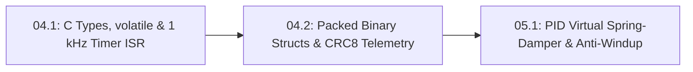

# Lesson 04.2: Packed Binary Telemetry Structs (`struct.pack`) & 8-Bit XOR Checksums

## Goal
Pack and unpack a compact **binary telemetry struct** between microcontroller C/C++ (`struct __attribute__((packed))`) and Python (`struct.pack` / `struct.unpack`), and protect each frame with a **`0xAA` sync byte** and an **8-bit XOR checksum (`crc8`)** so corrupted serial bytes are immediately rejected.

- **New ideas (max 2):**
  1. **Packed binary C structs (`__attribute__((packed))` and Python `struct.pack`/`unpack`) versus slow ASCII text**: Why sending raw binary numbers (`<BHHfB`, $10\text{ bytes}$) is $5\times$ smaller and faster on UART wires than printing human-readable ASCII text strings (`50+ bytes`).
  2. **Sync headers (`0xAA`) and 8-bit XOR checksums (`crc8`) for corrupted-frame rejection**: How XORing every byte in a packet (`crc ^= b`) catches single-bit serial noise before a corrupted angle or command can jerk the robot.
- **New syntax:** Python `import struct`, `struct.pack("<BHHf", ...)`, `struct.unpack("<BHHfB", ...)`, and bitwise XOR `^`.
- **Estimated time (untimed guesses):** Typical: 1.5–2.0 hours | Slow-learner: 2.5–3.5 hours

---

## Prerequisites
- [Lesson P.6: Loading Modules (`import`) & Automated Self-Checks (`assert`)](../track-p/P.6-modules-and-automated-asserts.md)
- [Lesson S0.8: 10-Bit ADC (`analogRead`) & Serial Monitor](../stage-0/S0.8-adc-analog-read-and-serial-monitor.md)
- [Lesson 04.1: Fixed-Width C/C++ Types (`uint16_t`), `volatile` ISR Flags & 1 kHz Timer Loops](04.1-c-types-and-hardware-timer-isr.md)



---

## Learn

### Idea 1: Packed binary C structs (`__attribute__((packed))` and Python `struct.pack`/`unpack`) versus slow ASCII text
- **Primary resource:** [Python 3 Documentation — `struct` — Interpret bytes as packed binary data](https://docs.python.org/3/library/struct.html) `[HTTP 200 — Verified by scripts/check_links.py]`
  - **What to read:** Read exact headings **`Functions and Exceptions`** and **`Format Characters`** (`<` little-endian, `B`=`uint8_t`, `H`=`uint16_t`, `f`=`float`).
  - **What to skip:** Skip native `@` pointer alignment tables.
  - **Key takeaway:** Printing `"t=1000,raw=2048,v=3.2500\n"` over UART sends $25\text{–}55$ ASCII characters ($250\text{–}550\text{ bits}$ at $10\text{ bits/byte}$). A **packed binary C struct** sends the exact same numbers in their native memory bytes: $1\text{ byte}$ sync (`B`), $2\text{ bytes}$ tick (`H`), $2\text{ bytes}$ encoder count (`H`), $4\text{ bytes}$ float velocity (`f`), and $1\text{ byte}$ checksum (`B`) = **$10\text{ bytes}$ total** ($100\text{ bits}$), streaming cleanly at $1\text{ kHz}$ without stalling the CPU.
  - **Alternative resource:** [Wikipedia — C data types ("Basic types")](https://en.wikipedia.org/wiki/C_data_types) `[HTTP 200 — Verified by scripts/check_links.py]` — Compare byte widths of `uint8_t`, `uint16_t`, and `float`.

### Idea 2: Sync headers (`0xAA`) and 8-bit XOR checksums (`crc8`) for corrupted-frame rejection
- **Primary resource:** [Wikipedia — Checksum ("Simple checksums")](https://en.wikipedia.org/wiki/Checksum) `[HTTP 200 — Verified by scripts/check_links.py]`
  - **What to read:** Read exact headings **`Checksum`** and **`Algorithms`**.
  - **What to skip:** Skip cryptographic SHA-256 hashes.
  - **Key takeaway:** Motor PWM switching can flip a bit on a nearby UART wire. If a bit flips inside a binary `float`, the number can jump from `1.57 rad` to `1e30 rad`! We start every packet with a **`0xAA` sync header** (`0b10101010`, alternating bits) and end it with an **8-bit XOR checksum** (`crc ^= byte` across all payload bytes). When the receiver unpacks the frame, it recomputes the XOR checksum and rejects the packet if `rx_crc != calc_crc`.
  - **Alternative resource:** [Wikipedia — Exclusive or ("Bitwise operation")](https://en.wikipedia.org/wiki/Exclusive_or) `[HTTP 200 — Verified by scripts/check_links.py]` — Review how bitwise XOR (`^`) outputs `1` when two bits differ.

### Bridge Notes
In C/C++ firmware on an `ESP32` or `STM32`, marking a `struct` with `__attribute__((packed))` prevents the compiler from inserting hidden alignment padding bytes between fields, so its memory layout in SRAM matches Python's little-endian `struct.pack("<BHHfB", ...)` format string (`<` = little-endian byte order, `B` = `uint8_t`, `H` = `uint16_t`, `f` = 32-bit `float`) byte-for-byte:

```cpp
struct __attribute__((packed)) TelemetryFrame10B {
    uint8_t  sync;      // 'B' (1 byte):  0xAA header
    uint16_t tick_ms;   // 'H' (2 bytes): 0..65535 ms
    uint16_t enc_raw;   // 'H' (2 bytes): 0..4095 AS5600 count
    float    vel_rad_s; // 'f' (4 bytes): IEEE-754 float32
    uint8_t  xor_crc;   // 'B' (1 byte):  XOR checksum of first 9 bytes
}; // Total = 1 + 2 + 2 + 4 + 1 = 10 bytes (100 UART bits at 8-N-1)
```

At $115200\text{ baud}$ ($10\text{ bits}$ per UART byte including start and stop bits), transmitting this $10\text{-byte}$ **packed binary C struct** over serial takes only:

$$
T_{\text{tx}} = \frac{10\text{ bytes} \times 10\text{ bits/byte}}{115200\text{ bits/s}} = 0.000868\text{ s} = 868.1\ \mu\text{s}
$$

That fits comfortably inside a $1000\ \mu\text{s}$ ($1\text{ kHz}$) real-time control period with $131.9\ \mu\text{s}$ of timing margin to spare, whereas a $50\text{-byte}$ human-readable ASCII `Serial.println()` string takes $4340.3\ \mu\text{s}$ ($5.0\times$ longer) and immediately overflows the $1\text{ kHz}$ loop! Starting every binary frame with the **`0xAA` sync header** and ending with an **8-bit XOR checksum** (`xor_crc`) guarantees that any corrupted byte on the wire is caught and rejected before reaching your laptop plotter or feedback controller.

---

## Do it yourself

- **What is simulated and in which tool:**
  - **In Python 3 (or the in-browser MechaLab Python Runner):** Complete `xor_checksum` (`TODO 1`), `pack_telemetry_10b` (`TODO 2`), and `unpack_and_verify_10b` (`TODO 3`) to pack a 10-byte `<BHHfB` frame, verify a clean frame, and confirm that flipping 1 bit in transit is caught by the XOR checksum.
- **What is real-hardware only:** Electrical crosstalk from unshielded motor phase wires flipping a physical bit on a $3.3\text{ V}$ UART line.

### Starter Code (runs as-is — fill in the TODOs)
Save as `packed_telemetry_and_crc.py` and run `python3 packed_telemetry_and_crc.py`:

```python
import struct


def xor_checksum(data_bytes):
    # TODO 1: XOR every byte b in data_bytes into crc (starting from crc = 0) and return crc
    crc = 0
    return crc


def pack_telemetry_10b(tick_ms, enc_raw, vel_rad_s):
    # TODO 2: Pack the 9-byte body using struct.pack("<BHHf", 0xAA, tick_ms, enc_raw, vel_rad_s),
    #         compute crc = xor_checksum(body), and return body + struct.pack("<B", crc)
    return b"\x00" * 10


def unpack_and_verify_10b(frame_10b):
    # TODO 3: Unpack sync, tick_ms, enc_raw, vel_rad_s, rx_crc = struct.unpack("<BHHfB", frame_10b)
    #         Check ok = (sync == 0xAA) and (rx_crc == xor_checksum(frame_10b[:9]))
    return False, 0, 0, 0.0


frame = pack_telemetry_10b(tick_ms=1000, enc_raw=2048, vel_rad_s=3.25)
ok_clean, tick, enc, vel = unpack_and_verify_10b(frame)
print(f"Frame size: {len(frame)} bytes | Clean frame valid: {ok_clean} | tick={tick}, enc={enc}, vel={vel:.2f} rad/s")

corrupted = bytearray(frame)
corrupted[4] ^= 0x01  # Flip 1 bit in payload
ok_bad, _, _, _ = unpack_and_verify_10b(bytes(corrupted))
print(f"Corrupted frame (1 bit flipped) valid: {ok_bad}")
```

### Expected Output
When `TODO 1`, `TODO 2`, and `TODO 3` are completed, running the script prints:

```text
Frame size: 10 bytes | Clean frame valid: True | tick=1000, enc=2048, vel=3.25 rad/s
Corrupted frame (1 bit flipped) valid: False
```

### Hint Ladder

<details>
<summary><strong>Hint 1 (Concept nudge)</strong></summary>

In `TODO 1`, loop `for b in data_bytes: crc ^= b`. In `TODO 2`, pack the first 4 fields with `"<BHHf"`, compute `crc = xor_checksum(body)`, and append `struct.pack("<B", crc)`. In `TODO 3`, unpack all 5 fields with `"<BHHfB"` and check `(sync == 0xAA) and (rx_crc == xor_checksum(frame_10b[:9]))`.
</details>

<details>
<summary><strong>Hint 2 (Formula / structure)</strong></summary>

```python
def pack_telemetry_10b(tick_ms, enc_raw, vel_rad_s):
    body = struct.pack("<BHHf", 0xAA, tick_ms, enc_raw, vel_rad_s)
    crc = xor_checksum(body)
    return body + struct.pack("<B", crc)
```
</details>

<details>
<summary><strong>Full Solution</strong></summary>

```python
import struct


def xor_checksum(data_bytes):
    crc = 0
    for b in data_bytes:
        crc ^= b
    return crc


def pack_telemetry_10b(tick_ms, enc_raw, vel_rad_s):
    body = struct.pack("<BHHf", 0xAA, tick_ms, enc_raw, vel_rad_s)
    crc = xor_checksum(body)
    return body + struct.pack("<B", crc)


def unpack_and_verify_10b(frame_10b):
    sync, tick_ms, enc_raw, vel_rad_s, rx_crc = struct.unpack("<BHHfB", frame_10b)
    ok = (sync == 0xAA) and (rx_crc == xor_checksum(frame_10b[:9]))
    return ok, tick_ms, enc_raw, vel_rad_s


frame = pack_telemetry_10b(tick_ms=1000, enc_raw=2048, vel_rad_s=3.25)
ok_clean, tick, enc, vel = unpack_and_verify_10b(frame)
print(f"Frame size: {len(frame)} bytes | Clean frame valid: {ok_clean} | tick={tick}, enc={enc}, vel={vel:.2f} rad/s")

corrupted = bytearray(frame)
corrupted[4] ^= 0x01  # Flip 1 bit in payload
ok_bad, _, _, _ = unpack_and_verify_10b(bytes(corrupted))
print(f"Corrupted frame (1 bit flipped) valid: {ok_bad}")
```
</details>

---

## Common mistakes & troubleshooting
- **Omitting `<` (little-endian) in `struct.pack("BHHfB", ...)`:** Without `<`, Python inserts native alignment padding bytes on 64-bit PCs, making the buffer $12\text{ or }16\text{ bytes}$ instead of $10\text{ bytes}$! Always prefix format strings with `<` (`"<BHHfB"`).
- **Forgetting `__attribute__((packed))` on the C struct:** Without `packed`, a 32-bit microcontroller pads `uint8_t sync` with extra bytes to align `float` on a 4-byte boundary.

---

## Check yourself

1. **Struct byte count:** How many total bytes does the format string `"<BIffB"` (`uint8_t`, `uint32_t`, `float`, `float`, `uint8_t`) occupy?
   <details>
   <summary><strong>Answer</strong></summary>

   $1 + 4 + 4 + 4 + 1 = \mathbf{14\text{ bytes}}$.
   </details>

2. **8-bit XOR checksum calculation:** What is the XOR checksum (`b0 ^ b1 ^ b2`) of the three bytes `[0xAA, 0x0F, 0xA5]`?
   <details>
   <summary><strong>Answer</strong></summary>

   `0xAA ^ 0x0F = 0xA5`, and `0xA5 ^ 0xA5 = 0x00` ($\mathbf{0}$).
   </details>

---

## Recap
- **Packed binary C structs** (`__attribute__((packed))` and Python `struct.pack("<BHHfB", ...)`) transmit telemetry in a fraction of the bytes required by ASCII `Serial.println()`.
- Pairing a **`0xAA` sync header** with an **8-bit XOR checksum** detects corrupted serial frames before bad numbers reach your control loop.

### You're ready to move on when...
- [ ] Your `packed_telemetry_and_crc.py` script prints `Frame size: 10 bytes | Clean frame valid: True` and `Corrupted frame (1 bit flipped) valid: False`.
- [ ] You can compute the exact byte size of any `<BHHfB` format string.
- **Next lesson:** [Lesson 05.1: PID Virtual Spring-Damper Control & Integrator Anti-Windup Clamping](../05-control-and-estimation/05.1-pid-virtual-spring-damper-and-anti-windup.md)
