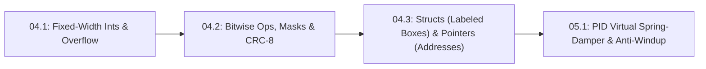

# Lesson 04.3: Python-to-C Bridge (Part 3) — C Structs as Labeled Boxes & Pointers as Box Addresses

## Goal
Complete our 3-part **Python-to-C Bridge** (`04.1` Fixed-Width Ints + Overflow $\to$ `04.2` Bitwise Masks + CRC-8 $\to$ `04.3` Structs + Pointers) by using only two mental pictures: **a C `struct` is a labeled box** that holds a joint's variables together, and **a pointer (`JointState *p = &joint`) is the memory address of that box** so a function can update the original box in place (`p->pos_rad = ...`) without copying it—and diagnose the classic `R4` pass-by-value bug where a C function modifies a temporary copy that vanishes upon return.

- **New ideas (max 2):**
  1. **C structs as labeled multi-field boxes for grouping joint state**: Grouping `enc_count`, `pos_rad`, `vel_rad_s`, and `fault_flags` inside `struct JointState` instead of scattering loose global variables (`q1_pos`, `q1_vel`, `q2_pos`, `q2_vel`).
  2. **Pointers (`*`, `&`, `->`) as box addresses for in-place updates and pass-by-value bug diagnosis**: Why `void update_joint(JointState j)` in C modifies a throwaway copy (leaving the caller's struct frozen at `0.0`), while passing the box's address `void update_joint(JointState *j)` with `&joint1` updates the original box in place via `j->pos_rad`.
- **New syntax:** C `struct JointState { ... };`, address-of `&box`, pointer parameter `JointState *p`, and arrow field access `p->field` (mirrored in Python via a dict/object reference vs. shallow copy).
- **Target time (unmeasured — [log yours](../.github/ISSUE_TEMPLATE/beginner-timing-log.md)):** Typical: 1.0–1.5 hours | Slow-learner: 2.0–3.0 hours

---

## Prerequisites
- [Lesson 04.1: Python-to-C Bridge (Part 1) — Fixed-Width C/C++ Types (`uint8_t`/`uint16_t`), Modular Overflow & 1 kHz Timer ISRs](04.1-c-types-and-hardware-timer-isr.md)
- [Lesson 04.2: Python-to-C Bridge (Part 2) — Bitwise Masks, Packed Binary Telemetry & CRC-8](04.2-packed-structs-and-crc8-telemetry.md)



---

## Learn

### Idea 1: C structs as labeled multi-field boxes for grouping joint state
- **Primary resource:** [Wikipedia — struct (C programming language)](https://en.wikipedia.org/wiki/Struct_(C_programming_language)) `[HTTP 200 — Verified by scripts/check_links.py]`
  - **What to read:** Read exact headings **`Declaration`** and **`Pointers`**.
  - **What to skip:** Skip bit-field compiler packing subtleties.
  - **Key takeaway:** When a robot has 2, 4, or 6 joints, creating separate variables (`joint1_count`, `joint1_pos`, `joint2_count`, `joint2_pos`...) quickly turns into copy-paste spaghetti. A C **`struct` is simply a labeled box** with named compartments (`joint1.enc_count`, `joint1.pos_rad`, `joint1.vel_rad_s`, `joint1.cmd_nm`). You define the box blueprint once (`struct JointBox`), and stamp out one box per robot joint (`JointBox shoulder; JointBox elbow;`).
  - **Alternative resource:** [Python 3 Documentation — Data Structures ("Dictionaries")](https://docs.python.org/3/tutorial/datastructures.html#dictionaries) `[HTTP 200 — Verified by scripts/check_links.py]` — Compare named key lookup in Python dicts to fixed-offset field access (`box.pos_rad`) in a C struct.

### Idea 2: Pointers (*, &, ->) as box addresses for in-place updates and pass-by-value bug diagnosis
- **Primary resource:** [Wikipedia — Pointer (computer programming) ("C and C++")](https://en.wikipedia.org/wiki/Pointer_(computer_programming)) `[HTTP 200 — Verified by scripts/check_links.py]`
  - **What to read:** Read exact headings **`Formal description`** and **`C and C++`**.
  - **What to skip:** Skip dynamic `malloc`/`free` heap allocation—in real-time embedded control we never allocate heap memory inside a $1\text{ kHz}$ loop!
  - **Key takeaway:** You never need mysterious pointer arithmetic in beginner firmware—you only need **three symbols**:
    1. **`&box` ("Address of `box`"):** Hands a function the street address where `box` lives in RAM instead of photocopying the entire box.
    2. **`JointBox *p` ("Pointer parameter"):** Declares that `p` holds the address of a `JointBox`.
    3. **`p->pos_rad` ("Follow the address arrow into the box"):** Opens the original box at address `p` and reads or writes its `pos_rad` compartment in place!

### Bridge Notes
Why do C/C++ robotics drivers use pointers (`JointBox *p`) whenever a function updates a joint's state? Because **by default, C passes structs by value—meaning it makes a temporary photocopy of the box** and hands that copy to the function:

```cpp
struct JointBox {
    uint16_t enc_count;
    float    pos_rad;
    float    vel_rad_s;
};

// ❌ R4 BUG (Pass-by-Value Photocopy): Modifies a temporary copy that is destroyed on return!
void update_joint_buggy(JointBox b, uint16_t new_count, float dt_s) {
    float new_pos = (new_count / 4096.0f) * 6.2831853f;
    b.vel_rad_s = (new_pos - b.pos_rad) / dt_s;
    b.pos_rad   = new_pos;
    b.enc_count = new_count;
} // <-- 'b' vanishes here! Caller's shoulder.pos_rad stays 0.0 forever!

// ✅ FIX (Pass Box Address via Pointer *): Updates the caller's original box in place!
void update_joint_ptr(JointBox *p, uint16_t new_count, float dt_s) {
    float new_pos = (new_count / 4096.0f) * 6.2831853f;
    p->vel_rad_s = (new_pos - p->pos_rad) / dt_s;
    p->pos_rad   = new_pos;
    p->enc_count = new_count;
}
// Called in 1 kHz loop as: update_joint_ptr(&shoulder, raw_spi_count, 0.001f);
```

Keep these three rules in mind whenever you read or write embedded C/C++ joint drivers:
- **Direct struct variable (`.`) vs. struct pointer (`->`):** When you hold the labeled box directly (`JointBox shoulder;`), access its compartments with a dot (`shoulder.pos_rad`). When a function receives the memory address of the box via a pointer parameter (`JointBox *p = &shoulder`), follow the address arrow into the box using `p->pos_rad`.
- **Zero-copy speed inside a $1\text{ kHz}$ loop:** Passing `&shoulder` copies only a single memory address ($4\text{ bytes}$ on a 32-bit `STM32` or `ESP32`) instead of copying every float and integer field on the stack.
- **`R4` Pass-by-Value Bug Diagnosis:** If your joint struct stays frozen at `0.0` in `loop()` even though the math inside `update_joint(...)` is right, check the function header first: writing `JointBox b` instead of `JointBox *p` means your function updated a temporary photocopy that vanished on return!

---

## Do it yourself

- **What is simulated and in which tool:** Runs 100% in Python 3 (or the in-browser MechaLab Python Runner) to model a C `JointBox` struct, contrast the `R4` pass-by-value copy bug against in-place pointer-style updates, and update a 2-joint arm state array.
- **What is real-hardware only:** Inspecting raw SRAM addresses (`0x20000100`) in an `STM32` debugger watch window.

### Starter Code (runs as-is — fill in the TODOs)
Complete `make_joint_box` (`TODO 1`), `update_joint_in_place` (`TODO 2`), and `diagnose_struct_update_bug` (`TODO 3`):

```python
import math


def make_joint_box(label, cpr=4096):
    # TODO 1: Return a dictionary representing a C struct JointBox with keys:
    #         "label": label, "cpr": cpr, "enc_count": 0, "pos_rad": 0.0, "vel_rad_s": 0.0
    return {}


def update_joint_copy_bug(box, new_count, dt_s):
    """Simulates C pass-by-value bug: copies the struct, updates the copy, and drops it."""
    local_copy = dict(box)
    new_pos = (new_count / float(local_copy.get("cpr", 4096))) * 2.0 * math.pi
    local_copy["vel_rad_s"] = (new_pos - local_copy.get("pos_rad", 0.0)) / dt_s
    local_copy["pos_rad"] = new_pos
    local_copy["enc_count"] = new_count


def update_joint_in_place(box_ptr, new_count, dt_s):
    # TODO 2: Simulate C pointer update (JointBox *p -> p->field):
    #         1. Compute new_pos = (new_count / float(box_ptr["cpr"])) * 2.0 * math.pi
    #         2. Mutate box_ptr["vel_rad_s"] = (new_pos - box_ptr["pos_rad"]) / dt_s
    #         3. Mutate box_ptr["pos_rad"] = new_pos and box_ptr["enc_count"] = new_count
    #         4. Return box_ptr
    return box_ptr


def diagnose_struct_update_bug(box_before_count, box_after_count, commanded_new_count):
    # TODO 3: If commanded_new_count != box_before_count but box_after_count == box_before_count,
    #         return "pass_by_value_copy_bug" (caller's struct was never modified in place),
    #         else return "updated_in_place_ok"
    return "unknown"


shoulder = make_joint_box("shoulder", cpr=4096)
update_joint_copy_bug(shoulder, 1024, 0.010)
count_after_copy = shoulder.get("enc_count", 0)
bug_status = diagnose_struct_update_bug(0, count_after_copy, 1024)

update_joint_in_place(shoulder, 1024, 0.010)
ok_status = diagnose_struct_update_bug(0, shoulder.get("enc_count", 0), 1024)

print(f"After copy call: count={count_after_copy} ({bug_status})")
print(f"After pointer call: count={shoulder.get('enc_count', 0)}, pos={shoulder.get('pos_rad', 0.0):.4f} rad, vel={shoulder.get('vel_rad_s', 0.0):.2f} rad/s ({ok_status})")
```

### Expected Output
When `TODO 1`, `TODO 2`, and `TODO 3` are completed, running the script prints:

```text
After copy call: count=0 (pass_by_value_copy_bug)
After pointer call: count=1024, pos=1.5708 rad, vel=157.08 rad/s (updated_in_place_ok)
```

### Hint Ladder

<details>
<summary><strong>Hint 1 (Concept nudge)</strong></summary>

In `TODO 1`, return `{"label": label, "cpr": cpr, "enc_count": 0, "pos_rad": 0.0, "vel_rad_s": 0.0}`. In `TODO 2`, update `box_ptr["vel_rad_s"]`, `box_ptr["pos_rad"]`, and `box_ptr["enc_count"]` directly on `box_ptr`. In `TODO 3`, check `if commanded_new_count != box_before_count and box_after_count == box_before_count:`.
</details>

<details>
<summary><strong>Hint 2 (Formula / structure)</strong></summary>

```python
def update_joint_in_place(box_ptr, new_count, dt_s):
    new_pos = (new_count / float(box_ptr["cpr"])) * 2.0 * math.pi
    box_ptr["vel_rad_s"] = (new_pos - box_ptr["pos_rad"]) / dt_s
    box_ptr["pos_rad"] = new_pos
    box_ptr["enc_count"] = new_count
    return box_ptr
```
</details>

<details>
<summary><strong>Full Solution</strong></summary>

```python
import math


def make_joint_box(label, cpr=4096):
    return {
        "label": label,
        "cpr": cpr,
        "enc_count": 0,
        "pos_rad": 0.0,
        "vel_rad_s": 0.0,
    }


def update_joint_copy_bug(box, new_count, dt_s):
    """Simulates C pass-by-value bug: copies the struct, updates the copy, and drops it."""
    local_copy = dict(box)
    new_pos = (new_count / float(local_copy.get("cpr", 4096))) * 2.0 * math.pi
    local_copy["vel_rad_s"] = (new_pos - local_copy.get("pos_rad", 0.0)) / dt_s
    local_copy["pos_rad"] = new_pos
    local_copy["enc_count"] = new_count


def update_joint_in_place(box_ptr, new_count, dt_s):
    new_pos = (new_count / float(box_ptr["cpr"])) * 2.0 * math.pi
    box_ptr["vel_rad_s"] = (new_pos - box_ptr["pos_rad"]) / dt_s
    box_ptr["pos_rad"] = new_pos
    box_ptr["enc_count"] = new_count
    return box_ptr


def diagnose_struct_update_bug(box_before_count, box_after_count, commanded_new_count):
    if commanded_new_count != box_before_count and box_after_count == box_before_count:
        return "pass_by_value_copy_bug"
    return "updated_in_place_ok"


shoulder = make_joint_box("shoulder", cpr=4096)
update_joint_copy_bug(shoulder, 1024, 0.010)
count_after_copy = shoulder.get("enc_count", 0)
bug_status = diagnose_struct_update_bug(0, count_after_copy, 1024)

update_joint_in_place(shoulder, 1024, 0.010)
ok_status = diagnose_struct_update_bug(0, shoulder.get("enc_count", 0), 1024)

print(f"After copy call: count={count_after_copy} ({bug_status})")
print(f"After pointer call: count={shoulder.get('enc_count', 0)}, pos={shoulder.get('pos_rad', 0.0):.4f} rad, vel={shoulder.get('vel_rad_s', 0.0):.2f} rad/s ({ok_status})")
assert bug_status == "pass_by_value_copy_bug"
assert ok_status == "updated_in_place_ok"
assert abs(shoulder["pos_rad"] - (math.pi / 2.0)) < 1e-6
```
</details>

---

## Common mistakes & troubleshooting
- **Forgetting `*` in a C function parameter (`void update(JointBox b)` instead of `void update(JointBox *p)`):** C copies the entire struct on entry and discards the copy on return, leaving the caller's struct unchanged.
- **Using `.` instead of `->` on a C struct pointer (`p.pos_rad` instead of `p->pos_rad`):** In C/C++, `p->field` dereferences the pointer `p` and accesses `field` in one step.

---

## Check yourself
1. **In C, if `JointBox shoulder;` is a struct variable and `void reset_joint(JointBox *p)` expects a pointer to a `JointBox`, how do you call `reset_joint`?**
   <details>
   <summary><strong>Answer 1</strong></summary>
   Pass the address of `shoulder` using the `&` operator: `reset_joint(&shoulder);`.
   </details>
2. **Inside `void reset_joint(JointBox *p)`, how do you set the `pos_rad` compartment inside the caller's box to `0.0f`?**
   <details>
   <summary><strong>Answer 2</strong></summary>
   Use the arrow operator: `p->pos_rad = 0.0f;`.
   </details>

---

## Recap
- [ ] I can group per-joint sensor and control variables inside a C `struct` ("a labeled box") instead of duplicating global variables.
- [ ] I can pass a struct's address (`&box`) to a pointer parameter (`JointBox *p`), update fields in place via `p->field`, and diagnose pass-by-value copy bugs (`R4`).

👉 **Next lesson:** [Lesson 05.1: PID Controller as a Virtual Spring-Damper + Integrator Anti-Windup](../05-control-and-estimation/05.1-pid-virtual-spring-damper-and-anti-windup.md)
