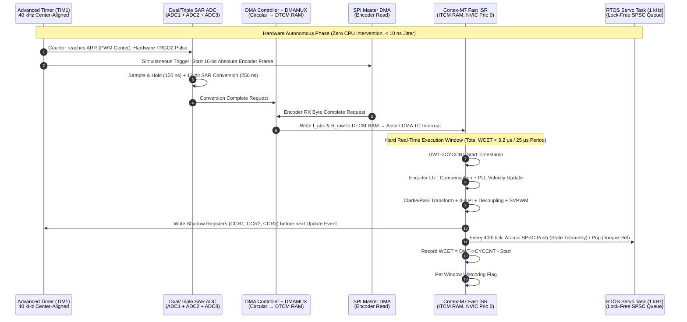

# Track 04: Hard Real-Time Embedded Systems, Industrial Networks & FPGA Co-Design

> **Part of the [ten-step MechaLab course](../README.md)**  
> **Prerequisites:** [Track 01: Mixed-Signal & Power Electronics](../01-electronics-and-power/README.md), [Track 03: Sensors & Actuators](../03-sensors-and-actuators/README.md)  
> **Feeds Into:** [Track 05: Control & Estimation](../05-control-and-estimation/README.md), [Track 06: Robotics & Autonomy](../06-robotics-and-autonomy/README.md), [Track 07: Systems, HIL & Production](../07-systems-hil-and-production/README.md)  
> **Core Principle:** In a real-time control system, **a mathematically correct answer delivered late is a wrong answer.** Sampling jitter $\Delta t$ acts as phase noise that directly erodes phase margin ($\Delta\phi = -\omega_c \Delta t_{\max}$) and injects multiplicative derivative noise. Production firmware achieves sub-microsecond determinism by offloading timing-critical I/O to hardware timers, DMA controllers, or FPGA fabric—and enforcing strict zero-allocation, lock-free execution paths.

---

<!-- step-index -->
> **Step 7 of 10 · Run it in real time: embedded C.** Move a fixed-rate control loop off Python and onto a microcontroller.
>
> This folder is the reading for Step 7. The ten steps are the only order the course uses; the three `Tier` sections
> below are its three depth layers, and the headings keep their old names because the
> module pages link to them. Read `Tier 1` as Depth 1 of this step, `Tier 2` as
> Depth 2, `Tier 3` as Depth 3; a page marked optional sits outside both routes,
> whatever its tier. Take Depth 1 in order; Depth 2 and Depth 3 wait until Step 10 is finished.

| Depth | What it is | Pages in this track | Focused hours |
| :--- | :--- | :--- | ---: |
| **1 · arm** | [Step 7](#tier-1-beginner--intuitive), in order | [`04.1`](04.1-c-types-and-hardware-timer-isr.md), [`04.2`](04.2-packed-structs-and-crc8-telemetry.md), [`04.3`](04.3-structs-and-pointers-labeled-boxes.md) · [`04-embedded.T1.04a`](../modules/04-embedded.T1.04a.md), [`04-embedded.T1.04b`](../modules/04-embedded.T1.04b.md) | 11-17 |
| **2 · practice** | [after Step 10](#tier-2-intermediate--applied), same step order | [`04-embedded.T2.04a`](../modules/04-embedded.T2.04a.md), [`04-embedded.T2.04b`](../modules/04-embedded.T2.04b.md) | 8 |
| **3 · derive** | [after the practice pass](#tier-3-advanced--production), same step order | — | — |
| **outside both routes** | [optional](#tier-3-advanced--production), graded, never required | [`04-embedded.T2.04c`](../modules/04-embedded.T2.04c.md), [`04-embedded.T2.04d`](../modules/04-embedded.T2.04d.md), [`04-embedded.T3.04a`](../modules/04-embedded.T3.04a.md) | 13 |

**Step 7 costs 19-25 focused hours in total** - 4-10 of lessons, 7 of arm modules, 8 of Depth 2 practice - out of a **201.1-292 focused-hour** course. Hours are each page's own metadata; [`docs/SYLLABUS.md`](../docs/SYLLABUS.md) is the full column, and [`docs/CURRICULUM.md`](../docs/CURRICULUM.md) maps steps to ids.

**Next:** Step 8 · Make it hold still: control → [Track 05](../05-control-and-estimation/README.md) (17-21 focused hours).
<!-- /step-index -->
---

## Tier 1 (Beginner / Intuitive)

> **Goal of Depth 1 (Track 04):** Break the #1 beginner firmware habit (`delay(10)` and slow `Serial.println()` inside a control loop), set up a deterministic **$1\text{ kHz}$ hardware timer interrupt (ISR)**, and stream compact binary telemetry frames to your laptop.
> **📚 Required Foundations & Bridge Modules for Depth 1 (Track 04):** Complete Tier 1 Foundations [`00-foundations.T1.00a`](../modules/00-foundations.T1.00a.md) (*Loops & Functions*), [`00-foundations.T1.00b`](../modules/00-foundations.T1.00b.md) (*Arrays & Plotting*), and [`00-foundations.T1.00c`](../modules/00-foundations.T1.00c.md) (*SI Timing Units*) plus the Track 04 Tier 1 Bridge Ladder [`04-embedded.T1.04a`](../modules/04-embedded.T1.04a.md) → [`04-embedded.T1.04b`](../modules/04-embedded.T1.04b.md).

### Beginner-First Lesson Series (`04.1 – 04.3`, 3-Part Python$\to$C Bridge, $\le 2$ new ideas per lesson)

If you are following the **Beginner-First Track (`Track P → Stage 0 → Track 00–08 Tier 1`)**, the Python$\to$C/C++ transition is split into **three gentle lessons (`04.1`, `04.2`, `04.3`)**, each with an **R4 debug exercise** (`uint8_t` wrap at 255, corrupted `CRC-8` frame, and pass-by-value copy bug):

| Lesson | Title | New Ideas ($\le 2$) | Est. Time |
| :--- | :--- | :--- | :--- |
| **[04.1](04.1-c-types-and-hardware-timer-isr.md)** | **Part 1 — Fixed-Width C/C++ Types (`uint16_t`), `volatile` ISR Flags and $1\text{ kHz}$ Timer Loops** | 1. Fixed-width C/C++ integers (`uint8_t`, `uint16_t`, `int16_t`), modular rollover & R4 `uint8_t` wrap-at-255 debug<br>2. Hardware timer ISRs, the `volatile` keyword, and why `delay()` ruins control loops | 45–60 min |
| **[04.2](04.2-packed-structs-and-crc8-telemetry.md)** | **Part 2 — Bitwise Ops, Packed Binary Structs (`struct.pack`), CRC-8 Payoff & UART Budgets** | 1. Packed binary C structs (`__attribute__((packed))` and Python `struct.pack`/`unpack`) and 8N1 UART bandwidth budgets<br>2. Bitwise shifts/masks, sync headers (`0xAA`), and polynomial CRC-8 (`0x07`) for R4 corrupted-frame rejection | 45–60 min |
| **[04.3](04.3-structs-and-pointers-labeled-boxes.md)** | **Part 3 — C/C++ Structs & Pointers: Labeled Boxes, Memory Addresses (`&`, `*`, `->`) & Pass-by-Value Debugging** | 1. C struct as a "labeled box" of named fields (`struct JointBox`) and dot member access (`box.pos_rad`)<br>2. A pointer as the "memory address of a box" (`&box`, `*p`, `p->pos_rad`) and fixing the R4 pass-by-value copy bug | 45–60 min |

### 1.1 Why `delay()` and `Serial.print()` Destroy Control Loops
- **Core Summary:** A discrete feedback controller (`PID`) assumes every sample occurs at an exact, fixed time step $\Delta t$ (e.g., $1.000\text{ ms}$). Calling `delay()` halts the CPU, while `Serial.println("q=" + String(q))` triggers heap fragmentation and blocks on slow UART TX buffers—stretching $\Delta t$ randomly and causing the derivative term $K_d \frac{\Delta e}{\Delta t}$ to explode with jitter noise.
- **Curated Free Resources:**
  - 🔗 [Adafruit Learn: Multi-Tasking the Arduino — Part 1 (Ditching `delay()`)](https://learn.adafruit.com/multi-tasking-the-arduino-part-1) — *Essential tutorial on replacing blocking `delay()` loops with non-blocking state machines.*
  - 🔗 [Adafruit Learn: Multi-Tasking the Arduino — Part 2 (Hardware Timer Interrupts)](https://learn.adafruit.com/multi-tasking-the-arduino-part-2/timers) — *Explains how hardware timer comparators trigger exact periodic interrupts regardless of what `loop()` is doing.*
- **🧪 Hands-On Exercise:**
  - *Task:* Toggle GPIO Pin 2 high at the start and low at the end of an Arduino/ESP32 loop that calls `Serial.println("Angle: " + String(angle, 4))` at $9600\text{ baud}$. Measure the loop period on your logic analyzer or oscilloscope and observe how UART TX buffer saturation stalls the loop for $> 15\text{ ms}$!
  - *📚 What to Learn & Resource Links for This Exercise:* Study SI millisecond/microsecond conversions in Foundations [`00-foundations.T1.00c`](../modules/00-foundations.T1.00c.md), logic analyzer probing in [Track 00 §0.2](../00-foundations/README.md#02-practical-bench-tools-hands-on-before-spice-or-kicad), and non-blocking `millis()`/`micros()` scheduling in [`04-embedded.T1.04b`](../modules/04-embedded.T1.04b.md), plus [sigrok PulseView Logic Analyzer Guide](https://sigrok.org/wiki/PulseView).
- **🧠 Knowledge Check:**
  <details>
  <summary><b>Click to toggle quiz questions & answers</b></summary>

  **Q1:** At $115,200\text{ baud}$ ($8\text{-N-}1$, meaning $10\text{ bits per byte}$ including start/stop bits), how long does it take the UART wire to physically transmit a 60-character ASCII `Serial.println()` string?
  * **Answer / Explanation:** $60\text{ bytes} \times 10\text{ bits/byte} = 600\text{ bits}$. At $115,200\text{ bits/s}$, transmission takes $600 / 115200 \approx 5.21\text{ ms}$! If your control loop tries to run at $1\text{ kHz}$ ($1.0\text{ ms}$ period), the hardware UART TX FIFO fills up after the first 2 iterations and blocks the CPU for $4.2\text{ ms}$ on every single print.

  **Q2:** How much phase margin $\Delta \phi$ does a $100\text{ Hz}$ bandwidth control loop lose if `Serial.print()` introduces $\Delta t_{\max} = 2\text{ ms}$ of timing jitter?
  * **Answer & Explanation:** $\Delta \phi = -\omega_c \Delta t_{\max} = -2\pi(100\text{ Hz})(0.002\text{ s}) = -1.257\text{ rad} = -72^\circ$ of lost phase margin! Since a typical control loop only has $45^\circ\text{–}60^\circ$ of phase margin, $2\text{ ms}$ of jitter drives the closed-loop system violently unstable.
  </details>

### 1.2 Hardware Timer Interrupts ($1\text{ kHz}$ ISR) & `volatile` Flags
- **Core Summary:** A hardware timer peripheral counts clock cycles independently in silicon and fires an Interrupt Service Routine (ISR) every $1000\ \mu\text{s}$ ($1.000\text{ kHz}$) with sub-microsecond accuracy. Variables shared between an ISR and `main()` must be marked `volatile` (or `std::atomic`) so the compiler never caches them in a CPU register.
- **Curated Free Resources:**
  - 🔗 [Barr Group: Embedded C Coding Standard — Interrupts & the `volatile` Keyword](https://barrgroup.com/embedded-systems/how-to/c-volatile-keyword) — *Definitive explanation by Michael Barr on why the C/C++ optimizer deletes ISR flag checks unless `volatile` is used.*
  - 🔗 [Edward A. Lee & Sanjit A. Seshia (UC Berkeley): Introduction to Embedded Systems — A Cyber-Physical Systems Approach (Free PDF)](https://ptolemy.berkeley.edu/books/leeseshia/) — *Rigorous open-access textbook covering state machines, interrupts, real-time scheduling, and cyber-physical verification.*
  - 🔗 [Jonathan Valvano (UT Austin): Embedded Systems — Shape The World](https://users.ece.utexas.edu/~valvano/) — *Hands-on ARM Cortex-M bare-metal programming, SysTick/timer interrupts, and finite state machines.*
  - 🔗 [Espressif ESP-IDF Docs: High Resolution Timer (`esp_timer`) & General Purpose Timers (`gptimer`)](https://docs.espressif.com/projects/esp-idf/en/stable/esp32/api-reference/system/esp_timer.html) — *Official guide to configuring microsecond-accurate hardware timers on ESP32.*
- **🧪 Hands-On Exercise:**
  - *Task:* Configure a $1.000\text{ kHz}$ hardware timer ISR on your MCU that toggles a debug GPIO pin on entry/exit and increments a `volatile uint32_t tick_count`. Verify on your logic analyzer or oscilloscope that the interval between rising edges is $1000.0\ \mu\text{s} \pm 1\ \mu\text{s}$.
  - *📚 What to Learn & Resource Links for This Exercise:* Study fixed-width C integer types (`uint32_t`), bitwise register masks (`|=`, `&= ~`), and `volatile` ISR flags in [`04-embedded.T1.04a`](../modules/04-embedded.T1.04a.md) and hardware timer ISR execution in [`04-embedded.T1.04b`](../modules/04-embedded.T1.04b.md), plus [STM32 Step-by-Step Timer Interrupt Wiki](https://wiki.st.com/stm32mcu/wiki/STM32StepByStep:Step3_Introduction_to_the_UART).
- **🧠 Knowledge Check:**
  <details>
  <summary><b>Click to toggle quiz questions & answers</b></summary>

  **Q1:** Why does `while (!tick_flag) {}` hang forever in `-O2` or `-O3` release builds if `bool tick_flag` is modified inside an ISR without the `volatile` keyword?
  * **Answer / Explanation:** Because the C++ compiler sees no code inside the `while` loop body that modifies `tick_flag`, it optimizes the loop by loading `tick_flag` into a CPU register (`R0`) once before the loop and checking `while (R0 == 0)` forever—never re-reading the actual SRAM address written by the ISR! Declaring `volatile bool tick_flag` forces a memory read instruction on every check.

  **Q2:** Why must you never call blocking `I2C` (`Wire.requestFrom()`) or `delay()` inside a hardware timer ISR?
  * **Answer & Explanation:** Inside an ISR, interrupts of the same or lower priority are masked, and the system tick (`millis()`) may not increment. Worse, a slow $400\text{ kHz}$ `I2C` transaction takes hundreds of microseconds in a busy-wait loop, starving all other interrupts and risking watchdog resets or missed timer ticks.
  </details>

### 1.3 Non-Blocking State Machines & Packed Binary Telemetry Structs
- **Core Summary:** Replacing human-readable ASCII strings with a fixed-size `__attribute__((packed))` binary C struct containing a sync byte (`0xAA`), payload floats, and an 8-bit CRC checksum cuts UART bandwidth by $4\times$ and eliminates dynamic string formatting overhead completely.
```cpp
struct __attribute__((packed)) TelemetryPacket {
    uint8_t  sync_head = 0xAA;
    uint32_t timestamp_us;
    float    q_rad;
    float    dq_rad_s;
    float    u_volts;
    uint8_t  crc8;
};
```
- **Curated Free Resources:**
  - 🔗 [Ben Eater (YouTube): Cyclic Redundancy Check (CRC) Error Detection Explained](https://www.youtube.com/watch?v=izG7qT0EpBw) — *Best visual explanation of how an 8-bit CRC catches corrupted serial bits on noisy motor wires.*
  - 🔗 [GCC Documentation: Common Type Attributes (`packed` and `aligned`)](https://gcc.gnu.org/onlinedocs/gcc/Common-Type-Attributes.html) — *Explains how compiler struct padding works and how `__attribute__((packed))` ensures exact byte layout across MCU and PC.*
- **🧪 Hands-On Exercise:**
  - *Task:* Write a 20-line Python `struct.unpack('<BIfffB', raw_bytes)` receiver script that decodes the 18-byte `TelemetryPacket` above, verifies `sync_head == 0xAA` and polynomial `crc8_ccitt` (`0x07`), and checks that the 8N1 wire rate ($18 \times 10 \times 1000 = 180\text{ kbit/s}$) runs on a $\ge 230.4\text{ kbaud}$ or $500\text{ kbaud}$ link without dropping frames:
    ```python
    import struct

    def crc8_ccitt(payload: bytes) -> int:
        c = 0x00
        for b in payload:
            c ^= b
            for _ in range(8):
                c = ((c << 1) ^ 0x07) & 0xFF if (c & 0x80) else (c << 1) & 0xFF
        return c

    # Pack 18-byte frame (< = little-endian, B = uint8, I = uint32, fff = 3x float32, B = uint8 crc8):
    body = struct.pack("<BIfff", 0xAA, 1000, 1.57, -0.25, 12.0)
    raw_bytes = body + struct.pack("<B", crc8_ccitt(body))
    sync, ts_us, q_rad, dq_rads, u_volts, rx_crc = struct.unpack("<BIfffB", raw_bytes)
    assert len(raw_bytes) == 18 and sync == 0xAA and rx_crc == crc8_ccitt(raw_bytes[:17])
    ```
  - *📚 What to Learn & Resource Links for This Exercise:* Study Python arrays and Matplotlib plotting in Foundations [`00-foundations.T1.00b`](../modules/00-foundations.T1.00b.md), bitwise shifts/masks in [`04-embedded.T1.04a`](../modules/04-embedded.T1.04a.md), and binary telemetry framing + `struct.pack`/`unpack` + `PlatformIO` upload (`pio run -t upload`) in [`04-embedded.T1.04b`](../modules/04-embedded.T1.04b.md) and [`resources/open-source-toolchains.md` §0](../resources/open-source-toolchains.md#0-core-supported-os-environment-terminal-bootstrap--python-venv-setup), plus the [Python `struct` Module Documentation](https://docs.python.org/3/library/struct.html).
- **🧠 Knowledge Check:**
  <details>
  <summary><b>Click to toggle quiz questions & answers</b></summary>

  **Q1:** Without `__attribute__((packed))`, what is `sizeof(TelemetryPacket)` on a 32-bit ARM Cortex-M microcontroller, and why?
  * **Answer / Explanation:** Without `packed`, the compiler inserts **3 padding bytes** after `uint8_t sync_head` so that `uint32_t timestamp_us` aligns on a 4-byte boundary, plus **3 tail padding bytes** after `uint8_t crc8` so the total struct size is a multiple of 4 bytes—making `sizeof(TelemetryPacket) == 24` instead of `18` bytes!

  **Q2:** Why is a single sync byte (`0xAA`) alone insufficient to frame binary packets over a raw UART stream?
  * **Answer & Explanation:** Because binary IEEE-754 `float` values in the payload (`q_rad`, `dq_rad_s`) can legitimately contain the byte `0xAA`! Pairing the sync header (`0xAA 0x55` or COBS framing) with a trailing `crc8` checksum guarantees that if the receiver ever locks onto a fake `0xAA` inside a float, the CRC check immediately rejects the misaligned frame and re-synchronizes.
  </details>

### ✅ Tier 1 Milestone Gate (`Track 04 · Depth 1`)
* Replace `loop() { delay(1); }` on your `ESP32`/`STM32` with a $1.000\text{ kHz}$ hardware timer interrupt, toggle a debug GPIO pin on entry/exit, and verify on your logic analyzer/oscilloscope that period jitter is $< 2\ \mu\text{s}$.
* **Next Linear Step in Depth 1:** [**Proceed to Track 05 (Tier 1: PID Virtual Spring-Damper, Anti-Windup & Complementary IMU) →**](../05-control-and-estimation/README.md#tier-1-beginner--intuitive)

---

## Tier 2 (Intermediate / Applied)

> **Goal of Depth 2 (Track 04):** Architect multi-rate embedded firmware using **FreeRTOS Rate-Monotonic Scheduling**, **Direct Memory Access (DMA)** circular buffers (zero CPU overhead I/O), and **CAN 2.0 / CAN-FD (`MIT Mini-Cheetah` 5-parameter impedance packets)**.
> **📚 Required Foundations & Bridge Modules for Depth 2 (Track 04):** Complete Tier 1/2 Foundations [`00-foundations.T1.00c`](../modules/00-foundations.T1.00c.md)–[`00-foundations.T1.00d`](../modules/00-foundations.T1.00d.md) (*Timing & Linear Range Mapping*) plus the Track 04 Tier 2 Bridge Ladder [`04-embedded.T2.04a`](../modules/04-embedded.T2.04a.md) (*DMA + RTA + CAN Packing*) → [`04-embedded.T2.04b`](../modules/04-embedded.T2.04b.md) (*Zephyr Devicetree & West*) → [`04-embedded.T2.04c`](../modules/04-embedded.T2.04c.md) (*Zephyr Static Threads & Priority Inheritance*) → [`04-embedded.T2.04d`](../modules/04-embedded.T2.04d.md) (*micro-ROS `rclc` Executor & XRCE-DDS*).

### 2.1 Multi-Rate FreeRTOS Task Partitioning & Response-Time Analysis (RTA)
- **Core Summary:** In multi-rate robotics firmware, **Rate-Monotonic Scheduling (RMS)** assigns higher priorities to shorter-period tasks: the $25\text{–}40\text{ kHz}$ FOC loop runs in a zero-latency hardware IRQ above the RTOS kernel, the $1\text{ kHz}$ servo/impedance loop runs in the highest-priority FreeRTOS task via `vTaskDelayUntil()`, and $100\text{ Hz}$ logging runs in a low-priority background task.
- **Curated Free Resources:**
  - 🔗 [Mastering the FreeRTOS Real Time Kernel (Official Free PDF Textbook)](https://www.freertos.org/Documentation/02-Kernel/07-Books-and-manual/01-RTOS_book) — *Covers preemptive priority scheduling, `vTaskDelayUntil()`, priority inversion, and interrupt safe APIs (`FromISR`).*
  - 🔗 [Zephyr Project RTOS Documentation (zephyrproject.org)](https://www.zephyrproject.org/) — *Linux Foundation safety-certifiable RTOS with device-tree hardware abstraction and native CAN-FD / EtherCAT / `micro-ROS` support.*
  - 🔗 [micro-ROS: ROS 2 on Microcontrollers (micro.ros.org)](https://micro.ros.org/) — *Brings native XRCE-DDS ROS 2 nodes and deterministic executors onto STM32, ESP32, and RP2350 under FreeRTOS or Zephyr.*
  - 🔗 [Shawn Hymel / DigiKey (YouTube): Introduction to RTOS (12-Part FreeRTOS Series)](https://www.youtube.com/playlist?list=PLEBQazB0HUyQ4hAPU1cJED6t3DU0h34bz) — *Hands-on visual walkthrough of FreeRTOS tasks, queues, mutexes, and hardware interrupts.*
- **🧪 Hands-On Exercise:**
  - *Task:* Run the Response-Time Analysis (RTA) verifier in `./04-embedded-and-realtime/lab/lab04_realtime_embedded.cpp` (or compute by hand) for a 3-task system: $\tau_1$ ($T_1 = 25\ \mu\text{s}, C_1 = 3.2\ \mu\text{s}$), $\tau_2$ ($T_2 = 250\ \mu\text{s}, C_2 = 35\ \mu\text{s}$), $\tau_3$ ($T_3 = 1000\ \mu\text{s}, C_3 = 180\ \mu\text{s}$) and find the exact worst-case response time $R_3$ of the $1\text{ kHz}$ task.
  - *📚 What to Learn & Resource Links for This Exercise:* Study fixed-point `while` loop iteration in Foundations [`00-foundations.T1.00a`](../modules/00-foundations.T1.00a.md), Rate-Monotonic Response-Time Analysis $R_i^{(k+1)} = C_i + \sum \lceil R_i^{(k)}/T_j\rceil C_j$ in [`04-embedded.T2.04a`](../modules/04-embedded.T2.04a.md) (`## 3. Formalization` Item 2 & `## 4. Worked example`), and Zephyr RTOS preemptive threads + mutex priority inheritance in [`04-embedded.T2.04c`](../modules/04-embedded.T2.04c.md), plus [Buttazzo *Hard Real-Time Computing Systems*](https://link.springer.com/book/10.1007/978-1-4614-0676-1).
- **🧠 Knowledge Check:**
  <details>
  <summary><b>Click to toggle quiz questions & answers</b></summary>

  **Q1:** In FreeRTOS, what is the critical difference between `vTaskDelay(1)` and `vTaskDelayUntil(&xLastWakeTime, 1)` inside a $1\text{ kHz}$ control task?
  * **Answer / Explanation:** `vTaskDelay(1)` sleeps for 1 tick *relative to when `vTaskDelay` is called*, so if your control math takes $0.3\text{ ms}$, the loop period drifts to $1.3\text{ ms}$! `vTaskDelayUntil(&xLastWakeTime, 1)` wakes the task at exact absolute multiples of the tick period ($t = 1.0, 2.0, 3.0\text{ ms}$), eliminating cumulative frequency drift.

  **Q2:** Using fixed-point Response-Time Analysis $R_i^{(k+1)} = C_i + \sum_{j \in hp(i)} \lceil R_i^{(k)} / T_j \rceil C_j$, if $\tau_1$ has $(T_1 = 25\ \mu\text{s}, C_1 = 5\ \mu\text{s})$ and $\tau_2$ has $(T_2 = 100\ \mu\text{s}, C_2 = 40\ \mu\text{s})$, what is the exact worst-case response time $R_2$ of $\tau_2$?
  * **Answer & Explanation:** Start with $R_2^{(0)} = 40\ \mu\text{s}$. Then $R_2^{(1)} = 40 + \lceil 40/25 \rceil \times 5 = 40 + 2 \times 5 = 50\ \mu\text{s}$. Next, $R_2^{(2)} = 40 + \lceil 50/25 \rceil \times 5 = 40 + 2 \times 5 = 50\ \mu\text{s}$ (converged!). Since $R_2 = 50\ \mu\text{s} \le D_2 = 100\ \mu\text{s}$, $\tau_2$ is guaranteed to meet its deadline.
  </details>

### 2.2 Direct Memory Access (DMA): Moving Sensor Data With Zero CPU Cycles
- **Core Summary:** Polling `SPI.transfer()` or `ADC_Read()` wastes precious CPU cycles waiting on peripheral shift registers. A **Direct Memory Access (DMA)** controller transfers ADC current samples, SPI encoder frames, and UART telemetry bytes directly between peripheral registers and SRAM in the background with **zero CPU intervention**, firing a single interrupt only when the entire transfer completes.
- **Canonical First-Use Hardware SWD Debugging (`ST-LINK` + `OpenOCD` + `gdb-multiarch`) Walkthrough:**
  When debugging DMA buffers, peripheral registers (`SPI1->SR`, `DMA1_Channel1->CNDTR`), or a `HardFault_Handler` on an `STM32G4` board, never guess with `printf`:
  1. **4-Wire `SWD` Header Connection:** Wire `SWDIO`, `SWCLK`, `GND`, and `3V3_REF` (target voltage sense) from your `ST-LINK/V2` or onboard Nucleo debugger to the MCU.
  2. **Two-Terminal Live Register & Breakpoint Inspection:**
     ```bash
     # Terminal 1: Start OpenOCD GDB server attached to the STM32G4 over ST-LINK SWD
     openocd -f interface/stlink.cfg -f target/stm32g4x.cfg
     # Terminal 2: Connect gdb-multiarch, flash ELF, set hardware breakpoint, and inspect registers
     gdb-multiarch build/firmware.elf -ex "target extended-remote :3333" -ex "monitor reset halt" -ex "load" -ex "b HardFault_Handler" -ex "c"
     ```
- **Curated Free Resources:**
  - 🔗 [STMicroelectronics AN4031: Using the STM32 DMA Controller](https://www.st.com/resource/en/application_note/an4031-using-the-stm32f2-stm32f4-and-stm32f7-series-dma-controller-stmicroelectronics.pdf) — *Explains DMA circular buffers, double-buffering, bus matrix arbitration, and peripheral-to-memory pipelines.*
  - 🔗 [Phil's Lab (YouTube): STM32 DMA Tutorial — ADC & UART Circular Buffers](https://www.youtube.com/watch?v=EsZLgqhqfO0) — *Practical embedded walkthrough of configuring circular DMA with half-transfer and transfer-complete interrupts.*
  - 🔗 [LiteRT for Microcontrollers (TFLite Micro) & Edge Impulse TinyML](https://github.com/tensorflow/tflite-micro) — *Run quantized `INT8` neural anomaly/vibration classifiers in* $< 20\text{ KB}$ *static SRAM on DMA-streamed IMU/current windows with zero heap allocation.*
- **🧪 Hands-On Exercise:**
  - *Task:* Calculate how many CPU clock cycles a $170\text{ MHz}$ Cortex-M4F saves per second by moving an 18-byte telemetry packet at $1\text{ kHz}$ and a 24-bit SPI encoder frame at $25\text{ kHz}$ ($10\text{ MHz}$ SPI clock) via DMA instead of blocking polling.
  - *📚 What to Learn & Resource Links for This Exercise:* Study SI frequency/time dimensional analysis in Foundations [`00-foundations.T1.00c`](../modules/00-foundations.T1.00c.md), DMA double-buffered (`HT`/`TC`) ping-pong overhead in [`04-embedded.T2.04a`](../modules/04-embedded.T2.04a.md) (`## 3. Formalization` Item 1), and Zephyr Devicetree SPI/GPIO bindings in [`04-embedded.T2.04b`](../modules/04-embedded.T2.04b.md), plus [STMicroelectronics AN4031 (Using the STM32 DMA Controller)](https://www.st.com/resource/en/application_note/an4031-using-the-stm32f2-stm32f4-and-stm32f7-series-dma-controller-stmicroelectronics.pdf).
- **🧠 Knowledge Check:**
  <details>
  <summary><b>Click to toggle quiz questions & answers</b></summary>

  **Q1:** How does a **Circular DMA** buffer with Half-Transfer (`HT`) and Transfer-Complete (`TC`) interrupts prevent data overwrites during high-speed continuous logging?
  * **Answer / Explanation:** It acts as a lock-free ping-pong buffer! While the DMA hardware is filling the *second* half of the array (`buffer[N/2 .. N-1]`), the `HT` interrupt lets the CPU safely read/process the *first* half (`buffer[0 .. N/2-1]`). When the DMA wraps around to the beginning (`TC` interrupt), the CPU processes the second half—ensuring the DMA hardware and CPU never touch the same memory half simultaneously.

  **Q2:** On an ARM Cortex-M7 MCU with a Data Cache (L1 D-Cache), what bug occurs if a DMA controller writes new ADC readings into a cached SRAM buffer and the CPU immediately reads the array?
  * **Answer / Explanation:** **Cache coherency staleness!** The DMA controller writes directly to physical SRAM, bypassing the CPU's L1 D-Cache. When the CPU reads the array, it gets stale cached values from L1 D-Cache instead of the fresh DMA data unless the buffer is placed in non-cacheable **DTCM RAM** (or `SCB_InvalidateDCache_by_Addr()` is called).
  </details>

### 2.3 CAN-FD Bus Wiring ($120\ \Omega$ Termination) & MIT Actuator Bit-Packing
- **Core Summary:** Single-ended `I2C` wires fail next to switching motor cables due to capacitive crosstalk, whereas **CAN / CAN-FD** uses twisted-pair differential signaling (`CAN_H - CAN_L` terminated with $120\ \Omega$ resistors at both ends of the bus) to reject common-mode motor noise. The **MIT Mini-Cheetah 8-byte actuator protocol** packs 5 fixed-point impedance commands (`q_des`, `dq_des`, `Kp`, `Kd`, `tau_ff`) into 64 bits so a single CAN frame updates joint stiffness, damping, and feedforward torque at $1\text{–}4\text{ kHz}$.
- **Curated Free Resources:**
  - 🔗 [Texas Instruments SLOA101: Introduction to the Controller Area Network (CAN)](https://www.ti.com/lit/an/sloa101b/sloa101b.pdf) — *Explains differential dominant/recessive bus states, non-destructive bitwise arbitration, and why* $120\ \Omega$ *termination resistors are mandatory.*
  - 🔗 [Ben Katz MIT Mini-Cheetah Motor Driver Documentation: CAN Packet Bit-Packing](https://os.mbed.com/users/benkatz/code/CanMasterTest/) — *Shows the exact 16/12/12/12/12-bit fixed-point packing and unpacking math used across modern QDD quadruped actuators.*
- **🧪 Hands-On Exercise:**
  - *Task:* Write the C++ or Python bit-packing function that maps `(q_des in [-12.5, 12.5] rad, dq_des in [-45, 45] rad/s, Kp in [0, 500], Kd in [0, 5], tau_ff in [-18, 18] N·m)` into an 8-byte `uint8_t data[8]` array (16 bits `q`, 12 bits `dq`, 12 bits `Kp`, 12 bits `Kd`, 12 bits `tau`), unpacks it back, and verifies the worst-case quantization error of each parameter.
  - *📚 What to Learn & Resource Links for This Exercise:* Study affine range mapping in Foundations [`00-foundations.T1.00d`](../modules/00-foundations.T1.00d.md), bitwise shift/mask operations in [`04-embedded.T1.04a`](../modules/04-embedded.T1.04a.md), MIT Mini-Cheetah 8-byte CAN bit-packing in [`04-embedded.T2.04a`](../modules/04-embedded.T2.04a.md) (`## 3. Formalization` Item 3 & `## 4. Worked example`), and micro-ROS XRCE-DDS zero-heap transport in [`04-embedded.T2.04d`](../modules/04-embedded.T2.04d.md), plus [Ben Katz's MIT Mini-Cheetah Actuator Guide](https://oscarliang.com/).
- **🧠 Knowledge Check:**
  <details>
  <summary><b>Click to toggle quiz questions & answers</b></summary>

  **Q1:** If you wire a 3-node CAN bus on a robot leg and put a $120\ \Omega$ termination resistor on *every* node (3 resistors in parallel instead of only at the 2 physical ends of the trunk), what resistance do you measure between `CAN_H` and `CAN_L` with power off, and what happens?
  * **Answer & Explanation:** Three $120\ \Omega$ resistors in parallel measure $120 / 3 = 40\ \Omega$ (instead of the required $120 / 2 = 60\ \Omega$). This overloads the CAN transceiver output drivers, reducing differential voltage swing and causing bus errors or thermal shutdown. Only the **two physical ends** of the main trunk cable should have $120\ \Omega$ termination ($60\ \Omega$ total DC resistance).

  **Q2:** Why does the MIT Mini-Cheetah protocol send `(q_des, dq_des, Kp, Kd, tau_ff)` over CAN instead of just sending a raw torque command `tau_cmd` at $1\text{ kHz}$?
  * **Answer & Explanation:** Because evaluating the PD impedance law $\tau = \tau_{ff} + K_p(q_{\text{des}} - q) + K_d(\dot{q}_{\text{des}} - \dot{q})$ locally inside the motor driver at **$25\text{–}40\text{ kHz}$** eliminates the $1\text{ ms}$ CAN bus transport delay from the stiffness/damping loop! This allows $10\times$ higher stable virtual damping $K_d$ and stiffness $K_p$ without high-frequency chatter.
  </details>

### ✅ Tier 2 Milestone Gate (`Track 04 · Depth 2`)
* Verify schedulability via exact Response-Time Analysis ($R_i \le D_i$) and test lock-free vs. torn-read behavior under contention in **Attitude ESKF & SeqLock** of the interactive workbench.
* **Next Linear Step in Depth 2:** [**Proceed to Track 05 (Tier 2: Bode Loop Shaping, Gang of Four, Swing-Up LQR & Linear KF) →**](../05-control-and-estimation/README.md#tier-2-intermediate--applied)

---

## Bridging the Gap: Maker to Custom

### From Unprotected Global Structs & Blocking `mutex` Locks to Hardware DMA + `WaitFreeSeqLock<T>`

* **How Beginners Do It (Tier 1/2 Pitfall):** A $25\text{ kHz}$ motor ISR writes `global_state.q` and `global_state.dq` while a $1\text{ kHz}$ control task reads `global_state`. Midway through the $1\text{ kHz}$ task reading the 24-byte struct, the $25\text{ kHz}$ ISR preempts it—resulting in a **torn read** (new position paired with old velocity or half-written float bytes!). Or worse, someone puts a `mutex` inside the $25\text{ kHz}$ ISR, causing hard faults or priority inversion deadlocks.
* **How Production Engineers Do It (Tier 3 Custom Approach):**
  Use a 25-line C++20 **`WaitFreeSeqLock<T>`** (full code in §4.3 below & simulated live in **IMU Sensor Fusion & Real-Time Lock**):
  1. The $40\text{ kHz}$ ISR increments an atomic sequence counter `seq_` to **odd** (`seq + 1`, `memory_order_release`), writes the struct, and increments `seq_` to **even** (`seq + 2`).
  2. The $1\text{ kHz}$ reader reads `seq0`, copies the struct, and reads `seq1` (`memory_order_acquire`). If `(seq0 != seq1) || (seq0 & 1)`, a preemption occurred during the copy and the reader simply retries in $<30\text{ ns}$—**zero locks, zero priority inversion, and zero torn reads ever!**

---

## Tier 3 (Advanced / Production)

> **Goal of Depth 3 (Track 04):** Master zero-jitter bare-metal and heterogeneous real-time execution: Autonomous `TIM1_TRGO2` $\to$ `ADC1/2` $\to$ `DMA` hardware pipelines, Cortex-M7 `ITCM`/`DTCM` memory placement, `CORDIC` hardware trig co-processors, C++20 `WaitFreeSeqLock`, EtherCAT Distributed Clocks (`<50 ns`), and FPGA $\Sigma\Delta$ `sinc³` decimation filters.
> **📚 Required Foundations & Bridge Modules for Depth 3 (Track 04):** Complete Tier 2 Foundations [`00-foundations.T2.00d`](../modules/00-foundations.T2.00d.md) (*Frequency Response*) and [`00-foundations.T2.00f`](../modules/00-foundations.T2.00f.md) (*Nyquist Sampling & Aliasing*) plus the Track 04 Tier 3 Bridge [`04-embedded.T3.04a`](../modules/04-embedded.T3.04a.md).
> * [**Next Linear Step in Depth 3 → Track 05 (Tier 3: Joseph-Form Manifold ESKF, MPC & Control Barrier QPs)**](../05-control-and-estimation/README.md#tier-3-advanced--production)

### 4.1 Zero-Jitter Hardware-Triggered Control Execution Pipeline



### 4.2 Cortex-M7 Memory Hierarchy (`ITCM`/`DTCM`) & NVIC Priority Grouping
- **Core Summary:** Placing the $40\text{ kHz}$ FOC ISR in **0-wait-state `ITCM` RAM** and DMA buffers in **non-cacheable `DTCM` RAM** eliminates Flash wait states and L1 cache coherency bugs, while configuring NVIC priority Level 0 above FreeRTOS `configMAX_SYSCALL_INTERRUPT_PRIORITY` (`BASEPRI`) guarantees zero RTOS kernel masking jitter.

| Priority Level | Assigned Peripherals | RTOS API Allowed? | Max Execution Time (WCET) |
| :--- | :--- | :--- | :--- |
| **Tier 0: Zero-Latency Hard Real-Time (`Prio 0–1`)** | Over-current Fault (`TIM_BRK`), Fast FOC `ADC_DMA_TC` ISR | **NO!** Never Masked by `BASEPRI` | $< 3.5\ \mu\text{s}$ |
| **Tier 1: RTOS-Aware Peripherals (`Prio 2–14`)** | CAN-FD RX/TX, EtherCAT SYNC0, IMU SPI DMA, UART | Yes (`xTaskNotifyFromISR`) | $< 15\ \mu\text{s}$ |
| **Tier 2: Kernel Tick & Context Switch (`Prio 15`)** | `SysTick` and `PendSV` | Kernel Internal | $< 5\ \mu\text{s}$ |

- **Curated Free Resources:**
  - 🔗 [STMicroelectronics AN4839: Level 1 Cache on STM32F7 and STM32H7 Series (ITCM/DTCM vs. SRAM)](https://www.st.com/resource/en/application_note/an4839-level-1-cache-on-stm32f7-series-and-stm32h7-series-stmicroelectronics.pdf) — *Essential application note on TCM tightly coupled memory and DMA cache coherency.*
  - 🔗 [FreeRTOS Official Docs: Running the RTOS on an ARM Cortex-M Core (`BASEPRI` & Zero-Latency Interrupts)](https://www.freertos.org/RTOS-Cortex-M3-M4.html) — *Explains why Tier-0 motor control interrupts must be placed above `configMAX_SYSCALL_INTERRUPT_PRIORITY`.*
- **🧪 Hands-On Exercise:**
  - *Task:* Inspect `../08-capstone-projects/firmware-capstone1-stm32g474/stm32g474_foc_firmware.cpp` to trace how `TIM1_TRGO2` triggers simultaneous `ADC1`/`ADC2` conversions at `CNT == ARR`, how the hardware `CORDIC` co-processor computes $\sin\theta_e, \cos\theta_e$ in 6 clock cycles, and how `DWT->CYCCNT` measures exact cycle-accurate WCET.
  - *📚 What to Learn & Resource Links for This Exercise:* Study hardware timer triggers and DMA in [`04-embedded.T2.04a`](../modules/04-embedded.T2.04a.md) and [`04-embedded.T3.04a`](../modules/04-embedded.T3.04a.md), plus [`08-capstone-projects/firmware-capstone1-stm32g474/stm32g474_foc_firmware.cpp`](../08-capstone-projects/firmware-capstone1-stm32g474/stm32g474_foc_firmware.cpp) and [STMicroelectronics AN5305 (STM32G474 High-Resolution Timer & Motor Control)](https://www.st.com/).
- **🧠 Knowledge Check:**
  <details>
  <summary><b>Click to toggle quiz questions & answers</b></summary>

  **Q1:** Why does FreeRTOS use the ARM Cortex-M `BASEPRI` register instead of `CPSID i` (`PRIMASK`) when entering critical sections?
  * **Answer & Explanation:** `CPSID i` disables *all* configurable interrupts globally, which would delay a $40\text{ kHz}$ FOC current loop or overcurrent fault whenever a low-priority task enters a critical section! By setting `BASEPRI` to `configMAX_SYSCALL_INTERRUPT_PRIORITY` (e.g., Priority 2), FreeRTOS masks only priorities $2\text{–}15$ while allowing Priority 0 and 1 hardware interrupts to execute with **zero latency**.

  **Q2:** Why are you strictly forbidden from calling `xQueueSendFromISR()` or `xTaskNotifyFromISR()` inside a Priority 0 interrupt that sits above `configMAX_SYSCALL_INTERRUPT_PRIORITY`?
  * **Answer & Explanation:** Because Priority 0 can preempt FreeRTOS right in the middle of the kernel modifying internal queue/task linked lists inside a critical section, corrupting kernel state! Priority 0 ISRs must communicate with RTOS tasks exclusively through lock-free atomics such as `WaitFreeSeqLock<T>` or a Single-Producer Single-Consumer (SPSC) ring buffer.
  </details>

### 4.3 Exact Response-Time Analysis (RTA) & C++20 `WaitFreeSeqLock`
- **Core Summary:** A `WaitFreeSeqLock<T>` allows a $40\text{ kHz}$ Tier-0 writer ISR to publish multi-word state structs to a $1\text{ kHz}$ reader task with **zero blocking**, **zero priority inversion**, and **mathematically guaranteed zero torn reads** using acquire/release atomic sequence fences.

$$
R_i^{(k+1)} = C_i + B_i + \sum_{j \in hp(i)} \left\lceil \frac{R_i^{(k)}}{T_j} \right\rceil C_j \le D_i
$$

```cpp
#include <atomic>
#include <cstdint>
#include <type_traits>

template <typename T>
requires std::is_trivially_copyable_v<T>
class WaitFreeSeqLock {
public:
    void write(const T& val) noexcept {
        uint32_t seq = seq_.load(std::memory_order_relaxed);
        seq_.store(seq + 1U, std::memory_order_release); // Odd = write in progress
        std::atomic_thread_fence(std::memory_order_acq_rel);
        data_ = val;
        std::atomic_thread_fence(std::memory_order_acq_rel);
        seq_.store(seq + 2U, std::memory_order_release); // Even = consistent snapshot
    }

    T read() const noexcept {
        T copy;
        uint32_t seq0, seq1;
        do {
            seq0 = seq_.load(std::memory_order_acquire);
            std::atomic_thread_fence(std::memory_order_acq_rel);
            copy = data_;
            std::atomic_thread_fence(std::memory_order_acq_rel);
            seq1 = seq_.load(std::memory_order_acquire);
        } while ((seq0 != seq1) || ((seq0 & 1U) != 0U));
        return copy;
    }

private:
    alignas(32) std::atomic<uint32_t> seq_{0U};
    T data_{};
};
```

- **Curated Free Resources:**
  - 🔗 [Hans Boehm (ACM Queue): Can Seqlocks Get Along with Programming Language Memory Models?](https://dl.acm.org/doi/10.1145/2247684.2247688) — *Seminal paper explaining the C++11/C++20 memory-ordering fences required for a correct lock-free Sequence Lock.*
  - 🔗 [Embassy Async Embedded Rust (`embassy.dev`) & RTIC (`rtic.rs`)](https://embassy.dev/) — *Compile-time memory-safe, data-race-free bare-metal concurrency and zero-cost Stack Resource Policy (SRP) hardware interrupt scheduling in Rust.*
  - 🔗 [CppReference: `std::memory_order` (`memory_order_acquire` & `memory_order_release`)](https://en.cppreference.com/w/cpp/atomic/memory_order) — *Complete reference on acquire/release semantics and preventing compiler/CPU load-store reordering.*
- **🧪 Hands-On Exercise:**
  - *Task:* Open **Attitude ESKF & SeqLock** in the interactive workbench, run the $40\text{ kHz}$ writer vs. $1\text{ kHz}$ reader stress test, and compare **Unprotected Global Struct** (which suffers torn reads where `q + dq != 0`) against **`WaitFreeSeqLock<T>`** ($0$ torn reads across $10^7$ cycles). Also compile and run `./04-embedded-and-realtime/lab/lab04_realtime_embedded.cpp`.
  - *📚 What to Learn & Resource Links for This Exercise:* Study bitwise odd/even sequence checks (`seq & 1U`) in [`04-embedded.T1.04a`](../modules/04-embedded.T1.04a.md) and C++20 `WaitFreeSeqLock<T>` acquire-release protocol in [`04-embedded.T3.04a`](../modules/04-embedded.T3.04a.md) (`## 3. Formalization` Item 1 & `## 4. Worked example`), plus [Hans Boehm *Can Seqlocks Get Along With Programming Language Memory Models?*](https://dl.acm.org/doi/10.1145/2247684.2247688).
- **🧠 Knowledge Check:**
  <details>
  <summary><b>Click to toggle quiz questions & answers</b></summary>

  **Q1:** Why must `read()` check *both* `(seq0 != seq1)` AND `((seq0 & 1U) != 0U)` in the `do-while` loop of `WaitFreeSeqLock`?
  * **Answer / Explanation:** `seq0 != seq1` detects if the writer *started or finished* a write while `read()` was copying `data_`. However, if the reader began copying while a write was *already* in progress (`seq0` was odd) and finished copying before the writer completed (`seq1 == seq0`, still the same odd number), `seq0 != seq1` alone would be false! Checking `(seq0 & 1U) != 0U` catches any read that occurred while `seq_` was odd.

  **Q2:** Why is `WaitFreeSeqLock` strictly wait-free for the **writer** ($40\text{ kHz}$ ISR) even if a low-priority **reader** is preempted mid-copy?
  * **Answer & Explanation:** The writer never checks or waits for readers—it unconditionally increments `seq_` to odd, writes `data_`, and increments `seq_` to even in a fixed number of instructions ($O(1)$). If a reader was mid-copy during that preemption, only the *reader* detects `seq0 != seq1` and repeats its 20-nanosecond copy.
  </details>

### 4.4 Deterministic Fieldbuses & FPGA Co-Design (`Sinc³` $\Sigma\Delta$ Decimation)
- **Core Summary:** Multi-axis humanoids and industrial CNC machines synchronize $30+$ joints with $< 50\text{ ns}$ jitter using **EtherCAT Distributed Clocks (`DC SYNC0`)** (on-the-fly Ethernet frame processing), while FPGA fabrics run parallel `sinc³` digital decimation filters ($H(z) = \left(\frac{1 - z^{-OSR}}{1 - z^{-1}}\right)^3$) on isolated $20\text{ MHz}$ $\Sigma\Delta$ modulator bitstreams (`AMC1306`) to provide both 16-bit current feedback ($OSR = 128$) and $< 800\text{ ns}$ short-circuit trip ($OSR = 16$).

| Bus / Protocol | Physical Layer | Payload & Bandwidth | Synchronization Jitter | Typical Mechatronics Role |
| :--- | :--- | :--- | :--- | :--- |
| **SPI / BiSS-C / EnDat 2.2** | 4-wire CMOS or RS-422 diff pair | $32\text{–}64\text{ bits}$ @ $10\text{–}50\text{ MHz}$ | $< 20\text{ ns}$ | On-board joint encoder, ADC, and IMU acquisition |
| **CAN-FD (Cyphal/MIT Mode)** | ISO 11898-2 Differential ($120\ \Omega$) | $64\text{ bytes}$ @ $1\text{ Mbps}$ / $5\text{–}8\text{ Mbps}$ | $15\text{–}50\ \mu\text{s}$ | Quadruped/humanoid limb buses ($3\text{–}6\text{ QDD joints}$ @ $1\text{–}2\text{ kHz}$) |
| **EtherCAT** | 100BASE-TX On-the-Fly Processing | Up to $1486\text{ bytes}$ @ $100\text{ Mbps}$ | **$< 50\text{ ns}$ (`DC SYNC0`)** | Industrial CNC, surgical arms, humanoids ($30+\text{ axes}$ @ $4\text{ kHz}$) |

- **Curated Free Resources:**
  - 🔗 [EtherCAT Technology Group: EtherCAT Operating Principle & Distributed Clocks Guide](https://www.ethercat.org/en/technology.html) — *Explains how EtherCAT subdevices read/write data on the fly as the Ethernet frame passes through at* $100\text{ Mbps}$ *and lock local clocks to* $< 50\text{ ns}$ *.*
  - 🔗 [Texas Instruments SBAA230: Sinc Filter Design for ΣΔ Modulators in Motor Control](https://www.ti.com/lit/an/sbaa230/sbaa230.pdf) — *Derives the Hogenauer `sinc³` CIC filter architecture and shows why aligning the `sinc³` impulse response center with the PWM carrier peak cancels switching ripple.*
- **🧪 Hands-On Exercise:**
  - *Task:* Run `./04-embedded-and-realtime/lab/lab04_realtime_embedded.cpp` to verify the fixed-point Hogenauer `sinc³` decimation filter response on a $20\text{ MHz}$ 1-bit $\Sigma\Delta$ modulator stream at $OSR = 128$ (16-bit current measurement) vs. $OSR = 16$ (fast overcurrent trip).
  - *📚 What to Learn & Resource Links for This Exercise:* Study Nyquist sampling and aliasing in Foundations [`00-foundations.T2.00f`](../modules/00-foundations.T2.00f.md) and Hogenauer `sinc³` $\Sigma\Delta$ decimation ($G = \text{OSR}^3$, $\tau_g = \frac{3(\text{OSR}-1)}{2 f_{\text{mod}}}$) + EtherCAT Distributed Clocks PI sync in [`04-embedded.T3.04a`](../modules/04-embedded.T3.04a.md) (`## 3. Formalization` Items 2–3), plus [Hogenauer's Classic CIC Filter Paper (IEEE TSP 1981)](https://ieeexplore.ieee.org/document/1163535).
- **🧠 Knowledge Check:**
  <details>
  <summary><b>Click to toggle quiz questions & answers</b></summary>

  **Q1:** Why can a single EtherCAT frame update 30 robot joint drives in $< 100\ \mu\text{s}$, whereas standard TCP/IP Ethernet would take several milliseconds?
  * **Answer & Explanation:** Standard Ethernet requires each node to receive an entire packet into a MAC buffer, traverse an OS network stack, and transmit a separate reply packet (incurring $30\times$ packet headers and inter-frame gaps). EtherCAT uses a hardware ASIC (`ESC`) in each drive that reads its command bytes and inserts its sensor telemetry bytes **on the fly** (in a few tens of nanoseconds) as a single Ethernet frame loops through all 30 drives!

  **Q2:** For a 3rd-order `sinc³` filter running on a $f_{\text{mod}} = 20\text{ MHz}$ $\Sigma\Delta$ bitstream with oversampling ratio $OSR = 128$, what is the output sample period $T_{\text{dec}}$ and group delay?
  * **Answer & Explanation:** Each decimated output sample takes $T_{\text{dec}} = OSR / f_{\text{mod}} = 128 / 20\text{ MHz} = 6.4\ \mu\text{s}$, and the symmetric 3-stage `sinc³` impulse response has a deterministic group delay of $1.5 \times T_{\text{dec}} = 9.6\ \mu\text{s}$.
  </details>

---

## 5. Failure Modes, Pitfalls & Anti-Patterns

1. **Dynamic Heap Allocation (`malloc`, `new`) in Real-Time Paths:** Override global `operator new` to trap after boot initialization.
2. **Floating-Point Denormals Stalling FPU Pipeline:** Always set **Flush-to-Zero (`FZ`, bit 24)** and **Default NaN (`DN`, bit 25)** in `FPSCR` at startup.
3. **Priority Inversion via Unprotected Mutexes:** Use wait-free SPSC queues / `WaitFreeSeqLock` or strictly enforce Priority Inheritance (`PTHREAD_PRIO_INHERIT`).
4. **Petting the Watchdog Inside a Timer ISR:** Require every task to set a bit in an atomic health bitmask and only pet the window watchdog when all tasks report healthy.

---

## 6. Tier 3 Production Lab & Milestone Gate (`Lab 04`)

* **Reference Bare-Metal STM32G474 Register-Level Firmware (`C++20`):** [`../08-capstone-projects/firmware-capstone1-stm32g474/stm32g474_foc_firmware.cpp`](../08-capstone-projects/firmware-capstone1-stm32g474/stm32g474_foc_firmware.cpp)

| Metric | Target Requirement | Verification Method |
| :--- | :--- | :--- |
| **ADC-Trigger-to-ISR-Entry Jitter** | Peak-to-peak jitter $< 50\text{ ns}$ ($< 25$ CPU cycles) over $10^7$ cycles | Hardware `TIM1_TRGO2` $\to$ `ADC` DMA pipeline |
| **Tier-0 FOC ISR WCET** | $\text{WCET}_{\max} < 4.0\ \mu\text{s}$ ($2.08\ \mu\text{s}$ achieved at $170\text{ MHz}$) | `DWT->CYCCNT` watermark in `ITCM`/`CCM-SRAM` |
| **Zero Heap Allocation Verification** | `0 bytes` allocated from `.heap` section | Linker `--wrap=malloc` build gate |
| **Lock-Free IPC Data Integrity** | `0` torn reads over $10^8$ transfers under high contention | Interactive **Attitude ESKF & SeqLock Simulator** |

---

## 7. Track 04 Bridge Modules & Fast-Track Skip/Gate Tests (`modules/`)

- **Tier 1 (Fixed-Width C Types, Bitwise Masks, State Machines & Timer ISRs → Step 1.5):** [`04-embedded.T1.04a`](../modules/04-embedded.T1.04a.md) · [`04-embedded.T1.04b`](../modules/04-embedded.T1.04b.md) *(Ladder Gate Test)*
- **Tier 2 (SPI/I2C, DMA, FreeRTOS, Zephyr RTOS & micro-ROS → Step 2.5):** [`04-embedded.T2.04a`](../modules/04-embedded.T2.04a.md) · [`04-embedded.T2.04b`](../modules/04-embedded.T2.04b.md) · [`04-embedded.T2.04c`](../modules/04-embedded.T2.04c.md) · [`04-embedded.T2.04d`](../modules/04-embedded.T2.04d.md) *(Ladder Gate Test)*
- **Tier 3 (Center-Aligned PWM→ADC Triggering, Q1.31 CORDIC & Wait-Free SeqLock → Step 3.5):** [`04-embedded.T3.04a`](../modules/04-embedded.T3.04a.md) *(Ladder Gate Test)*


- **Handoff to Track 05 — first bridge page:** [`05-control.T2.05a`](../modules/05-control.T2.05a.md)
