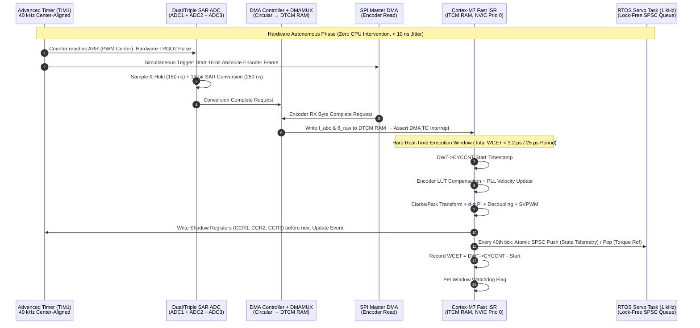

# Track 04: Hard Real-Time Embedded Systems, Industrial Networks & FPGA Co-Design

> **Part of the [MechaLab Multi-Pass Tiered Roadmap](../README.md)**  
> **Prerequisites:** [Track 01: Mixed-Signal & Power Electronics](../01-electronics-and-power/README.md), [Track 03: Sensors & Actuators](../03-sensors-and-actuators/README.md)  
> **Feeds Into:** [Track 05: Control & Estimation](../05-control-and-estimation/README.md), [Track 06: Robotics & Autonomy](../06-robotics-and-autonomy/README.md), [Track 07: Systems, HIL & Production](../07-systems-hil-and-production/README.md)  
> **Core Principle:** In a real-time control system, **a mathematically correct answer delivered late is a wrong answer.** Sampling jitter $\Delta t$ acts as phase noise that directly erodes phase margin ($\Delta\phi = -\omega_c \Delta t_{\max}$) and injects multiplicative derivative noise. Production firmware achieves sub-microsecond determinism by offloading timing-critical I/O to hardware timers, DMA controllers, or FPGA fabric—and enforcing strict zero-allocation, lock-free execution paths.

---

## 🔄 Linear Level-Up Navigation (Follow Your Current Pass Across Track 00 → Track 08)

Complete **only your current Tier section** below, verify its hands-on milestone, and proceed directly to **Track 05 in the same Tier**:

| Pass / Level | Previous Step in Pass | Current Track 04 Section | Next Linear Step in This Pass |
| :--- | :--- | :--- | :--- |
| **🟢 Pass 1: Tier 1 (Beginner)** | [← Track 03 (Tier 1)](../03-sensors-and-actuators/README.md#tier-1-beginner--intuitive) | [§1 Tier 1: Killing `delay()`, $1\text{ kHz}$ Timer ISRs & Binary Serial](#tier-1-beginner--intuitive) | [**Next in Pass 1 → Track 05 (Tier 1: PID Virtual Spring-Damper & Comp IMU)**](../05-control-and-estimation/README.md#tier-1-beginner--intuitive) |
| **🔵 Pass 2: Tier 2 (Applied)** | [← Track 03 (Tier 2)](../03-sensors-and-actuators/README.md#tier-2-intermediate--applied) | [§2 Tier 2: FreeRTOS Scheduling (RTA), DMA Buffers & CAN-FD (`MIT Mode`)](#tier-2-intermediate--applied) | [**Next in Pass 2 → Track 05 (Tier 2: Bode Loop Shaping, LQR & Linear KF)**](../05-control-and-estimation/README.md#tier-2-intermediate--applied) |
| **🌉 Bridge Concept** | — | [§3 Bridging the Gap: Global Structs / `mutex` $\to$ DMA Pipelines & `WaitFreeSeqLock`](#bridging-the-gap-maker-to-custom) | [Inspect Tier 3 Production Mastery ↓](#tier-3-advanced--production) |
| **🟣 Pass 3: Tier 3 (Production)** | [← Track 03 (Tier 3)](../03-sensors-and-actuators/README.md#tier-3-advanced--production) | [§4 Tier 3: Bare-Metal `TIM1`$\to$`ADC`, CORDIC & C++20 `WaitFreeSeqLock`](#tier-3-advanced--production) | [**Next in Pass 3 → Track 05 (Tier 3: Joseph ESKF, MPC & CBF-QP Walls)**](../05-control-and-estimation/README.md#tier-3-advanced--production) |

---

## Tier 1 (Beginner / Intuitive)

> **Goal of Pass 1 (Track 04):** Break the #1 beginner firmware habit (`delay(10)` and slow `Serial.println()` inside a control loop), set up a deterministic **$1\text{ kHz}$ hardware timer interrupt (ISR)**, and stream compact binary telemetry frames to your laptop.

### 1.1 Why `delay()` and `Serial.print()` Destroy Control Loops
* A feedback controller (`PID`) assumes every sample $\Delta t$ occurs at an exact, fixed interval (e.g., $\Delta t = 1.000\text{ ms}$).
* Calling `delay(5)` freezes the CPU completely, while `Serial.println("angle=" + String(q))` triggers heap allocation (`String`) and blocks on UART TX buffers—stretching your loop time randomly between $1\text{ ms}$ and $12\text{ ms}$! That timing jitter ($\Delta t$) makes the derivative term $K_d \frac{\Delta e}{\Delta t}$ explode with noise.

### 1.2 Hardware Timer Interrupts ($1\text{ kHz}$ ISR) & `volatile` Flags
* Configure a hardware timer peripheral to fire an Interrupt Service Routine (ISR) every $1000\ \mu\text{s}$ ($1.000\text{ kHz}$) with sub-microsecond hardware precision.
* **The Golden ISR Rule:** Keep ISRs short! Either run fast fixed-time math inside the ISR or set a `volatile bool tick_1khz = true;` flag and never call blocking `I2C`/`Serial` functions inside an interrupt.

### 1.3 Non-Blocking State Machines & Packed Binary Telemetry Structs
Instead of ASCII strings, send a fixed-size C struct with a header byte (`0xAA`) and 8-bit XOR/CRC checksum at $115200+$ baud:
```cpp
struct __attribute__((packed)) TelemetryPacket {
    uint8_t  sync_head = 0xAA;
    uint32_t timestamp_us;
    float    q_rad;
    float    dq_rad_s;
    float    u_volts;
    uint8_t  crc8;
};
```

### ✅ Tier 1 Milestone Gate (`Track 04 · Pass 1`)
* Replace `loop() { delay(1); }` on your `ESP32`/`STM32` with a $1.000\text{ kHz}$ hardware timer interrupt, toggle a debug GPIO pin on entry/exit, and verify on your logic analyzer/oscilloscope that period jitter is $< 2\ \mu\text{s}$.
* **Next Linear Step in Pass 1:** [**Proceed to Track 05 (Tier 1: PID Virtual Spring-Damper, Anti-Windup & Complementary IMU) →**](../05-control-and-estimation/README.md#tier-1-beginner--intuitive)

---

## Tier 2 (Intermediate / Applied)

> **Goal of Pass 2 (Track 04):** Architect multi-rate embedded firmware using **FreeRTOS Rate-Monotonic Scheduling**, **Direct Memory Access (DMA)** circular buffers (zero CPU overhead I/O), and **CAN 2.0 / CAN-FD (`MIT Mini-Cheetah` 5-parameter impedance packets)**.

### 2.1 Multi-Rate FreeRTOS Task Partitioning & Response-Time Analysis (RTA)
In a robot controller, different loops run at different rates. Under **Rate-Monotonic Scheduling (RMS)**, shorter period = higher priority:
1. **Fast Motor ISR ($25\text{–}40\text{ kHz}$, Hardware IRQ Prio 0):** Runs above FreeRTOS (`BASEPRI` cannot mask it).
2. **`Task_Servo_1kHz` (FreeRTOS High Priority):** Runs kinematics, LQR/impedance control, and CAN-FD bus sync using `vTaskDelayUntil(&lastWake, 1)`.
3. **`Task_Telemetry_100Hz` (FreeRTOS Low Priority):** Logs diagnostics over UART/USB without ever delaying `Task_Servo_1kHz`.

### 2.2 Direct Memory Access (DMA): Moving Sensor Data With Zero CPU Cycles
Instead of stalling a $170\text{ MHz}$ CPU for $20\ \mu\text{s}$ waiting for `SPI.transfer()` or `ADC_Read()` to finish, configure the **DMA controller** to copy ADC current registers and SPI encoder bytes directly into SRAM in the background, firing a single interrupt only when the complete packet is ready in memory.

### 2.3 CAN-FD Bus Wiring ($120\ \Omega$ Termination) & MIT Actuator Bit-Packing
* **Why `I2C` Fails on Robots:** Single-ended `I2C` wires act as antennas next to switching motor cables and glitch constantly. **CAN / CAN-FD** uses twisted-pair differential signaling (`CAN_H - CAN_L`, terminated with $120\ \Omega$ resistors at both ends of the trunk) that rejects puluhan volts of common-mode motor noise.
* **MIT Mini-Cheetah 8-Byte Actuator Command Packet:** Packs 5 float commands into 64 bits at $1\text{–}2\text{ kHz}$:
  * `q_des` ($16\text{ bits}$), `dq_des` ($12\text{ bits}$), `Kp` ($12\text{ bits}$), `Kd` ($12\text{ bits}$), `tau_ff` ($12\text{ bits}$) $\implies \tau_{\text{cmd}} = \tau_{ff} + K_p(q_{\text{des}} - q) + K_d(\dot{q}_{\text{des}} - \dot{q})$.

### ✅ Tier 2 Milestone Gate (`Track 04 · Pass 2`)
* Verify schedulability via exact Response-Time Analysis ($R_i \le D_i$) and test lock-free vs. torn-read behavior under contention in **Tab 8: Attitude ESKF & SeqLock** of the interactive workbench.
* **Next Linear Step in Pass 2:** [**Proceed to Track 05 (Tier 2: Bode Loop Shaping, Gang of Four, Swing-Up LQR & Linear KF) →**](../05-control-and-estimation/README.md#tier-2-intermediate--applied)

---

## Bridging the Gap: Maker to Custom

### From Unprotected Global Structs & Blocking `mutex` Locks to Hardware DMA + `WaitFreeSeqLock<T>`

* **How Beginners Do It (Tier 1/2 Pitfall):** A $25\text{ kHz}$ motor ISR writes `global_state.q` and `global_state.dq` while a $1\text{ kHz}$ control task reads `global_state`. Midway through the $1\text{ kHz}$ task reading the 24-byte struct, the $25\text{ kHz}$ ISR preempts it—resulting in a **torn read** (new position paired with old velocity or half-written float bytes!). Or worse, someone puts a `mutex` inside the $25\text{ kHz}$ ISR, causing hard faults or priority inversion deadlocks.
* **How Production Engineers Do It (Tier 3 Custom Approach):**
  Use a 25-line C++20 **`WaitFreeSeqLock<T>`** (full code in §4.3 below & simulated live in **Tab 8**):
  1. The $40\text{ kHz}$ ISR increments an atomic sequence counter `seq_` to **odd** (`seq + 1`, `memory_order_release`), writes the struct, and increments `seq_` to **even** (`seq + 2`).
  2. The $1\text{ kHz}$ reader reads `seq0`, copies the struct, and reads `seq1` (`memory_order_acquire`). If `(seq0 != seq1) || (seq0 & 1)`, a preemption occurred during the copy and the reader simply retries in $<30\text{ ns}$—**zero locks, zero priority inversion, and zero torn reads ever!**

---

## Tier 3 (Advanced / Production)

> **Goal of Pass 3 (Track 04):** Master zero-jitter bare-metal and heterogeneous real-time execution: Autonomous `TIM1_TRGO2` $\to$ `ADC1/2` $\to$ `DMA` hardware pipelines, Cortex-M7 `ITCM`/`DTCM` memory placement, `CORDIC` hardware trig co-processors, C++20 `WaitFreeSeqLock`, EtherCAT Distributed Clocks (`<50 ns`), and FPGA $\Sigma\Delta$ `sinc³` decimation filters.
> * [**Next Linear Step in Pass 3 → Track 05 (Tier 3: Joseph-Form Manifold ESKF, MPC & Control Barrier QPs)**](../05-control-and-estimation/README.md#tier-3-advanced--production)

### 4.1 Zero-Jitter Hardware-Triggered Control Execution Pipeline



### 4.2 Cortex-M7 Memory Hierarchy (`ITCM`/`DTCM`) & NVIC Priority Grouping

* **Why TCM Beats L1 Cache for Real-Time Control:** DMA controllers bypass the CPU's L1 D-Cache and read/write physical SRAM directly. Place the $40\text{ kHz}$ `ADC_DMA_IRQHandler()` in **0-wait-state `ITCM` RAM** (`__attribute__((section(".itcm.text")))`) and DMA buffers / state structs in **non-cacheable `DTCM` RAM**.

| Priority Level | Assigned Peripherals | RTOS API Allowed? | Max Execution Time (WCET) |
| :--- | :--- | :--- | :--- |
| **Tier 0: Zero-Latency Hard Real-Time (`Prio 0–1`)** | Over-current Fault (`TIM_BRK`), Fast FOC `ADC_DMA_TC` ISR | **NO!** Never Masked by `BASEPRI` | $< 3.5\ \mu\text{s}$ |
| **Tier 1: RTOS-Aware Peripherals (`Prio 2–14`)** | CAN-FD RX/TX, EtherCAT SYNC0, IMU SPI DMA, UART | Yes (`xTaskNotifyFromISR`) | $< 15\ \mu\text{s}$ |
| **Tier 2: Kernel Tick & Context Switch (`Prio 15`)** | `SysTick` and `PendSV` | Kernel Internal | $< 5\ \mu\text{s}$ |

### 4.3 Exact Response-Time Analysis (RTA) & C++20 `WaitFreeSeqLock`

$$
R_i^{(k+1)} = C_i + B_i + \sum_{j \in hp(i)} \left\lceil \frac{R_i^{(k)}}{T_j} \right\rceil C_j \le D_i
$$

```cpp
#include <atomic>
#include <cstdint>
#include <type_traits>

template <typename T>
requires std::is_trivially_copyable_v<T>
class WaitFreeSeqLock {
public:
    void write(const T& val) noexcept {
        uint32_t seq = seq_.load(std::memory_order_relaxed);
        seq_.store(seq + 1U, std::memory_order_release); // Odd = write in progress
        std::atomic_thread_fence(std::memory_order_acq_rel);
        data_ = val;
        std::atomic_thread_fence(std::memory_order_acq_rel);
        seq_.store(seq + 2U, std::memory_order_release); // Even = consistent snapshot
    }

    T read() const noexcept {
        T copy;
        uint32_t seq0, seq1;
        do {
            seq0 = seq_.load(std::memory_order_acquire);
            std::atomic_thread_fence(std::memory_order_acq_rel);
            copy = data_;
            std::atomic_thread_fence(std::memory_order_acq_rel);
            seq1 = seq_.load(std::memory_order_acquire);
        } while ((seq0 != seq1) || ((seq0 & 1U) != 0U));
        return copy;
    }

private:
    alignas(32) std::atomic<uint32_t> seq_{0U};
    T data_{};
};
```

### 4.4 Deterministic Fieldbuses & FPGA Co-Design (`Sinc³` $\Sigma\Delta$ Decimation)

| Bus / Protocol | Physical Layer | Payload & Bandwidth | Synchronization Jitter | Typical Mechatronics Role |
| :--- | :--- | :--- | :--- | :--- |
| **SPI / BiSS-C / EnDat 2.2** | 4-wire CMOS or RS-422 diff pair | $32\text{–}64\text{ bits}$ @ $10\text{–}50\text{ MHz}$ | $< 20\text{ ns}$ | On-board joint encoder, ADC, and IMU acquisition |
| **CAN-FD (Cyphal/MIT Mode)** | ISO 11898-2 Differential ($120\ \Omega$) | $64\text{ bytes}$ @ $1\text{ Mbps}$ / $5\text{–}8\text{ Mbps}$ | $15\text{–}50\ \mu\text{s}$ | Quadruped/humanoid limb buses ($3\text{–}6\text{ QDD joints}$ @ $1\text{–}2\text{ kHz}$) |
| **EtherCAT** | 100BASE-TX On-the-Fly Processing | Up to $1486\text{ bytes}$ @ $100\text{ Mbps}$ | **$< 50\text{ ns}$ (`DC SYNC0`)** | Industrial CNC, surgical arms, humanoids ($30+\text{ axes}$ @ $4\text{ kHz}$) |

* **FPGA Sinc³ Digital Decimation Filter for Isolated $\Sigma\Delta$ Modulators (`AMC1306`):** $H(z) = \left(\frac{1 - z^{-OSR}}{1 - z^{-1}}\right)^3$ delivers 16-bit current readings every $6.4\ \mu\text{s}$ ($OSR = 128$) alongside a parallel hardware short-circuit comparator ($OSR = 16$, $<800\text{ ns}$ trip).

---

## 5. Failure Modes, Pitfalls & Anti-Patterns

1. **Dynamic Heap Allocation (`malloc`, `new`) in Real-Time Paths:** Override global `operator new` to trap after boot initialization.
2. **Floating-Point Denormals Stalling FPU Pipeline:** Always set **Flush-to-Zero (`FZ`, bit 24)** and **Default NaN (`DN`, bit 25)** in `FPSCR` at startup.
3. **Priority Inversion via Unprotected Mutexes:** Use wait-free SPSC queues / `WaitFreeSeqLock` or strictly enforce Priority Inheritance (`PTHREAD_PRIO_INHERIT`).
4. **Petting the Watchdog Inside a Timer ISR:** Require every task to set a bit in an atomic health bitmask and only pet the window watchdog when all tasks report healthy.

---

## 6. Tier 3 Production Lab & Milestone Gate (`Lab 04`)

* **Reference Bare-Metal STM32G474 Register-Level Firmware (`C++20`):** [`../08-capstone-projects/firmware-capstone1-stm32g474/stm32g474_foc_firmware.cpp`](../08-capstone-projects/firmware-capstone1-stm32g474/stm32g474_foc_firmware.cpp)

| Metric | Target Requirement | Verification Method |
| :--- | :--- | :--- |
| **ADC-Trigger-to-ISR-Entry Jitter** | Peak-to-peak jitter $< 50\text{ ns}$ ($< 25$ CPU cycles) over $10^7$ cycles | Hardware `TIM1_TRGO2` $\to$ `ADC` DMA pipeline |
| **Tier-0 FOC ISR WCET** | $\text{WCET}_{\max} < 4.0\ \mu\text{s}$ ($2.08\ \mu\text{s}$ achieved at $170\text{ MHz}$) | `DWT->CYCCNT` watermark in `ITCM`/`CCM-SRAM` |
| **Zero Heap Allocation Verification** | `0 bytes` allocated from `.heap` section | Linker `--wrap=malloc` build gate |
| **Lock-Free IPC Data Integrity** | `0` torn reads over $10^8$ transfers under high contention | Interactive **Tab 8: Attitude ESKF & SeqLock Simulator** |
