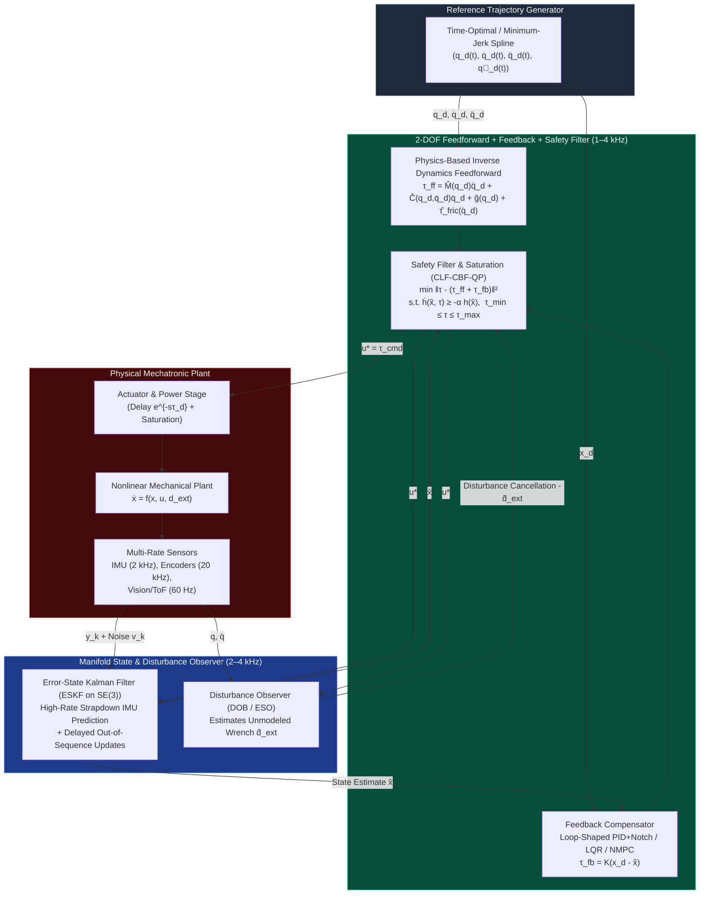

# Track 05: Classical, Optimal, Nonlinear Control & State Estimation

> **Prerequisites:** [Track 00: Foundations](../00-foundations/README.md), [Track 02: Mechanics, Kinematics & Dynamics](../02-mechanics-kinematics-dynamics/README.md), [Track 03: Sensors & Actuators](../03-sensors-and-actuators/README.md), [Track 04: Embedded & Real-Time](../04-embedded-and-realtime/README.md)  
> **Feeds Into:** [Track 06: Robotics & Autonomy](../06-robotics-and-autonomy/README.md), [Track 07: Systems, HIL & Production](../07-systems-hil-and-production/README.md)  
> **Core Principle:** Feedback control exists solely to reject unknown disturbances and handle model uncertainty; **feedforward inversion of known physics does 90% of the trajectory tracking work**. Moreover, Bode's Integral Theorem ("the waterbed effect") proves that suppressing sensitivity at low frequencies *inevitably* amplifies sensitivity and sensor noise at high frequencies—making actuator saturation, phase delay, and structural resonances the true boundaries of control design.

---

## 1. Module Overview & System Context

Many engineers jump straight from basic PID to reinforcement learning or black-box neural policies without mastering frequency-domain loop shaping, linear quadratic optimal control, state estimation on manifolds, or constrained real-time optimization. In production hardware, a misconfigured PID without anti-windup or derivative filtering will destroy a mechanical stage in milliseconds, while an unconstrained LQR will command $500\text{ V}$ from a $48\text{ V}$ inverter.

This track covers the complete progression of modern control and estimation theory as practiced on real hardware:
1. **Classical Frequency-Domain Loop Shaping & 2-DOF PID:** Sensitivity functions ($S, T, CS, PS$), Bode's Integral, delay margins, structural notch/lead-lag synthesis, anti-windup, and friction/inertia feedforward.
2. **State-Space Optimal & Robust Control:** Controllability/Observability Gramians, LQR, LQI (Integral action), LQG (and why LQG has *no* guaranteed robustness margins!), and $H_\infty$ loop shaping.
3. **Optimal State Estimation & Sensor Fusion:** Linear Kalman Filter, Joseph-form covariance update, Extended/Unscented Kalman Filters, **Error-State Kalman Filter (ESKF) on $SO(3)\times\mathbb{R}^n$**, and Moving Horizon Estimation (MHE).
4. **Nonlinear & Passivity-Based Control:** Feedback linearization (Computed Torque), Slotine & Li Passivity-Based Adaptive Control, Super-Twisting Sliding Mode Control (SMC), and **CLF-CBF-QP (Control Lyapunov / Control Barrier Functions)** for provable safety.
5. **Embedded Model Predictive Control (MPC):** Condensed vs. Sparse QP formulations, OSQP / HPIPM solvers, and Real-Time Iteration (RTI) Nonlinear MPC via `acados`.

---

## 2. Two-Degree-of-Freedom (2-DOF) Control & State Estimation Architecture



---

## 3. Frequency-Domain Loop Shaping & The Gang of Four

### 3.1 The Gang of Four Transfer Functions & Bode's Waterbed Effect
For plant $P(s)$ and feedback controller $C(s)$ with open-loop transfer function $L(s) = P(s)C(s)$, a single transfer function is **never** sufficient to verify stability and robustness (internal pole-zero cancellations between $P$ and $C$ can hide unstable modes). Always evaluate all four transfer functions (**Åström's Gang of Four**):

$$\begin{aligned}
S(s) &= \frac{1}{1 + P(s)C(s)} \quad &\text{(Sensitivity: Reference tracking error & output disturbance rejection)} \\
T(s) &= \frac{P(s)C(s)}{1 + P(s)C(s)} \quad &\text{(Complementary Sensitivity: Reference tracking & sensor noise amplification)} \\
P(s)S(s) &= \frac{P(s)}{1 + P(s)C(s)} \quad &\text{(Load Disturbance Sensitivity: Input torque disturbance to output error)} \\
C(s)S(s) &= \frac{C(s)}{1 + P(s)C(s)} \quad &\text{(Control Effort Sensitivity: Sensor noise to actuator saturation!)}
\end{aligned}$$

note the algebraic identity $S(s) + T(s) \equiv 1$ at every frequency, and **Bode's Sensitivity Integral** for open-loop stable plants with relative degree $\ge 2$:
$$\int_0^\infty \ln |S(j\omega)|\,d\omega = 0$$
Pushing $|S(j\omega)| < 1$ ($< 0\text{ dB}$) at low frequencies to reject disturbances *forces* $|S(j\omega)| > 1$ ($> 0\text{ dB}$) in a mid/high-frequency peak $M_s = \max_\omega |S(j\omega)|$.
* **Production Robustness Specifications:**
  * **Peak Sensitivity:** $M_s = \|S(j\omega)\|_\infty \le 1.6\text{ to }2.0$ ($4\text{–}6\text{ dB}$), which guarantees a minimum vector distance $1/M_s \ge 0.5$ to the critical Nyquist point $(-1, j0)$, simultaneously enforcing **Gain Margin $\ge 6\text{ dB}$** and **Phase Margin $\ge 30^\circ\text{–}45^\circ$**.
  * **Delay Margin:** Total loop transport delay $\tau_{\text{delay}} = \frac{T_s}{2}\text{ (ADC/ZOH)} + T_{\text{compute}} + T_{\text{comm}} + \tau_{\text{AFE}}$ consumes phase $\Delta\phi(\omega) = -\omega \tau_{\text{delay}}$ (in radians). Thus, achievable crossover bandwidth is strictly bounded by:
    $$\omega_c < \frac{\phi_{\text{margin,rad}}}{\tau_{\text{delay}}}$$

### 3.2 Production-Grade Discrete PID with Derivative Filter, Setpoint Weighting & Back-Calculation Anti-Windup
Never write `u = Kp*e + Ki*sum_e + Kd*(e - e_prev)/Ts` in production firmware! A real industrial 2-DOF PID controller includes:
1. **Setpoint Weighting ($b \in [0, 1]$ on Proportional, $c = 0$ on Derivative):** Prevents step changes in reference $r_k$ from slamming the derivative term ("derivative kick").
2. **First-Order Low-Pass Filtered Derivative ($N_d \in [10, 30]$):** Bounds high-frequency gain of the derivative path to $K_d N_d$ instead of $\infty$.
3. **Back-Calculation Integrator Anti-Windup ($K_{aw} = 1/T_t$):** Continuously drains the integrator whenever the actuator saturates ($u_{\text{sat}} \ne u_{\text{raw}}$).

```cpp
struct IndustrialPID {
    float kp{1.0f}, ki{0.0f}, kd{0.0f};
    float nd{20.0f};       // Derivative filter coefficient (cutoff = nd * kd_corner)
    float kaw{10.0f};      // Anti-windup back-calculation gain
    float b_weight{1.0f};  // Proportional setpoint weight [0..1]
    float u_min{-10.0f}, u_max{10.0f};

    float integrator{0.0f};
    float d_state{0.0f};
    float y_prev{0.0f};

    float step(float r, float y, float u_ff, float dt) noexcept {
        const float e_p = b_weight * r - y;
        const float e_i = r - y;

        // Filtered derivative on measurement ONLY (-dy/dt) to eliminate derivative kick
        const float alpha_d = 1.0f / (1.0f + nd * dt);
        d_state = alpha_d * d_state - (kd * nd * alpha_d) * (y - y_prev);
        y_prev = y;

        const float u_p = kp * e_p;
        const float u_unsat = u_ff + u_p + integrator + d_state;

        // Actuator saturation clamp
        float u_sat = u_unsat;
        if (u_sat > u_max) u_sat = u_max;
        if (u_sat < u_min) u_sat = u_min;

        // Tustin / Forward-Euler integrator with back-calculation anti-windup
        integrator += dt * (ki * e_i + kaw * (u_sat - u_unsat));
        return u_sat;
    }
};
```

---

## 4. Optimal State-Space Control & Manifold State Estimation

### 4.1 Discrete-Time LQR & Why LQG Has Zero Guaranteed Margins
For discrete LTI plant $x_{k+1} = A_d x_k + B_d u_k$ minimizing infinite-horizon quadratic cost:
$$J = \sum_{k=0}^\infty \left(x_k^\top Q x_k + u_k^\top R u_k\right), \quad Q \succeq 0,\ R \succ 0$$
the optimal state-feedback law $u_k = -K x_k$ is obtained from the Discrete Algebraic Riccati Equation (DARE):
$$P = Q + A_d^\top P A_d - A_d^\top P B_d \left(R + B_d^\top P B_d\right)^{-1} B_d^\top P A_d, \qquad K = \left(R + B_d^\top P B_d\right)^{-1} B_d^\top P A_d$$
* **Bryson's Rule for Initial $Q, R$ Scaling:** Initialize diagonal entries as $Q_{ii} = \frac{1}{x_{i,\max}^2}$ and $R_{jj} = \frac{1}{u_{j,\max}^2}$ so all physical variables (radians, meters, amperes) are normalized to dimensionless percents of maximum allowable excursion.
* **John Doyle's 1978 Theorem ("Guaranteed Margins for LQG Regulators — Abstract: There are none"):** While full-state feedback LQR guarantees a phase margin $\ge 60^\circ$ and gain margin $[0.5, \infty)$ in continuous time, **combining LQR with a Kalman Filter (LQG) destroys those guarantees**—the combined LQG loop transfer function can have arbitrarily small gain and phase margins to plant parameter errors! Always check the open-loop Nyquist/Bode sensitivity $M_s$ of the combined observer+controller $C_{\text{LQG}}(z)$ or perform **Loop Transfer Recovery (LTR)**.

### 4.2 Error-State Kalman Filter (ESKF) on $SO(3) \times \mathbb{R}^n$
Applying a standard additive EKF directly to a 4-component unit quaternion $q \in \mathbb{S}^3$ makes the $4\times 4$ covariance matrix singular because $\|q\|_2 = 1$ constrains variations to a 3D tangent hyperplane. The **Error-State (Indirect) Kalman Filter** maintains:
1. **Nominal State ($x = [p, v, q, b_a, b_g]^\top$, 16 parameters):** Integrated nonlinearly at high rate ($1\text{–}4\text{ kHz}$) using IMU measurements with zero noise terms.
2. **Error State ($\delta x = [\delta p, \delta v, \delta\theta, \delta b_a, \delta b_g]^\top \in \mathbb{R}^{15}$):** Evolves via a minimal, nonsingular $15\times 15$ linear tangent-space covariance $P \in \mathbb{R}^{15\times 15}$ where true rotation is $R_{\text{true}} = R_{\text{nom}} \exp([\delta\theta]_\times)$.
3. **Joseph-Form Covariance Update (Mandatory for `float32` Embedded Code):**
   Never use the naive textbook update $P^+ = (I - K H) P^-$, which loses symmetry and positive definiteness under finite precision. Always use the **Joseph Stabilized Form** (or Square-Root UD/Cholesky filter):
   $$P^+ = (I - K H) P^- (I - K H)^\top + K R_{\text{meas}} K^\top$$
   followed by error injection $q^+ \leftarrow q^- \otimes \exp_q\left(\frac{1}{2}\delta\hat{\theta}^+\right)$ and error reset $\delta\hat{x} \leftarrow 0$.

---

## 5. Nonlinear Control, Passivity & Embedded MPC

### 5.1 Computed Torque vs. Slotine-Li Passivity Control
For the manipulator equation $M(q)\ddot{q} + C(q,\dot{q})\dot{q} + g(q) = \tau$:
* **Computed Torque (Exact Feedback Linearization):**
  $$\tau = \hat{M}(q)\big(\ddot{q}_d - K_d(\dot{q} - \dot{q}_d) - K_p(q - q_d)\big) + \hat{C}(q,\dot{q})\dot{q} + \hat{g}(q)$$
  Gives linear error dynamics $\ddot{\tilde{q}} + K_d \dot{\tilde{q}} + K_p \tilde{q} = 0$ if $\hat{M}=M$, but does not directly exploit the skew-symmetry of $\dot{M} - 2C$ when inertial parameters are uncertain.
* **Slotine & Li Passivity-Based Controller:**
  Define reference velocity $\dot{q}_r = \dot{q}_d - \Lambda \tilde{q}$ (with $\tilde{q} = q - q_d$, $\Lambda \succ 0$) and composite sliding surface $s = \dot{\tilde{q}} + \Lambda \tilde{q} = \dot{q} - \dot{q}_r$. Choose control law:
  $$\tau = M(q)\ddot{q}_r + C(q,\dot{q})\dot{q}_r + g(q) - K_D s$$
  Using the Lyapunov function $V(t) = \frac{1}{2} s^\top M(q) s + \tilde{q}^\top \Lambda K_D \tilde{q}$, the time derivative is $\dot{V} = s^\top M \ddot{s} + \frac{1}{2}s^\top \dot{M} s + \dots = -s^\top K_D s \le 0$ because $s^\top(\dot{M} - 2C)s \equiv 0$ vanishes identically! Furthermore, since $M(q)\ddot{q}_r + C(q,\dot{q})\dot{q}_r + g(q) = Y(q,\dot{q},\dot{q}_r,\ddot{q}_r)\theta$ is **linear in the unknown inertial parameters $\theta$**, online adaptive law $\dot{\hat{\theta}} = -\Gamma Y^\top s$ guarantees global asymptotic tracking ($q \to q_d$).

### 5.2 Safety-Critical Control via Control Barrier Functions (CLF-CBF-QP)
To enforce hard state constraints (joint limits, obstacle avoidance, thermal/current envelopes) defined by safe superlevel set $\mathcal{C} = \{x \in \mathbb{R}^n \mid h(x) \ge 0\}$ on control-affine plant $\dot{x} = f(x) + g(x)u$, a **Control Barrier Function (CBF)** enforces forward invariance of $\mathcal{C}$ via a tiny Quadratic Program solved at $1\text{–}4\text{ kHz}$:

$$\begin{aligned}
u^*(x) = \arg\min_{u \in \mathcal{U}} \quad & \frac{1}{2} \|u - u_{\text{nom}}(x)\|_2^2 \\
\text{subject to} \quad & \underbrace{L_f h(x) + L_g h(x) u}_{\dot{h}(x,u)} \ge -\alpha\big(h(x)\big), \qquad u_{\min} \le u \le u_{\max}
\end{aligned}$$

### 5.3 Embedded Real-Time Model Predictive Control (Linear & RTI-NMPC)
MPC solves a finite-horizon optimal control problem over $N$ steps at every sample instant $k$:
$$\begin{aligned}
\min_{x_{0:N}, u_{0:N-1}} \quad & \frac{1}{2} \|x_N - x_{\text{ref},N}\|_P^2 + \sum_{i=0}^{N-1} \frac{1}{2}\left(\|x_i - x_{\text{ref},i}\|_Q^2 + \|u_i - u_{\text{ref},i}\|_R^2\right) \\
\text{subject to} \quad & x_{i+1} = f_d(x_i, u_i), \quad x_{\min} \le x_i \le x_{\max}, \quad u_{\min} \le u_i \le u_{\max}
\end{aligned}$$
* **Real-Time Iteration (RTI) Scheme (Diehl et al., implemented in `acados`):** Divides each sample period into a **Preparation Phase** (linearizing dynamics and condensing/factoring the KKT matrix using the predicted state *before* the sensor measurement arrives) and a **Feedback Phase** (completing a single QP step in microseconds the instant $x_k$ is measured).

| Control Paradigm | Handles Multi-Input Coupling? | Enforces Hard State/Input Constraints? | Typical Compute Load | Ideal Mechatronics Application |
| :--- | :--- | :--- | :--- | :--- |
| **Loop-Shaped 2-DOF PID + Notch** | SISO (or decoupled MIMO) | Input clamp + anti-windup only | $< 0.5\ \mu\text{s}$ | $20\text{–}50\text{ kHz}$ FOC current loops, high-bandwidth single-axis servos |
| **LQR / LQI** | Full MIMO | Unconstrained (requires post-clamp) | $< 2\ \mu\text{s}$ (matrix-vector multiply) | Inverted pendulums, active vibration isolation, attitude inner loops |
| **Passivity / Computed Torque** | Full Nonlinear MIMO | Via outer CLF-CBF-QP filter | $5\text{–}20\ \mu\text{s}$ (RNEA + QP) | Joint/Task-space impedance control of manipulators |
| **Linear / RTI-Nonlinear MPC** | Full Nonlinear MIMO | **Native hard state & input bounds over preview horizon** | $0.2\text{–}2.0\text{ ms}$ (`OSQP` / `HPIPM` / `acados`) | Quadruped/humanoid centroidal locomotion, autonomous racing, drone trajectory tracking |

---

## 6. Failure Modes, Pitfalls & Anti-Patterns

1. **Inverting Non-Minimum Phase Zeros in Feedforward:** If the plant $P(s)$ or discrete $P(z)$ has unstable (right-half-plane or $|z| > 1$) zeros—which arise frequently in non-collocated flexible systems and ZOH-discretized plants with relative degree $\ge 3$—naive plant inversion $C_{ff}(z) = P^{-1}(z)$ creates an **internally unstable feedforward filter** whose output blows up to $\pm\infty$. Use **Zero Phase Error Tracking Control (ZPETC, Tomizuka)** to cancel the phase of unstable zeros without inverting their magnitude.
2. **Hard State Constraints in MPC Without Slack Variables:** On real hardware, sensor noise or an external push will inevitably push state $x_k$ slightly outside a hard state constraint $x_{\min} \le x_k \le x_{\max}$, causing the QP solver to return `INFEASIBLE` in the middle of a maneuver! **Always** soften state constraints with heavily penalized $L_1/L_2$ slack variables $\epsilon \ge 0$ ($x_{\min} - \epsilon \le x_i \le x_{\max} + \epsilon$), keeping only physical actuator bounds $u_{\min} \le u_i \le u_{\max}$ strictly hard.
3. **Unobservable States in Extended Kalman Filters:** Adding bias states (e.g., 3D accelerometer bias + 3D gyro bias + scale factors) without persistent excitation makes the observability matrix $\mathcal{O}$ rank-deficient. For instance, yaw angle and $z$-gyro bias are unobservable during static hover without a magnetometer or external heading reference; the covariance grows unboundedly and corrupts roll/pitch estimates via false cross-correlations. Use **FEJ (First-Estimate Jacobians)** or observability-constrained EKF.

---

## 7. Curated Learning Resources

### Authoritative Textbooks & Seminal Papers
* **Åström, K. J., & Murray, R. M.** — *Feedback Systems: An Introduction for Scientists and Engineers* (2nd ed., Princeton University Press, 2021; free online at `fbsbook.org`).
* **Skogestad, S., & Postlethwaite, I.** — *Multivariable Feedback Control: Analysis and Design* (2nd ed., Wiley, 2005). The definitive text on frequency-domain MIMO loop shaping, $H_\infty$, and uncertainty modeling.
* **Slotine, J.-J. E., & Li, W.** — *Applied Nonlinear Control* (Prentice Hall, 1991). Phase planes, Lyapunov stability, feedback linearization, sliding mode, and passivity-based adaptive robot control.
* **Simon, D.** — *Optimal State Estimation: Kalman, $H_\infty$, and Nonlinear Approaches* (Wiley, 2006) & **Barfoot, T. D.** — *State Estimation for Robotics* (2nd ed., Cambridge University Press, 2024; free PDF).
* **Rawlings, J. B., Mayne, D. Q., & Diehl, M.** — *Model Predictive Control: Theory, Computation, and Design* (2nd ed., Nob Hill Publishing, 2020; free PDF).
* **Ames, A. D., et al.** — *"Control Barrier Functions: Theory and Applications"* (*ECC*, 2019).

### Open-Source Solvers & Libraries
* **`acados` (`C` / Python / MATLAB)** — Fast embedded optimal control and RTI-NMPC using `BLASFEO` and `HPIPM` (hardware-tuned AVX2 / ARM NEON linear algebra).
* **OSQP (`C` / C++ / Python / Rust) & TinyMPC** — Operator-splitting and ADMM convex QP solvers capable of running on Cortex-M4/M7 microcontrollers in hundreds of microseconds.
* **CasADi (`C++` / Python)** — Symbolic algorithmic differentiation and optimal control prototyping framework.

---

## 8. Hands-On Lab & Milestone Gate

### Lab 05: Error-State Kalman Filter + Embedded RTI-MPC & Swing-Up on Underactuated Plant

1. **Objective:** Design, verify, and deploy in C++ an Error-State EKF on $SO(3)$ alongside a constrained MPC + CLF-CBF safety filter on the two-mass resonant actuator or rotary inverted pendulum (Furuta pendulum).
2. **Tasks:**
   * Design a loop-shaped SISO controller for the two-mass resonant plant satisfying $M_s \le 1.7$ and verify Gang-of-Four frequency responses under $\pm 25\%$ load inertia variation.
   * Implement a 15-state ESKF in C++ (`Eigen`) with Joseph-form covariance update and verify consistency via **Normalized Estimation Error Squared (NEES)**.
   * Formulate a soft-state-constrained MPC in `acados` or `OSQP`/`TinyMPC`, generate zero-heap C code, and benchmark execution time and constraint satisfaction under impulse disturbances.
3. **Quantitative Acceptance Criteria:**

| Metric | Target Requirement | Verification Method |
| :--- | :--- | :--- |
| **Robustness Sensitivity Peak ($M_s, M_t$)** | $M_s = \|S(j\omega)\|_\infty \le 1.75$ ($4.8\text{ dB}$), $M_t \le 1.4$ across $\pm 25\%$ plant inertia uncertainty | Swept-sine Bode & Nyquist encirclement verification |
| **ESKF Statistical Consistency (NEES)** | Average NEES within $95\%$ $\chi^2_{15}$ confidence bounds $[7.26, 25.00]$ over 100 Monte-Carlo runs | Monte-Carlo simulation with realistic Allan-variance IMU noise |
| **MPC Solver Embedded Execution Time** | $p99.9\text{ solve time} < 800\ \mu\text{s}$ (Horizon $N=20$, $\Delta t = 5\text{ ms}$) with zero infeasible terminations under impulse pushes | Hardware/HIL benchmark with slack-variable soft state bounds |
| **CBF Safety Invariance** | Minimum barrier value $\min_t h(x(t)) \ge -10^{-4}$ under aggressive reference commands that violate safe workspace | Phase-portrait trajectory audit against hard position/velocity limits |
