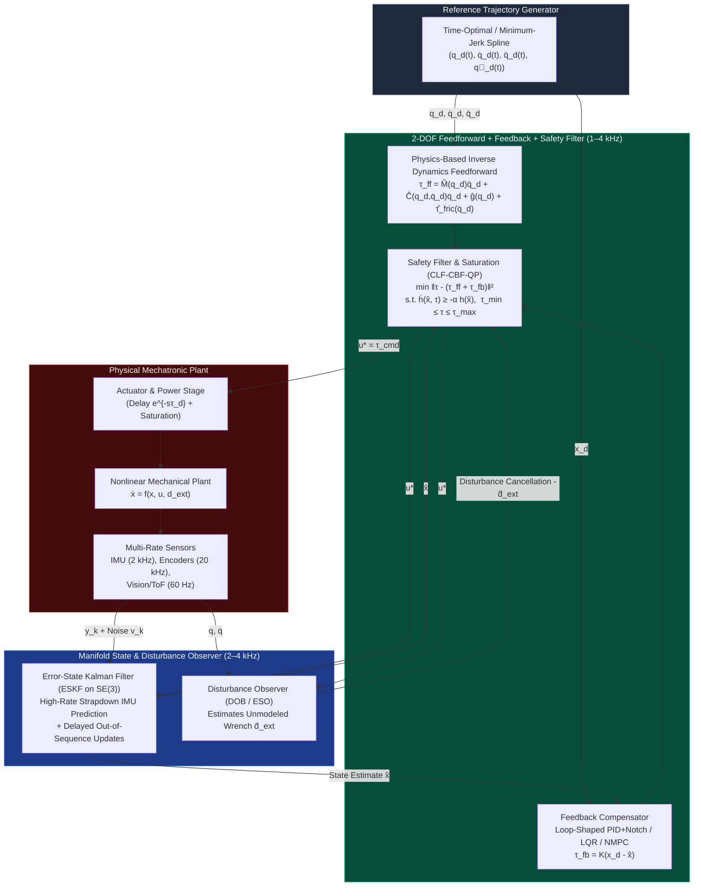

# Track 05: Classical, Optimal, Nonlinear Control & State Estimation

> **Part of the [MechaLab Multi-Pass Tiered Roadmap](../README.md)**  
> **Prerequisites:** [Track 00: Foundations](../00-foundations/README.md), [Track 02: Mechanics, Kinematics & Dynamics](../02-mechanics-kinematics-dynamics/README.md), [Track 03: Sensors & Actuators](../03-sensors-and-actuators/README.md), [Track 04: Embedded & Real-Time](../04-embedded-and-realtime/README.md)  
> **Feeds Into:** [Track 06: Robotics & Autonomy](../06-robotics-and-autonomy/README.md), [Track 07: Systems, HIL & Production](../07-systems-hil-and-production/README.md)  
> **Core Principle:** Feedback control exists solely to reject unknown disturbances and handle model uncertainty; **feedforward inversion of known physics does 90% of the trajectory tracking work**. Moreover, Bode's Integral Theorem ("the waterbed effect") proves that suppressing sensitivity at low frequencies *inevitably* amplifies sensitivity and sensor noise at high frequencies—making actuator saturation, phase delay, and structural resonances the true boundaries of control design.

---

## 🔄 Linear Level-Up Navigation (Follow Your Current Pass Across Track 00 → Track 08)

Complete **only your current Tier section** below, verify its hands-on milestone, and proceed directly to **Track 06 in the same Tier**:

| Pass / Level | Previous Step in Pass | Current Track 05 Section | Next Linear Step in This Pass |
| :--- | :--- | :--- | :--- |
| **🟢 Pass 1: Tier 1 (Beginner)** | [← Track 04 (Tier 1)](../04-embedded-and-realtime/README.md#tier-1-beginner--intuitive) | [§1 Tier 1: PID Virtual Spring-Damper, Anti-Windup & Complementary IMU](#tier-1-beginner--intuitive) | [**Next in Pass 1 → Track 06 (Tier 1: Cubic Trajectories & Joint Springs)**](../06-robotics-and-autonomy/README.md#tier-1-beginner--intuitive) |
| **🔵 Pass 2: Tier 2 (Applied)** | [← Track 04 (Tier 2)](../04-embedded-and-realtime/README.md#tier-2-intermediate--applied) | [§2 Tier 2: Bode Loop Shaping, Gang of Four, Swing-Up LQR & Linear KF](#tier-2-intermediate--applied) | [**Next in Pass 2 → Track 06 (Tier 2: Jacobian Transpose & `Ruckig` S-Curves)**](../06-robotics-and-autonomy/README.md#tier-2-intermediate--applied) |
| **🌉 Bridge Concept** | — | [§3 Bridging the Gap: Trial-and-Error PID / `if` Limits $\to$ LQR + Predictive CBF-QP](#bridging-the-gap-maker-to-custom) | [Inspect Tier 3 Production Mastery ↓](#tier-3-advanced--production) |
| **🟣 Pass 3: Tier 3 (Production)** | [← Track 04 (Tier 3)](../04-embedded-and-realtime/README.md#tier-3-advanced--production) | [§4 Tier 3: Joseph-Form Manifold ESKF, MPC & Control Barrier QPs](#tier-3-advanced--production) | [**Next in Pass 3 → Track 06 (Tier 3: Khatib Operational Inertia & Null-Space WBC)**](../06-robotics-and-autonomy/README.md#tier-3-advanced--production) |

---

## Tier 1 (Beginner / Intuitive)

> **Goal of Pass 1 (Track 05):** Build rock-solid physical intuition for PID control (Proportional = virtual spring, Derivative = virtual viscous damper, Integral = steady-state offset accumulator), prevent integrator windup, and fuse an accelerometer + gyroscope in 2 lines of code using a Complementary Filter.

### 1.1 Physical Intuition for PID: Virtual Springs & Dashpots
Forget Laplace transforms for a moment. When you command a motor torque $\tau = K_p (q_{\text{des}} - q) - K_d \dot{q} + K_i \int (q_{\text{des}} - q)\,dt$:
* **Proportional ($K_p$ [$\text{N}\cdot\text{m/rad}$]):** Attaches an invisible **mechanical spring** of stiffness $K_p$ pulling the shaft toward $q_{\text{des}}$. Alone, a spring oscillates forever!
* **Derivative ($K_d$ [$\text{N}\cdot\text{m}\cdot\text{s/rad}$]):** Submerges the joint in **virtual honey (viscous damping)** that opposes velocity $\dot{q}$ and stops overshoot.
* **Integral ($K_i$):** Accumulates persistent error over time to overcome constant gravity droop or dry static friction ($F_s$).

### 1.2 Why Unclamped Integrators Explode (Anti-Windup) & Derivative Kick
* **Integrator Windup:** If you hold a motor shaft with your hand for 3 seconds while $K_i$ is active, the integral sum grows to a massive number. When you let go, the motor slams violently past the target! **Always clamp `integrator = clamp(integrator, -u_max, u_max)`** (or use back-calculation anti-windup).
* **Derivative Kick:** Never take the derivative of `(r - y)` when the user steps the target `r`—a step change has infinite slope! Take the derivative on measurement only (`-Kd * dy/dt`).

### 1.3 2-Line Complementary IMU Filter (Gyro + Accelerometer Fusion)
* **Gyroscope (`omega_gyro`):** Crisp and responsive at high frequencies, but drifts slowly over seconds due to bias.
* **Accelerometer (`theta_accel = atan2(ay, az)`):** Never drifts over hours (gravity always points down), but is ruined by high-frequency vibration noise.
* **The Complementary Marriage ($\alpha = 0.98$):** High-pass filter the fast gyro + low-pass filter the drift-free accelerometer:
  ```c
  theta_est = 0.98f * (theta_est + omega_gyro * dt) + 0.02f * theta_accel;
  ```

### ✅ Tier 1 Milestone Gate (`Track 05 · Pass 1`)
* Implement `IndustrialPID` (code in §4.2 below) with anti-windup and filtered derivative on measurement, and fuse a 6-DOF IMU (`MPU6050`/`ICM-42688` or simulated data) to track tilt angle cleanly under table taps.
* **Next Linear Step in Pass 1:** [**Proceed to Track 06 (Tier 1: Cubic/Trapezoidal Trajectories & Joint Virtual Springs) →**](../06-robotics-and-autonomy/README.md#tier-1-beginner--intuitive)

---

## Tier 2 (Intermediate / Applied)

> **Goal of Pass 2 (Track 05):** Graduate from SISO trial-and-error tuning to **Bode Loop Shaping & Åström's Gang of Four ($M_s \le 1.75$)**, **Åström-Furuta Nonlinear Energy Swing-Up + MIMO LQR Balancing**, and the **Linear Kalman Filter**.

### 2.1 Frequency-Domain Loop Shaping, Phase Margin & Delay Bounds
* Every millisecond of loop delay $\tau_{\text{delay}}$ steals phase $\Delta\phi(\omega) = -\omega\tau_{\text{delay}}$ (in radians), imposing a hard ceiling on your control crossover frequency $\omega_c < \frac{\phi_{\text{margin,rad}}}{\tau_{\text{delay}}}$.
* **Åström's Gang of Four ($S, T, PS, CS$):** Check that peak sensitivity $M_s = \max_\omega \lvert S(j\omega)\rvert \le 1.75$ ($4.8\text{ dB}$) so your loop stays at least $1/M_s \ge 0.57$ away from Nyquist instability $(-1, j0)$.

### 2.2 Underactuated Control: Energy-Pumping Swing-Up + Discrete LQR Catch
How do you balance a 4-state rotary inverted pendulum ($x = [\theta, \dot{\theta}, x_c, \dot{x}_c]^\top$) with only 1 motor?
1. **Far From Upright ($\lvert\theta\rvert \ge 22^\circ$):** Pump mechanical energy $E = \frac{1}{2}J_p\dot{\theta}^2 + m g l(\cos\theta - 1)$ toward the upright equilibrium $E = 0$ via $u = -k_{\text{swing}} E \operatorname{sign}(\dot{\theta}\cos\theta)$.
2. **Inside the Catch Basin ($\lvert\theta\rvert < 22^\circ$):** Switch smoothly to full-state **Linear Quadratic Regulator (LQR)** $u = -K x$ computed from the Discrete Algebraic Riccati Equation (`DARE`), using **Bryson's Rule** ($Q_{ii} = 1/x_{i,\max}^2$, $R = 1/u_{\max}^2$) to weight pendulum angle vs. rail position.

### 2.3 Linear Kalman Filter (Predict $\to$ Innovation $\to$ Update)
Instead of a fixed $\alpha = 0.98$ complementary weight, a Kalman Filter dynamically computes the optimal Kalman Gain $K_k = P_k^- H^\top (H P_k^- H^\top + R)^{-1}$ to estimate hidden states (like velocity $\dot{x}$ or unmeasured gyro bias $b_g$) from noisy measurements.

### ✅ Tier 2 Milestone Gate (`Track 05 · Pass 2`)
* Open **Tab 4: Furuta Pendulum + LQR + CBF** in the interactive workbench, tune $Q_\theta$ and $R_{\text{ctrl}}$, and verify autonomous swing-up and upright LQR stabilization after injecting a $+3.2\text{ rad/s}$ impulse disturbance.
* **Next Linear Step in Pass 2:** [**Proceed to Track 06 (Tier 2: Jacobian Transpose Cartesian Compliance & `Ruckig` S-Curves) →**](../06-robotics-and-autonomy/README.md#tier-2-intermediate--applied)

---

## Bridging the Gap: Maker to Custom

### From Trial-and-Error PID & Naive `if (x > x_max) u = 0` Stops to LQR + Predictive Control Barrier Functions (CBF-QP)

* **Why Naive `if (x > x_max) u = 0` Crashes Hardware:** A physical mass moving at $\dot{x} = 1.5\text{ m/s}$ has kinetic energy $\frac{1}{2}m\dot{x}^2$. Waiting until $x$ touches the limit switch $x_{\max}$ to cut motor torque is **too late**—momentum carries the carriage straight through the mechanical end-stop!
* **How Production Engineers Enforce Safety (Control Barrier Function CBF-QP):**
  Define a velocity-aware quadratic safe set $h(x, \dot{x}) = x_{\max}^2 - x^2 - k_v x \dot{x} \ge 0$ and enforce the barrier condition $\dot{h}(x, u) \ge -\alpha_{\text{cbf}} h(x)$. As tested live in **Tab 4**, the CBF filter sees the wall approaching **ahead of time** and smoothly commands maximum reverse braking force so the carriage kisses the red safety boundary at zero velocity without ever crossing it!

---

## Tier 3 (Advanced / Production)

> **Goal of Pass 3 (Track 05):** Production mastery of modern optimal, nonlinear, and manifold control: Joseph-form Error-State Kalman Filters (ESKF) on $SO(3)\times\mathbb{R}^n$, Slotine-Li passivity-based adaptive control, CLF-CBF-QP safety filters, and Real-Time Iteration Nonlinear Model Predictive Control (RTI-NMPC).
> * [**Next Linear Step in Pass 3 → Track 06 (Tier 3: Khatib Operational Inertia $\Lambda(q)$ & Null-Space WBC)**](../06-robotics-and-autonomy/README.md#tier-3-advanced--production)

### 4.1 Two-Degree-of-Freedom (2-DOF) Control & State Estimation Architecture



### 4.2 Gang of Four, Bode's Waterbed Integral & Production 2-DOF PID

$$
S(s) = \frac{1}{1 + P(s)C(s)}, \quad T(s) = \frac{P(s)C(s)}{1 + P(s)C(s)}, \quad P(s)S(s) = \frac{P(s)}{1 + P(s)C(s)}, \quad C(s)S(s) = \frac{C(s)}{1 + P(s)C(s)}
$$

$$
S(s) + T(s) \equiv 1, \qquad \int_0^\infty \ln |S(j\omega)|\,d\omega = 0, \qquad \omega_c < \frac{\phi_{\text{margin,rad}}}{\tau_{\text{delay}}}
$$

```cpp
struct IndustrialPID {
    float kp{1.0f}, ki{0.0f}, kd{0.0f};
    float nd{20.0f};       // Derivative filter coefficient (cutoff = nd * kd_corner)
    float kaw{10.0f};      // Anti-windup back-calculation gain
    float b_weight{1.0f};  // Proportional setpoint weight [0..1]
    float u_min{-10.0f}, u_max{10.0f};

    float integrator{0.0f};
    float d_state{0.0f};
    float y_prev{0.0f};

    float step(float r, float y, float u_ff, float dt) noexcept {
        const float e_p = b_weight * r - y;
        const float e_i = r - y;

        // Filtered derivative on measurement ONLY (-dy/dt) to eliminate derivative kick
        const float alpha_d = 1.0f / (1.0f + nd * dt);
        d_state = alpha_d * d_state - (kd * nd * alpha_d) * (y - y_prev);
        y_prev = y;

        const float u_p = kp * e_p;
        const float u_unsat = u_ff + u_p + integrator + d_state;

        float u_sat = u_unsat;
        if (u_sat > u_max) u_sat = u_max;
        if (u_sat < u_min) u_sat = u_min;

        // Back-calculation integrator anti-windup
        integrator += dt * (ki * e_i + kaw * (u_sat - u_unsat));
        return u_sat;
    }
};
```

### 4.3 Discrete LQR (`DARE`) & Error-State Kalman Filter (ESKF) on $SO(3) \times \mathbb{R}^n$

* **Discrete Algebraic Riccati Equation (`DARE`):**

$$
P = Q + A_d^\top P A_d - A_d^\top P B_d \left(R + B_d^\top P B_d\right)^{-1} B_d^\top P A_d, \qquad K = \left(R + B_d^\top P B_d\right)^{-1} B_d^\top P A_d
$$

* **Joseph-Form Stabilized Covariance Update & Multiplicative $SO(3)$ Reset:**
  To prevent `float32` loss of symmetry or negative eigenvalues in covariance $P$, always execute the Joseph update:

$$
P^+ = (I - K H) P^- (I - K H)^\top + K R_{\text{meas}} K^\top, \qquad R_{\text{nom}}^+ = R_{\text{nom}}^- \exp\big([\delta\hat{\theta}^+]_\times\big), \qquad \delta\hat{x} \leftarrow 0
$$

### 4.4 Slotine-Li Passivity Control, CLF-CBF-QP & Real-Time Iteration MPC

* **Slotine & Li Passivity Controller:** Using reference velocity $\dot{q}_r = \dot{q}_d - \Lambda \tilde{q}$ and sliding surface $s = \dot{q} - \dot{q}_r$, the control law $\tau = M(q)\ddot{q}_r + C(q,\dot{q})\dot{q}_r + g(q) - K_D s$ yields $\dot{V} = -s^\top K_D s \le 0$ because $s^\top(\dot{M} - 2C)s \equiv 0$.
* **Control Barrier Function Quadratic Program (CBF-QP):**

$$
u^*(x) = \arg\min_{u \in [u_{\min}, u_{\max}]} \frac{1}{2} \|u - u_{\text{nom}}(x)\|_2^2 \quad \text{s.t.} \quad L_f h(x) + L_g h(x) u \ge -\alpha\big(h(x)\big)
$$

| Control Paradigm | Handles Multi-Input Coupling? | Enforces Hard State/Input Constraints? | Typical Compute Load | Ideal Mechatronics Application |
| :--- | :--- | :--- | :--- | :--- |
| **Loop-Shaped 2-DOF PID + Notch** | SISO (or decoupled MIMO) | Input clamp + anti-windup only | $< 0.5\ \mu\text{s}$ | $20\text{–}50\text{ kHz}$ FOC current loops, single-axis servos |
| **LQR / LQI** | Full MIMO | Unconstrained (requires post-clamp/CBF) | $< 2\ \mu\text{s}$ | Inverted pendulums, active vibration isolation |
| **Passivity / Computed Torque** | Full Nonlinear MIMO | Via outer CLF-CBF-QP filter | $5\text{–}20\ \mu\text{s}$ | Joint/Task-space impedance control of manipulators |
| **Linear / RTI-Nonlinear MPC** | Full Nonlinear MIMO | **Native hard state & input bounds over preview horizon** | $0.2\text{–}2.0\text{ ms}$ | Quadruped/humanoid locomotion, autonomous racing |

---

## 5. Failure Modes, Pitfalls & Anti-Patterns

1. **Inverting Non-Minimum Phase Zeros in Feedforward:** Never invert unstable discrete zeros ($|z| > 1$); use Tomizuka's Zero Phase Error Tracking Control (ZPETC).
2. **Hard State Constraints in MPC Without Slack Variables:** Always soften state constraints with heavily penalized $L_1/L_2$ slack variables $\epsilon \ge 0$ ($x_{\min} - \epsilon \le x_i \le x_{\max} + \epsilon$) so sensor noise or external pushes never cause solver `INFEASIBLE` aborts.
3. **Unobservable States in Extended Kalman Filters:** Verify observability Gramian rank; yaw angle and $z$-gyro bias are unobservable without a heading reference or horizontal acceleration.

---

## 6. Tier 3 Production Lab & Milestone Gate (`Lab 05`)

| Metric | Target Requirement | Verification Method |
| :--- | :--- | :--- |
| **Robustness Sensitivity Peak ($M_s, M_t$)** | $M_s = \|S(j\omega)\|_\infty \le 1.75$ ($4.8\text{ dB}$), $M_t \le 1.4$ | Gang-of-Four Bode audit |
| **ESKF Statistical Consistency (NEES)** | Mean NEES within $95\%$ $\chi^2_6$ bounds $[0.21, 2.41]$ (normalized per DOF) | Interactive **Tab 8: Attitude ESKF & SeqLock Simulator** |
| **Furuta Swing-Up & LQR Balancing** | Autonomous catch within $< 2.2\text{ s}$ and steady RMS error $< 0.08^\circ$ | Interactive **Tab 4: Furuta Pendulum + LQR + CBF Simulator** |
| **CBF Safety Invariance** | $\min_t h(x(t)) \ge 0$ ($|x_c| \le x_{\max}$) under $+3.2\text{ rad/s}$ impulse push | Interactive **Tab 4: CBF Safety Wall Test** |
