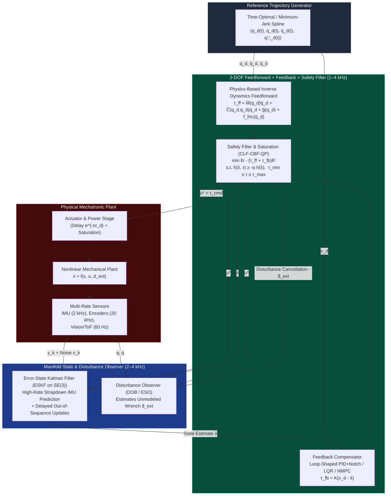

# Track 05: Classical, Optimal, Nonlinear Control & State Estimation

> **Part of the [MechaLab Multi-Pass Tiered Roadmap](../README.md)**  
> **Prerequisites:** [Track 00: Foundations](../00-foundations/README.md), [Track 02: Mechanics, Kinematics & Dynamics](../02-mechanics-kinematics-dynamics/README.md), [Track 03: Sensors & Actuators](../03-sensors-and-actuators/README.md), [Track 04: Embedded & Real-Time](../04-embedded-and-realtime/README.md)  
> **Feeds Into:** [Track 06: Robotics & Autonomy](../06-robotics-and-autonomy/README.md), [Track 07: Systems, HIL & Production](../07-systems-hil-and-production/README.md)  
> **Core Principle:** Feedback control exists solely to reject unknown disturbances and handle model uncertainty; **feedforward inversion of known physics does 90% of the trajectory tracking work**. Moreover, Bode's Integral Theorem ("the waterbed effect") proves that suppressing sensitivity at low frequencies *inevitably* amplifies sensitivity and sensor noise at high frequencies—making actuator saturation, phase delay, and structural resonances the true boundaries of control design.

---

## 🔄 Linear Level-Up Navigation (Follow Your Current Pass Across Track 00 → Track 08)

Complete **only your current Tier section** below, verify its hands-on milestone, and proceed directly to **Track 06 in the same Tier**:

| Pass / Level | Previous Step in Pass | Current Track 05 Section | Next Linear Step in This Pass |
| :--- | :--- | :--- | :--- |
| **🟢 Pass 1: Tier 1 (Beginner)** | [← Track 04 (Tier 1)](../04-embedded-and-realtime/README.md#tier-1-beginner--intuitive) | [§1 Tier 1: PID Virtual Spring-Damper, Anti-Windup & Complementary IMU](#tier-1-beginner--intuitive) | [**Next in Pass 1 → Track 06 (Tier 1: Cubic Trajectories & Joint Springs)**](../06-robotics-and-autonomy/README.md#tier-1-beginner--intuitive) |
| **🔵 Pass 2: Tier 2 (Applied)** | [← Track 04 (Tier 2)](../04-embedded-and-realtime/README.md#tier-2-intermediate--applied) | [§2 Tier 2: Bode Loop Shaping, Gang of Four, Swing-Up LQR & Linear KF](#tier-2-intermediate--applied) | [**Next in Pass 2 → Track 06 (Tier 2: Jacobian Transpose & `Ruckig` S-Curves)**](../06-robotics-and-autonomy/README.md#tier-2-intermediate--applied) |
| **🌉 Bridge Concept** | — | [§3 Bridging the Gap: Trial-and-Error PID / `if` Limits $\to$ LQR + Predictive CBF-QP](#bridging-the-gap-maker-to-custom) | [Inspect Tier 3 Production Mastery ↓](#tier-3-advanced--production) |
| **🟣 Pass 3: Tier 3 (Production)** | [← Track 04 (Tier 3)](../04-embedded-and-realtime/README.md#tier-3-advanced--production) | [§4 Tier 3: Joseph-Form Manifold ESKF, MPC & Control Barrier QPs](#tier-3-advanced--production) | [**Next in Pass 3 → Track 06 (Tier 3: Khatib Operational Inertia & Null-Space WBC)**](../06-robotics-and-autonomy/README.md#tier-3-advanced--production) |

---

## Tier 1 (Beginner / Intuitive)

> **Goal of Pass 1 (Track 05):** Build rock-solid physical intuition for PID control (Proportional = virtual spring, Derivative = virtual viscous damper, Integral = steady-state offset accumulator), prevent integrator windup, and fuse an accelerometer + gyroscope in 2 lines of code using a Complementary Filter.

### 1.1 Physical Intuition for PID: Virtual Springs & Dashpots
- **Core Summary:** A PID controller $\tau = K_p (q_{\text{des}} - q) - K_d \dot{q} + K_i \int (q_{\text{des}} - q)\,dt$ has direct mechanical meaning: **Proportional ($K_p$)** attaches an invisible spring pulling toward the target, **Derivative ($K_d$)** submerges the joint in viscous honey to damp overshoot, and **Integral ($K_i$)** slowly accumulates persistent error to overcome gravity droop or static friction.
- **Curated Free Resources:**
  - 🔗 [Brian Douglas (YouTube): What Is a PID Controller? (Intuitive Visual Guide)](https://www.youtube.com/watch?v=wkfEZmsQqiA) — *Gold-standard visual control lecture connecting $P$, $I$, and $D$ terms to physical springs, dampers, and steady-state offsets.*
  - 🔗 [Fetch Robotics / Russ Tedrake: PD Control as Virtual Mechanical Stiffness & Damping](https://manipulation.csail.mit.edu/force.html) — *Explains why robotics engineers think of PD gains directly in physical units ($\text{N}\cdot\text{m/rad}$ and $\text{N}\cdot\text{m}\cdot\text{s/rad}$).*
- **🧪 Hands-On Exercise:**
  - *Task:* Command a motor (or simulate a 1-DOF inertia $J = 0.01\text{ kg}\cdot\text{m}^2$) with $K_d = 0, K_i = 0$ and increase $K_p$—feel/observe how a pure $P$ controller oscillates like an undamped spring! Then add $K_d = 2\sqrt{J K_p}$ (critical damping $\zeta = 1.0$) and observe the step response snap to the target with zero overshoot.
- **🧠 Knowledge Check:**
  <details>
  <summary><b>Click to toggle quiz questions & answers</b></summary>

  **Q1:** For a rotational joint with moment of inertia $J = 0.02\text{ kg}\cdot\text{m}^2$ and proportional spring gain $K_p = 8.0\text{ N}\cdot\text{m/rad}$, what derivative damping gain $K_d$ achieves critical damping ($\zeta = 1.0$)?
  * **Answer / Explanation:** The closed-loop characteristic polynomial of $J\ddot{q} + K_d\dot{q} + K_p q = K_p q_{\text{des}}$ is $s^2 + \frac{K_d}{J}s + \frac{K_p}{J} = s^2 + 2\zeta\omega_n s + \omega_n^2$. Thus $\omega_n = \sqrt{K_p / J} = \sqrt{8.0 / 0.02} = 20\text{ rad/s}$, and for $\zeta = 1.0$, $K_d = 2 J \omega_n = 2\sqrt{J K_p} = 2 \times 0.02 \times 20 = 0.80\text{ N}\cdot\text{m}\cdot\text{s/rad}$.

  **Q2:** Why does a pure PD controller ($K_i = 0$) on a horizontal robot arm link exhibit a small steady-state droop $\Delta q_{\text{ss}}$ under gravity if gravity feedforward is not included?
  * **Answer & Explanation:** At rest ($\dot{q} = 0$), the PD torque is simply $\tau = K_p (q_{\text{des}} - q)$. To hold up a link requiring gravity torque $\tau_g = m g l_c$, the spring *must* stretch by $\Delta q_{\text{ss}} = \tau_g / K_p$. Either an integrator ($K_i$) or analytical gravity feedforward ($+\hat{\tau}_g(q)$) is needed to eliminate the droop.
  </details>

### 1.2 Why Unclamped Integrators Explode (Anti-Windup) & Derivative Kick
- **Core Summary:** When an actuator saturates at $u_{\max}$ (or a human hand blocks the shaft), an unclamped integral term accumulates a massive windup charge that causes violent overshoot upon release. Production PIDs clamp/back-calculate the integrator and take the filtered derivative strictly on **measurement (`-dy/dt`)** so setpoint steps never cause infinite "derivative kick" spikes.
- **Curated Free Resources:**
  - 🔗 [Brett Beauregard: Improving the Beginner's PID — Derivative Kick & Integrator Windup](http://brettbeauregard.com/blog/2011/04/improving-the-beginners-pid-introduction/) — *Classic line-by-line C++ walkthrough showing how to fix every flaw in a textbook 3-line PID.*
  - 🔗 [Karl Johan Åström & Richard M. Murray: Feedback Systems — Chapter 11 (PID Control & Anti-Windup, Free Caltech PDF)](https://www.cds.caltech.edu/~murray/books/AM08/pdf/fbs-pid_24Jul2020.pdf) — *Rigorous derivation of back-calculation anti-windup ($K_{\text{aw}}$) and high-frequency derivative roll-off ($N_d$).*
- **🧪 Hands-On Exercise:**
  - *Task:* Implement `IndustrialPID` (code in §4.2 below) with actuator limits $u \in [-10, +10]\text{ V}$. Simulate holding the plant at $y = 0$ for $1.0\text{ s}$ while $r = 1.0$, then releasing it—compare the massive overshoot when `kaw = 0.0` (no anti-windup) against the clean recovery when `kaw = 10.0`.
- **🧠 Knowledge Check:**
  <details>
  <summary><b>Click to toggle quiz questions & answers</b></summary>

  **Q1:** What happens on the exact sample when `r` steps from $0.0$ to $1.0$ at $1\text{ kHz}$ ($\Delta t = 0.001\text{ s}$) if your derivative term computes `kd * (e - e_prev) / dt`?
  * **Answer / Explanation:** Since `e = r - y` jumps instantaneously by $+1.0$, `(e - e_prev) / dt = 1.0 / 0.001 = 1000.0`! Even a modest `kd = 0.5` slams the motor with a $500\text{ V}$ single-sample spike ("derivative kick"). Differentiating `-kd * (y - y_prev) / dt` produces the exact same damping against motion without kicking on setpoint changes.

  **Q2:** Why must a practical derivative term include a first-order low-pass filter pole ($N_d \approx 10\text{–}20$)?
  * **Answer & Explanation:** Pure differentiation $s K_d$ has $+20\text{ dB/decade}$ gain that grows to infinity at high frequency, amplifying high-frequency encoder quantization and ADC noise into violent motor buzz. Adding a filter pole $\frac{K_d s}{1 + s/(N_d \omega_d)}$ caps the high-frequency derivative gain at $K_d N_d$.
  </details>

### 1.3 2-Line Complementary IMU Filter (Gyro + Accelerometer Fusion)
- **Core Summary:** A gyroscope is crisp and responsive at fast timescales but drifts over seconds due to bias, whereas an accelerometer's gravity vector (`atan2(ay, az)`) never drifts over hours but is corrupted by high-frequency vibration. A **Complementary Filter** fuses the high-pass filtered gyro integration with the low-pass filtered accelerometer angle (`theta = 0.98*(theta + omega*dt) + 0.02*theta_acc`).
- **Curated Free Resources:**
  - 🔗 [Shane Colton (MIT): The Balance Filter — A Simple Solution for Integrating Accelerometer and Gyroscope Measurements (PDF)](https://www.pieter-jan.com/node/11) — *Clear, intuitive whitepaper explaining why high-pass + low-pass filters summing to $1.0$ create a distortionless tilt estimator.*
  - 🔗 [Brian Douglas (YouTube): Sensor Fusion & Complementary Filters Explained](https://www.youtube.com/watch?v=whSw42XddsU) — *Shows in the frequency domain how complementary crossover frequency $\omega_c$ trades off gyro bias drift against vibration immunity.*
- **🧪 Hands-On Exercise:**
  - *Task:* Generate a $10\text{ s}$ synthetic IMU log at $200\text{ Hz}$ where true tilt is $\theta(t) = 0.3\sin(2\pi t)$, the gyro has a constant $+0.08\text{ rad/s}$ bias, and the accelerometer has $\sigma = 0.15\text{ rad}$ white vibration noise. Plot raw gyro integration (drifts away), raw accelerometer (noisy), and the $\alpha = 0.98$ complementary filter output.
- **🧠 Knowledge Check:**
  <details>
  <summary><b>Click to toggle quiz questions & answers</b></summary>

  **Q1:** If a complementary filter `theta = alpha * (theta + (omega + b_g) * dt) + (1 - alpha) * theta_acc` is subjected to a constant gyroscope bias `b_g`, what is its steady-state tilt error $\Delta \theta_{\text{ss}}$?
  * **Answer / Explanation:** At steady state, $\Delta \theta_{\text{ss}} = \frac{\alpha}{1 - \alpha} b_g \Delta t = \tau_c b_g$, where $\tau_c = \frac{\alpha \Delta t}{1 - \alpha}$ is the filter time constant! It stops drifting completely (unlike pure gyro integration), though a tiny constant offset $\tau_c b_g$ remains unless you add bias estimation (as in a Kalman filter / ESKF).

  **Q2:** For a sample rate of $f_s = 200\text{ Hz}$ ($\Delta t = 0.005\text{ s}$) and $\alpha = 0.98$, what is the crossover time constant $\tau_c$ of the complementary filter?
  * **Answer & Explanation:** $\tau_c = \frac{\alpha \Delta t}{1 - \alpha} = \frac{0.98 \times 0.005}{0.02} = 0.245\text{ s}$ (corresponding to a corner frequency $f_c = \frac{1}{2\pi \tau_c} \approx 0.65\text{ Hz}$). Motions faster than $0.65\text{ Hz}$ trust the gyro; motions slower than $0.65\text{ Hz}$ trust gravity.
  </details>

### ✅ Tier 1 Milestone Gate (`Track 05 · Pass 1`)
* Implement `IndustrialPID` (code in §4.2 below) with anti-windup and filtered derivative on measurement, and fuse a 6-DOF IMU (`MPU6050`/`ICM-42688` or simulated data) to track tilt angle cleanly under table taps.
* **Next Linear Step in Pass 1:** [**Proceed to Track 06 (Tier 1: Cubic/Trapezoidal Trajectories & Joint Virtual Springs) →**](../06-robotics-and-autonomy/README.md#tier-1-beginner--intuitive)

---

## Tier 2 (Intermediate / Applied)

> **Goal of Pass 2 (Track 05):** Graduate from SISO trial-and-error tuning to **Bode Loop Shaping & Åström's Gang of Four ($M_s \le 1.75$)**, **Åström-Furuta Nonlinear Energy Swing-Up + MIMO LQR Balancing**, and the **Linear Kalman Filter**.

### 2.1 Frequency-Domain Loop Shaping, Phase Margin & Delay Bounds
- **Core Summary:** Every millisecond of sensor/computation delay $\tau_{\text{delay}}$ steals phase $\Delta\phi(\omega) = -\omega\tau_{\text{delay}}$, bounding your maximum achievable crossover frequency to $\omega_c < \frac{\phi_{\text{margin,rad}}}{\tau_{\text{delay}}}$. Auditing **Åström's Gang of Four ($S, T, PS, CS$)** and keeping peak sensitivity $M_s = \max_\omega \lvert S(j\omega)\rvert \le 1.75$ ($4.8\text{ dB}$) guarantees robustness against unmodeled resonances and gain variations.
- **Curated Free Resources:**
  - 🔗 [Åström & Murray: Feedback Systems — Chapter 10 & 12 (Frequency Domain Design & The Gang of Four, Free Caltech PDF)](https://www.cds.caltech.edu/~murray/books/AM08/pdf/fbs-loopshaping_24Jul2020.pdf) — *Explains why checking $T(s)$ alone is a trap and why all four transfer functions ($S, T, PS, CS$) must be bounded.*
  - 🔗 [Brian Douglas (YouTube): Bode Plots, Phase Margin & Loop Shaping Playlist](https://www.youtube.com/playlist?list=PLUMWjy5jgHK24TCFwngV5MeiruHxtfBQR) — *Visualizes how phase margin relates to overshoot and why time delay causes phase to plummet at high frequency.*
- **🧪 Hands-On Exercise:**
  - *Task:* Calculate the maximum achievable crossover frequency $f_c = \omega_c / (2\pi)$ with a $45^\circ$ ($\pi/4\text{ rad}$) phase margin if a double-integrator plant $P(s) = 1/(J s^2)$ is controlled with a $50^\circ$ phase-lead compensator across a total loop delay of $\tau_{\text{delay}} = 2.0\text{ ms}$ vs. $\tau_{\text{delay}} = 0.1\text{ ms}$.
- **🧠 Knowledge Check:**
  <details>
  <summary><b>Click to toggle quiz questions & answers</b></summary>

  **Q1:** Geometrically on the Nyquist plot, what does the peak sensitivity $M_s = \max_\omega \lvert S(j\omega)\rvert = \max_\omega \left|\frac{1}{1 + L(j\omega)}\right|$ represent?
  * **Answer / Explanation:** Its reciprocal $1 / M_s = \min_\omega \lvert 1 + L(j\omega)\rvert$ is the **shortest Euclidean distance** from the loop Nyquist curve $L(j\omega)$ to the critical instability point $(-1 + j0)$! Enforcing $M_s \le 1.75$ guarantees that $L(j\omega)$ stays outside a safety disk of radius $1/1.75 \approx 0.57$ around $(-1, j0)$, providing simultaneous gain and phase margin.

  **Q2:** Which member of the "Gang of Four" ($S, T, PS, CS$) reveals whether high-frequency encoder measurement noise $n(t)$ will saturate your motor amplifier $u(t)$?
  * **Answer & Explanation:** The noise-to-control transfer function **$C(s)S(s) = \frac{C(s)}{1 + P(s)C(s)}$**! Even if the output tracking $T(s)$ looks smooth (because the heavy mechanical plant $P(s)$ filters out chatter), an unbounded high-frequency $C(j\omega)S(j\omega)$ will slam the motor driver between $+u_{\max}$ and $-u_{\max}$ on every ADC noise LSB.
  </details>

### 2.2 Underactuated Control: Energy-Pumping Swing-Up + Discrete LQR Catch
- **Core Summary:** An underactuated 4-state Furuta/cart-pole pendulum ($x = [\theta, \dot{\theta}, x_c, \dot{x}_c]^\top$) has 2 degrees of freedom and only 1 actuator. Far from upright ($\lvert\theta\rvert \ge 22^\circ$), an **Åström-Furuta nonlinear energy pump** drives total mechanical energy $E$ to the upright homoclinic orbit ($E = 0$); inside the catch basin ($\lvert\theta\rvert < 22^\circ$), a **Discrete Linear Quadratic Regulator (LQR)** ($u = -Kx$ from the `DARE`) stabilizes all four states simultaneously.
- **Curated Free Resources:**
  - 🔗 [Russ Tedrake (MIT 6.832): Underactuated Robotics — Chapter 3: Acrobots, Cart-Poles, and Energy Shaping](https://underactuated.csail.mit.edu/acrobot.html) — *Interactive open-access MIT textbook deriving the Åström-Furuta energy swing-up and LQR catch basin.*
  - 🔗 [Steve Brunton (YouTube): Control Bootcamp — Linear Quadratic Regulator (LQR) & Bryson's Rule](https://www.youtube.com/watch?v=1_UobILf3cc) — *Clear walkthrough of tuning $Q$ and $R$ matrices systematically.*
- **🧪 Hands-On Exercise:**
  - *Task:* Open **Tab 4: Furuta Pendulum + LQR + CBF** in the interactive workbench, trigger a full swing-up from hanging down ($\theta = \pi$), and experiment with the $Q_\theta$ (angle penalty) and $R_{\text{ctrl}}$ (effort penalty) sliders before injecting a $+3.2\text{ rad/s}$ impulse push.
- **🧠 Knowledge Check:**
  <details>
  <summary><b>Click to toggle quiz questions & answers</b></summary>

  **Q1:** How do you choose the diagonal weights of $Q = \operatorname{diag}(q_1, q_2, q_3, q_4)$ and $R$ using **Bryson's Rule** so you don't waste hours guessing random numbers?
  * **Answer / Explanation:** Set each diagonal entry equal to the reciprocal square of the maximum acceptable deviation for that variable: $Q_{ii} = \frac{1}{(x_{i,\max})^2}$ and $R_{jj} = \frac{1}{(u_{j,\max})^2}$. This normalizes different physical units ($\text{rad}$, $\text{m}$, $\text{N}$) so a $100\%$ limit excursion in any state contributes $1.0$ to the quadratic cost!

  **Q2:** Why can't the linear LQR controller $u = -Kx$ be active all the way from the downward hanging position $\theta = \pi$?
  * **Answer & Explanation:** Because the linearized state matrix $A = \frac{\partial f}{\partial x}\big|_{\theta=0}$ uses the small-angle approximation $\sin\theta \approx \theta$ and $\cos\theta \approx 1$. Below $|\theta| > 90^\circ$, $\cos\theta < 0$, so the physical sign of how horizontal carriage acceleration torques the pendulum *reverses*—meaning the upright LQR gain would push the carriage the wrong way!
  </details>

### 2.3 Linear Kalman Filter (Predict $\to$ Innovation $\to$ Update)
- **Core Summary:** A Linear Kalman Filter propagates a state estimate $\hat{x}_k$ and uncertainty covariance matrix $P_k$ through a physics prediction step ($\hat{x}_k^- = A_d \hat{x}_{k-1}^+ + B_d u_{k-1}$) and an optimal measurement update ($K_k = P_k^- H^\top (H P_k^- H^\top + R)^{-1}$), estimating unmeasured hidden states such as velocity $\dot{x}$ or gyroscope bias $b_g$.
- **Curated Free Resources:**
  - 🔗 [Roger Labbe: Kalman and Bayesian Filters in Python (Open-Source Interactive Book)](https://github.com/rlabbe/Kalman-and-Bayesian-Filters-in-Python) — *Hands-on Jupyter/Python textbook building intuition from 1D Gaussians to full multi-state Kalman filters.*
  - 🔗 [Michel van Biezen / Bilgin Esme: Kalman Filter Explained Simply](https://www.kalmanfilter.net/default.aspx) — *Step-by-step numerical examples of the Predict-Update loop and covariance propagation.*
- **🧪 Hands-On Exercise:**
  - *Task:* Write a 2-state discrete Kalman Filter in Python for $x = [\theta, b_g]^\top$ where state transition is $\theta_k = \theta_{k-1} + (\omega_{\text{gyro}} - b_{g,k-1})\Delta t$, $b_{g,k} = b_{g,k-1}$, and measurement is $y_k = \theta_k + v_k$. Verify that $b_g$ converges to the true hidden gyroscope bias within $2\text{ s}$!
- **🧠 Knowledge Check:**
  <details>
  <summary><b>Click to toggle quiz questions & answers</b></summary>

  **Q1:** How does the Kalman Filter know how to estimate gyroscope bias $b_g$ when the accelerometer only measures tilt angle $y_k = \theta_k$ ($H = [1, 0]$) and cannot measure $b_g$ directly?
  * **Answer / Explanation:** During the **Prediction step**, $P_k^- = A_d P_{k-1}^+ A_d^\top + Q_d$ builds a negative off-diagonal cross-covariance $P_{12}^- < 0$ between angle $\theta$ and bias $b_g$ (because a positive bias error causes a negative angle prediction error via $-\Delta t$). When the **Update step** computes $K_k = P_k^- H^\top S^{-1} = \begin{bmatrix} P_{11}^- \\ P_{21}^- \end{bmatrix} S^{-1}$, that off-diagonal covariance $P_{21}^-$ maps angle innovation $(y_k - \hat{\theta}_k^-)$ directly into a correction of the hidden bias $\hat{b}_g$!

  **Q2:** What happens to the Kalman Gain $K_k = P_k^- H^\top (H P_k^- H^\top + R)^{-1}$ as the sensor measurement noise covariance $R \to \infty$ (e.g., during violent vibration)?
  * **Answer & Explanation:** As $R \to \infty$, $(H P_k^- H^\top + R)^{-1} \to 0$, so $K_k \to 0$: the filter automatically ignores the noisy sensor measurement and coasts purely on its physics/gyro prediction model!
  </details>

### ✅ Tier 2 Milestone Gate (`Track 05 · Pass 2`)
* Open **Tab 4: Furuta Pendulum + LQR + CBF** in the interactive workbench, tune $Q_\theta$ and $R_{\text{ctrl}}$, and verify autonomous swing-up and upright LQR stabilization after injecting a $+3.2\text{ rad/s}$ impulse disturbance.
* **Next Linear Step in Pass 2:** [**Proceed to Track 06 (Tier 2: Jacobian Transpose Cartesian Compliance & `Ruckig` S-Curves) →**](../06-robotics-and-autonomy/README.md#tier-2-intermediate--applied)

---

## Bridging the Gap: Maker to Custom

### From Trial-and-Error PID & Naive `if (x > x_max) u = 0` Stops to LQR + Predictive Control Barrier Functions (CBF-QP)

* **Why Naive `if (x > x_max) u = 0` Crashes Hardware:** A physical mass moving at $\dot{x} = 1.5\text{ m/s}$ has kinetic energy $\frac{1}{2}m\dot{x}^2$. Waiting until $x$ touches the limit switch $x_{\max}$ to cut motor torque is **too late**—momentum carries the carriage straight through the mechanical end-stop!
* **How Production Engineers Enforce Safety (Control Barrier Function CBF-QP):**
  Define a velocity-aware quadratic safe set $h(x, \dot{x}) = x_{\max}^2 - x^2 - k_v x \dot{x} \ge 0$ and enforce the barrier condition $\dot{h}(x, u) \ge -\alpha_{\text{cbf}} h(x)$. As tested live in **Tab 4**, the CBF filter sees the wall approaching **ahead of time** and smoothly commands maximum reverse braking force so the carriage kisses the red safety boundary at zero velocity without ever crossing it!

---

## Tier 3 (Advanced / Production)

> **Goal of Pass 3 (Track 05):** Production mastery of modern optimal, nonlinear, and manifold control: Joseph-form Error-State Kalman Filters (ESKF) on $SO(3)\times\mathbb{R}^n$, Slotine-Li passivity-based adaptive control, CLF-CBF-QP safety filters, and Real-Time Iteration Nonlinear Model Predictive Control (RTI-NMPC).
> * [**Next Linear Step in Pass 3 → Track 06 (Tier 3: Khatib Operational Inertia $\Lambda(q)$ & Null-Space WBC)**](../06-robotics-and-autonomy/README.md#tier-3-advanced--production)

### 4.1 Two-Degree-of-Freedom (2-DOF) Control & State Estimation Architecture



### 4.2 Gang of Four, Bode's Waterbed Integral & Production 2-DOF PID
- **Core Summary:** Bode's Sensitivity Integral ($\int_0^\infty \ln\lvert S(j\omega)\rvert\,d\omega = 0$) proves mathematically that pushing disturbance sensitivity $\lvert S(j\omega)\rvert < 1$ down at low frequencies *inevitably* pushes $\lvert S(j\omega)\rvert > 1$ up at high frequencies ("the waterbed effect"). Combining physics-based inverse dynamics feedforward $\tau_{\text{ff}}$ with a loop-shaped 2-DOF PID achieves aggressive tracking without inflating high-frequency feedback loop gain.

$$
S(s) = \frac{1}{1 + P(s)C(s)}, \quad T(s) = \frac{P(s)C(s)}{1 + P(s)C(s)}, \quad P(s)S(s) = \frac{P(s)}{1 + P(s)C(s)}, \quad C(s)S(s) = \frac{C(s)}{1 + P(s)C(s)}
$$

$$
S(s) + T(s) \equiv 1, \qquad \int_0^\infty \ln |S(j\omega)|\,d\omega = 0, \qquad \omega_c < \frac{\phi_{\text{margin,rad}}}{\tau_{\text{delay}}}
$$

```cpp
struct IndustrialPID {
    float kp{1.0f}, ki{0.0f}, kd{0.0f};
    float nd{20.0f};       // Derivative filter coefficient (cutoff = nd * kd_corner)
    float kaw{10.0f};      // Anti-windup back-calculation gain
    float b_weight{1.0f};  // Proportional setpoint weight [0..1]
    float u_min{-10.0f}, u_max{10.0f};

    float integrator{0.0f};
    float d_state{0.0f};
    float y_prev{0.0f};

    float step(float r, float y, float u_ff, float dt) noexcept {
        const float e_p = b_weight * r - y;
        const float e_i = r - y;

        // Filtered derivative on measurement ONLY (-dy/dt) to eliminate derivative kick
        const float alpha_d = 1.0f / (1.0f + nd * dt);
        d_state = alpha_d * d_state - (kd * nd * alpha_d) * (y - y_prev);
        y_prev = y;

        const float u_p = kp * e_p;
        const float u_unsat = u_ff + u_p + integrator + d_state;

        float u_sat = u_unsat;
        if (u_sat > u_max) u_sat = u_max;
        if (u_sat < u_min) u_sat = u_min;

        // Back-calculation integrator anti-windup
        integrator += dt * (ki * e_i + kaw * (u_sat - u_unsat));
        return u_sat;
    }
};
```

- **Curated Free Resources:**
  - 🔗 [Gunter Stein (IEEE Bode Lecture): Respect the Unstable! (PDF)](https://ieeexplore.ieee.org/document/1213600) — *One of the most famous papers in control engineering history, showing how Bode's waterbed integral and time delays caused the X-29 flight control failure modes.*
  - 🔗 [Skogestad & Postlethwaite: Multivariable Feedback Control — Chapter 5: Fundamental Limitations](https://folk.ntnu.no/skoge/book.html) — *Derives exact bandwidth bounds imposed by right-half-plane zeros, unstable poles, and time delays.*
- **🧪 Hands-On Exercise:**
  - *Task:* Run `./05-control-and-estimation/lab/lab05_eskf_mpc_and_cbf.py` to inspect how 2-DOF feedforward + feedback reduces trajectory tracking error by $> 10\times$ compared to feedback alone without increasing the sensitivity peak $M_s$.
- **🧠 Knowledge Check:**
  <details>
  <summary><b>Click to toggle quiz questions & answers</b></summary>

  **Q1:** If an open-loop plant has unstable poles $p_i$ in the right-half plane ($\operatorname{Re}(p_i) > 0$), what happens to Bode's Sensitivity Integral $\int_0^\infty \ln\lvert S(j\omega)\rvert\,d\omega$?
  * **Answer / Explanation:** Instead of integrating to $0$, the area becomes strictly positive: $\int_0^\infty \ln\lvert S(j\omega)\rvert\,d\omega = \pi \sum \operatorname{Re}(p_i) > 0$! This means unstable plants have an *even deeper* waterbed penalty—and stabilizing an unstable pole $p$ requires a minimum bandwidth $\omega_c > 2 p$.

  **Q2:** Why does `IndustrialPID` include a setpoint weight `b_weight` $\in [0, 1]$ on the proportional error `e_p = b_weight * r - y` while keeping `e_i = r - y` unweighted?
  * **Answer & Explanation:** It implements a **2-Degree-of-Freedom (2-DOF) PID**! Setting `b_weight < 1` (e.g., `0.5`) removes the closed-loop zero that causes step-response overshoot to reference changes $r(t)$, while preserving $100\%$ of the feedback stiffness $K_p y$ against external load disturbances and $100\%$ zero steady-state error via `e_i`.
  </details>

### 4.3 Discrete LQR (`DARE`) & Error-State Kalman Filter (ESKF) on $SO(3) \times \mathbb{R}^n$
- **Core Summary:** Standard additive Extended Kalman Filters fail on 3D rotations because adding covariance vectors to a $3\times 3$ rotation matrix or unit quaternion destroys orthogonality ($R^\top R \ne I$). An **Error-State Kalman Filter (ESKF)** integrates the nominal orientation noiselessly on the manifold $SO(3)$, estimates a minimal $3\text{-DOF}$ tangent-space error $\delta\theta \in \mathbb{R}^3$ using the **Joseph-form covariance update**, and injects the correction multiplicatively via $R^+ = R^- \exp([\delta\hat{\theta}^+]_\times)$ before resetting $\delta\hat{x} \leftarrow 0$.

* **Discrete Algebraic Riccati Equation (`DARE`):**

$$
P = Q + A_d^\top P A_d - A_d^\top P B_d \left(R + B_d^\top P B_d\right)^{-1} B_d^\top P A_d, \qquad K = \left(R + B_d^\top P B_d\right)^{-1} B_d^\top P A_d
$$

* **Joseph-Form Stabilized Covariance Update & Multiplicative $SO(3)$ Reset:**

$$
P^+ = (I - K H) P^- (I - K H)^\top + K R_{\text{meas}} K^\top, \qquad R_{\text{nom}}^+ = R_{\text{nom}}^- \exp\big([\delta\hat{\theta}^+]_\times\big), \qquad \delta\hat{x} \leftarrow 0
$$

- **Curated Free Resources:**
  - 🔗 [Joan Solà: Quaternion Kinematics for the Error-State Kalman Filter (arXiv Free Monograph)](https://arxiv.org/abs/1711.02508) — *The definitive 100-page reference used across drone and robotics companies for manifold ESKF derivations, Jacobians, and resets.*
  - 🔗 [Paul Groves: Principles of GNSS, Inertial, and Multisensor Integrated Navigation Systems](https://www.artechhouse.com/) / [Tab 8: Attitude ESKF & SeqLock Simulator](../README.md) — *Interactive verification of Joseph-form ESKF convergence and Normalized Estimation Error Squared (NEES) consistency.*
- **🧪 Hands-On Exercise:**
  - *Task:* Open **Tab 8: Attitude ESKF & SeqLock** in the interactive workbench, inject a large initial gyro bias $b_g$ and attitude error, and verify that the 6-state $SO(3)$ ESKF converges while keeping its **Normalized Estimation Error Squared (NEES)** $\epsilon_k = \delta x_k^\top P_k^{-1} \delta x_k$ inside the $95\%$ $\chi^2$ consistency bounds.
- **🧠 Knowledge Check:**
  <details>
  <summary><b>Click to toggle quiz questions & answers</b></summary>

  **Q1:** Why does running a standard 7-state additive EKF directly on a 4D unit quaternion $q \in \mathbb{R}^4$ cause the $4\times 4$ quaternion covariance block $P_{qq}$ to become singular?
  * **Answer / Explanation:** Because a unit quaternion satisfies the 1D constraint $\|q\|_2 = 1$, it only has **3 degrees of freedom**! Any uncertainty parallel to $q$ is zero ($q^\top \delta q = 0$), which gives the $4\times 4$ covariance matrix $P_{qq}$ a zero eigenvalue and causes matrix inversions to blow up in 32-bit floating point. The ESKF tracks a 3D tangent-space rotation vector $\delta\theta \in \mathbb{R}^3$ whose $3\times 3$ covariance is strictly full-rank!

  **Q2:** Why must production flight controllers use the **Joseph-form** covariance update $P^+ = (I - KH)P^-(I - KH)^\top + K R K^\top$ instead of the textbook shortcut $P^+ = (I - KH)P^-$?
  * **Answer & Explanation:** In `float32` arithmetic, subtracting two nearly equal matrices in $(I - KH)P^-$ easily loses symmetry and produces tiny negative eigenvalues, causing the Kalman filter to diverge to `NaN` after a few minutes of flight. The Joseph form is the sum of two symmetric positive-definite outer products ($A P^- A^\top + K R K^\top$), guaranteeing symmetry and positive-definiteness by construction!
  </details>

### 4.4 Slotine-Li Passivity Control, CLF-CBF-QP & Real-Time Iteration MPC
- **Core Summary:** **Slotine-Li Passivity Control** exploits the physical skew-symmetry $s^\top(\dot{M} - 2C)s \equiv 0$ to guarantee global asymptotic trajectory tracking on nonlinear manipulators; **Control Barrier Function QPs (CBF-QP)** wrap any nominal controller in a 1D/3D safety filter that guarantees forward invariance of $h(x) \ge 0$; and **Model Predictive Control (MPC)** optimizes future trajectories over a preview horizon subject to hard actuator and state constraints.

* **Slotine & Li Passivity Controller:** Using reference velocity $\dot{q}_r = \dot{q}_d - \Lambda \tilde{q}$ and sliding surface $s = \dot{q} - \dot{q}_r$, the control law $\tau = M(q)\ddot{q}_r + C(q,\dot{q})\dot{q}_r + g(q) - K_D s$ yields $\dot{V} = -s^\top K_D s \le 0$ because $s^\top(\dot{M} - 2C)s \equiv 0$.
* **Control Barrier Function Quadratic Program (CBF-QP):**

$$
u^*(x) = \arg\min_{u \in [u_{\min}, u_{\max}]} \frac{1}{2} \|u - u_{\text{nom}}(x)\|_2^2 \quad \text{s.t.} \quad L_f h(x) + L_g h(x) u \ge -\alpha\big(h(x)\big)
$$

| Control Paradigm | Handles Multi-Input Coupling? | Enforces Hard State/Input Constraints? | Typical Compute Load | Ideal Mechatronics Application |
| :--- | :--- | :--- | :--- | :--- |
| **Loop-Shaped 2-DOF PID + Notch** | SISO (or decoupled MIMO) | Input clamp + anti-windup only | $< 0.5\ \mu\text{s}$ | $20\text{–}50\text{ kHz}$ FOC current loops, single-axis servos |
| **LQR / LQI** | Full MIMO | Unconstrained (requires post-clamp/CBF) | $< 2\ \mu\text{s}$ | Inverted pendulums, active vibration isolation |
| **Passivity / Computed Torque** | Full Nonlinear MIMO | Via outer CLF-CBF-QP filter | $5\text{–}20\ \mu\text{s}$ | Joint/Task-space impedance control of manipulators |
| **Linear / RTI-Nonlinear MPC** | Full Nonlinear MIMO | **Native hard state & input bounds over preview horizon** | $0.2\text{–}2.0\text{ ms}$ | Quadruped/humanoid locomotion, autonomous racing |

- **Curated Free Resources:**
  - 🔗 [Aaron Ames et al. (ECC Tutorial): Control Barrier Functions: Theory and Applications (arXiv Free Paper)](https://arxiv.org/abs/1903.11199) — *Comprehensive tutorial on Zeroing Control Barrier Functions (ZCBFs), relative degree 2 exponential CBFs, and QP safety filters.*
  - 🔗 [OSQP (Operator Splitting Quadratic Program Solver) Documentation](https://osqp.org/) — *Zero-allocation embedded C/C++ QP solver used across production MPC and CBF controllers.*
- **🧪 Hands-On Exercise:**
  - *Task:* In **Tab 4: Furuta Pendulum + LQR + CBF**, toggle the **CBF Safety Filter ON vs. OFF** and apply repeated $+3.2\text{ rad/s}$ impulse pushes toward the rail limit $x_{\max}$. Verify that with CBF ON, $\min_t h(x(t)) \ge 0$ and the carriage never crosses the red safety wall.
- **🧠 Knowledge Check:**
  <details>
  <summary><b>Click to toggle quiz questions & answers</b></summary>

  **Q1:** Why must a position limit $p_{\max} - p \ge 0$ on a mechanical system ($\ddot{p} = u/m$) use a velocity-dependent Control Barrier Function $h(p, \dot{p})$ (or Exponential CBF) rather than simply setting $h(p) = p_{\max} - p$?
  * **Answer & Explanation:** Because position $p$ has **relative degree 2** with respect to force/torque $u$! The first derivative $\dot{h}(p) = -\dot{p}$ does not contain the control input $u$ at all ($L_g h = 0$), so the 1st-order condition $\dot{h} \ge -\alpha h$ cannot constrain $u$. Including velocity in $h(p, \dot{p}) = p_{\max}^2 - p^2 - k_v p \dot{p}$ makes $\dot{h}$ depend directly on acceleration $\ddot{p}$ (and therefore $u$), accounting for stopping distance!

  **Q2:** Why does Slotine-Li passivity control $\tau = M(q)\ddot{q}_r + C(q,\dot{q})\dot{q}_r + g(q) - K_D s$ avoid inverting the mass matrix $M^{-1}(q)$ required by feedback linearization?
  * **Answer & Explanation:** Instead of canceling the nonlinear Coriolis dynamics via $M(q)u$ to force a linear double integrator $\ddot{\tilde{q}} + K_d \dot{\tilde{q}} + K_p \tilde{q} = 0$, Slotine-Li uses the true physical kinetic energy $V(s) = \frac{1}{2}s^\top M(q) s$ as a Lyapunov function. The natural physical skew-symmetry $\dot{M} - 2C$ cancels out identically in $\dot{V} = -s^\top K_D s \le 0$, providing global stability and linear-in-parameters adaptive control without ever inverting $M(q)$!
  </details>

---

## 5. Failure Modes, Pitfalls & Anti-Patterns

1. **Inverting Non-Minimum Phase Zeros in Feedforward:** Never invert unstable discrete zeros ($|z| > 1$); use Tomizuka's Zero Phase Error Tracking Control (ZPETC).
2. **Hard State Constraints in MPC Without Slack Variables:** Always soften state constraints with heavily penalized $L_1/L_2$ slack variables $\epsilon \ge 0$ ($x_{\min} - \epsilon \le x_i \le x_{\max} + \epsilon$) so sensor noise or external pushes never cause solver `INFEASIBLE` aborts.
3. **Unobservable States in Extended Kalman Filters:** Verify observability Gramian rank; yaw angle and $z$-gyro bias are unobservable without a heading reference or horizontal acceleration.

---

## 6. Tier 3 Production Lab & Milestone Gate (`Lab 05`)

| Metric | Target Requirement | Verification Method |
| :--- | :--- | :--- |
| **Robustness Sensitivity Peak ($M_s, M_t$)** | $M_s = \|S(j\omega)\|_\infty \le 1.75$ ($4.8\text{ dB}$), $M_t \le 1.4$ | Gang-of-Four Bode audit |
| **ESKF Statistical Consistency (NEES)** | Mean NEES within $95\%$ $\chi^2_6$ bounds $[0.21, 2.41]$ (normalized per DOF) | Interactive **Tab 8: Attitude ESKF & SeqLock Simulator** |
| **Furuta Swing-Up & LQR Balancing** | Autonomous catch within $< 2.2\text{ s}$ and steady RMS error $< 0.08^\circ$ | Interactive **Tab 4: Furuta Pendulum + LQR + CBF Simulator** |
| **CBF Safety Invariance** | $\min_t h(x(t)) \ge 0$ ($|x_c| \le x_{\max}$) under $+3.2\text{ rad/s}$ impulse push | Interactive **Tab 4: CBF Safety Wall Test** |
