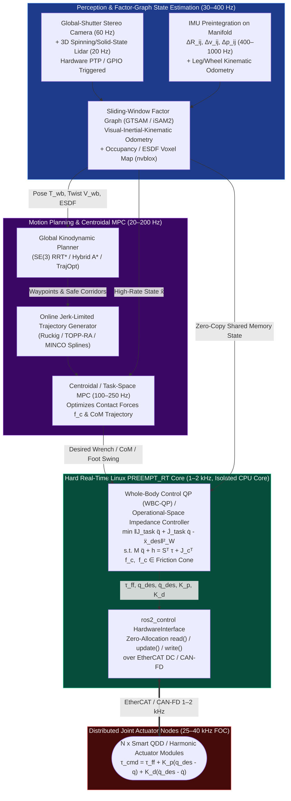

# Track 06: Robotics, Whole-Body Control, Perception & Autonomous Systems

> **Part of the [MechaLab Multi-Pass Tiered Roadmap](../README.md)**  
> **Prerequisites:** [Track 02: Mechanics, Kinematics & Dynamics](../02-mechanics-kinematics-dynamics/README.md), [Track 04: Embedded & Real-Time](../04-embedded-and-realtime/README.md), [Track 05: Control & Estimation](../05-control-and-estimation/README.md)  
> **Feeds Into:** [Track 07: Systems, HIL & Production](../07-systems-hil-and-production/README.md), [Track 08: Capstone Projects](../08-capstone-projects/README.md)  
> **Core Principle:** High-level autonomy (SLAM, motion planning, task policies) is only as reliable as the real-time bridge connecting it to physical joint torques and contact forces. Modern robotic systems replace rigid trajectory replay with **Operational-Space Impedance Control, Hierarchical Whole-Body Quadratic Programming (WBC-QP), and Factor-Graph State Estimation**.

---

## 🔄 Linear Level-Up Navigation (Follow Your Current Pass Across Track 00 → Track 08)

Complete **only your current Tier section** below, verify its hands-on milestone, and proceed directly to **Track 07 in the same Tier**:

| Pass / Level | Previous Step in Pass | Current Track 06 Section | Next Linear Step in This Pass |
| :--- | :--- | :--- | :--- |
| **🟢 Pass 1: Tier 1 (Beginner)** | [← Track 05 (Tier 1)](../05-control-and-estimation/README.md#tier-1-beginner--intuitive) | [§1 Tier 1: Cubic/Trapezoidal Trajectories & Joint Virtual Springs](#tier-1-beginner--intuitive) | [**Next in Pass 1 → Track 07 (Tier 1: 10-Step Safe Bring-Up & Sine Sweeps)**](../07-systems-hil-and-production/README.md#tier-1-beginner--intuitive) |
| **🔵 Pass 2: Tier 2 (Applied)** | [← Track 05 (Tier 2)](../05-control-and-estimation/README.md#tier-2-intermediate--applied) | [§2 Tier 2: Jacobian Transpose Cartesian Compliance & `Ruckig` S-Curves](#tier-2-intermediate--applied) | [**Next in Pass 2 → Track 07 (Tier 2: Regen Clamps, CRC & HIL Faults)**](../07-systems-hil-and-production/README.md#tier-2-intermediate--applied) |
| **🌉 Bridge Concept** | — | [§3 Bridging the Gap: Rigid `servo.write()` Stepping $\to$ $1\text{ kHz}$ Torque/Impedance Control](#bridging-the-gap-maker-to-custom) | [Inspect Tier 3 Production Mastery ↓](#tier-3-advanced--production) |
| **🟣 Pass 3: Tier 3 (Production)** | [← Track 05 (Tier 3)](../05-control-and-estimation/README.md#tier-3-advanced--production) | [§4 Tier 3: Khatib Operational Inertia $\Lambda(q)$ & Null-Space WBC](#tier-3-advanced--production) | [**Next in Pass 3 → Track 07 (Tier 3: Schroeder Multisine SysID & $<1\ \mu\text{s}$ STO)**](../07-systems-hil-and-production/README.md#tier-3-advanced--production) |

---

## Tier 1 (Beginner / Intuitive)

> **Goal of Pass 1 (Track 06):** Stop commanding sudden step jumps (`q_des = 90.0`) that slam robot joints! Learn to generate smooth **Cubic Polynomial & Trapezoidal Velocity Trajectories** so velocity starts and ends at zero, and implement **Joint-Space Virtual Springs (Compliant PD + Gravity Offset)** so a human hand can safely push the robot arm out of the way.

### 1.1 Why Step Commands Break Gears: Smooth Cubic Spline Interpolation
If you step `q_des` instantaneously from $0\text{ rad}$ to $1.0\text{ rad}$, initial position error is huge and target velocity is infinite—slamming the motor with maximum stall current and shaking the whole desk.
* **Rest-to-Rest Cubic Polynomial ($t \in [0, T]$ with $\dot{q}(0) = \dot{q}(T) = 0$):**
  Define normalized time $s = t / T \in [0, 1]$:

$$
q_d(t) = q_0 + (3s^2 - 2s^3)(q_f - q_0), \qquad \dot{q}_d(t) = \frac{6s(1 - s)}{T}(q_f - q_0)
$$

  Notice that at both $s = 0$ and $s = 1$, velocity $\dot{q}_d$ is **identically zero**!

### 1.2 Joint-Space Compliant Control (Virtual Spring-Damper + Gravity Feedforward)
Instead of a stiff PID with a giant integral term $K_i$ that fights external contact until something breaks, set $K_i = 0$ and add analytical gravity compensation $g(q)$:

$$
\tau_{\text{cmd}} = K_p (q_d(t) - q) + K_d (\dot{q}_d(t) - \dot{q}) + \underbrace{m g l_c \cos(q)}_{\text{Gravity Feedforward } g(q)}
$$

Now, if you set a gentle $K_p$, the robot floats effortlessly against gravity and yields like a soft mechanical spring whenever your hand touches it!

### ✅ Tier 1 Milestone Gate (`Track 06 · Pass 1`)
* Replace step setpoints on your 1-DOF or 2-DOF gimbal arm with a rest-to-rest cubic polynomial generator and gravity feedforward $g(q)$, verifying that you can gently push the link away by hand and watch it return smoothly without overshoot.
* **Next Linear Step in Pass 1:** [**Proceed to Track 07 (Tier 1: 10-Step Safe Bring-Up Protocol & Single-Tone Sine Sweeps) →**](../07-systems-hil-and-production/README.md#tier-1-beginner--intuitive)

---

## Tier 2 (Intermediate / Applied)

> **Goal of Pass 2 (Track 06):** Upgrade from joint-space springs to **Cartesian Task-Space Impedance Control (`tau = J^T F_cart + g(q)`)**—allowing you to specify independent $(x, y, z)$ stiffness in millimeters/Newtons—and eliminate structural vibration using **Jerk-Bounded S-Curve Trajectories (`Ruckig`)**.

### 2.1 Sensorless Cartesian Impedance via the Jacobian Transpose ($\tau = J(q)^\top F_{\text{cart}} + g(q)$)
Suppose you want your robot gripper to be **very stiff vertically ($K_z = 1000\text{ N/m}$)** so it holds its height, but **very soft horizontally ($K_x = 50\text{ N/m}$)** so it slides smoothly into a chamfered hole. You don't even need Inverse Kinematics or a 6-axis force sensor!
1. Compute current gripper position $x = \text{FK}(q)$ and tip velocity $\dot{x} = J(q)\dot{q}$.
2. Compute virtual 3D Cartesian spring-damper force $F_{\text{cart}} = K_x (x_d - x) + D_x (\dot{x}_d - \dot{x})$.
3. Map $F_{\text{cart}}$ directly to joint torques via $\tau = J(q)^\top F_{\text{cart}} + g(q)$!

### 2.2 Why Trapezoidal Velocity Still Vibrates Arms: Jerk-Bounded S-Curves (`Ruckig`)
A trapezoidal velocity profile has square-wave acceleration steps (infinite **jerk** $\dddot{q} = \frac{d\ddot{q}}{dt} = \pm\infty$), which rings flexible links like a bell. **3rd-Order S-Curve Generators (`Ruckig`)** bound maximum velocity, acceleration, *and* jerk ($\lvert\dddot{q}\rvert \le j_{\max}$), ramping acceleration in smooth linear ramps so structural modes are never excited.

### ✅ Tier 2 Milestone Gate (`Track 06 · Pass 2`)
* Test the 3-DOF QDD Hopping Leg and 6-DOF Arm kinematics in **Tab 5: URDF / MuJoCo & STO**, verifying Jacobian transpose force mapping across the workspace.
* **Next Linear Step in Pass 2:** [**Proceed to Track 07 (Tier 2: Regen Braking Bus Clamps, CRC Watchdogs & HIL Faults) →**](../07-systems-hil-and-production/README.md#tier-2-intermediate--applied)

---

## Bridging the Gap: Maker to Custom

### From Rigid `servo.write(angle)` Stepping to $1\text{ kHz}$ Distributed Torque & Operational-Space Impedance Control

| Feature | Tier 1 Maker Approach (`servo.write(angle)` Hobby RC Servo) | Tier 2/3 Custom Approach ($1\text{ kHz}$ CAN-FD Torque + Operational Impedance) |
| :--- | :--- | :--- |
| **Control Interface** | $50\text{ Hz}$ PWM pulse width ($1000\text{–}2000\ \mu\text{s}$) commands angle only; internal potentiometer loop is hidden and un-tunable. | $1\text{–}2\text{ kHz}$ CAN-FD / EtherCAT frame commands `(q_des, dq_des, Kp, Kd, tau_ff)` to a $40\text{ kHz}$ FOC loop. |
| **Unplanned Wall Contact** | Stalls at maximum current until plastic/brass gears strip or the LDO thermal-trips. | Regulates exact Cartesian contact wrench $\mathcal{F} = K_x \Delta x$ ($10.0\text{ N} \pm 0.5\text{ N}$) with zero gear damage. |
| **Multi-Joint Coordination** | Independent joint loops fight each other along straight lines. | Khatib's Operational Inertia $\Lambda(q)$ decouples $(x,y,z)$ dynamics and projects posture tasks into the dynamically consistent null-space $N^\top(q)$. |

---

## Tier 3 (Advanced / Production)

> **Goal of Pass 3 (Track 06):** Master full-stack robotic autonomy and whole-body control: Khatib's Operational-Space Inertia $\Lambda(q)$ & dynamically consistent null-space projection $\bar{J}(q)$, Floating-Base Whole-Body Control QPs (`WBC-QP`) with friction cones, `PREEMPT_RT` Linux kernel isolation (`<50 µs` jitter), and Forster's Manifold IMU Preintegration for Factor-Graph SLAM (`GTSAM`).
> * [**Next Linear Step in Pass 3 → Track 07 (Tier 3: Schroeder Multisine Closed-Loop SysID & $<1\ \mu\text{s}$ Hardware STO)**](../07-systems-hil-and-production/README.md#tier-3-advanced--production)

### 4.1 Full-Stack Autonomous Robotic Software & Hardware Architecture

### 4.2 Khatib Operational-Space Impedance & Dynamically Consistent Null-Space Projection

$$
\Lambda(q) = \left(J(q) M^{-1}(q) J(q)^\top\right)^{-1}, \qquad \bar{J}(q) = M^{-1}(q) J(q)^\top \Lambda(q)
$$

$$
\tau = J(q)^\top \Big(\Lambda(q)\ddot{x}_d - K_x \tilde{x} - D_x \dot{\tilde{x}}\Big) + g(q) + \left(I - J(q)^\top \bar{J}(q)^\top\right) \tau_{\text{null}}
$$

Because $J(q) M^{-1}(q) \left(I - J(q)^\top \bar{J}(q)^\top\right) \equiv 0$, any posture torque $\tau_{\text{null}}$ (such as moving a 7-DOF arm's elbow away from an obstacle) produces **strictly zero acceleration at the end-effector**!

### 4.3 Floating-Base Whole-Body Control QP (`WBC-QP`) & `PREEMPT_RT` Linux

$$
\begin{aligned}
\min_{\dot{v}, f_c, \tau} \quad & \sum_{k} w_k \left\| J_k(q)\dot{v} + \dot{J}_k(q,v)v - \ddot{x}_{k,\text{des}} \right\|_2^2 + \|f_c\|_{W_f}^2 + \|\tau\|_{W_\tau}^2 \\
\text{subject to} \quad & M(q)\dot{v} + h(q,v) = S^\top \tau + J_c(q)^\top f_c, \qquad J_{\text{stance}}(q)\dot{v} + \dot{J}_{\text{stance}}(q,v)v = 0 \\
& |f_{c,x}| \le \mu f_{c,z},\quad |f_{c,y}| \le \mu f_{c,z},\quad f_{c,z} \ge f_{z,\min} > 0, \qquad \tau_{\min} \le \tau \le \tau_{\max}
\end{aligned}
$$

* **Hard Real-Time Linux (`PREEMPT_RT`) Checklist:**
  1. Boot parameters: `isolcpus=2,3 nohz_full=2,3 rcu_nocbs=2,3 irqaffinity=0,1 processor.max_cstate=1`.
  2. Call `mlockall(MCL_CURRENT | MCL_FUTURE)` and pin the $1\text{ kHz}$ control thread to isolated core 2 with `SCHED_FIFO` priority `80`.
  3. Bridge `ros2_control` to DDS via lock-free `realtime_tools::RealtimeBuffer<T>` or `iceoryx` zero-copy shared memory.

### 4.4 Hardware-Synchronized VIO & Manifold IMU Preintegration

$$
\Delta R_{ij}(b_g^+) \approx \Delta\tilde{R}_{ij} \exp\left(\frac{\partial \Delta\tilde{R}_{ij}}{\partial b_g} (b_g^+ - \bar{b}_g)\right)
$$

---

## 5. Failure Modes, Pitfalls & Anti-Patterns

1. **Rolling-Shutter Cameras in High-Vibration VIO:** Always specify Global-Shutter CMOS sensors (`OV9281`, `IMX296`) hardware-triggered via `FSYNC` from the IMU clock.
2. **Exciting Structural Modes with Step/Trapezoidal Velocity Profiles:** Always bound jerk ($\lvert\dddot{q}\rvert \le j_{\max}$) using 3rd-order S-curves (`Ruckig`).
3. **Kinematic Singularities in Inverse Differential Kinematics:** Monitor manipulability $w(q) = \sqrt{\det(JJ^\top)}$ and smoothly ramp damping $\lambda^2(w)$ when $w < w_{\text{thresh}}$.

---

## 6. Tier 3 Production Lab & Milestone Gate (`Lab 06`)

| Metric | Target Requirement | Verification Method |
| :--- | :--- | :--- |
| **`ros2_control` Update Loop Determinism** | $p99.99$ loop period jitter $< 50\ \mu\text{s}$ at $1\text{ kHz}$; `0` page faults after init | `mlockall` + `cyclictest` / `getrusage` verification |
| **Free-Space Cartesian Tracking Error** | RMS position error $< 1.5\text{ mm}$ at $1.0\text{ m/s}$ peak speed with bounded jerk $\lvert\dddot{x}\rvert \le 20\text{ m/s}^3$ | Online `Ruckig` S-curve trajectory generator |
| **Unplanned Rigid Contact Force Overshoot** | Peak contact force overshoot $< 15\%$ above steady-state $K_x \Delta x$ at $0.3\text{ m/s}$ impact | Operational-Space Impedance wall-contact test |
| **Null-Space Decoupling Accuracy** | End-effector perturbation $< 0.2\text{ mm}$ during $\pm 0.5\text{ rad}$ null-space elbow motion | Dynamically consistent projector $N^\top = I - J^\top \bar{J}^\top$ check |
