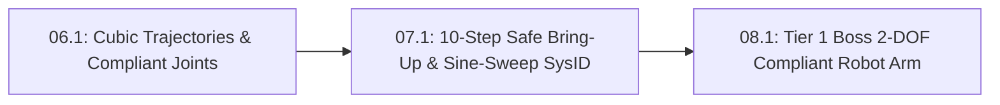

# Lesson 07.1: 10-Step Smoke-Free Hardware Bring-Up & Single-Tone Sine-Sweep System Identification

<!-- run-callout:start -->
> **Step 9 of 10 · Plan motion and bring it up safely**
>
> **Run this in the workbench.** [Open MechaLab with `07.1` loaded](https://tle47.github.io/Mechatronics-Roadmap/?lesson=07.1) - it opens on the **Run Python Lessons** tab with that entry selected. Starter code, hints and the graded check are ready; this page is the reading copy, and nothing you type here is saved.
<!-- run-callout:end -->

## Goal
Verify encoder-to-actuator sign matching and current-limited power-on safety using the **10-step smoke-free hardware bring-up protocol**, and extract a motor joint's true **viscous friction ($b$)** and **rotational inertia ($J$)** from a two-frequency **sine-sweep system identification** experiment.

- **New ideas (max 2):**
  1. **10-step smoke-free hardware bring-up and encoder-to-actuator sign verification**: How unpowered continuity checks, a $100\text{ mA}$ `CC/CV` current limit, and checking that positive motor command increases measured encoder angle ($\Delta\theta_{\text{meas}} \cdot u_{\text{test}} > 0$) prevent positive-feedback runaway.
  2. **Single-tone sine-sweep system identification to measure viscous friction ($b$) and rotational inertia ($J$)**: How driving $\tau(t) = A\sin(2\pi f t)$ at a slow frequency $f_1$ and a fast frequency $f_2$ extracts $b$ and $J$ from the measured velocity amplitude $|\omega|$.
- **New syntax:** None (uses `math.sqrt`, `math.pi`, and conditional safety checks).
- **Target time (unmeasured — [log yours](../.github/ISSUE_TEMPLATE/beginner-timing-log.md)):** Typical: 1.5–2.0 hours | Slow-learner: 2.5–3.5 hours

---

## Prerequisites
- [Lesson S0.5: Multimeters & Current-Limited (`CC/CV`) Bench Supplies](../stage-0/S0.5-multimeters-and-current-limited-supplies.md)
- [Lesson 02.4: Rotational Inertia & Gear Ratios](../02-mechanics-kinematics-dynamics/02.4-rotational-inertia-and-gear-ratios.md)
- [Lesson 05.1: PID Virtual Spring-Damper Control & Integrator Anti-Windup Clamping](../05-control-and-estimation/05.1-pid-virtual-spring-damper-and-anti-windup.md)
- [Lesson 06.1: Rest-to-Rest Cubic Polynomial Trajectories & Joint-Space Gravity Feedforward](../06-robotics-and-autonomy/06.1-cubic-trajectories-and-compliant-joints.md)



---

## Learn

### Idea 1: 10-step smoke-free hardware bring-up and encoder-to-actuator sign verification
- **Primary resource:** [SparkFun — How to Use a Multimeter ("Continuity")](https://learn.sparkfun.com/tutorials/how-to-use-a-multimeter) `[HTTP 200 — Verified by scripts/check_links.py]`
  - **What to read:** Review exact headings **`Continuity`** and **`Measuring Voltage`**.
  - **What to skip:** Skip internal fuse replacement steps.
  - **Key takeaway:** Never power a new robot joint from an unfused battery or close a PID loop before checking sensor direction! Our **10-step smoke-free hardware bring-up** checks unpowered rail continuity (`VIN` to `GND` must not beep), powers logic at a $100\text{ mA}$ `CC/CV` current limit, and performs **encoder-to-actuator sign verification**: when a small positive open-loop command ($u_{\text{test}} = +0.10$) nudges the motor, the encoder reading $\Delta \theta_{\text{meas}}$ **must also be positive** ($\Delta\theta_{\text{meas}} \cdot u_{\text{test}} > 0$). If $\Delta\theta_{\text{meas}} < 0$, the encoder is inverted relative to the motor, which turns negative feedback into violent positive-feedback runaway!
  - **Alternative resource:** [Wikipedia — Negative feedback ("Overview")](https://en.wikipedia.org/wiki/Negative_feedback) `[HTTP 200 — Verified by scripts/check_links.py]` — Compare stabilizing negative feedback against runaway positive feedback.

### Idea 2: Single-tone sine-sweep system identification to measure viscous friction ($b$) and rotational inertia ($J$)
- **Primary resource:** [Wikipedia — System identification ("Overview")](https://en.wikipedia.org/wiki/System_identification) `[HTTP 200 — Verified by scripts/check_links.py]`
  - **What to read:** Read exact headings **`System identification`** and **`Overview`**.
  - **What to skip:** Skip nonlinear Wiener-Hammerstein Volterra series.
  - **Key takeaway:** Instead of guessing your joint's rotational inertia $J$ ($\text{kg}\cdot\text{m}^2$) and viscous damping $b$ ($\text{N}\cdot\text{m}\cdot\text{s/rad}$) when calculating PID gains ($K_d = 2\sqrt{J K_p}$), you can measure them directly with a **single-tone sine-sweep system identification** test! For a rotor $J\dot{\omega} + b\omega = A\sin(2\pi f t)$, the steady-state velocity amplitude is $|\omega(f)| = \frac{A}{\sqrt{b^2 + (2\pi f J)^2}}$. At a very slow frequency $f_1 \to 0$, friction dominates so $b \approx \frac{A}{|\omega(f_1)|}$; at a higher frequency $f_2$, inertia dominates and we solve directly for $J = \frac{\sqrt{(A / |\omega(f_2)|)^2 - b^2}}{2\pi f_2}$.
  - **Alternative resource:** [Wikipedia — Frequency response ("Measurement and plotting")](https://en.wikipedia.org/wiki/Frequency_response) `[HTTP 200 — Verified by scripts/check_links.py]` — Read exact headings **`Frequency response`** and **`Measurement and plotting`**.

### Bridge Notes
Before closing any PID loop on your bench, execute the automated pre-flight checks from the **10-step smoke-free hardware bring-up** protocol:
1. Verify unpowered rail resistance $R_{\text{rail}} > 100\ \Omega$ (no short circuit) and `CC/CV` current limit $I_{\text{limit}} \le 0.15\text{ A}$ for logic bring-up.
2. Perform **encoder-to-actuator sign verification**: apply a tiny open-loop pulse $u_{\text{test}} > 0$ and confirm $\Delta\theta_{\text{meas}} \cdot u_{\text{test}} > 0$ (if negative, swap two motor phase wires or flip the encoder `DIR` pin).

Once open-loop direction is verified, run a two-tone **sine-sweep system identification** with torque amplitude $A$ (`N·m`) at low frequency $f_1$ (`Hz`) and high frequency $f_2$ (`Hz`). Since total mechanical impedance at angular excitation frequency $\Omega = 2\pi f$ is $Z(\Omega) = \frac{A}{|\omega|} = \sqrt{b^2 + (\Omega J)^2}$:

$$
\hat{b} = \frac{A}{|\omega(f_1)|}, \qquad \hat{J} = \frac{\sqrt{\left(\frac{A}{|\omega(f_2)|}\right)^2 - \hat{b}^2}}{2\pi f_2}
$$

With $\hat{J}$ and $\hat{b}$ measured from real data, you can compute exact critically damped PD gains without guesswork!

---

## Do it yourself

- **What is simulated and in which tool:**
  - **In Python 3 (or the in-browser MechaLab Python Runner):** Complete `verify_bringup_safety` (`TODO 1`) to catch an inverted encoder sign before closing the loop, and `identify_b_and_j` (`TODO 2`) to extract $\hat{b}$ and $\hat{J}$ from two sine-sweep velocity amplitude measurements.
- **What is real-hardware only:** Pressing a physical mushroom E-Stop switch in series with the $+12\text{ V}$ motor supply wire.

### Starter Code (runs as-is — fill in the TODOs)
Save as `bringup_and_sinesweep_sysid.py` and run `python3 bringup_and_sinesweep_sysid.py`:

```python
import math


def verify_bringup_safety(rail_ohms, psu_limit_a, u_test, dtheta_meas):
    # TODO 1: Return "PASS_READY_FOR_CLOSED_LOOP" if rail_ohms >= 100.0, psu_limit_a <= 0.50,
    #         and (u_test * dtheta_meas) > 0.0; if (u_test * dtheta_meas) <= 0.0 return "ABORT_INVERTED_ENCODER_SIGN"
    return "UNKNOWN"


def identify_b_and_j(amp_nm, f1_hz, omega1_amp, f2_hz, omega2_amp):
    # TODO 2: Estimate b_est = amp_nm / omega1_amp, z2 = amp_nm / omega2_amp,
    #         and j_est = math.sqrt(z2**2 - b_est**2) / (2.0 * math.pi * f2_hz)
    b_est = 0.0
    j_est = 0.0
    return b_est, j_est


print("Bring-up check 1 (+u -> +dtheta):", verify_bringup_safety(1200.0, 0.20, +0.10, +0.05))
print("Bring-up check 2 (+u -> -dtheta):", verify_bringup_safety(1200.0, 0.20, +0.10, -0.05))

# True plant: b = 0.05 N*m*s/rad, J = 0.02 kg*m^2 driven with A = 0.20 N*m at f1->0 and f2=5.0 Hz
w1 = 0.20 / 0.05
w2 = 0.20 / math.sqrt(0.05**2 + (2.0 * math.pi * 5.0 * 0.02) ** 2)
b_hat, j_hat = identify_b_and_j(0.20, 0.05, w1, 5.0, w2)
print(f"Sine-Sweep SysID -> b_hat={b_hat:.4f} N*m*s/rad | J_hat={j_hat:.4f} kg*m^2")
```

### Expected Output
When `TODO 1` and `TODO 2` are completed, running the script prints:

```text
Bring-up check 1 (+u -> +dtheta): PASS_READY_FOR_CLOSED_LOOP
Bring-up check 2 (+u -> -dtheta): ABORT_INVERTED_ENCODER_SIGN
Sine-Sweep SysID -> b_hat=0.0500 N*m*s/rad | J_hat=0.0200 kg*m^2
```

### Hint Ladder

<details>
<summary><strong>Hint 1 (Concept nudge)</strong></summary>

In `TODO 1`, check `if (u_test * dtheta_meas) <= 0.0: return "ABORT_INVERTED_ENCODER_SIGN"`, then check `if rail_ohms >= 100.0 and psu_limit_a <= 0.50: return "PASS_READY_FOR_CLOSED_LOOP"`. In `TODO 2`, compute `b_est = amp_nm / omega1_amp`, `z2 = amp_nm / omega2_amp`, and `j_est = math.sqrt(z2**2 - b_est**2) / (2.0 * math.pi * f2_hz)`.
</details>

<details>
<summary><strong>Hint 2 (Formula / structure)</strong></summary>

```python
def identify_b_and_j(amp_nm, f1_hz, omega1_amp, f2_hz, omega2_amp):
    b_est = amp_nm / omega1_amp
    z2 = amp_nm / omega2_amp
    j_est = math.sqrt(z2**2 - b_est**2) / (2.0 * math.pi * f2_hz)
    return b_est, j_est
```
</details>

<details>
<summary><strong>Full Solution</strong></summary>

```python
import math


def verify_bringup_safety(rail_ohms, psu_limit_a, u_test, dtheta_meas):
    if (u_test * dtheta_meas) <= 0.0:
        return "ABORT_INVERTED_ENCODER_SIGN"
    if rail_ohms >= 100.0 and psu_limit_a <= 0.50:
        return "PASS_READY_FOR_CLOSED_LOOP"
    return "ABORT_RAIL_OR_CURRENT_LIMIT"


def identify_b_and_j(amp_nm, f1_hz, omega1_amp, f2_hz, omega2_amp):
    b_est = amp_nm / omega1_amp
    z2 = amp_nm / omega2_amp
    j_est = math.sqrt(z2**2 - b_est**2) / (2.0 * math.pi * f2_hz)
    return b_est, j_est


print("Bring-up check 1 (+u -> +dtheta):", verify_bringup_safety(1200.0, 0.20, +0.10, +0.05))
print("Bring-up check 2 (+u -> -dtheta):", verify_bringup_safety(1200.0, 0.20, +0.10, -0.05))

w1 = 0.20 / 0.05
w2 = 0.20 / math.sqrt(0.05**2 + (2.0 * math.pi * 5.0 * 0.02) ** 2)
b_hat, j_hat = identify_b_and_j(0.20, 0.05, w1, 5.0, w2)
print(f"Sine-Sweep SysID -> b_hat={b_hat:.4f} N*m*s/rad | J_hat={j_hat:.4f} kg*m^2")
```
</details>

---

## Common mistakes & troubleshooting
- **Closing a PID loop before checking that $+\text{PWM}$ increases encoder angle:** This is the #1 cause of violent motor runaway on first power-on. Always run Step 6 of the bring-up checklist (`+0.10` open-loop nudge) with the bench PSU current limit capped at $0.3\text{–}0.5\text{ A}$.
- **Commanding a huge sine-sweep torque amplitude that hits mechanical hard-stops:** Keep sine-sweep excitation amplitude $A$ gentle ($10\text{–}20\%$ of rated torque) so the joint oscillates smoothly near the center of its workspace without saturating.

---

## Check yourself

1. **Inverted encoder runaway:** What happens when you enable a closed-loop proportional controller $u = K_p(r - \theta_{\text{meas}})$ if positive voltage spins the motor clockwise ($+\theta$) but the encoder counts downward ($-\theta_{\text{meas}}$)?
   <details>
   <summary><strong>Answer</strong></summary>

   As the motor moves toward the target, error $r - \theta_{\text{meas}}$ grows **larger instead of smaller** (**positive feedback**), accelerating the joint at full voltage into the mechanical hard-stop!
   </details>

2. **Low-frequency viscous friction estimate:** During a slow sine-sweep test where inertial torque $2\pi f_1 J \approx 0$, a torque amplitude of $A = 0.15\text{ N}\cdot\text{m}$ produces a peak velocity amplitude of $|\omega| = 3.0\text{ rad/s}$. What is the viscous damping coefficient $\hat{b} = A / |\omega|$?
   <details>
   <summary><strong>Answer</strong></summary>

   $\hat{b} = \frac{0.15\text{ N}\cdot\text{m}}{3.0\text{ rad/s}} = \mathbf{0.050\text{ N}\cdot\text{m}\cdot\text{s/rad}}$.
   </details>

---

## Recap
- The **10-step smoke-free hardware bring-up** verifies unpowered continuity, `CC/CV` current limiting, and positive **encoder-to-actuator sign matching** ($\Delta\theta_{\text{meas}} \cdot u_{\text{test}} > 0$) before closing any feedback loop.
- **Single-tone sine-sweep system identification** extracts viscous damping $\hat{b}$ at low frequency and rotational inertia $\hat{J}$ at high frequency from $|\omega(f)| = \frac{A}{\sqrt{b^2 + (2\pi f J)^2}}$.

### You're ready to move on when...
- [ ] Your `bringup_and_sinesweep_sysid.py` script prints `PASS_READY_FOR_CLOSED_LOOP`, `ABORT_INVERTED_ENCODER_SIGN`, `b_hat=0.0500 N*m*s/rad`, and `J_hat=0.0200 kg*m^2`.
- [ ] You can list the unpowered continuity, current-limit, and encoder-sign steps of safe hardware bring-up.

<!-- next-step:start -->
👉 **Next:** [Step 9 · Plan motion and bring it up safely — 06-robotics.T1.06a: 1D Point-to-Point Motion, Boundary Conditions & Virtual Joint Spring-Damper](../modules/06-robotics.T1.06a.md)
<!-- next-step:end -->
