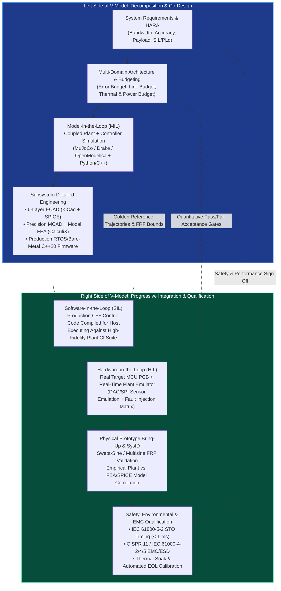
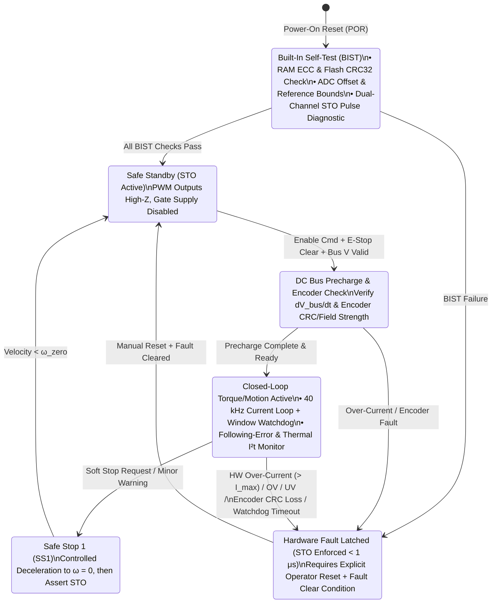

# Track 07: Mechatronic Systems Engineering, SysID, Real-Time HIL & Production Qualification

> **Part of the [MechaLab Multi-Pass Tiered Roadmap](../README.md)**  
> **Prerequisites:** [Track 01: Electronics & Power](../01-electronics-and-power/README.md), [Track 04: Embedded & Real-Time](../04-embedded-and-realtime/README.md), [Track 05: Control & Estimation](../05-control-and-estimation/README.md)  
> **Feeds Into:** [Track 08: Capstone Projects](../08-capstone-projects/README.md)  
> **Core Principle:** A prototype that works once on a laboratory bench is not a product. Production mechatronics engineering closes the V-Model via frequency-domain System Identification, deterministic Hardware-in-the-Loop (HIL) fault injection, Independent Hardware Functional Safety (IEC 61508 / ISO 13849), and first-pass Electromagnetic Compatibility (EMC) & Design-for-Manufacturing (DFM) sign-off.

---

## 🔄 Linear Level-Up Navigation (Follow Your Current Pass Across Track 00 → Track 08)

Complete **only your current Tier section** below, verify its hands-on milestone, and proceed directly to **Track 08 (The Boss Capstone for Your Current Pass)**:

| Pass / Level | Previous Step in Pass | Current Track 07 Section | Next Linear Step in This Pass |
| :--- | :--- | :--- | :--- |
| **🟢 Pass 1: Tier 1 (Beginner)** | [← Track 06 (Tier 1)](../06-robotics-and-autonomy/README.md#tier-1-beginner--intuitive) | [§1 Tier 1: 10-Step Safe Bring-Up Protocol & Single-Tone Sine Sweeps](#tier-1-beginner--intuitive) | [**🏆 Next in Pass 1 → Track 08 (Tier 1 Boss: Breakout 2-DOF Desktop Robot)**](../08-capstone-projects/README.md#tier-1-capstone-builds-beginner--breakout-pass) |
| **🔵 Pass 2: Tier 2 (Applied)** | [← Track 06 (Tier 2)](../06-robotics-and-autonomy/README.md#tier-2-intermediate--applied) | [§2 Tier 2: Regen Braking Bus Clamps, CRC Watchdogs & HIL Faults](#tier-2-intermediate--applied) | [**🏆 Next in Pass 2 → Track 08 (Tier 2 Boss: Custom 4-Layer CAN Servo + LQR)**](../08-capstone-projects/README.md#tier-2-capstone-builds-intermediate--applied-pass) |
| **🌉 Bridge Concept** | — | [§3 Bridging the Gap: Software `if(fault) pwm=0` $\to$ Dual-Channel Hardware STO Cutoff](#bridging-the-gap-maker-to-custom) | [Inspect Tier 3 Production Mastery ↓](#tier-3-advanced--production) |
| **🟣 Pass 3: Tier 3 (Production)** | [← Track 06 (Tier 3)](../06-robotics-and-autonomy/README.md#tier-3-advanced--production) | [§4 Tier 3: Schroeder Multisine Closed-Loop SysID & $<1\ \mu\text{s}$ Hardware STO](#tier-3-advanced--production) | [**🏆 Next in Pass 3 → Track 08 (Tier 3 Boss: Full Production Capstones I–IV)**](../08-capstone-projects/README.md#tier-3-capstone-builds-advanced--production-pass) |

---

## Tier 1 (Beginner / Intuitive)

> **Goal of Pass 1 (Track 07):** Adopt a disciplined **10-Step Hardware Bring-Up Protocol** so you never release magic smoke on power-up, wire a physical E-Stop switch + inline fuse, and measure your motor's actual inertia and friction using a simple single-tone sine sweep.

### 1.1 The 10-Step Smoke-Free Hardware Bring-Up Checklist
Never plug a fresh LiPo battery into a newly wired breadboard or PCB! Follow this exact sequence every time:
1. **Visual & Polarity Inspection:** Check electrolytic capacitor stripes, IC pin-1 dots, and power connector polarity.
2. **DMM Unpowered Continuity Beep Test:** Probe `VIN` to `GND`, `5V` to `GND`, and `3.3V` to `GND`. Any continuous beep = dead short!
3. **Bench Supply Current-Limit Pre-Set:** Disconnect the circuit, set PSU to nominal voltage ($12.0\text{ V}$) and **Constant-Current limit $I_{\text{limit}} = 100\text{ mA}$**.
4. **Logic-Only Power-Up (Motor Disconnected):** Enable PSU output; verify quiescent current matches datasheet ($\sim 30\text{–}60\text{ mA}$) and check `3.3V` rail with DMM.
5. **Finger / Thermal Check:** Ensure no regulator or gate driver feels warm after 60 seconds.
6. **Sensor Sanity Check Before Enabling Actuators:** Spin the shaft by hand and verify the encoder angle increments smoothly ($0 \to +2\pi$) in the **same positive direction** as positive motor torque! *(Inverted encoder sign turns negative feedback into positive feedback—the #1 cause of violent motor runaway on first enable!)*
7. **Low-Current Open-Loop Alignment:** Set $I_{\text{limit}} = 0.5\text{ A}$ and apply a tiny $10\%$ PWM test pulse.
8. **Hardware E-Stop Verification:** Press your physical inline E-Stop switch and confirm immediate power cutoff.
9. **Closed-Loop Low-Gain Test:** Start with $K_p$ at $10\%$ of nominal and zero $K_i$.
10. **Raise Current Limit & Log Telemetry:** Only raise PSU current limit once step responses are clean and damped.

### 1.2 Single-Tone Sine Sweeps to Measure Inertia $J$ & Friction $b$
Command a gentle sinusoidal torque $\tau(t) = A \sin(2\pi f t)$ at $f = 0.5, 1.0, 2.0, 5.0\text{ Hz}$ and record the resulting velocity amplitude $|\omega|$. Since $J\dot{\omega} + b\omega = \tau$, the ratio $|\omega|/A = \frac{1}{\sqrt{(2\pi f J)^2 + b^2}}$ lets you solve directly for $J$ and $b$!

### ✅ Tier 1 Milestone Gate (`Track 07 · Pass 1`)
* Execute the 10-Step Bring-Up Checklist on your Tier 1 hardware setup, verify positive encoder-to-torque sign matching, and extract empirical rotor inertia $J$ and viscous damping $b$ from a 4-frequency sine sweep.
* **🏆 Next Linear Step in Pass 1:** [**Proceed to Track 08 (Tier 1 Boss Capstone: Breadboard/Breakout 2-DOF Desktop Robot) →**](../08-capstone-projects/README.md#tier-1-capstone-builds-beginner--breakout-pass)

---

## Tier 2 (Intermediate / Applied)

> **Goal of Pass 2 (Track 07):** Protect your custom 4-layer PCBs from **Regenerative Braking Over-Voltage Spikes** using an active shunt brake chopper, enforce **CRC-16 + Window Watchdog timeouts** on every CAN-FD frame, and automate **Software/Hardware-in-the-Loop (SIL/HIL) Fault Injection**.

### 2.1 Why Fast Braking Blows Up Power Supplies (Regenerative Bus Clamping)
When a spinning robot link decelerates rapidly ($\tau \cdot \omega < 0$), the brushless motor becomes a generator and dumps its kinetic energy $\frac{1}{2}J\omega^2$ back into the DC bus capacitors:

$$
V_{\text{bus,peak}} = \sqrt{V_{\text{bus,nom}}^2 + \frac{2 \eta \left(\frac{1}{2}J\omega_0^2 - E_{\text{losses}}\right)}{C_{\text{bus}}}}
$$

Bench power supplies cannot sink reverse current (they have an output diode), so $V_{\text{bus}}$ spikes from $24\text{ V}$ to $>70\text{ V}$ in milliseconds, destroying your gate driver! **Solution:** Add a comparator/MCU-driven MOSFET + $10\ \Omega$ power resistor (**Shunt Brake Chopper**) that turns on whenever $V_{\text{bus}} > V_{\text{nom}} + 3\text{ V}$.

### 2.2 Communication Loss Watchdogs, CRC-16 & Thermal $I^2 t$ Protection
* **Host Heartbeat Timeout:** If no valid CRC-checked CAN-FD frame arrives within $5.0\text{ ms}$ (5 missed $1\text{ kHz}$ ticks), automatically transition the joint into damped zero-velocity braking (`Kd` only, `tau_ff = 0`).
* **Software Thermal $I^2 t$ Integrator:** Even without a winding thermistor, integrate $\dot{T}_{\text{est}} = \frac{1}{C_{\text{th}}}\big(I_q^2 R_s - \frac{T_{\text{est}} - T_a}{R_{\text{th}}}\big)$ at $100\text{ Hz}$ and derate maximum current smoothly before copper insulation melts.

### ✅ Tier 2 Milestone Gate (`Track 07 · Pass 2`)
* Open **Tab 5: URDF / MuJoCo & STO** in the interactive workbench and inject all three hardware faults (**Overcurrent Short $42\text{ A}$**, **Encoder SPI Wire Open**, and **DC Bus Overvoltage $64\text{ V}$**) to verify deterministic fault detection and gate shutdown.
* **🏆 Next Linear Step in Pass 2:** [**Proceed to Track 08 (Tier 2 Boss Capstone: Custom 4-Layer CAN Servo + LQR/MuJoCo Twin) →**](../08-capstone-projects/README.md#tier-2-capstone-builds-intermediate--applied-pass)

---

## Bridging the Gap: Maker to Custom

### From Software `if (fault) pwm = 0` Checks to $<1\ \mu\text{s}$ Dual-Channel Hardware Safe Torque Off (STO)

* **Why Software `if (current > max) analogWrite(0)` Fails in Production:**
  1. **Too Slow:** A dead phase-to-phase short across a $48\text{ V}$ bus with $L_s = 35\ \mu\text{H}$ ramps current at $\frac{dI}{dt} = \frac{48\text{ V}}{35\ \mu\text{H}} = 1.37\text{ A/\mu s}$. In a $1\text{ kHz}$ ($1000\ \mu\text{s}$) software loop, current would try to reach $>1,000\text{ A}$, exploding the MOSFETs in the first $10\ \mu\text{s}$!
  2. **Single Point of Failure:** If the CPU hangs inside an infinite loop or suffers a stack overflow, software `if` checks never run.
* **How Production Drives Guarantee Safety (IEC 61800-5-2 Dual-Channel Hardware STO):**
  1. **Analog Comparator $\to$ Timer `BKIN` ($< 650\text{ ns}$):** An analog window comparator watching the Kelvin shunt amplifier output feeds directly into the `STM32` `TIM1_BKIN` hardware break pin, asynchronously tristating all 6 PWM outputs in silicon in **$< 1\ \mu\text{s}$** with zero CPU instructions!
  2. **Dual Independent Channels:** Channel A cuts the isolated $12\text{ V}$ gate-driver power rail (`VCC_GATE`), while Channel B disables the gate-driver enable pin (`74LVC244` hardware buffer), achieving **SIL-3 / PLe** functional safety.

---

## Tier 3 (Advanced / Production)

> **Goal of Pass 3 (Track 07):** Master industrial V-Model qualification: Root-Sum-Square (RSS) multi-domain error budgets, **Schroeder-Phased Multisine Closed-Loop System Identification** ($\text{CF} \approx 1.66$), automated HIL fault-injection matrices, and **IEC 61508 / ISO 13849 / IEC 61800-5-2 Dual-Channel Safe Torque Off (STO)**.
> * [**🏆 Next Linear Step in Pass 3 → Track 08 (Tier 3 Mastery: Full Production Capstones I–IV)**](../08-capstone-projects/README.md#tier-3-capstone-builds-advanced--production-pass)

### 4.1 Mechatronic V-Model & Real-Time HIL Verification Architecture

### 4.2 Root-Sum-Square (RSS) Multi-Domain Error Budgeting

$$
\sigma_{\text{total}} = \sqrt{\sigma_{\text{encoder}}^2 + \left(L_{\text{Abbe}}\sigma_{\theta,\text{pitch}}\right)^2 + \sigma_{\text{thermal}}^2 + \sigma_{\text{structural,vib}}^2 + \sigma_{\text{servo,tracking}}^2}
$$

| Subsystem Source | Error Mechanism | Uncalibrated Magnitude | Mitigation Strategy | Residual Budgeted Contribution ($3\sigma$) |
| :--- | :--- | :--- | :--- | :--- |
| **Mechanical Guideways** | Pitch/Yaw error $\times 80\text{ mm}$ Abbe offset | $2.80\ \mu\text{m}$ | Reduce Abbe offset to $15\text{ mm}$; preload crossed-roller rails | $0.52\ \mu\text{m}$ |
| **Thermal Growth** | Aluminum frame $\Delta T = \pm 2^\circ\text{C}$ over $150\text{ mm}$ | $6.90\ \mu\text{m}$ | Symmetric metrology loop + PT1000 real-time compensation | $0.80\ \mu\text{m}$ |
| **Linear Encoder** | Sub-divisional error (SDE) + scale accuracy | $\pm 3.0\ \mu\text{m}$ | Heydemann Lissajous calibration + interferometer LUT | $0.45\ \mu\text{m}$ |
| **Control Loop** | Dynamic following error + DAC/PWM ripple | $4.5\ \mu\text{m}$ | Zero-phase acceleration/friction feedforward + $25\text{ kHz}$ FOC | $0.65\ \mu\text{m}$ |
| **Total RSS ($3\sigma$)** | $\sqrt{\sum (3\sigma_i)^2}$ | **$15.1\ \mu\text{m}$ (FAIL)** | **Co-Designed System** | **$1.24\ \mu\text{m}$ (PASS $< 5.0\ \mu\text{m}$)** |

### 4.3 Schroeder-Phased Multisine Closed-Loop System Identification (SysID)

A sum of $M$ cosines $u(t) = \sum_{k=1}^M A_k \cos(\omega_k t + \phi_k)$ with naive zero phases ($\phi_k = 0$) adds constructively at $t=0$, creating a massive impulse spike ($\text{CF} = \sqrt{2M}$) that clips the actuator. Choosing **Schroeder Quadratic Phases**:

$$
\phi_k = -\frac{\pi k (k - 1)}{M} \implies \text{Crest Factor } \text{CF} = \frac{\|u\|_\infty}{\|u\|_{\text{rms}}} \approx 1.45\text{–}1.66
$$

Using external excitation $d_{\text{exc}}$ as an instrumental variable inside a stabilizing feedback loop $C_0(s)$ yields an unbiased plant estimate even in the presence of circulating sensor noise:

$$
\hat{P}(j\omega_k) = \frac{\hat{S}_{y d_{\text{exc}}}(j\omega_k)}{\hat{S}_{u d_{\text{exc}}}(j\omega_k)}, \qquad \gamma_{uy}^2(\omega) = \frac{|\hat{S}_{uy}(j\omega)|^2}{\hat{S}_{uu}(j\omega)\hat{S}_{yy}(j\omega)} \in [0, 1]
$$

### 4.4 Functional Safety State Machine & Dual-Channel Safe Torque Off (STO)

---

## 5. Failure Modes, Pitfalls & Anti-Patterns

1. **Braking Regenerative Over-Voltage Destroying the DC Bus:** Always include an active hysteretic brake chopper MOSFET + power resistor triggered whenever $V_{\text{bus}} > V_{\text{nom}} + 4\text{ V}$.
2. **Testing Fault Handling Only in Software Simulation:** Use a physical HIL fault-injection switch matrix to open/short sensor and power lines under load.
3. **Ignoring Cable Shield Termination ($360^\circ$ Gland vs. Pigtail Wire):** Terminate shielded motor/encoder cables with $360^\circ$ metallic EMC glands or connector backshells, never a $5\text{ cm}$ twisted pigtail ($50\text{ nH}$ series inductance).

---

## 6. Tier 3 Production Lab & Milestone Gate (`Lab 07`)

| Metric | Target Requirement | Verification Method |
| :--- | :--- | :--- |
| **SysID Model-to-Hardware Correlation** | Magnitude error $< 1.5\text{ dB}$ across $5\text{ Hz} - 500\text{ Hz}$ with $\text{CF} \approx 1.66$ | Interactive **Tab 7: Schroeder Multisine SysID Simulator** |
| **Hardware Over-Current to Gate Turn-Off** | Latency $< 1.0\ \mu\text{s}$ ($0.65\ \mu\text{s}$ achieved) from shunt fault to all 6 gates High-Z | Interactive **Tab 5: Dual-Channel Hardware STO Simulator** |
| **Encoder CRC / Wire-Break Fault Reaction** | Fault detected within $\le 2$ cycles ($\le 80\ \mu\text{s}$); zero unintended torque spike | Interactive **Tab 5: Encoder SPI Wire Open Fault Injection** |
| **Regenerative Braking Clamp Accuracy** | Peak DC bus rise $\Delta V_{\text{bus}} < 4.5\text{ V}$ during emergency stop | Active shunt brake chopper verification |
