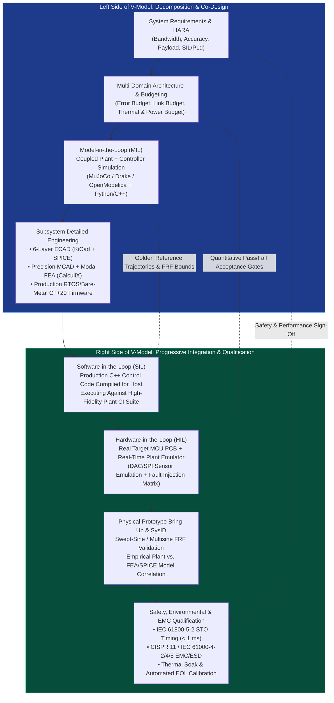
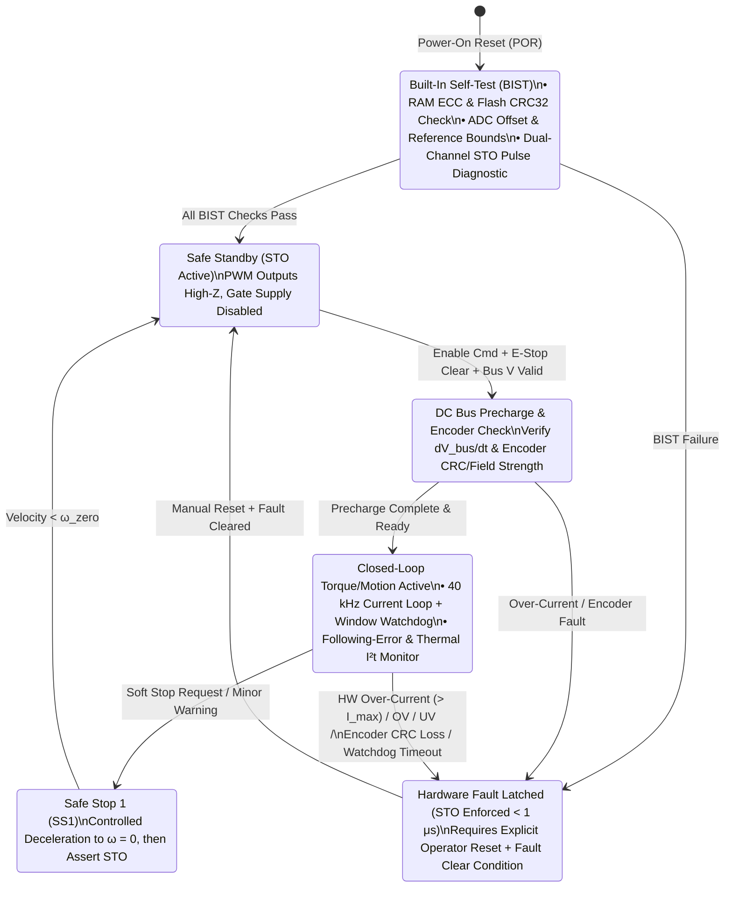

# Track 07: Mechatronic Systems Engineering, SysID, Real-Time HIL & Production Qualification

> **Prerequisites:** [Track 01: Electronics & Power](../01-electronics-and-power/README.md), [Track 04: Embedded & Real-Time](../04-embedded-and-realtime/README.md), [Track 05: Control & Estimation](../05-control-and-estimation/README.md)  
> **Feeds Into:** [Track 08: Capstone Projects](../08-capstone-projects/README.md)  
> **Core Principle:** A prototype that works once on a laboratory bench is not a product. Production mechatronics engineering closes the V-Model via frequency-domain System Identification, deterministic Hardware-in-the-Loop (HIL) fault injection, Independent Hardware Functional Safety (IEC 61508 / ISO 13849), and first-pass Electromagnetic Compatibility (EMC) & Design-for-Manufacturing (DFM) sign-off.

---

## 1. Module Overview & System Context

In complex cyber-physical products, the most catastrophic failures occur at subsystem boundaries under off-nominal conditions: a broken encoder wire causing full-torque motor runaway, a firmware regression inverting a current-sense sign on a hardware revision, or a $40\text{ kHz}$ inverter failing CISPR 11 radiated emissions by $18\text{ dB}$ two weeks before factory mass production.

This track covers the discipline that separates hobbyist prototypes from certified industrial, medical, aerospace, and automotive hardware:
1. **The Mechatronic V-Model & Error/Power/Thermal Budgets:** Allocating quantitative system requirements across mechanical, electrical, thermal, and control domains before CAD or schematic capture begins.
2. **Closed-Loop System Identification (SysID):** Multisine and swept-sine excitation, ETFE/Welch non-parametric FRFs, Subspace (`N4SID`) and Prediction-Error (`PEM`) parametric fitting, and friction/inertia identification.
3. **Simulation-in-the-Loop (SIL) & Real-Time Hardware-in-the-Loop (HIL):** Testing unmodified production MCU binaries against real-time FPGA/CPU physics emulators with automated hardware fault injection (short-to-GND, open phase, sensor dropout).
4. **Functional Safety Engineering:** Hazard Analysis & Risk Assessment (HARA), FMEA, Fault Tree Analysis (FTA), Safe Torque Off (STO), Dual-Channel Lockstep monitoring, and IEC 61508 (SIL) / ISO 13849 (PL) / ISO 26262 (ASIL) compliance.
5. **EMC Pre-Compliance, Thermal/Vibration Environmental Testing & EOL Factory Calibration:** Designing automated End-of-Line (EOL) production test fixtures (`pogo-pin` ICT + dynamometer characterization).

---

## 2. Mechatronic V-Model & Real-Time HIL Verification Architecture

---

## 3. System Error Budgeting & Multi-Domain Allocation

### 3.1 Root-Sum-Square (RSS) vs. Worst-Case Error Budgets
When designing a precision motion system (e.g., a $3\text{-axis}$ optical alignment stage requiring $\le 5\ \mu\text{m}$ total $3\sigma$ positioning uncertainty at the tool center point), errors from mechanics, thermal drift, sensors, and control tracking must be budgeted upfront:
* **Systematic / Slowly Varying Biases ($E_{\text{sys}}$):** Sum linearly or calibrate via lookup tables (e.g., lead-screw pitch error, gravity sag).
* **Uncorrelated Random / Zero-Mean Errors ($\sigma_i$):** Combine via **Root-Sum-Square (RSS)**:

$$
\sigma_{\text{total}} = \sqrt{\sigma_{\text{encoder}}^2 + \left(L_{\text{Abbe}}\sigma_{\theta,\text{pitch}}\right)^2 + \sigma_{\text{thermal}}^2 + \sigma_{\text{structural,vib}}^2 + \sigma_{\text{servo,tracking}}^2}
$$

| Subsystem Source | Error Mechanism | Uncalibrated Magnitude | Mitigation Strategy | Residual Budgeted Contribution ($3\sigma$) |
| :--- | :--- | :--- | :--- | :--- |
| **Mechanical Guideways** | Pitch/Yaw angular error $\times 80\text{ mm}$ Abbe offset | $35\ \mu\text{rad} \times 80\text{ mm} = 2.80\ \mu\text{m}$ | Reduce Abbe offset to $15\text{ mm}$; preload crossed-roller rails | $0.52\ \mu\text{m}$ |
| **Thermal Growth** | Aluminum frame $\Delta T = \pm 2^\circ\text{C}$ over $150\text{ mm}$ | $23\times 10^{-6} \times 0.15 \times 2 = 6.90\ \mu\text{m}$ | Symmetric Invar/steel metrology loop + PT1000 real-time thermal compensation | $0.80\ \mu\text{m}$ |
| **Linear Encoder** | Sub-divisional error (SDE) + scale accuracy | $\pm 3.0\ \mu\text{m}$ | Heydemann Lissajous ellipse calibration + laser interferometer LUT | $0.45\ \mu\text{m}$ |
| **Control Loop** | Dynamic following error + DAC/PWM ripple | $4.5\ \mu\text{m}$ | Zero-phase acceleration/friction feedforward + $25\text{ kHz}$ current loop | $0.65\ \mu\text{m}$ |
| **Total RSS ($3\sigma$)** | $\sqrt{\sum (3\sigma_i)^2}$ | **$15.1\ \mu\text{m}$ (FAIL)** | **Co-Designed System** | **$1.24\ \mu\text{m}$ (PASS $< 5.0\ \mu\text{m}$)** |

---

## 4. Frequency-Domain & Parametric System Identification (SysID)

Never tune a high-performance controller solely by trial-and-error step responses on hardware! A single automated $30\text{-second}$ frequency-response measurement reveals the exact rigid-body inertia, viscous damping, loop transport delay, and every structural resonance and anti-resonance.

### 4.1 Excitation Signal Design: Schroeder-Phased Multisine vs. Logarithmic Chirp
A sum of $M$ harmonically related sinusoids $u(t) = \sum_{k=1}^M A_k \cos(\omega_k t + \phi_k)$ with random phases exhibits high peak-to-average spikes that saturate the actuator. Choosing **Schroeder Phases**:

$$
\phi_k = -\frac{\pi k (k - 1)}{M}
$$

minimizes the **Crest Factor** ($\text{CF} = \frac{\|u\|_\infty}{\|u\|_{\text{rms}}} \approx 1.45\text{–}1.6$), packing maximum spectral energy into every frequency bin without tripping current or voltage saturation limits.

### 4.2 Closed-Loop Identification (Sensitivity Method)
Unstable or integrating plants (free-spinning motors, inverted pendulums, vertical gravity axes) cannot be excited in open loop without drifting into mechanical hard stops. Instead, close a simple low-gain stabilizing controller $C_0(s)$, inject excitation $r_{\text{exc}}(t)$ at the reference or actuator input ($u = C_0(r - y) + d_{\text{exc}}$), and identify the plant via cross-spectral ratios:

$$
\hat{P}(j\omega) = \frac{\hat{S}_{y d_{\text{exc}}}(j\omega)}{\hat{S}_{u d_{\text{exc}}}(j\omega)}
$$

Using the external excitation $d_{\text{exc}}$ as the instrumental variable prevents sensor noise $v(t)$ circulating around the feedback loop from biasing the plant estimate! Always plot the **Coherence Function**:

$$
\gamma_{uy}^2(\omega) = \frac{|\hat{S}_{uy}(j\omega)|^2}{\hat{S}_{uu}(j\omega)\hat{S}_{yy}(j\omega)} \in [0, 1]
$$

Any frequency band where $\gamma_{uy}^2(\omega) < 0.8$ indicates either poor SNR (anti-resonance notch), actuator saturation/backlash nonlinearity, or unmeasured external disturbances.

---

## 5. Functional Safety (IEC 61508 / ISO 13849 / IEC 61800-5-2) & Hardware Interlocks

Software running on the primary control MCU **cannot** be relied upon as the sole protection against catastrophic physical hazards (a cosmic-ray bit flip, stack overflow, or welded relay contact can freeze GPIO pins in an active state).

### 5.1 Dual-Channel Safe Torque Off (STO) Architecture
Per **IEC 61800-5-2**, **Safe Torque Off (STO)** removes power from the gate-driver stage in hardware so the motor cannot generate electromagnetic torque, achieving **SIL-3 (IEC 61508) / PLe, Category 3/4 (ISO 13849-1)**:
* **Channel A:** Hardware Emergency-Stop / Safety Relay cuts the isolated gate-driver high-side/low-side power supply (`VCC_GATE_12V`).
* **Channel B:** Independent optical/digital isolator asserts the hardware `DISABLE` / `BKIN` pin on the gate driver IC *and* gates the 6 PWM lines via a dedicated hardware buffer (`74LVC244`) with diagnostic readback (`STO_FB_A`, `STO_FB_B`) monitored by both the MCU and safety supervisor.
* **Cross-Monitoring & Pulse Testing:** Both channels are periodically pulse-tested ($100\ \mu\text{s}$ dark pulses) to detect latent "stuck-high" faults (increasing **Diagnostic Coverage $\text{DC}_{\text{avg}} \ge 99\%$**).

---

## 6. Failure Modes, Pitfalls & Anti-Patterns

1. **Braking Regenerative Over-Voltage Destroying the DC Bus:** When a high-inertia robot axis or mobile base decelerates rapidly ($P_{\text{mech}} = \tau \omega < 0$), the PMSM acts as a 3-phase generator, pumping kinetic energy $\frac{1}{2}J\omega^2$ back through the inverter into the DC bus capacitors:

$$
V_{\text{bus,peak}} = \sqrt{V_{\text{bus,nom}}^2 + \frac{2 \eta \left(\frac{1}{2}J\omega_0^2 - E_{\text{losses}}\right)}{C_{\text{bus}}}}
$$

   If $V_{\text{bus}}$ is powered by a bench power supply (which cannot sink reverse current) or a BMS that disconnects on over-voltage, $V_{\text{bus}}$ skyrockets past $100\text{ V}$ in milliseconds! Always include an active ** Hysteretic Brake Chopper MOSFET + Power Resistor** triggered whenever $V_{\text{bus}} > V_{\text{nom}} + 4\text{ V}$.
2. **Testing Fault Handling Only in Software Simulation:** Simulating an encoder dropout in Python does not test whether the MCU's SPI DMA peripheral hangs waiting for clock edges or whether the gate driver's hardware `DESAT` comparator trips cleanly under load. Use a physical **HIL Fault Injection Switch Matrix** (reed relays / solid-state FET switches controlled by the test runner) to physically open/short sensor and power pins while the target runs.
3. **Ignoring Cable Shield Termination ($360^\circ$ Gland vs. "Pigtail" Wire):** Twisting a motor or encoder cable shield into a $5\text{ cm}$ "pigtail" wire to connect it to chassis ground adds $\sim 50\text{ nH}$ of series inductance, rendering the shield completely ineffective above $5\text{ MHz}$ and failing radiated emissions. Terminate shielded cables with **$360^\circ$ metallic EMC cable glands** or shielded connector backshells bonded directly to the unpainted metal enclosure wall.

---

## 7. Curated Learning Resources

### Authoritative Textbooks & Standards
* **Pintelon, R., & Schoukens, J.** — *System Identification: A Frequency Domain Approach* (2nd ed., Wiley-IEEE Press, 2012) & **Ljung, L.** — *System Identification: Theory for the User* (2nd ed., Prentice Hall, 1999).
* **Isermann, R.** — *Fault-Diagnosis Systems: An Introduction from Fault Detection to Fault Tolerance* (Springer, 2006) & *Mechatronic Systems: Fundamentals* (Springer, 2005).
* **IEC 61508 (Parts 1–7)** — *Functional Safety of Electrical/Electronic/Programmable Electronic Safety-Related Systems*.
* **ISO 13849-1 & IEC 61800-5-2** — *Safety of Machinery: Safety-Related Parts of Control Systems* & *Adjustable Speed Electrical Power Drive Systems — Safety Requirements (STO, SS1, SS2, SLS)*.
* **ISO 10218-1/2 & ISO/TS 15066** — *Robots and Robotic Devices — Safety Requirements for Industrial and Collaborative Robots* (biomechanical quasi-static and transient contact force/pressure limits).

### Open-Source Toolchains
* **`pytest` + `hypothesis` + Saleae / `sigrok-cli` + `PyVISA`** — Automated hardware-in-the-loop test runners driving programmable power supplies, oscilloscopes, and fault-injection boards via SCPI.
* **PlotJuggler & Foxglove Studio** — High-rate time-series telemetry visualization, live FFT analysis, and ROS 2 / MCAP log inspection.
* **Renode & QEMU** — Instruction-set simulation of full ARM Cortex-M/R/A SoCs and peripherals for deterministic CI/CD firmware verification.

---

## 8. Hands-On Lab & Milestone Gate

### Lab 07: Closed-Loop Frequency SysID, Automated HIL Fault-Injection Rig & STO Verification

1. **Objective:** Build an automated HIL + physical SysID test bench that identifies the empirical Bode plot of a mechatronic actuator from $1\text{ Hz}$ to $2\text{ kHz}$ and executes a 12-case hardware fault-injection safety suite.
2. **Tasks:**
   * Inject a 20-second Schroeder-phased multisine into the closed-loop actuator, compute the empirical FRF $\hat{P}(j\omega)$ and coherence $\gamma^2(\omega)$, and overlay against the theoretical 4-state electromechanical model.
   * Build a microcontroller-driven HIL fault-injection harness capable of triggering: (a) encoder `SPI_MISO` stuck-low/CRC corruption, (b) DC bus over-voltage ($V_{\text{bus}} > 56\text{ V}$), (c) phase-to-phase over-current comparator trip, and (d) primary task infinite-loop deadlock.
   * Measure hardware fault-to-STO-latch response times on an oscilloscope and generate an automated pass/fail test report via `pytest`.
3. **Quantitative Acceptance Criteria:**

| Metric | Target Requirement | Verification Method |
| :--- | :--- | :--- |
| **SysID Model-to-Hardware Correlation** | Magnitude error $< 1.5\text{ dB}$ and phase error $< 8^\circ$ across $1\text{ Hz} - 1\text{ kHz}$ (where $\gamma^2(\omega) \ge 0.90$) | Empirical Welch FRF vs. parametric state-space model overlay |
| **Hardware Over-Current to Gate Turn-Off** | Latency $< 1.0\ \mu\text{s}$ from shunt threshold exceedance to all 6 gate-drive outputs low | Oscilloscope capture of shunt fault injection vs. `HO/LO` gate pins |
| **Encoder CRC / Wire-Break Fault Reaction** | Fault detected within $2$ control cycles ($\le 80\ \mu\text{s}$); zero unintended torque impulse ($\lvert\Delta\tau\rvert < 0.05\text{ N}\cdot\text{m}$) | HIL open-circuit relay injection during $1,000\text{ RPM}$ loaded operation |
| **Regenerative Braking Clamp Accuracy** | Peak DC bus rise $\Delta V_{\text{bus}} < 4.5\text{ V}$ during emergency deceleration from max rated speed with full inertia disk | High-voltage differential probe capture on `V_BUS` and brake resistor |
