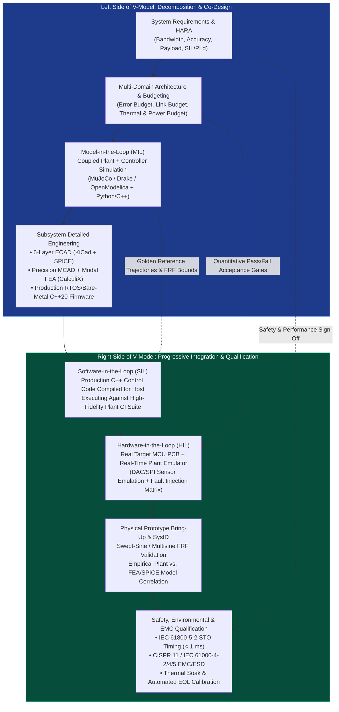
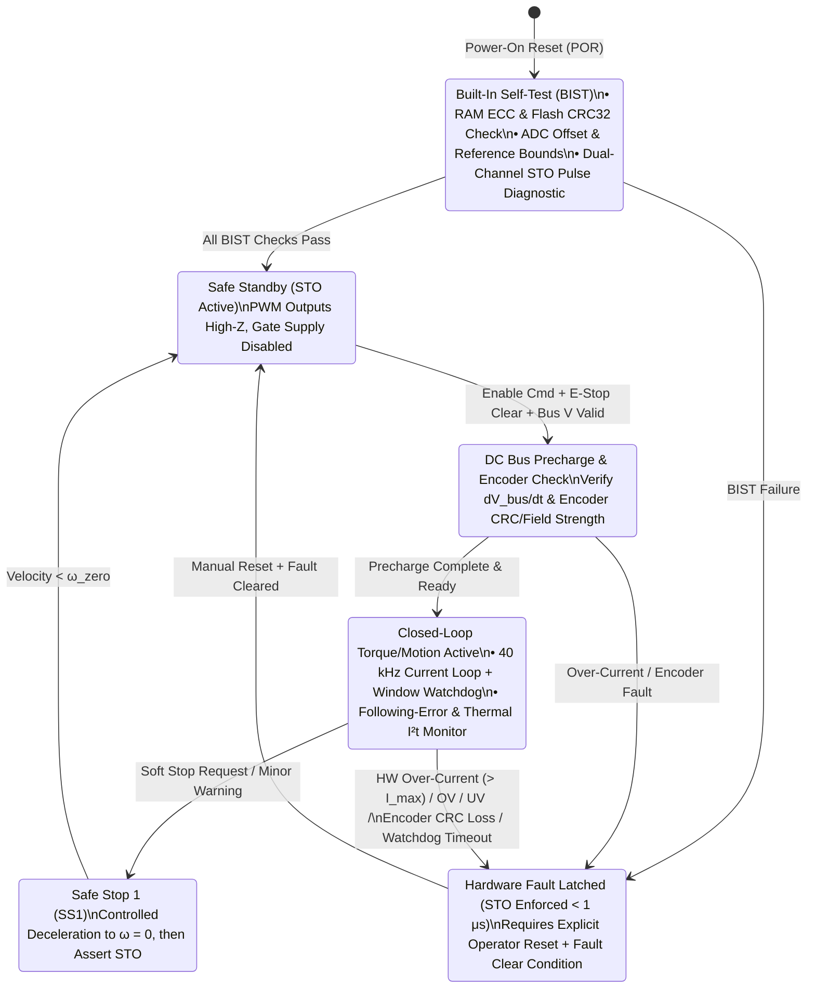

# Track 07: Mechatronic Systems Engineering, SysID, Real-Time HIL & Production Qualification

> **Part of the [MechaLab Multi-Pass Tiered Roadmap](../README.md)**  
> **Prerequisites:** [Track 01: Electronics & Power](../01-electronics-and-power/README.md), [Track 04: Embedded & Real-Time](../04-embedded-and-realtime/README.md), [Track 05: Control & Estimation](../05-control-and-estimation/README.md)  
> **Feeds Into:** [Track 08: Capstone Projects](../08-capstone-projects/README.md)  
> **Core Principle:** A prototype that works once on a laboratory bench is not a product. Production mechatronics engineering closes the V-Model via frequency-domain System Identification, deterministic Hardware-in-the-Loop (HIL) fault injection, Independent Hardware Functional Safety (IEC 61508 / ISO 13849), and first-pass Electromagnetic Compatibility (EMC) & Design-for-Manufacturing (DFM) sign-off.

---

## 🔄 Linear Level-Up Navigation (Follow Your Current Pass Across Track 00 → Track 08)

Complete **only your current Tier section** below, verify its hands-on milestone, and proceed directly to **Track 08 (The Boss Capstone for Your Current Pass)**:

| Pass / Level | Previous Step in Pass | Current Track 07 Section | Next Linear Step in This Pass |
| :--- | :--- | :--- | :--- |
| **🟢 Pass 1: Tier 1 (Beginner)** | [← Track 06 (Tier 1)](../06-robotics-and-autonomy/README.md#tier-1-beginner--intuitive) | [§1 Tier 1: 10-Step Safe Bring-Up Protocol & Single-Tone Sine Sweeps](#tier-1-beginner--intuitive) | [**🏆 Next in Pass 1 → Track 08 (Tier 1 Boss: Breakout 2-DOF Desktop Robot)**](../08-capstone-projects/README.md#tier-1-capstone-builds-beginner--breakout-pass) |
| **🔵 Pass 2: Tier 2 (Applied)** | [← Track 06 (Tier 2)](../06-robotics-and-autonomy/README.md#tier-2-intermediate--applied) | [§2 Tier 2: Regen Braking Bus Clamps, CRC Watchdogs & HIL Faults](#tier-2-intermediate--applied) | [**🏆 Next in Pass 2 → Track 08 (Tier 2 Boss: Custom 4-Layer CAN Servo + LQR)**](../08-capstone-projects/README.md#tier-2-capstone-builds-intermediate--applied-pass) |
| **🌉 Bridge Concept** | — | [§3 Bridging the Gap: Software `if(fault) pwm=0` $\to$ Dual-Channel Hardware STO Cutoff](#bridging-the-gap-maker-to-custom) | [Inspect Tier 3 Production Mastery ↓](#tier-3-advanced--production) |
| **🟣 Pass 3: Tier 3 (Production)** | [← Track 06 (Tier 3)](../06-robotics-and-autonomy/README.md#tier-3-advanced--production) | [§4 Tier 3: Schroeder Multisine Closed-Loop SysID & $<1\ \mu\text{s}$ Hardware STO](#tier-3-advanced--production) | [**🏆 Next in Pass 3 → Track 08 (Tier 3 Boss: Full Production Capstones I–IV)**](../08-capstone-projects/README.md#tier-3-capstone-builds-advanced--production-pass) |

---

## Tier 1 (Beginner / Intuitive)

> **Goal of Pass 1 (Track 07):** Adopt a disciplined **10-Step Hardware Bring-Up Protocol** so you never release magic smoke on power-up, wire a physical E-Stop switch + inline fuse, and measure your motor's actual inertia and friction using a simple single-tone sine sweep.

### 1.1 The 10-Step Smoke-Free Hardware Bring-Up Checklist
- **Core Summary:** Never plug an unfused LiPo battery into a newly wired breadboard or PCB! A disciplined 10-step bring-up sequence—starting with unpowered DMM continuity checks, a $100\text{ mA}$ current-limited bench power supply, logic-only power-up, and manual encoder-to-torque sign verification—catches shorts and positive-feedback wiring inversions before a single MOSFET can be damaged.
  1. **Visual & Polarity Inspection:** Check electrolytic capacitor stripes, IC pin-1 dots, and power connector polarity.
  2. **DMM Unpowered Continuity Beep Test:** Probe `VIN` to `GND`, `5V` to `GND`, and `3.3V` to `GND`. Any continuous beep = dead short!
  3. **Bench Supply Current-Limit Pre-Set:** Disconnect the circuit, set PSU to nominal voltage ($12.0\text{ V}$) and **Constant-Current limit $I_{\text{limit}} = 100\text{ mA}$**.
  4. **Logic-Only Power-Up (Motor Disconnected):** Enable PSU output; verify quiescent current matches datasheet ($\sim 30\text{–}60\text{ mA}$) and check `3.3V` rail with DMM.
  5. **Finger / Thermal Check:** Ensure no regulator or gate driver feels warm after 60 seconds.
  6. **Sensor Sanity Check Before Enabling Actuators:** Spin the shaft by hand and verify the encoder angle increments smoothly ($0 \to +2\pi$) in the **same positive direction** as positive motor torque! *(Inverted encoder sign turns negative feedback into positive feedback—the #1 cause of violent motor runaway on first enable!)*
  7. **Low-Current Open-Loop Alignment:** Set $I_{\text{limit}} = 0.5\text{ A}$ and apply a tiny $10\%$ PWM test pulse.
  8. **Hardware E-Stop Verification:** Press your physical inline E-Stop switch and confirm immediate power cutoff.
  9. **Closed-Loop Low-Gain Test:** Start with $K_p$ at $10\%$ of nominal and zero $K_i$.
  10. **Raise Current Limit & Log Telemetry:** Only raise PSU current limit once step responses are clean and damped.
- **Curated Free Resources:**
  - 🔗 [EEVblog #102 (YouTube): DIY Constant-Current Dummy Load & Safe PCB Bring-Up Techniques](https://www.youtube.com/watch?v=8xX2SVcItOA) — *Practical lab walkthrough of current-limited first power-on and thermal fault hunting.*
  - 🔗 [Hackaday: How to Bring Up a New PCB Without Letting the Magic Smoke Out](https://hackaday.com/2019/05/14/bringing-up-a-new-pcb-without-letting-the-magic-smoke-out/) — *Step-by-step checklist for rail isolation, continuity testing, and incremental subsystem verification.*
- **🧪 Hands-On Exercise:**
  - *Task:* Before enabling closed-loop PID on your motor, deliberately swap the encoder `A` and `B` channels (or invert the sign of `theta_meas`) in software while the bench PSU current limit is capped at $I_{\text{limit}} = 0.3\text{ A}$. Observe how a tiny nudge immediately drives the motor *away* from the target at full saturation (positive feedback!) while the PSU CC limit safely protects the hardware.
- **🧠 Knowledge Check:**
  

  
<b>Click to toggle quiz questions & answers</b>

  **Q1:** What is the #1 cause of violent, full-speed motor runaway on the very first closed-loop enable of a newly wired robot joint?
  * **Answer / Explanation:** **Inverted encoder-to-actuator sign convention!** If positive motor current (+PWM / +$i_q$) spins the shaft clockwise, but the encoder counts *down* (negative) when spun clockwise, then the feedback error $e = q_{\text{des}} - q_{\text{meas}}$ *grows* as the motor moves toward the target—turning negative feedback into runaway positive feedback! Always verify Step 6 by hand before closing the loop.

  **Q2:** Why should you never use a LiPo battery for initial board bring-up?
  * **Answer & Explanation:** A 3S/6S LiPo battery has an internal resistance of only $10\text{–}30\text{ m}\Omega$ and can deliver $> 150\text{ A}$ into a solder bridge or reversed IC, vaporizing PCB copper traces in milliseconds. A bench PSU set to $100\text{ mA}$ Constant-Current (CC) mode folds back voltage to $\sim 0\text{ V}$ harmlessly on a short.
  

### 1.2 Single-Tone Sine Sweeps to Measure Inertia $J$ & Friction $b$
- **Core Summary:** Instead of guessing your motor and link's rotor inertia $J$ and viscous damping $b$, command a gentle open-loop sinusoidal torque $\tau(t) = A \sin(2\pi f t)$ across 4 frequencies ($f = 0.5, 1.0, 2.0, 5.0\text{ Hz}$) and measure the steady-state velocity amplitude $|\omega|$. Fitting $|\omega|/A = \frac{1}{\sqrt{(2\pi f J)^2 + b^2}}$ extracts the physical plant parameters directly from hardware data.
- **Curated Free Resources:**
  - 🔗 [CTMS (Control Tutorials for MATLAB & Simulink): System Identification from Frequency Response](https://ctms.engin.umich.edu/CTMS/index.php?example=Introduction&section=SystemModeling) — *Shows how a first-order mechanical velocity plant $G_{\omega\tau}(s) = \frac{1}{J s + b}$ behaves at low frequency ($1/b$) vs. high frequency ($1/(J\omega)$).*
  - 🔗 [Brian Douglas (YouTube): Data-Driven System Identification Overview](https://www.youtube.com/watch?v=1_UobILf3cc) — *Explains how empirical frequency sweeps anchor analytical CAD models.*
- **🧪 Hands-On Exercise:**
  - *Task:* Command $\tau(t) = 0.1 \sin(2\pi f t)\text{ N}\cdot\text{m}$ on a simulated or physical rotor at $f_1 = 0.2\text{ Hz}$ and $f_2 = 5.0\text{ Hz}$. Use the low-frequency amplitude ratio to estimate viscous friction $b \approx A / |\omega(f_1)|$ and the high-frequency roll-off to estimate inertia $J \approx A / (2\pi f_2 |\omega(f_2)|)$.
- **🧠 Knowledge Check:**
  

  
<b>Click to toggle quiz questions & answers</b>

  **Q1:** For a rigid rotor $J\dot{\omega} + b\omega = \tau$, at what frequency $f$ does the phase lag between torque $\tau(t)$ and velocity $\omega(t)$ equal exactly $-45^\circ$, and what is the gain $|\omega|/A$ at that corner frequency?
  * **Answer / Explanation:** At the mechanical corner frequency $\omega_c = 2\pi f_c = b / J$ ($f_c = \frac{b}{2\pi J}$), the inductive/inertial reactance $J\omega_c$ equals the viscous resistance $b$, producing a $-45^\circ$ phase shift and an amplitude ratio $|\omega|/A = \frac{1}{\sqrt{2}\,b}$ ($-3\text{ dB}$ below the DC gain $1/b$).

  **Q2:** At high frequencies ($2\pi f \gg b/J$), how many decibels per decade does the velocity amplitude $|\omega(f)|$ roll off, and what parameter exclusively determines the gain?
  * **Answer & Explanation:** It rolls off at **$-20\text{ dB/decade}$** (slope $-1$), and the gain $|\omega|/A \approx \frac{1}{2\pi f J}$ depends **exclusively on the total rotational inertia $J$** (viscous friction $b$ becomes negligible at high frequency).
  

### ✅ Tier 1 Milestone Gate (`Track 07 · Pass 1`)
* Execute the 10-Step Bring-Up Checklist on your Tier 1 hardware setup, verify positive encoder-to-torque sign matching, and extract empirical rotor inertia $J$ and viscous damping $b$ from a 4-frequency sine sweep.
* **🏆 Next Linear Step in Pass 1:** [**Proceed to Track 08 (Tier 1 Boss Capstone: Breadboard/Breakout 2-DOF Desktop Robot) →**](../08-capstone-projects/README.md#tier-1-capstone-builds-beginner--breakout-pass)

---

## Tier 2 (Intermediate / Applied)

> **Goal of Pass 2 (Track 07):** Protect your custom 4-layer PCBs from **Regenerative Braking Over-Voltage Spikes** using an active shunt brake chopper, enforce **CRC-16 + Window Watchdog timeouts** on every CAN-FD frame, and automate **Software/Hardware-in-the-Loop (SIL/HIL) Fault Injection**.

### 2.1 Why Fast Braking Blows Up Power Supplies (Regenerative Bus Clamping)
- **Core Summary:** When a spinning robot joint decelerates rapidly ($\tau \cdot \omega < 0$), the brushless motor acts as a generator and pumps kinetic energy $\frac{1}{2}J\omega^2$ back into the DC bus capacitors. Because bench power supplies have output diodes and cannot sink reverse current, $V_{\text{bus}}$ spikes catastrophically unless an **active shunt brake chopper** (comparator/MCU-driven MOSFET + power resistor) clamps the rail whenever $V_{\text{bus}} > V_{\text{nom}} + 3\text{ V}$.

$$
V_{\text{bus,peak}} = \sqrt{V_{\text{bus,nom}}^2 + \frac{2 \eta \left(\frac{1}{2}J\omega_0^2 - E_{\text{losses}}\right)}{C_{\text{bus}}}}
$$

- **Curated Free Resources:**
  - 🔗 [ODrive Hardware Docs: Regenerative Braking & Brake Resistor Sizing Guide](https://docs.odriverobotics.com/v/latest/hardware.html#brake-resistor) — *Practical guide showing how ODrive motor controllers modulate a low-side MOSFET brake chopper to dump regenerative braking energy into a $2\ \Omega / 50\text{ W}$ resistor.*
  - 🔗 [Texas Instruments SLLA325: Managing Regenerative Energy in Brushless DC Motor Drives](https://www.ti.com/lit/an/slla325/slla325.pdf) — *Derives the exact bus capacitance energy balance equation and hysteretic chopper comparator thresholds.*
- **🧪 Hands-On Exercise:**
  - *Task:* Calculate the peak DC bus voltage $V_{\text{bus,peak}}$ when a robot link with reflected inertia $J = 0.04\text{ kg}\cdot\text{m}^2$ spinning at $\omega_0 = 30\text{ rad/s}$ ($E_k = 18\text{ J}$) brakes to a halt with $\eta = 75\%$ regeneration efficiency on a $V_{\text{bus,nom}} = 24\text{ V}$ supply with $C_{\text{bus}} = 1000\ \mu\text{F}$ (and no brake resistor!).
- **🧠 Knowledge Check:**
  

  
<b>Click to toggle quiz questions & answers</b>

  **Q1:** Using the energy balance equation above for $V_{\text{bus,nom}} = 24\text{ V}$, $C_{\text{bus}} = 1000\ \mu\text{F} = 0.001\text{ F}$, and regenerated energy $\Delta E = \eta E_k = 0.75 \times 18\text{ J} = 13.5\text{ J}$, what voltage does $V_{\text{bus,peak}}$ reach without a brake chopper?
  * **Answer / Explanation:** $V_{\text{bus,peak}} = \sqrt{24^2 + \frac{2 \times 13.5}{0.001}} = \sqrt{576 + 27000} = \sqrt{27576} \approx \mathbf{166.1\text{ V}}$! That $166\text{ V}$ spike instantly avalanches $60\text{ V}$ MOSFETs and explodes $35\text{ V}$ electrolytic bus capacitors.

  **Q2:** How do you size the maximum resistance $R_{\text{brake}}$ of the shunt brake chopper resistor so it can absorb a peak regenerative braking power $P_{\text{regen,peak}} = 300\text{ W}$ at a clamping threshold $V_{\text{clamp}} = 28\text{ V}$?
  * **Answer & Explanation:** Since the resistor can dissipate at most $P_{\max} = V_{\text{clamp}}^2 / R_{\text{brake}}$ at $100\%$ chopper duty cycle, we require $R_{\text{brake}} \le \frac{V_{\text{clamp}}^2}{P_{\text{regen,peak}}} = \frac{28^2}{300} = \frac{784}{300} \approx \mathbf{2.61\ \Omega}$ (e.g., use a $2.0\ \Omega$ wirewound power resistor).
  

### 2.2 Communication Loss Watchdogs, CRC-16 & Thermal $I^2 t$ Protection
- **Core Summary:** Production actuators never trust a single communications packet blindly or allow a severed CAN cable to leave a joint holding its last commanded torque forever. Every CAN-FD command frame is validated with a hardware CRC and a **$5.0\text{ ms}$ Host Heartbeat Timeout** (which smoothly transitions the joint into pure viscous damping $K_d$), while a background $100\text{ Hz}$ **Thermal $I^2 t$ Observer** derates maximum current before copper windings overheat.
- **Curated Free Resources:**
  - 🔗 [Jack Ganssle: Great Watchdog Timers for Embedded Systems](https://www.ganssle.com/watchdogs.htm) — *The classic industry guide to independent hardware window watchdogs, task health bitmasks, and safe fallback states.*
  - 🔗 [Maxon Academy: Thermal Winding Time Constants & $I^2 t$ Overload Protection](https://www.maxongroup.com/) — *Explains two-node thermal RC modeling (copper winding to iron stator housing) for brushless motors.*
- **🧪 Hands-On Exercise:**
  - *Task:* Open **Tab 5: URDF / MuJoCo & STO** in the interactive workbench and trigger all three hardware fault injections (**Overcurrent Short $42\text{ A}$**, **Encoder SPI Wire Open**, and **DC Bus Overvoltage $64\text{ V}$**) to inspect the deterministic fault detection latency and safe-state transition.
- **🧠 Knowledge Check:**
  

  
<b>Click to toggle quiz questions & answers</b>

  **Q1:** When a quadruped leg actuator detects a CAN-FD communication timeout (5 missed $1\text{ kHz}$ host packets = $5\text{ ms}$), why is transitioning to **pure viscous damping ($\tau = -K_d \dot{q}$)** often safer than immediately tristating the MOSFETs (`High-Z`) while the robot is standing?
  * **Answer / Explanation:** If a standing quadruped immediately cuts all motor torque to zero (`High-Z`) on a brief CAN cable unplug, the robot collapses violently to the floor under gravity (**Safe Stop 0 / SS0**). Commanding pure passive/active viscous damping ($\tau = -K_d \dot{q}$, or shorting the low-side phases at low speed) lets the robot settle slowly to the ground like a hydraulic damper before asserting Safe Torque Off (**Safe Stop 1 / SS1**)!

  **Q2:** Why does a motor's copper stator winding have a much shorter thermal time constant ($\tau_{\text{th,cu}} \approx 5\text{–}15\text{ s}$) than its outer aluminum housing ($\tau_{\text{th,housing}} \approx 300\text{ s}$)?
  * **Answer & Explanation:** Because the copper coils have small thermal mass and are separated from the aluminum housing by electrically insulating slot liners and epoxy (thermal resistance $R_{\text{th,cu-case}}$). Under a $30\text{ A}$ stall, the internal copper windings can exceed $180^\circ\text{C}$ and melt their enamel insulation in **8 seconds** while the outside of the motor still feels cool to the touch!
  

### ✅ Tier 2 Milestone Gate (`Track 07 · Pass 2`)
* Open **Tab 5: URDF / MuJoCo & STO** in the interactive workbench and inject all three hardware faults (**Overcurrent Short $42\text{ A}$**, **Encoder SPI Wire Open**, and **DC Bus Overvoltage $64\text{ V}$**) to verify deterministic fault detection and gate shutdown.
* **🏆 Next Linear Step in Pass 2:** [**Proceed to Track 08 (Tier 2 Boss Capstone: Custom 4-Layer CAN Servo + LQR/MuJoCo Twin) →**](../08-capstone-projects/README.md#tier-2-capstone-builds-intermediate--applied-pass)

---

## Bridging the Gap: Maker to Custom

### From Software `if (fault) pwm = 0` Checks to $<1\ \mu\text{s}$ Dual-Channel Hardware Safe Torque Off (STO)

* **Why Software `if (current > max) analogWrite(0)` Fails in Production:**
  1. **Too Slow:** A dead phase-to-phase short across a $48\text{ V}$ bus with $L_s = 35\ \mu\text{H}$ ramps current at $\frac{dI}{dt} = \frac{48\text{ V}}{35\ \mu\text{H}} = 1.37\text{ A/\mu s}$. In a $1\text{ kHz}$ ($1000\ \mu\text{s}$) software loop, current would try to reach $>1,000\text{ A}$, exploding the MOSFETs in the first $10\ \mu\text{s}$!
  2. **Single Point of Failure:** If the CPU hangs inside an infinite loop or suffers a stack overflow, software `if` checks never run.
* **How Production Drives Guarantee Safety (IEC 61800-5-2 Dual-Channel Hardware STO):**
  1. **Analog Comparator $\to$ Timer `BKIN` ($< 650\text{ ns}$):** An analog window comparator watching the Kelvin shunt amplifier output feeds directly into the `STM32` `TIM1_BKIN` hardware break pin, asynchronously tristating all 6 PWM outputs in silicon in **$< 1\ \mu\text{s}$** with zero CPU instructions!
  2. **Dual Independent Channels:** Channel A cuts the isolated $12\text{ V}$ gate-driver power rail (`VCC_GATE`), while Channel B disables the gate-driver enable pin (`74LVC244` hardware buffer), achieving **SIL-3 / PLe** functional safety.

---

## Tier 3 (Advanced / Production)

> **Goal of Pass 3 (Track 07):** Master industrial V-Model qualification: Root-Sum-Square (RSS) multi-domain error budgets, **Schroeder-Phased Multisine Closed-Loop System Identification** ($\text{CF} \approx 1.66$), automated HIL fault-injection matrices, and **IEC 61508 / ISO 13849 / IEC 61800-5-2 Dual-Channel Safe Torque Off (STO)**.
> * [**🏆 Next Linear Step in Pass 3 → Track 08 (Tier 3 Mastery: Full Production Capstones I–IV)**](../08-capstone-projects/README.md#tier-3-capstone-builds-advanced--production-pass)

### 4.1 Mechatronic V-Model & Real-Time HIL Verification Architecture

### 4.2 Root-Sum-Square (RSS) Multi-Domain Error Budgeting
- **Core Summary:** Uncorrelated random error sources across mechanical guideways (Abbe pitch offset $L_{\text{Abbe}}\sigma_\theta$), thermal expansion, encoder interpolation, and servo tracking combine via **Root-Sum-Square (RSS)** $\sigma_{\text{total}} = \sqrt{\sum \sigma_i^2}$, meaning the single largest error contributor dominates the entire system budget until mitigated.

$$
\sigma_{\text{total}} = \sqrt{\sigma_{\text{encoder}}^2 + \left(L_{\text{Abbe}}\sigma_{\theta,\text{pitch}}\right)^2 + \sigma_{\text{thermal}}^2 + \sigma_{\text{structural,vib}}^2 + \sigma_{\text{servo,tracking}}^2}
$$

| Subsystem Source | Error Mechanism | Uncalibrated Magnitude | Mitigation Strategy | Residual Budgeted Contribution ($3\sigma$) |
| :--- | :--- | :--- | :--- | :--- |
| **Mechanical Guideways** | Pitch/Yaw error $\times 80\text{ mm}$ Abbe offset | $2.80\ \mu\text{m}$ | Reduce Abbe offset to $15\text{ mm}$; preload crossed-roller rails | $0.52\ \mu\text{m}$ |
| **Thermal Growth** | Aluminum frame $\Delta T = \pm 2^\circ\text{C}$ over $150\text{ mm}$ | $6.90\ \mu\text{m}$ | Symmetric metrology loop + PT1000 real-time compensation | $0.80\ \mu\text{m}$ |
| **Linear Encoder** | Sub-divisional error (SDE) + scale accuracy | $\pm 3.0\ \mu\text{m}$ | Heydemann Lissajous calibration + interferometer LUT | $0.45\ \mu\text{m}$ |
| **Control Loop** | Dynamic following error + DAC/PWM ripple | $4.5\ \mu\text{m}$ | Zero-phase acceleration/friction feedforward + $25\text{ kHz}$ FOC | $0.65\ \mu\text{m}$ |
| **Total RSS ($3\sigma$)** | $\sqrt{\sum (3\sigma_i)^2}$ | **$15.1\ \mu\text{m}$ (FAIL)** | **Co-Designed System** | **$1.24\ \mu\text{m}$ (PASS $< 5.0\ \mu\text{m}$)** |

- **Curated Free Resources:**
  - 🔗 [Alexander Slocum (MIT): Precision Machine Design — Error Budgeting & Homogeneous Transformation Matrices](https://pergatory.mit.edu/resources/FUNdaMENTALS.html) — *Shows how to combine systematic geometric/thermal drifts and random $3\sigma$ RSS variances in a unified spreadsheet/Python budget.*
  - 🔗 [Heydemann (Applied Optics): Determination and Correction of Quadrature Fringe Measurement Errors in Interferometers](https://opg.optica.org/ao/abstract.cfm?uri=ao-20-19-3382) — *The classic least-squares ellipse-fitting algorithm used to remove sub-divisional error (SDE) from $\sin/\cos$ optical and magnetic encoders.*
- **🧪 Hands-On Exercise:**
  - *Task:* Verify the RSS table above in Python: notice that cutting the encoder error in half (from $3.0\ \mu\text{m}$ to $1.5\ \mu\text{m}$) without fixing the $6.90\ \mu\text{m}$ thermal drift barely changes the total RSS error! Always attack the largest squared term in $\sqrt{\sum \sigma_i^2}$ first.
- **🧠 Knowledge Check:**
  

  
<b>Click to toggle quiz questions & answers</b>

  **Q1:** When combining error sources in a precision machine error budget, which errors are summed **linearly** ($\sum |e_i|$) and which are summed via **Root-Sum-Square** ($\sqrt{\sum \sigma_i^2}$)?
  * **Answer / Explanation:** Deterministic, repeatable **systematic errors** that occur together in the same direction (such as uniform thermal soak offset before compensation) must be summed linearly, whereas independent, zero-mean **random/uncorrelated variations** across axes and timescales are combined via Root-Sum-Square (RSS).

  **Q2:** Suppose four subsystems have $3\sigma$ errors of $0.5\ \mu\text{m}$, $0.5\ \mu\text{m}$, $0.5\ \mu\text{m}$, and $4.0\ \mu\text{m}$. What is the total RSS error, and how much does eliminating the first three errors *completely* ($0.0\ \mu\text{m}$) improve the total accuracy?
  * **Answer & Explanation:** $\text{RSS} = \sqrt{0.5^2 + 0.5^2 + 0.5^2 + 4.0^2} = \sqrt{0.75 + 16.0} = \mathbf{4.09\ \mu\text{m}}$. Eliminating the first three errors completely only reduces the total error from $4.09\ \mu\text{m}$ to $4.00\ \mu\text{m}$ ($2\%$ improvement!)—proving why RSS error budgets stop engineers from over-engineering the wrong subsystem.
  

### 4.3 Schroeder-Phased Multisine Closed-Loop System Identification (SysID)
- **Core Summary:** Exciting a mechanical plant with $M$ simultaneous sine waves $u(t) = \sum_{k=1}^M A_k \cos(\omega_k t + \phi_k)$ using naive zero phases ($\phi_k = 0$) creates a massive constructive interference spike at $t = 0$ (Crest Factor $\text{CF} = \sqrt{2M}$). **Schroeder Quadratic Phases** $\phi_k = -\frac{\pi k(k-1)}{M}$ compress the Crest Factor to $\sim 1.45\text{–}1.66$, while the **Closed-Loop Instrumental-Variable Cross-Spectral Estimator** $\hat{P}(j\omega_k) = \frac{\hat{S}_{y d_{\text{exc}}}}{\hat{S}_{u d_{\text{exc}}}}$ extracts unbiased non-parametric Bode plots (including flexible resonances and anti-resonances) while the stabilizing feedback controller stays safely active.

$$
\phi_k = -\frac{\pi k (k - 1)}{M} \implies \text{Crest Factor } \text{CF} = \frac{\|u\|_\infty}{\|u\|_{\text{rms}}} \approx 1.45\text{–}1.66
$$

$$
\hat{P}(j\omega_k) = \frac{\hat{S}_{y d_{\text{exc}}}(j\omega_k)}{\hat{S}_{u d_{\text{exc}}}(j\omega_k)}, \qquad \gamma_{uy}^2(\omega) = \frac{|\hat{S}_{uy}(j\omega)|^2}{\hat{S}_{uu}(j\omega)\hat{S}_{yy}(j\omega)} \in [0, 1]
$$

- **Curated Free Resources:**
  - 🔗 [Rik Pintelon & Johan Schoukens: System Identification — A Frequency Domain Approach (IEEE Press / VUB Lecture Notes)](https://www.vub.be/) — *The definitive text on Schroeder-phased multisines, Crest Factor minimization, and closed-loop FRF estimation.*
  - 🔗 [Lab 07 Script: `07-systems-hil-and-production/lab/lab07_sysid_hil_and_sto.py`](./lab/lab07_sysid_hil_and_sto.py) — *Executable Python verification of Schroeder multisine Crest Factor reduction and closed-loop two-mass FRF identification.*
- **🧪 Hands-On Exercise:**
  - *Task:* Open **Tab 7: Schroeder Multisine SysID** in the interactive workbench, toggle between **Zero Phases ($\phi_k = 0$)** and **Schroeder Phases ($\phi_k = -\pi k(k-1)/M$)** to see the time-domain Crest Factor drop from $> 6.5$ down to $\sim 1.66$, and inspect how the extracted Bode plot pinpoints both the anti-resonance $f_{\text{ar}}$ and resonance $f_{\text{res}}$ so a Biquad Notch Filter can flatten the peak!
- **🧠 Knowledge Check:**
  

  
<b>Click to toggle quiz questions & answers</b>

  **Q1:** Why does naive direct spectral division $\hat{P}_{\text{naive}}(j\omega) = \frac{\hat{S}_{uy}(j\omega)}{\hat{S}_{uu}(j\omega)}$ produce a **biased (wrong)** plant estimate when data is recorded inside a closed feedback loop?
  * **Answer / Explanation:** In a closed loop, output measurement noise $v(t)$ circulates back through the feedback controller $u(t) = d_{\text{exc}}(t) - C(s)v(t)$, making input $u$ correlated with noise $v$ ($\hat{S}_{uv} \ne 0$)! At high frequencies where loop gain is small, $\hat{P}_{\text{naive}}(j\omega)$ converges to the negative inverse of your controller $-1/C(j\omega)$ instead of the plant $P(j\omega)$. Dividing cross-spectra with the known external excitation $\frac{\hat{S}_{y d_{\text{exc}}}}{\hat{S}_{u d_{\text{exc}}}}$ eliminates noise bias completely because $d_{\text{exc}}$ is uncorrelated with sensor noise ($S_{v d_{\text{exc}}} \equiv 0$).

  **Q2:** What does it mean when the magnitude-squared coherence $\gamma_{uy}^2(\omega) \in [0, 1]$ drops below $0.4$ at a specific frequency band during a SysID sweep?
  * **Answer & Explanation:** Low coherence $\gamma^2 \ll 1$ warns you that the output at that frequency is **not** linearly caused by your excitation—either due to deep anti-resonance notches where signal falls into the ADC noise floor, actuator saturation/backlash nonlinearity, or unmeasured external disturbances.
  

### 4.4 Functional Safety State Machine & Dual-Channel Safe Torque Off (STO)
- **Core Summary:** Under **IEC 61508 / ISO 13849-1 / IEC 61800-5-2**, safety-critical torque cutoff must never rely on software execution alone. A **Dual-Channel Hardware Safe Torque Off (STO)** architecture routes analog shunt window comparators directly to the MCU timer's hardware break pin (`TIM1_BKIN`) while simultaneously cutting gate-driver supply (`Channel A`) and buffer enable (`Channel B`) in hardware, guaranteeing all 6 MOSFET gates enter `High-Z` in **$< 1.0\ \mu\text{s}$**.

- **Curated Free Resources:**
  - 🔗 [Texas Instruments SLYY136: Functional Safety & Safe Torque Off (STO) in Brushless Servo Drives (IEC 61800-5-2)](https://www.ti.com/lit/ml/slyy136/slyy136.pdf) — *Reference dual-channel hardware STO schematic architecture achieving SIL-3 / PLe without safety relays.*
  - 🔗 [STMicroelectronics AN4277: Using STM32 Timer Break Inputs (`TIMx_BKIN`) for Cycle-by-Cycle Motor Fault Protection](https://www.st.com/resource/en/application_note/an4277-using-stm32-device-pwm-shut-down-features-for-motor-control-and-digital-power-conversion-stmicroelectronics.pdf) — *Shows how internal/external analog comparators asynchronously latch PWM outputs into safe state in silicon even if the CPU clock stops.*
- **🧪 Hands-On Exercise:**
  - *Task:* Open **Tab 5: URDF / MuJoCo & STO** in the interactive workbench, trigger the **Overcurrent Short ($42\text{ A}$)** fault, and verify on the sub-microsecond fault timeline that the analog comparator + `TIM1_BKIN` hardware latch drives all 6 MOSFET gates to `High-Z` at $t = 0.65\ \mu\text{s}$—long before the $25\ \mu\text{s}$ software ISR tick!
- **🧠 Knowledge Check:**
  

  
<b>Click to toggle quiz questions & answers</b>

  **Q1:** Why does ISO 13849-1 Category 3 / PLe require **two independent hardware channels** (e.g., cutting gate-driver `VCC` on Channel A AND disabling the gate buffer `OE` on Channel B) plus **diagnostic pulse feedback (`STO_DIAG`)** checked during `BOOT_BIST`?
  * **Answer / Explanation:** Dual channels ensure that a single component failure (e.g., a shorted load-switch transistor on Channel A) cannot defeat the E-stop (**Single-Fault Tolerance**). However, if Channel A fails shorted *silently* and nobody checks it, a later failure on Channel B would leave you with zero protection (**accumulation of latent faults**)! Pulsing each channel briefly during `BOOT_BIST` and reading `STO_DIAG` verifies that neither channel is stuck before motion is ever allowed.

  **Q2:** Why must the `FAULT_LATCHED` state require an explicit rising-edge manual operator reset *after* the fault condition clears, rather than automatically re-enabling torque as soon as current drops back to zero?
  * **Answer & Explanation:** If a drive automatically re-enabled torque as soon as current dropped to zero after an overcurrent trip, it would oscillate in a violent **hiccup/chatter loop** ($40\text{ A}$ short $\to$ trip $\to$ $0\text{ A}$ $\to$ auto-restart $\to$ $40\text{ A}$ short) or unexpectedly lunge at an operator who just cleared a jammed robot arm!
  

---

## 5. Failure Modes, Pitfalls & Anti-Patterns

1. **Braking Regenerative Over-Voltage Destroying the DC Bus:** Always include an active hysteretic brake chopper MOSFET + power resistor triggered whenever $V_{\text{bus}} > V_{\text{nom}} + 4\text{ V}$.
2. **Testing Fault Handling Only in Software Simulation:** Use a physical HIL fault-injection switch matrix to open/short sensor and power lines under load.
3. **Ignoring Cable Shield Termination ($360^\circ$ Gland vs. Pigtail Wire):** Terminate shielded motor/encoder cables with $360^\circ$ metallic EMC glands or connector backshells, never a $5\text{ cm}$ twisted pigtail ($50\text{ nH}$ series inductance).

---

## 6. Tier 3 Production Lab & Milestone Gate (`Lab 07`)

| Metric | Target Requirement | Verification Method |
| :--- | :--- | :--- |
| **SysID Model-to-Hardware Correlation** | Magnitude error $< 1.5\text{ dB}$ across $5\text{ Hz} - 500\text{ Hz}$ with $\text{CF} \approx 1.66$ | Interactive **Tab 7: Schroeder Multisine SysID Simulator** |
| **Hardware Over-Current to Gate Turn-Off** | Latency $< 1.0\ \mu\text{s}$ ($0.65\ \mu\text{s}$ achieved) from shunt fault to all 6 gates High-Z | Interactive **Tab 5: Dual-Channel Hardware STO Simulator** |
| **Encoder CRC / Wire-Break Fault Reaction** | Fault detected within $\le 2$ cycles ($\le 80\ \mu\text{s}$); zero unintended torque spike | Interactive **Tab 5: Encoder SPI Wire Open Fault Injection** |
| **Regenerative Braking Clamp Accuracy** | Peak DC bus rise $\Delta V_{\text{bus}} < 4.5\text{ V}$ during emergency stop | Active shunt brake chopper verification |
