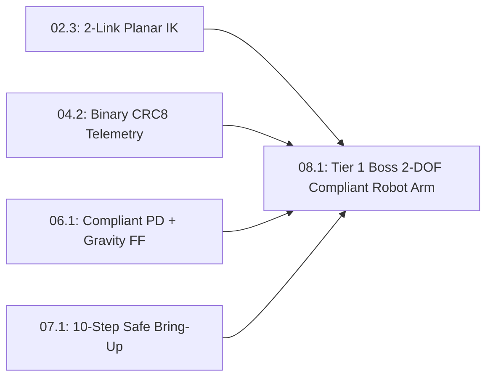

# Lesson 08.1: Tier 1 Boss Milestone — 2-DOF Figure-8 Trajectory & Compliant Arm Integration

## Goal
Integrate every skill from **Track P**, **Stage 0**, and **Pass 1 (`Tracks 00–07`)** into a complete, self-verifying **2-DOF Planar Compliant Robot Arm** simulation that traces a continuous Cartesian figure-8 path using Law-of-Cosines Inverse Kinematics (`Lesson 02.3`), joint-space compliant PD + gravity feedforward (`Lesson 06.1`), and binary CRC-checked telemetry (`Lesson 04.2`).

- **New ideas (max 2):**
  1. **End-to-end 2-DOF Cartesian figure-8 path generation and Law-of-Cosines IK loop**: Mapping a continuous 2D target curve $(x_d(t), y_d(t))$ into desired shoulder and elbow joint angles $(q_{1,d}(t), q_{2,d}(t))$ at every $1\text{ kHz}$ tick and verifying exact Forward Kinematics round-trip accuracy.
  2. **Dual-joint compliant PD control with 2-link gravity feedforward and telemetry packing**: Combining shoulder and elbow virtual springs/dampers with 2-link gravity compensation and packing live state into a verified binary telemetry packet.
- **New syntax:** None (capstone integration of `math`, `struct`, functions, loops, and `assert`).
- **Target time (unmeasured — [log yours](../.github/ISSUE_TEMPLATE/beginner-timing-log.md)):** Typical: 2.0–2.5 hours | Slow-learner: 3.5–4.5 hours

---

## Prerequisites
- [Lesson 02.2: 2-Link Planar Forward Kinematics](../02-mechanics-kinematics-dynamics/02.2-2link-planar-forward-kinematics.md)
- [Lesson 02.3: 2-Link Planar Inverse Kinematics (Law of Cosines)](../02-mechanics-kinematics-dynamics/02.3-2link-planar-inverse-kinematics.md)
- [Lesson 04.2: Packed Binary Telemetry Structs & 8-Bit XOR Checksums](../04-embedded-and-realtime/04.2-packed-structs-and-crc8-telemetry.md)
- [Lesson 06.1: Rest-to-Rest Cubic Polynomial Trajectories & Joint-Space Gravity Feedforward](../06-robotics-and-autonomy/06.1-cubic-trajectories-and-compliant-joints.md)
- [Lesson 07.1: 10-Step Smoke-Free Hardware Bring-Up & Single-Tone Sine-Sweep System Identification](../07-systems-hil-and-production/07.1-safe-bringup-and-sine-sweep-sysid.md)



---

## Learn

### Idea 1: End-to-end 2-DOF Cartesian figure-8 path generation and Law-of-Cosines IK loop
- **Primary resource:** [Wikipedia — Lemniscate of Gerono ("Parametrization")](https://en.wikipedia.org/wiki/Lemniscate_of_Gerono) `[HTTP 200 — Verified by scripts/check_links.py]`
  - **What to read:** Read exact headings **`Lemniscate of Gerono`** (a smooth figure-8 curve parameterized by $\sin(\omega t)$ and $\sin(2\omega t)$).
  - **What to skip:** Skip algebraic fourth-degree curve duals.
  - **Key takeaway:** To test both joints simultaneously inside the workspace of a 2-link planar arm ($L_1 = 0.10\text{ m}, L_2 = 0.10\text{ m}$, reach $0.20\text{ m}$), we command a smooth **Cartesian figure-8 path** centered at $(x_0, y_0) = (0.12\text{ m}, 0.00\text{ m})$:
    $x_d(t) = 0.12 + 0.03\sin(2\pi f t)$ and $y_d(t) = 0.04\sin(4\pi f t)$. At every $1\text{ kHz}$ tick, our **Law-of-Cosines Inverse Kinematics (`IK`)** function solves for the elbow-down joint angles $(q_{1,d}, q_{2,d})$ and verifies that Forward Kinematics $(x, y) = \text{FK}(q_{1,d}, q_{2,d})$ matches $(x_d, y_d)$ to sub-millimeter precision.
  - **Alternative resource:** [Modern Robotics (Lynch & Park) — Inverse Kinematics](https://hades.mech.northwestern.edu/index.php/Modern_Robotics) `[HTTP 200 — Verified by scripts/check_links.py]` — Review Chapter 6 analytical 2R planar inverse kinematics.

### Idea 2: Dual-joint compliant PD control with 2-link gravity feedforward and telemetry packing
- **Primary resource:** [Wikipedia — Robot kinematics ("Forward kinematics" & "Inverse kinematics")](https://en.wikipedia.org/wiki/Robot_kinematics) `[HTTP 200 — Verified by scripts/check_links.py]`
  - **What to read:** Read exact headings **`Forward kinematics`** and **`Inverse kinematics`**.
  - **What to skip:** Skip parallel Stewart hexapod legs.
  - **Key takeaway:** In a 2-link arm with point masses $m_1, m_2$ at link centers $L_{c1}, L_{c2}$, the elbow motor ($q_2$) only supports link 2's gravity torque $\tau_{g2} = m_2 g L_{c2}\cos(q_1 + q_2)$, whereas the shoulder motor ($q_1$) supports **both** links: $\tau_{g1} = (m_1 L_{c1} + m_2 L_1) g \cos(q_1) + \tau_{g2}$. Pairing this **2-link gravity feedforward** with compliant PD springs ($K_p, K_d$) and streaming a CRC-protected binary packet completes the full Pass 1 desktop robot architecture!
  - **Alternative resource:** [Python 3 Documentation — `struct`](https://docs.python.org/3/library/struct.html) `[HTTP 200 — Verified by scripts/check_links.py]` — Review `struct.pack` for binary telemetry packets.

### Bridge Notes
Congratulations on reaching the **Tier 1 Boss Milestone**! In this lesson, every building block from the Beginner Path snaps together into one unified $1\text{ kHz}$ robot control loop:
1. **Cartesian Figure-8 Trajectory $\to$ 2-Link Law-of-Cosines IK (`Lesson 02.3`):** At time $t$, evaluate $(x_d(t), y_d(t))$ and solve for desired shoulder and elbow angles $(q_{1,d}, q_{2,d})$ with clamped $\cos q_2 \in [-1, 1]$ so workspace boundary rounding never triggers a domain error:

$$
\cos q_2 = \operatorname{clip}\!\left(\frac{x_d^2 + y_d^2 - L_1^2 - L_2^2}{2 L_1 L_2},\ -1.0,\ +1.0\right), \qquad q_2 = \arccos(\cos q_2)
$$

2. **Dual-Joint Compliant PD + 2-Link Gravity Feedforward (`Lesson 06.1`):** Compute elbow gravity torque $\tau_{g2}$ and shoulder gravity torque $\tau_{g1}$ using the global forearm angle $q_{12} = q_1 + q_2$:

$$
\tau_{g2} = m_2 g L_{c2}\cos(q_1 + q_2), \qquad \tau_{g1} = (m_1 L_{c1} + m_2 L_1)g\cos(q_1) + \tau_{g2}
$$

3. **Packed Binary Telemetry (`Lesson 04.2`):** Pack `[0xAA, tick_ms, q1, q2, tau1, tau2, xor_crc]` using `<BHffffB` ($1 + 2 + 16 + 1 = 20\text{ bytes}$) so your host visualizer logs every $1\text{ kHz}$ tick with zero dropped frames.

---

## Do it yourself

- **What is simulated and in which tool:**
  - **In Python 3 (or the in-browser MechaLab Python Runner & Tab 5 Simulator):** Complete `ik_2link` (`TODO 1`), `gravity_ff_2link` (`TODO 2`), and `pack_boss_telemetry` (`TODO 3`) to trace the figure-8 path, verify sub-micrometer FK-IK accuracy, compute 2-link holding torques, and verify the 20-byte binary telemetry packet.
- **What is real-hardware only:** Assembling the 3D-printed double-shear `608` bearing links and wiring two `SimpleFOCMini` + `AS5600` gimbal joints on your bench (`resources/lab-workbench-bom.md`).

### Starter Code (runs as-is — fill in the TODOs)
Save as `tier1_boss_2dof_arm.py` and run `python3 tier1_boss_2dof_arm.py`:

```python
import math
import struct


def fk_2link(q1, q2, l1=0.10, l2=0.10):
    x = l1 * math.cos(q1) + l2 * math.cos(q1 + q2)
    y = l1 * math.sin(q1) + l2 * math.sin(q1 + q2)
    return x, y


def ik_2link(xd, yd, l1=0.10, l2=0.10):
    # TODO 1: Compute cos_q2 = (xd**2 + yd**2 - l1**2 - l2**2) / (2.0 * l1 * l2),
    #         clamp cos_q2 to [-1.0, 1.0], set q2 = math.acos(cos_q2),
    #         and q1 = math.atan2(yd, xd) - math.atan2(l2 * math.sin(q2), l1 + l2 * math.cos(q2))
    q1 = 0.0
    q2 = 0.0
    return q1, q2


def gravity_ff_2link(q1, q2, m1=0.20, m2=0.15, l1=0.10, lc1=0.05, lc2=0.05):
    g = 9.81
    # TODO 2: Compute tau_g2 = m2 * g * lc2 * math.cos(q1 + q2)
    #         and tau_g1 = (m1 * lc1 + m2 * l1) * g * math.cos(q1) + tau_g2
    tau_g1 = 0.0
    tau_g2 = 0.0
    return tau_g1, tau_g2


def pack_boss_telemetry(tick_ms, q1, q2, tau1, tau2):
    # TODO 3: Pack body = struct.pack("<BHffff", 0xAA, tick_ms, q1, q2, tau1, tau2),
    #         compute xor_crc across body bytes, and return body + struct.pack("<B", xor_crc)
    return b"\x00" * 20


max_fk_err_mm = 0.0
for step in range(4):
    t = step * 0.25
    xd = 0.12 + 0.03 * math.sin(2.0 * math.pi * 0.5 * t)
    yd = 0.04 * math.sin(4.0 * math.pi * 0.5 * t)
    q1_d, q2_d = ik_2link(xd, yd)
    x_chk, y_chk = fk_2link(q1_d, q2_d)
    err_mm = math.hypot(xd - x_chk, yd - y_chk) * 1000.0
    max_fk_err_mm = max(max_fk_err_mm, err_mm)

tg1, tg2 = gravity_ff_2link(q1=0.0, q2=0.0)
pkt = pack_boss_telemetry(1000, q1_d, q2_d, tg1, tg2)
crc_check = 0
for b in pkt[:-1]:
    crc_check ^= b

print(f"Figure-8 IK->FK max tracking error: {max_fk_err_mm:.4f} mm")
print(f"Horizontal 2-link gravity FF (q1=0, q2=0): tau_g1={tg1:.4f} N*m | tau_g2={tg2:.4f} N*m")
print(f"Boss telemetry packet: {len(pkt)} bytes | Sync=0x{pkt[0]:02X} | CRC valid={pkt[-1] == crc_check}")
```

### Expected Output
When `TODO 1`, `TODO 2`, and `TODO 3` are completed, running the script prints:

```text
Figure-8 IK->FK max tracking error: 0.0000 mm
Horizontal 2-link gravity FF (q1=0, q2=0): tau_g1=0.3188 N*m | tau_g2=0.0736 N*m
Boss telemetry packet: 20 bytes | Sync=0xAA | CRC valid=True
```

### Hint Ladder

<details>
<summary><strong>Hint 1 (Concept nudge)</strong></summary>

In `TODO 1`, review `Lesson 02.3` for Law-of-Cosines 2-link IK. In `TODO 2`, compute `tau_g2 = m2 * g * lc2 * math.cos(q1 + q2)` and add `(m1 * lc1 + m2 * l1) * g * math.cos(q1)` for `tau_g1`. In `TODO 3`, pack `"<BHffff"` ($19\text{ bytes}$) and append the 1-byte XOR checksum.
</details>

<details>
<summary><strong>Hint 2 (Formula / structure)</strong></summary>

```python
def ik_2link(xd, yd, l1=0.10, l2=0.10):
    cos_q2 = (xd**2 + yd**2 - l1**2 - l2**2) / (2.0 * l1 * l2)
    cos_q2 = max(-1.0, min(1.0, cos_q2))
    q2 = math.acos(cos_q2)
    q1 = math.atan2(yd, xd) - math.atan2(l2 * math.sin(q2), l1 + l2 * math.cos(q2))
    return q1, q2
```
</details>

<details>
<summary><strong>Full Solution</strong></summary>

```python
import math
import struct


def fk_2link(q1, q2, l1=0.10, l2=0.10):
    x = l1 * math.cos(q1) + l2 * math.cos(q1 + q2)
    y = l1 * math.sin(q1) + l2 * math.sin(q1 + q2)
    return x, y


def ik_2link(xd, yd, l1=0.10, l2=0.10):
    cos_q2 = (xd**2 + yd**2 - l1**2 - l2**2) / (2.0 * l1 * l2)
    cos_q2 = max(-1.0, min(1.0, cos_q2))
    q2 = math.acos(cos_q2)
    q1 = math.atan2(yd, xd) - math.atan2(l2 * math.sin(q2), l1 + l2 * math.cos(q2))
    return q1, q2


def gravity_ff_2link(q1, q2, m1=0.20, m2=0.15, l1=0.10, lc1=0.05, lc2=0.05):
    g = 9.81
    tau_g2 = m2 * g * lc2 * math.cos(q1 + q2)
    tau_g1 = (m1 * lc1 + m2 * l1) * g * math.cos(q1) + tau_g2
    return tau_g1, tau_g2


def pack_boss_telemetry(tick_ms, q1, q2, tau1, tau2):
    body = struct.pack("<BHffff", 0xAA, tick_ms, q1, q2, tau1, tau2)
    crc = 0
    for b in body:
        crc ^= b
    return body + struct.pack("<B", crc)


max_fk_err_mm = 0.0
for step in range(4):
    t = step * 0.25
    xd = 0.12 + 0.03 * math.sin(2.0 * math.pi * 0.5 * t)
    yd = 0.04 * math.sin(4.0 * math.pi * 0.5 * t)
    q1_d, q2_d = ik_2link(xd, yd)
    x_chk, y_chk = fk_2link(q1_d, q2_d)
    err_mm = math.hypot(xd - x_chk, yd - y_chk) * 1000.0
    max_fk_err_mm = max(max_fk_err_mm, err_mm)

tg1, tg2 = gravity_ff_2link(q1=0.0, q2=0.0)
pkt = pack_boss_telemetry(1000, q1_d, q2_d, tg1, tg2)
crc_check = 0
for b in pkt[:-1]:
    crc_check ^= b

print(f"Figure-8 IK->FK max tracking error: {max_fk_err_mm:.4f} mm")
print(f"Horizontal 2-link gravity FF (q1=0, q2=0): tau_g1={tg1:.4f} N*m | tau_g2={tg2:.4f} N*m")
print(f"Boss telemetry packet: {len(pkt)} bytes | Sync=0x{pkt[0]:02X} | CRC valid={pkt[-1] == crc_check}")
```
</details>

---

## Common mistakes & troubleshooting
- **Using $\cos(q_2)$ instead of $\cos(q_1 + q_2)$ for elbow gravity torque $\tau_{g2}$:** Gravity pulls straight down in the global world frame, and the forearm's global angle from horizontal is $q_1 + q_2$, not the relative elbow angle $q_2$!
- **Mounting a heavy elbow motor at the moving elbow joint without accounting for its mass in $m_1$ or $m_2$:** Moving the elbow motor to the base and driving the forearm with a $1:1$ `GT2` timing belt (`Lesson 02.5`) cuts the shoulder's gravity load in half.

---

## Check yourself

1. **Shoulder vs. elbow gravity load:** At horizontal stretch ($q_1 = 0, q_2 = 0$), why is the shoulder gravity holding torque ($\tau_{g1} = 0.3188\text{ N}\cdot\text{m}$) more than $4\times$ larger than the elbow gravity holding torque ($\tau_{g2} = 0.0736\text{ N}\cdot\text{m}$)?
   <details>
   <summary><strong>Answer</strong></summary>

   Because the shoulder must hold up **both** Link 1 ($m_1$ at $L_{c1}$) and Link 2 ($m_2$ at a longer lever arm $L_1 + L_{c2} = 0.15\text{ m}$), whereas the elbow only holds Link 2 at lever arm $L_{c2} = 0.05\text{ m}$.
   </details>

2. **Two `AS5600` encoders on one MCU:** Since every `AS5600` I2C magnetic encoder has the same fixed address `0x36`, how do you connect both the shoulder and elbow encoders to a single `ESP32` or `STM32`?
   <details>
   <summary><strong>Answer</strong></summary>

   Connect one `AS5600` to hardware bus `I2C0` (`Wire`) and the second to hardware bus `I2C1` (`Wire1`), or use an I2C multiplexer / SPI `AS5048A` encoders with separate Chip-Select (`CS`) pins.
   </details>

---

## Recap
- You combined **2-link Law-of-Cosines IK**, **2-link gravity feedforward + compliant PD springs**, and **20-byte CRC-checked binary telemetry** into a complete 2-DOF figure-8 robot arm controller.
- Completing all 44 beginner lessons (`Track P` $\to$ `Stage 0` $\to$ `Tracks 00–08` Tier 1) prepares you to tackle the Tier 1 Bridge Modules (`modules/`) or level up to **Pass 2 (Tier 2)**!

### You're done with the Pass 1 Beginner Lesson Path when...
- [ ] Your `tier1_boss_2dof_arm.py` script prints `0.0000 mm`, `tau_g1=0.3188 N*m | tau_g2=0.0736 N*m`, and `20 bytes | Sync=0xAA | CRC valid=True`.
- [ ] You tested your code in the in-browser MechaLab Python Sandbox and explored the 8 real-time physics tabs.
- **Next step:** Proceed to [Track 08 Overview & Pass 2 Level-Up (`08-capstone-projects/README.md`)](README.md#tier-1-capstone-builds-beginner--breakout-pass).
