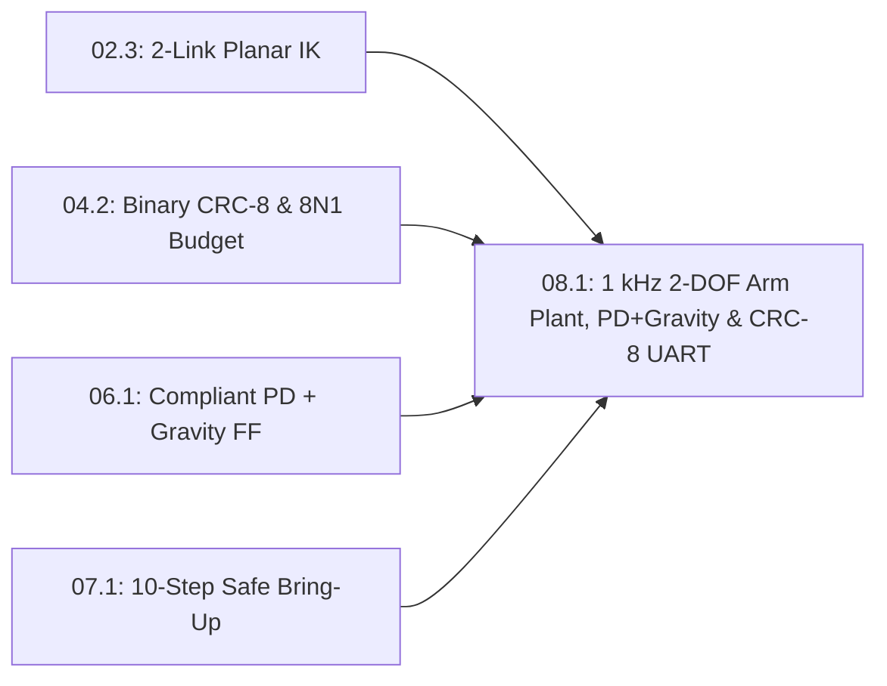

# Lesson 08.1: Tier 1 Boss Milestone — 1 kHz 2-DOF Compliant Arm Plant, Figure-8 PD Control & CRC-8 Telemetry

<!-- run-callout:start -->
> **Step 10 of 10 · Put it together: the 2-DOF arm**
>
> **Run this in the workbench.** [Open MechaLab with `08.1` loaded](https://tle47.github.io/Mechatronics-Roadmap/?lesson=08.1) - it opens on the **Run Python Lessons** tab with that entry selected. Starter code, hints and the graded check are ready; this page is the reading copy, and nothing you type here is saved.
<!-- run-callout:end -->

## Goal
Integrate every skill from **Track P**, **Stage 0**, and **Pass 1 (`Tracks 00–07`)** into a complete, self-verifying **1,000-step ($1\text{ kHz}$, $\Delta t = 0.001\text{ s}$) time-stepped 2-DOF Planar Compliant Robot Arm** simulation that solves Law-of-Cosines Inverse Kinematics (`Lesson 02.3`), drives a physical 2-link plant with joint inertia, damping, gravity loading, and a $0.4\text{–}0.6\text{ s}$ payload disturbance using closed-loop **PD + 2-link gravity feedforward** (`Lesson 06.1`), measures **both kinematic IK$\to$FK round-trip error and actual dynamic arm tip tracking error**, and verifies **20-byte polynomial CRC-8 (`0x07`) telemetry & 8N1 UART ring-buffer bandwidth** (`Lesson 04.2`).

- **New ideas (max 2):**
  1. **End-to-end 2-DOF Cartesian figure-8 path generation and Law-of-Cosines IK loop**: Mapping a continuous 2D target curve $(x_d(t), y_d(t))$ into desired shoulder and elbow joint angles $(q_{1,d}(t), q_{2,d}(t))$ and finite-difference velocities $(\dot{q}_{1,d}, \dot{q}_{2,d})$ at every $1\text{ kHz}$ tick.
  2. **Time-stepped 1 kHz dual-joint compliant PD + gravity feedforward plant with CRC-8 telemetry and 8N1 UART buffering**: Driving a time-stepped 2-DOF physical arm plant ($I_1, I_2, b_1, b_2$, gravity, and external disturbance torques) with closed-loop PD + gravity feedforward, measuring true dynamic tip tracking error (`mm`), and verifying that a $20\text{-byte}$ CRC-8 frame at $1\text{ kHz}$ ($200\text{ kbit/s}$ 8N1) overflows $115.2\text{ kbaud}$ (`412` dropped frames) while running with **zero dropped frames** at $500\text{ kbaud}$.
- **New syntax:** None (capstone integration of `math`, `struct`, functions, loops, and `assert`).
- **Target time (unmeasured — [log yours](../.github/ISSUE_TEMPLATE/beginner-timing-log.md)):** Typical: 2.0–2.5 hours | Slow-learner: 3.5–4.5 hours

---

## Prerequisites
- [Lesson 02.2: 2-Link Planar Forward Kinematics](../02-mechanics-kinematics-dynamics/02.2-2link-planar-forward-kinematics.md)
- [Lesson 02.3: 2-Link Planar Inverse Kinematics (Law of Cosines)](../02-mechanics-kinematics-dynamics/02.3-2link-planar-inverse-kinematics.md)
- [Lesson 04.2: Packed Binary Telemetry Structs, CRC-8 & UART Bandwidth Budgets](../04-embedded-and-realtime/04.2-packed-structs-and-crc8-telemetry.md)
- [Lesson 06.1: Rest-to-Rest Cubic Polynomial Trajectories & Joint-Space Gravity Feedforward](../06-robotics-and-autonomy/06.1-cubic-trajectories-and-compliant-joints.md)
- [Lesson 07.1: 10-Step Smoke-Free Hardware Bring-Up & Single-Tone Sine-Sweep System Identification](../07-systems-hil-and-production/07.1-safe-bringup-and-sine-sweep-sysid.md)



---

## Learn

### Idea 1: End-to-end 2-DOF Cartesian figure-8 path generation and Law-of-Cosines IK loop
- **Primary resource:** [Wikipedia — Lemniscate of Gerono ("Parametrization")](https://en.wikipedia.org/wiki/Lemniscate_of_Gerono) `[HTTP 200 — Verified by scripts/check_links.py]`
  - **What to read:** Read exact headings **`Lemniscate of Gerono`** (a smooth figure-8 curve parameterized by $\sin(\omega t)$ and $\sin(2\omega t)$).
  - **What to skip:** Skip algebraic fourth-degree curve duals.
  - **Key takeaway:** To test both joints simultaneously inside the workspace of a 2-link planar arm ($L_1 = 0.10\text{ m}, L_2 = 0.10\text{ m}$, reach $0.20\text{ m}$), we command a smooth **Cartesian figure-8 path** centered at $(x_0, y_0) = (0.12\text{ m}, 0.00\text{ m})$ over $1000$ ticks ($\Delta t = 0.001\text{ s}$):
    $x_d(t) = 0.12 + 0.03\sin(2\pi f t)$ and $y_d(t) = 0.04\sin(4\pi f t)$. At every $1\text{ kHz}$ tick, our **Law-of-Cosines Inverse Kinematics (`IK`)** function solves for desired angles $(q_{1,d}, q_{2,d})$ and desired angular velocities $\dot{q}_{i,d} = (q_{i,d}[k] - q_{i,d}[k-1])/\Delta t$. We distinguish **kinematic IK$\to$FK round-trip error** ($\|\text{FK}(\text{IK}(x_d, y_d)) - (x_d, y_d)\| \approx 0.0000\text{ mm}$) from **actual dynamic arm tip tracking error** ($\|\text{FK}(q_1(t), q_2(t)) - (x_d(t), y_d(t))\|$).
  - **Alternative resource:** [Modern Robotics (Lynch & Park) — Inverse Kinematics](https://hades.mech.northwestern.edu/index.php/Modern_Robotics) `[HTTP 200 — Verified by scripts/check_links.py]` — Review Chapter 6 analytical 2R planar inverse kinematics.

### Idea 2: Time-stepped 1 kHz dual-joint compliant PD + gravity feedforward plant with CRC-8 telemetry and 8N1 UART buffering
- **Primary resource:** [Wikipedia — Robot kinematics ("Forward kinematics" & "Inverse kinematics")](https://en.wikipedia.org/wiki/Robot_kinematics) `[HTTP 200 — Verified by scripts/check_links.py]`
  - **What to read:** Read exact headings **`Forward kinematics`** and **`Inverse kinematics`**.
  - **What to skip:** Skip parallel Stewart hexapod legs.
  - **Key takeaway:** At every $1\text{ kHz}$ tick, our controller computes 2-link gravity feedforward $\tau_{g2} = m_2 g L_{c2}\cos(q_1 + q_2)$ and $\tau_{g1} = (m_1 L_{c1} + m_2 L_1) g \cos(q_1) + \tau_{g2}$ plus compliant PD feedback $\tau_i = K_{p,i}(q_{i,d} - q_i) + K_{d,i}(\dot{q}_{i,d} - \dot{q}_i) + \tau_{g,i}$, clamped to $\pm 2.5\text{ N}\cdot\text{m}$. This torque drives a physical 2-DOF plant ($\ddot{q}_i = (\tau_i - \tau_{g,i} + \tau_{\text{dist},i} - b_i\dot{q}_i)/I_i$) subjected to a downward payload disturbance pulse ($\tau_{\text{dist}} = [-0.15, -0.08]\text{ N}\cdot\text{m}$) during $t \in [0.40, 0.60)\text{ s}$, while streaming a 20-byte polynomial **CRC-8 (`0x07`)** frame over a simulated 256-byte UART TX ring buffer.
  - **Alternative resource:** [Python 3 Documentation — `struct`](https://docs.python.org/3/library/struct.html) `[HTTP 200 — Verified by scripts/check_links.py]` — Review `struct.pack` for binary telemetry packets.

### Bridge Notes
In this **Tier 1 Boss Milestone**, every building block from the Beginner Path runs together inside a genuine $1\text{ kHz}$ ($1000\text{-tick}$, $\Delta t = 0.001\text{ s}$) time-stepped physical simulation:
1. **Cartesian Figure-8 Trajectory $\to$ Law-of-Cosines IK (`Lesson 02.3`):** At each $1\text{ ms}$ step, solve $(q_{1,d}, q_{2,d}) = \text{IK}(x_d(t), y_d(t))$ with clamped $\cos q_2 \in [-1, 1]$ and compute reference joint velocities $(\dot{q}_{1,d}, \dot{q}_{2,d})$.
2. **Time-Stepped 2-DOF Plant + Closed-Loop Compliant PD + Gravity Feedforward (`Lesson 06.1`):** Apply $\tau_i = \operatorname{clip}(K_{p,i} e_i + K_{d,i} \dot{e}_i + \tau_{g,i}(q),\ -2.5,\ +2.5)$ to the moving arm plant:

$$
\ddot{q}_i = \frac{\tau_i - \tau_{g,i}(q_1, q_2) + \tau_{\text{dist},i}(t) - b_i \dot{q}_i}{I_i}, \qquad \dot{q}_i \leftarrow \dot{q}_i + \ddot{q}_i \Delta t, \qquad q_i \leftarrow q_i + \dot{q}_i \Delta t
$$

Even when a sudden external disturbance torque hits both joints during $0.40\text{ s} \le t < 0.60\text{ s}$, the compliant PD + gravity feedforward loop keeps actual dynamic tip tracking error under $2.5\text{ mm}$ peak ($0.91\text{ mm}$ RMS)!
3. **20-Byte Polynomial CRC-8 (`0x07`) & 8N1 UART Ring-Buffer Test (`Lesson 04.2`):** A 20-byte `<BHffffB` packet at $1\text{ kHz}$ requires $20 \times 10 \times 1000 = 200\text{ kbit/s}$ on an 8N1 serial link—overflowing a 256-byte TX buffer at $115.2\text{ kbaud}$ (`412` dropped frames) but achieving **zero dropped frames** at $500\text{ kbaud}$.

---

## Do it yourself

- **What is simulated and in which tool:**
  - **In Python 3 (or the in-browser MechaLab Python Runner and the Robot Arm Kinematics & Safety Cutoff lab):** Instead of a single monolithic fill-in, complete this capstone in **4 progressive stages**:
    1. **Stage 1 — Pre-Run Prediction Worksheet (`Predict`):** Before running the code, write down your quantitative predictions for:
       - Horizontal gravity torque at $(q_1=0, q_2=0)$ with $m_1=0.20\text{ kg}, m_2=0.15\text{ kg}, L_1=0.10\text{ m}, L_{c1}=0.05\text{ m}, L_{c2}=0.05\text{ m}$ ($\tau_{g2} = 0.15 \times 9.81 \times 0.05 = 0.0736\text{ N}\cdot\text{m}$, $\tau_{g1} = 0.3188\text{ N}\cdot\text{m}$).
       - Whether a 20-byte frame ($200\text{ bits}$ at 8N1) at $1\text{ kHz}$ ($200\text{ kbit/s}$) will drop frames at $115.2\text{ kbaud}$ vs. $500\text{ kbaud}$.
       - **Repair prediction worksheet:** Before you touch `TODO 3b`–`TODO 3e`, fill the four-row table below with your estimate of each before/after metric.
    2. **Stage 2 — `R2` Link Length & Payload Adaptation:** Complete `ik_2link` (`TODO 1`) and `gravity_ff_2link` (`TODO 2`) so they work for any link lengths `(l1, l2)` and payload mass `m2`.
    3. **Stage 3 — `R4` Diagnose Four Broken Capstone Versions:** Complete `diagnose_capstone_fault` (`TODO 3`) to identify four broken versions from their observable bench symptoms. The signatures are described; the boundaries are yours to choose:
       - **Broken Version A (`"gravity_ff_sign_inverted"`):** The arm sags visibly downward at horizontal; the steady-state joint angle sits well below the commanded zero.
       - **Broken Version B (`"wrong_encoder_cpr"`):** Measured angles are about four times too large; IK/FK position mismatch is huge at every pose, not just under load.
       - **Broken Version C (`"missing_anti_windup"`):** A large step overshoot appears only after the actuator saturates; the integral keeps accumulating while the command is clipped.
       - **Broken Version D (`"encoder_zero_offset"`):** A correctly scaled encoder with a zero offset. The tip is off by a small, roughly constant distance (about $12\text{ mm}$) at every pose, with no sag and no overshoot.
       - **Stage 3b — `R4` Repair the zero-offset unit:** Complete `repair_encoder_offset` (`TODO 3b`) to subtract the constant offset, then prove the corrected FK tip error falls from the measured offset to below $1\text{ mm}$.
       - **Stage 3c — `R4` Repair the CPR unit:** Complete `repair_encoder_cpr` (`TODO 3c`) to divide out the measured $4\times$ scale, then prove the FK tip error falls from about $174\text{ mm}$ to below $1\text{ mm}$ in the bench check.
       - **Stage 3d — `R4` Repair the anti-windup unit:** Complete `repair_integral_update` (`TODO 3d`) to freeze the integral while the command is saturated in the direction of the error, then prove the step overshoot falls from $37.2\%$ to below $5\%$ in the 3000-step bench simulation.
       - **Stage 3e — `R4` Repair the gravity-sign unit:** Complete `repair_gravity_sign` (`TODO 3e`) to flip the inverted feedforward command, then prove the horizontal tip error falls from about $32\text{ mm}$ to below $1\text{ mm}$ at the $K_p = 4$ bench check.
       - **Stage 3f — `R4` Diagnose a unit nobody described:** A fifth unit came back from the bench with the readings below. None of A–D describes it, and no rule above tells you what it is. Work it out from the readings alone, return the cause as one number with `infer_encoder_scale` (`TODO 6`), then correct it with the repair you already wrote (`TODO 3c`).

         | Reading | Unit E |
         | :--- | ---: |
         | Commanded shoulder angle | $0.305\text{ rad}$ |
         | The joint's own angle report | $0.4575\text{ rad}$ |
         | Horizontal hold, $2\text{ s}$ | Settles; no sag |
         | Step response | $4.0\%$ overshoot |
         | Tip error at half that pose ($0.1525\text{ rad}$) | $15.2\text{ mm}$ |
         | Tip error at the full pose ($0.305\text{ rad}$) | $30.5\text{ mm}$ |

         No sag and nominal overshoot point away from the loop. The tip error doubles when the pose doubles, which a fixed distance would not do. The tests check your factor on this unit, on an honest encoder, and on a unit whose error is a constant offset: a fix that cannot tell a scale from an offset is a guess, not a diagnosis.
    4. **Stage 4 — `R5` Blank-Page Trajectory Generator from Spec:** Write `figure8_target(t_s, x0=0.12, y0=0.0, ax=0.03, ay=0.04, freq_hz=0.5)` (`TODO 4` — the only blank-page function) from specification: return $(x_d, y_d)$ where $x_d = x_0 + a_x \sin(2\pi f t)$ and $y_d = y_0 + a_y \sin(4\pi f t)$, plus `pack_boss_telemetry` (`TODO 5`).
  - **08.1 Four-Fault Bench (in the Python runner):** Select Lesson 08.1 and use the bench below the lesson header. It grades **your own** `repair_encoder_offset`, `repair_encoder_cpr`, `repair_integral_update` and `repair_gravity_sign`: press **Grade my repairs**, and each card reports the tip error or overshoot your function actually produces — $174\text{ mm}$, $37.2\%$, $31.8\text{ mm}$ and $12\text{ mm}$ while the TODOs are unfilled, and $0$, $4.7\%$, $0$, $0$ once they are right. A repair that is only close keeps its real error: returning an angle $10\%$ short of the offset leaves $1.2\text{ mm}$ on the card, not a green badge. The zero-offset slider is a separate playground that applies its own manual correction, so you can see the target before writing the function. The bench computes its own two-link FK chord and runs the same 3000-step saturated PI loop as the proof lines below; your `fk_2link` cannot make a wrong repair look right.
  - **The bench is this lesson's pass condition, not a sidebar:** **Run & Verify Output** marks 08.1 verified only when all four bench cards are at target ($\le 1\text{ mm}$ tip error, $< 5\%$ overshoot). A repair one line short of right keeps its real metric on the card and the lesson stays unverified — a printed repair line cannot carry the capstone on its own.
- **What is real-hardware only:** Assembling the 3D-printed double-shear `608` bearing links and wiring two `SimpleFOCMini` + `AS5600` gimbal joints on your bench (`resources/lab-workbench-bom.md`).

#### Repair prediction worksheet (fill before running)

Before you complete `TODO 3b`–`TODO 3e`, estimate each metric from the geometry and the Lesson 05.1 PI result. Write your own numbers first; the reference row is hidden below.

| Broken unit | Setup | Your estimate: before | Your estimate: after |
| :--- | :--- | ---: | ---: |
| Zero offset | $0.06\text{ rad}$ at a $0.20\text{ m}$ tip | ____ mm | ____ mm |
| CPR scale | true $0.30\text{ rad}$, measured $4\times$ | ____ mm | ____ mm |
| Anti-windup | 3000-step saturated PI step | ____ % | ____ % |
| Gravity sign | horizontal, $K_p = 4$ | ____ mm | ____ mm |

Then open the **08.1 Four-Fault Bench** in the Python runner, write each repair function, and press **Grade my repairs**. Compare the before column within $10\%$ and the after column against the target (below $1\text{ mm}$ or below $5\%$). The zero-offset slider shows what a correct correction looks like; the card above it only turns green when your function does the same.

<details>
<summary><strong>Reference estimates — check after filling your row</strong></summary>

| Broken unit | Reference before | Reference after |
| :--- | ---: | ---: |
| Zero offset | 12.00 mm | 0.0000 mm |
| CPR scale | 174.0 mm | 0.0000 mm |
| Anti-windup | 37.2% | 4.7% |
| Gravity sign | 31.8 mm | 0.0000 mm |

</details>

### Starter Code (runs as-is — fill in the TODOs)
Save as `tier1_boss_2dof_arm.py` and run `python3 tier1_boss_2dof_arm.py`:

```python
import math
import struct


def fk_2link(q1, q2, l1=0.10, l2=0.10):
    x = l1 * math.cos(q1) + l2 * math.cos(q1 + q2)
    y = l1 * math.sin(q1) + l2 * math.sin(q1 + q2)
    return x, y


def ik_2link(xd, yd, l1=0.10, l2=0.10):
    # TODO 1 (Stage 2 - R2): Compute cos_q2 = (xd**2 + yd**2 - l1**2 - l2**2) / (2.0 * l1 * l2),
    #         clamp cos_q2 to [-1.0, 1.0], set q2 = math.acos(cos_q2),
    #         and q1 = math.atan2(yd, xd) - math.atan2(l2 * math.sin(q2), l1 + l2 * math.cos(q2))
    q1 = 0.0
    q2 = 0.0
    return q1, q2


def gravity_ff_2link(q1, q2, m1=0.20, m2=0.15, l1=0.10, lc1=0.05, lc2=0.05):
    g = 9.81
    # TODO 2 (Stage 2 - R2): Compute tau_g2 = m2 * g * lc2 * math.cos(q1 + q2)
    #         and tau_g1 = (m1 * lc1 + m2 * l1) * g * math.cos(q1) + tau_g2
    tau_g1 = 0.0
    tau_g2 = 0.0
    return tau_g1, tau_g2


def diagnose_capstone_fault(sag_rad, fk_mismatch_mm, step_overshoot_pct):
    # TODO 3 (Stage 3 - R4): Classify the bench observation into one of four causes.
    #   Above, each broken version has a signature, not a threshold. Choose boundaries
    #   that separate nominal from every broken unit and keep the four labels distinct.
    #   The fourth unit has a small constant tip error, no sag, and no overshoot.
    return "unknown"


def repair_encoder_offset(q_measured, offset_rad):
    # TODO 3b (Stage 3b - R4 repair): Remove the constant offset from the measured angle.
    return q_measured


def repair_encoder_cpr(q_measured, scale_factor):
    # TODO 3c (Stage 3c - R4 repair): Divide out the measured-to-true encoder scale.
    return q_measured


def repair_integral_update(i_term, i_candidate, e, u_raw, u_max):
    # TODO 3d (Stage 3d - R4 repair): Keep i_candidate unless the command is saturated
    #          and the error is still pushing it further into the limit; then keep i_term.
    return i_candidate


def repair_gravity_sign(tau_g):
    # TODO 3e (Stage 3e - R4 repair): The broken feedforward command has the wrong sign.
    return tau_g


def infer_encoder_scale(q_true_rad, q_measured_rad):
    # TODO 6 (Stage 3f - R4): Unit E's readings are in Stage 3f and no rule above covers it.
    #   Work out the cause from those readings and return it as the factor by which the
    #   reported angle is too large (1.0 = honest). Then repair it with repair_encoder_cpr.
    return 1.0


def figure8_target(t_s, x0=0.12, y0=0.0, ax=0.03, ay=0.04, freq_hz=0.5):
    # TODO 4 (Stage 4 - R5 Blank-Page From Spec):
    #   Specification:
    #   - xd(t) = x0 + ax * sin(2 * pi * freq_hz * t_s)
    #   - yd(t) = y0 + ay * sin(4 * pi * freq_hz * t_s)
    #   Return (xd, yd)
    return x0, y0


def crc8_ccitt(data_bytes):
    crc = 0x00
    for b in data_bytes:
        crc ^= b
        for _ in range(8):
            crc = ((crc << 1) ^ 0x07) & 0xFF if (crc & 0x80) else (crc << 1) & 0xFF
    return crc


def pack_boss_telemetry(tick_ms, q1, q2, tau1, tau2):
    # TODO 5: Pack body = struct.pack("<BHffff", 0xAA, tick_ms, q1, q2, tau1, tau2),
    #         compute crc = crc8_ccitt(body), and return body + struct.pack("<B", crc)
    return b"\x00" * 20


def simulate_uart_tx(num_frames, frame_bytes, dt_s, baud_rate, buf_cap_bytes=256):
    tx_bytes_per_tick = (baud_rate / 10.0) * dt_s  # 8N1 = 10 bits per byte
    buf_used = 0.0
    dropped = 0
    for _ in range(num_frames):
        if buf_used + frame_bytes <= buf_cap_bytes:
            buf_used += frame_bytes
        else:
            dropped += 1
        buf_used = max(0.0, buf_used - tx_bytes_per_tick)
    return dropped


dt = 0.001
q1, q2 = ik_2link(0.12, 0.0)
dq1, dq2 = 0.0, 0.0
prev_q1_d, prev_q2_d = q1, q2
max_ik_fk_err_mm = 0.0
max_dyn_err_mm = 0.0
sum_sq_dyn_err = 0.0
pkt_last = b""

for step in range(1000):
    t = step * dt
    xd, yd = figure8_target(t)
    q1_d, q2_d = ik_2link(xd, yd)
    dq1_d = (q1_d - prev_q1_d) / dt if step > 0 else 0.0
    dq2_d = (q2_d - prev_q2_d) / dt if step > 0 else 0.0
    prev_q1_d, prev_q2_d = q1_d, q2_d

    x_ik, y_ik = fk_2link(q1_d, q2_d)
    max_ik_fk_err_mm = max(max_ik_fk_err_mm, math.hypot(xd - x_ik, yd - y_ik) * 1000.0)

    tg1, tg2 = gravity_ff_2link(q1, q2)
    tau1 = max(-2.5, min(2.5, 18.0 * (q1_d - q1) + 0.60 * (dq1_d - dq1) + tg1))
    tau2 = max(-2.5, min(2.5, 12.0 * (q2_d - q2) + 0.35 * (dq2_d - dq2) + tg2))

    dist1 = -0.15 if 400 <= step < 600 else 0.0
    dist2 = -0.08 if 400 <= step < 600 else 0.0
    ddq1 = (tau1 - tg1 + dist1 - 0.04 * dq1) / 0.008
    ddq2 = (tau2 - tg2 + dist2 - 0.02 * dq2) / 0.003
    dq1 += ddq1 * dt
    dq2 += ddq2 * dt
    q1 += dq1 * dt
    q2 += dq2 * dt

    x_act, y_act = fk_2link(q1, q2)
    dyn_err_mm = math.hypot(xd - x_act, yd - y_act) * 1000.0
    max_dyn_err_mm = max(max_dyn_err_mm, dyn_err_mm)
    sum_sq_dyn_err += dyn_err_mm**2

    if step == 999:
        pkt_last = pack_boss_telemetry(step + 1, q1, q2, tau1, tau2)

rms_dyn_err_mm = math.sqrt(sum_sq_dyn_err / 1000.0)
tg1_0, tg2_0 = gravity_ff_2link(0.0, 0.0)
drop_115k = simulate_uart_tx(1000, 20, dt, 115200)
drop_500k = simulate_uart_tx(1000, 20, dt, 500000)
crc_ok = len(pkt_last) == 20 and pkt_last[0] == 0xAA and pkt_last[-1] == crc8_ccitt(pkt_last[:-1])

print(f"1 kHz 2-DOF plant (1000 ticks, disturbance at 0.4-0.6 s): IK->FK err={max_ik_fk_err_mm:.4f} mm | Dynamic tip err max={max_dyn_err_mm:.2f} mm, RMS={rms_dyn_err_mm:.2f} mm")
print(f"Horizontal 2-link gravity FF (q1=0, q2=0): tau_g1={tg1_0:.4f} N*m | tau_g2={tg2_0:.4f} N*m")
print(f"20-byte CRC-8 frame @ 1 kHz (200 kbit/s 8N1): CRC8=0x{pkt_last[-1]:02X} valid={crc_ok} | Dropped @115.2k={drop_115k}, @500k={drop_500k}")
```

### Expected Output
When every TODO is completed, running the script prints:

```text
1 kHz 2-DOF plant (1000 ticks, disturbance at 0.4-0.6 s): IK->FK err=0.0000 mm | Dynamic tip err max=2.40 mm, RMS=0.91 mm
Horizontal 2-link gravity FF (q1=0, q2=0): tau_g1=0.3188 N*m | tau_g2=0.0736 N*m
20-byte CRC-8 frame @ 1 kHz (200 kbit/s 8N1): CRC8=0xB2 valid=True | Dropped @115.2k=412, @500k=0
Zero-offset repair (q_true=0.30 rad): tip err 12.00 mm -> 0.0000 mm
CPR repair (q_true=0.30 rad, 4x scale): tip err 174.0 mm -> 0.0000 mm
Anti-windup repair: overshoot 37.2% -> 4.7%
Gravity-sign repair: tip err 31.8 mm -> 0.0000 mm
```

### Hint Ladder

<details>
<summary><strong>Hint 1 (Concept nudge)</strong></summary>

In `TODO 1`, review `Lesson 02.3` for Law-of-Cosines 2-link IK. In `TODO 2`, compute `tau_g2 = m2 * g * lc2 * math.cos(q1 + q2)` and add `(m1 * lc1 + m2 * l1) * g * math.cos(q1)` for `tau_g1`. In `TODO 3`, separate the four signatures: a large negative sag is the sign inversion, a huge mismatch is the CPR error, a small constant mismatch is the zero offset, and overshoot after saturation is the missing anti-windup. Pick boundaries that keep `nominal_ok` nominal. In `TODO 3b`, subtract the constant offset. In `TODO 3c`, divide by the measured scale (`4.0` here). In `TODO 3d`, freeze `i_term` when `abs(u_raw) > u_max` and `e * u_raw > 0.0`; otherwise keep `i_candidate`. In `TODO 3e`, negate the inverted feedforward command. Each repair ends by checking the corrected tip error or overshoot against the true value. In `TODO 4`, use `math.sin(2.0 * math.pi * freq_hz * t_s)` and `math.sin(4.0 * math.pi * freq_hz * t_s)`.
</details>

<details>
<summary><strong>Hint 2 (Formula / structure)</strong></summary>

```python
def figure8_target(t_s, x0=0.12, y0=0.0, ax=0.03, ay=0.04, freq_hz=0.5):
    xd = x0 + ax * math.sin(2.0 * math.pi * freq_hz * t_s)
    yd = y0 + ay * math.sin(4.0 * math.pi * freq_hz * t_s)
    return xd, yd
```
</details>

<details>
<summary><strong>Full Solution</strong></summary>

```python
import math
import struct


def fk_2link(q1, q2, l1=0.10, l2=0.10):
    x = l1 * math.cos(q1) + l2 * math.cos(q1 + q2)
    y = l1 * math.sin(q1) + l2 * math.sin(q1 + q2)
    return x, y


def ik_2link(xd, yd, l1=0.10, l2=0.10):
    cos_q2 = (xd**2 + yd**2 - l1**2 - l2**2) / (2.0 * l1 * l2)
    cos_q2 = max(-1.0, min(1.0, cos_q2))
    q2 = math.acos(cos_q2)
    q1 = math.atan2(yd, xd) - math.atan2(l2 * math.sin(q2), l1 + l2 * math.cos(q2))
    return q1, q2


def gravity_ff_2link(q1, q2, m1=0.20, m2=0.15, l1=0.10, lc1=0.05, lc2=0.05):
    g = 9.81
    tau_g2 = m2 * g * lc2 * math.cos(q1 + q2)
    tau_g1 = (m1 * lc1 + m2 * l1) * g * math.cos(q1) + tau_g2
    return tau_g1, tau_g2


def diagnose_capstone_fault(sag_rad, fk_mismatch_mm, step_overshoot_pct):
    if sag_rad < -0.15:
        return "gravity_ff_sign_inverted"
    if fk_mismatch_mm > 50.0:
        return "wrong_encoder_cpr"
    if fk_mismatch_mm > 5.0:
        return "encoder_zero_offset"
    if step_overshoot_pct > 30.0:
        return "missing_anti_windup"
    return "nominal_ok"


def repair_encoder_offset(q_measured, offset_rad):
    return q_measured - offset_rad


def repair_encoder_cpr(q_measured, scale_factor):
    return q_measured / scale_factor


def repair_integral_update(i_term, i_candidate, e, u_raw, u_max):
    if abs(u_raw) > u_max and e * u_raw > 0.0:
        return i_term
    return i_candidate


def repair_gravity_sign(tau_g):
    return -tau_g


def infer_encoder_scale(q_true_rad, q_measured_rad):
    return q_measured_rad / q_true_rad


def _simulate_anti_windup(update):
    J, b, tau_g, u_max, dt = 0.02, 0.05, 0.60, 1.20, 0.001
    kp, ki, kd = 4.0, 12.0, 0.4
    q = dq = i_term = max_q = 0.0
    for _ in range(3000):
        e = 1.0 - q
        i_candidate = i_term + ki * e * dt
        u_raw = kp * e - kd * dq + i_candidate
        i_term = update(i_term, i_candidate, e, u_raw, u_max)
        u = max(-u_max, min(u_max, kp * e - kd * dq + i_term))
        ddq = (u - b * dq - tau_g) / J
        dq += ddq * dt
        q += dq * dt
        max_q = max(max_q, q)
    return max(0.0, max_q - 1.0)


def figure8_target(t_s, x0=0.12, y0=0.0, ax=0.03, ay=0.04, freq_hz=0.5):
    xd = x0 + ax * math.sin(2.0 * math.pi * freq_hz * t_s)
    yd = y0 + ay * math.sin(4.0 * math.pi * freq_hz * t_s)
    return xd, yd


def crc8_ccitt(data_bytes):
    crc = 0x00
    for b in data_bytes:
        crc ^= b
        for _ in range(8):
            crc = ((crc << 1) ^ 0x07) & 0xFF if (crc & 0x80) else (crc << 1) & 0xFF
    return crc


def pack_boss_telemetry(tick_ms, q1, q2, tau1, tau2):
    body = struct.pack("<BHffff", 0xAA, tick_ms, q1, q2, tau1, tau2)
    return body + struct.pack("<B", crc8_ccitt(body))


def simulate_uart_tx(num_frames, frame_bytes, dt_s, baud_rate, buf_cap_bytes=256):
    tx_bytes_per_tick = (baud_rate / 10.0) * dt_s  # 8N1 = 10 bits per byte
    buf_used = 0.0
    dropped = 0
    for _ in range(num_frames):
        if buf_used + frame_bytes <= buf_cap_bytes:
            buf_used += frame_bytes
        else:
            dropped += 1
        buf_used = max(0.0, buf_used - tx_bytes_per_tick)
    return dropped


dt = 0.001
q1, q2 = ik_2link(0.12, 0.0)
dq1, dq2 = 0.0, 0.0
prev_q1_d, prev_q2_d = q1, q2
max_ik_fk_err_mm = 0.0
max_dyn_err_mm = 0.0
sum_sq_dyn_err = 0.0
pkt_last = b""

for step in range(1000):
    t = step * dt
    xd, yd = figure8_target(t)
    q1_d, q2_d = ik_2link(xd, yd)
    dq1_d = (q1_d - prev_q1_d) / dt if step > 0 else 0.0
    dq2_d = (q2_d - prev_q2_d) / dt if step > 0 else 0.0
    prev_q1_d, prev_q2_d = q1_d, q2_d

    x_ik, y_ik = fk_2link(q1_d, q2_d)
    max_ik_fk_err_mm = max(max_ik_fk_err_mm, math.hypot(xd - x_ik, yd - y_ik) * 1000.0)

    tg1, tg2 = gravity_ff_2link(q1, q2)
    tau1 = max(-2.5, min(2.5, 18.0 * (q1_d - q1) + 0.60 * (dq1_d - dq1) + tg1))
    tau2 = max(-2.5, min(2.5, 12.0 * (q2_d - q2) + 0.35 * (dq2_d - dq2) + tg2))

    dist1 = -0.15 if 400 <= step < 600 else 0.0
    dist2 = -0.08 if 400 <= step < 600 else 0.0
    ddq1 = (tau1 - tg1 + dist1 - 0.04 * dq1) / 0.008
    ddq2 = (tau2 - tg2 + dist2 - 0.02 * dq2) / 0.003
    dq1 += ddq1 * dt
    dq2 += ddq2 * dt
    q1 += dq1 * dt
    q2 += dq2 * dt

    x_act, y_act = fk_2link(q1, q2)
    dyn_err_mm = math.hypot(xd - x_act, yd - y_act) * 1000.0
    max_dyn_err_mm = max(max_dyn_err_mm, dyn_err_mm)
    sum_sq_dyn_err += dyn_err_mm**2

    if step == 999:
        pkt_last = pack_boss_telemetry(step + 1, q1, q2, tau1, tau2)

rms_dyn_err_mm = math.sqrt(sum_sq_dyn_err / 1000.0)
tg1_0, tg2_0 = gravity_ff_2link(0.0, 0.0)
drop_115k = simulate_uart_tx(1000, 20, dt, 115200)
drop_500k = simulate_uart_tx(1000, 20, dt, 500000)
crc_ok = len(pkt_last) == 20 and pkt_last[0] == 0xAA and pkt_last[-1] == crc8_ccitt(pkt_last[:-1])

assert max_ik_fk_err_mm < 1e-6
assert 0.5 < max_dyn_err_mm < 5.0 and rms_dyn_err_mm < 2.0
assert crc_ok and drop_115k == 412 and drop_500k == 0
assert diagnose_capstone_fault(-0.22, 1.0, 4.0) == "gravity_ff_sign_inverted"
assert diagnose_capstone_fault(-0.01, 85.0, 4.0) == "wrong_encoder_cpr"
assert diagnose_capstone_fault(-0.01, 12.0, 4.0) == "encoder_zero_offset"
assert diagnose_capstone_fault(-0.01, 1.0, 37.2) == "missing_anti_windup"

# Stage 3b: the repair must reduce the measured tip error, not just relabel it.
_q_true = 0.30
_offset_rad = 0.06  # the broken unit's constant zero offset: 0.2 m * 0.06 rad = 12 mm
_x_true, _y_true = fk_2link(_q_true, 0.0)
_x_meas, _y_meas = fk_2link(_q_true + _offset_rad, 0.0)
err_before_mm = math.hypot(_x_meas - _x_true, _y_meas - _y_true) * 1000.0
_q_fixed = repair_encoder_offset(_q_true + _offset_rad, _offset_rad)
_x_fixed, _y_fixed = fk_2link(_q_fixed, 0.0)
err_after_mm = math.hypot(_x_fixed - _x_true, _y_fixed - _y_true) * 1000.0
assert math.isclose(err_before_mm, 12.0, abs_tol=0.01) and err_after_mm < 1e-6

# Stage 3c: divide out the 4x encoder scale.
_cpr_q_true = 0.30
_cpr_scale = 4.0
_cpr_x_true, _cpr_y_true = fk_2link(_cpr_q_true, 0.0)
_cpr_x_bad, _cpr_y_bad = fk_2link(_cpr_q_true * _cpr_scale, 0.0)
_cpr_before_mm = math.hypot(_cpr_x_bad - _cpr_x_true, _cpr_y_bad - _cpr_y_true) * 1000.0
_cpr_x_fixed, _cpr_y_fixed = fk_2link(repair_encoder_cpr(_cpr_q_true * _cpr_scale, _cpr_scale), 0.0)
_cpr_after_mm = math.hypot(_cpr_x_fixed - _cpr_x_true, _cpr_y_fixed - _cpr_y_true) * 1000.0
assert _cpr_before_mm > 100.0 and _cpr_after_mm < 1e-6

# Stage 3d: freeze the integral while the actuator is saturated.
def _no_repair(i_term, i_candidate, e, u_raw, u_max):
    return i_candidate

_aw_before_pct = 100.0 * _simulate_anti_windup(_no_repair)
_aw_after_pct = 100.0 * _simulate_anti_windup(repair_integral_update)
assert math.isclose(_aw_before_pct, 37.2, abs_tol=0.1) and _aw_after_pct < 5.0

# Stage 3e: flip the inverted gravity feedforward.
_tg1_bench, _ = gravity_ff_2link(0.0, 0.0)
_kp_bench = 4.0
_u_bad = -_tg1_bench
_u_fixed = repair_gravity_sign(_u_bad)
_q_bad = (_u_bad - _tg1_bench) / _kp_bench
_q_fixed = (_u_fixed - _tg1_bench) / _kp_bench
_x_zero, _y_zero = fk_2link(0.0, 0.0)
_x_bad, _y_bad = fk_2link(_q_bad, 0.0)
_x_fixed, _y_fixed = fk_2link(_q_fixed, 0.0)
_grav_before_mm = math.hypot(_x_bad - _x_zero, _y_bad - _y_zero) * 1000.0
_grav_after_mm = math.hypot(_x_fixed - _x_zero, _y_fixed - _y_zero) * 1000.0
assert _grav_before_mm > 20.0 and _grav_after_mm < 1e-6

# Stage 3f: a unit with no rule of its own - the factor must be inferred, then used.
_unit_e_scale = infer_encoder_scale(0.305, 0.4575)
assert math.isclose(_unit_e_scale, 1.5, abs_tol=1e-9)
_unit_e_fixed = repair_encoder_cpr(0.4575, _unit_e_scale)
assert math.isclose(_unit_e_fixed, 0.305, abs_tol=1e-12)
assert math.isclose(infer_encoder_scale(0.30, 0.30), 1.0, abs_tol=1e-12)
# A constant offset moves every reading by the same angle, so its ratio changes with the pose.
assert not math.isclose(infer_encoder_scale(0.10, 0.16), infer_encoder_scale(1.00, 1.06), abs_tol=1e-6)

print(f"1 kHz 2-DOF plant (1000 ticks, disturbance at 0.4-0.6 s): IK->FK err={max_ik_fk_err_mm:.4f} mm | Dynamic tip err max={max_dyn_err_mm:.2f} mm, RMS={rms_dyn_err_mm:.2f} mm")
print(f"Horizontal 2-link gravity FF (q1=0, q2=0): tau_g1={tg1_0:.4f} N*m | tau_g2={tg2_0:.4f} N*m")
print(f"20-byte CRC-8 frame @ 1 kHz (200 kbit/s 8N1): CRC8=0x{pkt_last[-1]:02X} valid={crc_ok} | Dropped @115.2k={drop_115k}, @500k={drop_500k}")
print(f"Zero-offset repair (q_true={_q_true:.2f} rad): tip err {err_before_mm:.2f} mm -> {err_after_mm:.4f} mm")
print(f"CPR repair (q_true={_cpr_q_true:.2f} rad, 4x scale): tip err {_cpr_before_mm:.1f} mm -> {_cpr_after_mm:.4f} mm")
print(f"Anti-windup repair: overshoot {_aw_before_pct:.1f}% -> {_aw_after_pct:.1f}%")
print(f"Gravity-sign repair: tip err {_grav_before_mm:.1f} mm -> {_grav_after_mm:.4f} mm")
```
</details>

---

## Common mistakes & troubleshooting
- **Confusing kinematic IK$\to$FK round-trip error (`0.0000 mm`) with dynamic plant tracking error (`2.40 mm` peak under disturbance):** Evaluating `FK(IK(x_d, y_d))` only tests your trigonometry formula—it does not test whether a moving arm with inertia, damping, and payload disturbances actually follows the trajectory! Always step the physical plant state $(q, \dot{q})$ forward at $\Delta t = 1\text{ ms}$ and measure $\|\text{FK}(q_1(t), q_2(t)) - (x_d(t), y_d(t))\|$.
- **Using $\cos(q_2)$ instead of $\cos(q_1 + q_2)$ for elbow gravity torque $\tau_{g2}$:** Gravity pulls straight down in the global world frame, and the forearm's global angle from horizontal is $q_1 + q_2$, not the relative elbow angle $q_2$!
- **Streaming 20-byte telemetry frames at $1\text{ kHz}$ over $115{,}200\text{ baud}$:** A 20-byte frame is $200\text{ bits}$ on an 8N1 UART link ($200\text{ kbit/s}$ at $1\text{ kHz}$), which overflows the TX ring buffer (`412` dropped frames in $1\text{ s}$). Configure UART to $\ge 230{,}400$ or $500{,}000\text{ baud}$.

---

## Check yourself

1. **Shoulder vs. elbow gravity load:** At horizontal stretch ($q_1 = 0, q_2 = 0$), why is the shoulder gravity holding torque ($\tau_{g1} = 0.3188\text{ N}\cdot\text{m}$) more than $4\times$ larger than the elbow gravity holding torque ($\tau_{g2} = 0.0736\text{ N}\cdot\text{m}$)?
   <details>
   <summary><strong>Answer</strong></summary>

   Because the shoulder must hold up **both** Link 1 ($m_1$ at $L_{c1}$) and Link 2 ($m_2$ at a longer lever arm $L_1 + L_{c2} = 0.15\text{ m}$), whereas the elbow only holds Link 2 at lever arm $L_{c2} = 0.05\text{ m}$.
   </details>

2. **Two `AS5600` encoders on one MCU:** Since every `AS5600` I2C magnetic encoder has the same fixed address `0x36`, how do you connect both the shoulder and elbow encoders to a single `ESP32` or `STM32`?
   <details>
   <summary><strong>Answer</strong></summary>

   Connect one `AS5600` to hardware bus `I2C0` (`Wire`) and the second to hardware bus `I2C1` (`Wire1`), or use an I2C multiplexer / SPI `AS5048A` encoders with separate Chip-Select (`CS`) pins.
   </details>

---

## Recap
- You combined **2-link Law-of-Cosines IK**, a **1,000-step ($1\text{ kHz}$) time-stepped 2-DOF physical arm plant with PD + 2-link gravity feedforward and disturbance rejection**, **four graded R4 repairs for zero offset, CPR scale, anti-windup, and gravity sign**, and **20-byte polynomial CRC-8 (`0x07`) telemetry + 8N1 UART ring-buffer verification** into a complete 2-DOF figure-8 robot arm controller.
- Completing all 48 beginner lessons (`Track P` $\to$ `Stage 0` $\to$ `Tracks 00–08` Tier 1) prepares you to tackle the Tier 1 Bridge Modules (`modules/`) or level up to **Pass 2 (Tier 2)**!

### You're done with the Pass 1 Beginner Lesson Path when...
- [ ] Your `tier1_boss_2dof_arm.py` script prints `IK->FK err=0.0000 mm | Dynamic tip err max=2.40 mm, RMS=0.91 mm`, `tau_g1=0.3188 N*m | tau_g2=0.0736 N*m`, and `CRC8=0xB2 valid=True | Dropped @115.2k=412, @500k=0`.
- [ ] The four repair lines print `12.00 mm -> 0.0000 mm`, `174.0 mm -> 0.0000 mm`, `37.2% -> 4.7%`, and `31.8 mm -> 0.0000 mm`.
- [ ] All four **08.1 Four-Fault Bench** cards read `REPAIRED` ($0$, $0$, $4.7\%$, $0$). While any card still shows its broken metric — say a repair left at $1.20\text{ mm}$ — the lesson does not verify, because the bench, not the printed line, decides the pass.
- [ ] `infer_encoder_scale` names Unit E's cause as $1.5$ from its readings alone, and `repair_encoder_cpr` brings its report back to $0.305\text{ rad}$; an honest encoder returns $1.0$, and a constant-offset unit cannot be mistaken for either.
- [ ] You tested your code in the in-browser MechaLab Python Sandbox and explored the real-time physics tabs.

<!-- next-step:start -->
👉 **Next:** [Step 10 · Put it together: the 2-DOF arm — 08-capstones.T3.07a: System Error/Latency Budgeting, Cross-Domain Interface Contracts & Pre-Bring-Up Safety Sign-Off](../modules/08-capstones.T3.07a.md)
<!-- next-step:end -->
