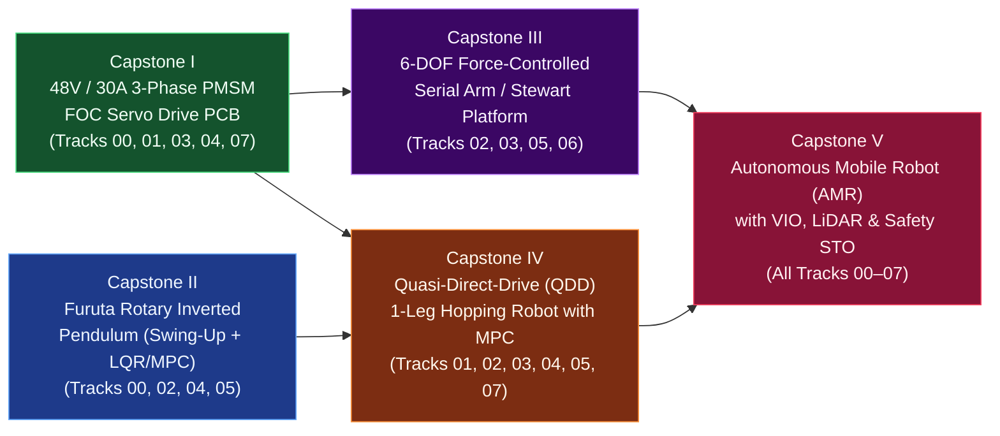
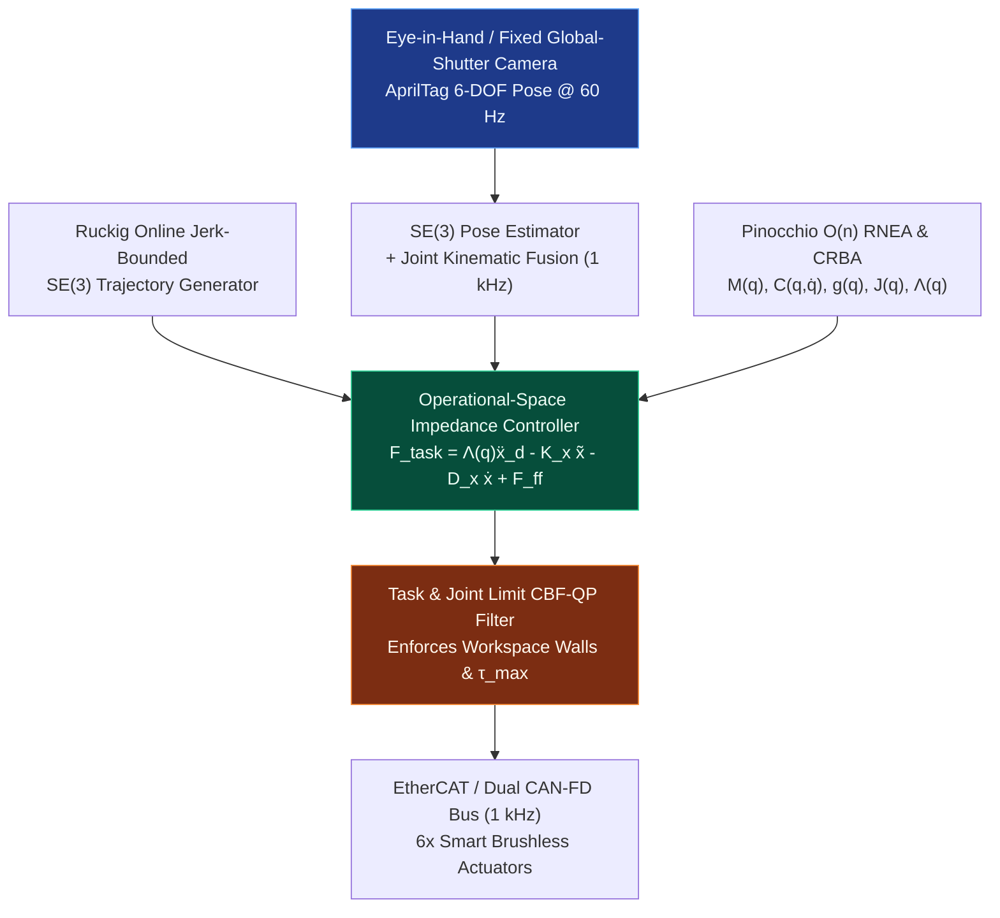

# Track 08: Multi-Pass Boss Capstone Projects (Tier 1 → Tier 2 → Tier 3)

> **Part of the [MechaLab Multi-Pass Tiered Roadmap](../README.md)**  
> **Prerequisites:** Tracks [00](../00-foundations/README.md) through [07](../07-systems-hil-and-production/README.md) in your current Tier Pass  
> **Core Principle:** Mastery is proven only by designing, fabricating, bringing up, and qualifying integrated physical hardware. In our linear level-up architecture, Track 08 serves as the **Boss Fight at the end of each pass**—letting you build a complete, working robot at Tier 1 with breakout modules, then loop back to Track 00 for Tier 2 to build custom 4-layer PCBs, and finally loop back for Tier 3 to build the full industrial Capstones I–V.

---

## 🔄 Linear Level-Up Navigation (Complete Your Current Pass & Loop Back to Level Up!)

| Pass / Level | Previous Step in Pass | Current Track 08 Boss Capstone | Next Level-Up Loop Action |
| :--- | :--- | :--- | :--- |
| **🟢 Pass 1: Tier 1 Boss** | [← Track 07 (Tier 1)](../07-systems-hil-and-production/README.md#tier-1-beginner--intuitive) | [§1 Tier 1 Boss: Breadboard/Breakout 2-DOF Compliant Desktop Robot](#tier-1-capstone-builds-beginner--breakout-pass) | [**🔼 Loop Back & Level Up to Pass 2 → Track 00 (Tier 2)**](../00-foundations/README.md#tier-2-intermediate--applied) |
| **🔵 Pass 2: Tier 2 Boss** | [← Track 07 (Tier 2)](../07-systems-hil-and-production/README.md#tier-2-intermediate--applied) | [§2 Tier 2 Boss: Custom 4-Layer CAN Servo + LQR Pendulum / MuJoCo Twin](#tier-2-capstone-builds-intermediate--applied-pass) | [**🔼 Loop Back & Level Up to Pass 3 → Track 00 (Tier 3)**](../00-foundations/README.md#tier-3-advanced--production) |
| **🌉 Bridge Concept** | — | [§3 Bridging the Gap: 3-Pass Evolution of the Same Robot Architecture](#bridging-the-gap-maker-to-custom) | [Inspect Tier 3 Production Capstones I–V ↓](#tier-3-capstone-builds-advanced--production-pass) |
| **🟣 Pass 3: Tier 3 Boss** | [← Track 07 (Tier 3)](../07-systems-hil-and-production/README.md#tier-3-advanced--production) | [§4 Tier 3 Boss: Full Production Capstones I–V ($48\text{ V}$ FOC, Furuta, 6-DOF, Hopper, AMR)](#tier-3-capstone-builds-advanced--production-pass) | **🏆 Curriculum Mastery Complete!** |

---

## Tier 1 Capstone Builds (Beginner / Breakout Pass)

> **🏆 Goal of Pass 1 Boss (`Track 08 · Tier 1`):** Combine every skill from Pass 1 (`Track 00` $\to$ `Track 07`) to build a complete, desktop-safe **$12\text{ V}$ 2-DOF Planar Compliant Robot Arm** (or 1-Axis Reaction-Wheel Pendulum) using off-the-shelf breakout boards, 3D-printed double-shear links, and a $1\text{ kHz}$ timer ISR.

### 1.1 Tier 1 Boss Architecture (`~$120` Total Hardware Cost)
* **Compute:** `ESP32-S3` or `STM32 Nucleo-G474RE` running a zero-`delay()` $1.000\text{ kHz}$ hardware timer ISR (Track 04 Tier 1).
* **Power & Actuators:** $12\text{ V} / 3\text{ A}$ current-limited bench supply + $470\ \mu\text{F}$ bulk decoupling + $2\times$ gimbal BLDC motors (`2804`/`4108` hollow-shaft) driven by `SimpleFOCMini` (`DRV8313`) breakouts (Track 01 & Track 03 Tier 1).
* **Sensors:** $2\times$ `AS5600` ($I^2C$) or `AS5048A` (`SPI`) 14-bit magnetic encoders + 1x `MPU6050`/`ICM-42688` IMU fused via 2-line complementary filter (Track 03 & Track 05 Tier 1).
* **Mechanics & Control:** 3D-printed 2-link planar arm ($L_1 = 100\text{ mm}, L_2 = 100\text{ mm}$) with `608` radial ball bearings in double shear, tracking a smooth cubic-polynomial figure-8 trajectory with joint-space virtual spring-damper compliance (Track 02 & Track 06 Tier 1).

### ✅ Tier 1 Boss Sign-Off Gate (`Unlock Pass 2!`)
1. Passes all 10 steps of the Track 07 smoke-free bring-up checklist with hardware E-stop verified.
2. Tracks a $0.5\text{ Hz}$ figure-8 planar trajectory using analytical Law-of-Cosines IK with $< 3\text{ mm}$ tracking error.
3. Yields compliantly like a gentle mechanical spring when pushed by a human finger and returns smoothly to the trajectory without oscillation or MCU brown-out resets.
* **🔼 Next Step After Completing Pass 1:** [**Loop Back & Level Up to Pass 2 → Track 00 (Tier 2: State-Space Matrices, Quaternions & Tustin Biquads)**](../00-foundations/README.md#tier-2-intermediate--applied)

---

## Tier 2 Capstone Builds (Intermediate / Applied Pass)

> **🏆 Goal of Pass 2 Boss (`Track 08 · Tier 2`):** Combine every skill from Pass 2 (`Track 00` $\to$ `Track 07`) to build a **Custom 4-Layer $24\text{ V}/15\text{ A}$ CAN-FD Smart Actuator PCB** and use it to drive either a **Physical Furuta Rotary Inverted Pendulum (Swing-Up + LQR)** or a **2-DOF Cartesian Impedance Leg synced to a live MuJoCo Digital Twin**.

### 2.1 Tier 2 Boss Architecture
* **Custom 4-Layer KiCad PCB:** `STM32G431`/`STM32G474` + `DRV8323RS` gate driver + 3x $1\text{ m}\Omega$ 4-terminal Kelvin shunts (`INA240`) + `TCAN1044` CAN-FD transceiver + active shunt brake resistor clamp (Track 01 & Track 07 Tier 2).
* **Embedded Firmware:** $25\text{ kHz}$ Clarke/Park $d$-$q$ FOC + Type-II PLL velocity observer + FreeRTOS $1\text{ kHz}$ CAN-FD `MIT Mode` task (`q_des, dq_des, Kp, Kd, tau_ff`) with DMA circular buffers (Track 03 & Track 04 Tier 2).
* **Control & Digital Twin:** Validated URDF/MuJoCo model (`models/capstone2-furuta-pendulum/furuta_pendulum.xml` or `models/capstone4-qdd-hopper/qdd_hopper_leg.xml`) executing either Åström-Furuta energy swing-up + discrete LQR balancing or Jacobian Transpose Cartesian compliance ($\tau = J^\top F_{\text{cart}} + g(q)$) with `Ruckig` S-curves (Track 02, Track 05, Track 06 Tier 2).

### ✅ Tier 2 Boss Sign-Off Gate (`Unlock Pass 3!`)
1. Custom 4-layer PCB passes Double-Pulse Test ($V_{DS,\text{peak}} < 34\text{ V}$ on $24\text{ V}$ bus) and $1\text{ kHz}$ CAN-FD command loop with CRC-16 watchdog active.
2. Furuta Pendulum catches upright autonomously within $< 2.5\text{ s}$ (or 2-DOF leg tracks Cartesian stiffness targets in hardware + MuJoCo twin).
* **🔼 Next Step After Completing Pass 2:** [**Loop Back & Level Up to Pass 3 → Track 00 (Tier 3: Lie Groups $SO(3)/SE(3)$ & Port-Hamiltonian Modeling)**](../00-foundations/README.md#tier-3-advanced--production)

---

## Bridging the Gap: Maker to Custom

### How the Same Robot Evolves Across All 3 Linear Passes

| Subsystem | Pass 1: Tier 1 Boss (Breakout Desktop Arm) | Pass 2: Tier 2 Boss (Custom 4-Layer CAN Servo) | Pass 3: Tier 3 Boss (Full Production Capstones I–V) |
| :--- | :--- | :--- | :--- |
| **Motor Drive Hardware** | Breadboard + `SimpleFOCMini` (`DRV8313`, $12\text{ V} / 1.5\text{ A}$, no current shunts) | Custom 4-Layer KiCad PCB (`DRV8323` + `INA240` Kelvin shunts, $24\text{ V} / 15\text{ A}$) | Custom 6-Layer $<2\text{ nH}$ PCB (`DRV8353RS` + `ISC030N08NM6`, $48\text{ V} / 30\text{ A}$ + Dual Hardware STO) |
| **Commutation & Timing** | $1\text{ kHz}$ timer ISR + open-loop sine voltage | $25\text{ kHz}$ $d$-$q$ FOC + FreeRTOS + SPI DMA | $40\text{ kHz}$ `TIM1_TRGO2`$\to$`ADC` DMA in `ITCM` RAM + `CORDIC` + `WaitFreeSeqLock` |
| **Kinematics & Control** | 2D Law-of-Cosines IK + joint PD virtual springs | URDF/MuJoCo + Jacobian Transpose $\tau = J^\top F$ + LQR | Screw PoE on $SE(3)$ + $O(n)$ RNEA + Khatib $\Lambda(q)$ WBC-QP + CBF-QP safety walls |
| **Verification & Safety** | 10-step bench bring-up + manual E-stop switch | Active regen brake clamp + CAN CRC watchdog | Schroeder multisine closed-loop SysID + HIL fault matrix + $<1\ \mu\text{s}$ SIL-3/PLe STO |

---

## Tier 3 Capstone Builds (Advanced / Production Pass)

> **🏆 Goal of Pass 3 Mastery (`Track 08 · Tier 3`):** Full industrial-grade specification, fabrication, bring-up, and quantitative sign-off of the five flagship production capstones below.

---

### Capstone 1: Custom 48V / 30A Field-Oriented Control PMSM Servo Drive

#### 1.1 System Specification & Architecture
Design, lay out, assemble, and bring up a $45\text{ mm} \times 45\text{ mm}$ 6-layer motor controller mounted directly to the back of a frameless outrunner PMSM, turning a raw brushless motor into a high-bandwidth CAN-FD smart actuator.

* **Electrical Hardware:**
  * **DC Bus:** $18\text{ V} - 54\text{ V}$ nominal ($80\text{ V}$ MOSFET rating, `ISC030N08NM6`, $R_{DS(\text{on})} \le 3.0\text{ m}\Omega$), $30\text{ A}$ peak phase current, $15\text{ A}_{\text{rms}}$ continuous.
  * **Gate Driver & Current Sensing:** 3-phase smart gate driver (`DRV8353RS` or `UCC21520` + discrete `INA240A2` inline $1\text{ m}\Omega$ 4-terminal Kelvin shunts).
  * **MCU & Sensors:** `STM32G474RET6` ($170\text{ MHz}$ Cortex-M4F with CORDIC coprocessor & high-resolution timer), onboard 16-bit absolute magnetic/inductive encoder (`MA732` / `MT6835`) over $16\text{ MHz}$ SPI + PT1000 stator winding thermistor + CAN-FD transceiver (`TCAN1044V`).
* **Firmware & Control Stack:**
  * $40\text{ kHz}$ center-aligned SVPWM, dual simultaneous ADC DMA triggered at `TIM1` peak, zero-wait-state execution from CCM-SRAM.
  * Automated motor parameter identification ($R_s, L_d, L_q, \lambda_{pm}$), encoder eccentricity/harmonic calibration LUT, anticogging table, and 5-parameter CAN-FD impedance control (`q_des, dq_des, kp, kd, tau_ff`) at $2\text{ kHz}$.

#### 1.2 Quantitative Sign-Off Gate

| Parameter | Acceptance Threshold | Test Procedure |
| :--- | :--- | :--- |
| **Switching Overshoot** | $V_{DS,\text{peak}} < 60\text{ V}$ at $48\text{ V}$ bus, $30\text{ A}$ turn-off | Double-pulse test with spring-tip probe (Tab 6 Simulator) |
| **$d$-$q$ Current Bandwidth** | $f_{-3\text{dB}} \ge 2.5\text{ kHz}$, phase margin $\ge 55^\circ$ | Swept-sine current injection Bode measurement (Tab 3 Simulator) |
| **Torque Ripple (Calibrated)** | $< 1.5\%$ of rated torque at $10\text{ RPM}$ | Reaction torque load cell sweep over $360^\circ$ |
| **CAN-FD Command Latency** | $< 120\ \mu\text{s}$ from CAN frame EOF to updated PWM duty | Oscilloscope trigger on CAN RX vs. PWM duty step |
| **Short-Circuit Protection** | Survives hard phase-to-phase and phase-to-GND short at $48\text{ V}$ | Physical contactor short test; gate shutdown $< 1.2\ \mu\text{s}$ (Tab 5 STO) |

#### 1.3 Reference KiCad Netlist, Thermal Report, Production BOM & Bare-Metal STM32G474 Firmware
* **KiCad S-Expression Schematic Netlist (43 Nets, Kelvin Shunts & Dual STO):** [`eda-capstone1-foc-drive/capstone1_foc_48v30a.net`](eda-capstone1-foc-drive/capstone1_foc_48v30a.net)
* **Production Bill of Materials (CSV):** [`eda-capstone1-foc-drive/capstone1_bom.csv`](eda-capstone1-foc-drive/capstone1_bom.csv)
* **Coupled Thermal & Switching Loss Report (JSON):** [`eda-capstone1-foc-drive/foc_thermal_and_bom.json`](eda-capstone1-foc-drive/foc_thermal_and_bom.json)
* **Bare-Metal STM32G474 Register-Level 40 kHz FOC Firmware (`C++20`):** [`firmware-capstone1-stm32g474/stm32g474_foc_firmware.cpp`](firmware-capstone1-stm32g474/stm32g474_foc_firmware.cpp)

---

### Capstone 2: Rotary Inverted Pendulum (Furuta Pendulum) with Swing-Up, LQR & CBF/MPC

#### 2.1 System Specification & Architecture
Build an underactuated 2-DOF rotary inverted pendulum demonstrating precision mechanical bearing design, non-contact magnetic sensing, nonlinear energy-shaping swing-up, and $1\text{ kHz}$ state-space LQR + Control Barrier Function (CBF-QP) stabilization.

* **Nonlinear Dynamics & Control Law:**
  1. **Lagrangian Derivation:** Full coupled inertia matrix $M(q)$ where $M_{11}(q_2) = J_1 + m_2 L_1^2 + J_2 \sin^2(q_2)$ and $M_{12}(q_2) = m_2 L_1 l_{c2} \cos(q_2)$.
  2. **Åström-Furuta Energy-Based Swing-Up:** $u = \text{sat}_{u_{\max}}\big(k_E (E - E_0)\,\text{sign}(\dot{q}_2 \cos q_2)\big)$.
  3. **Hysteretic Hand-Off to LQR + CBF-QP:** Switch into a $1\text{ kHz}$ discrete LQR + CBF safety filter when $\lvert q_2\rvert < 18^\circ$, enforcing hard base travel bounds.

#### 2.2 Quantitative Sign-Off Gate

| Parameter | Acceptance Threshold | Test Procedure |
| :--- | :--- | :--- |
| **Unactuated Joint Damping ($Q$-Factor)** | $> 45$ free oscillations from $15^\circ$ release to $1^\circ$ decay | Free-decay ringdown log |
| **Autonomous Swing-Up Reliability** | $100 / 100$ successful catches from hanging rest within $\le 2.2\text{ s}$ | Interactive **Tab 4 Simulator** & 100-trial script |
| **Upright Balancing RMS Jitter** | $\lvert q_2\rvert_{\text{rms}} < 0.08^\circ$, $\lvert q_1\rvert_{\text{rms}} < 0.25^\circ$ at steady state | 60-second upright hold telemetry audit |
| **Impulse Disturbance Recovery** | Recovers from $25^\circ$ perturbation without violating base travel limit | CBF Safety Wall test in **Tab 4 Simulator** |

#### 2.3 Reference URDF & MuJoCo MJCF Models
* **URDF Model:** [`models/capstone2-furuta-pendulum/furuta_pendulum.urdf`](models/capstone2-furuta-pendulum/furuta_pendulum.urdf)
* **MuJoCo MJCF Model:** [`models/capstone2-furuta-pendulum/furuta_pendulum.xml`](models/capstone2-furuta-pendulum/furuta_pendulum.xml)

---

### Capstone 3: 6-DOF Force-Controlled Serial Manipulator or Stewart Platform

#### 3.1 System Specification & Architecture
Construct a 6-DOF manipulator executing $1\text{ kHz}$ Operational-Space Impedance Control and visual servoing.

#### 3.2 Quantitative Sign-Off Gate

| Parameter | Acceptance Threshold | Test Procedure |
| :--- | :--- | :--- |
| **Kinematic Calibration Accuracy** | Static TCP position error $< 0.35\text{ mm}$ across $400\text{ mm}$ workspace cube | Multi-pose touch-probe / ChArUco calibration |
| **Cartesian Impedance Transparency** | Backdriving force $< 3.5\text{ N}$ in zero-stiffness gravity-comp mode ($K_x = 0$) | Handheld 6-axis F/T sensor pull test |
| **Compliant Force Tracking** | Normal force regulated to $10.0\text{ N} \pm 0.5\text{ N}$ over $20^\circ$ unknown ramp | Force-plate contact trajectory test |
| **Dynamic Visual Servoing Bandwidth** | Tracks moving AprilTag ($0.5\text{ m/s}$, $1.5\text{ Hz}$) with $< 4\text{ mm}$ lag | External motion-capture ground truth |

#### 3.3 Reference URDF & MuJoCo MJCF Models
* **URDF Model:** [`models/capstone3-6dof-arm/manipulator_6dof.urdf`](models/capstone3-6dof-arm/manipulator_6dof.urdf)
* **MuJoCo MJCF Model:** [`models/capstone3-6dof-arm/manipulator_6dof.xml`](models/capstone3-6dof-arm/manipulator_6dof.xml)

---

### Capstone 4: Quasi-Direct-Drive (QDD) 3-DOF Legged Hopping Robot with Contact MPC

#### 4.1 System Specification & Architecture
Build a 3-DOF (Hip Ab/Ad, Hip Flex/Ext, Knee Flex/Ext) Quasi-Direct-Drive robotic leg placing all three $8:1$ planetary QDD actuators coaxially at the hip to keep distal shank mass $< 180\text{ g}$.
* **Proprioceptive Contact Estimator:** $\hat{f}_{\text{foot}} = (J_{\text{foot}}^\top)^{-1}(\tau_m - M(q)\ddot{q} - h(q,\dot{q}))$.
* **Flight Phase Raibert Foot Placement:** $p_{\text{foot,touchdown}} = p_{\text{hip}} + \frac{T_{\text{stance}}}{2} v_{\text{com}} + k_v (v_{\text{com}} - v_{\text{des}})$.

#### 4.2 Quantitative Sign-Off Gate

| Parameter | Acceptance Threshold | Test Procedure |
| :--- | :--- | :--- |
| **Impact Peak Torque Absorption** | Zero gear tooth damage or belt skip under $1.0\text{ m}$ vertical drop test ($> 4g$) | Unpowered and active-damping drop test |
| **Proprioceptive GRF Accuracy** | RMS error $< 4.5\text{ N}$ ($< 5\%$ of peak vertical GRF) vs. external force plate | Continuous hopping at $2.5\text{ Hz}$ |
| **Continuous Hopping Apex Regulation** | Apex height regulated to $0.45\text{ m} \pm 0.012\text{ m}$ over $200$ consecutive hops | Boom encoder + IMU-kinematic estimator |
| **Step Terrain Disturbance Rejection** | Survives unmapped $\pm 60\text{ mm}$ ground height step change without falling | Blind step insertion during hopping |

#### 4.3 Reference URDF, MuJoCo MJCF & 3D STEP/STL Planetary Carrier Models
* **URDF Model:** [`models/capstone4-qdd-hopper/qdd_hopper_leg.urdf`](models/capstone4-qdd-hopper/qdd_hopper_leg.urdf)
* **MuJoCo MJCF Model:** [`models/capstone4-qdd-hopper/qdd_hopper_leg.xml`](models/capstone4-qdd-hopper/qdd_hopper_leg.xml)
* **8:1 QDD Double-Shear Planetary Carrier 3D STEP & STL:** [`cad/qdd_planetary_carrier.step`](cad/qdd_planetary_carrier.step) and [`cad/qdd_planetary_carrier.stl`](cad/qdd_planetary_carrier.stl)

---

### Capstone 5: Autonomous Mobile Robot (AMR) with VIO/LiDAR SLAM, MPPI & Functional Safety

#### 5.1 System Specification & Quantitative Sign-Off Gate
Design and qualify a production-ready $48\text{ V}$ swerve/differential-drive AMR with tightly coupled LiDAR-Visual-Inertial-Wheel Odometry (`FAST-LIO2` / `GTSAM`), $50\text{ Hz}$ MPPI/NMPC controller, $1\text{ kHz}$ CBF safety shield, and hardware-enforced ISO 13849 PLd Safe Torque Off:

| Parameter | Acceptance Threshold | Test Procedure |
| :--- | :--- | :--- |
| **Odometry Drift (Loop Closure Off)** | $< 0.35\%$ translational drift over $500\text{ m}$ trajectory | RTK-GNSS / Total Station ground truth |
| **Dynamic Obstacle Avoidance** | Zero collisions with $1.5\text{ m/s}$ cross-path obstacle at $2.0\text{ m/s}$ | 25-trial dynamic obstacle injection |
| **Trajectory Tracking & Docking** | Cross-track error $< 15\text{ mm}$ RMS; docking repeatability $< \pm 3\text{ mm}$ | Retroreflector / AprilTag docking verification |
| **Hardware Safety STO Distance** | Hardware STO asserted in $< 5\text{ ms}$; full stop from $2.0\text{ m/s}$ within $\le 0.45\text{ m}$ | Safety zone laser intrusion test |
