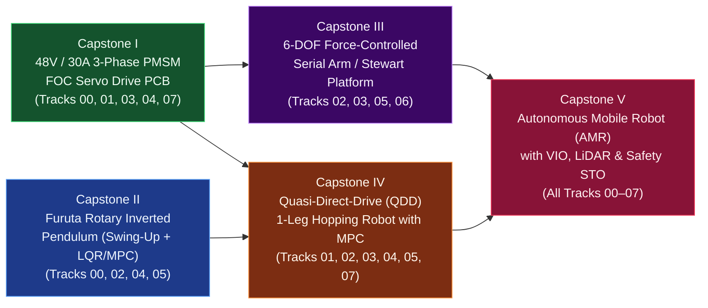
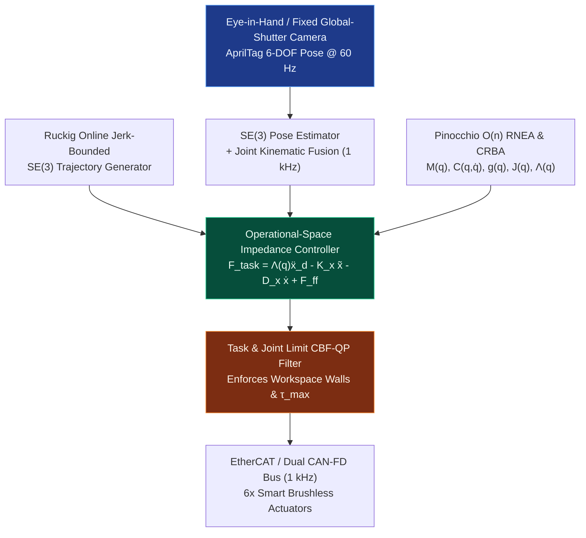

# Track 08: Full-Stack Production Capstone Projects

> **Prerequisites:** Tracks [00](../00-foundations/README.md) through [07](../07-systems-hil-and-production/README.md)  
> **Core Principle:** Mastery is proven only by designing, fabricating, bringing up, and qualifying integrated physical hardware. Each capstone below specifies a complete industrial-grade mechatronic system with system block diagrams, mechanical/electrical/firmware/control specifications, failure-mode protections, and quantitative sign-off gates.

---

## Capstone Progression Overview

---

## Capstone 1: Custom 48V / 30A Field-Oriented Control PMSM Servo Drive

### 1.1 System Specification & Architecture
Design, lay out, assemble, and bring up a $45\text{ mm} \times 45\text{ mm}$ 6-layer motor controller mounted directly to the back of a frameless outrunner PMSM, turning a raw brushless motor into a high-bandwidth CAN-FD smart actuator.

* **Electrical Hardware:**
  * **DC Bus:** $18\text{ V} - 54\text{ V}$ nominal ($80\text{ V}$ MOSFET rating, e.g., `ISC030N08NM6`, $R_{DS(\text{on})} \le 3.0\text{ m}\Omega$), $30\text{ A}$ peak phase current, $15\text{ A}_{\text{rms}}$ continuous.
  * **Gate Driver & Current Sensing:** 3-phase smart gate driver (`DRV8353RS` or `UCC21520` + discrete `INA240A2` inline $1\text{ m}\Omega$ 4-terminal Kelvin shunts).
  * **MCU & Sensors:** `STM32G474RET6` ($170\text{ MHz}$ Cortex-M4F with CORDIC coprocessor & high-resolution timer), onboard 16-bit absolute magnetic/inductive encoder (`MA732` / `MT6835`) over $16\text{ MHz}$ SPI + PT1000 stator winding thermistor + CAN-FD transceiver (`TCAN1044V`).
* **Firmware & Control Stack:**
  * $40\text{ kHz}$ center-aligned SVPWM, dual simultaneous ADC DMA triggered at `TIM1` peak, zero-wait-state execution from CCM-SRAM.
  * Automated motor parameter identification ($R_s, L_d, L_q, \lambda_{pm}$), encoder eccentricity/harmonic calibration LUT, anticogging table, and 5-parameter CAN-FD impedance control (`q_des, dq_des, kp, kd, tau_ff`) at $2\text{ kHz}$.

### 1.2 Quantitative Sign-Off Gate

| Parameter | Acceptance Threshold | Test Procedure |
| :--- | :--- | :--- |
| **Switching Overshoot** | $V_{DS,\text{peak}} < 60\text{ V}$ at $48\text{ V}$ bus, $30\text{ A}$ turn-off | Double-pulse test with spring-tip probe |
| **$d$-$q$ Current Bandwidth** | $f_{-3\text{dB}} \ge 2.5\text{ kHz}$, phase margin $\ge 55^\circ$ | Swept-sine current injection Bode measurement |
| **Torque Ripple (Calibrated)** | $< 1.5\%$ of rated torque at $10\text{ RPM}$ | Reaction torque load cell sweep over $360^\circ$ |
| **CAN-FD Command Latency** | $< 120\ \mu\text{s}$ from CAN frame EOF to updated PWM duty | Oscilloscope trigger on CAN RX vs. PWM duty step |
| **Short-Circuit Protection** | Survives hard phase-to-phase and phase-to-GND short at $48\text{ V}$ | Physical contactor short test; gate shutdown $< 1.2\ \mu\text{s}$ |

### 1.3 Reference KiCad Netlist, Coupled Electro-Thermal Solver, Production BOM & Bare-Metal STM32G474 Firmware
* **EDA Generator & ERC/Thermal Verifier:** [eda-capstone1-foc-drive/generate_foc_pcb_and_bom.py](eda-capstone1-foc-drive/generate_foc_pcb_and_bom.py)
* **KiCad S-Expression Schematic Netlist (43 Nets, Kelvin Shunts & Dual STO):** [eda-capstone1-foc-drive/capstone1_foc_48v30a.net](eda-capstone1-foc-drive/capstone1_foc_48v30a.net)
* **Production Bill of Materials (CSV):** [eda-capstone1-foc-drive/capstone1_bom.csv](eda-capstone1-foc-drive/capstone1_bom.csv)
* **Coupled Thermal & Switching Loss Report (JSON):** [eda-capstone1-foc-drive/foc_thermal_and_bom.json](eda-capstone1-foc-drive/foc_thermal_and_bom.json)
* **Bare-Metal STM32G474 Register-Level 40 kHz FOC Firmware & Unit Tests (`C++20`):** [firmware-capstone1-stm32g474/stm32g474_foc_firmware.cpp](firmware-capstone1-stm32g474/stm32g474_foc_firmware.cpp)

---

## Capstone 2: Rotary Inverted Pendulum (Furuta Pendulum) with Swing-Up, LQR & MPC

### 2.1 System Specification & Architecture
Build an underactuated 2-DOF rotary inverted pendulum demonstrating precision mechanical bearing design, cableless slip-ring or non-contact magnetic sensing, nonlinear energy-shaping swing-up, and high-rate state-space/MPC stabilization.

* **Mechanical & Sensor Hardware:**
  * Base rotary arm ($q_1$, actuated by direct-drive brushless motor with $18\text{-bit}$ optical/magnetic encoder) and unactuated vertical pendulum link ($q_2$, supported on preloaded ultra-low-friction hybrid ceramic bearings with a non-contact radial diametric magnet + Hall/AMR encoder mounted across the rotary joint axis).
* **Nonlinear Dynamics & Control Law:**
  1. **Lagrangian Derivation:** Include the full coupled inertia matrix $M(q)$ where $M_{11}(q_2) = J_1 + m_2 L_1^2 + J_2 \sin^2(q_2)$ and $M_{12}(q_2) = m_2 L_1 l_{c2} \cos(q_2)$ (never drop the $\sin^2(q_2)$ centrifugal coupling term!).
  2. **Åström-Furuta Energy-Based Swing-Up:** Pump mechanical energy $E(q_2, \dot{q_2}) = \frac{1}{2}J_p \dot{q}_2^2 + m_2 g l_{c2}(\cos q_2 - 1)$ toward upright equilibrium $E = 0$ via control law $u = \text{sat}_{u_{\max}}\big(k_E (E - E_0)\,\text{sign}(\dot{q}_2 \cos q_2)\big)$.
  3. **Hysteretic Hand-Off to LQR / Constrained MPC:** Switch cleanly into a $1\text{ kHz}$ discrete LQI or `OSQP`/`TinyMPC` controller when $|q_2| < 18^\circ$, enforcing hard base arm travel bounds $q_1 \in [-120^\circ, +120^\circ]$.

### 2.2 Quantitative Sign-Off Gate

| Parameter | Acceptance Threshold | Test Procedure |
| :--- | :--- | :--- |
| **Unactuated Joint Damping ($Q$-Factor)** | $> 45$ free oscillations from $15^\circ$ release to $1^\circ$ decay | Free-decay ringdown log (verifies bearing alignment & zero drag) |
| **Autonomous Swing-Up Reliability** | $100 / 100$ successful catches from hanging rest within $\le 2.2\text{ s}$ | Automated 100-trial endurance script |
| **Upright Balancing RMS Jitter** | $|q_2|_{\text{rms}} < 0.08^\circ$, $|q_1|_{\text{rms}} < 0.25^\circ$ at steady state | 60-second upright hold telemetry audit |
| **Impulse Disturbance Recovery** | Recovers from $25^\circ$ angular perturbation without violating $|q_1| \le 120^\circ$ base limit | Calibrated pendulum impact hammer test |

### 2.3 Reference URDF & MuJoCo MJCF Models
* **URDF Model:** [models/capstone2-furuta-pendulum/furuta_pendulum.urdf](models/capstone2-furuta-pendulum/furuta_pendulum.urdf)
* **MuJoCo MJCF Model:** [models/capstone2-furuta-pendulum/furuta_pendulum.xml](models/capstone2-furuta-pendulum/furuta_pendulum.xml)

---

## Capstone 3: 6-DOF Force-Controlled Serial Manipulator or Stewart Platform

### 3.1 System Specification & Architecture
Construct a 6-DOF manipulator (either a 6-axis serial arm using QDD/strain-wave actuators or a 6-UPS Stewart-Gough parallel hexapod) executing $1\text{ kHz}$ Operational-Space Impedance Control and visual servoing.

### 3.2 Quantitative Sign-Off Gate

| Parameter | Acceptance Threshold | Test Procedure |
| :--- | :--- | :--- |
| **Kinematic Calibration Accuracy** | Static TCP position error $< 0.35\text{ mm}$ across $400\text{ mm}$ workspace cube | Multi-pose touch-probe / ChArUco circle-point calibration |
| **Cartesian Impedance Transparency** | Backdriving force $< 3.5\text{ N}$ in zero-stiffness gravity-compensation mode ($K_x = 0, D_x = 0$) | Handheld 6-axis F/T sensor pull test across workspace |
| **Compliant Surface Polishing / Force Tracking** | Normal force regulated to $10.0\text{ N} \pm 0.5\text{ N}$ while traversing a $20^\circ$ unknown tilted ramp at $150\text{ mm/s}$ | Force-plate / load-cell contact trajectory test |
| **Dynamic Visual Servoing Bandwidth** | Tracks a moving AprilTag target ($0.5\text{ m/s}$, $1.5\text{ Hz}$ figure-eight) with $< 4\text{ mm}$ lag | External motion-capture / high-speed camera ground truth |

### 3.3 Reference URDF & MuJoCo MJCF Models
* **URDF Model:** [models/capstone3-6dof-arm/manipulator_6dof.urdf](models/capstone3-6dof-arm/manipulator_6dof.urdf)
* **MuJoCo MJCF Model:** [models/capstone3-6dof-arm/manipulator_6dof.xml](models/capstone3-6dof-arm/manipulator_6dof.xml)

---

## Capstone 4: Quasi-Direct-Drive (QDD) 3-DOF Legged Hopping Robot with Contact MPC

### 4.1 System Specification & Architecture
Build a 3-DOF (Hip Ab/Ad, Hip Flex/Ext, Knee Flex/Ext) Quasi-Direct-Drive robotic leg mounted on a vertical/planar boom (or free-balancing point-foot hopper) using coaxial belt/link transmission to keep distal leg inertia minimal.

* **Mechanical Architecture:**
  * Place all three $8:1$ planetary QDD actuators coaxially at the hip to minimize lower-leg swinging mass ($m_{\text{shank}} < 180\text{ g}$); drive the knee via a 4-bar linkage or pre-tensioned $5\text{ mm}$ Gates Poly Chain GT Carbon timing belt supported in double shear.
* **Contact Detection, State Estimation & Control:**
  * **Proprioceptive Contact Estimator:** Fuse leg Jacobian torque residuals $\hat{f}_{\text{foot}} = (J_{\text{foot}}^\top)^{-1}(\tau_m - M(q)\ddot{q} - h(q,\dot{q}))$ with IMU impact acceleration via a Kalman/Bayesian contact probability filter (no fragile foot microswitch required!).
  * **Stance Phase Control:** $200\text{ Hz}$ Ground Reaction Force (GRF) Linear MPC enforcing friction pyramid $|f_x| \le \mu f_z$, $f_{z,\min} \le f_z \le f_{z,\max}$, mapped to joint torques via $\tau_{\text{stance}} = -J(q)^\top f_{\text{GRF}}^*$.
  * **Flight Phase Control:** $1\text{ kHz}$ Operational-Space foot placement controller using Raibert's neutral-point heuristic + capture-point feedback:
    $$p_{\text{foot,touchdown}} = p_{\text{hip}} + \frac{T_{\text{stance}}}{2} v_{\text{com}} + k_v (v_{\text{com}} - v_{\text{des}})$$

### 4.2 Quantitative Sign-Off Gate

| Parameter | Acceptance Threshold | Test Procedure |
| :--- | :--- | :--- |
| **Impact Peak Torque Absorption** | Zero gear tooth damage or belt skip under $1.0\text{ m}$ vertical drop test ($> 4g$ impact) | Unpowered and active-damping drop test onto rigid force plate |
| **Proprioceptive GRF Estimation Accuracy** | RMS error $< 4.5\text{ N}$ ($< 5\%$ of peak vertical GRF) vs. external 6-axis force plate | Continuous hopping at $2.5\text{ Hz}$ on instrumented force plate |
| **Continuous Hopping Apex Regulation** | Apex height regulated to $0.45\text{ m} \pm 0.012\text{ m}$ over $200$ consecutive hops | Boom encoder + IMU-kinematic state estimator log |
| **Step Terrain Disturbance Rejection** | Survives unmapped $\pm 60\text{ mm}$ ground height step change without falling | Blind wooden-block step insertion during continuous hopping |

### 4.3 Reference URDF, MuJoCo MJCF & 3D STEP/STL Planetary Carrier Models
* **URDF Model:** [models/capstone4-qdd-hopper/qdd_hopper_leg.urdf](models/capstone4-qdd-hopper/qdd_hopper_leg.urdf)
* **MuJoCo MJCF Model:** [models/capstone4-qdd-hopper/qdd_hopper_leg.xml](models/capstone4-qdd-hopper/qdd_hopper_leg.xml)
* **8:1 QDD Double-Shear Planetary Carrier 3D STEP & STL:** [cad/qdd_planetary_carrier.step](cad/qdd_planetary_carrier.step) and [cad/qdd_planetary_carrier.stl](cad/qdd_planetary_carrier.stl)
* **Automated Model Validator:** [models/validate_models.py](models/validate_models.py)

---

## Capstone 5: Autonomous Mobile Robot (AMR) with VIO/LiDAR SLAM, MPPI & Functional Safety

### 5.1 System Specification & Architecture
Design and qualify a production-ready differential-drive or swerve-drive (4-wheel independent steering + drive) Autonomous Mobile Robot capable of $2.5\text{ m/s}$ indoor/outdoor navigation with hardware-enforced ISO 13849 PLd Safe Torque Off.

* **Hardware & Power Distribution:**
  * $48\text{ V}\ 20\text{ Ah}$ LiFePO4 battery with CAN BMS, hot-swap precharge, dual-channel safety relay (`Pilz` / custom dual-contactor STO), 4x FOC wheel drives over isolated CAN-FD, 3D LiDAR (`Livox Mid-360` or `Ouster`), hardware-triggered global-shutter stereo camera, and industrial `ARM64`/`x86_64` compute running `PREEMPT_RT` Linux.
* **Autonomy & Safety Stack:**
  * Tightly coupled LiDAR-Visual-Inertial-Wheel Odometry (`FAST-LIO2` / `GTSAM`), Euclidean Signed Distance Field (`ESDF`) local mapping, $50\text{ Hz}$ Model Predictive Path Integral (`MPPI`) or NMPC kinodynamic controller, and a $1\text{ kHz}$ Control Barrier Function (CBF) velocity/torque safety shield + independent hardware safety laser scanner zone interlock.

### 5.2 Quantitative Sign-Off Gate

| Parameter | Acceptance Threshold | Test Procedure |
| :--- | :--- | :--- |
| **Odometry Drift (Loop Closure Off)** | $< 0.35\%$ translational drift over a $500\text{ m}$ indoor/outdoor trajectory | RTK-GNSS / Leica Total Station ground-truth comparison |
| **Dynamic Obstacle Avoidance** | Zero collisions with sudden cross-path pedestrian dummy ($1.5\text{ m/s}$) at $2.0\text{ m/s}$ robot speed | 25-trial dynamic obstacle injection test |
| **Trajectory Tracking Precision** | Cross-track error $< 15\text{ mm}$ RMS at $2.0\text{ m/s}$ along clothoid/spline path; docking repeatability $< \pm 3\text{ mm}$ | AprilTag / laser retroreflector docking station verification |
| **Hardware Safety STO Stopping Distance** | Hardware STO asserted in $< 5\text{ ms}$; full mechanical stop from $2.0\text{ m/s}$ within $\le 0.45\text{ m}$ | Safety zone intrusion test with laser distance meter |
