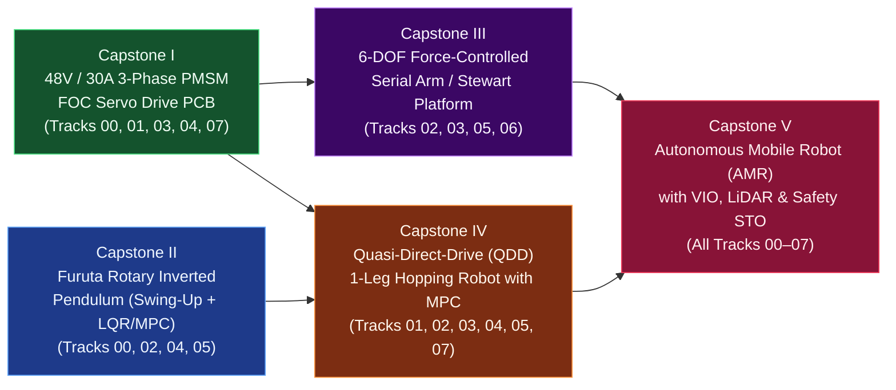
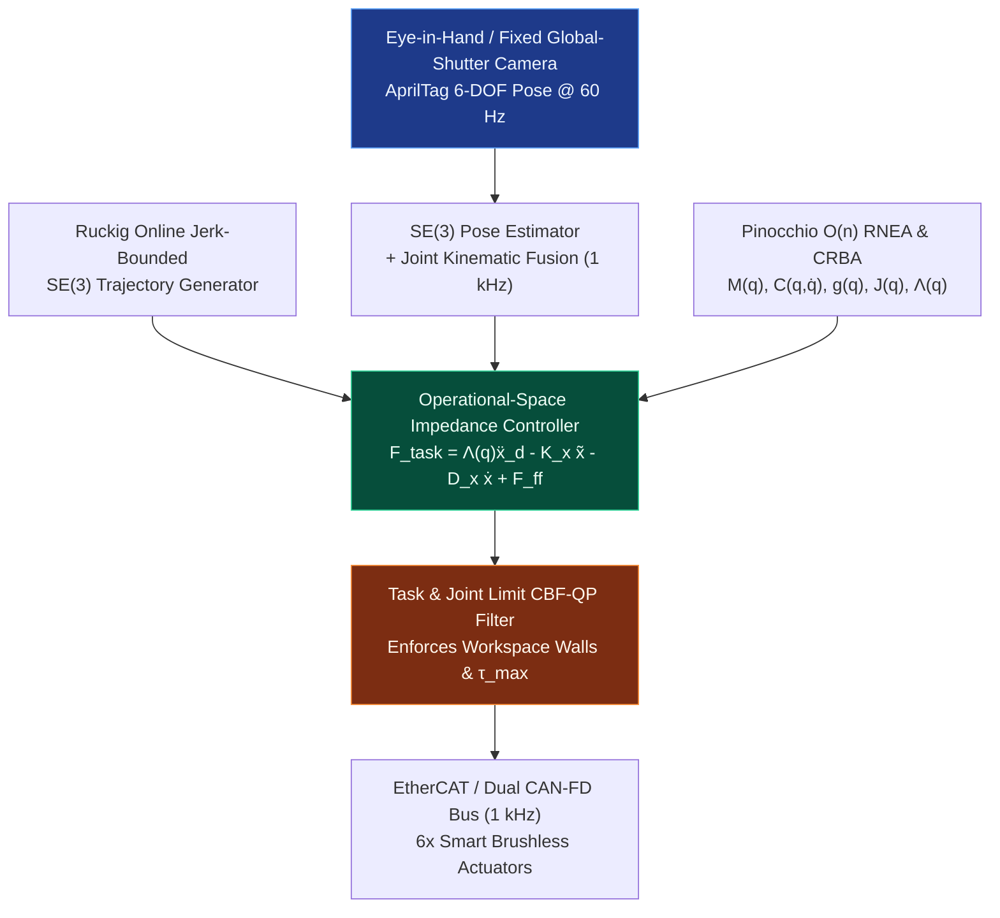

# Track 08: Multi-Pass Boss Capstone Projects (Tier 1 → Tier 2 → Tier 3)

> **Part of the [MechaLab Multi-Pass Tiered Roadmap](../README.md)**  
> **Prerequisites:** Tracks [00](../00-foundations/README.md) through [07](../07-systems-hil-and-production/README.md) in your current Tier Pass  
> **Core Principle:** Mastery is proven only by designing, fabricating, bringing up, and qualifying integrated physical hardware. In our linear level-up architecture, Track 08 serves as the **Boss Fight at the end of each pass**—letting you build a complete, working robot at Tier 1 with breakout modules, then loop back to Track 00 for Tier 2 to build custom 4-layer PCBs, and finally loop back for Tier 3 to build the full industrial Capstones I–V.

---

## 🔄 Linear Level-Up Navigation (Complete Your Current Pass & Loop Back to Level Up!)

| Pass / Level | Previous Step in Pass | Current Track 08 Boss Capstone | Next Level-Up Loop Action |
| :--- | :--- | :--- | :--- |
| **🟢 Pass 1: Tier 1 Boss** | [← Track 07 (Tier 1)](../07-systems-hil-and-production/README.md#tier-1-beginner--intuitive) | [§1 Tier 1 Boss: Breadboard/Breakout 2-DOF Compliant Desktop Robot](#tier-1-capstone-builds-beginner--breakout-pass) | [**🔼 Loop Back & Level Up to Pass 2 → Track 00 (Tier 2)**](../00-foundations/README.md#tier-2-intermediate--applied) |
| **🔵 Pass 2: Tier 2 Boss** | [← Track 07 (Tier 2)](../07-systems-hil-and-production/README.md#tier-2-intermediate--applied) | [§2 Tier 2 Boss: Custom 4-Layer CAN Servo + LQR Pendulum / MuJoCo Twin](#tier-2-capstone-builds-intermediate--applied-pass) | [**🔼 Loop Back & Level Up to Pass 3 → Track 00 (Tier 3)**](../00-foundations/README.md#tier-3-advanced--production) |
| **🌉 Bridge Concept** | — | [§3 Bridging the Gap: 3-Pass Evolution of the Same Robot Architecture](#bridging-the-gap-maker-to-custom) | [Inspect Tier 3 Production Capstones I–V ↓](#tier-3-capstone-builds-advanced--production-pass) |
| **🟣 Pass 3: Tier 3 Boss** | [← Track 07 (Tier 3)](../07-systems-hil-and-production/README.md#tier-3-advanced--production) | [§4 Tier 3 Boss: Full Production Capstones I–V (48 V FOC, Furuta, 6-DOF, Hopper, AMR)](#tier-3-capstone-builds-advanced--production-pass) | **🏆 Curriculum Mastery Complete!** |

---

## Tier 1 Capstone Builds (Beginner / Breakout Pass)

> **🏆 Goal of Pass 1 Boss (`Track 08 · Tier 1`):** Combine every skill from Pass 1 (`Track 00` $\to$ `Track 07`) to build a complete, desktop-safe **$12\text{ V}$ 2-DOF Planar Compliant Robot Arm** (or 1-Axis Reaction-Wheel Pendulum) using off-the-shelf breakout boards, 3D-printed double-shear links, and a $1\text{ kHz}$ timer ISR.
> **📚 Required Foundations & Bridge Modules for Pass 1 Boss (`07-systems.T1.08`):** Requires completing Tier 1 Foundations [`00-foundations.T1.00a`](../modules/00-foundations.T1.00a.md)–[`00-foundations.T1.00e`](../modules/00-foundations.T1.00e.md) and **Step 1.1 (`00-foundations.T1.01`)** plus all Tier 1 Track Bridges ([`01-electronics.T1.01b`](../modules/01-electronics.T1.01b.md), [`02-mechanics.T1.02a`](../modules/02-mechanics.T1.02a.md), [`03-sensors.T1.03a`](../modules/03-sensors.T1.03a.md), [`04-embedded.T1.04b`](../modules/04-embedded.T1.04b.md), [`05-control.T1.05a`](../modules/05-control.T1.05a.md), [`06-robotics.T1.06a`](../modules/06-robotics.T1.06a.md), [`07-systems.T1.07a`](../modules/07-systems.T1.07a.md)).

### Beginner-First Capstone Lesson (`08.1`, $\le 2$ new ideas per lesson)

If you are following the **Beginner-First Track (`Track P → Stage 0 → Track 00–08 Tier 1`)**, complete this self-contained Python capstone simulation before building the physical 2-DOF arm:

| Lesson | Title | New Ideas ($\le 2$) | Est. Time |
| :--- | :--- | :--- | :--- |
| **[08.1](08.1-tier1-2dof-compliant-arm-capstone.md)** | **Tier 1 Boss Milestone — 2-DOF Figure-8 Trajectory and Compliant Arm Integration** | 1. End-to-end 2-DOF Cartesian figure-8 path generation and Law-of-Cosines IK loop 2. Dual-joint compliant PD control with coupled gravity feedforward and RMS tracking verification | 60–90 min |

### 1.1 Tier 1 Boss Architecture: 2-DOF Breakout Compliant Desktop Robot (`~\$120` BOM)
- **Core Summary:** Integrates every Pass 1 milestone into a physical 2-DOF desktop robot arm using off-the-shelf `SimpleFOCMini` (`DRV8313`) breakouts, `AS5600`/`AS5048A` magnetic encoders, 3D-printed double-shear `608` bearing joints, a $1.000\text{ kHz}$ hardware timer ISR, cubic spline interpolation, and joint-space virtual spring-damper compliance.
  * **Compute:** `ESP32-S3` or `STM32 Nucleo-G474RE` running a zero-`delay()` $1.000\text{ kHz}$ hardware timer ISR (Track 04 Tier 1).
  * **Power & Actuators:** $12\text{ V} / 3\text{ A}$ current-limited bench supply + $470\ \mu\text{F}$ bulk decoupling + $2\times$ gimbal BLDC motors (`2804`/`4108` hollow-shaft) driven by `SimpleFOCMini` (`DRV8313`) breakouts (Track 01 & Track 03 Tier 1).
  * **Sensors:** $2\times$ `AS5600` ($I^2C$) or `AS5048A` (`SPI`) 14-bit magnetic encoders + 1x `MPU6050`/`ICM-42688` IMU fused via 2-line complementary filter (Track 03 & Track 05 Tier 1).
  * **Mechanics & Control:** 3D-printed 2-link planar arm ($L_1 = 100\text{ mm}, L_2 = 100\text{ mm}$) with `608` radial ball bearings in double shear (using the canonical `+0.10 mm` press-fit bore and 4-wall slicer recipe in [Track 02 §1.3](../02-mechanics-kinematics-dynamics/README.md#13-practical-3d-printed-joints-radial-bearings--gt2-timing-belts)), tracking a smooth cubic-polynomial figure-8 trajectory with joint-space virtual spring-damper compliance (Track 02 & Track 06 Tier 1), brought up step-by-step via the 10-Step Smoke-Free Checklist in [`07-systems.T1.07a`](../modules/07-systems.T1.07a.md).
- **Curated Free Resources:**
  - 🔗 [SimpleFOC Project Hub: Dual-Motor Gimbal & 2-DOF Arm Examples](https://docs.simplefoc.com/examples) — *Complete wiring schematics and dual-axis closed-loop position/torque sketches for `ESP32` and `STM32`.*
  - 🔗 [SO-101 / SO-ARM100 Open-Source 3D-Printed 6-DOF Leader-Follower Arm (TheRobotStudio)](https://github.com/TheRobotStudio/SO-ARM100) — \$110–\$130 open-source 3D-printed desktop manipulator natively supported by Hugging Face `LeRobot` for teleoperation and imitation learning.
  - 🔗 [LeKiwi Open-Source 3-Wheel Omnidirectional Holonomic Mobile Base (SIGRobotics-UIUC)](https://github.com/SIGRobotics-UIUC/LeKiwi) — *Low-cost holonomic mobile base designed to carry the `SO-101` arm for mobile manipulation.*
  - 🔗 [Lab Workbench Bill of Materials (`resources/lab-workbench-bom.md`)](../resources/lab-workbench-bom.md) — *Exact part numbers and budget links for all Tier 1 breakout modules, encoders, bearings, and bench tools.*
- **🧪 Hands-On Exercise:**
  - *Task:* Program your 2-DOF planar arm ($L_1 = L_2 = 0.10\text{ m}$) to trace a continuous figure-8 trajectory $x_d(t) = 0.12 + 0.03\sin(2\pi f t)$, $y_d(t) = 0.04\sin(4\pi f t)$ at $f = 0.5\text{ Hz}$ using analytical Law-of-Cosines IK and soft joint PD springs ($K_p = 1.5\text{ N}\cdot\text{m/rad}, K_d = 0.08\text{ N}\cdot\text{m}\cdot\text{s/rad}$). Verify that you can block the tip with two fingers and release it smoothly without triggering a brown-out or oscillation.
  - *📚 What to Learn & Resource Links for This Exercise:* Study 2D trigonometry & `atan2` in Foundations [`00-foundations.T1.00d`](../modules/00-foundations.T1.00d.md), star grounding & bulk decoupling in [`01-electronics.T1.01b`](../modules/01-electronics.T1.01b.md), 2-link planar IK in [`02-mechanics.T1.02a`](../modules/02-mechanics.T1.02a.md), $1\text{ kHz}$ timer ISR in [`04-embedded.T1.04b`](../modules/04-embedded.T1.04b.md), and compliant PD + gravity feedforward in [`06-robotics.T1.06a`](../modules/06-robotics.T1.06a.md).
- **🧠 Knowledge Check:**
  

  
<b>Click to toggle quiz questions & answers</b>

  **Q1:** If both `AS5600` magnetic encoders have a fixed `I2C` address of `0x36`, how do you read two `AS5600` sensors on a single `ESP32` or `STM32` in your 2-DOF Tier 1 Boss build?
  * **Answer / Explanation:** Either map them to the two independent hardware `I2C` peripherals on the MCU (`Wire` on `I2C0` and `Wire1` on `I2C1`), use a `TCA9548A` I2C multiplexer breakout, or upgrade to `AS5048A` / `MT6835` SPI encoders where both sensors share `SCK/MOSI/MISO` and use two separate GPIO Chip-Select (`CS1`, `CS2`) pins at $10\text{ MHz}$!

  **Q2:** Why does mounting the elbow gimbal motor *at the shoulder base* and driving the forearm via a $1:1$ GT2 timing belt reduce the required shoulder motor torque by $> 50\%$?
  * **Answer & Explanation:** Because a gimbal motor weighs $\sim 80\text{–}120\text{ g}$! Mounting it out at the moving elbow joint adds $m_{\text{motor}} L_1^2$ to the shoulder's rotational inertia and $m_{\text{motor}} g L_1$ to the shoulder's gravity load. Moving the elbow actuator coaxially to the base (the core principle of **Capstone 4**!) keeps the moving links feather-light.
  

### ✅ Tier 1 Boss Sign-Off Gate (`Unlock Pass 2!`)
1. Passes all 10 steps of the Track 07 smoke-free bring-up checklist with hardware E-stop verified.
2. Tracks a $0.5\text{ Hz}$ figure-8 planar trajectory using analytical Law-of-Cosines IK with $< 3\text{ mm}$ tracking error.
3. Yields compliantly like a gentle mechanical spring when pushed by a human finger and returns smoothly to the trajectory without oscillation or MCU brown-out resets.
* **🔼 Next Step After Completing Pass 1:** [**Loop Back & Level Up to Pass 2 → Track 00 (Tier 2: State-Space Matrices, Quaternions & Tustin Biquads)**](../00-foundations/README.md#tier-2-intermediate--applied)

---

## Tier 2 Capstone Builds (Intermediate / Applied Pass)

> **🏆 Goal of Pass 2 Boss (`Track 08 · Tier 2`):** Combine every skill from Pass 2 (`Track 00` $\to$ `Track 07`) to build a **Custom 4-Layer $24\text{ V}/15\text{ A}$ CAN-FD Smart Actuator PCB** and use it to drive either a **Physical Furuta Rotary Inverted Pendulum (Swing-Up + LQR)** or a **2-DOF Cartesian Impedance Leg synced to a live MuJoCo Digital Twin**.
> **📚 Required Foundations & Bridge Modules for Pass 2 Boss (`07-systems.T2.08`):** Requires completing Tier 2 Foundations [`00-foundations.T2.00a`](../modules/00-foundations.T2.00a.md)–[`00-foundations.T2.00f`](../modules/00-foundations.T2.00f.md) and **Step 2.1 (`00-foundations.T2.01`)** plus all Tier 2 Track Bridges ([`01-electronics.T2.01b`](../modules/01-electronics.T2.01b.md), [`02-mechanics.T2.02a`](../modules/02-mechanics.T2.02a.md), [`03-sensors.T2.03a`](../modules/03-sensors.T2.03a.md), [`04-embedded.T2.04a`](../modules/04-embedded.T2.04a.md)–[`04-embedded.T2.04d`](../modules/04-embedded.T2.04d.md), [`05-control.T2.05a`](../modules/05-control.T2.05a.md), [`06-robotics.T2.06a`](../modules/06-robotics.T2.06a.md)–[`06-robotics.T2.06b`](../modules/06-robotics.T2.06b.md), [`07-systems.T2.07a`](../modules/07-systems.T2.07a.md)).

### 2.1 Tier 2 Boss Architecture: Custom 4-Layer CAN-FD Smart Servo + LQR / MuJoCo Twin
- **Core Summary:** Transitions from breadboards to a custom-fabricated 4-layer KiCad PCB integrating an `STM32G4` MCU, 3-phase gate driver, 4-terminal Kelvin shunt amplifiers, and CAN-FD transceiver—running $25\text{ kHz}$ $d$-$q$ current FOC and a $1\text{ kHz}$ FreeRTOS `MIT Mode` impedance/LQR loop synchronized with a validated URDF/MuJoCo digital twin.
  * **Custom 4-Layer KiCad PCB:** `STM32G431`/`STM32G474` + `DRV8323RS` gate driver + 3x $1\text{ m}\Omega$ 4-terminal Kelvin shunts (`INA240`) + `TCAN1044` CAN-FD transceiver + active shunt brake resistor clamp, exported via the canonical `kicad-cli` Gerber/Drill/BOM/CPL workflow ([Track 01 §2.1](../01-electronics-and-power/README.md#21-schematic-capture-smd-footprints--4-layer-kicad-pcb-layout)) and probed safely with a pigtail spring-tip ground ([`01-electronics.T2.01b`](../modules/01-electronics.T2.01b.md)).
  * **Embedded Firmware:** $25\text{ kHz}$ Clarke/Park $d$-$q$ FOC + Type-II PLL velocity observer + FreeRTOS $1\text{ kHz}$ CAN-FD `MIT Mode` task (`q_des, dq_des, Kp, Kd, tau_ff`) with DMA circular buffers and 4-wire `SWD` + `OpenOCD` + `gdb-multiarch` bring-up (Track 03 & Track 04 Tier 2).
  * **Control & Digital Twin:** Validated URDF/MuJoCo model (`models/capstone2-furuta-pendulum/furuta_pendulum.xml` or `models/capstone4-qdd-hopper/qdd_hopper_leg.xml`) executing either Åström-Furuta energy swing-up + discrete LQR balancing or Jacobian Transpose Cartesian compliance ($\tau = J^\top F_{\text{cart}} + g(q)$) with `Ruckig` S-curves (Track 02, Track 05, Track 06 Tier 2).
- **Curated Free Resources:**
  - 🔗 [Ben Katz MIT Mini-Cheetah Actuator Hardware & Firmware Repository](https://github.com/bgkatz/3phase_integrated) — *Open-source reference schematic, layout, and firmware for integrated brushless robot actuators.*
  - 🔗 [Stanford Pupper / Open-Duck-Mini Open-Source Legged Platforms](https://github.com/apirrone/Open_Duck_Mini) — *Open-source quadruped and biped builds demonstrating sim-to-real MuJoCo/Isaac reinforcement learning and custom actuator integration.*
  - 🔗 [Universal Manipulation Interface (`UMI`, `umi-gripper.github.io`)](https://umi-gripper.github.io/) — *3D-printed handheld GoPro + IMU + ArUco gripper for collecting in-the-wild visuomotor Diffusion Policy demonstrations.*
  - 🔗 [MuJoCo Python Bindings (`mujoco` pip package) & Interactive Viewer Documentation](https://mujoco.readthedocs.io/en/stable/python.html) — *Load `./models/capstone2-furuta-pendulum/furuta_pendulum.xml` directly in Python at* $1\text{ kHz}$ *to co-simulate your LQR controller alongside hardware.*
- **🧪 Hands-On Exercise:**
  - *Task:* Run `python3 08-capstone-projects/models/validate_models.py` to verify all URDF and MuJoCo MJCF inertial matrices across Capstones 2, 3, and 4, and test the full swing-up + LQR + CBF safety filter in **Tab 4** and **Tab 5** of the interactive workbench.
  - *📚 What to Learn & Resource Links for This Exercise:* Study state-space matrices & eigenvalues in Foundations [`00-foundations.T2.00e`](../modules/00-foundations.T2.00e.md), parallel-axis inertia & triangle-inequality checks in [`02-mechanics.T2.02a`](../modules/02-mechanics.T2.02a.md), LQR Riccati control in [`05-control.T2.05a`](../modules/05-control.T2.05a.md), and regenerative shunt clamping + CAN-FD CRC-16 watchdogs in [`07-systems.T2.07a`](../modules/07-systems.T2.07a.md).
- **🧠 Knowledge Check:**
  

  
<b>Click to toggle quiz questions & answers</b>

  **Q1:** When bringing up your custom 4-layer motor controller PCB for the first time, why should you test the **3-phase current sense amplifiers (`INA240`)** and **SPI encoder** before soldering or enabling the 6 power MOSFETs (or with gate drive disabled)?
  * **Answer / Explanation:** Verifying that zero current reads $V_{\text{ref}}/2 = 1.650\text{ V}$ on all three ADC channels, that injecting a known $1.0\text{ A}$ DC bench current through each Kelvin shunt produces the exact expected ADC count slope, and that SPI encoder CRC errors are zero ensures your inner $25\text{ kHz}$ current loop has valid feedback *before* high-power switching is ever enabled!

  **Q2:** How do you verify that your physical Furuta pendulum or 2-DOF leg matches its MuJoCo `.xml` digital twin before closing a high-gain LQR loop?
  * **Answer & Explanation:** Release the unpowered pendulum from a known initial angle (e.g., $15^\circ$ from hanging down) and compare the **free-decay oscillation period $T_d$ and logarithmic decrement damping $\zeta$** of the real encoder log against the MuJoCo simulation trajectory! Matching the natural frequency $\omega_n = \sqrt{m g l_c / J}$ validates $m, l_c, J$, and matching the ringdown envelope validates joint viscous/Coulomb friction.
  

### ✅ Tier 2 Boss Sign-Off Gate (`Unlock Pass 3!`)
1. Custom 4-layer PCB passes Double-Pulse Test ($V_{DS,\text{peak}} < 34\text{ V}$ on $24\text{ V}$ bus) and $1\text{ kHz}$ CAN-FD command loop with CRC-16 watchdog active.
2. Furuta Pendulum catches upright autonomously within $< 2.5\text{ s}$ (or 2-DOF leg tracks Cartesian stiffness targets in hardware + MuJoCo twin).
* **🔼 Next Step After Completing Pass 2:** [**Loop Back & Level Up to Pass 3 → Track 00 (Tier 3: Lie Groups SO(3)/SE(3) & Port-Hamiltonian Modeling)**](../00-foundations/README.md#tier-3-advanced--production)

---

## Bridging the Gap: Maker to Custom

### How the Same Robot Evolves Across All 3 Linear Passes

| Subsystem | Pass 1: Tier 1 Boss (Breakout Desktop Arm) | Pass 2: Tier 2 Boss (Custom 4-Layer CAN Servo) | Pass 3: Tier 3 Boss (Full Production Capstones I–V) |
| :--- | :--- | :--- | :--- |
| **Motor Drive Hardware** | Breadboard + `SimpleFOCMini` (`DRV8313`, $12\text{ V} / 1.5\text{ A}$, no current shunts) | Custom 4-Layer KiCad PCB (`DRV8323` + `INA240` Kelvin shunts, $24\text{ V} / 15\text{ A}$) | Custom 6-Layer $<2\text{ nH}$ PCB (`DRV8353RS` + `ISC030N08NM6`, $48\text{ V} / 30\text{ A}$ + Dual Hardware STO) |
| **Commutation & Timing** | $1\text{ kHz}$ timer ISR + open-loop sine voltage | $25\text{ kHz}$ $d$-$q$ FOC + FreeRTOS + SPI DMA | $40\text{ kHz}$ `TIM1_TRGO2`$\to$`ADC` DMA in `ITCM` RAM + `CORDIC` + `WaitFreeSeqLock` |
| **Kinematics & Control** | 2D Law-of-Cosines IK + joint PD virtual springs | URDF/MuJoCo + Jacobian Transpose $\tau = J^\top F$ + LQR | Screw PoE on $SE(3)$ + $O(n)$ RNEA + Khatib $\Lambda(q)$ WBC-QP + CBF-QP safety walls |
| **Verification & Safety** | 10-step bench bring-up + manual E-stop switch | Active regen brake clamp + CAN CRC watchdog | Schroeder multisine closed-loop SysID + HIL fault matrix + $<1\ \mu\text{s}$ SIL-3/PLe STO |

---

## Tier 3 Capstone Builds (Advanced / Production Pass)

> **🏆 Goal of Pass 3 Mastery (`Track 08 · Tier 3`):** Full industrial-grade specification, fabrication, bring-up, and quantitative sign-off of the five flagship production capstones below.
> **📚 Required Foundations & Bridge Modules for Pass 3 Capstones (`08-capstones.T3.08`):** Requires completing Tier 3 Foundations [`00-foundations.T3.00a`](../modules/00-foundations.T3.00a.md) and **Step 3.1 (`00-foundations.T3.01`)** plus all Tier 3 Bridges ([`01-electronics.T3.01a`](../modules/01-electronics.T3.01a.md), [`02-mechanics.T3.02a`](../modules/02-mechanics.T3.02a.md), [`03-sensors.T3.03a`](../modules/03-sensors.T3.03a.md), [`04-embedded.T3.04a`](../modules/04-embedded.T3.04a.md), [`05-control.T3.05a`](../modules/05-control.T3.05a.md), [`06-robotics.T3.06a`](../modules/06-robotics.T3.06a.md)–[`06-robotics.T3.06b`](../modules/06-robotics.T3.06b.md), [`07-systems.T3.06a`](../modules/07-systems.T3.06a.md), and [`08-capstones.T3.07a`](../modules/08-capstones.T3.07a.md)).

---

### Capstone 1: Custom 48V / 30A Field-Oriented Control PMSM Servo Drive
- **Core Summary:** A production $45\text{ mm} \times 45\text{ mm}$ 6-layer $< 2\text{ nH}$ PMSM servo drive built around `STM32G474RET6` ($170\text{ MHz}$ Cortex-M4F + `CORDIC`), `DRV8353RS`, $80\text{ V}$ `ISC030N08NM6` MOSFETs ($2.6\text{ m}\Omega$), `INA240A2` inline Kelvin shunts, `MA732` 16-bit SPI encoder, and $< 1\ \mu\text{s}$ Dual-Channel Hardware STO—executing $40\text{ kHz}$ decoupled $d$-$q$ SVPWM FOC in $2.08\ \mu\text{s}$ from zero-wait-state CCM-SRAM.

#### 1.1 System Specification & Architecture
* **Electrical Hardware:**
  * **DC Bus:** $18\text{ V} - 54\text{ V}$ nominal ($80\text{ V}$ MOSFET rating, `ISC030N08NM6`, $R_{DS(\text{on})} \le 3.0\text{ m}\Omega$), $30\text{ A}$ peak phase current, $15\text{ A}_{\text{rms}}$ continuous.
  * **Gate Driver & Current Sensing:** 3-phase smart gate driver (`DRV8353RS` or `UCC21520` + discrete `INA240A2` inline $1\text{ m}\Omega$ 4-terminal Kelvin shunts).
  * **MCU & Sensors:** `STM32G474RET6` ($170\text{ MHz}$ Cortex-M4F with CORDIC coprocessor & high-resolution timer), onboard 16-bit absolute magnetic/inductive encoder (`MA732` / `MT6835`) over $16\text{ MHz}$ SPI + PT1000 stator winding thermistor + CAN-FD transceiver (`TCAN1044V`).
* **Firmware & Control Stack:**
  * $40\text{ kHz}$ center-aligned SVPWM, dual simultaneous ADC DMA triggered at `TIM1` peak, zero-wait-state execution from CCM-SRAM.
  * Automated motor parameter identification ($R_s, L_d, L_q, \lambda_{pm}$), encoder eccentricity/harmonic calibration LUT, anticogging table, and 5-parameter CAN-FD impedance control (`q_des, dq_des, kp, kd, tau_ff`) at $2\text{ kHz}$.

#### 1.2 Quantitative Sign-Off Gate

| Parameter | Acceptance Threshold | Test Procedure |
| :--- | :--- | :--- |
| **Switching Overshoot** | $V_{DS,\text{peak}} < 60\text{ V}$ at $48\text{ V}$ bus, $30\text{ A}$ turn-off | Double-pulse test with spring-tip probe (Tab 6 Simulator) |
| **$d$-$q$ Current Bandwidth** | $f_{-3\text{dB}} \ge 2.5\text{ kHz}$, phase margin $\ge 55^\circ$ | Swept-sine current injection Bode measurement (Tab 3 Simulator) |
| **Torque Ripple (Calibrated)** | $< 1.5\%$ of rated torque at $10\text{ RPM}$ | Reaction torque load cell sweep over $360^\circ$ |
| **CAN-FD Command Latency** | $< 120\ \mu\text{s}$ from CAN frame EOF to updated PWM duty | Oscilloscope trigger on CAN RX vs. PWM duty step |
| **Short-Circuit Protection** | Survives hard phase-to-phase and phase-to-GND short at $48\text{ V}$ | Physical contactor short test; gate shutdown $< 1.2\ \mu\text{s}$ (Tab 5 STO) |

- **Curated Free Resources:**
  - 🔗 [KiCad Netlist (`eda-capstone1-foc-drive/capstone1_foc_48v30a.net`)](eda-capstone1-foc-drive/capstone1_foc_48v30a.net) & [Production BOM (`capstone1_bom.csv`)](eda-capstone1-foc-drive/capstone1_bom.csv) — *Complete 43-net KiCad S-expression netlist and 18-line manufacturable BOM inside this repository.*
  - 🔗 [Bare-Metal STM32G474 Register-Level 40 kHz FOC Firmware (`firmware-capstone1-stm32g474/stm32g474_foc_firmware.cpp`)](firmware-capstone1-stm32g474/stm32g474_foc_firmware.cpp) — *Production C++20 firmware implementing `TIM1_TRGO2`* $\to$ *`ADC1/2`, `CORDIC`, `WaitFreeSeqLock`, and `TIM1_BKIN` STO.*
- **🧪 Hands-On Exercise:**
  - *Task:* Run `python3 08-capstone-projects/eda-capstone1-foc-drive/generate_foc_pcb_and_bom.py` and inspect `foc_thermal_and_bom.json` + **Tab 6: 48V 30A PCB & Thermal** to verify that at $48\text{ V} / 30\text{ A}$ ($40\text{ kHz}$), total 6-MOSFET loss is $12.16\text{ W}$, $T_{j,\max} = 85.4^\circ\text{C} < 125^\circ\text{C}$, and $V_{DS,\text{peak}} = 57.5\text{ V} < 64\text{ V}$.
  - *📚 What to Learn & Resource Links for This Exercise:* Study Port-Hamiltonian power balance in Foundations [`00-foundations.T3.00a`](../modules/00-foundations.T3.00a.md), 6-layer `<2 nH` PCB layout + Cauer thermal networks in [`01-electronics.T3.01a`](../modules/01-electronics.T3.01a.md), $d$-$q$ decoupling + SVPWM in [`03-sensors.T3.03a`](../modules/03-sensors.T3.03a.md), and cross-domain thermal/power budgeting in [`08-capstones.T3.07a`](../modules/08-capstones.T3.07a.md).
- **🧠 Knowledge Check:**
  

  
<b>Click to toggle quiz questions & answers</b>

  **Q1:** Why does Capstone 1 select $80\text{ V}$ rated MOSFETs (`ISC030N08NM6`) for a $48\text{ V}$ nominal battery bus instead of $60\text{ V}$ MOSFETs?
  * **Answer / Explanation:** At $48\text{ V}$ nominal ($54.6\text{ V}$ full charge on a 13S Li-Ion pack), add $+3\text{ V}$ regenerative braking margin before the brake chopper turns on ($57.6\text{ V}$) plus $+9.5\text{ V}$ of parasitic loop ringing $L_{\text{loop}}\frac{dI}{dt}$ during a $30\text{ A}$ turn-off—bringing peak drain-source voltage to $\sim 60\text{–}67\text{ V}$! An $80\text{ V}$ MOSFET provides an $80\%$ derating safety ceiling ($64\text{ V}$), whereas a $60\text{ V}$ MOSFET would avalanche and fail.

  **Q2:** How does the `STM32G474` hardware `CORDIC` co-processor accelerate the $40\text{ kHz}$ FOC ISR in `stm32g474_foc_firmware.cpp`?
  * **Answer & Explanation:** By writing the Q1.31 electrical angle $\theta_e$ into `CORDIC->WDATA`, the hardware `CORDIC` unit computes both $\sin\theta_e$ and $\cos\theta_e$ simultaneously in just **6 clock cycles** ($35\text{ ns}$ at $170\text{ MHz}$) with zero lookup-table Flash cache misses, helping keep the entire $40\text{ kHz}$ ISR WCET down to $2.08\ \mu\text{s}$!
  

---

### Capstone 2: Rotary Inverted Pendulum (Furuta Pendulum) with Swing-Up, LQR & CBF/MPC
- **Core Summary:** An underactuated 2-DOF rotary inverted pendulum combining low-friction double-shear bearing mechanics ($Q > 45$), non-contact magnetic angle sensing, Åström-Furuta nonlinear energy-pumping swing-up, $1\text{ kHz}$ Discrete LQR stabilization, and a velocity-aware Control Barrier Function (CBF-QP) safety filter that strictly prevents base rail/travel collisions.

#### 2.1 System Specification & Architecture
* **Nonlinear Dynamics & Control Law:**
  1. **Lagrangian Derivation:** Full coupled inertia matrix $M(q)$ where $M_{11}(q_2) = J_1 + m_2 L_1^2 + J_2 \sin^2(q_2)$ and $M_{12}(q_2) = m_2 L_1 l_{c2} \cos(q_2)$.
  2. **Åström-Furuta Energy-Based Swing-Up:** $u = \text{sat}_{u_{\max}}\big(k_E (E - E_0)\,\text{sign}(\dot{q}_2 \cos q_2)\big)$.
  3. **Hysteretic Hand-Off to LQR + CBF-QP:** Switch into a $1\text{ kHz}$ discrete LQR + CBF safety filter when $\lvert q_2\rvert < 18^\circ$, enforcing hard base travel bounds.

#### 2.2 Quantitative Sign-Off Gate

| Parameter | Acceptance Threshold | Test Procedure |
| :--- | :--- | :--- |
| **Unactuated Joint Damping ($Q$-Factor)** | $> 45$ free oscillations from $15^\circ$ release to $1^\circ$ decay | Free-decay ringdown log |
| **Autonomous Swing-Up Reliability** | $100 / 100$ successful catches from hanging rest within $\le 2.2\text{ s}$ | Interactive **Tab 4 Simulator** & 100-trial script |
| **Upright Balancing RMS Jitter** | $\lvert q_2\rvert_{\text{rms}} < 0.08^\circ$, $\lvert q_1\rvert_{\text{rms}} < 0.25^\circ$ at steady state | 60-second upright hold telemetry audit |
| **Impulse Disturbance Recovery** | Recovers from $25^\circ$ perturbation without violating base travel limit | CBF Safety Wall test in **Tab 4 Simulator** |

- **Curated Free Resources:**
  - 🔗 [URDF (`models/capstone2-furuta-pendulum/furuta_pendulum.urdf`)](models/capstone2-furuta-pendulum/furuta_pendulum.urdf) & [MuJoCo MJCF (`furuta_pendulum.xml`)](models/capstone2-furuta-pendulum/furuta_pendulum.xml) — *Exact physical multi-body models verified by `validate_models.py`.*
  - 🔗 [Åström & Furuta (Automatica 2000): Swinging Up a Pendulum by Energy Control](https://www.sciencedirect.com/science/article/pii/S0005109899001405) — *Original paper deriving the energy Lyapunov pump and homoclinic catch conditions.*
- **🧪 Hands-On Exercise:**
  - *Task:* Open **Tab 4: Furuta Pendulum + LQR + CBF**, run the autonomous swing-up, and test the maximum impulse disturbance (`+3.2 rad/s` push) the pendulum can survive with the CBF safety wall active at $x_{\max} = 0.45\text{ m}$.
  - *📚 What to Learn & Resource Links for This Exercise:* Study Van Loan ZOH discretization in Foundations **Step 3.1 (`00-foundations.T3.01`)**, discrete LQR in [`05-control.T2.05a`](../modules/05-control.T2.05a.md), and CLF-CBF-QP forward invariance in [`05-control.T3.05a`](../modules/05-control.T3.05a.md).
- **🧠 Knowledge Check:**
  

  
<b>Click to toggle quiz questions & answers</b>

  **Q1:** Why must you remove the rubber contact seals (`2RS`) from the unactuated pendulum pivot bearings (or use open/shielded `ZZ` bearings flushed with light instrument oil) on a physical Furuta pendulum?
  * **Answer / Explanation:** Rubber contact lip seals (`2RS`) introduce heavy Coulomb stick-slip friction at zero velocity. Whenever the upright pendulum crosses $\dot{q}_2 = 0$, stick-slip friction causes the pivot to momentarily lock and jump, creating a persistent $\pm 1.5^\circ$ limit-cycle hunting oscillation!

  **Q2:** Why does the mode-switching logic between Swing-Up and LQR use **hysteresis** (e.g., enter LQR when $\lvert\theta\rvert < 18^\circ$, exit back to Swing-Up only if $\lvert\theta\rvert > 28^\circ$)?
  * **Answer & Explanation:** Without hysteresis, a pendulum disturbed right to the $\lvert\theta\rvert = 22^\circ$ boundary will chatter rapidly back and forth between the Swing-Up law and the LQR law at $1\text{ kHz}$ (**sliding-mode chattering**), injecting violent high-frequency torque reversals into the base motor.
  

---

### Capstone 3: 6-DOF Force-Controlled Serial Manipulator or Stewart Platform
- **Core Summary:** A 6-DOF torque-controlled robotic manipulator executing $O(n)$ RNEA/CRBA inverse dynamics, Khatib's Operational-Space Impedance Control ($\Lambda(q)$), `Ruckig` jerk-limited $SE(3)$ trajectories, and $60\text{ Hz}$ global-shutter AprilTag visual servoing over a $1\text{ kHz}$ EtherCAT / dual CAN-FD bus.

#### 3.1 System Specification & Architecture

#### 3.2 Quantitative Sign-Off Gate

| Parameter | Acceptance Threshold | Test Procedure |
| :--- | :--- | :--- |
| **Kinematic Calibration Accuracy** | Static TCP position error $< 0.35\text{ mm}$ across $400\text{ mm}$ workspace cube | Multi-pose touch-probe / ChArUco calibration |
| **Cartesian Impedance Transparency** | Backdriving force $< 3.5\text{ N}$ in zero-stiffness gravity-comp mode ($K_x = 0$) | Handheld 6-axis F/T sensor pull test |
| **Compliant Force Tracking** | Normal force regulated to $10.0\text{ N} \pm 0.5\text{ N}$ over $20^\circ$ unknown ramp | Force-plate contact trajectory test |
| **Dynamic Visual Servoing Bandwidth** | Tracks moving AprilTag ($0.5\text{ m/s}$, $1.5\text{ Hz}$) with $< 4\text{ mm}$ lag | External motion-capture ground truth |

- **Curated Free Resources:**
  - 🔗 [URDF (`models/capstone3-6dof-arm/manipulator_6dof.urdf`)](models/capstone3-6dof-arm/manipulator_6dof.urdf) & [MuJoCo MJCF (`manipulator_6dof.xml`)](models/capstone3-6dof-arm/manipulator_6dof.xml) — *Complete 6-DOF spatial manipulator model with full 3D inertia tensors.*
  - 🔗 [ALOHA 2 (`aloha-2.github.io`) & Pollen Robotics `Reachy 2` (`pollen-robotics.com`)](https://aloha-2.github.io/) — *Open-source bimanual and humanoid manipulation hardware blueprints and `ros2_control` stacks.*
  - 🔗 [Pinocchio C++/Python Rigid Body Dynamics Library](https://stack-of-tasks.github.io/pinocchio/) — *Computes 6-DOF RNEA, CRBA,* $J(q)$ *, and* $\Lambda(q)$ *in* $< 5\ \mu\text{s}$ *.*
- **🧪 Hands-On Exercise:**
  - *Task:* Open **Tab 5: URDF / MuJoCo & STO** and **Tab 6: 3D CAD & 48V PCB** in the MechaLab Workbench (`npm run dev`), or run `python3 08-capstone-projects/urdf-mujoco-capstone3-6dof/verify_capstone3_kinematics_cbf.py` to inspect the 6-DOF arm's space screw axes $\mathcal{S}_1 \dots \mathcal{S}_6$, verify inverse dynamics torque $\tau = \text{RNEA}(q, \dot{q}, \ddot{q})$, and test damped least-squares IK near the wrist singularity ($q_5 \to 0$).
  - *📚 What to Learn & Resource Links for This Exercise:* Study $SO(3)/SE(3)$ Lie groups in Foundations [`00-foundations.T3.00a`](../modules/00-foundations.T3.00a.md), Screw PoE & $\mathcal{O}(n)$ RNEA in [`02-mechanics.T3.02a`](../modules/02-mechanics.T3.02a.md), and Khatib operational-space impedance $\Lambda(q)$ in [`06-robotics.T3.06a`](../modules/06-robotics.T3.06a.md).
- **🧠 Knowledge Check:**
  

  
<b>Click to toggle quiz questions & answers</b>

  **Q1:** How do you calibrate the link length and joint zero-offset manufacturing errors ($\Delta \theta_i, \Delta L_i$) of a 3D-printed or CNC-machined 6-DOF arm down to $< 0.35\text{ mm}$ without a \$50,000 laser tracker?
  * **Answer / Explanation:** Use **Closed-Loop Kinematic Calibration**! Touch a pointed stylus mounted on the end-effector into 20+ machined dimples at known spacing on an aluminum calibration plate (or observe a printed ChArUco board from 30 poses), and run non-linear least-squares (`scipy.optimize.least_squares`) on the Product-of-Exponentials twist parameters $\xi_i$ to minimize the residual position error $\|\text{FK}(q_k; \xi) - p_{\text{plate},k}\|_2^2$.

  **Q2:** Why does a 6-DOF arm using $8:1$ planetary QDD actuators achieve $< 3.5\text{ N}$ backdriving transparency using motor current sensing alone, whereas a $100:1$ harmonic-drive arm requires joint torque sensors (`JTS`) or a 6-axis wrist Force/Torque sensor?
  * **Answer & Explanation:** Reflected rotor inertia scales as $N^2 J_m$ ($10,000\times$ vs. $64\times$) and harmonic gear seal/wave-generator friction requires $15\text{–}30\text{ N}$ of breakaway force at the tip! A $100:1$ harmonic arm can only achieve low backdriving force by measuring torque *after* the gearbox with a strain-gauge Joint Torque Sensor and closing an inner torque feedback loop to mask gearbox friction.
  

---

### Capstone 4: Quasi-Direct-Drive (QDD) 3-DOF Legged Hopping Robot with Contact MPC
- **Core Summary:** A high-impact 3-DOF Quasi-Direct-Drive (QDD) robotic leg placing all three $8:1$ planetary actuators coaxially at the hip to keep distal shank mass $< 180\text{ g}$, executing proprioceptive ground-reaction-force (GRF) contact detection, stance-phase Contact Force QP/MPC within friction cones, and flight-phase Raibert neutral-point foot placement.

#### 4.1 System Specification & Architecture
* **Proprioceptive Contact Estimator:** $\hat{f}_{\text{foot}} = (J_{\text{foot}}^\top)^{-1}(\tau_m - M(q)\ddot{q} - h(q,\dot{q}))$.
* **Flight Phase Raibert Foot Placement:** $p_{\text{foot,touchdown}} = p_{\text{hip}} + \frac{T_{\text{stance}}}{2} v_{\text{com}} + k_v (v_{\text{com}} - v_{\text{des}})$.

#### 4.2 Quantitative Sign-Off Gate

| Parameter | Acceptance Threshold | Test Procedure |
| :--- | :--- | :--- |
| **Impact Peak Torque Absorption** | Zero gear tooth damage or belt skip under $1.0\text{ m}$ vertical drop test ($> 4g$) | Unpowered and active-damping drop test |
| **Proprioceptive GRF Accuracy** | RMS error $< 4.5\text{ N}$ ($< 5\%$ of peak vertical GRF) vs. external force plate | Continuous hopping at $2.5\text{ Hz}$ |
| **Continuous Hopping Apex Regulation** | Apex height regulated to $0.45\text{ m} \pm 0.012\text{ m}$ over $200$ consecutive hops | Boom encoder + IMU-kinematic estimator |
| **Step Terrain Disturbance Rejection** | Survives unmapped $\pm 60\text{ mm}$ ground height step change without falling | Blind step insertion during hopping |

- **Curated Free Resources:**
  - 🔗 [URDF (`models/capstone4-qdd-hopper/qdd_hopper_leg.urdf`)](models/capstone4-qdd-hopper/qdd_hopper_leg.urdf), [MuJoCo MJCF (`qdd_hopper_leg.xml`)](models/capstone4-qdd-hopper/qdd_hopper_leg.xml), and [3D STEP/STL Planetary Carrier (`cad/qdd_planetary_carrier.step`)](cad/qdd_planetary_carrier.step) — *Complete mechanical CAD and physics models inside this repository.*
  - 🔗 [Marc Raibert (MIT Leg Lab): Legged Robots That Balance — Chapter 2: Hopping on One Leg](https://mitpress.mit.edu/9780262681193/legged-robots-that-balance/) & [Jared Di Carlo et al. (MIT Cheetah 3 Convex MPC Paper)](https://dspace.mit.edu/handle/1721.1/138000) — *Foundational papers on Raibert foot placement and convex contact-force MPC.*
- **🧪 Hands-On Exercise:**
  - *Task:* Open **Tab 1: 3D CAD & FEA** to inspect the **8:1 QDD Double-Shear Planetary Carrier** (`cad/qdd_planetary_carrier.stl`), and open **Tab 5: URDF / MuJoCo & STO** to simulate the **3-DOF QDD Hopping Leg (`Capstone 4`)** through stance thrust, liftoff, apex, and touchdown impact absorption.
  - *📚 What to Learn & Resource Links for This Exercise:* Study reflected inertia $N^2 J_{\text{rotor}}$ in [`02-mechanics.T1.02a`](../modules/02-mechanics.T1.02a.md), linearized friction-cone contact WBC constraints in [`06-robotics.T3.06a`](../modules/06-robotics.T3.06a.md), and EtherCAT DC synchronization in [`04-embedded.T3.04a`](../modules/04-embedded.T3.04a.md).
- **🧠 Knowledge Check:**
  

  
<b>Click to toggle quiz questions & answers</b>

  **Q1:** In Marc Raibert's flight-phase foot placement law $p_{\text{touchdown}} = p_{\text{hip}} + \frac{T_{\text{stance}}}{2} v_{\text{com}} + k_v (v_{\text{com}} - v_{\text{des}})$, what is the physical meaning of the neutral point $\frac{T_{\text{stance}}}{2} v_{\text{com}}$?
  * **Answer / Explanation:** If the foot lands at a distance $\frac{T_{\text{stance}}}{2} v_{\text{com}}$ ahead of the hip, then during the stance duration $T_{\text{stance}}$ the hip travels symmetrically from $-\frac{T_{\text{stance}}}{2} v_{\text{com}}$ behind the foot to $+\frac{T_{\text{stance}}}{2} v_{\text{com}}$ ahead of the foot! The horizontal braking impulse in the first half of stance exactly cancels the accelerating impulse in the second half, keeping average forward speed $v_{\text{com}}$ unchanged (**CG print symmetry**). Landing ahead of the neutral point brakes the robot; landing behind it accelerates the robot!

  **Q2:** Why does a QDD hopping leg switch its joint gains from high stiffness in stance ($K_p$ high) to **very low stiffness ($K_p$ low, $K_d$ moderate)** right before expected ground touchdown?
  * **Answer & Explanation:** If the leg hits the ground early with stiff position gains ($K_p$ high) tracking a flight trajectory, the impact spike bounces the foot right back off the ground! Lowering $K_p$ just before touchdown lets the low-inertia $8:1$ QDD joint absorb the initial $1\text{ ms}$ impact passively like a shock absorber while the proprioceptive GRF estimator detects $\hat{f}_z > 15\text{ N}$ and switches smoothly into stance-phase force control.
  

---

### Capstone 5: Autonomous Mobile Robot (AMR) with VIO/LiDAR SLAM, MPPI & Functional Safety
- **Core Summary:** Full-stack integration of all 8 curriculum tracks into a $48\text{ V}$ swerve/differential-drive Autonomous Mobile Robot combining hardware-synchronized global-shutter VIO + 3D LiDAR factor-graph SLAM (`GTSAM`/`FAST-LIO2`), $50\text{ Hz}$ kinodynamic MPC/MPPI trajectory tracking, $1\text{ kHz}$ Control Barrier Function (CBF-QP) obstacle shields, and hardware-enforced ISO 13849 PLd Safe Torque Off.

#### 5.1 System Specification & Quantitative Sign-Off Gate

| Parameter | Acceptance Threshold | Test Procedure |
| :--- | :--- | :--- |
| **Odometry Drift (Loop Closure Off)** | $< 0.35\%$ translational drift over $500\text{ m}$ trajectory | RTK-GNSS / Total Station ground truth |
| **Dynamic Obstacle Avoidance** | Zero collisions with $1.5\text{ m/s}$ cross-path obstacle at $2.0\text{ m/s}$ | 25-trial dynamic obstacle injection |
| **Trajectory Tracking & Docking** | Cross-track error $< 15\text{ mm}$ RMS; docking repeatability $< \pm 3\text{ mm}$ | Retroreflector / AprilTag docking verification |
| **Hardware Safety STO Distance** | Hardware STO asserted in $< 5\text{ ms}$; full stop from $2.0\text{ m/s}$ within $\le 0.45\text{ m}$ | Safety zone laser intrusion test |

- **Curated Free Resources:**
  - 🔗 [FAST-LIO2: Fast Direct LiDAR-Inertial Odometry (Open-Source C++ / ROS 2 Repository)](https://github.com/hku-mars/FAST_LIO) — *State-of-the-art tightly-coupled iterated Kalman filter on* $SO(3)$ *manifolds used across modern AMRs and quadrupeds.*
  - 🔗 [Nav2 MPPI (Model Predictive Path Integral) Controller Documentation](https://docs.nav2.org/jazzy/configuration_and_development/configuration_guide/controller_plugins/mppi_controller/configuring_mppic/) — *Production sampling-based nonlinear MPC controller for differential, swerve, and Ackermann mobile robots.*
- **🧪 Hands-On Exercise:**
  - *Task:* Calculate the minimum safety LiDAR protective field radius $d_{\text{stop}}$ required for a $48\text{ V}$ AMR traveling at $v_0 = 2.0\text{ m/s}$ given a safety scanner response time $t_{\text{scan}} = 30\text{ ms}$, STO + brake contactor actuation latency $t_{\text{sto}} = 5\text{ ms}$, and tire-floor braking deceleration $a_{\text{brake}} = 5.5\text{ m/s}^2$.
  - *📚 What to Learn & Resource Links for This Exercise:* Study $SO(3)$ ESKF & IMU preintegration in [`05-control.T3.05a`](../modules/05-control.T3.05a.md) and [`06-robotics.T3.06a`](../modules/06-robotics.T3.06a.md), dual-channel STO latency in [`07-systems.T3.06a`](../modules/07-systems.T3.06a.md), and `ISO 13855` safety stopping distance $d_{\text{stop}} = v_0(t_{\text{scan}} + t_{\text{sto}}) + \frac{v_0^2}{2 a_{\text{brake}}} + d_{\text{margin}}$ in [`08-capstones.T3.07a`](../modules/08-capstones.T3.07a.md) (`## 3. Formalization` & `## 4. Worked example`).
- **🧠 Knowledge Check:**
  

  
<b>Click to toggle quiz questions & answers</b>

  **Q1:** Using ISO 13855 stopping-distance analysis $d_{\text{stop}} = v_0 (t_{\text{scan}} + t_{\text{sto}}) + \frac{v_0^2}{2 a_{\text{brake}}}$ for $v_0 = 2.0\text{ m/s}$, $t_{\text{scan}} + t_{\text{sto}} = 0.035\text{ s}$, and $a_{\text{brake}} = 5.5\text{ m/s}^2$, what is the minimum stopping distance $d_{\text{stop}}$?
  * **Answer / Explanation:** Reaction travel $d_{\text{react}} = 2.0 \times 0.035 = 0.070\text{ m}$ plus braking travel $d_{\text{brake}} = \frac{2.0^2}{2 \times 5.5} = \frac{4.0}{11.0} = 0.364\text{ m}$, giving $d_{\text{stop}} = 0.070 + 0.364 = \mathbf{0.434\text{ m}} \le 0.45\text{ m}$! Notice that scaling the protective safety zone dynamically with live wheel velocity $v_0$ shrinks the stop zone at low docking speeds while guaranteeing zero human contact at $2.0\text{ m/s}$.

  **Q2:** Why does fusing wheel encoder odometry into a Visual-Inertial-LiDAR factor graph (`GTSAM`) dramatically improve reliability when an AMR drives down a long, featureless white warehouse corridor?
  * **Answer & Explanation:** In a featureless corridor or glass-walled lobby, visual feature tracking and LiDAR scan matching can become degenerate along the corridor's longitudinal axis, leaving accelerometer double-integration to drift cubically ($\frac{1}{2}b_a t^2$). Non-slipping wheel encoder preintegration provides a direct, drift-free velocity constraint in the body frame that anchors accelerometer bias $b_a$ and scale!
  

---

## 6. Track 08 Bridge Modules & Pre-Flight Commissioning Gate (`modules/`)

- **Tier 1 Boss Prerequisite Bridge (PLC Scan, E-Stop Chains & Sine-Sweep Bring-Up → Step 1.8):** [`07-systems.T1.07a`](../modules/07-systems.T1.07a.md) *(Ladder Gate Test)*
- **Tier 2 Boss Prerequisite Bridge (Regenerative Shunt Chopper, CAN-FD Watchdog & HIL Fault Injection → Step 2.8):** [`07-systems.T2.07a`](../modules/07-systems.T2.07a.md) *(Ladder Gate Test)*
- **Tier 3 (Pre-Flight Readiness Audit & Stage Commissioning Gate for Capstones I–V → Step 3.8):** [`08-capstones.T3.07a`](../modules/08-capstones.T3.07a.md) *(Ladder Gate Test)*

