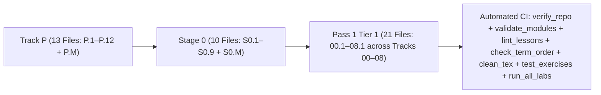

# Changelog — Beginner-First Mechatronics Roadmap Rewrite

All structural changes, lesson splits, curriculum reorderings, angle-convention standardizations, and automated verification additions are logged below.

---

## [2026-10-16] — Run 4: Course Packaging, Technical Fixes (`DRV8833` & `05-control.T1.05a`), Tracks 03–08 Beginner Lessons (`03.1–08.1`), Clean TeX & In-Browser Pyodide/Placement Workbench

### 1. Technical Accuracy & CI Expected-Output Diffing
- **Fixed `DRV8833` Voltage Rating (`2.7–10.8 V` operating, `11.8 V` abs max):** Updated `01-electronics-and-power/01.2-h-bridge-and-stall-current.md`, `01-electronics-and-power/README.md`, `modules/01-electronics.T1.01b.md`, `docs/SYLLABUS.md`, and `resources/lab-workbench-bom.md` so `DRV8833` is paired with a $6\text{–}9\text{ V}$ supply while $12\text{ V}$ motors explicitly use `TB6612FNG` ($4.5\text{–}13.5\text{ V}$) or `DRV8871` ($6.5\text{–}45\text{ V}$).
- **Fixed `modules/05-control.T1.05a.md` Expected Output & Added CI Output Diffing:** Updated `05-control.T1.05a.md` to match the exact stdout of its worked PID simulation (`Unclamped OS=0.372, Anti-windup OS=0.047`) and extended both `scripts/run_all_labs.py` and `scripts/validate_modules.py` to execute and diff all 44 bridge module `Expected output` blocks and forbid `[verify in-app]` / `[UNVERIFIED]` placeholders when `resources_verified: true`.

### 2. Openness, Licensing, Attribution & Slim Single-Screen `README.md`
- **Added Dual `LICENSE` (`CC BY 4.0` for docs, `MIT` for code), `CONTRIBUTING.md`, and `.github/ISSUE_TEMPLATE/`:** Added explicit attribution for [`engyasin/awesome-mechatronics`](https://github.com/engyasin/awesome-mechatronics) and three structured issue templates (`beginner-timing-log.md`, `lab-bug.md`, `lesson-error.md`).
- **Slimmed Root `README.md` (111 KB $\to$ 30 KB), Added Visibility Badges & Isolated Vite App in `app/`:** Added shields.io status badges, a prominent **Open Live Browser Workbench** callout, and a before/after $1\text{ kHz}$ control code comparison; fixed Step 3 to start at `Track 00 Lesson 00.1`; separated the \$0 Simulator Path, \$15–\$25 Starter Kit, and \$150 Closed-Loop Bench in `README.md` and `resources/lab-workbench-bom.md`; labeled beginner times as unmeasured targets backed by `beginner-timing-log.md`; moved `SYLLABUS.md` and `PLAN-batch-1.md` into `docs/`; isolated the Vite workbench into `app/` (`app/index.html`, `app/src/`); excluded `.aistudio/` in `.gitignore`; and verified live module/bridge/ladder/lesson counts (`68 modules: 24 legacy, 44 bridge across 25 ladders; 16 Tier 1 bridge modules; 44 beginner lessons`) across `README.md` and all script docstrings.
- **Clean TeX Source (`scripts/clean_tex.py`):** Stripped all 862 `\kern0pt` and `\_` math-mode workarounds across the repository and added `python3 scripts/clean_tex.py --check` to CI.

### 3. Closed the Beginner Cliff (`Lessons 03.1–08.1`), Beginner-First Workbench Mode & CI UI Smoke Tests
- **Expanded Tier 1 Tracks 03–08 into 9 Full Beginner Lesson Files (`03.1`, `03.2`, `04.1`, `04.2`, `05.1`, `05.2`, `06.1`, `07.1`, `08.1`):** Every lesson enforces $\le 2$ new ideas in YAML front matter, 150–250 word `Bridge Notes`, runnable Python 3 starter code, 3-step progressive hints, and `assert`-verified full solutions (44 total beginner lessons across Track P, Stage 0, and Tracks 00–08 Tier 1).
- **Beginner vs. All-Labs Workbench Mode, Web-Worker Isolated Pyodide Runner (`Tab 9`), Instructor Behavioral Tests, Placement Quiz (`Tab 10`), Portfolio Export & Real-Browser E2E Tests:** Added a **Beginner View (Plain-English Path)** default with expandable technical subtitles (`All 10 Engineering Labs`), isolated Python execution inside a dedicated **Web Worker** with `Stop` / `Reset Runtime` controls and infinite-loop step/time guards, added **Instructor-Owned Behavioral Tests** (multi-input, boundary, and numerical tolerance checks that reject print-only spoofing across all 32 lessons), separated `Executed & Passed (WASM)` from `Self-Marked` completions in `localStorage` and **Markdown Portfolio Certificate export**, and added both SSR/DOM smoke tests (`scripts/smoke_test_workbench.mjs`) and real-browser Headless Chromium E2E tests (`scripts/e2e_browser_workbench.mjs`) in CI.

### 4. Cross-Tier Bridging Architecture (`Learn & Simulate` vs. `Build` vs. `Production Practice`, 8-Step Teaching Ladder, Recurring 2-DOF Arm Spine & Tier Transition Gates)
- **Three Explicit Completion Routes & Reconciled Provisional Time Estimates (`README.md`, `docs/SYLLABUS.md`, `TabArchitecture.tsx`):** Defined **Route 1 (`Learn & Simulate`, \$0)**, **Route 2 (`Build`, optional $\le 12\text{ V}$ low-voltage hardware)**, and **Route 3 (`Production Practice`, supervised $24\text{ V}/15\text{ A}$ & $48\text{ V}/30\text{ A}$ hardware requiring experienced review & pre-power sign-off)**, and reconciled the syllabus's `323.5 hours` (`68 formal modules` across Passes 1–3) with the optional `Track P` + `Stage 0` entry ramp (`~18–23 hours` unmeasured target $\implies \text{~341.5–346.5 hours}$ full zero-to-Tier-3 provisional estimate).
- **Unified 8-Step Teaching Ladder & Recurring 2-DOF Robot Arm Spine (`README.md`, `docs/SYLLABUS.md`):** Documented the 8-step progression (*Recall → See it → Predict → Work through → Practice with support → Break it on purpose → Transfer → Integrate*), 5-dimension difficulty labels, and how **one recurring robot joint and 2-DOF arm** evolves from Track 00 through Track 08 across Tiers 1, 2, and 3.
- **Track P Tooling Orientation, School-Math Diagnostic & Stage 0 8-Step Sequence (`track-p/README.md`, `stage-0/README.md`, `TabPlacementQuiz.tsx`):** Added a zero-jargon computer-tooling orientation (`Stop`, `Reset Runtime`, `localStorage`, error reading), a no-penalty **6-Topic School-Math Diagnostic** (*"I know this"*, *"Show me a refresher"*, *"Teach it from scratch"*), and Stage 0's deliberate 8-step `Simulate → Predict → Measure → Build → Diagnose Fault` sequence with 3 demonstrated pre-power safety checks.
- **6-Gate Tier 1 $\to$ Tier 2 Exit Readiness Review, Tier 2 Tool First-Run Labs / 3 Hardware Evidence Routes & Tier 3 Scope (`docs/SYLLABUS.md`, `TabPlacementQuiz.tsx`):** Added an interactive **6-Gate Tier 1 Exit Readiness Review** in Workbench Tab 3 with targeted refresher routing, decoupled Tier 2 tool first-run labs (`KiCad`, `CadQuery/URDF`, `RTOS`, `ROS 2`), defined 3 equivalent Tier 2 evidence routes (*Simulation*, *Reference-Board*, *Custom-PCB*), and structured Tier 3 into *Use & Understand* vs. *Derive & Extend* modes with 5 incremental concept ladders and an explicit **Choose 1 of 5 Capstones** rule for Step 3.8 (`9.5 h`).

---

## [2026-10-16] — Run 3: Term-Order Hardening, Falstad CI Mirrors Moved to `tests/` & Batch 1 (`Tracks 00, 01, 02` Tier 1)

### 1. Part A Hardening (`check_term_order.py`, `lint_lessons.py`, `density_report.py`, Multi-URL Heading Check & Falstad CI Mirrors)
- **Added `scripts/check_term_order.py`:** Verifies all 89 glossary terms in `resources/glossary.md` against all 35 beginner lessons in curriculum path order (`P.1`–`P.M` $\to$ `S0.1`–`S0.M` $\to$ `00.1`–`00.3` $\to$ `01.1`–`01.4` $\to$ `02.1`–`02.5`), failing if any lesson uses a glossary term before the lesson that defines it, and checking `PLAN-batch-1.md` prerequisites.
- **Reordered Stage 0 (`S0.2` $\leftrightarrow$ `S0.4` $\leftrightarrow$ `S0.5`) to eliminate forward term references:**
  - `S0.2-series-parallel-and-voltage-dividers.md` now comes immediately after `S0.1` (Ohm's Law), before `S0.3` (Breadboards & Short Circuits), `S0.4-leds-and-resistor-power.md`, and `S0.5-multimeters-and-current-limited-supplies.md`, so **Series** and **Parallel** are defined before sizing a series LED resistor (`S0.4`) or probing voltage in parallel vs. current in series (`S0.5`).
- **Upgraded `scripts/lint_lessons.py`:** Compares each lesson's `## Learn` headings and `### Bridge Notes` against its declared YAML `ideas:` list, failing on extra topics or missing `ideas:` coverage in `### Bridge Notes`.
- **Added `scripts/density_report.py`:** Computes per-lesson word count, new glossary terms, resource count, and code-block count across all 35 beginner lessons, sorted by cognitive density score.
- **Moved Falstad CI Python Mirrors (`S0.1`–`S0.6`, `01.1`) to `tests/test_exercises.py`:** Confirmed that the Python blocks in `S0.1`–`S0.6` and `01.1` only mirrored Falstad circuit calculations for CI; moved them into `tests/test_exercises.py` so learners in `S0.1`–`S0.6` and `01.1` interact directly with the Falstad netlists (`falstad/*.txt`).

### 2. Part B Batch 1 — Tier 1 Beginner Lessons for Tracks 00, 01 & 02 (`PLAN-batch-1.md` + 11 New Lesson Files)
- **Track 00 (`00-foundations/`, 3 lessons):**
  - `00.1-effort-flow-and-first-order-lag.md`: Effort/flow power ($P = V \cdot I = F \cdot v = \tau \cdot \omega$) and first-order lag step response ($\tau$, $63.2\%$ at $1\tau$, $99.3\%$ at $5\tau$).
  - `00.2-mass-spring-damper-oscillations.md`: Hooke's Law spring ($F_s = -kx$), viscous damper ($F_d = -bv$), natural frequency ($\omega_n = \sqrt{k/m}$), and damping ratio ($\zeta$: underdamped, critically damped, overdamped).
  - `00.3-modeling-discipline-and-sanity-checks.md`: 4-step workflow (`Diagram -> Symbolic Equations -> Code -> Sanity Check`) and dimensional/limiting-case checks.
- **Track 01 (`01-electronics-and-power/`, 3 new lessons after `01.1`):**
  - `01.2-h-bridge-and-stall-current.md`: 4-switch H-bridge (`Forward`, `Reverse`, `Coast`, `Brake`), shoot-through prevention, back-EMF ($V_{\text{emf}} = K_e\omega$), and stall current ($I_{\text{stall}} = V_s/R_a$) using Falstad (`falstad/01.2-h-bridge.txt`) and Wokwi Arduino Uno firmware (`IN1/IN2/PWM` with no motor in Wokwi).
  - `01.3-power-regulators-and-power-budget.md`: Linear (`LDO`) regulator heat loss vs. switching (`Buck`) power conservation and worst-case robot power budgets.
  - `01.4-grounding-and-rc-lowpass-filters.md`: High-current ground bounce ($V_{\text{ground}} = I_{\text{motor}}R_{\text{wire}}$), star grounding, and passive RC low-pass filters ($f_c = \frac{1}{2\pi RC}$, `falstad/01.4-rc-lowpass.txt`).
- **Track 02 (`02-mechanics-kinematics-dynamics/`, 5 lessons ramping `1-link FK -> 2-link FK -> IK`):**
  - `02.1-1d-link-fk-and-coord-frames.md`: 2D coordinate frames, right-hand CCW angle sign convention, and 1-link planar forward kinematics ($x = L\cos\theta, y = L\sin\theta$).
  - `02.2-2link-planar-forward-kinematics.md`: Cumulative link angle ($\theta_{12} = \theta_1 + \theta_2$), chaining 2-link tip-to-tail vectors, and annular reach envelope.
  - `02.3-2link-planar-inverse-kinematics.md`: Law of Cosines for elbow angle, reachability clamping (`[-1, +1]`), elbow-down vs. elbow-up solutions, and shoulder angle via `math.atan2`.
  - `02.4-rotational-inertia-and-gear-ratios.md`: Rotational Newton's Second Law ($\tau_{\text{net}} = I_{\text{rot}}\alpha$), moment of inertia ($I_{\text{rot}} = mr^2$), gear ratio ($N$), and reflected rotor inertia ($I_{\text{reflected}} = N^2 I_{\text{motor}}$).
  - `02.5-bearings-belts-and-3d-printing.md`: Cantilevered vs. double-shear shaft support, `GT2` timing belt ratios ($N = N_{\text{driven}}/N_{\text{driver}}$), and 3D-printed layer orientation.
- **Removed Tier 1 Jargon Leaks:** Purged Jacobian determinants, phase-space ellipses, complex numbers ($j\omega$), decibels ($\text{dB}$), Laplace $s$, and Euler-Bernoulli beam deflection formulas ($\delta = \frac{FL^3}{3EI}$) from all Tier 1 sections while keeping Pass 2 / Pass 3 material intact under Advanced (Later).
