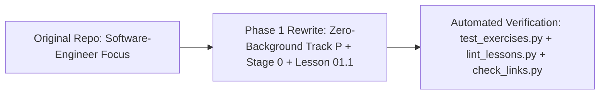

# Changelog — Mechatronics Roadmap Beginner-First Rewrite

## [2026-10-15] — Phase 1: Absolute-Beginner Entry Ramp (`Track P`, `Stage 0`, `Track 01 Lesson 01.1`) & Automated QA

### Added
- **Track P: Prerequisites (`track-p/`, 8 lessons + overview):**
  - `P.1-variables-types-and-arithmetic.md` — Variables, data types (`int`, `float`, `str`, `bool`), explicit `*`/`/`/`**`, parentheses order of operations, and `f-strings`.
  - `P.2-decisions-loops-and-lists.md` — Split from the old dense Python lesson; covers `if/elif/else` clamping, zero-indexed `list` collections, and `for` loops with `range()`.
  - `P.3-functions-assert-and-import.md` — Reusable functions (`def` and `return` vs. `print()`), `while` loops, `import math`, and automated self-testing with `assert`. (Deferred optional type hints `: float -> float`, `1e-9` tolerance, and `try/except` to Track 00 Lesson `T1.00a` where they are first needed).
  - `P.4-units-prefixes-binary-and-frequency.md` — SI base units, metric prefixes (`M`, `k`, `m`, `µ`), frequency vs. period ($f = 1/T$), and binary bits / powers of 2 ($2^N$, explaining why 8-bit is `0..255` and 10-bit is `0..1023`).
  - `P.5-algebra-and-trigonometry-for-robotics.md` — Formula rearrangement, linear range scaling, right-triangle trigonometry (`sin`, `cos`, `atan2`), and radians ($\pi\text{ rad} = 180^\circ$).
  - `P.6-reading-time-series-graphs.md` — Restored dedicated lesson on reading time-series graphs: **slope** ($\Delta y / \Delta t$) as rate of change (velocity/acceleration) and **rectangle area** ($v \cdot \Delta t$) as accumulated displacement using verified PhysicsClassroom resources.
  - `P.7-forces-torque-and-rotational-motion.md` — Mass vs. weight ($W = m \cdot g$), Newton's Second Law ($F_{\text{net}} = m \cdot a$), lever torque ($\tau = r \cdot F \sin\theta$), and converting `RPM` to `rad/s`.
  - `P.M-track-p-milestone.md` — End-to-end Python simulation milestone of a gravity-holding robot arm link.
- **Stage 0: Electronics & Microcontroller Foundations (`stage-0/`, 8 lessons + overview, standardized on Arduino Uno `5.0 V`):**
  - `S0.1-voltage-current-resistance-and-ohms-law.md` — Closed DC loops, ground (`0 V`), Voltage ($V$), Current ($I$), Resistance ($R$), Ohm's Law ($V = IR$), LED forward voltage ($V_f$), and power dissipation ($P = VI$).
  - `S0.2-breadboards-multimeter-and-short-circuits.md` — Schematic symbols, breadboard internal clips (`a–e` vs. `f–j`), parallel voltmeter vs. series ammeter probing, and demonstrating short circuits in **Falstad** (documenting that Wokwi's digital breadboard does not flag power-to-ground shorts).
  - `S0.3-series-parallel-and-voltage-dividers.md` — Series vs. parallel resistor rules, voltage dividers ($V_{\text{out}} = V_{\text{in}}\frac{R_2}{R_1+R_2}$), and 3-pin potentiometers.
  - `S0.4-capacitors-and-power-rail-decoupling.md` — Capacitor charge storage ($C$), the $RC$ time constant ($\tau = RC$), decoupling/bypass capacitors across `5V` and `GND`, and polarized electrolytic safety.
  - `S0.5-arduino-uno-digital-io-and-pullups.md` — Arduino Uno (`5.0 V`, `20 mA` pin limit) `setup()` vs. `loop()`, `pinMode`, `digitalWrite`, floating input pins, and active-low buttons using `INPUT_PULLUP`.
  - `S0.6-adc-analog-read-and-serial-monitor.md` — 10-bit ADC (`analogRead(A0)` returning `0..1023` for `0..5.0 V`), quantization step size (`4.89 mV`), avoiding the C/C++ integer division trap (`5.0 / 1023.0`), and `9600 baud` UART Serial Monitor logging.
  - `S0.7-pwm-duty-cycle-and-analog-write.md` — Focused strictly on PWM duty cycle, average voltage, viewing live PWM square waves on **Falstad's oscilloscope**, dimming an LED in Wokwi via 8-bit `analogWrite` (`0..255`), and the "Looking Ahead" note comparing Uno's `~490/980 Hz` LED PWM against `20 kHz` ultrasonic motor PWM.
  - `S0.M-stage-0-milestone.md` — Simplified LED dimmer milestone on Arduino Uno in Wokwi with a potentiometer on `A0`, active-low safety kill-switch on `Pin 2`, PWM LED on `Pin 9`, and Serial Monitor telemetry.
- **Track 01 Entry Lesson (`01-electronics-and-power/01.1-mosfet-inductor-flyback.md`):**
  - Moved low-side N-Channel MOSFET switching (`Gate`, `Drain`, `Source`, common ground, $10\text{ k}\Omega$ gate pull-down), inductors (motor coils), inductive kickback ($V_L = L \frac{\Delta I}{\Delta t}$), and reverse-biased flyback diode clamping into Lesson `01.1` right before the H-bridge.
- **Beginner Support Guides (`resources/`):**
  - `resources/glossary.md` — Plain-English definitions and first-lesson citations for every technical term introduced in Track P, Stage 0, and Lesson 01.1.
  - `resources/safety.md` — Pre-flight continuity checks, multimeter current-jack fuse rule, polarized electrolytic capacitor hazard, flyback diode orientation, and mechanical E-stop rules.
  - `resources/troubleshooting.md` — Symptom-to-fix lookup tables for Python, Falstad, Wokwi, and breadboard wiring.
- **Automated Verification Suite & CI:**
  - `tests/test_exercises.py` — Automated test runner verifying every lesson solution block and every numerical quiz calculation across `Track P`, `Stage 0`, and `Lesson 01.1`.
  - `scripts/lint_lessons.py` — Automated lesson template linter enforcing all 7 required sections (`Goal`, `Prerequisites`, `Learn`, `Do it yourself`, `Common mistakes & troubleshooting`, `Check yourself`, `Recap`), max 2 new ideas per lesson, bridge notes word count (150–250 words), runnable starter code with `TODO`s, 3-step hint ladder, check-yourself answers, and time estimates.
  - `scripts/check_links.py` & `LINK_REPORT.md` + `.github/workflows/link-check.yml` — Automated HTTP status and static HTML heading verifier (marking JS apps `[verify in-app]`) plus weekly GitHub Action.

### Changed
- **`README.md`:** Reorganized into a welcoming, beginner-first start page (`Track P` $\rightarrow$ `Stage 0` $\rightarrow$ `Pass 1: Tier 1`) with **Pass 2 (Tier 2)** and **Pass 3 (Tier 3)** cleanly separated below an **`Advanced (Later)`** divider.
