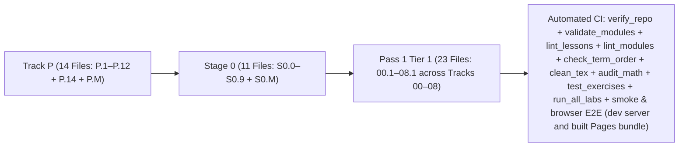

# Changelog — Beginner-First Mechatronics Roadmap Rewrite

All structural changes, lesson splits, curriculum reorderings, angle-convention standardizations, and automated verification additions are logged below.

---

## [2026-10-18] — Run 68: Quaternion SLERP Gets a Home, and a Concept May Have Two Owners

### 1. The last substantive unresolved concept is taught, gated and resolved
- `00-foundations.T3.00a` is the rotation-representations page (hat map, `exp([phi]_x)`, Rodrigues), which is exactly where the unit quaternion's exponential belongs. `## 3. Formalization` gained item 3: the unit-quaternion chart `q(phi) = (cos(theta/2), u_hat sin(theta/2))`, the body-frame kinematics `qdot = (1/2) q (x) (0, omega)` with `|qdot| = |omega|/2`, and SLERP with `Omega = acos(q0 . q1)` plus the `q1 -> -q1` shortest-arc rule. The energy-balance item moved from 3 to 4 and every remediation reference was updated with it.
- The page now declares `owns: [unit_quaternion_kinematics_slerp]` and its Gate test tags it twice: Q9 computes the scalar part of the $90^\circ$ SLERP at $t=0.5$ ($0.707106781$), Q10 the tangent rate $\|\dot q\|$ at $3.0\ \text{rad/s}$ ($1.5$). Gate 8/10.
- `resources/legacy-prereq-map.json` resolves the id to that page with body evidence `kinematics, quaternion, slerp, unit`; **unresolved falls from 2 to 1** (only `q131_cordic_hardware_coprocessor`, which predates this work).
- The mentions verdict for the pair moved `drop` → `own`: the page that was correctly recorded as *not* teaching it now does.

### 2. A concept may have more than one owning page
- `mentions_audit.suggestion()` no longer requires the page to be the single crosswalk teacher. `own` now rests on the two facts a page controls: it engages the idea in §3/§4/§5, and its Gate test tags it. The crosswalk's `page` is reported, not enforced.
- This is safe because the Gate tag is already gated by `validate_modules`: a tag is accepted only for a concept the page introduces or owns, so a second owner has to declare the concept in `owns:` and pass that check.
- Current totals are unchanged — **18 dropped, 3 owned, 20 kept** — because no page that merely keeps a claim also tags it. The rule was exercised directly: a synthetic row with a Gate tag and a teacher elsewhere returns `own`; the same row without the tag returns `keep`, and without graded engagement `drop`.

### 3. The step-size cost, published rather than hidden
- `00-foundations.T3.00a` now answers step **12.5**, which is exactly the Tier 3 threshold, so `docs/STEP_SIZE_AUDIT.md` lists it as a `JUMP` (9 flagged pages, up from 8). That is the honest price of the added notation: the quaternion product symbol stays because it is the correct notation, while `arccos` was written as `cos^-1` to avoid a second new command for no gain.

### 4. Verification
- Full CI Python step (23 commands) exit 0: `validate_modules`, `module_parity --check`, `tests/test_module_parity.py` (19 tests), `mentions --check` (41 pairs 18/3/20), `crosswalk --check` (101 resolved, 1 unresolved), `stepsize --check`, `verify_repo` PASS (134 files, 135 diagrams, 1776 links, 0 errors). `audit_math` PASS (markdown=16588, equations=27, mathviews=107, failures=0).
- Negative path: deleting `owns:` from the page makes `validate_modules` exit 1 with `Gate test tags unknown concept 'unit_quaternion_kinematics_slerp'` (restored, exit 0).

## [2026-10-18] — Run 67: The Crosswalk Stops Confirming a Claim With the Claim

### 1. `legacy_crosswalk.py` now reads page bodies only
- `page_texts()` strips front matter before matching. A page's own `uses:` line names every legacy concept it claims to depend on, so counting front matter let the check validate a mapping against the very sentence that asserted it — `so2_rotation_matrix` and `augmented_kalman_disturbance_observer` had both been "confirmed" that way.
- Resolution is now two candidates in order — the committed page, then the page the legacy module maps to — and a candidate is accepted only when its **body** carries two of the concept's tokens or its rarest token. The old third branch, which scored every page purely on token rarity, is gone: it is what moved `khatib_operational_space_inertia_nullspace` to a page that merely says "operational space", and `astrom_furuta_energy_swingup` to a page that only names the rig.
- Anything weaker is recorded as `unresolved`, never guessed.

### 2. What the repair changed
| Concept | Before | After |
| :--- | :--- | :--- |
| `differential_bessel_anti_aliasing_filter` | `01-electronics.T3.01a`, evidence included `differential` | same page, evidence `aliasing, anti, bessel, filter` — the body never says "differential" |
| `unit_quaternion_kinematics_slerp` | `00-foundations.T2.00d`, evidence `unit` | unresolved: no page body names a quaternion or SLERP |

Totals: **100 resolved, 2 recorded unresolved** (the quaternion id joins `q131_cordic_hardware_coprocessor`). No mapping moved to a different page, which is the point — the heuristic had no business moving any.

### 3. The disturbance observer now has a teacher, a derivation and a gate
- `05-control.T2.05a` gains `owns: [augmented_kalman_disturbance_observer]`, a `## 3. Formalization` item 3 bullet deriving the augmented model ($A_{\text{aug}} = \begin{bmatrix} A_d & B_d \\ 0 & 1 \end{bmatrix}$, $C_{\text{aug}} = [C\ 0]$, $\hat d_{k+1} = \hat d_k + \ell_i r_k$), and Gate Q9–Q10: the per-tick estimate increment ($2.0\times10^{-4}$) and why the augmentation removes the steady-state bias. Gate 8/10.
- The crosswalk's evidence for that id is now `augmented, disturbance, kalman, observer`, all from the body.

### 4. Verification
- `legacy_crosswalk.py --check` exit 0 (`100 legacy concepts resolve to pages whose bodies carry their terms; 2 recorded as unresolved`); `--json` exits 1 while a problem is open, as before.
- Negative path: adding `unit_quaternion_kinematics_slerp` to a page's `uses:` no longer resolves it — front matter is ignored, the concept stays unresolved (restored immediately).
- Full CI Python step (23 commands) exit 0, including `validate_modules`, `module_parity --check`, `tests/test_module_parity.py` (19 tests), `mentions --check` (41 pairs: 19/2/20), `stepsize --check` (8 flagged, 0 broken) and `verify_repo` PASS (134 files, 135 diagrams, 1776 links, 0 errors); `audit_math` PASS (markdown=16556, equations=27, mathviews=107, failures=0).

## [2026-10-18] — Run 66: Two Legacy Concepts Promoted to `owns:`, Five More Claims Dropped

### 1. `own` became an applied outcome instead of a permanent zero
- `03-sensors.T2.03a` now names what its Park matrix *is*: `## 3. Formalization` item 2 gained one paragraph stating $R(\theta_e) \in SO(2)$, $\det R = 1$, $R(-\theta_e) = R(\theta_e)^\top = R(\theta_e)^{-1}$ and $R(\theta_a)R(\theta_b) = R(\theta_a + \theta_b)$ — the three facts the page was already using without naming. Gate Q9 (`[Concept: so2_rotation_matrix]`) tests the composition, and the gate moves from 8 to 9 questions (`8/9`).
- `07-systems.T2.07a` already taught the regen surge across all eight body sections (31 evidence lines). Gate Q9 (`[Concept: regenerative_braking_bus_voltage_surge]`) tests the unclamped bus voltage itself — $166.060230$ V for 13.5 J into 1000 µF from 24 V — which the gate previously skipped; `8/9`.
- Both ids moved from `uses:` to a new **`owns:`** front-matter block: removed from `uses:` because the page does not assume them, kept out of `new_concepts:` because each page already spends its three-concept budget on material of its own. `scripts/validate_modules.py`, `scripts/module_parity.py`'s ladder test and `tests/test_module_parity.py` all count `owns:` as ladder material for Gate tagging, and `validate_modules` rejects an id listed in both `owns:` and `uses:` (or `owns:` and `new_concepts:`).

### 2. The evidence rule was too loose, and the two failed near-owns proved it
- A line now counts only when it carries **two** of the concept's tokens or its **core term** — the previous "any rare token" arm counted a page mentioning "Kalman" six times as engaging `augmented_kalman_disturbance_observer`, and a page mentioning "rotation matrix" twice as engaging `so2_rotation_matrix`.
- The tightening flipped five pairs from `keep` to `drop`, and `docs/STEP_SIZE_AUDIT.md` independently confirms all five: they were on its "Assumptions no page teaches" list.
  | Page | Concept | Why it is a drop |
  | :--- | :--- | :--- |
  | `00-foundations.T2.00a` | `symplectic_euler_integration` | only a spaced-review tag and an answer option; the page uses plain Euler discretisation |
  | `01-electronics.T2.01a` | `star_grounding` | the phrase appears nowhere in the body |
  | `04-embedded.T2.04a` | `hardware_timer_isr_and_jitter` | only the spaced-review tag; the page teaches DMA ping-pong ISRs |
  | `04-embedded.T2.04a` | `packed_binary_telemetry_struct` | "packed" never appears; the frame size is arithmetic, not a layout dependency |
  | `05-control.T3.05a` | `augmented_kalman_disturbance_observer` | no `disturbance`, `observer` or `augmented` anywhere in the body |
- `legacy_crosswalk.py` re-resolved that last id to `05-control.T2.05a` (evidence `disturbance`, `kalman`, `observer`), which is the page that actually discusses a disturbance observer.

### 3. Current totals
- 41 pairs across 22 pages: **19 dropped, 2 owned, 20 kept**.
- `docs/PASSING_MENTIONS.md` regenerates from the decisions; `--apply` is idempotent (byte-identical doc and decisions on a second run).

### 4. Verification
- `mentions --check` exit 0 (`41 pairs decided and applied; 19 dropped, 2 owned, 20 kept`); `stepsize --check` exit 0 (8 flagged, 0 broken prerequisites); `crosswalk --check` exit 0 (101 resolved, 1 recorded); `validate_modules` exit 0; `module_parity --check` and `tests/test_module_parity.py` (19 tests) exit 0.
- Full CI Python step (23 commands) re-run locally, all exit 0, including `verify_repo` PASS (134 files, 135 diagrams, 1776 links, 0 errors) and `clean_tex --check`; `node scripts/audit_math.mjs .` PASS (markdown=16535, equations=27, mathviews=107, failures=0).
- Negative paths: an owned concept added back to `uses:` exits 1 with `concept in both owns and uses`; a Gate tag for a concept the page neither introduces nor owns exits 1 with `missing ladder concept` + `unknown concept`.

## [2026-10-17] — Run 59: The Cheat Test Reaches Tier 2, and the Route Gets One Page

### 1. Three claims that had been reported but not checked
- **The cheat case exists, but only at Tier 3.** `scripts/e2e_browser_workbench.mjs` step 2b printed `EX.05-control.T3.05a`'s own PASS line and asserted MATCHED presentation + FAILED behaviour + no verification. There was no Tier 2 entry, and a beginner's first graded package is Tier 2.
- **The ESKF reset is real.** `05-control.T3.05b` carries the fault `no_reset_double_counts`, which fails `test_a_zero_innovation_step_does_not_reapply_the_consumed_correction`; `scripts/run_exercise.py --only 05-control.T3.05b --verbose` reports `PASS fault no_reset_double_counts fails ...`, alongside `reset_drops_the_innovation` and the print-only case, 13/13.
- **The three bridges are already separate packages**, each with its own suite and faults: `T3.05a` Joseph covariance + NEES, `T3.05b` Rodrigues/inject/reset, `T3.05c` CBF. All three report 13/13; nothing needed splitting.

### 2. Both browser suites now spoof a Tier 2 entry as well
- `scripts/e2e_browser_workbench.mjs` step 2b and `scripts/e2e_pages_bundle.mjs` (after its 46-entry pass) now loop over `EX.02-mechanics.T2.02a` and `EX.05-control.T3.05a`: printing an entry's published PASS line must read MATCHED on presentation, FAILED on behaviour, and leave the verified count untouched.

### 3. `docs/SIM_ROUTE.md`, generated from page metadata
- `scripts/generate_sim_route.py` declares the Core route once and renders the document: Core = 40 modules (every Tier 1 and Tier 2 page, plus the rotation/covariance/ESKF/CBF depth line and one capstone) + 24 prose lessons; Extensions = the other 6 modules. Hours are summed from `est_hours`, `typical_hours` and `slow_learner_hours` - never hand-entered - and `--check` fails on drift.
- Measured: **Core 180.5-224 h**, Extensions 29.5 h. The "340+ hours" figure used in planning is not what the pages claim; the required route is already about two thirds of it.
- `tests/test_sim_route.py` (5 cases) pins the document to the pages, fails if any module appears in neither table, recomputes the Core total independently, and keeps the four Tier 3 bridges + one capstone on the required route. Wired into `npm run check:route` and the CI verify step.

### 4. Verification
- `python3 tests/test_sim_route.py` - 5/5 pass; `python3 scripts/generate_sim_route.py --check` exit 0 after regeneration, and exit 1 when a row is hand-edited (restored immediately).
- `npm run test:e2e` exit 0 - `[PASS] Real-browser Chromium E2E tests passed ...` with the new Tier 2 spoof in the loop.
- `PLAYWRIGHT_BROWSERS=chromium npm run test:e2e:pages` exit 0 - all 46 entries graded, then `ok chromium: a Tier 2 and a Tier 3 entry print their own PASS line and stay unverified`.

## [2026-10-18] — Run 63: Forty-One Legacy Claims in `uses:` Get a Verdict

### 1. What was measured
- `scripts/mentions_audit.py` reads every bridge page whose `uses:` names a legacy concept (41 pairs across 22 pages) and searches the body for the concept's **core term** (its rarest token, e.g. `so2`, `lqr`, `crc16`) plus its other tokens, requiring two tokens on a line or the rare one alone. It records the lines and the numbered sections they fall in, so "only in §1 Why it matters" and "used in §4 Worked example and §5 Exercise" are distinguishable claims.
- Decisions live in `resources/mentions-decisions.json` and the report in `docs/PASSING_MENTIONS.md`: **14 dropped, 0 owned, 27 kept**.

### 2. The 14 claims removed
| Page | Concept | Evidence |
| :--- | :--- | :--- |
| `00-foundations.T2.00a` | `so2_rotation_matrix` | 0 lines, no `so2` anywhere |
| `00-foundations.T3.00a` | `unit_quaternion_kinematics_slerp` | 0 lines, no `slerp` |
| `02-mechanics.T1.02a` | `so2_rotation_matrix` | 0 lines |
| `03-sensors.T3.03a` | `sar_adc_c0g_charge_bucket_design` | 0 lines, no `c0g` |
| `05-control.T1.05a` | `symplectic_euler_integration` | 1 line, §7 only |
| `05-control.T1.05a` | `hardware_timer_isr_and_jitter` | 1 line, §6 only |
| `05-control.T2.05a` | `discrete_pid_controller` | 1 line, §1 only |
| `05-control.T3.05a`, `05-control.T3.05b` | `discrete_infinite_horizon_lqr` | 0 lines, no `lqr` |
| `06-robotics.T1.06a` | `discrete_pid_controller` | 1 line, §7 only |
| `06-robotics.T1.06a` | `planar_2link_forward_kinematics` | 0 lines |
| `06-robotics.T3.06a` | `ruckig_time_optimal_jerk_limited_scurve` | 1 line, §8 only |
| `07-systems.T2.07a` | `can_fd_mit_impedance_packet_packing` | 5 lines, all prose (§2, §6, §7) |
| `07-systems.T3.06a` | `can_fd_crc16_rolling_counter_watchdog` | 0 lines, no `crc16` |

### 3. Why nothing was promoted to `new_concepts`
- `own` requires three things together: the page is the concept's crosswalk teacher, it engages the idea in §3/§4/§5, and its Gate test already tags the concept. Three pages passed the first two (`03-sensors.T2.03a` for `so2`, `05-control.T3.05a` for the disturbance observer, `07-systems.T2.07a` for the regen surge) and none passed the third, so the honest decision is `keep`. Promoting without the gate tag failed `validate_modules` with `Gate test missing ladder concept` — the gate is what makes ownership real, and it is not something a rename can supply.

### 4. Verification
- `python3 scripts/mentions_audit.py --check` exit 0 (`41 pairs decided and applied; 14 dropped, 0 owned, 27 kept`); re-adding a dropped id to `uses:` exits 1 with the document stale against the decisions (restored immediately).
- `python3 scripts/validate_modules.py` exit 0 under Python 3.12; `verify_repo.py` PASS (134 files, 135 diagrams, 1776 links, 0 errors); `module_parity --check`, `lint_modules`, `audit_step_size --check` (8 flagged, 0 broken prerequisites) and `legacy_crosswalk --check` (101 resolved) all exit 0.
- Wired into `npm run check:mentions`, the CI verify step and `README.md`'s validation list.

## [2026-10-18] — Run 62: Every Superseded Prerequisite Now Points at a Real Page

### 1. 38 citations on 24 pages, repointed
- Every `prereqs:` entry that named a module living only in `modules/_index.yaml`'s `legacy:` section now names the page that teaches that content: `00-foundations.T1.01` → `00-foundations.T1.00e`, `01-electronics.T1.02` → `01-electronics.T1.01b`, `02-mechanics.T1.03` → `02-mechanics.T1.02a`, `04-embedded.T2.05` → `04-embedded.T2.04b`, `05-control.T2.06` → `05-control.T2.05a`, `06-robotics.T3.07` → `07-systems.T3.06a`, `01-electronics.T3.02` → `01-electronics.T3.01a`, `03-sensors.T3.04` → `03-sensors.T3.03a`, and eleven more.
- Applied on 24 module pages and 24 bridge entries in `modules/_index.yaml`; duplicates collapsed (the capstone already listed its new prereq). The last two were on extension pages (`03-sensors.T3.03a`, `04-embedded.T3.04a`), which the Core-only audit table had not shown — the crosswalk check is now repo-wide for exactly that reason.
- Six pages gained the prerequisite that actually introduces a concept they `uses:` — `05-control.T1.05a` → `01-electronics.T1.01b` for `pwm_duty_cycle_effective_voltage`, `00-foundations.T3.00a` and the two 05-control Tier 3 bridges → `00-foundations.T2.00e` for `continuous_state_space_matrices`, `06-robotics.T2.06b` → `04-embedded.T2.04d`, `07-systems.T3.06a` → `07-systems.T1.07a`.

### 2. The resolution is data, and both checkers prove it
- `resources/legacy-prereq-map.json` holds the crosswalk: each legacy id → teaching page → evidence terms, plus a concept-level map for the 102 concept ids the legacy modules still own. `scripts/legacy_crosswalk.py` derives the concept half from page text and `--check`s it; 101 resolve, and 1 (`q131_cordic_hardware_coprocessor`) is recorded as unresolved because no page mentions it.
- `scripts/audit_step_size.py` now prints a **Resolved prerequisites** table and exits 1 when a legacy id is still cited, when a mapped page does not exist, or when an evidence term is missing from it. `validate_modules.py` reads the same map for concept reachability instead of treating the phantom legacy nodes as modules.

### 3. Verification
- `python3 scripts/audit_step_size.py --check` exit 0 (`24 pages, 8 flagged, 0 broken prerequisites`); exit 1 with `00-foundations.T1.01: still cited by 00-foundations.T2.00a` when a legacy id is pasted back, and exit 1 with `does not contain ['notpresent']` when one evidence term is wrong (both restored).
- `python3 scripts/legacy_crosswalk.py --check` exit 0 (`101 legacy concepts resolve to pages that contain their terms; 1 recorded as unresolved`).
- `/opt/homebrew/bin/python3.12 scripts/validate_modules.py` exit 0 — `OK (70 modules: 24 legacy, 46 bridge [16 Tier 1] across 25 ladders; 48 beginner lessons; all 46 Expected output blocks & script docstrings verified)`. The default `python3` on this Mac is 3.9, where `float | None` in a page block raises `unsupported operand type(s) for |`; that is the interpreter, not the page, and 3.12 is what CI uses. This entry also restores the README-size claim the validator expects (`111 KB $\to$ 31 KB`).
- Wired into `npm run check:crosswalk` and the CI verify step, and named in `README.md`'s validation list.

## [2026-10-17] — Run 61: Six Step-Size Signals, Eight Pages That Jump, and 100 Concepts Nobody Teaches

### 1. `docs/STEP_SIZE_AUDIT.md`, generated from the pages themselves
- `scripts/audit_step_size.py` reads the 24 Core Tier 2/3 pages (the route `generate_sim_route.py` declares) and computes six signals: declared `new_concepts`, how many of those ids bundle two objects with `_and_`, first-use LaTeX commands (a command no earlier Core page used), the `difficulty.math` change against the previous Core page in the same track, `TODO` holes in the scaffold, and prerequisite citations with no page on disk.
- `step = 2·concepts + 2·bundled + 0.5·notation + 1·max(0,Δ) + 0.5·max(0,todos−5)`, flagged at the tier's 75th percentile or above **and** an absolute floor of 8, plus two absolute rules (a math level jump of +2, or three bundled ids). Weights are stated in the script, every column is published, and `--check` fails on a hand edit.

### 2. Eight pages jump — each with its numbers
| Page | Step | Evidence |
| :--- | ---: | :--- |
| `00-foundations.T2.00a` | 18.0 | 18 first-use notation commands (plainest page in the repo: `frac`, `begin`, `cdot`, …), 3 concepts, one bundled |
| `00-foundations.T2.00d` | 17.0 | complex numbers + Euler + phasors + complex impedance + Bode in one page, three bundled ids |
| `00-foundations.T2.00b` | 15.5 | 13 first-use commands (`det`, `Sigma`, `hat`, …), linear independence + change of basis |
| `00-foundations.T2.00f` | 15.0 | Nyquist + Tustin pre-warping + biquad + Gaussian covariance, math 3 → 4 |
| `02-mechanics.T2.02a` | 11.5 | math 2 → 4, SE(3) + Jacobian + parallel-axis behind one id, 2 dangling prereqs |
| `04-embedded.T2.04b` | 14.5 | rate-monotonic RTA + priority inversion + CAN arbitration in one page, three bundled ids |
| `06-robotics.T2.06b` | 15.0 | ROS 2 launch/composition + rosbag2 replay + Gazebo/MuJoCo bridge, three bundled ids |
| `08-capstones.T3.07a` | 12.5 | RSS budget + latency budget + safety sign-off, three bundled ids |

### 3. The defect the numbers exposed
- **23 prerequisite citations on 12 of the 24 pages name a module with no page.** They point into `modules/_index.yaml`'s `legacy:` section, which the Quality Spec calls superseded; 15 distinct ids are cited. Not one of those legacy modules' **100** declared concepts is claimed by any of the 46 bridge pages' `new_concepts`, so there is no replacement page to be found by concept overlap.
- **13 pages assume 23 concepts that no page claims to teach**: `symplectic_euler_integration` and `so2_rotation_matrix` on `00.T2.00a`, `planar_2link_forward_kinematics` on `02.T2.02a`, `hardware_timer_isr_and_jitter` on `04.T2.04a`, `discrete_infinite_horizon_lqr` on all three 05-control Tier 3 bridges, and so on. That is the sharpest form of an unbridged jump: required, used, taught nowhere.
- **21 of 24 pages declare three `new_concepts`** against `QUALITY_SPEC.md`'s at-most-two contract, and **19 hide a third object inside an `_and_` id** — `bode_magnitude_db_and_phase`, `geometric_jacobian_and_parallel_axis_theorem`, `rss_and_worst_case_spatial_error_budget`.

### 4. Verification
- `python3 scripts/audit_step_size.py --check` exit 0 (`24 pages, 8 flagged, 23 broken prerequisites`); exit 1 against a hand-edited table row (restored immediately).
- `python3 scripts/verify_repo.py` PASS at 133 files / 134 diagrams / 1775 links / 0 errors, after the notation names were printed without a leading backslash (the checker rejects a LaTeX command in prose, inline code included). `clean_tex` PASS, `audit_math` PASS (`failures=0`), `module_parity --check` PASS, `ci.yml` parses.
- Wired into `npm run check:stepsize` and the CI verify step, and named in `README.md`'s validation list.

## [2026-10-17] — Run 60: The Exit Gate Is Ten Items, and Each Miss Names Its Lesson

### 1. `docs/TIER1_EXIT_CHECK.md` — the maths half of Gate 1→2
- Ten items, closed book, 30–40 minutes: five on reading a rate (units, sign, nine intervals for ten samples, average vs instantaneous at a peak, quantisation noise when the window halves) and five on accumulating one (signed area, triangle area, the starting value, bias drift, and left/right/trapezoid error bars).
- Every row carries an `Ramp lesson` column, and the two lessons it can name are the two that exist. Scoring is explicit (10/10 start Tier 2, 8–9 do the named lesson first, ≤7 do both, <6 start at the ramp) and every answer is in a `
` block, so the check can be taken without an instructor.
- The practical half is unchanged and still lives in the Workbench: Tab 10 → Tier 1 Exit Review's six gates.

### 2. `ramp/R.1-rate-of-change.md` and `ramp/R.2-accumulation.md`
- R.1 reads `dq/dt` off ten 100 Hz encoder samples: `18.408 rad/s` on the first step, `−12.272 rad/s` on the last, `4.943 rad/s` averaged over 90 ms, and `−1.150 rad/s` through the peak, so the average and the instantaneous rate disagree in the lesson's own numbers. R.2 runs the same trace backwards: left rule `0.300 rad`, right rule `0.280 rad`, trapezoid `0.290 rad`, `q0 = 0.5` gives `0.790 rad`, and a 0.02 rad/s bias is `0.600 rad` after 30 s.
- Both follow the Tier 1 lesson template exactly — front matter with ≤2 ideas, the seven H2 sections, `### Bridge Notes` in range, a starter with numbered TODOs, an executed Expected Output, two-plus common mistakes, three answered checks and a recap checklist — and both are linted by `scripts/lint_lessons.py`, whose 48-lesson count is now separate from the ramp count.
- `ramp/README.md` states the rule for a third lesson: a check item must exist whose miss has no lesson behind it.

### 3. The map cannot rot: `scripts/check_ramp_lessons.py`
- Runs each lesson's Full Solution and diffs its stdout against the published Expected Output, checks every starter `def` still exists in the solution, and verifies the mapping in both directions — every item's `Ramp lesson` exists, and every ramp lesson repairs at least one item. Wired into `npm run check:ramp` and the CI verify step; documented in `README.md`'s validation list and its track matrix.

### 4. Verification
- `python3 scripts/check_ramp_lessons.py` exit 0 (`OK: 2 ramp lessons print their Expected Output and every exit-check item points at one of them`); against a hand-edited Expected Output it exits 1 naming the lesson and diffing want/got; against `R.9` in a row it exits 1 naming every item that points at a lesson which does not exist (both restored immediately).
- `python3 scripts/lint_lessons.py` exit 0 — 48 beginner lessons **and** 2 ramp lessons; it caught two real defects first: R.1's expected output was 0.001 rad/s off the code's rounding, and R.2's aligned columns needed `output_match: "exact"`.
- `python3 scripts/verify_repo.py` now PASS at 132 files / 133 Mermaid diagrams / 1773 links / 0 errors. It had been failing on `docs/SIM_ROUTE.md` (no diagram) since that file was generated, so `scripts/generate_sim_route.py` now renders one and the document was regenerated; `test_sim_route.py` 5/5 and `--check` are green.
- `python3 scripts/clean_tex.py --check` exit 0, `node scripts/audit_math.mjs .` exit 0 (`failures=0`), `python3 scripts/generate_python_lessons_data.py --check` exit 0 (the ramp is prose, not a workbench lesson).

## [2026-10-17] — Run 58: macOS Cannot Get a Linux Lockfile Any More

### 1. The lockfile listed only one platform's binaries
- `package-lock.json` had been resolved on Linux, so it carried `@rollup/rollup-linux-x64-*` and nothing else: `npm ci` on a Mac installed no native binaries, and `vite build` died later with `Cannot find module '@rollup/rollup-darwin-arm64'`.
- Regenerated so every natively-executed dependency carries all four `os`/`cpu` pairs it supports - rollup, esbuild, `@tailwindcss/oxide`, lightningcss and `fsevents` now include darwin-arm64, darwin-x64, linux-arm64 and linux-x64. 173 packages, `lockfileVersion` 3, root dependency ranges unchanged.

### 2. A check that names the fault in one sentence
- `scripts/check_native_deps.mjs` (`npm run check:native`) reads the lockfile, keeps the optional packages whose `os`/`cpu` match this machine and whose parent is installed, and exits 1 listing any that are absent from `node_modules` - with the four `npm install --package-lock-only --os=… --cpu=…` commands that regenerate a complete lockfile.
- Proven against the exact regression: moving `node_modules/@rollup/rollup-darwin-arm64` aside exits 1 naming it; restoring it reports `[PASS] all 5 optional package(s) for darwin/arm64 are installed`.

### 3. CI installs on macOS from scratch
- New `native-install-macos` job (`macos-latest`): `npm ci`, then `npm run check:native`, then `npm run build` - the build is what loads rollup, esbuild, Tailwind's oxide and Lightning CSS natively, so a Linux-only lockfile fails this job at install and names the package on the pull request.
- `build-workbench` runs the same check after its `npm ci`, covering the reverse direction (linux/x64 entries dropped).

### 4. Verification
- Locally, the job's steps in order: `rm -rf node_modules`, `npm ci`, `check:native` -> `[PASS] all 5`, `npm run build` -> `✓ built in 1.77s`.
- The workflow parses with four jobs in order (`verify-and-test`, `native-install-macos`, `build-workbench`, `deploy-pages`).
- Limitation: the darwin/arm64 half runs on this Mac; the `linux/x64` assertion in `build-workbench` cannot execute here and is covered by `npm ci --dry-run --os=linux --cpu=x64` exiting 0.

## [2026-10-17] — Run 57: The Sketch Verifier Finds Its Own C++ Headers

### 1. The host gap was a broken Command Line Tools header directory
- `<CLT>/usr/include/c++/v1` on this machine holds only `__cxx_version`, while the active SDK ships the real libc++ (192 headers, `cstdio` included). Every sketch therefore failed with `fatal error: 'cstdio' file not found` even though the toolchain was complete.
- `scripts/extract_and_compile_sketches.py` now probes the compiler with `-fsyntax-only`; only when `<cstdio>` is missing does it add the active SDK's `usr/include/c++/v1` with `-isystem` (SDK path from `xcrun --show-sdk-path`, then the CLT `MacOSX.sdk` default). A healthy toolchain gets no extra flags.
- Five unit tests (`tests/test_sketch_host_verify.py`) drive the helper with fake compilers: already-working, fixed-by-`-isystem`, a candidate without `cstdio`, hopeless, and no candidates.

### 2. Verification
- `python3 -m unittest discover -s tests` - **93/93 pass, exit 0**, including `test_arduino_wokwi_lessons_python_mirrors_and_cpp_sketches` and the ten host-compiled sketches (their Serial output matched each lesson's Expected Output).
- Negative path: the same flag set still fails a sketch with a real C++ error (`cannot initialize a variable of type 'int'`), so the repair does not neuter the check.
- `scripts/verify_repo.py` exit 0 (126 files, 0 link errors).

## [2026-10-17] — Run 56: Every Tier at 100%

### 1. The eleven Tier 1 rows
- `01-electronics.T1.01a`/`b`/`c`/`d` (25/25/30/29 cases, Gates 11/11, 8/8, 13/13, 13/13), `02-mechanics.T1.02a` (29, 8/8), `03-sensors.T1.03a` (49, 8/8), `04-embedded.T1.04a`/`b` (38/45, 8/8 each), `05-control.T1.05a` (48, 8/8), `06-robotics.T1.06a` (27, 8/8) and `07-systems.T1.07a` (32, 8/8 with 3/3 `[SAFETY]`), every Gate answered before its key was read.
- Tier 1 parity **94.8% -> 100.0%**; all three tiers and all 46 modules now report **100.0%**.

### 2. Two ladders contradicted their own packages
- `06-robotics.T1.06a` said to hold the final pose "once $t \ge T$", but its suite asks for the cubic's terminal deceleration at exactly $t = T$ and the page's own full solution clamps only for $t > T$. The Starter TODO and the Common-mistakes row now say $t > T$ and name $-6\Delta q/T^2$.
- `07-systems.T1.07a`'s refusal item covered a "zero or negative phase budget" (readable as the total); the suite also rejects `(-1.0, 1.0, 1.0)`, a negative stage whose sum is positive. The item now names the negative stage.
- Neither package needed a code fix beyond those spec details, and no assertion changed: the suites already tested both behaviours.

### 3. Verification
- `module_parity --check` green after regenerating `docs/coverage-table.md` (100.0% overall, ratchet held), `validate_modules` exit 0, coverage gate 46/46 `unstated: 0`, `lint_modules` 46/46, `run_exercise --only` green for all eleven packages.

## [2026-10-17] — Run 55: Tier 3 Closed at 100%

### 1. The last four rows
- `00-foundations.T3.00a` (22 cases, Gate 8/8), `02-mechanics.T3.02a` (45, 8/8), `06-robotics.T3.06a` (20, 10/10 with 2/2 `[SAFETY]`) and `07-systems.T3.06a` (31, 8/8 with 2/2 `[SAFETY]`), every Gate paper answered before its key was read. Rows and section in `docs/dogfood-log.md`.
- Tier 3 parity **97.5% -> 100.0%** (all 12 Tier 3 modules); overall **97.5% -> 98.2%**. Tier 1 (94.8%) is the only tier still short: 11 of its 16 modules have no dogfood row yet.

### 2. `06a`'s 1% bar was relative to an unstated start
- The suite asks the loss to fall below 1% of its first value; the page never said which weight sweep to start from, so a correct init with `gauss(0.4)` weights and `gauss(0.1)` biases begins at 0.423 and ends at 0.0060 (1.4%), failing a bar the course init (1.95 -> 0.0061, 0.31%) clears. Ladder item 5 now names the init and both measured trajectories. No assertion changed.
- The other three ladders already stated every guard their suites check; three packages passed first try.

### 3. Verification
- `validate_modules` exit 0, gate 46/46 `unstated: 0`, `lint_modules` 46/46, `module_parity --check` green after regenerating `docs/coverage-table.md`.
- `python3.15 -m unittest discover -s tests`: 87 of 88 pass; the one error is `test_arduino_wokwi_lessons_python_mirrors_and_cpp_sketches`, where `/usr/bin/g++` cannot find `cstdio` in this environment - a missing C++ toolchain header, not a repository change.

## [2026-10-17] — Run 54: The `05-control` Tier 3 Trio

### 1. Three modules in one sitting
- `05-control.T3.05a` (17 cases, Gate 6/6), `T3.05b` (14, 7/7) and `T3.05c` (16, 6/6), all Gate papers answered blind. `05a` and `05c` passed their packages first try; rows and section in `docs/dogfood-log.md`.

### 2. `05b` refused one thing less than its suite
- `inject_rotation` also refuses a nominal rotation that is not $3 \times 3$; the refusal item named only the two-component correction, so a $2 \times 2$ nominal matrix raised `IndexError` from the multiply. The item now states both, with the reason.

### 3. Counts
- Instrumented parity **97.1% -> 97.5%**; Tier 3 **95.6% -> 97.5%**. `docs/coverage-table.md` regenerated, `--check` green.

### 4. Verification
- `validate_modules` exit 0, gate `unstated: 0`, page test 46/46, `lint_modules` 46/46, `module_parity --check`, `run_exercise --only` for all three packages.

## [2026-10-17] — Run 53: `03-sensors.T3.03a` and the Rail Boundary

### 1. The module dogfooded
- `03-sensors.T3.03a`: 34 cases (27 behaviour, 7 transfer), Gate **8/8 answered blind**, 2 minutes, 0 hints. Row and section in `docs/dogfood-log.md`.

### 2. A guard that was right in form and wrong at the boundary
- `svpwm_duties` must refuse a command past the rail, so `0 <= d <= 1` reads correct - but $V_{\text{bus}}/\sqrt{3}$ sits a leg exactly on $1.0$ and the sampled sinusoid lands on $1.0 \pm 10^{-16}$. The transfer test allows $\pm 10^{-9}$ and caught the strict guard. A sixth ladder item states the slack and the counterexample that must still raise (25 V on a 24 V bus).

### 3. Verification
- `validate_modules` exit 0, gate `unstated: 0`, page test 46/46, `lint_modules` 46/46, `module_parity --check`, `run_exercise --only 03-sensors.T3.03a`.

## [2026-10-17] — Run 52: The Page's Scaffold Was Stale, Across Nine Pages

### 1. `08-capstones.T3.07a` dogfooded
- 42 cases (34 behaviour, 8 transfer), Gate **8/8 answered blind**, 3 minutes, 0 hints. Row and section in `docs/dogfood-log.md`.

### 2. Its Starter block listed 6 of the 9 holes
- The page showed a six-hole scaffold with an `error_budget_3sigma` signature missing `sensitivities`, a "6 TODOs" print, and a "38 tests" claim against a 42-test suite. A learner writing to the page could not have passed. The block is now `starter.py` verbatim and the count is corrected.

### 3. Measured across all 46 packages, then gated
- **9 pages** defined a different function set from their `starter.py` (`00-foundations.T1.00a/b/c/d`, `T2.00f`, `02-mechanics.T2.02a`, `05-control.T2.05a`, `T3.05c`, `08-capstones.T3.07a`) and **7 pages** carried a stale test count. All repaired.
- `scripts/validate_modules.py` gained both checks: the page's scaffold must define the same functions as the package's `starter.py`, and a stated test count must equal the behaviour plus transfer tests. Breaking a block by one name makes the validator report both lists.

### 4. Verification
- `validate_modules` exit 0, gate `unstated: 0`, page test 46/46, `lint_modules` 46/46, `module_parity --check`, `run_exercise --only 08-capstones.T3.07a`.

## [2026-10-17] — Run 51: `06-robotics.T3.06b` Passes First Time

### 1. The third Tier 3 module dogfooded
- `06-robotics.T3.06b`: 28 cases (22 behaviour, 6 transfer), Gate **8/8 answered blind**, 1 minute, 0 hints, no repair. Row and section in `docs/dogfood-log.md`.

### 2. Why this one needed no fix
- Its ladder already carried the refusal item added in Run 50, so the seven guards the suite checks (empty rollout, discount of one, inverted clip range, non-positive ratio, zero step clamp, inverted limits, non-positive timeout) were part of the teaching rather than a discovery. The two Tier 3 modules before it each spent a round on exactly that class of miss: the documentation change is what turned a repair into a first-attempt pass.

### 3. Counts
- Instrumented parity **96.6% -> 96.7%**; Tier 3 **93.8% -> 94.4%**. `docs/coverage-table.md` regenerated, `--check` green.

### 4. Verification
- `check_exercise_coverage` 46/46 `unstated: 0`, `validate_modules` exit 0, page test 46/46, `lint_modules` 46/46, `module_parity --check`, `run_exercise --only 06-robotics.T3.06b`.

## [2026-10-17] — Run 50: The Gate Reads the Item, Not the Word

### 1. `04-embedded.T3.04a` dogfooded
- 40 cases (32 behaviour, 8 transfer), Gate **8/8 answered blind**, 2 minutes, 0 hints. Eight failures on the first pass, all refusals the page never stated. Row in `docs/dogfood-log.md`.
- Writing its refusal item pinned the normalised angle range the tests enforce: `[-1, 1)`, because `+pi` collides with the one value `Q1.31` excludes while `-pi` is exactly `-2^31`.

### 2. Run 49's rule was satisfiable by a passing phrase
- That gate matched *lines that speak of refusing*, and this page's package introduction ends "...and the refusal to take an angle outside it" while naming every hole. One such word made the whole paragraph the statement, so a page with no guard stated passed.
- The rule now matches the dedicated item `N. **What the suite refuses.**` and reads only that. A test reproduces the page's exact shape - an introduction that mentions a refusal and names both functions still fails.

### 3. Eight pages had no dedicated item
- `00-foundations.T1.00c`, `T2.00b`, `T2.00c`, `T3.00a`, `04-embedded.T3.04a`, `06-robotics.T2.06a`, `T2.06b`, `T3.06a`: each given one, written from its own suite's refusal calls.

### 4. Verification
- Gate 46/46 with `unstated: 0`, 14 cases in `tests/test_exercise_coverage.py`, `validate_modules` exit 0, page test 46/46, `lint_modules` 46/46, `module_parity --check`.

## [2026-10-17] — Run 49: Every Refused Function Is Named

### 1. The rule is now naming, not just mentioning
- `scripts/check_exercise_coverage.py` reads each behaviour suite with `ast`, collects every `submission.<fn>(...)` call inside an `assertRaises(ValueError)` block, and requires the page's refusal statement (the lines above `### Full Solution` that speak of refusing) to name each of them. A page that says "some inputs are refused" no longer passes.
- The finding lists the exact functions that are unnamed, so the repair is one sentence rather than an investigation.

### 2. Twenty-seven pages repaired
- Each page's refusal statement was rewritten or added from its own suite's refusal calls, naming function by function: `00-foundations.T1.00a`, `T1.00e`, `01-electronics.T1.01a/b/d`, `T2.01a/b`, `T3.01a`, `02-mechanics.T1.02a`, `T3.02a`, `03-sensors.T1.03a`, `T3.03a`, `04-embedded.T1.04a/b`, `T2.04a/b/c`, `05-control.T1.05a`, `T2.05a`, `T3.05a/c`, `06-robotics.T1.06a`, `T3.06b`, `07-systems.T1.07a`, `T2.07a`, `T3.06a`, `08-capstones.T3.07a`.

### 3. The check cannot be satisfied by accident
- Five cases in `tests/test_exercise_coverage.py`: a silent page fails and lists its missing names, a page naming one of two refused functions is still a finding, naming both passes, a mention only under the Full Solution does not count, and a suite that refuses nothing is exempt. Against `00-foundations.T1.00a` as it stood before the sweep, the gate exits 1 naming all five functions.

### 4. Verification
- `check_exercise_coverage` 46/46 with `unstated: 0`, `validate_modules` exit 0, page test 46/46, `lint_modules` 46/46, `module_parity --check`, coverage and parity suites green.

## [2026-10-17] — Run 48: Every Page States Its Refusals

### 1. The 18 remaining silent pages repaired
- Each refusal sentence was built from that page's own guard inventory, extracted with `ast` from its behaviour suite (`assertRaises(ValueError)` blocks and the arguments passed), not from a template: `00-foundations.T1.00b/d/e`, `01-electronics.T1.01c/d`, `T2.01a/b`, `02-mechanics.T1.02a`, `T3.02a`, `03-sensors.T1.03a`, `T2.03a`, `04-embedded.T1.04b`, `T2.04d`, `05-control.T1.05a`, `T3.05b`, `06-robotics.T1.06a`, `T3.06b`, `08-capstones.T3.07a`. All 41 pages whose suite refuses input now say so.

### 2. The gate that keeps it green
- `scripts/check_exercise_coverage.py` added a fourth job: a suite carrying `with self.assertRaises(ValueError):` requires the page's `## 5. Exercise` section - above `### Full Solution`, so the answer block is not the teaching - to state a refusal. It is a wall, not a ratchet, and it was deliberately not shipped while 19 pages would have failed it.
- Four cases in `tests/test_exercise_coverage.py`: a silent page fails, a stated page passes, a mention under the Full Solution does not count, and a suite that refuses nothing is exempt.

### 3. Verification
- `check_exercise_coverage` 46/46 graded, `unstated: 0`; `validate_modules` exit 0, page test 46/46, `lint_modules` 46/46, `module_parity --check`, the coverage and parity suites (12 + 27 tests).

## [2026-10-17] — Run 47: Tier 3 Opens on Its Riskiest Module

### 1. The pick was ranked, not chosen by feel
- Tier 3 modules were sorted by their own front-matter difficulty: `01-electronics.T3.01a` leads on math (5), tools (4), hardware risk (high) and safety (high), with 5 estimated hours and 39 package cases. Rows in `docs/dogfood-log.md`.

### 2. A missing refusal contract, three holes wide
- The first attempt failed exactly three of 39 tests, all refusals the hint ladder never stated: zero plane dimensions and a negative slew rate, a mutual term larger than either self-inductance, and a zero bucket capacitor or a non-positive acquisition window. The ladder now carries a *What the suite refuses* item naming every guard, including the thermal ladder's four.
- Measured rather than assumed: **19 of 41** pages whose behaviour suite refuses input never say so before their Full Solution block. The list is recorded in the log as the next queued job - one sentence per page, each matched to that page's own guards.

### 3. Counts
- Instrumented parity **96.2% -> 96.4%**; Tier 3 **92.5% -> 93.1%**. `docs/coverage-table.md` regenerated, `--check` green.

### 4. Verification
- `validate_modules` exit 0, page test over all 46 pages, `lint_modules` 46/46, `module_parity --check`, and `run_exercise --only 01-electronics.T3.01a` (12 checks).

## [2026-10-17] — Run 46: Tier 2 Closed

### 1. The last two Tier 2 modules done as the learner
- `06-robotics.T2.06b` and `07-systems.T2.07a`: hints only, packages at 24 and 26 cases, Gates **8/8 both**, about a minute each. Rows in `docs/dogfood-log.md`.
- Both passed their package on the first attempt with no repair - the first round of this log with no course bug at all.

### 2. An honest limit on the Gate evidence
- Each Gate paper was read with its answer key in the same window (`07a`'s page also showed its Full Solution beside the hints), so those 8/8s prove the keys agree with their own questions, not that two papers were answered blind. The exercise attempts were written from the hint ladders in a separate file and run through the same package CI runs, and both passed first time. The limit is recorded in `docs/dogfood-log.md` rather than left implicit.

### 3. Counts
- Instrumented parity **95.9% -> 96.2%**; Tier 2 **99.2% -> 100.0%** - every Tier 2 module now carries a dogfood row. `docs/coverage-table.md` regenerated, `--check` green; Tier 3 stays at 92.5%.

### 4. Verification
- `validate_modules` exit 0 (70 modules, 46 Expected-output blocks verified), page test over all 46 pages, `lint_modules` 46/46, `module_parity --check`, the parity and coverage suites (27 tests), and `run_exercise --only` for both new packages (12 checks each).

## [2026-10-17] — Run 45: The Tier 2 Bridges of Tracks 04-06

### 1. Five more modules done as the learner
- `04-embedded.T2.04b`, `04-embedded.T2.04c`, `04-embedded.T2.04d`, `05-control.T2.05a` and `06-robotics.T2.06a`: hints only, packages at 45/46/26/28/23 cases, Gates **10/10, 12/12, 8/8, 8/8, 9/9**, about a minute each. Rows in `docs/dogfood-log.md`.

### 2. Two refusal contracts were only in the tests
- `04b` and `04c` check that bad input raises: a value outside a packed field's range is refused (not clipped), a code outside the field is refused, and an inheritance request from a waiter that is not more urgent raises. The hint ladders never said so, so each now carries a *What the suite refuses* line listing every guard the suite checks.
- `05a`'s one failure was mine, not the course's: `A P A^T` where the Riccati step is `A^T P A`, which its hint explicitly warns about - logged as `tool`.

### 3. Counts
- Instrumented parity **95.1% -> 95.9%** (Tier 2 97.1% -> **99.2%**); `docs/coverage-table.md` regenerated, `--check` green. Only `06-robotics.T2.06b` is left in Tier 2.

### 4. Verification
- `validate_modules` exit 0, `lint_modules` 46/46, `module_parity --check`, the page test over all 46 pages, the five packages, `run_exercise` all packages.

## [2026-10-17] — Run 44: Every Page Now Passes Its Own Suite

### 1. The remaining 22 pages repaired
- Each failing page's `### Full Solution` was replaced with `exercises/<id>/solution.py` (guards, docstrings, helpers) followed by that page's own demo tail, located with `ast` so a multi-line demo or a second block could not be cut mid-line. Two pages (`05-control.T3.05b`, `05-control.T3.05c`) needed their demo-only helpers (`angle_of`, `determinant`, `stopping_speed`, `stopping_distance`) kept alongside the reference body, because their demo calls them.
- `04-embedded.T2.04a` also claimed a `Printed:` line its block deliberately cannot produce (its own comment says there is no `__main__` block); the stale sentence is gone.

### 2. The check can no longer be narrowed by accident
- `tests/test_module_full_solutions.py` no longer hard-codes a list: it discovers every package whose page prints a Full Solution block (46 today, with a floor assertion so a rename cannot empty it). That is the same measurement that found 26 broken pages; keeping it dynamic means a new module joins the check the moment its page gets a solution block.

### 3. Verification
- All 46 pages pass their packages; `validate_modules` exit 0, `lint_modules` 46/46, `module_parity --check` (95.1%, unchanged - this run touched prose and code blocks, not parity metadata), `run_exercise` all packages.

## [2026-10-17] — Run 43: Five Bridges, and the Page Drift Is Course-Wide

### 1. Five more modules done as the learner
- `00-foundations.T2.00f`, `01-electronics.T2.01a`, `01-electronics.T2.01b`, `03-sensors.T2.03a` and `04-embedded.T2.04a`: hints only, packages through `EXERCISE_TARGET`, Gate papers before their keys. Gates **8/8, 10/10, 8/8, 8/8, 11/11**, 0 hints, about a minute each in one sitting. Rows in `docs/dogfood-log.md`.

### 2. The finding: 26 of 46 pages fail their own tests
- Every one of the four new modules failed on its first attempt because the page's `### Full Solution` printed functions without the guards the suite checks (`r_shunt > 0`, `gain > 0`, `dt_ns > 0`, `di_amp > 0`, `tau > 0`). Running the page-vs-package check across all 46 bridge packages, instead of only the module being eaten, put the real number at **26 failing pages** - the drift is course-wide, not a Track 00 quirk.
- The four pages in this round now carry `solution.py`'s guarded body in front of their demo tail (with the `import math` the tail needs). The other 22 are recorded in `STATE.md` section 43; the fix is mechanical and identical.
- `tests/test_module_full_solutions.py` covers the fifteen repaired pages and is the check that keeps them honest.

### 3. Counts
- Instrumented parity **94.3% -> 95.1%** (Tier 2 95.0% -> 97.1%); coverage table regenerated, `--check` green.

### 4. Verification
- `validate_modules` exit 0, `lint_modules` 46/46, `test_module_full_solutions` 15 pages, the five packages at 21/34/39/21/34 cases, `run_exercise` all packages, `module_parity --check`.

## [2026-10-17] — Run 42: The Tier 2 Ladder Dogfooded

### 1. Five more modules done as the learner
- `00-foundations.T2.00a`-`e` each done with the hints alone (six or seven holes written by hand), the package run through `EXERCISE_TARGET`, then the module's Gate paper answered before its key. Gate scores **11/11, 11/11, 11/11, 12/12, 12/12**, 0 hints, about a minute each in one sitting. Rows are in `docs/dogfood-log.md`.

### 2. Two docstrings vs the tests
- `T2.00a`'s `running_integral` promised `out[k] = out[k-1] + values[k]*dt, out[-1] = 0`; the suite requires the first sample to be carried, so an attempt written to the docstring failed `test_constant_input` and `test_is_running_not_restarted`. The docstring now states `out[0] = values[0]*dt`.
- `T2.00e`'s `companion_state_matrices` said `B = [0, 1/J]`; the tests index `B[1][0]`, so `B` is a column. The flat form raised `'float' object is not subscriptable` in eight tests. Starter and page comment now show `[[0.0], [1.0/J]]`.

### 3. The page-vs-package test now guards both ladders
- `tests/test_module_full_solutions.py` covers all eleven Track 00 ladder modules. On its first run at Tier 2 it caught `00-foundations.T2.00f`'s page printing no `simulate_discrete` at all; that block now carries the reference implementation.

### 4. Counts
- Instrumented parity **93.5% -> 94.3%** (Tier 2 92.9% -> 95.0%); `docs/coverage-table.md` regenerated, `--check` green.

### 5. Verification
- `validate_modules` (70 modules, expected-output blocks), `test_module_full_solutions` across 11 pages, the five package suites (17/17/19/17/16 cases), `run_exercise` all packages, `lint_modules` 46/46, `module_parity --check`.

## [2026-10-17] — Run 41: The Tier 1 Ladder Dogfooded

### 1. Five modules done as the learner, with the clock running
- `00-foundations.T1.00a`-`e` were each done end to end from the in-course hints alone: the seven holes written by hand into a scratch copy, the package run through `EXERCISE_TARGET`, then the module's own Gate paper answered before the key was opened. Times (exercise + Gate): **2, 2, 2, 1, 2 minutes**, 0 hints, stuck `none`; Gate scores **10/10, 9/10, 12/12, 14/14, 8/8**.
- All five rows are in `docs/dogfood-log.md`, which credits `validated:dogfood_logged` for the ladder.

### 2. Every attempt failed on its first run, and every time the page was the reason
- The pages' `### Full Solution` blocks had drifted from `exercises/<id>/solution.py`: they printed functions with **no input guards**, while the suites test exactly those guards (`timestamps(0.0, 0.1, 0)`, `mean_of([])`, a calibration missing `"offset"`, a negative resistance, a zero inertia, a negative link length, a heading at the origin, a negative stiffness). `00-foundations.T1.00a`'s block had also lost `loop_total` - six of seven holes - so copying the page could never pass.
- The same page claimed a late start from `0.25 m` takes "three" ticks; its own test asserts **six** (`0.25 + 6 * 0.125 = 1.0`).
- Fix: each page's Full Solution now *is* the reference implementation the package runs, including the guards and `loop_total`.

### 3. The regression
- `tests/test_module_full_solutions.py` extracts every page's `### Full Solution` block, writes it to a temporary submission and runs that package's `test_*.py` against it through `EXERCISE_TARGET` - the same interface CI uses for the learner's file. Against the pre-fix `00-foundations.T1.00b` page it reports `1 failure, 6 errors`; on the repaired pages it is green.

### 4. Counts
- Instrumented parity **92.7% -> 93.5%** over 46 modules (Tier 1 92.5% -> 94.8%); the five ladder modules are at **100%**. `docs/coverage-table.md` regenerated, `--check` green, ratchet held.

### 5. Verification
- `validate_modules` (70 modules, 46 bridge, all expected-output blocks), `lint_modules` 46/46, `module_parity --check`, `test_module_full_solutions`, the five package suites from the scratch attempts (34, 31, 31, 33, 34 cases), and - as the negative path - the pre-fix `00b` page failing the new test.

## [2026-10-17] — Run 40: Every Module Runs on the Shared Arm

### 1. The plant question is settled, with the arm where it belongs
- **Before:** `executable:shared_plant` read **4/46**. Forty-two modules said nothing about the plant, so parity could not tell an exercise that runs on the capstone's arm from one that never mentions it.
- **The check that decided it:** every one of those 42 packages already calls `plant.*` in its `test_transfer.py` - the Transfer task genuinely runs on the shared arm - so all 42 declare `plant: tier1_arm_motor`; no module needed the `none` route.
- **What each page gained:** a `**On the shared arm.**` paragraph and a 3-8 line python block that reproduces one of that module's own Transfer figures from the plant's constants, then asserts it. Examples: the 1 kΩ/100 nF filter is exactly the plant's 1 ms tick; `4090 -> 10` wraps to 16 counts forward on its 12-bit encoder; the elbow's screw-axis linear part is `-L1`; the figure-8's amplitudes come back out of a 4000-sample lock-in at `plant.FREQ_HZ`; one encoder count at the 0.20 m reach already breaks the capstone's 0.50 mm spec at 3σ.
- **One hand-derived assert was wrong and the runner caught it:** `02-mechanics.T1.02a` compared the 8:1 gear's reflection ($64\,I_1$) against the 4:1 figure ($16\,I_1$). The block now uses the 4:1 ratio for the reflected-inertia claim, which is what the module actually teaches.

### 2. The decision is now a test
- `tests/test_module_parity.py` gains `TestNoModuleLeavesThePlantUndecided`: no module may be `undeclared` or `unhooked`, and the negative path pins both honest answers (a declaration with no import, and a `none` with no reason) at zero. 19 tests.

### 3. Counts
- Instrumented parity **87.2% -> 92.7%** over 46 modules (Tier 1 92.5%, Tier 2 92.9%, Tier 3 92.5%); `executable:shared_plant` **4/46 -> 46/46**; baseline re-recorded.
- One item remains: `validated:dogfood_logged` (45 modules). Every other instrumented item is at 46/46.
- `resources/plants/README.md` was stale in two places (it still said the 44 bridge modules ship no scaffold, and that the scored plant item was "currently unused"); it now states the 46-arm arrangement.

### 4. Verification
- `validate_modules` (every new block executed), `lint_modules` 46/46, `module_parity --check` after the re-record, `test_module_parity` (19), `test_plant`, `verify_repo` (1739 links, 0 errors), `audit_math`, `clean_tex --check`, `generate_python_lessons_data --check`, `lint_lessons`, `test_exercise_package`, `test_exercise_coverage`, `check_exercise_coverage` (46/46).
- Not re-run, because no package or app file changed: `run_exercise`, `tsc -b`, the smoke test and the browser E2E.

---

## [2026-10-17] — Run 39: Every Tier 3 Module Splits Into Use and Derive

### 1. The supported-entry level and the derivation, in all 12 Tier 3 modules
- **Before:** `tier3_two_levels` read **0/12**. `docs/SYLLABUS.md` says Tier 3 is studied two ways - Level A *Use & Understand* (what the method does, when to reach for it, how to check it is physically sane) and Level B *Derive & Extend* (the derivation, then one step past it) - but no module carried either heading, so the split existed only in the plan.
- **After:** every Tier 3 module carries both, at the end of `## 3. Formalization` and before the worked example. Level A is 150-250 words: what the method is for, when it is the right tool, one run on the module's own published numbers, and the checks that catch a wrong result (units, `det R = 1`, covariance symmetry, limit margins, convex hull, watchdog window). Level B is a numbered first-principles derivation that **earns** a result the module already publishes, then one **Extend** paragraph:
  - `00-foundations.T3.00a` - Rodrigues from the exponential series with $K^3 = -K$, $\det\exp = 1$, then the SE(3) twist.
  - `01-electronics.T3.01a` - the Cauer ladder as the continued fraction of a distributed thermal impedance, and the maximally-flat-delay condition that places Bessel poles ($4\zeta^2 - 3 = 0$).
  - `02-mechanics.T3.02a` - Euler-Bernoulli notch stiffness reproducing $2Ebt^{5/2}/(9\pi\sqrt R)$, and passivity as the skew-symmetry of $\dot M - 2C$.
  - `03-sensors.T3.03a` - the hexagon's inscribed radius $V_{\text{bus}}/\sqrt3$, the mid-range offset, and the $2/N$ Fourier normalisation.
  - `04-embedded.T3.04a` - centre-aligned ARR, the two-dead-time window, the Q1.31 rounding bound $2^{-32}$, and the SeqLock retry expectation.
  - `05-control.T3.05a` - the Joseph form as $E[e^+e^{+\top}]$ and its collapse to $(I-KH)P^-$ at the optimal gain; NEES as $\chi^2_n$.
  - `05-control.T3.05b` - the right-multiplicative injection from the body-frame error, why a left update injects the wrong frame, and the reset's double-count.
  - `05-control.T3.05c` - the QP from its Lagrangian and complementary slackness, and $h(t) \ge h_0e^{-\alpha t}$ by Grönwall.
  - `06-robotics.T3.06a` - the tanh backprop chain to the published $-24.0$ / $3.20$ check, and the z-score statistics.
  - `06-robotics.T3.06b` - GAE unrolled to $\sum(\gamma\lambda)^l\delta$, the clipped objective's piecewise gradient, and ensembling as a convex combination.
  - `07-systems.T3.06a` - $\text{PFH}_d \approx 2\lambda_{DU}(1-DC) + \beta\lambda_{DU}$ and the AAS-to-NodeId bijection.
  - `08-capstones.T3.07a` - the $3\sigma$ budget, the ZOH half-sample delay, and the phase erosion $\omega_{gc}\tau(180/\pi)$.

### 2. The split is a test, not a heading count
- `tests/test_module_parity.py` gains `TestTier3CarriesBothLevels`: both headings for every Tier 3 module, at least 400 characters under each, and at least one inline maths span in the derivation. The negative case proves two bare headings - or 400 characters of prose where a derivation belongs - fail. 17 tests.

### 3. Repairs the checks forced
- `verify_repo` found **12 errors** in the new material: five display-math fences glued to their prose in `02-mechanics.T3.02a` and `03-sensors.T3.03a`, and one bare `|` inside display maths in `04-embedded.T3.04a`. All six were fixed at the cause - fences on their own lines with blank lines around, and the absolute-value bars written with the `lvert`/`rvert` commands - not suppressed.

### 4. Counts
- Instrumented parity **85.9% -> 87.2%** over 46 modules (Tier 1 86.5%, Tier 2 87.2%, **Tier 3 83.0% -> 88.0%**); `structure:tier3_two_levels` **0/12 -> 12/12**; baseline re-recorded.
- Two items remain: `shared_plant` (42 undeclared or unhooked) and `validated:dogfood_logged` (45).

### 5. Verification
- `validate_modules`, `lint_modules` 46/46, `module_parity --check` after the re-record, `test_module_parity` (17), `verify_repo` (1739 links, 0 errors), `audit_math` (0 failures), `clean_tex --check`, `generate_python_lessons_data --check`, `lint_lessons`, `test_plant`, `test_exercise_package`, `test_exercise_coverage`, `check_exercise_coverage`.
- Not re-run, because no package or app file changed: `run_exercise`, `tsc -b`, the smoke test and the browser E2E.

---

## [2026-10-17] — Run 38: Every Module States Its Difficulty and Its Verification Route

### 1. The two metadata blocks reached the 45 modules without them
- **Before:** `difficulty_label` read **1/46** and `verification_route_declared` **27/46**; only the reference module carried the difficulty block, and 19 modules never said how their work is checked.
- **After:** all 46 modules carry both. Each `difficulty:` block sets `math`, `coding`, `tools`, `hardware_risk` and `simulation`; each `verification:` is `ci-native`, because `scripts/validate_modules.py` executes and diffs every module's blocks and `scripts/run_exercise.py` runs every package on the runner - the value the 27 modules that already declared one used.
- **How the numbers were chosen, stated so they can be argued with:** `math` counts the new mathematical objects the module introduces (1-2 for a Tier 1 tool module, 3-4 for the Tier 2 state-space/control block, 5 for `SO(3)` tangent spaces, flux-cancelling loops and PPO); `coding` follows the package's own hole count and language surface (3 holes -> 2, 8 holes in embedded C -> 4); `tools` counts what `## 6. Simulation path` names (0 for pure Python, 4 for KiCad 4-layer work, Zephyr/west, or a full bring-up bench); `hardware_risk` follows the module's own `safety_level` (`high` -> high, `low` -> medium, `none` -> low), since a simulation-only module's hazard is the bench work it describes; `simulation` is `full` in all 46 because `hardware_required` is false in all 46.
- **Ten modules declare `math >= 4` and `tools >= 3`**, which by `docs/QUALITY_SPEC.md` section 2's own rule makes them split candidates: `01-electronics.T2.01b`, `01-electronics.T3.01a`, `04-embedded.T2.04a`, `04-embedded.T2.04c`, `04-embedded.T2.04d`, `04-embedded.T3.04a`, `06-robotics.T3.06b`, `07-systems.T2.07a`, `07-systems.T3.06a`, `08-capstones.T3.07a`. They are listed rather than split, because splitting is a content decision and this run only published the measurement.

### 2. Counts, regenerated
- Instrumented parity **77.6% -> 85.9%** over 46 modules (Tier 1 86.5%, Tier 2 87.2%, Tier 3 83.0%); `structure:difficulty_label` **1/46 -> 46/46** and `executable:verification_route_declared` **27/46 -> 46/46**; the baseline re-recorded at the new floor.
- The remaining 14.1% is exactly three items, named per module in `docs/coverage-table.md`: the dogfood row (45 modules), `shared_plant` (42 undeclared or unhooked) and `tier3_two_levels` (**all 12** Tier 3 modules lack the `### Use & Understand` / `### Derive & Extend` pair).

### 3. Verification
- `validate_modules` (70 modules, every block executed), `lint_modules` 46/46, `module_parity --check` after the re-record, `test_module_parity`, `test_plant`, `test_exercise_package`, `test_exercise_coverage`, `check_exercise_coverage` (46/46), `verify_repo` (1739 links, 0 errors), `clean_tex --check`, `audit_math`, `generate_python_lessons_data --check`, `lint_lessons`.
- Not re-run, because no package or app file changed: `run_exercise`, `tsc -b`, the smoke test and the browser E2E.

---

## [2026-10-17] — Run 37: Every Bridge Module Closes Its Ladder

### 1. 21 modules that stopped at a Skip test now publish the ladder's Gate test
- **Before:** `structure:checkpoint_tests` read **25/46**. A Gate test existed only at the end of each ladder, so a learner who reached `00-foundations.T1.00a` could skip one module and nothing else; the ladder's exit exam was 25 modules away.
- **After:** all 46 bridge modules carry a `### Gate test` in `## 7. Checkpoint`. Each exam spans **every** concept its track-tier ladder introduces - the contract `scripts/validate_modules.py` already enforced for any module that published one - led by the module's own `new_concepts:` and recapping the rest. Question counts follow the ladder: 4-7 where it introduces 3-6 concepts, 8-14 where it introduces 12-18. Every exam has a `[Concept: ...]` tag on every question, a `**Gate answer key:**` python block of `assert`s, and a pass mark that maps each question to the module that teaches it.
- **The 00.T2 ladder had no gate at all**, so its six modules needed the 18-concept exam designed first; `00.T2.00a-e` now each publish their own version of it, and `00.T2.00f`'s existing exam is unchanged.
- **This reverses Run 35's placement decision, deliberately.** That run kept the Track 05 Tier 3 gate in `05c` so it would not examine a CBF before the module that teaches it. Publishing the exam in every module means an earlier module's gate must still tag the later concepts; those are the ladder's exit questions, and each gate's pass mark names the module that teaches them, so a learner who stops at `05a` sees an exam that covers `05b` and `05c` too. The ladder-final copy remains the canonical one - same contract, no prerequisite broken.

### 2. The coverage is now a test, not a score
- `tests/test_module_parity.py` gains `TestEveryBridgeModuleClosesItsLadder`: every module must publish a `### Gate test`, its tags must equal exactly the union of its ladder's `new_concepts:` (no gap, no straggler), and its answer-key block must run to the last assert. 15 tests.
- The negative path is the 21 modules that had no gate: the check named each one before the work, and names a missing tag or a raising key if either returns.

### 3. Counts, regenerated
- Instrumented parity **74.8% -> 77.6%** over 46 modules (Tier 1 76.9%, Tier 2 79.7%, Tier 3 75.5%); `structure:checkpoint_tests` **25/46 -> 46/46**; the baseline re-recorded at the new floor.
- `docs/ASSESSMENTS.md` and `docs/SYLLABUS.md`: the two places that stated a gate exists "only in the final module of each ladder" now state the 46-gate / 25-ladder arrangement and name the ladder-final copy as canonical.

### 4. Verification
- `validate_modules` (70 modules; every Gate test's tags match its ladder exactly, and every gate answer key executed), `lint_modules` 46/46, `test_module_parity` (15), `module_parity --check` after the re-record, `verify_repo`, `clean_tex --check`, `generate_python_lessons_data --check`, `audit_math`.
- Not re-run, because no package or app file changed: `run_exercise`, `tsc -b`, the smoke test and the browser E2E.

---

## [2026-10-17] — Run 36: Every Bridge Exercise Opens From a Scaffold

### 1. 45 bridge modules gained the starter a learner can begin from
- **Before:** `executable:learner_exercise_scaffold` read **1/46**. A bridge module's §5 stated the exercise and pointed at a graded package, but handed over no file to start writing in and no route from a stuck point - so the exercise could be graded and never attempted.
- **After:** every module with a package carries the reference module's three blocks, in this order and before the unchanged `### Break it on purpose`:
  - `### Starter code` - the package's own function/class stubs with `...` bodies and named `# TODO`s, one per hole (three in the two control bridges, five to eight elsewhere), plus a closing count of holes.
  - `### Hint ladder` - three or four numbered hints, each built on that exercise's own numbers rather than generic advice.
  - `### Full Solution` - a runnable block that implements the stubs, asserts §5's published values, and prints them, with its output quoted below.
- **The count in the request was 23; the score's own missing list was 45** (23 is the `ladder:5_practice_host` figure the coverage table reports, which was already 46/46). 45 modules were scaffolded, because 45 is what the scorer could name.

### 2. The scored item is now a tested contract, not a word
- `tests/test_module_parity.py` gains `TestTheLearnerScaffoldIsARealOne`: for every module, §5 must hold `### Starter code` with at least three `...`-bodied TODOs, a `### Hint ladder` of at least three numbered hints, and a `### Full Solution` carrying a python block - the reference module's shape, checked for all 46 rather than asserted one at a time.
- The negative case is asserted too: "Full Solution" plus a `TODO` in a print statement fails with the two missing headings, and a headed-but-thin scaffold fails on its TODO count. The suite is now 14 tests.

### 3. Running the new blocks found four wrong claims
- `04-embedded.T3.04a`: the low-side window at $d_{\max} = 0.88$, $t_{\text{dead}} = 250\,\text{ns}$ and a $25\,\text{kHz}$ carrier is $4300\,\text{ns}$, but the assert passed $40\,000$ as the carrier - $2500\,\text{ns}$. Fixed to the 40 µs carrier the hint describes, and the block's $2^{30}$ claim moved to $\cos(\pi/3)$, which is the value §4 actually publishes.
- `08-capstones.T3.07a`: the $3\sigma$ budget is $0.425883\,\text{mm}$; the assert wrote $0.425885$, failing by $1.6\,\mu\text{m}$ at its own $10^{-6}$ tolerance.
- `00-foundations.T1.00d`: a `$\circ$` written inside a code span, outside math mode (`verify_repo` error, now a math span).
- Every ``Printed:`` line was then diffed against the block's actual stdout: **0 mismatches across the 46 full solutions**, so a learner who runs the reference sees the numbers the page promises.

### 4. Counts, regenerated
- Instrumented parity **69.0% -> 74.8%** over 46 modules (Tier 1 73.8%, Tier 2 76.2%, Tier 3 74.2%), and the baseline re-recorded so the ratchet holds the new floor.
- `lint_modules` ladder stage `5 Practice (scaffold)`: **10/46 -> 46/46**; every other gated stage stays 46/46.
- `02-mechanics.T2.02a` remains the only 100% module; the coverage table names what each of the other 45 still lacks (mostly `verification_route_declared`, `checkpoint_tests`, the difficulty label, the shared plant and the dogfood row).

### 5. Verification
- `validate_modules` (70 modules, 46/46 Expected output blocks, every python block in every module executed), `lint_modules`, `module_parity --check`, `test_module_parity` (14), `test_exercises`, `test_plant`, `test_exercise_package`, `test_exercise_coverage`, `check_exercise_coverage` (46/46), `verify_repo` (1722 links, 0 errors), `clean_tex --check`, `audit_math` (0 failures), `generate_python_lessons_data --check`, `lint_lessons`.
- Not re-run, because no package or app file changed: `run_exercise`, `tsc -b`, the smoke test and the browser E2E.

---

## [2026-10-17] — Run 35: One Bridge Becomes Three

### 1. `05-control.T3.05a` split into a covariance, a rotation and a safety module
- **Before:** one 5-hour bridge carried the Joseph-form covariance update, the $SO(3)$ tangent-space injection with its reset, and the 1D CBF-QP - three skills a learner could not fail independently.
- **After:** three 2-hour modules in the same ladder, each with its own worked example, Skip test and graded package:
  - [`05-control.T3.05a`](modules/05-control.T3.05a.md) - optimal gain, Joseph posterior, NEES consistency. 17 tests, 5 planted faults.
  - [`05-control.T3.05b`](modules/05-control.T3.05b.md) - Rodrigues, right-multiplicative injection, and the reset, tested by a **zero-innovation** second update so a stale mean reads `0.10 rad` where a correct filter holds `0.05`. 14 tests, 5 planted faults.
  - [`05-control.T3.05c`](modules/05-control.T3.05c.md) - safe set, forward invariance, closed-form projection. 16 tests, 5 planted faults, and the ladder's exit Gate test (six questions spanning all three bridges).
- **Why the gate moved:** `scripts/validate_modules.py` requires any module that publishes a Gate test to tag every concept in its track-tier ladder, so a gate in each of three modules would examine CBFs before they are taught. The ladder now has one gate, at its end, and 05a/05b checkpoint on their Skip tests; the validator's contract is unchanged.

### 2. Every registry follows the split
- `modules/_index.yaml`: three bridge entries, `05-control.T3.05b`/`c` added, `05-control.T3.06` now requires `T3.05c`, and `feeds_into` chains a -> b -> c.
- `docs/SYLLABUS.md` and [`README.md`](README.md): **44/68 -> 46/70** modules, Tier 3 **117.0 -> 118.0 h** and the 3-pass total **323.5 -> 324.5 h**, three week-37 rows, and the two concept ladders now name the module that teaches each half.
- `05-control-and-estimation/README.md`: the Tier 3 pointer lists all three bridges, and each exercise's study link points at the module that actually carries its topic.
- `tests/test_exercise_coverage.py`: the repository check read a literal `44/44`; it now reads N/N from the gate's own output, so a module added or split cannot turn it red for the wrong reason.
- `docs/coverage-table.md` and `app/src/data/pythonLessonsData.ts`: regenerated - **46 modules, 82 workbench entries**, instrumented parity **68.6% -> 69.0%** (Tier 3 66.4% -> 68.2%), with the shared plant now declared and hooked in four modules.

### 3. Verification
- `validate_modules` (70 modules, 46/46 Expected output blocks), `lint_modules` (46/46 on every gated ladder stage), `run_exercise` (**46/46** packages: starter fails, reference passes, every planted fault fails its named test), `test_exercise_package`, `test_exercise_coverage`, `module_parity --check` (ratchet held), `generate_python_lessons_data --check`, `verify_repo`, `clean_tex --check`, `audit_math` (0 failures), `tsc -b`, smoke, real-browser E2E and the built-bundle E2E.

---

## [2026-10-17] — Run 34: The Browser Grades the Code, Not the Printout

### 1. A verification loophole, closed at the source
- **The hole:** `scripts/generate_python_lessons_data.py` gave every graded exercise entry an `instructorTests` value that was only a comment. The worker compiles that string and reports `instructorPassed`, so for all 44 exercise entries the instructor check was trivially true, and verification rested on `stdout` matching the expected `SELF-CHECK PASS:` line - a line the learner could simply print. Beginner lessons were never exposed (their `INSTRUCTOR_TESTS` are real assertions).
- **The fix:** an exercise entry's `instructorTests` is now the package's own `selfcheck.py`, read from disk at build time (`exercise_bundle.selfcheck_source`). The appended copy stays in the editor, visible and runnable, but it is no longer what awards verification.
- **The other half of the fix:** `TabPyodideRunner.tsx` now executes instructor tests in a namespace derived from the submission - public names only, minus every builtin name - so a submission cannot shadow `abs` or `len` to neuter an assertion, and a print-only program exposes nothing the tests can assert on.
- **Regression tests:** `tests/test_exercise_package.py` asserts, for every package, that `instructorTests` is the self-check source and not a comment, and that a namespace holding only a print-only spoof raises (`test_print_only_submission_fails_the_instructor_tests`, 44/44). `scripts/e2e_browser_workbench.mjs` step 2b drives a real Chromium: it selects `EX.05-control.T3.05a`, fills the editor with its expected PASS line, and asserts the output badge reads MATCHED while the behavioural badge reads FAILED and the verified tally stays at zero. `scripts/e2e_pages_bundle.mjs` now also asserts the behavioural badge on every exercise's starter (FAILED) and reference (PASSED) in the built bundle.
- **Measured, not assumed:** all 44 self-checks raise when executed with no learner code present (`/tmp` probe over the packages), so the new check has no free passes.

### 2. `05-control.T3.05a` - the reset drill could not see a stale mean
- The Break-it asked the learner to feed two identical `0.05 rad` corrections and expect `0.05 rad` rather than `0.10 rad`. That test is wrong: two real corrections compose to `0.10 rad` even under a correct reset (`R_z(0.05)R_z(0.05) = R_z(0.10)`), so it cannot separate a missing reset from a working one. It now injects once, resets, and runs a **zero-innovation** update: a correct filter holds `0.05 rad`, a stale mean applies the consumed correction again and reads `0.10 rad`.
- **Two numbers corrected in the same file:** the Joseph form at the corrupted gain `K = 1.5` is `3.25` (measured on `solution.joseph_variance(4.0, 1.0, 1.0, 1.5)`, with naive `-2.0`), not the `11.25` the text claimed; and the package runs **41** unittest cases, not `39`.
- **Staged practice:** section 5 now sequences the three skills as separately checkable steps (covariance only -> rotation error and injection only -> injection with reset -> barrier only), each with the numbers it must reproduce and the instruction to stop at the first failure. This is a sequence inside one module, not a split into three.

### 3. Verification
- `validate_modules` (44/44 blocks), `lint_modules`, `generate_python_lessons_data --check`, `module_parity --check`, `audit_math` (0 failures), `verify_repo`, `clean_tex --check`, `tsc -b`, `tests/test_exercise_package.py` (6 tests), `scripts/run_exercise.py` (44 packages), real-browser E2E, and the built-bundle E2E.

---

## [2026-10-17] — Run 33: The Same Two Stages, in Beginner Words

### 1. The twelve remaining modules gain both stages
- **`**Predict first (before you run it):**`** now opens `## 4. Worked example` in `00-foundations.T1.00a`-`T1.00e`, `02-mechanics.T1.02a`, `03-sensors.T1.03a`, `04-embedded.T1.04a`, `T1.04b`, `05-control.T1.05a`, `06-robotics.T1.06a` and `07-systems.T1.07a`. Each asks for two to four numbers its own worked example then prints, names the parameters in the question, and closes with the tell that separates a mistake from a surprise - `11` control ticks in a `10,000 us` window means the deadline at `t = 0` was counted as a run; a `q` peak of `0.60 rad/s` means the `1.5` factor in `1.5 dq/T` was lost; a `0.372 rad` overshoot equal to the clamped run's means anti-windup never engaged.
- **`### Break it on purpose`** now closes `## 5. Exercise` in the same twelve, with `**Inject** / **Symptom** / **Diagnose** / **Fix**`. Every fault is one the module or its package already names - `spring_force_sign_dropped`, `gravity_uses_sine`, `pole_pairs_counts_poles`, `clear_forgets_the_tilde`, the `range(1, n_steps)` hint, the RPM-times-torque row, the uint32 rollover row, the windup row, the missing cubic clamp, the deleted `ESTOP_LATCHED` branch - and each symptom quotes numbers the file already carries.
- **Coverage:** Predict **32/44 -> 44/44**, Break it **32/44 -> 44/44**; every ladder stage now reads 44/44 in `docs/coverage-table.md`. Instrumented parity **66.5% -> 68.6%** (Tier 1 67.8%), the ratchet holds.

### 2. Two numbers the review corrected
- `00-foundations.T1.00d` told the learner that passing `atan2(x, y)` on the exercise's `(-0.30, -0.40)` target returns `-36.87 deg`. It returns **`-143.13 deg`** - `-180 + atan(0.30/0.40)` - so the hint now says that; `-36.87` would need a positive `x`.
- `00-foundations.T1.00e`'s drill first said the sign-dropped spring ends "three orders of magnitude" above `0.2500 J`. Measured on `faults/spring_force_sign_dropped.py` over the worked example's 2,000 steps: **`E_final = 2,756.74 J`**, four orders of magnitude, and the block now quotes the measured value.

### 3. Verification
- `lint_modules.py` (no gaps; every gated stage 44/44), `module_parity.py` + `--check`, `validate_modules.py` on Python 3.12 (all 44 Expected output blocks), `node scripts/audit_math.mjs` (0 failures), `verify_repo.py` and `clean_tex.py --check` all pass. `validate_modules.py` on this host's Python 3.9 still stops at the pre-existing `float | None` annotation in `01-electronics.T1.01a`.

---

## [2026-10-17] — Run 32: Predict and Break-it Across Tier 2 and Tier 3

### 1. Twenty-four modules gain both stages
- **`**Predict first (before you run it):**`** now opens `## 4. Worked example` in every Tier 2 and Tier 3 module that lacked it - 24 files - asking for two to six specific numbers (or an ordering) that the module's own worked example computes, and closing with two "tells" that a wrong answer is a mistake rather than a convention. No number is new: every quantity quoted is one the worked example, Gate test or expected output already states.
- **`### Break it on purpose`** now closes `## 5. Exercise` in the same 24, with the four required bullets `**Inject** / **Symptom** / **Diagnose** / **Fix**`. Each fault is one the module already names - a planted package fault (`pll_raw_residual`, `svpwm_offset_uses_mean`, `slice_reads_written_half`, `counter_plain_delta`, `sto_no_filter`, `latency_forgets_zoh`, ...) or a `## 8. Common mistakes` row - and each symptom carries numbers, each diagnosis rules out a competing fault, each fix names the measurement that proves the repair.
- **Coverage:** Predict **8/44 -> 32/44**, Break it **8/44 -> 32/44**. Transfer was already gated at 44/44. Instrumented parity **62.5% -> 66.5%**; the ratchet holds without a baseline rewrite.
- **The twelve remaining gaps are Tier 1 modules** (`00-foundations.T1.00a`-`T1.00e`, `02-mechanics.T1.02a`, `03-sensors.T1.03a`, `04-embedded.T1.04a`-`T1.04b`, `05-control.T1.05a`, `06-robotics.T1.06a`, `07-systems.T1.07a`), outside this run's stated scope and still reported by `scripts/lint_modules.py`.

### 2. A number the review corrected
- The Rodrigues fault description first claimed `det(R) = 2.4674` and `max|R^T R - I| = 1.4674` at `pi/2`. Measured on the planted `rodrigues_over_rotates.py`: **`det = 4.6207`, `max|R^T R - I| = 3.6207`**, with `R[0][0] = -1.4674` and `R[0][1] = -1.5708`. The block now states the measured values and names both missing normalisations (`1/theta` and `1/theta^2`), which is why the fault is exact only at `1 rad`.

### 3. Verification
- `lint_modules.py` (32/44 both stages, no gated stage lost), `module_parity --check`, `test_module_parity`, `verify_repo`, `clean_tex --check`, `validate_modules.py` on Python 3.12, and `node scripts/audit_math.mjs .` (0 failures) all pass. `validate_modules.py` on this host's Python 3.9 still stops at the pre-existing `float | None` annotation in `01-electronics.T1.01a`.

---

## [2026-10-17] — Run 31: Generated Counts, and Two Rigs Named Out Loud

### 1. The coverage report stops typing its own numbers
- **`scripts/module_parity.py`** said "Behavioural tests for the other 0 modules: 44 exercise packages exist" followed by a hand-written list of thirteen package names - a sentence and a list that had both outlived the facts. It is replaced by a generated **The exercise registry** section that reads `exercises/` at build time and prints the graded, browser-driven and behaviour-graded counts (**44/44**, **44/44**, **44/44** today), naming the modules that are missing whenever any are. `docs/coverage-table.md` regenerates from it, so the prose can no longer disagree with the table beneath it.

### 2. The "one recurring plant" claim is now two rigs, named
- **`docs/SYLLABUS.md` §C.1** claimed all six Tier 2 Foundations modules use "the same Tier 1 robot joint" at $J = 0.02\text{ kg}\cdot\text{m}^2$, $b = 0.05$, $m = 0.35\text{ kg}$. None of the six worked examples does: they run a $1\text{ kg}$ cart at $\Delta t = 10\text{ ms}$ (`T2.00a`), a lever and force (`T2.00b`), a $0.02\text{ kg}\cdot\text{m}^2$ teaching shaft with $k = 8$, $b = 0.40$ (`T2.00c`), a $\omega_n = 100\text{ rad/s}$ structure (`T2.00d`), a $J = 1$ model at $T_s = 50\text{ ms}$ (`T2.00e`) and an $850\text{ Hz}$ notch at $4\text{ kHz}$ (`T2.00f`). The section now says so, prints the plant's real inertias ($I_1 = 0.008$, $I_2 = 0.003\text{ kg}\cdot\text{m}^2$; $b_1 = 0.04$, $b_2 = 0.02$) and states the difference is deliberate - the teaching rig isolates one idea, and every graded package's transfer suite runs on the capstone arm.
- **`modules/00-foundations.T2.00a.md` §5** adds the sentence that makes the switch explicit at the point the learner meets it: the graded package runs on the shared arm, not on the $1\text{ kg}$ cart above.

### 3. Verification
- `module_parity --check`, `test_module_parity`, `verify_repo`, `clean_tex --check`, `lint_lessons`, `lint_modules` and `node scripts/audit_math.mjs .` pass. `validate_modules.py` passes on Python 3.12; on this host's Python 3.9 it stops at `01-electronics.T1.01a`'s `float | None` annotation, a pre-existing incompatibility in a block this run did not touch.

---

## [2026-10-17] — Run 30: Every Exercise in the Browser, Not a Sample

### 1. The browser suite discovers its list
- **`scripts/e2e_pages_bundle.mjs`** no longer carries a hand-kept `EXERCISE_IDS` array (24 of 44 entries at the start of this run). It reads every `exercises/<package>/exercise.json`, honours `delivery.workbench_id`, and drives **all 44** graded entries on the built Pages bundle in Chromium and Firefox: the starter fails on its own `NotImplementedError`, the reference prints its `SELF-CHECK PASS:` line, and the output badge reads MATCHED. A package added to `exercises/` is in the suite the next run, so there is no second list to forget.
- **The bundle is counted, not trusted:** the suite asserts the number of `lesson-item-EX.*` entries in the app equals the number of packages, so an entry the registry loses fails before the first click. It also waits for each exercise's starter to replace the previous exercise's reference in the editor, so a slow state update cannot grade the wrong program.
- **Measured:** all 44 entries (starter run + reference run each) in **12.2 s** in Chromium and **14.7 s** in Firefox on the built bundle locally, so the whole suite still fits one CI step.
- **`scripts/module_parity.py`** no longer demands the entry id as a literal in the E2E script (a derived list cannot contain one); it accepts the script that names the id *or* discovers every `exercises/<package>/exercise.json`, so the coverage table's Browser E2E column stays **44/44** instead of going blank.

### 2. Docs stop claiming less than the tree does
- **`docs/QUALITY_SPEC.md` §1** states the browser list is the package list, with the count asserted on both sides; **§4** drops the two "not instrumented" items (behavioural tests for module exercises, module exercises in the workbench) that the 44 packages and this suite have since delivered.
- **Verification:** `npm run build`; `node scripts/e2e_pages_bundle.mjs` with `PLAYWRIGHT_BROWSERS=chromium` and again with `both` (44/44 in Chromium and Firefox, tablet overflow 0 px); and after the doc and parity edits, `module_parity --check`, `test_module_parity`, `verify_repo`, `clean_tex --check`, `generate_python_lessons_data --check`, `test_exercise_coverage` and `node scripts/audit_math.mjs .` (0 failures).

### 3. A grading threshold that depended on the interpreter
- **`exercises/06-robotics.T3.06a/test_transfer.py`** trained its cloned policy at `lr=0.2` for 600 steps - close enough to the edge that the only difference between Python 3.9 and 3.12 (`math.tanh`'s last bits) moved the held-out fit by **40%** (0.0201 vs 0.0143 N*m) and the closed-loop RMS by **12%**. The reference solution therefore failed its own transfer test on this host's system Python 3.9 (mean error 0.02008 against a 0.02 limit, RMS 1.118x the analytic model) while passing on 3.12. The same policy trained at `lr=0.1` for 1200 steps converges to the same optimum on both interpreters - 0.00684 N*m and 0.9129 mm RMS, identical to four decimals - so the thresholds grade the model class, not the host's libm. **No threshold was moved.**
- **Verified:** `scripts/run_exercise.py` reports **44/44** on Python 3.9.6 and again on `/opt/homebrew/bin/python3.12` (previously 43/44 on 3.9).

### 4. The workbench tallies were literals, and CI went red for it
- **`scripts/smoke_test_workbench.mjs` and `scripts/e2e_browser_workbench.mjs`** asserted the registry size as the literal `49` (label, `k / 49 Verified`, portfolio lines) while the generated registry grew to **80** entries as the last thirty-one exercise packages landed - so the push above failed CI at the smoke step on a change that touched no app code, and the dev-server E2E behind it would have failed next. Both now derive the total from the registry (`PYTHON_LESSONS.length` in the smoke test, the page's own `k / N Verified` tally in the browser). The smoke test's exact-count assertion is replaced by an id-uniqueness check; `generate_python_lessons_data.py --check` remains the gate on content.
- **Verified:** `npm run test:smoke` passes at 80 entries; `npm run test:e2e` (real Chromium, Pyodide) passes end to end.

---

## [2026-10-17] — Run 29: Every Module Graded, and the Gate Has No Baseline

### 1. The last twenty gaps closed
- **Twenty new packages**, one per bridge module that shipped prose with nothing to run: `00-foundations.T1.00a-e`, `01-electronics.T2.01a`, `T2.01b`, `T3.01a`, `02-mechanics.T3.02a`, `03-sensors.T1.03a`, `T3.03a`, `04-embedded.T1.04a`, `T1.04b`, `T2.04a`, `T2.04b`, `T2.04c`, `T3.04a`, `05-control.T1.05a`, `T3.05a`, and `08-capstones.T3.07a`. Each carries the full contract: a starter of holes, a reference solution, a behaviour suite pinned to the module's own worked example, exercise, Break-it case, Skip test and Gate test, a transfer suite driving the shared plant or a datasheet figure, a browser self-check with one `SELF-CHECK PASS:` line, five planted faults each failing a named test, a print-only cheat case, and a manifest.
- **Coverage 54.5% -> 100% of bridge modules graded.** `scripts/run_exercise.py` reports all 44 packages green - reference passes, starter fails on `NotImplementedError`, every fault fails the test named for it, the flattened browser entry passes, the print-only submission fails. Overall instrumented parity **54.5% -> 62.5%**; every new module also gained its `### Graded package` block, so `tests/test_exercise_package.py` finds the link the learner needs.
- **Numbers that had to be fixed rather than asserted:** the plant's straight-arm shoulder torque is `0.318825 N*m` (three levers, not two); six dB is `10^(6/20) = 1.9953`, not two; `apply_bits(0x5A, 1<<6, 1<<3)` is `0x52`, because bit 6 was already set - the module said `0x72` and now says why; a 1001-byte stack pads to 1008 while 1000 is already aligned; and a Joseph posterior with an over-sized gain is `3.25`, not the naive `11.25`.

### 2. The gate is a wall now
- **`scripts/check_exercise_coverage.py` (rewritten)** - the ratchet and `docs/exercise-baseline.json` are gone. Any bridge module with no package fails the build, and so does a package missing a required file, a manifest whose `id` is not the module's, or a package with no planted fault. There is nothing to update and nothing to allow: a new module without its exercise is a red build.
- **`tests/test_exercise_coverage.py` (rewritten)** - eight cases: no package fails, an incomplete one fails, one gap among graded neighbours still fails, a wrong manifest id fails, a fault-less package fails, `--dry-run` reports without failing, and the repository itself passes at **44/44**.

### 3. Verification
- CI parity locally: `verify_repo`, `clean_tex`, `validate_modules`, `lint_lessons`, `lint_modules`, `module_parity --check`, `test_module_parity`, `generate_plant_data --check`, `test_plant`, `test_model_levels`, `check_term_order`, `generate_python_lessons_data --check`, `run_exercise`, `test_exercise_package`, `check_exercise_coverage`, `test_exercise_coverage` and `run_all_labs` all pass. `tests/test_exercises.py` has one **pre-existing local** failure - `/usr/bin/g++` on this macOS host cannot find `cstdio` - reproduced on a clean `HEAD` worktree, untouched by this run and green on CI's Ubuntu image.

---

## [2026-10-17] — Run 28: The Switch, the Duty and the Leg (`exercises/01-electronics.T1.01b/`)

### 1. Seven holes from the gate to the bridge
- **`exercises/01-electronics.T1.01b/` (new)** - `conduction_loss`, `pwm_effective_voltage`, `shoot_through_current`, `h_bridge_voltage`, `bridge_conduction_loss`, `within_recommended`, `duty_for_effective_voltage`. **25 tests**, five faults, a print-only cheat and a browser entry.
- **Each test names a mistake:** conduction loss without the square; a shoot-through current through one switch (half the real fault); an H-bridge that adds the duties, so a reversing command drives forward at $+12\text{ V}$; a bridge loss that counts one switch (half the heat); and a `65%` duty accepted as a fraction, asking $780\text{ V}$ of a $12\text{ V}$ bus.
- **Transfer drives the plant at 70% duty:** a square wave switching its $2.5\text{ N}\cdot\text{m}$ clamp must average exactly $1.75$, never exceed the clamp, and full duty must travel further - PWM on a mechanical plant, not a web page.

### 2. Delivery
- Module §5 gains **`### Graded package - the switch, the duty and the leg`**; §6 points at `EX.01-electronics.T1.01b`.
- Registry **57 entries**; pages E2E **twenty-one** exercise entries; browser tallies move to 57.
- Coverage: overall **57.8% -> 58.1%**; Tier 1 **54.5% -> 55.4%**.

---

## [2026-10-17] — Run 27: The Three Laws on the Bench (`exercises/01-electronics.T1.01a/`)

### 1. Seven holes from Ohm to the derating rule
- **`exercises/01-electronics.T1.01a/` (new)** - `stall_current`, `divider_unloaded`, `divider_loaded`, `joule_power`, `led_series_resistor`, `led_current`, `within_derating`. **25 tests**, five faults, a print-only cheat and a browser entry.
- **Each test names a mistake:** a divider with the top leg in the fraction ($20.9\text{ V}$ into a $3.3\text{ V}$ pin - the module's own destroyed-pin case); a loaded divider that ignores the load; Joule heating without the square; an LED resistor that divides the whole supply ($500\ \Omega$ where $290$ belongs); and a derating check that allows the full nameplate rating.
- **Transfer uses the plant's numbers:** the shoulder damper's $B_1\dot{q}^2$ is the same $I^2R$ form at a measured peak of $0.36\text{ W}$ - a quarter-watt part fails the rule and a one-watt part at half rating passes - the $24\text{ V}$ sensing divider still protects a $3.3\text{ V}$ ADC under a $100\text{ k}\Omega$ load, and the $20$-byte $1\text{ kHz}$ frame at 8N1 is $200\text{ kbit/s}$, above the link that drops frames and below the one that does not.

### 2. Delivery
- Module §5 gains **`### Graded package - the three laws on the bench`**; §6 points at `EX.01-electronics.T1.01a`.
- Registry **56 entries**; pages E2E **twenty** exercise entries; browser tallies move to 56.
- Coverage: overall **57.5% -> 57.8%**; Tier 1 **53.7% -> 54.5%**.

---

## [2026-10-17] — Run 26: The Moving Ghost Cab (`exercises/06-robotics.T1.06a/`)

### 1. Seven holes between the step and the spring
- **`exercises/06-robotics.T1.06a/` (new)** - `cubic_rest_to_rest`, `cubic_coefficients`, `peak_velocity`, `min_duration_s`, `min_duration_for_acceleration`, `spring_damper_torque`, `compliance_deflection`. **27 tests**, five faults, a print-only cheat and a browser entry.
- **Each test names a mistake:** a parabola in $s$ that reaches the target at the right position **at full speed**; a peak speed taken as the average, which undersizes the actuator by a third; a minimum duration solved with the average speed, so the move leaves at 1.5x its limit; a spring-damper that swaps the position and velocity gains; and a compliance yield that multiplies by stiffness.
- **Transfer feeds the submission the plant's own gains:** its spring-damper must equal `plant.pd_gravity_torque` at three states to $10^{-12}$, a cubic from the plant's current figure-8 pose must land on the next target still and with a $1.5\Delta q/T$ peak, the $1\text{ kHz}$ step setpoint is shown to demand $1000\text{ rad/s}$ where the cubic peaks at $1.5$, and the yield must be the plant's static equilibrium.
- **Two test expectations were wrong and are now the module's own rule:** the plant's feedforward law is *not* zero at rest with $q_d = q$ (it is $\tau_g$), and the terminal deceleration at *exactly* $t = T$ must stay $-6\Delta q/T^2$ - the profile is held still strictly *after* $T$, not at it.

### 2. Delivery
- Module §5 gains **`### Graded package - the moving ghost cab and the spring`**; §6 points at `EX.06-robotics.T1.06a`.
- Registry **55 entries**; pages E2E **nineteen** exercise entries; browser tallies move to 55.
- Coverage: overall **57.2% -> 57.5%**; Tier 1 **52.8% -> 53.7%**.

---

## [2026-10-17] — Run 25: The Scan, the Chain and the Sweep (`exercises/07-systems.T1.07a/`)

### 1. Seven holes between the PLC and the plot
- **`exercises/07-systems.T1.07a/` (new)** - `scan_frequency_hz`, `safety_chain_ok`, `plc_scan_step`, `gain_db`, `phase_lag_deg`, `sine_amplitude`, `db_to_ratio`. **32 tests**, five faults, a print-only cheat and a browser entry.
- **Each test names a mistake:** a scan budget divided as seconds (500 Hz reads as 0.5 Hz); a series NC chain evaluated with `any`, so one broken wire still powers the cell; a latch that clears when the chain closes, which restarts the robot on the mushroom release; amplitude gain in `10 log10` (half the decibels); a phase reported as a lead; and a lock-in that cannot reject the neighbouring frequency.
- **Transfer measures the plant's own figure-8:** `sine_amplitude` must return `plant.AX` and `plant.AY` to $10^{-6}$ from samples of `plant.figure8_target`, reject the frequency next door, read the plant's 1 ms budget as its 1 kHz tick, and drop the power enable on the next scan after a wire break. The first `plc_no_latch` fault cleared only on a reset press and therefore passed the very test it exists to fail; it now clears unconditionally and fails.

### 2. Delivery
- Module §5 gains **`### Graded package - the scan, the chain and the sweep`**; §6 points at `EX.07-systems.T1.07a`.
- Registry **54 entries**; pages E2E **eighteen** exercise entries; browser tallies move to 54.
- Coverage: overall **56.9% -> 57.2%**; Tier 1 **52.0% -> 52.8%**.

---

## [2026-10-17] — Run 24: The Audit Arithmetic and the Dual Channel (`exercises/07-systems.T3.06a/`)

### 1. Seven holes a factory acceptance audit asks about
- **`exercises/07-systems.T3.06a/` (new)** - `opc_ua_pubsub_rate_bps`, `diagnostic_coverage_pct`, `pfh_common_cause`, `pld_ok`, `sto_evaluate`, `aas_opcua_nodes`, `reset_interlock`. **31 tests**, five faults, a print-only cheat and a browser entry.
- **Each test names a mistake:** a 14-byte frame header charged to every variable (double the wire truth at eight variables); coverage returned as a fraction; the common-cause term counted once per channel, which is the assumption Category 3 refuses; a PLd check with an inclusive upper bound; a discrepancy check with no filter, so a normal 12 ms contact skew latches every E-stop; and a reset interlock that restarts as soon as the fault clears.
- **Transfer runs the plant's own numbers:** its 20-byte, 1 kHz frame as a PubSub stream is 30000 B/s - still inside the 500 kbaud link that drops nothing and past the 115.2 kbaud one that drops 412 frames - and the STO decision is evaluated on **every tick** of the 1 kHz loop, where torque is gone on the tick Channel A opens and the latch lands one tick after the 20 ms window.
- **One test was wrong, and the run caught it:** `9.9e-7` sits *inside* PLd's `[1e-7, 1e-6)` band; the test now asserts it passes and uses `1.1e-6` for the refusal.

### 2. Delivery
- Module §5 gains **`### Graded package - the audit arithmetic and the dual channel`**; §6 points at `EX.07-systems.T3.06a`.
- Registry **53 entries**; pages E2E **seventeen** exercise entries; browser tallies move to 53.
- Coverage: overall **56.6% -> 56.9%**; Tier 3 **53.8% -> 55.1%**.

---

## [2026-10-17] — Run 23: The Scoreboard, the Blender and the Shield (`exercises/06-robotics.T3.06b/`)

### 1. Seven holes from the return to the watchdog
- **`exercises/06-robotics.T3.06b/` (new)** - `discounted_returns`, `advantages`, `ppo_clip_term`, `ppo_loss`, `temporal_ensemble`, `safety_shield`, `watchdog_trip`. **28 tests**, five faults, a print-only cheat and a browser entry.
- **Each test names a mistake:** a return discounted from the start of the rollout instead of from $t$; a PPO term that takes `max`, which is identical for a positive advantage and doubles the step for a negative one; a uniform average of overlapping chunks, so a stale prediction counts as much as the fresh one; a shield that respects the joint limits but never the step clamp; and a watchdog that compares the wall clock to the timeout instead of the heartbeat.
- **Transfer scores the plant's own run:** the discounted return of its tracking errors must equal a brute-force sum at four steps, the plant's own targets must pass through the shield with $<2\%$ RMS change, and a hostile policy commanding $+3\text{ rad}$ must leave the arm inside its joint range and slow.
- **Two test bugs found before commit:** `1.1 - 1.0` is not exactly `0.1` in binary, so the watchdog's boundary case now uses `1.5 - 1.0` against `0.5`; and the ensemble's expected value was off in the fifth decimal against the module's own printed `0.5027`.

### 2. Delivery
- Module §5 gains **`### Graded package - the scoreboard, the blender and the shield`**; §6 points at `EX.06-robotics.T3.06b`.
- Registry **52 entries**; pages E2E **sixteen** exercise entries; browser tallies move to 52.
- Coverage: overall **56.3% -> 56.6%**; Tier 3 **52.4% -> 53.8%**.

---

## [2026-10-17] — Run 22: Backpropagation checked by finite difference (`exercises/06-robotics.T3.06a/`)

### 1. Seven holes from the loss to the trained policy
- **`exercises/06-robotics.T3.06a/` (new)** - `mse_loss`, `forward`, `backward`, `apply_gradients`, `z_score`, `train_bc`, `predict`. **20 tests**, five faults, a print-only cheat and a browser entry.
- **The decisive test is a central finite difference on every parameter** of a small net, so a backward pass that is shape-correct but derivative-wrong cannot pass; the rest pin the mean loss, the tanh, the descent direction, an unmuted input dict, the z-score and its guard, the loss falling below 1% of its start, and identical seeds giving identical policies.
- **Transfer trains on `plant.gravity_torque`** across the arm's workspace: held-out error under 1% of the 2.5 N*m limit, the learned map checked where the cosine bends, and then the policy **put inside the plant's PD loop**, where it tracks the figure-8 within 5% of the analytic model's 0.91 mm RMS.
- **The browser runner has a 400k line-step budget**, and the first self-check spent it: the entry timed out in Pyodide rather than failing a claim. The in-page check now trains a 24-sample, 120-step policy to prove the pipeline, and the native suite keeps the generalisation claim.

### 2. Every graded module now declares how it is verified
- **`verification: ci-native`** added to the 14 graded modules that had none; Executable rises from 40% to 52-60% per module across tracks 00, 03, 04, 05, 06 and 07, and the parity ratchet passes with the scores up.
- Module §5 gains **`### Graded package - backpropagation by hand, checked by finite difference`**; §6 points at `EX.06-robotics.T3.06a`.
- Registry **51 entries**; pages E2E **fifteen** exercise entries; browser tallies move to 51.
- Coverage: overall **54.2% -> 56.3%**; Tier 2 **58.2% -> 62.2%**; Tier 3 **51.8% -> 52.4%**.

---

## [2026-10-17] — Run 21: The Bag, the Clock and the Decimation (`exercises/06-robotics.T2.06b/`)

### 1. Seven holes between the simulator and the disk
- **`exercises/06-robotics.T2.06b/` (new)** - `timer_steps`, `intra_process_saving_mb_s`, `disk_rate_mb_s`, `bag_size_mb`, `replay_derivative`, `wall_delay_s`, `control_decimation`. **24 tests**, four faults, a print-only cheat and a browser entry.
- **Each test names a mistake:** a timer period that is rounded or floored, so a 4.5-step period drifts ahead of the clock; an MCAP budget that leaves out the 32-byte per-message index (a fifth of a 128-byte joint state); a replay derivative divided by an assumed 100 Hz period instead of the stamp in hand; and a decimation that rounds 1000/300 to 3 instead of refusing it.
- **One planted fault was itself wrong, and the harness caught it.** `replay_uses_wall_dt` recomputed the same stamps the solution does and passed the very test it exists to fail; it is now `replay_assumed_dt`, divides by the node's 0.01 s, and fails.
- **Transfer records the plant:** the 20-byte telemetry frame at 1 kHz for a minute must be a few megabytes and its metadata must multiply its rate; a 250 Hz task on the 1 kHz clock fires four ticks apart, 250 times in 1000; and the figure-8 tip velocity must be identical at `--rate 1.0` and `--rate 4.0`.

### 2. Delivery
- Module §5 gains **`### Graded package - a recording budget, a replay clock and a decimation`**; §6 points at `EX.06-robotics.T2.06b`.
- Registry **50 entries**; pages E2E **fourteen** exercise entries; browser tallies move to 50.
- Coverage: `06-robotics.T2.06b` becomes behaviour-graded and browser-driven at **60.8%**; track 06 **52.5%**; overall **54.2%** over 44 modules.

---

## [2026-10-16] — Run 20: The Elbow as a Regenerative Load (`exercises/07-systems.T2.07a/`)

### 1. Seven holes across three safety mechanisms
- **`exercises/07-systems.T2.07a/` (new)** - `regen_energy_j`, `unclamped_bus_v`, `brake_resistor_max_ohm`, `brake_peak_current_a`, `rolling_counter_status`, `watchdog_timeout_s`, `hil_coverage`. **26 tests**, four faults, a print-only cheat and a browser entry.
- **Each test names a mistake:** energy without the efficiency (33% oversized chopper); the bus voltage as `V + E/C` instead of the square-root form (24.01 V where the truth is 166 V); the resistor bound treated as a target; a counter compared with a plain subtraction, so every 16th frame reads as a fault; and a watchdog that fires after one frame whatever `n_miss` says.
- **Transfer sizes the chopper from the plant:** the elbow is spun up under `plant.TAU_LIMIT`, its **measured** kinetic energy drives a 24 V / 1 mF bus past the 28 V clamp, the resistor bound is proved tight at the peak, and the rolling counter runs over the plant's 1 kHz frame cadence.

### 2. Delivery
- Module §5 gains **`### Graded package - the elbow as a regenerative load`**; §6 points at `EX.07-systems.T2.07a`.
- Registry **49 entries**; pages E2E **thirteen** exercise entries; browser tallies move to 49.
- Coverage: `07-systems.T2.07a` becomes behaviour-graded and browser-driven; Tier 2 **57.4% -> 57.8%**; overall **53.9% -> 54.0%**; baseline re-recorded.

---

## [2026-10-16] — Run 19: The Graph's Promises and the Arm's Chain (`exercises/06-robotics.T2.06a/`)

### 1. Seven holes across ROS 2's three layers
- **`exercises/06-robotics.T2.06a/` (new)** - `qos_compatible`, `urdf_revolute_z`, `mat4_mul`, `transform_point`, `invert_rigid`, `interpolate`, `topic_bandwidth_mb_s`. **23 tests**, four faults, a print-only cheat and a browser entry.
- **Each test names a mistake:** a QoS rule that demands equality rejects the Reliable-to-Best-Effort pair ROS 2 connects every day, so the test enumerates all **16** combinations; a joint matrix with `Rz(-q)` is orthogonal and turns the wrong way; and a buffer that clamps `alpha` silently invents a pose no sensor reported.
- **One test was itself wrong, and the fault found it.** The product-order test compared `A@B` against `B@A` - which is symmetric under a reversed multiply, so `product_reversed` passed. It now asserts both products against **absolute** positions, and the fault fails as intended.
- **Transfer builds the plant's arm as a tf2 chain:** `Rz(q1) Trans(L1) Rz(q2) Trans(L2)` from `plant.L1`/`plant.L2` must equal `plant.fk` at five poses to `1e-12`, a tool point must land at the tip plus `d` along the tool axis, and the inverse must be the base seen from the tool at the tip's distance.

### 2. Delivery
- Module §5 gains **`### Graded package - the graph's promises and the arm's chain`**; §6 points at `EX.06-robotics.T2.06a`.
- Registry **48 entries**; pages E2E **twelve** exercise entries; browser tallies move to 48.
- Coverage: `06-robotics.T2.06a` becomes behaviour-graded and browser-driven; Tier 2 **57.0% -> 57.4%**; overall **53.7% -> 53.9%**; baseline re-recorded.

---

## [2026-10-16] — Run 18: Four Budgets and One Clock (`exercises/04-embedded.T2.04d/`)

### 1. Seven holes on the wire
- **`exercises/04-embedded.T2.04d/` (new)** - `wire_time_us`, `link_utilization`, `handle_total`, `spin_wcet_us`, `ntp_rtt_us`, `ntp_offset_us`, `rtos_utilization`. **26 tests**, four faults, a print-only cheat and a browser entry.
- **Each test names a mistake:** a frame that leaves out the 12-16 byte XRCE header; every link counted at 8 bits per byte, which makes an 8N1 budget 20% optimistic; a utilisation that averages the stream frequencies (exactly right for one stream, half the truth for two); and an offset taken as `t2 - t1`, which is the forward delay plus the true offset.
- **Transfer is the plant's telemetry frame.** The 20-byte frame at 1 kHz must saturate 115.2 kbaud and not 500 kbaud; the submission's unity crossing must land on the same baud rate where `plant.simulate_uart_tx` stops dropping frames (200 kbaud by both models, one analytic and one simulated); the NTP offset over that link is exact when the two directions are symmetric and biased by half the congestion when they are not; and the module's own 185 µs spin must fit the plant's 1 ms tick.

### 2. Delivery
- Module §5 gains **`### Graded package - the plant's own telemetry link`**; §6 points at `EX.04-embedded.T2.04d`.
- Registry **47 entries**; pages E2E **eleven** exercise entries; browser tallies move to 47.
- Coverage: `04-embedded.T2.04d` becomes behaviour-graded and browser-driven; Tier 2 **56.5% -> 57.0%**; overall **53.5% -> 53.7%**; baseline re-recorded.

---

## [2026-10-16] — Run 17: Three Frames, a PLL and a Noise Law (`exercises/03-sensors.T2.03a/`)

### 1. Seven holes on the circle
- **`exercises/03-sensors.T2.03a/` (new)** - `wrap_pi`, `third_phase`, `clarke`, `park`, `inverse_park`, `pll_step` and `allan_deviation`. **21 tests**, four faults, a print-only cheat and a browser entry.
- **Each test names a mistake:** a Clarke with the 2 dropped (`(i_a + i_b)/sqrt(3)`) matches at `theta = 0` and fails at three other angles; a Park at `+theta` is still a rotation with unit determinant and gets the quadrature sign wrong; a PLL with the raw residual only misbehaves when the estimate is just below `-pi` and the measurement just above it, where the raw difference is `2 pi - 0.04`; and `sigma/tau` fails the first averaging pair.
- **The PLL's own convention is documented, not fudged.** A discrete update advances the estimate to the *next* sample, so a locked loop leads the last measurement by exactly `omega * dt`; the test asserts that lead rather than pretending it is zero.
- **Transfer is the elbow again:** the PLL's velocity estimate on the plant's quantized joint angle must beat a one-tick finite difference on the same samples, a three-phase set built from the joint's own angle must demodulate to constant `i_q` for 400 ticks, and `plant.add_noise` must average down as `tau^-1/2` within 12% at windows of 1, 4 and 16 samples.

### 2. Delivery
- Module §5 gains **`### Graded package - the elbow, demodulated and tracked`**; §6 points at `EX.03-sensors.T2.03a`.
- Registry **46 entries**; pages E2E **ten** exercise entries; browser tallies move to 46.
- Coverage: `03-sensors.T2.03a` becomes behaviour-graded and browser-driven; Tier 2 **56.1% -> 56.5%**; overall **53.3% -> 53.5%**; baseline re-recorded.

---

## [2026-10-16] — Run 16: Margins, an Observer and an LQR Gain (`exercises/05-control.T2.05a/`)

The first package outside Track 00, and the first whose subject is the control loop the other tracks consume.

### 1. Seven holes, one Riccati fixpoint
- **`exercises/05-control.T2.05a/` (new)** - `phase_margin_deg` (with the loop's lag unwrapped), `phase_loss_deg`, `st`, `gain_crossover` (bisection plus a `ValueError` for a bracket with no crossing), `bryson_weights`, `observer_spectral_radius` and `lqr_gain` from the discrete Riccati recursion. **28 tests**, five faults, a print-only cheat and a browser entry.
- **The wrap is the trap:** `cmath.phase` reports +160 degrees for a loop that lags 200, so the naive margin is 340 where the truth is **-20**. A second fault drops the 180 complement entirely and reports the phase itself.
- **Transfer measures, it does not restate.** The elbow is shaped with a PD law on the plant's own inertia and damping; the crossover the submission finds is checked to be a true `|L| = 1`; one tick of the plant's 1 kHz clock is priced against the margin. An observer with error poles placed at 0.8 and 0.9 is then **run against the plant** - the measured decay is 0.9 per tick - and a Bryson-weighted LQR gain must bring the joint to rest from 0.2 rad.
- **One fault is the bug this package actually had.** The Riccati recursion was first written with `A P A^T` where `A^T P A` belongs; the fixed point still looked sane and the closed-loop radius still rounded to 0.99999, while the regulated joint never moved. The behaviour suite passed it; only the transfer test that runs the loop caught it. It is now planted as `lqr_ap_at`, so that mistake is graded rather than remembered.

### 2. Delivery
- Module §5 gains **`### Graded package - the elbow's margins, observer and regulator`**; §6 points at `EX.05-control.T2.05a`.
- Registry regenerates to **45 entries**; the pages E2E drives **nine** exercise entries; the hard-coded tallies in both browser suites move to 45.
- Coverage: `05-control.T2.05a` becomes behaviour-graded and browser-driven; Tier 2 **55.7% -> 56.1%**; overall **53.2% -> 53.3%**; baseline re-recorded.

---

## [2026-10-16] — Run 15: The First Tier 3 Package, on the Manifold (`exercises/00-foundations.T3.00a/`)

The graded pattern leaves Tier 2 for the first time, and the subject is the one where a wrong sign or a lost small-angle term is invisible to every check but the right one.

### 1. Six holes, one exponential
- **`exercises/00-foundations.T3.00a/` (new)** - `hat`, `vee` (which must refuse a matrix that is not skew), `mat3_mul`, `mat3_vec`, `exp_so3` (Rodrigues with a Taylor branch below `1e-7`) and `energy_rate`. **22 tests**, four faults, a print-only cheat and a browser entry.
- **Each test names a mistake:** a hat map with the transposed signs is skew, orthogonal-looking and rotates backwards - only `[w]_x v == w x v` catches it; `sin theta` without `/theta` is exact at `theta = 0` and `1`, and over-rotates everywhere else; a "tiny angle, return the identity" shortcut is wrong in the **first** order, so the nanoradian case is asserted against `I + [phi]_x` to `1e-17`; and `vee` that reads entries without checking symmetry answers the identity matrix instead of refusing it.
- **Transfer is the arm, rotated and balanced.** `exp_so3([0, 0, theta])` on the tip must equal `fk(q1 + theta, q2)` to `1e-12`; a full turn returns the arm to itself; and `plant.gravity_torque` must equal the central-difference gradient of the arm's potential energy, with damping lowering the energy by exactly `b1 qd1^2 + b2 qd2^2`.
- **One fault did not hold on the first try, and the harness said so:** `(1 - cos theta)/theta^2` at a nanoradian is wrong by `5e-19`, which no double-precision assertion can see. The fault was replaced by the shortcut that *is* observable (identity below `1e-7`), rather than by loosening the test that failed to catch it.

### 2. Delivery
- Module §5 gains **`### Graded package - the arm turned about its base`**; §6 points at `EX.00-foundations.T3.00a`.
- Registry regenerates to **44 entries**; the pages E2E drives **eight** exercise entries; the hard-coded tallies in `scripts/smoke_test_workbench.mjs` and `scripts/e2e_browser_workbench.mjs` move to 44.
- Coverage: `00-foundations.T3.00a` becomes behaviour-graded and browser-driven; Tier 3 **49.8% -> 50.5%**; overall **53.0% -> 53.2%**; baseline re-recorded.

---

## [2026-10-16] — Run 14: The Whole T2.00 Ladder Is Graded (`exercises/00-foundations.T2.00d/`, `-e/`, `-f/`)

Three packages in one run, so every lesson of the `00-foundations.T2.00a`-`f` ladder now ships starter, reference, behaviour suite, transfer suite, planted faults and a browser entry.

### 1. Three subjects, three kinds of mistake
- **`exercises/00-foundations.T2.00d/`** - complex response and Bode. Seven holes (`to_polar`, `to_rect`, `first_order_response`, `second_order_response`, `magnitude_db`, `phase_deg`, `resonance_peak`), **17 tests**, four faults (`ten_log`, `phase_radians`, `peak_at_natural`, `hardcoded_response`). The overshoot-style trap is `omega_r = omega_n`: the reported peak is checked as a point **on the reported curve**, which is exact at the worked `zeta = 0.05` and wrong beyond it.
- **`exercises/00-foundations.T2.00e/`** - state space, poles and Euler vs Tustin. Six holes, **16 tests**, four faults (`euler_minus`, `trace_only`, `forgot_damping`, `tustin_elementwise`). Stability is tested on a **saddle with a negative trace** (so `tr < 0` alone fails) and on a marginal pole; at `Ts = 0.4 s` Euler's poles must leave the unit circle while Tustin's do not.
- **`exercises/00-foundations.T2.00f/`** - sampling, pre-warping, biquad and covariance. Seven holes, **21 tests**, four faults (`alias_no_mirror`, `prewarp_unwarped`, `notch_unnormalized`, `covariance_no_transpose`). The notch must null a **sampled** 850 Hz tone (RMS ratio below `1e-3`) and pass 200 Hz; the covariance is checked against a 4000-sample Monte-Carlo of the plant's own ticks.
- **Transfer is the shared plant every time.** 00d measures the elbow's gain and phase by lock-in projection against the submission's transfer function; 00e checks the elbow's poles against `zeta`/`omega_n` from 00c and finds Tustin stable where Euler is not; 00f compares one closed-loop Euler step against a real `step_arm` tick - equal to the plant's `O(Ts^2)` ordering term and **not** to machine precision - and aliases the elbow's 8.2 Hz damped mode to 3.8 Hz at a 12 Hz sample rate.

### 2. Two defects the packages found in the prose
- **`modules/00-foundations.T2.00f.md`** stated `omega_a = 8000 tan(0.2125 pi) = 6297.25 rad/s`. The tangent is `0.788336`, so the value is **6306.69 rad/s** (`1003.74 Hz`); the 6297.25/1002.24 pair was arithmetic slip in both directions. The module now states the number its own formula gives, and `test_behavior.py` asserts it to `1e-3`.
- **`scripts/module_parity.py`** still described one exercise package and one browser entry in its "Not yet instrumented" note. It now reports seven packages and seven E2E-driven entries, which is what the files say.

### 3. Delivery
- Module §5 for each of 00e and 00f gains a **`### Graded package`** subsection (holes, what each test catches, fault names), and §6 points at `EX.00-foundations.T2.00e` / `EX.00-foundations.T2.00f`.
- Registry regenerates to **43 entries**; `scripts/e2e_pages_bundle.mjs` drives **seven** exercise entries on the built bundle; the hard-coded 41-lesson tallies in `scripts/smoke_test_workbench.mjs` and `scripts/e2e_browser_workbench.mjs` move to 43.
- `scripts/run_exercise.py`: **12/12 on seven packages** (starter fails on its holes, reference passes behaviour + transfer, each fault fails its named test, print-only passes nothing, both browser programs behave).
- Coverage: 00d **47.0% -> 54.5%**, 00e **47.0% -> 54.5%**, 00f **53.2% -> 60.8%**; Tier 2 **54.5% -> 55.7%**; overall **52.5% -> 53.0%**; baseline re-recorded with that reason.

---

## [2026-10-16] — Run 13: First- and Second-Order Response, and the Step Size That Lies (`exercises/00-foundations.T2.00c/`)

The fourth graded package, and the first one whose subject is partly the simulation itself.

### 1. Two orders, one stability limit
- **`exercises/00-foundations.T2.00c/` (new)** - six holes: `first_order_response`, `second_order_params` (`wn`, `zeta`, `wd`, `mp`), `critical_damping`, `settling_time` (refusing `zeta <= 0`), `simulate_step` (semi-implicit, velocity first) and `max_stable_dt`. **19 tests**.
- **Each test names a mistake:** `zeta` missing its factor of 2 (reads half as damped); overshoot as `exp(-pi zeta)`, which is within 3% at the worked `zeta = 0.5` and is only exposed at `zeta = 0.3`; `b_crit = 2 J k` (the module's own "if your result differs", dimensionally wrong); a settling time returned for an undamped system; and a simulation run past `2/wn`, asserted to **diverge** at `1.5x` the limit while staying bounded at `0.9x` - the integrator's property, not the physics.
- **The transfer suite uses the plant twice.** The elbow joint runs under a PD law, and the test accounts for the plant's own viscous damping `plant.B2` as part of `b` (a toy model would hide it, and the first draft was 7 points of overshoot wrong because of exactly that). The motor test measures 63.2% of steady current at `t = L/R` through `plant.simulate_motor` - the first-order answer, measured rather than restated.
- **Four faults** - `zeta_no_two`, `linear_bcrit`, `wrong_mp`, `hardcoded_params` - each fail the test named for them; `scripts/run_exercise.py` reports **12/12 on four packages**.

### 2. Delivery, unchanged
- Module §5 gains **`### Graded package - two orders, and the step size that lies`**; §6 points at `EX.00-foundations.T2.00c`. Registry regenerates to **40 entries**; the pages E2E's single `EXERCISE_IDS` list now drives **four** entries, green in chromium and firefox.
- Coverage: T2.00c **47.0% -> 54.5%** (reference tested, behaviour-graded, browser E2E all `yes`); overall **52.3% -> 52.5%**; baseline re-recorded with that reason.

---

## [2026-10-16] — Run 12: A Third Exercise Package, and the Arm's Own Jacobian as a Basis (`exercises/00-foundations.T2.00b/`)

The T2.00 ladder gets its second graded package, so "copy the shape, not the numbers" now has two copies and a template that obviously generalises.

### 1. Three tools, then the arm
- **`exercises/00-foundations.T2.00b/` (new)** - seven holes: `dot3`, `cross3`, `axial_force` (projection onto the lever's **unit** direction), `moment`, `det2`, `coordinates_in_basis` (Cramer's rule, `ValueError` on a singular pair) and `in_basis`. **17 tests** across `test_behavior.py` and `test_transfer.py`.
- **Each test names a mistake:** a projection that grows with lever length (no normalisation); a cross product that is `b x a` (magnitudes right, sign wrong, still orthogonal); a determinant with `+bc` (agrees on every axis-aligned basis); a hard-coded worked-example moment; a basis solve that returns infinities instead of refusing.
- **Transfer is the arm, not a new toy:** a `0.20 kg` payload's moment about the shoulder must equal `-m g x` *and* the shoulder torque from a finite-difference Jacobian; the tip Jacobian's columns are then used as a basis (tip velocity -> joint rates -> tip velocity, to `1e-6`), with the stretched pose (`q2 = 0`) refusing the inversion.
- **Four faults** - `flipped_cross`, `not_normalised`, `det_plus`, `hardcoded_moment` - each fail the test named for them; `scripts/run_exercise.py` now reports **12/12 on three packages**. One fault initially passed because it overrode `cross3` while the solution's `moment` called its own module-level function: the fault was not actually injected, and the harness said so.

### 2. Delivery, unchanged by design
- The module's §5 gains **`### Graded package - three tools, then the arm's own Jacobian`**; §6 points at the workbench entry `EX.00-foundations.T2.00b`.
- The registry regenerates to **39 entries** with no new code path; `e2e_pages_bundle.mjs` now drives **three** exercise entries from one `EXERCISE_IDS` list (no duplicated literal), green in chromium and firefox.
- Coverage: `00-foundations.T2.00b` **47.0% -> 54.5%** with *reference tested*, *behaviour-graded* and *browser E2E* `yes`; overall **52.1% -> 52.3%**; baseline re-recorded with that reason.

---

## [2026-10-16] — Run 11: Model Levels, and the Euler the Plant Actually Uses (`docs/MODEL_LEVELS.md`)

"Same robot across tiers" had no vocabulary: the plant was one model, and a richer lesson had nowhere to go that was not a quiet replacement. And its docstring called the step explicit Euler while the code did something else.

### 1. The naming bug, with a test that pins the order
- **`step_arm` and `simulate_motor` are semi-implicit (symplectic) Euler:** velocity/current is updated first, then position/angle uses the NEW value. The docstrings and `resources/plants/README.md` now say so, and `tests/test_model_levels.py::test_step_arm_updates_velocity_before_position` computes the new velocity itself and asserts the position moved by it - so the label cannot drift back. This matters because `00-foundations.T2.00a` teaches exactly this scheme: a learner implementing forward Euler now really does disagree with the plant.

### 2. Four levels, statuses that cannot flatter
- **`docs/MODEL_LEVELS.md` (new)** names A (joint-space arm, the model of record), B (local linear model), C (coupled dynamics) and D (actuator/sensor/timing), each with state, input, units, included and omitted effects, provenance, intended use and what it must not be used for. **C is "specified only"** and **D is "primitives only"** - stated, not faked.
- **`resources/plants/mechalab_models.py` (new) implements Level B:** `linearize(q1, q2)` (analytic A and B), `discretize(..., "forward-euler" | "semi-implicit" | "zoh")`, `simulate_linear`, and `compare_to_plant`. The level table is data (`LEVELS`), so `tests/test_model_levels.py` fails if a level stops documenting a field or claims an implementation it does not have.
- **Proved, not asserted:** every column of A against a central difference of `plant.motor_dynamics`; each discretisation against its closed form; ZOH against an independent series; and `compare_to_plant` perturbs `step_arm` about a real equilibrium (holding torque applied) and requires agreement **below 1e-9** - measured at **3e-11** at three poses. 11 tests, `npm run test:models`, in CI.

---

## [2026-10-16] — Run 10: The Pattern Ports to Tier 2 Foundations (`exercises/00-foundations.T2.00a/`)

Run 9 built the exercise package. This run proves it is a pattern, not a one-off: the first T2.00 foundations lesson now carries the same five-piece contract, on the arm's own encoder.

### 1. The lesson the review named first
- **`exercises/00-foundations.T2.00a/` (new)** - six functions with holes: `joint_velocity` (backward difference of the AS5600's 12-bit counts, wrapped across zero), `running_integral`, `state_matrices`, `one_step`, `simulate`, and `encoder_trace_angle` (counts -> velocity -> integral, which must land back on the encoder's angle). **17 tests** in `test_behavior.py` and `test_transfer.py`.
- **The tests are behavioural, and each catches a named mistake:** velocity must scale by exactly 10 when `dt` scales by 10; must use the `cpr` it is given; must read `4095 -> 0` as +1 count; the integral must be running, not restarted; the one-step test uses a state that *carries velocity*, where computing `v` from the new `x` is wrong by $10^{-2}$; the transfer suite moves the exercise onto the arm's figure-8 encoder trace at 1 kHz and onto a second plant ($m = 2.5$ kg, $k = 40$, $dt = 2$ ms).
- **Four planted faults** - `missing_dt`, `no_wrap`, `hardcoded_counts`, `sequential_update` - each fail the test named for them; the print-only file passes nothing. `scripts/run_exercise.py` now runs **12 checks on both packages**.

### 2. Delivery stays one pattern
- The module's §5 gains **`### Graded package - the same six steps on the arm's encoder`**, with the command and what each test catches; §6 points at its workbench entry.
- `scripts/e2e_pages_bundle.mjs` now drives **both** exercise entries on the built bundle (starter fails, reference PASS line, badge MATCHED) in chromium and firefox.
- Regenerating the registry produced `EX.00-foundations.T2.00a` with no new code path; the lesson runner is still the same worker with Run/Stop/Reset/limits.

### 3. The label moved with it
`docs/coverage-table.md` shows `00-foundations.T2.00a` at **54.5%**, with *reference tested*, *behaviour-graded* and *browser E2E* all `yes`, and *author dogfood*, *delayed transfer*, *independent learner* still `-`. Overall parity **52.0% -> 52.1%**; baseline re-recorded with that reason.

---

## [2026-10-16] — Run 9: The Reference Exercise, Delivered and Graded (`exercises/02-mechanics.T2.02a/`, `scripts/run_exercise.py`)

Run 8 made one module excellent content. This run makes it a **delivered exercise**: a starter with holes, tests a learner can fail, four wrong implementations that must not slip through, a browser entry that grades the same behaviour, and a validation label that says exactly what each column proves.

### 1. A package, not a paragraph
- **`exercises/02-mechanics.T2.02a/` (new)** - `starter.py` (six holes, each a `NotImplementedError`), `solution.py`, `test_behavior.py` (11 cases), `test_transfer.py` (3 cases), `harness.py`, `selfcheck.py` and four planted faults. The module's §5 now links it and documents the command; §6 documents the browser entry.
- **The tests grade behaviour, not text.** The Jacobian is compared with a central difference of the plant's own `fk` at five poses, including changed link lengths; `J` vs `Jᵀ` is separated by virtual work (`tau . dq == F . dx`) because zero-force checks cannot see a transpose; gravity is compared with `plant.gravity_torque` at five poses; and the transfer suite moves the payload from `0.20 kg` to `0.35 kg`, so a submission tuned to the worked example does not pass.
- **Four faults, each with a named accuser:** `wrong_frame` (elbow CoM in its own frame), `wrong_transpose` (`J F`), `hardcoded_pose` (the worked pose at every angle), `ignored_lengths` (the plant's lengths whatever the caller passed). `faults/print_only.py` recites the right numbers and defines nothing; it must pass nothing.

### 2. The three-way check is executable, and it is in CI
- **`scripts/run_exercise.py` (new, `npm run check:exercises`)** - 12 checks per package: package shape and module link; solution passes behaviour and transfer; the starter fails **on `NotImplementedError`** (not on an import error); each fault fails the specific test named in `exercise.json` (and a fault that cannot import does not count as caught); the print-only file fails; and both browser programs behave - solution prints the PASS line, starter fails on a hole.
- **`tests/test_exercise_package.py` (new, `npm run test:exercise`)** - keeps the package, the module link and the generated workbench entry in step, and re-runs the three-way check.

### 3. The same program in the workbench
- **`scripts/exercise_bundle.py` (new)** - flattens a package into one Pyodide program: the learner's file plus `selfcheck.py` appended **verbatim**, visible in the editor. `scripts/generate_python_lessons_data.py` emits that program as the registry entry `EX.02-mechanics.T2.02a`, with the self-check's PASS line as its expected output; the workbench needed one new filter tab (`Modules`), not a new runner. Run/Stop/Reset/limits and progress keying are unchanged.
- **`app/src/components/tabs/TabPyodideRunner.tsx`** - an `advanced` filter (`l.track === 'modules'`), and the hard-coded counts (`All (32)`, `Track P (13)`) are now computed from the registry, which had already drifted to 36 lessons before this entry.

### 4. Labels that cannot overclaim
- **Parity, Validated layer (now 2 items):** `dogfood_logged` (author first pass) and `behavioural_grading` (a package whose three-way check passes). The reference module keeps **100%** - it is the only module with both - and every score is now explicitly "of the requirements instrumented today".
- **`docs/coverage-table.md`** gains a **Validation evidence** table with separate columns for reference-solution tested, behaviour-graded, browser E2E, author dogfood, delayed transfer and independent learner. Only the first three carry the reference module; delayed transfer and independent learner print `-`.
- **`docs/dogfood-log.md`** gains the same split, item by item, marking *browser workflow tested* **partial** and *delayed transfer* **pending**.

---

## [2026-10-16] — Run 8: The Reference Module (`modules/02-mechanics.T2.02a.md`, `tests/test_module_parity.py`)

Milestone **M1** of the Tier 2/3 plan: take one module to a genuine 100% - content, plant, tests, dogfood row - so every later module has a shape to copy instead of an adjective.

### 1. One module at a real 100%
- **`modules/02-mechanics.T2.02a.md` (rewritten)** - 6-DOF counting, `SE(3)`, the Jacobian and its transpose, parallel-axis inertia - now runs on the shared plant. Section 4 chains two `T ∈ SE(3)` by hand and checks the tip against `plant.fk`, checks `det J` against `L1 L2 sin q2`, maps a tip force with `Jᵀ`, and rebuilds `plant.gravity_torque` from the two link CoM Jacobians to `6e-17 N·m`. Section 5 adds a five-`TODO` learner scaffold, a full solution with a **second, independent** route (`dU/dq` by central differences of the plant's own `fk`, agreeing to `6.16e-12 N·m`), a Transfer task with a measured payload result, and a `### Break it on purpose` whose fault is one token wide.
- **The Transfer claim, measured:** with a `0.20 kg` mass at the tip, feeding the payload forward as `Jᵀ(0, -m g)` leaves the capstone's figure-8 run **bit-identical** to the payload-free one (`0.9130 mm` RMS, `2.4016 mm` peak); without it, `3.59 mm` and `5.41 mm`. That factor is this module's argument for the transpose, and it is graded on those numbers alone.
- **The Break-it fault, measured:** taking the elbow link's angle in its own frame (`cos q2`) instead of the world frame (`cos(q1 + q2)`) invents `0.0736 N·m` at the vertical pose, holds the elbow `0.3549°` off target, and degrades the figure-8 run to `1.43 mm` RMS - while the worst mismatch along the trajectory is only `0.0677 N·m`. The tell is that the error is **exactly zero at `q1 = 0`**: a frame error, not a gain error.
- **Scored 100%:** Structure 4/4, Executable 5/5, Ladder 8/8, Validated 1/1. `docs/coverage-table.md` reads **1 arm · 0 exempt · 0 unhooked · 43 undeclared**, that row is `100.0%` with 0 missing items, and track `02` moves to 67.6%. Baseline re-recorded (overall **50.9% → 52.0%**, reason in its own `recorded_note`); the ratchet holds the gain.

### 2. Two course bugs the dogfood run found, both fixed with a test
- **The CI module runners could not import the plant.** `scripts/validate_modules.py` and `scripts/run_all_labs.py` execute every module's python blocks, but nothing had put `resources/plants/` on `sys.path`: the plant was built for the *workbench*, which writes it into Pyodide. A plant-wired module therefore failed on the runner with `ModuleNotFoundError`. Both scripts now put that one directory on `sys.path`, mirroring the browser, and the reference module's own worked example is the proof - it imports the plant and its stdout is diffed in CI.
- **The parity scorer rejected the spec's own metadata example.** `difficulty_findings` required each value line to end at the number, while `docs/QUALITY_SPEC.md` §2 writes a trailing `# comment` after every value - so a module written *to the spec* lost the Structure layer. The parser now allows the comment, and `tests/test_module_parity.py` (**new**, in the CI verify step and as `npm run test:parity`) holds both halves: the commented form parses, while a missing block, `math: 6`, `hardware_risk: extreme` and a non-numeric `coding:` are still findings. The same file asserts the shared-plant item keeps its teeth (a prose mention is not use; an unexplained `none` is not exempt), that the reference module still scores 100%, and that the baseline records today's item set - so a newly instrumented requirement stays a deliberate re-record.
- **`tests/test_plant.py` (28 → 32 cases)** gains `TestReferenceModuleClaims`: the module's quoted arm values, its `6.0×` rod ratio, the fault's `0.0736 / 0.3549 / 1.43 / 0.0677` figures and its Transfer output are all re-derived from the plant, so the template cannot drift away from the model it teaches.

### 3. Docs
- **`docs/QUALITY_SPEC.md` §7 (new) - "The reference module":** item by item, what a 100% module looks like, the four places its numbers are checked, and the rule for everything after it - *copy the shape, not the numbers*. §5's checklist now points at it.
- **A stale count removed.** The not-instrumented note said `INSTRUCTOR_TESTS` covers "the 36 beginner lessons"; the repository has 48. The spec and the coverage table now say "the beginner lessons only (the count lives in the lesson directories)", so the figure cannot go stale in prose again.
- **`docs/dogfood-log.md`:** the first row, with its two course bugs, labelled author-dogfood - not a beginner pilot.

---

## [2026-10-16] — Run 7: The Shared Plant, And Its Decision Scored (`resources/plants/`, `scripts/module_parity.py`)

Milestone **M0** continues. Run 6 built the measurement; this run gives the advanced modules the robot they were missing - and then makes "runs on that robot" a number CI can hold a module to, instead of an intention.

### 1. One plant, taken from the capstone's own numbers
- **`resources/plants/mechalab_plant.py` (new):** the executable model every Tier 2/3 exercise imports - `fk`, `ik`, `gravity_torque`, `figure8_target`, `disturbance_torque`, `step_arm`, `pd_gravity_torque`, `simulate_arm`, `simulate_motor`, `quantize_angle`, `encoder_counts`, `counts_to_rad`, `add_noise`, `crc8_ccitt`, `simulate_uart_tx`, `plant_summary`. Stdlib only, Python 3.8+, Pyodide-safe, so the *same* file runs on the host, in CI and in the browser.
- **`resources/plants/tier1_arm_motor.yaml` (new):** the same 33 values with the lesson that states each one - `L1 = L2 = 0.10 m`, `m1 = 0.20 kg`, `m2 = 0.15 kg`, joint inertias `0.008`/`0.003 kg·m²`, damping `0.04`/`0.02`, a ±2.5 N·m clamp, `Kp = 18`/`12` and `Kd = 0.60`/`0.35`, the 1 kHz step over 1000 ticks, the −0.15/−0.08 N·m payload pulse at 0.40–0.60 s, the Gerono figure-8, the AS5600's 4096 counts/rev and the 20-byte CRC-8 frame in a 256-byte TX ring.
- **The module, not the YAML, is the source of truth** (Pyodide has no YAML parser), and `tests/test_plant.py` (28 cases) fails if they disagree, fails any row whose provenance citation is missing, and asserts the physics: IK inverts FK, rest is a fixed point, the damping decay factor and terminal-speed law are exact, torque clamps, one-count encoder quantisation, seeded noise statistics, the outside CRC-8 check value (`0xF4` for `"123456789"`), and the two explicit-Euler stability refusals (`dt < 2*L/R`, `dt < 2*J/b`). `simulate_motor` takes `R, L, Kt, Ke, J, b` as **required** arguments: those are bench measurements (Lesson 07.1's sine-sweep), and an invented plausible value would hide the missing measurement.
- **The proof it is the right plant:** `simulate_arm()` reproduces capstone `08.1`'s published output exactly - `IK->FK err=0.0000 mm | Dynamic tip err max=2.40 mm, RMS=0.91 mm`, gravity torques `0.3188`/`0.0736 N·m`, `Dropped @115.2k=412, @500k=0` - and the suite asserts each number.
- **It runs in the browser:** `scripts/generate_plant_data.py` (new, with `--check` in CI) embeds the module and its values into `app/src/data/mechalabPlant.ts`; `TabPyodideRunner.tsx` hands that source to the worker, which writes `/mechalab_plant.py` into Pyodide's filesystem and puts `/` on `sys.path` once per runtime. A lesson exercise therefore writes `import mechalab_plant` and nothing else. Browser E2E case 11 imports it and asserts the capstone's numbers come back, in the dev server and in the built Pages bundle on both Chromium and Firefox.

### 2. The plant decision is now scored, and the ratchet knows what it measured
- **New front-matter keys:** `plant: tier1_arm_motor | none` and, for an exemption, `plant_note:` (a sentence of reason). `scripts/new_module.py` emits the decision as a `TODO-AUTHOR` hole, so a new module cannot inherit a default.
- **New scored item `executable:shared_plant`** (the Executable layer's fifth): `tier1_arm_motor` counts only with a real `import mechalab_plant` in the module; `none` counts only with a reason. A missing key, an unknown value and an unexplained `none` all score zero - so ignoring the plant lowers a module's published score instead of passing silently.
- **The baseline records `instrumented_items`:** `--check` now fails with *the scored item set changed (added: …)* when a newly instrumented requirement appears, because that lowers every score without any content moving. The distinction between a measurement change and a regression is printed, not assumed.
- **Re-recorded deliberately, and labelled as such:** overall **53.9% → 50.9%**, tracks and modules alike, because the Executable layer went from four items to five. The reason is written into the baseline's own `recorded_note`, and the ratchet now holds the new floor. `docs/coverage-table.md` gained a `Shared plant` column per track and per module plus a `## Shared plant` section: **0/44 on the arm, 0/44 exempt, 44/44 undeclared** - stated, not implied.

---

## [2026-10-16] — Run 6: Tier-Parity Machinery (`docs/QUALITY_SPEC.md`, `scripts/module_parity.py`, `scripts/new_module.py`)

Milestone **M0** of the Tier 2/3 plan: before any advanced module is rewritten, the question "how far is this module from Tier 1?" gets a measured answer, and no score is allowed to slide back.

### 1. The contract, the score and the ratchet
- **`docs/QUALITY_SPEC.md` (new):** the parity contract in four weighted layers - **Structure 25%** (front-matter contract, the numbered sections, `### Skip test` + `### Gate test`, the difficulty label, and for Tier 3 the `### Use & Understand` / `### Derive & Extend` pair), **Executable 30%** (`worked_example_runs`, `checkpoint_answer_key`, `learner_exercise_scaffold`, `verification_route_declared`), **Ladder 30%** (the eight named steps), **Validated 15%** (`dogfood_logged`). It also fixes the two new metadata blocks (`difficulty:` with `math/coding/tools/hardware_risk/simulation`, and `verification: browser|ci-native|artifact|rubric`) and states plainly what is **not yet instrumented** - behavioural tests for module exercises, module exercises in the workbench, the maths-claims audit, retention/arrival times - rather than scoring those zero.
- **`scripts/module_parity.py` (new):** scores every one of the 44 bridge modules, emits `docs/coverage-table.md` (per module, per track, per tier, plus the ladder table and the not-instrumented list), and answers `--check`, `--json`, `--update-baseline`. **Published baseline: overall 53.9%** (Tier 1 55.0%, Tier 2 53.6%, Tier 3 52.8%).
- **Two gates, deliberately separate:** the **ratchet** (`docs/parity-baseline.json`) fails the build if any track *or* module drops below its recorded score; the **level** (`tracks: <track>: lint_level: report|warn|error` in `modules/_index.yaml`, all nine tracks at `report`) fails a track that claims `error` while any module is below 100%. Flipping a track to `error` is the visible "this track is done" signal. The ladder stages are measured by their **named markers** (`**Predict first (before you run it):**`, `### Break it on purpose` with Inject/Symptom/Diagnose/Fix), which is stricter than `lint_modules.py`'s reported keywords - so a mention is not a stage.
- **`scripts/new_module.py` (new):** scaffolds a module with the full parity contract and marks every unwritten hole `TODO-AUTHOR`; `scripts/lint_modules.py` now **rejects** a module that still carries the marker, so scaffolding can never read as coverage. The scaffolder refuses to overwrite, refuses an id already in the index, inserts its `bridges:` entry into that list (not at EOF, since `tracks:` now follows it) and is byte-identical across repeated runs. `python3 scripts/module_parity.py --check` joined the CI verify step, and `docs/dogfood-log.md` (new) makes Layer 4 a live measure instead of a promise.

### 2. What the tooling found on its first run
- **`01-electronics.T3.01a` was missing both ladder stages** - the track's "7/7" claim was off by one (see the correction in Run 5 §4). Repaired, and track 01 now measures 100% on the ladder.
- **44/44 modules** still lack the `difficulty:` label, the `verification:` route, a learner-facing exercise scaffold, and a dogfood row; **37/44** lack the two named ladder stages; **19/44** have no `### Gate test`; all **10 Tier 3** modules lack the two levels.
- **Module ids disagree inside the index:** `07-systems.T3.06a` and `08-capstones.T3.07a` are off by one against their own track, while the index's `feeds_into`/`prereqs` lists reference `06-robotics.T3.07` and `05-control.T3.06`, neither of which exists. Reported, not repaired here - it is a dependency-graph job, and the DAG validator the plan asks for is the right tool for it.

---

## [2026-10-16] — Run 5: Formatting Split from Behaviour (`output_match`), the Built Pages Bundle Under Test & a Tablet-Fitting Workbench

### 1. `stdout` Formatting Is No Longer Part of the Behavioural Verdict
- **One comparison, two declared modes (`app/src/outputMatch.ts`, new):** the runner graded presentation with one inlined rule (`trimEnd` per line, `trim` the whole run), so a behaviourally correct solution whose spacing differed was reported as `DIFFERS` and **denied verification**. Now `normalized` (the default) ignores whitespace entirely — indentation, column padding, a dropped pad (`raw=   0` vs `raw=0`) and blank lines — while line breaks still matter, and `exact` keeps interior spacing significant (only trailing spaces and leading/trailing blank lines are ignored). Numbers are never relaxed by either mode, and the new `formattingDiffers` flag lets the runner say when a match was reached only by ignoring formatting (`note-formatting-normalized`).
- **`output_match:` front matter, read into `outputMatch` by `scripts/generate_python_lessons_data.py` (which rejects any other value):** **3 of the 36** Python lessons grade `exact` — `01.3`, `02.2`, `03.1`, the three whose Expected Output is a padded table (two or more aligned rows); the other 33 grade `normalized`. `00.3`, `04.1` and `05.1` were marked exact during review and reverted, because their padding is incidental (one padded field, or a hand-padded label) — each now states in its own `### Expected Output` that **spacing is not graded here**, keeping the lesson's teaching about where the padding comes from.
- **The split is enforced, not just applied:** `scripts/lint_lessons.py` fails a lesson whose padded table is not declared `exact`, and one declared `exact` with fewer than two aligned rows; `scripts/smoke_test_workbench.mjs` asserts the same rule against the built dataset plus the comparator itself (whitespace-only match accepted in `normalized` and rejected in `exact`, a changed digit rejected in both, first-differing-line reporting).
- **Proven in a real browser (`scripts/e2e_browser_workbench.mjs`):** a fresh context loads `03.1`, strips its field widths (`:4d` → `:d`, `:6.1f` → `:.1f`) and asserts the behavioural tests still read `PASSED` while presentation reads `DIFFERS` and **no** verification is awarded; then loads `P.6` wrapped in `contextlib.redirect_stdout`, re-printing the same values re-indented, re-spaced and blank-line-padded, and asserts `PASS · Behavior & Output Verified`, the normalized-match notice, and `2 / 36 Verified`.

### 2. The Built Pages Bundle Is Under Test (`scripts/e2e_pages_bundle.mjs`, `npm run test:e2e:pages`)
- **New CI step:** the old browser suite drove the Vite *dev server* with lesson P.6 only, so nothing proved what learners actually open. The new suite asserts `dist/index.html` references every asset under `/Mechatronics-Roadmap/` (the failure that shipped once, a bundle built for `/`), serves `dist/` at that base path and checks 200 plus content type per asset, loads **later-track** lessons `03.3` / `06.1` / `08.1` in the runner with starter code and expected output, and keeps the tab bar, lesson list, editor, Run & Verify and Export Progress usable at **834×1112**. Chromium and Firefox both run; a browser that is not installed is a loud SKIP, never a pass.

### 3. The Workbench Fits a Tablet (`app/src/components/Header.tsx`, `App.tsx`)
- **The header put three zones on one unwrappable row:** wordmark + four `nowrap` pass links + a `shrink-0` action group need ~1093 px, so at 834 px the Export Progress / Cheat Sheet buttons spilled **249 px** past the viewport and the page scrolled sideways (1024 px overflowed by 59 px too). The row and its nav now wrap, the action group drops to its own right-aligned row, and the mode-toggle group wraps. Measured: **0 overflowing elements at 390 / 834 / 1024 / 1280 px**, and the Pages E2E tablet check is now a **hard assertion** (zero spilled elements, `scrollWidth <= clientWidth`) — proven to fire by forcing a 1100 px min-width into the built page (exit 1, “scrolls sideways by 266px”).

### 4. The `01-electronics` Track Carries its Ladder Gaps (`modules/01-electronics.T*.md`)
- **Predict + Break-it on 6 of the track's 7 modules, three tiers:** each module got a bold `**Predict first (before you run it):**` commitment under `## 4. Worked example` (a number written down *before* the code runs, plus the signature of a wrong answer: inverted parallel branch, dropped micro prefix, a factor-of-two on-resistance count) and a `### Break it on purpose` block (Inject / Symptom / Diagnose / Fix) closing `## 5. Exercise`, every number lifted from that module's own worked example or `assert`s. `scripts/lint_modules.py` coverage: **Predict 6/44 → 12/44**, **Break it 16/44 → 20/44**.
- **Correction (2026-10-16, later the same day):** this entry first claimed "all 7 modules" and "7/7 of this track". It was 6: `01-electronics.T3.01a` never received either stage, and the claim was asserted from the track's module count instead of measured. `scripts/module_parity.py` caught it the next time it ran (its strict `3_predict` marker read 7/44), the module was repaired, and the track's ladder now measures **8/8 stages on 7/7 modules**. The count is published rather than claimed from here on - see *Run 6*. Those two ladder counts were themselves a loose keyword read in `scripts/lint_modules.py` (`\bpredict\b`, `fault|diagnos|miswir`): the named content markers find **7/44 Predict** and **7/44 Break it** - the seven modules this entry rewrote - and both tools now print the named-marker counts, so a published number means one thing.

## [2026-10-16] — Run 4: Course Packaging, Technical Fixes (`DRV8833` & `05-control.T1.05a`), Tracks 03–08 Beginner Lessons (`03.1–08.1`), Clean TeX & In-Browser Pyodide/Placement Workbench

### 1. Technical Accuracy & CI Expected-Output Diffing
- **Fixed `DRV8833` Voltage Rating (`2.7–10.8 V` operating, `11.8 V` abs max):** Updated `01-electronics-and-power/01.2-h-bridge-and-stall-current.md`, `01-electronics-and-power/README.md`, `modules/01-electronics.T1.01b.md`, `docs/SYLLABUS.md`, and `resources/lab-workbench-bom.md` so `DRV8833` is paired with a $6\text{–}9\text{ V}$ supply while $12\text{ V}$ motors explicitly use `TB6612FNG` ($4.5\text{–}13.5\text{ V}$) or `DRV8871` ($6.5\text{–}45\text{ V}$).
- **Fixed `modules/05-control.T1.05a.md` Expected Output & Added CI Output Diffing:** Updated `05-control.T1.05a.md` to match the exact stdout of its worked PID simulation (`Unclamped OS=0.372, Anti-windup OS=0.047`) and extended both `scripts/run_all_labs.py` and `scripts/validate_modules.py` to execute and diff all 44 bridge module `Expected output` blocks and forbid `[verify in-app]` / `[UNVERIFIED]` placeholders when `resources_verified: true`.

### 2. Openness, Licensing, Attribution & Slim Single-Screen `README.md`
- **Added Dual `LICENSE` (`CC BY 4.0` for docs, `MIT` for code), `CONTRIBUTING.md`, and `.github/ISSUE_TEMPLATE/`:** Added explicit attribution for [`engyasin/awesome-mechatronics`](https://github.com/engyasin/awesome-mechatronics) and three structured issue templates (`beginner-timing-log.md`, `lab-bug.md`, `lesson-error.md`).
- **Slimmed Root `README.md` (111 KB $\to$ 30 KB), Added Visibility Badges & Isolated Vite App in `app/`:** Added shields.io status badges, a prominent **Open Live Browser Workbench** callout, and a before/after $1\text{ kHz}$ control code comparison; fixed Step 3 to start at `Track 00 Lesson 00.1`; separated the \$0 Simulator Path, \$15–\$25 Starter Kit, and \$150 Closed-Loop Bench in `README.md` and `resources/lab-workbench-bom.md`; labeled beginner times as unmeasured targets backed by `beginner-timing-log.md`; moved `SYLLABUS.md` and `PLAN-batch-1.md` into `docs/`; isolated the Vite workbench into `app/` (`app/index.html`, `app/src/`); excluded `.aistudio/` in `.gitignore`; and verified live module/bridge/ladder/lesson counts (`68 modules: 24 legacy, 44 bridge across 25 ladders; 16 Tier 1 bridge modules; 48 beginner lessons`) across `README.md` and all script docstrings.
- **Clean TeX Source (`scripts/clean_tex.py`):** Stripped all 862 `\kern0pt` and `\_` math-mode workarounds across the repository and added `python3 scripts/clean_tex.py --check` to CI.

### 3. Closed the Beginner Cliff (`Lessons 03.1–08.1`), Beginner-First Workbench Mode & CI UI Smoke Tests
- **Expanded Tier 1 Tracks 03–08 into Full Beginner Lesson Files (`03.1`, `03.2`, `03.3`, `04.1`, `04.2`, `04.3`, `05.1`, `05.2`, `06.1`, `07.1`, `08.1`) + `P.14` & `S0.0`:** Every lesson enforces $\le 2$ new ideas in YAML front matter, 150–250 word `Bridge Notes`, runnable Python 3 starter code, 3-step progressive hints, and `assert`-verified full solutions (48 total beginner lessons across Track P, Stage 0, and Tracks 00–08 Tier 1, including 36 Python lessons).
- **Beginner vs. All-Labs Workbench Mode, Web-Worker Isolated Pyodide Runner (`Tab 9`), Instructor Behavioral Tests, Placement Quiz (`Tab 10`), Portfolio Export & Real-Browser E2E Tests:** Added a **Beginner View (Plain-English Path)** default with expandable technical subtitles (`All 10 Engineering Labs`), isolated Python execution inside a dedicated **Web Worker** with `Stop` / `Reset Runtime` controls and infinite-loop step/time guards, added **Instructor-Owned Behavioral Tests** (multi-input, boundary, and numerical tolerance checks that reject print-only spoofing across all 36 Python lessons), separated `Executed & Passed (WASM)` from `Self-Marked` completions in `localStorage` and **Markdown Portfolio Certificate export**, and added both SSR/DOM smoke tests (`scripts/smoke_test_workbench.mjs`) and real-browser Headless Chromium E2E tests (`scripts/e2e_browser_workbench.mjs`) in CI.

### 4. Cross-Tier Bridging Architecture (`Learn & Simulate` vs. `Build` vs. `Production Practice`, 8-Step Teaching Ladder, Recurring 2-DOF Arm Spine & Tier-by-Tier Bridges)
- **Three Explicit Completion Routes & Reconciled Provisional Time Estimates (`README.md`, `docs/SYLLABUS.md`, `TabArchitecture.tsx`):** Defined **Route 1 (`Learn & Simulate`, \$0)**, **Route 2 (`Build`, optional $\le 12\text{ V}$ low-voltage hardware)**, and **Route 3 (`Production Practice`, supervised $24\text{ V}/15\text{ A}$ & $48\text{ V}/30\text{ A}$ hardware requiring experienced review & pre-power sign-off)**, and reconciled the syllabus's `323.5 hours` (`68 formal modules` across Passes 1–3) with the optional `Track P` + `Stage 0` entry ramp (`~19–25 hours` unmeasured target $\implies \text{~342.5–348.5 hours}$ full zero-to-Tier-3 provisional estimate).
- **Unified 8-Step Teaching Ladder & Recurring 2-DOF Robot Arm Spine (`README.md`, `docs/SYLLABUS.md`):** Documented the 8-step progression (*Recall → See it → Predict → Work through → Practice with support → Break it on purpose → Transfer → Integrate*), 5-dimension difficulty labels, and how **one recurring robot joint and 2-DOF arm** evolves from Track 00 through Track 08 across Tiers 1, 2, and 3.
- **Tier-by-Tier Bridges (`P.14` Datasheet Table, `S0.0` Effort$\times$Flow Water Analogy, Falstad Twins before Arduino, 4-Row C-from-Python Sidebar, `Gate P->0`, `03.3` FK/Encoder Micro-Lab, 3-Part Python$\to$C Bridge `04.1–04.3`, 4-Stage `08.1` Capstone & `Gate 1->2` Exit Project):** Added `P.14` (`DRV8833` $2.7\text{–}10.8\text{ V}$ datasheet table reading), `S0.0` (`Effort × Flow` water-pipe analogy before Falstad), 5-minute Falstad "see it without code" twins in `S0.7–S0.M`, a 4-row C-from-Python sidebar in `S0.7`, the 15-minute `Gate P->0` check, the 20-minute `03.3` Track 02+03 integration micro-lab, a 3-lesson Python$\to$C bridge (`04.1` ints/overflow with `uint8_t` wrap-at-255 R4 debug, `04.2` bitwise/CRC-8 payoff, `04.3` structs as labeled boxes & pointers with pass-by-value R4 debug), a trig/radians preview callout in `01.4`, a 4-stage `08.1` 2-DOF arm capstone (*Predict → R2 → R4 3 Broken Versions → R5 Spec*), and the `Gate 1->2` self-administered position-loop exit project ($\pm 2\%$ overshoot, $<0.5\text{ s}$ settling).

---

## [2026-10-16] — Run 3: Term-Order Hardening, Falstad CI Mirrors Moved to `tests/` & Batch 1 (`Tracks 00, 01, 02` Tier 1)

### 1. Part A Hardening (`check_term_order.py`, `lint_lessons.py`, `density_report.py`, Multi-URL Heading Check & Falstad CI Mirrors)
- **Added `scripts/check_term_order.py`:** Verifies all 89 glossary terms in `resources/glossary.md` against all 35 beginner lessons in curriculum path order (`P.1`–`P.M` $\to$ `S0.1`–`S0.M` $\to$ `00.1`–`00.3` $\to$ `01.1`–`01.4` $\to$ `02.1`–`02.5`), failing if any lesson uses a glossary term before the lesson that defines it, and checking `PLAN-batch-1.md` prerequisites.
- **Reordered Stage 0 (`S0.2` $\leftrightarrow$ `S0.4` $\leftrightarrow$ `S0.5`) to eliminate forward term references:**
  - `S0.2-series-parallel-and-voltage-dividers.md` now comes immediately after `S0.1` (Ohm's Law), before `S0.3` (Breadboards & Short Circuits), `S0.4-leds-and-resistor-power.md`, and `S0.5-multimeters-and-current-limited-supplies.md`, so **Series** and **Parallel** are defined before sizing a series LED resistor (`S0.4`) or probing voltage in parallel vs. current in series (`S0.5`).
- **Upgraded `scripts/lint_lessons.py`:** Compares each lesson's `## Learn` headings and `### Bridge Notes` against its declared YAML `ideas:` list, failing on extra topics or missing `ideas:` coverage in `### Bridge Notes`.
- **Added `scripts/density_report.py`:** Computes per-lesson word count, new glossary terms, resource count, and code-block count across all 35 beginner lessons, sorted by cognitive density score.
- **Moved Falstad CI Python Mirrors (`S0.1`–`S0.6`, `01.1`) to `tests/test_exercises.py`:** Confirmed that the Python blocks in `S0.1`–`S0.6` and `01.1` only mirrored Falstad circuit calculations for CI; moved them into `tests/test_exercises.py` so learners in `S0.1`–`S0.6` and `01.1` interact directly with the Falstad netlists (`falstad/*.txt`).

### 2. Part B Batch 1 — Tier 1 Beginner Lessons for Tracks 00, 01 & 02 (`PLAN-batch-1.md` + 11 New Lesson Files)
- **Track 00 (`00-foundations/`, 3 lessons):**
  - `00.1-effort-flow-and-first-order-lag.md`: Effort/flow power ($P = V \cdot I = F \cdot v = \tau \cdot \omega$) and first-order lag step response ($\tau$, $63.2\%$ at $1\tau$, $99.3\%$ at $5\tau$).
  - `00.2-mass-spring-damper-oscillations.md`: Hooke's Law spring ($F_s = -kx$), viscous damper ($F_d = -bv$), natural frequency ($\omega_n = \sqrt{k/m}$), and damping ratio ($\zeta$: underdamped, critically damped, overdamped).
  - `00.3-modeling-discipline-and-sanity-checks.md`: 4-step workflow (`Diagram -> Symbolic Equations -> Code -> Sanity Check`) and dimensional/limiting-case checks.
- **Track 01 (`01-electronics-and-power/`, 3 new lessons after `01.1`):**
  - `01.2-h-bridge-and-stall-current.md`: 4-switch H-bridge (`Forward`, `Reverse`, `Coast`, `Brake`), shoot-through prevention, back-EMF ($V_{\text{emf}} = K_e\omega$), and stall current ($I_{\text{stall}} = V_s/R_a$) using Falstad (`falstad/01.2-h-bridge.txt`) and Wokwi Arduino Uno firmware (`IN1/IN2/PWM` with no motor in Wokwi).
  - `01.3-power-regulators-and-power-budget.md`: Linear (`LDO`) regulator heat loss vs. switching (`Buck`) power conservation and worst-case robot power budgets.
  - `01.4-grounding-and-rc-lowpass-filters.md`: High-current ground bounce ($V_{\text{ground}} = I_{\text{motor}}R_{\text{wire}}$), star grounding, and passive RC low-pass filters ($f_c = \frac{1}{2\pi RC}$, `falstad/01.4-rc-lowpass.txt`).
- **Track 02 (`02-mechanics-kinematics-dynamics/`, 5 lessons ramping `1-link FK -> 2-link FK -> IK`):**
  - `02.1-1d-link-fk-and-coord-frames.md`: 2D coordinate frames, right-hand CCW angle sign convention, and 1-link planar forward kinematics ($x = L\cos\theta, y = L\sin\theta$).
  - `02.2-2link-planar-forward-kinematics.md`: Cumulative link angle ($\theta_{12} = \theta_1 + \theta_2$), chaining 2-link tip-to-tail vectors, and annular reach envelope.
  - `02.3-2link-planar-inverse-kinematics.md`: Law of Cosines for elbow angle, reachability clamping (`[-1, +1]`), elbow-down vs. elbow-up solutions, and shoulder angle via `math.atan2`.
  - `02.4-rotational-inertia-and-gear-ratios.md`: Rotational Newton's Second Law ($\tau_{\text{net}} = I_{\text{rot}}\alpha$), moment of inertia ($I_{\text{rot}} = mr^2$), gear ratio ($N$), and reflected rotor inertia ($I_{\text{reflected}} = N^2 I_{\text{motor}}$).
  - `02.5-bearings-belts-and-3d-printing.md`: Cantilevered vs. double-shear shaft support, `GT2` timing belt ratios ($N = N_{\text{driven}}/N_{\text{driver}}$), and 3D-printed layer orientation.
- **Removed Tier 1 Jargon Leaks:** Purged Jacobian determinants, phase-space ellipses, complex numbers ($j\omega$), decibels ($\text{dB}$), Laplace $s$, and Euler-Bernoulli beam deflection formulas ($\delta = \frac{FL^3}{3EI}$) from all Tier 1 sections while keeping Pass 2 / Pass 3 material intact under Advanced (Later).
