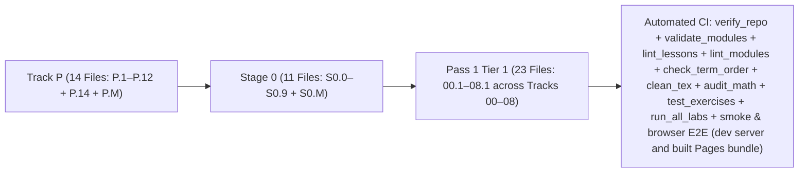

# Changelog — Beginner-First Mechatronics Roadmap Rewrite

All structural changes, lesson splits, curriculum reorderings, angle-convention standardizations, and automated verification additions are logged below.

---

## [2026-10-16] — Run 6: Tier-Parity Machinery (`docs/QUALITY_SPEC.md`, `scripts/module_parity.py`, `scripts/new_module.py`)

Milestone **M0** of the Tier 2/3 plan: before any advanced module is rewritten, the question "how far is this module from Tier 1?" gets a measured answer, and no score is allowed to slide back.

### 1. The contract, the score and the ratchet
- **`docs/QUALITY_SPEC.md` (new):** the parity contract in four weighted layers - **Structure 25%** (front-matter contract, the numbered sections, `### Skip test` + `### Gate test`, the difficulty label, and for Tier 3 the `### Use & Understand` / `### Derive & Extend` pair), **Executable 30%** (`worked_example_runs`, `checkpoint_answer_key`, `learner_exercise_scaffold`, `verification_route_declared`), **Ladder 30%** (the eight named steps), **Validated 15%** (`dogfood_logged`). It also fixes the two new metadata blocks (`difficulty:` with `math/coding/tools/hardware_risk/simulation`, and `verification: browser|ci-native|artifact|rubric`) and states plainly what is **not yet instrumented** - behavioural tests for module exercises, module exercises in the workbench, the maths-claims audit, retention/arrival times - rather than scoring those zero.
- **`scripts/module_parity.py` (new):** scores every one of the 44 bridge modules, emits `docs/coverage-table.md` (per module, per track, per tier, plus the ladder table and the not-instrumented list), and answers `--check`, `--json`, `--update-baseline`. **Published baseline: overall 53.9%** (Tier 1 55.0%, Tier 2 53.6%, Tier 3 52.8%).
- **Two gates, deliberately separate:** the **ratchet** (`docs/parity-baseline.json`) fails the build if any track *or* module drops below its recorded score; the **level** (`tracks: <track>: lint_level: report|warn|error` in `modules/_index.yaml`, all nine tracks at `report`) fails a track that claims `error` while any module is below 100%. Flipping a track to `error` is the visible "this track is done" signal. The ladder stages are measured by their **named markers** (`**Predict first (before you run it):**`, `### Break it on purpose` with Inject/Symptom/Diagnose/Fix), which is stricter than `lint_modules.py`'s reported keywords - so a mention is not a stage.
- **`scripts/new_module.py` (new):** scaffolds a module with the full parity contract and marks every unwritten hole `TODO-AUTHOR`; `scripts/lint_modules.py` now **rejects** a module that still carries the marker, so scaffolding can never read as coverage. The scaffolder refuses to overwrite, refuses an id already in the index, inserts its `bridges:` entry into that list (not at EOF, since `tracks:` now follows it) and is byte-identical across repeated runs. `python3 scripts/module_parity.py --check` joined the CI verify step, and `docs/dogfood-log.md` (new) makes Layer 4 a live measure instead of a promise.

### 2. What the tooling found on its first run
- **`01-electronics.T3.01a` was missing both ladder stages** - the track's "7/7" claim was off by one (see the correction in Run 5 §4). Repaired, and track 01 now measures 100% on the ladder.
- **44/44 modules** still lack the `difficulty:` label, the `verification:` route, a learner-facing exercise scaffold, and a dogfood row; **37/44** lack the two named ladder stages; **19/44** have no `### Gate test`; all **10 Tier 3** modules lack the two levels.
- **Module ids disagree inside the index:** `07-systems.T3.06a` and `08-capstones.T3.07a` are off by one against their own track, while the index's `feeds_into`/`prereqs` lists reference `06-robotics.T3.07` and `05-control.T3.06`, neither of which exists. Reported, not repaired here - it is a dependency-graph job, and the DAG validator the plan asks for is the right tool for it.

---

## [2026-10-16] — Run 5: Formatting Split from Behaviour (`output_match`), the Built Pages Bundle Under Test & a Tablet-Fitting Workbench

### 1. `stdout` Formatting Is No Longer Part of the Behavioural Verdict
- **One comparison, two declared modes (`app/src/outputMatch.ts`, new):** the runner graded presentation with one inlined rule (`trimEnd` per line, `trim` the whole run), so a behaviourally correct solution whose spacing differed was reported as `DIFFERS` and **denied verification**. Now `normalized` (the default) ignores whitespace entirely — indentation, column padding, a dropped pad (`raw=   0` vs `raw=0`) and blank lines — while line breaks still matter, and `exact` keeps interior spacing significant (only trailing spaces and leading/trailing blank lines are ignored). Numbers are never relaxed by either mode, and the new `formattingDiffers` flag lets the runner say when a match was reached only by ignoring formatting (`note-formatting-normalized`).
- **`output_match:` front matter, read into `outputMatch` by `scripts/generate_python_lessons_data.py` (which rejects any other value):** **3 of the 36** Python lessons grade `exact` — `01.3`, `02.2`, `03.1`, the three whose Expected Output is a padded table (two or more aligned rows); the other 33 grade `normalized`. `00.3`, `04.1` and `05.1` were marked exact during review and reverted, because their padding is incidental (one padded field, or a hand-padded label) — each now states in its own `### Expected Output` that **spacing is not graded here**, keeping the lesson's teaching about where the padding comes from.
- **The split is enforced, not just applied:** `scripts/lint_lessons.py` fails a lesson whose padded table is not declared `exact`, and one declared `exact` with fewer than two aligned rows; `scripts/smoke_test_workbench.mjs` asserts the same rule against the built dataset plus the comparator itself (whitespace-only match accepted in `normalized` and rejected in `exact`, a changed digit rejected in both, first-differing-line reporting).
- **Proven in a real browser (`scripts/e2e_browser_workbench.mjs`):** a fresh context loads `03.1`, strips its field widths (`:4d` → `:d`, `:6.1f` → `:.1f`) and asserts the behavioural tests still read `PASSED` while presentation reads `DIFFERS` and **no** verification is awarded; then loads `P.6` wrapped in `contextlib.redirect_stdout`, re-printing the same values re-indented, re-spaced and blank-line-padded, and asserts `PASS · Behavior & Output Verified`, the normalized-match notice, and `2 / 36 Verified`.

### 2. The Built Pages Bundle Is Under Test (`scripts/e2e_pages_bundle.mjs`, `npm run test:e2e:pages`)
- **New CI step:** the old browser suite drove the Vite *dev server* with lesson P.6 only, so nothing proved what learners actually open. The new suite asserts `dist/index.html` references every asset under `/Mechatronics-Roadmap/` (the failure that shipped once, a bundle built for `/`), serves `dist/` at that base path and checks 200 plus content type per asset, loads **later-track** lessons `03.3` / `06.1` / `08.1` in the runner with starter code and expected output, and keeps the tab bar, lesson list, editor, Run & Verify and Export Progress usable at **834×1112**. Chromium and Firefox both run; a browser that is not installed is a loud SKIP, never a pass.

### 3. The Workbench Fits a Tablet (`app/src/components/Header.tsx`, `App.tsx`)
- **The header put three zones on one unwrappable row:** wordmark + four `nowrap` pass links + a `shrink-0` action group need ~1093 px, so at 834 px the Export Progress / Cheat Sheet buttons spilled **249 px** past the viewport and the page scrolled sideways (1024 px overflowed by 59 px too). The row and its nav now wrap, the action group drops to its own right-aligned row, and the mode-toggle group wraps. Measured: **0 overflowing elements at 390 / 834 / 1024 / 1280 px**, and the Pages E2E tablet check is now a **hard assertion** (zero spilled elements, `scrollWidth <= clientWidth`) — proven to fire by forcing a 1100 px min-width into the built page (exit 1, “scrolls sideways by 266px”).

### 4. The `01-electronics` Track Carries its Ladder Gaps (`modules/01-electronics.T*.md`)
- **Predict + Break-it on 6 of the track's 7 modules, three tiers:** each module got a bold `**Predict first (before you run it):**` commitment under `## 4. Worked example` (a number written down *before* the code runs, plus the signature of a wrong answer: inverted parallel branch, dropped micro prefix, a factor-of-two on-resistance count) and a `### Break it on purpose` block (Inject / Symptom / Diagnose / Fix) closing `## 5. Exercise`, every number lifted from that module's own worked example or `assert`s. `scripts/lint_modules.py` coverage: **Predict 6/44 → 12/44**, **Break it 16/44 → 20/44**.
- **Correction (2026-10-16, later the same day):** this entry first claimed "all 7 modules" and "7/7 of this track". It was 6: `01-electronics.T3.01a` never received either stage, and the claim was asserted from the track's module count instead of measured. `scripts/module_parity.py` caught it the next time it ran (its strict `3_predict` marker read 7/44), the module was repaired, and the track's ladder now measures **8/8 stages on 7/7 modules**. The count is published rather than claimed from here on - see *Run 6*. Those two ladder counts were themselves a loose keyword read in `scripts/lint_modules.py` (`\bpredict\b`, `fault|diagnos|miswir`): the named content markers find **7/44 Predict** and **7/44 Break it** - the seven modules this entry rewrote - and both tools now print the named-marker counts, so a published number means one thing.

## [2026-10-16] — Run 4: Course Packaging, Technical Fixes (`DRV8833` & `05-control.T1.05a`), Tracks 03–08 Beginner Lessons (`03.1–08.1`), Clean TeX & In-Browser Pyodide/Placement Workbench

### 1. Technical Accuracy & CI Expected-Output Diffing
- **Fixed `DRV8833` Voltage Rating (`2.7–10.8 V` operating, `11.8 V` abs max):** Updated `01-electronics-and-power/01.2-h-bridge-and-stall-current.md`, `01-electronics-and-power/README.md`, `modules/01-electronics.T1.01b.md`, `docs/SYLLABUS.md`, and `resources/lab-workbench-bom.md` so `DRV8833` is paired with a $6\text{–}9\text{ V}$ supply while $12\text{ V}$ motors explicitly use `TB6612FNG` ($4.5\text{–}13.5\text{ V}$) or `DRV8871` ($6.5\text{–}45\text{ V}$).
- **Fixed `modules/05-control.T1.05a.md` Expected Output & Added CI Output Diffing:** Updated `05-control.T1.05a.md` to match the exact stdout of its worked PID simulation (`Unclamped OS=0.372, Anti-windup OS=0.047`) and extended both `scripts/run_all_labs.py` and `scripts/validate_modules.py` to execute and diff all 44 bridge module `Expected output` blocks and forbid `[verify in-app]` / `[UNVERIFIED]` placeholders when `resources_verified: true`.

### 2. Openness, Licensing, Attribution & Slim Single-Screen `README.md`
- **Added Dual `LICENSE` (`CC BY 4.0` for docs, `MIT` for code), `CONTRIBUTING.md`, and `.github/ISSUE_TEMPLATE/`:** Added explicit attribution for [`engyasin/awesome-mechatronics`](https://github.com/engyasin/awesome-mechatronics) and three structured issue templates (`beginner-timing-log.md`, `lab-bug.md`, `lesson-error.md`).
- **Slimmed Root `README.md` (111 KB $\to$ 30 KB), Added Visibility Badges & Isolated Vite App in `app/`:** Added shields.io status badges, a prominent **Open Live Browser Workbench** callout, and a before/after $1\text{ kHz}$ control code comparison; fixed Step 3 to start at `Track 00 Lesson 00.1`; separated the \$0 Simulator Path, \$15–\$25 Starter Kit, and \$150 Closed-Loop Bench in `README.md` and `resources/lab-workbench-bom.md`; labeled beginner times as unmeasured targets backed by `beginner-timing-log.md`; moved `SYLLABUS.md` and `PLAN-batch-1.md` into `docs/`; isolated the Vite workbench into `app/` (`app/index.html`, `app/src/`); excluded `.aistudio/` in `.gitignore`; and verified live module/bridge/ladder/lesson counts (`68 modules: 24 legacy, 44 bridge across 25 ladders; 16 Tier 1 bridge modules; 48 beginner lessons`) across `README.md` and all script docstrings.
- **Clean TeX Source (`scripts/clean_tex.py`):** Stripped all 862 `\kern0pt` and `\_` math-mode workarounds across the repository and added `python3 scripts/clean_tex.py --check` to CI.

### 3. Closed the Beginner Cliff (`Lessons 03.1–08.1`), Beginner-First Workbench Mode & CI UI Smoke Tests
- **Expanded Tier 1 Tracks 03–08 into Full Beginner Lesson Files (`03.1`, `03.2`, `03.3`, `04.1`, `04.2`, `04.3`, `05.1`, `05.2`, `06.1`, `07.1`, `08.1`) + `P.14` & `S0.0`:** Every lesson enforces $\le 2$ new ideas in YAML front matter, 150–250 word `Bridge Notes`, runnable Python 3 starter code, 3-step progressive hints, and `assert`-verified full solutions (48 total beginner lessons across Track P, Stage 0, and Tracks 00–08 Tier 1, including 36 Python lessons).
- **Beginner vs. All-Labs Workbench Mode, Web-Worker Isolated Pyodide Runner (`Tab 9`), Instructor Behavioral Tests, Placement Quiz (`Tab 10`), Portfolio Export & Real-Browser E2E Tests:** Added a **Beginner View (Plain-English Path)** default with expandable technical subtitles (`All 10 Engineering Labs`), isolated Python execution inside a dedicated **Web Worker** with `Stop` / `Reset Runtime` controls and infinite-loop step/time guards, added **Instructor-Owned Behavioral Tests** (multi-input, boundary, and numerical tolerance checks that reject print-only spoofing across all 36 Python lessons), separated `Executed & Passed (WASM)` from `Self-Marked` completions in `localStorage` and **Markdown Portfolio Certificate export**, and added both SSR/DOM smoke tests (`scripts/smoke_test_workbench.mjs`) and real-browser Headless Chromium E2E tests (`scripts/e2e_browser_workbench.mjs`) in CI.

### 4. Cross-Tier Bridging Architecture (`Learn & Simulate` vs. `Build` vs. `Production Practice`, 8-Step Teaching Ladder, Recurring 2-DOF Arm Spine & Tier-by-Tier Bridges)
- **Three Explicit Completion Routes & Reconciled Provisional Time Estimates (`README.md`, `docs/SYLLABUS.md`, `TabArchitecture.tsx`):** Defined **Route 1 (`Learn & Simulate`, \$0)**, **Route 2 (`Build`, optional $\le 12\text{ V}$ low-voltage hardware)**, and **Route 3 (`Production Practice`, supervised $24\text{ V}/15\text{ A}$ & $48\text{ V}/30\text{ A}$ hardware requiring experienced review & pre-power sign-off)**, and reconciled the syllabus's `323.5 hours` (`68 formal modules` across Passes 1–3) with the optional `Track P` + `Stage 0` entry ramp (`~19–25 hours` unmeasured target $\implies \text{~342.5–348.5 hours}$ full zero-to-Tier-3 provisional estimate).
- **Unified 8-Step Teaching Ladder & Recurring 2-DOF Robot Arm Spine (`README.md`, `docs/SYLLABUS.md`):** Documented the 8-step progression (*Recall → See it → Predict → Work through → Practice with support → Break it on purpose → Transfer → Integrate*), 5-dimension difficulty labels, and how **one recurring robot joint and 2-DOF arm** evolves from Track 00 through Track 08 across Tiers 1, 2, and 3.
- **Tier-by-Tier Bridges (`P.14` Datasheet Table, `S0.0` Effort$\times$Flow Water Analogy, Falstad Twins before Arduino, 4-Row C-from-Python Sidebar, `Gate P->0`, `03.3` FK/Encoder Micro-Lab, 3-Part Python$\to$C Bridge `04.1–04.3`, 4-Stage `08.1` Capstone & `Gate 1->2` Exit Project):** Added `P.14` (`DRV8833` $2.7\text{–}10.8\text{ V}$ datasheet table reading), `S0.0` (`Effort × Flow` water-pipe analogy before Falstad), 5-minute Falstad "see it without code" twins in `S0.7–S0.M`, a 4-row C-from-Python sidebar in `S0.7`, the 15-minute `Gate P->0` check, the 20-minute `03.3` Track 02+03 integration micro-lab, a 3-lesson Python$\to$C bridge (`04.1` ints/overflow with `uint8_t` wrap-at-255 R4 debug, `04.2` bitwise/CRC-8 payoff, `04.3` structs as labeled boxes & pointers with pass-by-value R4 debug), a trig/radians preview callout in `01.4`, a 4-stage `08.1` 2-DOF arm capstone (*Predict → R2 → R4 3 Broken Versions → R5 Spec*), and the `Gate 1->2` self-administered position-loop exit project ($\pm 2\%$ overshoot, $<0.5\text{ s}$ settling).

---

## [2026-10-16] — Run 3: Term-Order Hardening, Falstad CI Mirrors Moved to `tests/` & Batch 1 (`Tracks 00, 01, 02` Tier 1)

### 1. Part A Hardening (`check_term_order.py`, `lint_lessons.py`, `density_report.py`, Multi-URL Heading Check & Falstad CI Mirrors)
- **Added `scripts/check_term_order.py`:** Verifies all 89 glossary terms in `resources/glossary.md` against all 35 beginner lessons in curriculum path order (`P.1`–`P.M` $\to$ `S0.1`–`S0.M` $\to$ `00.1`–`00.3` $\to$ `01.1`–`01.4` $\to$ `02.1`–`02.5`), failing if any lesson uses a glossary term before the lesson that defines it, and checking `PLAN-batch-1.md` prerequisites.
- **Reordered Stage 0 (`S0.2` $\leftrightarrow$ `S0.4` $\leftrightarrow$ `S0.5`) to eliminate forward term references:**
  - `S0.2-series-parallel-and-voltage-dividers.md` now comes immediately after `S0.1` (Ohm's Law), before `S0.3` (Breadboards & Short Circuits), `S0.4-leds-and-resistor-power.md`, and `S0.5-multimeters-and-current-limited-supplies.md`, so **Series** and **Parallel** are defined before sizing a series LED resistor (`S0.4`) or probing voltage in parallel vs. current in series (`S0.5`).
- **Upgraded `scripts/lint_lessons.py`:** Compares each lesson's `## Learn` headings and `### Bridge Notes` against its declared YAML `ideas:` list, failing on extra topics or missing `ideas:` coverage in `### Bridge Notes`.
- **Added `scripts/density_report.py`:** Computes per-lesson word count, new glossary terms, resource count, and code-block count across all 35 beginner lessons, sorted by cognitive density score.
- **Moved Falstad CI Python Mirrors (`S0.1`–`S0.6`, `01.1`) to `tests/test_exercises.py`:** Confirmed that the Python blocks in `S0.1`–`S0.6` and `01.1` only mirrored Falstad circuit calculations for CI; moved them into `tests/test_exercises.py` so learners in `S0.1`–`S0.6` and `01.1` interact directly with the Falstad netlists (`falstad/*.txt`).

### 2. Part B Batch 1 — Tier 1 Beginner Lessons for Tracks 00, 01 & 02 (`PLAN-batch-1.md` + 11 New Lesson Files)
- **Track 00 (`00-foundations/`, 3 lessons):**
  - `00.1-effort-flow-and-first-order-lag.md`: Effort/flow power ($P = V \cdot I = F \cdot v = \tau \cdot \omega$) and first-order lag step response ($\tau$, $63.2\%$ at $1\tau$, $99.3\%$ at $5\tau$).
  - `00.2-mass-spring-damper-oscillations.md`: Hooke's Law spring ($F_s = -kx$), viscous damper ($F_d = -bv$), natural frequency ($\omega_n = \sqrt{k/m}$), and damping ratio ($\zeta$: underdamped, critically damped, overdamped).
  - `00.3-modeling-discipline-and-sanity-checks.md`: 4-step workflow (`Diagram -> Symbolic Equations -> Code -> Sanity Check`) and dimensional/limiting-case checks.
- **Track 01 (`01-electronics-and-power/`, 3 new lessons after `01.1`):**
  - `01.2-h-bridge-and-stall-current.md`: 4-switch H-bridge (`Forward`, `Reverse`, `Coast`, `Brake`), shoot-through prevention, back-EMF ($V_{\text{emf}} = K_e\omega$), and stall current ($I_{\text{stall}} = V_s/R_a$) using Falstad (`falstad/01.2-h-bridge.txt`) and Wokwi Arduino Uno firmware (`IN1/IN2/PWM` with no motor in Wokwi).
  - `01.3-power-regulators-and-power-budget.md`: Linear (`LDO`) regulator heat loss vs. switching (`Buck`) power conservation and worst-case robot power budgets.
  - `01.4-grounding-and-rc-lowpass-filters.md`: High-current ground bounce ($V_{\text{ground}} = I_{\text{motor}}R_{\text{wire}}$), star grounding, and passive RC low-pass filters ($f_c = \frac{1}{2\pi RC}$, `falstad/01.4-rc-lowpass.txt`).
- **Track 02 (`02-mechanics-kinematics-dynamics/`, 5 lessons ramping `1-link FK -> 2-link FK -> IK`):**
  - `02.1-1d-link-fk-and-coord-frames.md`: 2D coordinate frames, right-hand CCW angle sign convention, and 1-link planar forward kinematics ($x = L\cos\theta, y = L\sin\theta$).
  - `02.2-2link-planar-forward-kinematics.md`: Cumulative link angle ($\theta_{12} = \theta_1 + \theta_2$), chaining 2-link tip-to-tail vectors, and annular reach envelope.
  - `02.3-2link-planar-inverse-kinematics.md`: Law of Cosines for elbow angle, reachability clamping (`[-1, +1]`), elbow-down vs. elbow-up solutions, and shoulder angle via `math.atan2`.
  - `02.4-rotational-inertia-and-gear-ratios.md`: Rotational Newton's Second Law ($\tau_{\text{net}} = I_{\text{rot}}\alpha$), moment of inertia ($I_{\text{rot}} = mr^2$), gear ratio ($N$), and reflected rotor inertia ($I_{\text{reflected}} = N^2 I_{\text{motor}}$).
  - `02.5-bearings-belts-and-3d-printing.md`: Cantilevered vs. double-shear shaft support, `GT2` timing belt ratios ($N = N_{\text{driven}}/N_{\text{driver}}$), and 3D-printed layer orientation.
- **Removed Tier 1 Jargon Leaks:** Purged Jacobian determinants, phase-space ellipses, complex numbers ($j\omega$), decibels ($\text{dB}$), Laplace $s$, and Euler-Bernoulli beam deflection formulas ($\delta = \frac{FL^3}{3EI}$) from all Tier 1 sections while keeping Pass 2 / Pass 3 material intact under Advanced (Later).
