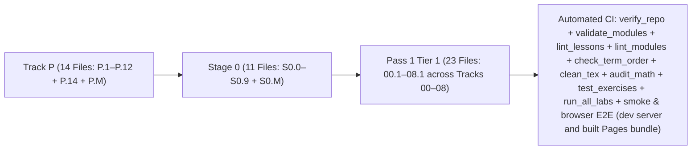

# Changelog — Beginner-First Mechatronics Roadmap Rewrite

All structural changes, lesson splits, curriculum reorderings, angle-convention standardizations, and automated verification additions are logged below.

---

## [2026-10-17] — Run 26: The Moving Ghost Cab (`exercises/06-robotics.T1.06a/`)

### 1. Seven holes between the step and the spring
- **`exercises/06-robotics.T1.06a/` (new)** - `cubic_rest_to_rest`, `cubic_coefficients`, `peak_velocity`, `min_duration_s`, `min_duration_for_acceleration`, `spring_damper_torque`, `compliance_deflection`. **27 tests**, five faults, a print-only cheat and a browser entry.
- **Each test names a mistake:** a parabola in $s$ that reaches the target at the right position **at full speed**; a peak speed taken as the average, which undersizes the actuator by a third; a minimum duration solved with the average speed, so the move leaves at 1.5x its limit; a spring-damper that swaps the position and velocity gains; and a compliance yield that multiplies by stiffness.
- **Transfer feeds the submission the plant's own gains:** its spring-damper must equal `plant.pd_gravity_torque` at three states to $10^{-12}$, a cubic from the plant's current figure-8 pose must land on the next target still and with a $1.5\Delta q/T$ peak, the $1\text{ kHz}$ step setpoint is shown to demand $1000\text{ rad/s}$ where the cubic peaks at $1.5$, and the yield must be the plant's static equilibrium.
- **Two test expectations were wrong and are now the module's own rule:** the plant's feedforward law is *not* zero at rest with $q_d = q$ (it is $\tau_g$), and the terminal deceleration at *exactly* $t = T$ must stay $-6\Delta q/T^2$ - the profile is held still strictly *after* $T$, not at it.

### 2. Delivery
- Module §5 gains **`### Graded package - the moving ghost cab and the spring`**; §6 points at `EX.06-robotics.T1.06a`.
- Registry **55 entries**; pages E2E **nineteen** exercise entries; browser tallies move to 55.
- Coverage: overall **57.2% -> 57.5%**; Tier 1 **52.8% -> 53.7%**.

---

## [2026-10-17] — Run 25: The Scan, the Chain and the Sweep (`exercises/07-systems.T1.07a/`)

### 1. Seven holes between the PLC and the plot
- **`exercises/07-systems.T1.07a/` (new)** - `scan_frequency_hz`, `safety_chain_ok`, `plc_scan_step`, `gain_db`, `phase_lag_deg`, `sine_amplitude`, `db_to_ratio`. **32 tests**, five faults, a print-only cheat and a browser entry.
- **Each test names a mistake:** a scan budget divided as seconds (500 Hz reads as 0.5 Hz); a series NC chain evaluated with `any`, so one broken wire still powers the cell; a latch that clears when the chain closes, which restarts the robot on the mushroom release; amplitude gain in `10 log10` (half the decibels); a phase reported as a lead; and a lock-in that cannot reject the neighbouring frequency.
- **Transfer measures the plant's own figure-8:** `sine_amplitude` must return `plant.AX` and `plant.AY` to $10^{-6}$ from samples of `plant.figure8_target`, reject the frequency next door, read the plant's 1 ms budget as its 1 kHz tick, and drop the power enable on the next scan after a wire break. The first `plc_no_latch` fault cleared only on a reset press and therefore passed the very test it exists to fail; it now clears unconditionally and fails.

### 2. Delivery
- Module §5 gains **`### Graded package - the scan, the chain and the sweep`**; §6 points at `EX.07-systems.T1.07a`.
- Registry **54 entries**; pages E2E **eighteen** exercise entries; browser tallies move to 54.
- Coverage: overall **56.9% -> 57.2%**; Tier 1 **52.0% -> 52.8%**.

---

## [2026-10-17] — Run 24: The Audit Arithmetic and the Dual Channel (`exercises/07-systems.T3.06a/`)

### 1. Seven holes a factory acceptance audit asks about
- **`exercises/07-systems.T3.06a/` (new)** - `opc_ua_pubsub_rate_bps`, `diagnostic_coverage_pct`, `pfh_common_cause`, `pld_ok`, `sto_evaluate`, `aas_opcua_nodes`, `reset_interlock`. **31 tests**, five faults, a print-only cheat and a browser entry.
- **Each test names a mistake:** a 14-byte frame header charged to every variable (double the wire truth at eight variables); coverage returned as a fraction; the common-cause term counted once per channel, which is the assumption Category 3 refuses; a PLd check with an inclusive upper bound; a discrepancy check with no filter, so a normal 12 ms contact skew latches every E-stop; and a reset interlock that restarts as soon as the fault clears.
- **Transfer runs the plant's own numbers:** its 20-byte, 1 kHz frame as a PubSub stream is 30000 B/s - still inside the 500 kbaud link that drops nothing and past the 115.2 kbaud one that drops 412 frames - and the STO decision is evaluated on **every tick** of the 1 kHz loop, where torque is gone on the tick Channel A opens and the latch lands one tick after the 20 ms window.
- **One test was wrong, and the run caught it:** `9.9e-7` sits *inside* PLd's `[1e-7, 1e-6)` band; the test now asserts it passes and uses `1.1e-6` for the refusal.

### 2. Delivery
- Module §5 gains **`### Graded package - the audit arithmetic and the dual channel`**; §6 points at `EX.07-systems.T3.06a`.
- Registry **53 entries**; pages E2E **seventeen** exercise entries; browser tallies move to 53.
- Coverage: overall **56.6% -> 56.9%**; Tier 3 **53.8% -> 55.1%**.

---

## [2026-10-17] — Run 23: The Scoreboard, the Blender and the Shield (`exercises/06-robotics.T3.06b/`)

### 1. Seven holes from the return to the watchdog
- **`exercises/06-robotics.T3.06b/` (new)** - `discounted_returns`, `advantages`, `ppo_clip_term`, `ppo_loss`, `temporal_ensemble`, `safety_shield`, `watchdog_trip`. **28 tests**, five faults, a print-only cheat and a browser entry.
- **Each test names a mistake:** a return discounted from the start of the rollout instead of from $t$; a PPO term that takes `max`, which is identical for a positive advantage and doubles the step for a negative one; a uniform average of overlapping chunks, so a stale prediction counts as much as the fresh one; a shield that respects the joint limits but never the step clamp; and a watchdog that compares the wall clock to the timeout instead of the heartbeat.
- **Transfer scores the plant's own run:** the discounted return of its tracking errors must equal a brute-force sum at four steps, the plant's own targets must pass through the shield with $<2\%$ RMS change, and a hostile policy commanding $+3\text{ rad}$ must leave the arm inside its joint range and slow.
- **Two test bugs found before commit:** `1.1 - 1.0` is not exactly `0.1` in binary, so the watchdog's boundary case now uses `1.5 - 1.0` against `0.5`; and the ensemble's expected value was off in the fifth decimal against the module's own printed `0.5027`.

### 2. Delivery
- Module §5 gains **`### Graded package - the scoreboard, the blender and the shield`**; §6 points at `EX.06-robotics.T3.06b`.
- Registry **52 entries**; pages E2E **sixteen** exercise entries; browser tallies move to 52.
- Coverage: overall **56.3% -> 56.6%**; Tier 3 **52.4% -> 53.8%**.

---

## [2026-10-17] — Run 22: Backpropagation checked by finite difference (`exercises/06-robotics.T3.06a/`)

### 1. Seven holes from the loss to the trained policy
- **`exercises/06-robotics.T3.06a/` (new)** - `mse_loss`, `forward`, `backward`, `apply_gradients`, `z_score`, `train_bc`, `predict`. **20 tests**, five faults, a print-only cheat and a browser entry.
- **The decisive test is a central finite difference on every parameter** of a small net, so a backward pass that is shape-correct but derivative-wrong cannot pass; the rest pin the mean loss, the tanh, the descent direction, an unmuted input dict, the z-score and its guard, the loss falling below 1% of its start, and identical seeds giving identical policies.
- **Transfer trains on `plant.gravity_torque`** across the arm's workspace: held-out error under 1% of the 2.5 N*m limit, the learned map checked where the cosine bends, and then the policy **put inside the plant's PD loop**, where it tracks the figure-8 within 5% of the analytic model's 0.91 mm RMS.
- **The browser runner has a 400k line-step budget**, and the first self-check spent it: the entry timed out in Pyodide rather than failing a claim. The in-page check now trains a 24-sample, 120-step policy to prove the pipeline, and the native suite keeps the generalisation claim.

### 2. Every graded module now declares how it is verified
- **`verification: ci-native`** added to the 14 graded modules that had none; Executable rises from 40% to 52-60% per module across tracks 00, 03, 04, 05, 06 and 07, and the parity ratchet passes with the scores up.
- Module §5 gains **`### Graded package - backpropagation by hand, checked by finite difference`**; §6 points at `EX.06-robotics.T3.06a`.
- Registry **51 entries**; pages E2E **fifteen** exercise entries; browser tallies move to 51.
- Coverage: overall **54.2% -> 56.3%**; Tier 2 **58.2% -> 62.2%**; Tier 3 **51.8% -> 52.4%**.

---

## [2026-10-17] — Run 21: The Bag, the Clock and the Decimation (`exercises/06-robotics.T2.06b/`)

### 1. Seven holes between the simulator and the disk
- **`exercises/06-robotics.T2.06b/` (new)** - `timer_steps`, `intra_process_saving_mb_s`, `disk_rate_mb_s`, `bag_size_mb`, `replay_derivative`, `wall_delay_s`, `control_decimation`. **24 tests**, four faults, a print-only cheat and a browser entry.
- **Each test names a mistake:** a timer period that is rounded or floored, so a 4.5-step period drifts ahead of the clock; an MCAP budget that leaves out the 32-byte per-message index (a fifth of a 128-byte joint state); a replay derivative divided by an assumed 100 Hz period instead of the stamp in hand; and a decimation that rounds 1000/300 to 3 instead of refusing it.
- **One planted fault was itself wrong, and the harness caught it.** `replay_uses_wall_dt` recomputed the same stamps the solution does and passed the very test it exists to fail; it is now `replay_assumed_dt`, divides by the node's 0.01 s, and fails.
- **Transfer records the plant:** the 20-byte telemetry frame at 1 kHz for a minute must be a few megabytes and its metadata must multiply its rate; a 250 Hz task on the 1 kHz clock fires four ticks apart, 250 times in 1000; and the figure-8 tip velocity must be identical at `--rate 1.0` and `--rate 4.0`.

### 2. Delivery
- Module §5 gains **`### Graded package - a recording budget, a replay clock and a decimation`**; §6 points at `EX.06-robotics.T2.06b`.
- Registry **50 entries**; pages E2E **fourteen** exercise entries; browser tallies move to 50.
- Coverage: `06-robotics.T2.06b` becomes behaviour-graded and browser-driven at **60.8%**; track 06 **52.5%**; overall **54.2%** over 44 modules.

---

## [2026-10-16] — Run 20: The Elbow as a Regenerative Load (`exercises/07-systems.T2.07a/`)

### 1. Seven holes across three safety mechanisms
- **`exercises/07-systems.T2.07a/` (new)** - `regen_energy_j`, `unclamped_bus_v`, `brake_resistor_max_ohm`, `brake_peak_current_a`, `rolling_counter_status`, `watchdog_timeout_s`, `hil_coverage`. **26 tests**, four faults, a print-only cheat and a browser entry.
- **Each test names a mistake:** energy without the efficiency (33% oversized chopper); the bus voltage as `V + E/C` instead of the square-root form (24.01 V where the truth is 166 V); the resistor bound treated as a target; a counter compared with a plain subtraction, so every 16th frame reads as a fault; and a watchdog that fires after one frame whatever `n_miss` says.
- **Transfer sizes the chopper from the plant:** the elbow is spun up under `plant.TAU_LIMIT`, its **measured** kinetic energy drives a 24 V / 1 mF bus past the 28 V clamp, the resistor bound is proved tight at the peak, and the rolling counter runs over the plant's 1 kHz frame cadence.

### 2. Delivery
- Module §5 gains **`### Graded package - the elbow as a regenerative load`**; §6 points at `EX.07-systems.T2.07a`.
- Registry **49 entries**; pages E2E **thirteen** exercise entries; browser tallies move to 49.
- Coverage: `07-systems.T2.07a` becomes behaviour-graded and browser-driven; Tier 2 **57.4% -> 57.8%**; overall **53.9% -> 54.0%**; baseline re-recorded.

---

## [2026-10-16] — Run 19: The Graph's Promises and the Arm's Chain (`exercises/06-robotics.T2.06a/`)

### 1. Seven holes across ROS 2's three layers
- **`exercises/06-robotics.T2.06a/` (new)** - `qos_compatible`, `urdf_revolute_z`, `mat4_mul`, `transform_point`, `invert_rigid`, `interpolate`, `topic_bandwidth_mb_s`. **23 tests**, four faults, a print-only cheat and a browser entry.
- **Each test names a mistake:** a QoS rule that demands equality rejects the Reliable-to-Best-Effort pair ROS 2 connects every day, so the test enumerates all **16** combinations; a joint matrix with `Rz(-q)` is orthogonal and turns the wrong way; and a buffer that clamps `alpha` silently invents a pose no sensor reported.
- **One test was itself wrong, and the fault found it.** The product-order test compared `A@B` against `B@A` - which is symmetric under a reversed multiply, so `product_reversed` passed. It now asserts both products against **absolute** positions, and the fault fails as intended.
- **Transfer builds the plant's arm as a tf2 chain:** `Rz(q1) Trans(L1) Rz(q2) Trans(L2)` from `plant.L1`/`plant.L2` must equal `plant.fk` at five poses to `1e-12`, a tool point must land at the tip plus `d` along the tool axis, and the inverse must be the base seen from the tool at the tip's distance.

### 2. Delivery
- Module §5 gains **`### Graded package - the graph's promises and the arm's chain`**; §6 points at `EX.06-robotics.T2.06a`.
- Registry **48 entries**; pages E2E **twelve** exercise entries; browser tallies move to 48.
- Coverage: `06-robotics.T2.06a` becomes behaviour-graded and browser-driven; Tier 2 **57.0% -> 57.4%**; overall **53.7% -> 53.9%**; baseline re-recorded.

---

## [2026-10-16] — Run 18: Four Budgets and One Clock (`exercises/04-embedded.T2.04d/`)

### 1. Seven holes on the wire
- **`exercises/04-embedded.T2.04d/` (new)** - `wire_time_us`, `link_utilization`, `handle_total`, `spin_wcet_us`, `ntp_rtt_us`, `ntp_offset_us`, `rtos_utilization`. **26 tests**, four faults, a print-only cheat and a browser entry.
- **Each test names a mistake:** a frame that leaves out the 12-16 byte XRCE header; every link counted at 8 bits per byte, which makes an 8N1 budget 20% optimistic; a utilisation that averages the stream frequencies (exactly right for one stream, half the truth for two); and an offset taken as `t2 - t1`, which is the forward delay plus the true offset.
- **Transfer is the plant's telemetry frame.** The 20-byte frame at 1 kHz must saturate 115.2 kbaud and not 500 kbaud; the submission's unity crossing must land on the same baud rate where `plant.simulate_uart_tx` stops dropping frames (200 kbaud by both models, one analytic and one simulated); the NTP offset over that link is exact when the two directions are symmetric and biased by half the congestion when they are not; and the module's own 185 µs spin must fit the plant's 1 ms tick.

### 2. Delivery
- Module §5 gains **`### Graded package - the plant's own telemetry link`**; §6 points at `EX.04-embedded.T2.04d`.
- Registry **47 entries**; pages E2E **eleven** exercise entries; browser tallies move to 47.
- Coverage: `04-embedded.T2.04d` becomes behaviour-graded and browser-driven; Tier 2 **56.5% -> 57.0%**; overall **53.5% -> 53.7%**; baseline re-recorded.

---

## [2026-10-16] — Run 17: Three Frames, a PLL and a Noise Law (`exercises/03-sensors.T2.03a/`)

### 1. Seven holes on the circle
- **`exercises/03-sensors.T2.03a/` (new)** - `wrap_pi`, `third_phase`, `clarke`, `park`, `inverse_park`, `pll_step` and `allan_deviation`. **21 tests**, four faults, a print-only cheat and a browser entry.
- **Each test names a mistake:** a Clarke with the 2 dropped (`(i_a + i_b)/sqrt(3)`) matches at `theta = 0` and fails at three other angles; a Park at `+theta` is still a rotation with unit determinant and gets the quadrature sign wrong; a PLL with the raw residual only misbehaves when the estimate is just below `-pi` and the measurement just above it, where the raw difference is `2 pi - 0.04`; and `sigma/tau` fails the first averaging pair.
- **The PLL's own convention is documented, not fudged.** A discrete update advances the estimate to the *next* sample, so a locked loop leads the last measurement by exactly `omega * dt`; the test asserts that lead rather than pretending it is zero.
- **Transfer is the elbow again:** the PLL's velocity estimate on the plant's quantized joint angle must beat a one-tick finite difference on the same samples, a three-phase set built from the joint's own angle must demodulate to constant `i_q` for 400 ticks, and `plant.add_noise` must average down as `tau^-1/2` within 12% at windows of 1, 4 and 16 samples.

### 2. Delivery
- Module §5 gains **`### Graded package - the elbow, demodulated and tracked`**; §6 points at `EX.03-sensors.T2.03a`.
- Registry **46 entries**; pages E2E **ten** exercise entries; browser tallies move to 46.
- Coverage: `03-sensors.T2.03a` becomes behaviour-graded and browser-driven; Tier 2 **56.1% -> 56.5%**; overall **53.3% -> 53.5%**; baseline re-recorded.

---

## [2026-10-16] — Run 16: Margins, an Observer and an LQR Gain (`exercises/05-control.T2.05a/`)

The first package outside Track 00, and the first whose subject is the control loop the other tracks consume.

### 1. Seven holes, one Riccati fixpoint
- **`exercises/05-control.T2.05a/` (new)** - `phase_margin_deg` (with the loop's lag unwrapped), `phase_loss_deg`, `st`, `gain_crossover` (bisection plus a `ValueError` for a bracket with no crossing), `bryson_weights`, `observer_spectral_radius` and `lqr_gain` from the discrete Riccati recursion. **28 tests**, five faults, a print-only cheat and a browser entry.
- **The wrap is the trap:** `cmath.phase` reports +160 degrees for a loop that lags 200, so the naive margin is 340 where the truth is **-20**. A second fault drops the 180 complement entirely and reports the phase itself.
- **Transfer measures, it does not restate.** The elbow is shaped with a PD law on the plant's own inertia and damping; the crossover the submission finds is checked to be a true `|L| = 1`; one tick of the plant's 1 kHz clock is priced against the margin. An observer with error poles placed at 0.8 and 0.9 is then **run against the plant** - the measured decay is 0.9 per tick - and a Bryson-weighted LQR gain must bring the joint to rest from 0.2 rad.
- **One fault is the bug this package actually had.** The Riccati recursion was first written with `A P A^T` where `A^T P A` belongs; the fixed point still looked sane and the closed-loop radius still rounded to 0.99999, while the regulated joint never moved. The behaviour suite passed it; only the transfer test that runs the loop caught it. It is now planted as `lqr_ap_at`, so that mistake is graded rather than remembered.

### 2. Delivery
- Module §5 gains **`### Graded package - the elbow's margins, observer and regulator`**; §6 points at `EX.05-control.T2.05a`.
- Registry regenerates to **45 entries**; the pages E2E drives **nine** exercise entries; the hard-coded tallies in both browser suites move to 45.
- Coverage: `05-control.T2.05a` becomes behaviour-graded and browser-driven; Tier 2 **55.7% -> 56.1%**; overall **53.2% -> 53.3%**; baseline re-recorded.

---

## [2026-10-16] — Run 15: The First Tier 3 Package, on the Manifold (`exercises/00-foundations.T3.00a/`)

The graded pattern leaves Tier 2 for the first time, and the subject is the one where a wrong sign or a lost small-angle term is invisible to every check but the right one.

### 1. Six holes, one exponential
- **`exercises/00-foundations.T3.00a/` (new)** - `hat`, `vee` (which must refuse a matrix that is not skew), `mat3_mul`, `mat3_vec`, `exp_so3` (Rodrigues with a Taylor branch below `1e-7`) and `energy_rate`. **22 tests**, four faults, a print-only cheat and a browser entry.
- **Each test names a mistake:** a hat map with the transposed signs is skew, orthogonal-looking and rotates backwards - only `[w]_x v == w x v` catches it; `sin theta` without `/theta` is exact at `theta = 0` and `1`, and over-rotates everywhere else; a "tiny angle, return the identity" shortcut is wrong in the **first** order, so the nanoradian case is asserted against `I + [phi]_x` to `1e-17`; and `vee` that reads entries without checking symmetry answers the identity matrix instead of refusing it.
- **Transfer is the arm, rotated and balanced.** `exp_so3([0, 0, theta])` on the tip must equal `fk(q1 + theta, q2)` to `1e-12`; a full turn returns the arm to itself; and `plant.gravity_torque` must equal the central-difference gradient of the arm's potential energy, with damping lowering the energy by exactly `b1 qd1^2 + b2 qd2^2`.
- **One fault did not hold on the first try, and the harness said so:** `(1 - cos theta)/theta^2` at a nanoradian is wrong by `5e-19`, which no double-precision assertion can see. The fault was replaced by the shortcut that *is* observable (identity below `1e-7`), rather than by loosening the test that failed to catch it.

### 2. Delivery
- Module §5 gains **`### Graded package - the arm turned about its base`**; §6 points at `EX.00-foundations.T3.00a`.
- Registry regenerates to **44 entries**; the pages E2E drives **eight** exercise entries; the hard-coded tallies in `scripts/smoke_test_workbench.mjs` and `scripts/e2e_browser_workbench.mjs` move to 44.
- Coverage: `00-foundations.T3.00a` becomes behaviour-graded and browser-driven; Tier 3 **49.8% -> 50.5%**; overall **53.0% -> 53.2%**; baseline re-recorded.

---

## [2026-10-16] — Run 14: The Whole T2.00 Ladder Is Graded (`exercises/00-foundations.T2.00d/`, `-e/`, `-f/`)

Three packages in one run, so every lesson of the `00-foundations.T2.00a`-`f` ladder now ships starter, reference, behaviour suite, transfer suite, planted faults and a browser entry.

### 1. Three subjects, three kinds of mistake
- **`exercises/00-foundations.T2.00d/`** - complex response and Bode. Seven holes (`to_polar`, `to_rect`, `first_order_response`, `second_order_response`, `magnitude_db`, `phase_deg`, `resonance_peak`), **17 tests**, four faults (`ten_log`, `phase_radians`, `peak_at_natural`, `hardcoded_response`). The overshoot-style trap is `omega_r = omega_n`: the reported peak is checked as a point **on the reported curve**, which is exact at the worked `zeta = 0.05` and wrong beyond it.
- **`exercises/00-foundations.T2.00e/`** - state space, poles and Euler vs Tustin. Six holes, **16 tests**, four faults (`euler_minus`, `trace_only`, `forgot_damping`, `tustin_elementwise`). Stability is tested on a **saddle with a negative trace** (so `tr < 0` alone fails) and on a marginal pole; at `Ts = 0.4 s` Euler's poles must leave the unit circle while Tustin's do not.
- **`exercises/00-foundations.T2.00f/`** - sampling, pre-warping, biquad and covariance. Seven holes, **21 tests**, four faults (`alias_no_mirror`, `prewarp_unwarped`, `notch_unnormalized`, `covariance_no_transpose`). The notch must null a **sampled** 850 Hz tone (RMS ratio below `1e-3`) and pass 200 Hz; the covariance is checked against a 4000-sample Monte-Carlo of the plant's own ticks.
- **Transfer is the shared plant every time.** 00d measures the elbow's gain and phase by lock-in projection against the submission's transfer function; 00e checks the elbow's poles against `zeta`/`omega_n` from 00c and finds Tustin stable where Euler is not; 00f compares one closed-loop Euler step against a real `step_arm` tick - equal to the plant's `O(Ts^2)` ordering term and **not** to machine precision - and aliases the elbow's 8.2 Hz damped mode to 3.8 Hz at a 12 Hz sample rate.

### 2. Two defects the packages found in the prose
- **`modules/00-foundations.T2.00f.md`** stated `omega_a = 8000 tan(0.2125 pi) = 6297.25 rad/s`. The tangent is `0.788336`, so the value is **6306.69 rad/s** (`1003.74 Hz`); the 6297.25/1002.24 pair was arithmetic slip in both directions. The module now states the number its own formula gives, and `test_behavior.py` asserts it to `1e-3`.
- **`scripts/module_parity.py`** still described one exercise package and one browser entry in its "Not yet instrumented" note. It now reports seven packages and seven E2E-driven entries, which is what the files say.

### 3. Delivery
- Module §5 for each of 00e and 00f gains a **`### Graded package`** subsection (holes, what each test catches, fault names), and §6 points at `EX.00-foundations.T2.00e` / `EX.00-foundations.T2.00f`.
- Registry regenerates to **43 entries**; `scripts/e2e_pages_bundle.mjs` drives **seven** exercise entries on the built bundle; the hard-coded 41-lesson tallies in `scripts/smoke_test_workbench.mjs` and `scripts/e2e_browser_workbench.mjs` move to 43.
- `scripts/run_exercise.py`: **12/12 on seven packages** (starter fails on its holes, reference passes behaviour + transfer, each fault fails its named test, print-only passes nothing, both browser programs behave).
- Coverage: 00d **47.0% -> 54.5%**, 00e **47.0% -> 54.5%**, 00f **53.2% -> 60.8%**; Tier 2 **54.5% -> 55.7%**; overall **52.5% -> 53.0%**; baseline re-recorded with that reason.

---

## [2026-10-16] — Run 13: First- and Second-Order Response, and the Step Size That Lies (`exercises/00-foundations.T2.00c/`)

The fourth graded package, and the first one whose subject is partly the simulation itself.

### 1. Two orders, one stability limit
- **`exercises/00-foundations.T2.00c/` (new)** - six holes: `first_order_response`, `second_order_params` (`wn`, `zeta`, `wd`, `mp`), `critical_damping`, `settling_time` (refusing `zeta <= 0`), `simulate_step` (semi-implicit, velocity first) and `max_stable_dt`. **19 tests**.
- **Each test names a mistake:** `zeta` missing its factor of 2 (reads half as damped); overshoot as `exp(-pi zeta)`, which is within 3% at the worked `zeta = 0.5` and is only exposed at `zeta = 0.3`; `b_crit = 2 J k` (the module's own "if your result differs", dimensionally wrong); a settling time returned for an undamped system; and a simulation run past `2/wn`, asserted to **diverge** at `1.5x` the limit while staying bounded at `0.9x` - the integrator's property, not the physics.
- **The transfer suite uses the plant twice.** The elbow joint runs under a PD law, and the test accounts for the plant's own viscous damping `plant.B2` as part of `b` (a toy model would hide it, and the first draft was 7 points of overshoot wrong because of exactly that). The motor test measures 63.2% of steady current at `t = L/R` through `plant.simulate_motor` - the first-order answer, measured rather than restated.
- **Four faults** - `zeta_no_two`, `linear_bcrit`, `wrong_mp`, `hardcoded_params` - each fail the test named for them; `scripts/run_exercise.py` reports **12/12 on four packages**.

### 2. Delivery, unchanged
- Module §5 gains **`### Graded package - two orders, and the step size that lies`**; §6 points at `EX.00-foundations.T2.00c`. Registry regenerates to **40 entries**; the pages E2E's single `EXERCISE_IDS` list now drives **four** entries, green in chromium and firefox.
- Coverage: T2.00c **47.0% -> 54.5%** (reference tested, behaviour-graded, browser E2E all `yes`); overall **52.3% -> 52.5%**; baseline re-recorded with that reason.

---

## [2026-10-16] — Run 12: A Third Exercise Package, and the Arm's Own Jacobian as a Basis (`exercises/00-foundations.T2.00b/`)

The T2.00 ladder gets its second graded package, so "copy the shape, not the numbers" now has two copies and a template that obviously generalises.

### 1. Three tools, then the arm
- **`exercises/00-foundations.T2.00b/` (new)** - seven holes: `dot3`, `cross3`, `axial_force` (projection onto the lever's **unit** direction), `moment`, `det2`, `coordinates_in_basis` (Cramer's rule, `ValueError` on a singular pair) and `in_basis`. **17 tests** across `test_behavior.py` and `test_transfer.py`.
- **Each test names a mistake:** a projection that grows with lever length (no normalisation); a cross product that is `b x a` (magnitudes right, sign wrong, still orthogonal); a determinant with `+bc` (agrees on every axis-aligned basis); a hard-coded worked-example moment; a basis solve that returns infinities instead of refusing.
- **Transfer is the arm, not a new toy:** a `0.20 kg` payload's moment about the shoulder must equal `-m g x` *and* the shoulder torque from a finite-difference Jacobian; the tip Jacobian's columns are then used as a basis (tip velocity -> joint rates -> tip velocity, to `1e-6`), with the stretched pose (`q2 = 0`) refusing the inversion.
- **Four faults** - `flipped_cross`, `not_normalised`, `det_plus`, `hardcoded_moment` - each fail the test named for them; `scripts/run_exercise.py` now reports **12/12 on three packages**. One fault initially passed because it overrode `cross3` while the solution's `moment` called its own module-level function: the fault was not actually injected, and the harness said so.

### 2. Delivery, unchanged by design
- The module's §5 gains **`### Graded package - three tools, then the arm's own Jacobian`**; §6 points at the workbench entry `EX.00-foundations.T2.00b`.
- The registry regenerates to **39 entries** with no new code path; `e2e_pages_bundle.mjs` now drives **three** exercise entries from one `EXERCISE_IDS` list (no duplicated literal), green in chromium and firefox.
- Coverage: `00-foundations.T2.00b` **47.0% -> 54.5%** with *reference tested*, *behaviour-graded* and *browser E2E* `yes`; overall **52.1% -> 52.3%**; baseline re-recorded with that reason.

---

## [2026-10-16] — Run 11: Model Levels, and the Euler the Plant Actually Uses (`docs/MODEL_LEVELS.md`)

"Same robot across tiers" had no vocabulary: the plant was one model, and a richer lesson had nowhere to go that was not a quiet replacement. And its docstring called the step explicit Euler while the code did something else.

### 1. The naming bug, with a test that pins the order
- **`step_arm` and `simulate_motor` are semi-implicit (symplectic) Euler:** velocity/current is updated first, then position/angle uses the NEW value. The docstrings and `resources/plants/README.md` now say so, and `tests/test_model_levels.py::test_step_arm_updates_velocity_before_position` computes the new velocity itself and asserts the position moved by it - so the label cannot drift back. This matters because `00-foundations.T2.00a` teaches exactly this scheme: a learner implementing forward Euler now really does disagree with the plant.

### 2. Four levels, statuses that cannot flatter
- **`docs/MODEL_LEVELS.md` (new)** names A (joint-space arm, the model of record), B (local linear model), C (coupled dynamics) and D (actuator/sensor/timing), each with state, input, units, included and omitted effects, provenance, intended use and what it must not be used for. **C is "specified only"** and **D is "primitives only"** - stated, not faked.
- **`resources/plants/mechalab_models.py` (new) implements Level B:** `linearize(q1, q2)` (analytic A and B), `discretize(..., "forward-euler" | "semi-implicit" | "zoh")`, `simulate_linear`, and `compare_to_plant`. The level table is data (`LEVELS`), so `tests/test_model_levels.py` fails if a level stops documenting a field or claims an implementation it does not have.
- **Proved, not asserted:** every column of A against a central difference of `plant.motor_dynamics`; each discretisation against its closed form; ZOH against an independent series; and `compare_to_plant` perturbs `step_arm` about a real equilibrium (holding torque applied) and requires agreement **below 1e-9** - measured at **3e-11** at three poses. 11 tests, `npm run test:models`, in CI.

---

## [2026-10-16] — Run 10: The Pattern Ports to Tier 2 Foundations (`exercises/00-foundations.T2.00a/`)

Run 9 built the exercise package. This run proves it is a pattern, not a one-off: the first T2.00 foundations lesson now carries the same five-piece contract, on the arm's own encoder.

### 1. The lesson the review named first
- **`exercises/00-foundations.T2.00a/` (new)** - six functions with holes: `joint_velocity` (backward difference of the AS5600's 12-bit counts, wrapped across zero), `running_integral`, `state_matrices`, `one_step`, `simulate`, and `encoder_trace_angle` (counts -> velocity -> integral, which must land back on the encoder's angle). **17 tests** in `test_behavior.py` and `test_transfer.py`.
- **The tests are behavioural, and each catches a named mistake:** velocity must scale by exactly 10 when `dt` scales by 10; must use the `cpr` it is given; must read `4095 -> 0` as +1 count; the integral must be running, not restarted; the one-step test uses a state that *carries velocity*, where computing `v` from the new `x` is wrong by $10^{-2}$; the transfer suite moves the exercise onto the arm's figure-8 encoder trace at 1 kHz and onto a second plant ($m = 2.5$ kg, $k = 40$, $dt = 2$ ms).
- **Four planted faults** - `missing_dt`, `no_wrap`, `hardcoded_counts`, `sequential_update` - each fail the test named for them; the print-only file passes nothing. `scripts/run_exercise.py` now runs **12 checks on both packages**.

### 2. Delivery stays one pattern
- The module's §5 gains **`### Graded package - the same six steps on the arm's encoder`**, with the command and what each test catches; §6 points at its workbench entry.
- `scripts/e2e_pages_bundle.mjs` now drives **both** exercise entries on the built bundle (starter fails, reference PASS line, badge MATCHED) in chromium and firefox.
- Regenerating the registry produced `EX.00-foundations.T2.00a` with no new code path; the lesson runner is still the same worker with Run/Stop/Reset/limits.

### 3. The label moved with it
`docs/coverage-table.md` shows `00-foundations.T2.00a` at **54.5%**, with *reference tested*, *behaviour-graded* and *browser E2E* all `yes`, and *author dogfood*, *delayed transfer*, *independent learner* still `-`. Overall parity **52.0% -> 52.1%**; baseline re-recorded with that reason.

---

## [2026-10-16] — Run 9: The Reference Exercise, Delivered and Graded (`exercises/02-mechanics.T2.02a/`, `scripts/run_exercise.py`)

Run 8 made one module excellent content. This run makes it a **delivered exercise**: a starter with holes, tests a learner can fail, four wrong implementations that must not slip through, a browser entry that grades the same behaviour, and a validation label that says exactly what each column proves.

### 1. A package, not a paragraph
- **`exercises/02-mechanics.T2.02a/` (new)** - `starter.py` (six holes, each a `NotImplementedError`), `solution.py`, `test_behavior.py` (11 cases), `test_transfer.py` (3 cases), `harness.py`, `selfcheck.py` and four planted faults. The module's §5 now links it and documents the command; §6 documents the browser entry.
- **The tests grade behaviour, not text.** The Jacobian is compared with a central difference of the plant's own `fk` at five poses, including changed link lengths; `J` vs `Jᵀ` is separated by virtual work (`tau . dq == F . dx`) because zero-force checks cannot see a transpose; gravity is compared with `plant.gravity_torque` at five poses; and the transfer suite moves the payload from `0.20 kg` to `0.35 kg`, so a submission tuned to the worked example does not pass.
- **Four faults, each with a named accuser:** `wrong_frame` (elbow CoM in its own frame), `wrong_transpose` (`J F`), `hardcoded_pose` (the worked pose at every angle), `ignored_lengths` (the plant's lengths whatever the caller passed). `faults/print_only.py` recites the right numbers and defines nothing; it must pass nothing.

### 2. The three-way check is executable, and it is in CI
- **`scripts/run_exercise.py` (new, `npm run check:exercises`)** - 12 checks per package: package shape and module link; solution passes behaviour and transfer; the starter fails **on `NotImplementedError`** (not on an import error); each fault fails the specific test named in `exercise.json` (and a fault that cannot import does not count as caught); the print-only file fails; and both browser programs behave - solution prints the PASS line, starter fails on a hole.
- **`tests/test_exercise_package.py` (new, `npm run test:exercise`)** - keeps the package, the module link and the generated workbench entry in step, and re-runs the three-way check.

### 3. The same program in the workbench
- **`scripts/exercise_bundle.py` (new)** - flattens a package into one Pyodide program: the learner's file plus `selfcheck.py` appended **verbatim**, visible in the editor. `scripts/generate_python_lessons_data.py` emits that program as the registry entry `EX.02-mechanics.T2.02a`, with the self-check's PASS line as its expected output; the workbench needed one new filter tab (`Modules`), not a new runner. Run/Stop/Reset/limits and progress keying are unchanged.
- **`app/src/components/tabs/TabPyodideRunner.tsx`** - an `advanced` filter (`l.track === 'modules'`), and the hard-coded counts (`All (32)`, `Track P (13)`) are now computed from the registry, which had already drifted to 36 lessons before this entry.

### 4. Labels that cannot overclaim
- **Parity, Validated layer (now 2 items):** `dogfood_logged` (author first pass) and `behavioural_grading` (a package whose three-way check passes). The reference module keeps **100%** - it is the only module with both - and every score is now explicitly "of the requirements instrumented today".
- **`docs/coverage-table.md`** gains a **Validation evidence** table with separate columns for reference-solution tested, behaviour-graded, browser E2E, author dogfood, delayed transfer and independent learner. Only the first three carry the reference module; delayed transfer and independent learner print `-`.
- **`docs/dogfood-log.md`** gains the same split, item by item, marking *browser workflow tested* **partial** and *delayed transfer* **pending**.

---

## [2026-10-16] — Run 8: The Reference Module (`modules/02-mechanics.T2.02a.md`, `tests/test_module_parity.py`)

Milestone **M1** of the Tier 2/3 plan: take one module to a genuine 100% - content, plant, tests, dogfood row - so every later module has a shape to copy instead of an adjective.

### 1. One module at a real 100%
- **`modules/02-mechanics.T2.02a.md` (rewritten)** - 6-DOF counting, `SE(3)`, the Jacobian and its transpose, parallel-axis inertia - now runs on the shared plant. Section 4 chains two `T ∈ SE(3)` by hand and checks the tip against `plant.fk`, checks `det J` against `L1 L2 sin q2`, maps a tip force with `Jᵀ`, and rebuilds `plant.gravity_torque` from the two link CoM Jacobians to `6e-17 N·m`. Section 5 adds a five-`TODO` learner scaffold, a full solution with a **second, independent** route (`dU/dq` by central differences of the plant's own `fk`, agreeing to `6.16e-12 N·m`), a Transfer task with a measured payload result, and a `### Break it on purpose` whose fault is one token wide.
- **The Transfer claim, measured:** with a `0.20 kg` mass at the tip, feeding the payload forward as `Jᵀ(0, -m g)` leaves the capstone's figure-8 run **bit-identical** to the payload-free one (`0.9130 mm` RMS, `2.4016 mm` peak); without it, `3.59 mm` and `5.41 mm`. That factor is this module's argument for the transpose, and it is graded on those numbers alone.
- **The Break-it fault, measured:** taking the elbow link's angle in its own frame (`cos q2`) instead of the world frame (`cos(q1 + q2)`) invents `0.0736 N·m` at the vertical pose, holds the elbow `0.3549°` off target, and degrades the figure-8 run to `1.43 mm` RMS - while the worst mismatch along the trajectory is only `0.0677 N·m`. The tell is that the error is **exactly zero at `q1 = 0`**: a frame error, not a gain error.
- **Scored 100%:** Structure 4/4, Executable 5/5, Ladder 8/8, Validated 1/1. `docs/coverage-table.md` reads **1 arm · 0 exempt · 0 unhooked · 43 undeclared**, that row is `100.0%` with 0 missing items, and track `02` moves to 67.6%. Baseline re-recorded (overall **50.9% → 52.0%**, reason in its own `recorded_note`); the ratchet holds the gain.

### 2. Two course bugs the dogfood run found, both fixed with a test
- **The CI module runners could not import the plant.** `scripts/validate_modules.py` and `scripts/run_all_labs.py` execute every module's python blocks, but nothing had put `resources/plants/` on `sys.path`: the plant was built for the *workbench*, which writes it into Pyodide. A plant-wired module therefore failed on the runner with `ModuleNotFoundError`. Both scripts now put that one directory on `sys.path`, mirroring the browser, and the reference module's own worked example is the proof - it imports the plant and its stdout is diffed in CI.
- **The parity scorer rejected the spec's own metadata example.** `difficulty_findings` required each value line to end at the number, while `docs/QUALITY_SPEC.md` §2 writes a trailing `# comment` after every value - so a module written *to the spec* lost the Structure layer. The parser now allows the comment, and `tests/test_module_parity.py` (**new**, in the CI verify step and as `npm run test:parity`) holds both halves: the commented form parses, while a missing block, `math: 6`, `hardware_risk: extreme` and a non-numeric `coding:` are still findings. The same file asserts the shared-plant item keeps its teeth (a prose mention is not use; an unexplained `none` is not exempt), that the reference module still scores 100%, and that the baseline records today's item set - so a newly instrumented requirement stays a deliberate re-record.
- **`tests/test_plant.py` (28 → 32 cases)** gains `TestReferenceModuleClaims`: the module's quoted arm values, its `6.0×` rod ratio, the fault's `0.0736 / 0.3549 / 1.43 / 0.0677` figures and its Transfer output are all re-derived from the plant, so the template cannot drift away from the model it teaches.

### 3. Docs
- **`docs/QUALITY_SPEC.md` §7 (new) - "The reference module":** item by item, what a 100% module looks like, the four places its numbers are checked, and the rule for everything after it - *copy the shape, not the numbers*. §5's checklist now points at it.
- **A stale count removed.** The not-instrumented note said `INSTRUCTOR_TESTS` covers "the 36 beginner lessons"; the repository has 48. The spec and the coverage table now say "the beginner lessons only (the count lives in the lesson directories)", so the figure cannot go stale in prose again.
- **`docs/dogfood-log.md`:** the first row, with its two course bugs, labelled author-dogfood - not a beginner pilot.

---

## [2026-10-16] — Run 7: The Shared Plant, And Its Decision Scored (`resources/plants/`, `scripts/module_parity.py`)

Milestone **M0** continues. Run 6 built the measurement; this run gives the advanced modules the robot they were missing - and then makes "runs on that robot" a number CI can hold a module to, instead of an intention.

### 1. One plant, taken from the capstone's own numbers
- **`resources/plants/mechalab_plant.py` (new):** the executable model every Tier 2/3 exercise imports - `fk`, `ik`, `gravity_torque`, `figure8_target`, `disturbance_torque`, `step_arm`, `pd_gravity_torque`, `simulate_arm`, `simulate_motor`, `quantize_angle`, `encoder_counts`, `counts_to_rad`, `add_noise`, `crc8_ccitt`, `simulate_uart_tx`, `plant_summary`. Stdlib only, Python 3.8+, Pyodide-safe, so the *same* file runs on the host, in CI and in the browser.
- **`resources/plants/tier1_arm_motor.yaml` (new):** the same 33 values with the lesson that states each one - `L1 = L2 = 0.10 m`, `m1 = 0.20 kg`, `m2 = 0.15 kg`, joint inertias `0.008`/`0.003 kg·m²`, damping `0.04`/`0.02`, a ±2.5 N·m clamp, `Kp = 18`/`12` and `Kd = 0.60`/`0.35`, the 1 kHz step over 1000 ticks, the −0.15/−0.08 N·m payload pulse at 0.40–0.60 s, the Gerono figure-8, the AS5600's 4096 counts/rev and the 20-byte CRC-8 frame in a 256-byte TX ring.
- **The module, not the YAML, is the source of truth** (Pyodide has no YAML parser), and `tests/test_plant.py` (28 cases) fails if they disagree, fails any row whose provenance citation is missing, and asserts the physics: IK inverts FK, rest is a fixed point, the damping decay factor and terminal-speed law are exact, torque clamps, one-count encoder quantisation, seeded noise statistics, the outside CRC-8 check value (`0xF4` for `"123456789"`), and the two explicit-Euler stability refusals (`dt < 2*L/R`, `dt < 2*J/b`). `simulate_motor` takes `R, L, Kt, Ke, J, b` as **required** arguments: those are bench measurements (Lesson 07.1's sine-sweep), and an invented plausible value would hide the missing measurement.
- **The proof it is the right plant:** `simulate_arm()` reproduces capstone `08.1`'s published output exactly - `IK->FK err=0.0000 mm | Dynamic tip err max=2.40 mm, RMS=0.91 mm`, gravity torques `0.3188`/`0.0736 N·m`, `Dropped @115.2k=412, @500k=0` - and the suite asserts each number.
- **It runs in the browser:** `scripts/generate_plant_data.py` (new, with `--check` in CI) embeds the module and its values into `app/src/data/mechalabPlant.ts`; `TabPyodideRunner.tsx` hands that source to the worker, which writes `/mechalab_plant.py` into Pyodide's filesystem and puts `/` on `sys.path` once per runtime. A lesson exercise therefore writes `import mechalab_plant` and nothing else. Browser E2E case 11 imports it and asserts the capstone's numbers come back, in the dev server and in the built Pages bundle on both Chromium and Firefox.

### 2. The plant decision is now scored, and the ratchet knows what it measured
- **New front-matter keys:** `plant: tier1_arm_motor | none` and, for an exemption, `plant_note:` (a sentence of reason). `scripts/new_module.py` emits the decision as a `TODO-AUTHOR` hole, so a new module cannot inherit a default.
- **New scored item `executable:shared_plant`** (the Executable layer's fifth): `tier1_arm_motor` counts only with a real `import mechalab_plant` in the module; `none` counts only with a reason. A missing key, an unknown value and an unexplained `none` all score zero - so ignoring the plant lowers a module's published score instead of passing silently.
- **The baseline records `instrumented_items`:** `--check` now fails with *the scored item set changed (added: …)* when a newly instrumented requirement appears, because that lowers every score without any content moving. The distinction between a measurement change and a regression is printed, not assumed.
- **Re-recorded deliberately, and labelled as such:** overall **53.9% → 50.9%**, tracks and modules alike, because the Executable layer went from four items to five. The reason is written into the baseline's own `recorded_note`, and the ratchet now holds the new floor. `docs/coverage-table.md` gained a `Shared plant` column per track and per module plus a `## Shared plant` section: **0/44 on the arm, 0/44 exempt, 44/44 undeclared** - stated, not implied.

---

## [2026-10-16] — Run 6: Tier-Parity Machinery (`docs/QUALITY_SPEC.md`, `scripts/module_parity.py`, `scripts/new_module.py`)

Milestone **M0** of the Tier 2/3 plan: before any advanced module is rewritten, the question "how far is this module from Tier 1?" gets a measured answer, and no score is allowed to slide back.

### 1. The contract, the score and the ratchet
- **`docs/QUALITY_SPEC.md` (new):** the parity contract in four weighted layers - **Structure 25%** (front-matter contract, the numbered sections, `### Skip test` + `### Gate test`, the difficulty label, and for Tier 3 the `### Use & Understand` / `### Derive & Extend` pair), **Executable 30%** (`worked_example_runs`, `checkpoint_answer_key`, `learner_exercise_scaffold`, `verification_route_declared`), **Ladder 30%** (the eight named steps), **Validated 15%** (`dogfood_logged`). It also fixes the two new metadata blocks (`difficulty:` with `math/coding/tools/hardware_risk/simulation`, and `verification: browser|ci-native|artifact|rubric`) and states plainly what is **not yet instrumented** - behavioural tests for module exercises, module exercises in the workbench, the maths-claims audit, retention/arrival times - rather than scoring those zero.
- **`scripts/module_parity.py` (new):** scores every one of the 44 bridge modules, emits `docs/coverage-table.md` (per module, per track, per tier, plus the ladder table and the not-instrumented list), and answers `--check`, `--json`, `--update-baseline`. **Published baseline: overall 53.9%** (Tier 1 55.0%, Tier 2 53.6%, Tier 3 52.8%).
- **Two gates, deliberately separate:** the **ratchet** (`docs/parity-baseline.json`) fails the build if any track *or* module drops below its recorded score; the **level** (`tracks: <track>: lint_level: report|warn|error` in `modules/_index.yaml`, all nine tracks at `report`) fails a track that claims `error` while any module is below 100%. Flipping a track to `error` is the visible "this track is done" signal. The ladder stages are measured by their **named markers** (`**Predict first (before you run it):**`, `### Break it on purpose` with Inject/Symptom/Diagnose/Fix), which is stricter than `lint_modules.py`'s reported keywords - so a mention is not a stage.
- **`scripts/new_module.py` (new):** scaffolds a module with the full parity contract and marks every unwritten hole `TODO-AUTHOR`; `scripts/lint_modules.py` now **rejects** a module that still carries the marker, so scaffolding can never read as coverage. The scaffolder refuses to overwrite, refuses an id already in the index, inserts its `bridges:` entry into that list (not at EOF, since `tracks:` now follows it) and is byte-identical across repeated runs. `python3 scripts/module_parity.py --check` joined the CI verify step, and `docs/dogfood-log.md` (new) makes Layer 4 a live measure instead of a promise.

### 2. What the tooling found on its first run
- **`01-electronics.T3.01a` was missing both ladder stages** - the track's "7/7" claim was off by one (see the correction in Run 5 §4). Repaired, and track 01 now measures 100% on the ladder.
- **44/44 modules** still lack the `difficulty:` label, the `verification:` route, a learner-facing exercise scaffold, and a dogfood row; **37/44** lack the two named ladder stages; **19/44** have no `### Gate test`; all **10 Tier 3** modules lack the two levels.
- **Module ids disagree inside the index:** `07-systems.T3.06a` and `08-capstones.T3.07a` are off by one against their own track, while the index's `feeds_into`/`prereqs` lists reference `06-robotics.T3.07` and `05-control.T3.06`, neither of which exists. Reported, not repaired here - it is a dependency-graph job, and the DAG validator the plan asks for is the right tool for it.

---

## [2026-10-16] — Run 5: Formatting Split from Behaviour (`output_match`), the Built Pages Bundle Under Test & a Tablet-Fitting Workbench

### 1. `stdout` Formatting Is No Longer Part of the Behavioural Verdict
- **One comparison, two declared modes (`app/src/outputMatch.ts`, new):** the runner graded presentation with one inlined rule (`trimEnd` per line, `trim` the whole run), so a behaviourally correct solution whose spacing differed was reported as `DIFFERS` and **denied verification**. Now `normalized` (the default) ignores whitespace entirely — indentation, column padding, a dropped pad (`raw=   0` vs `raw=0`) and blank lines — while line breaks still matter, and `exact` keeps interior spacing significant (only trailing spaces and leading/trailing blank lines are ignored). Numbers are never relaxed by either mode, and the new `formattingDiffers` flag lets the runner say when a match was reached only by ignoring formatting (`note-formatting-normalized`).
- **`output_match:` front matter, read into `outputMatch` by `scripts/generate_python_lessons_data.py` (which rejects any other value):** **3 of the 36** Python lessons grade `exact` — `01.3`, `02.2`, `03.1`, the three whose Expected Output is a padded table (two or more aligned rows); the other 33 grade `normalized`. `00.3`, `04.1` and `05.1` were marked exact during review and reverted, because their padding is incidental (one padded field, or a hand-padded label) — each now states in its own `### Expected Output` that **spacing is not graded here**, keeping the lesson's teaching about where the padding comes from.
- **The split is enforced, not just applied:** `scripts/lint_lessons.py` fails a lesson whose padded table is not declared `exact`, and one declared `exact` with fewer than two aligned rows; `scripts/smoke_test_workbench.mjs` asserts the same rule against the built dataset plus the comparator itself (whitespace-only match accepted in `normalized` and rejected in `exact`, a changed digit rejected in both, first-differing-line reporting).
- **Proven in a real browser (`scripts/e2e_browser_workbench.mjs`):** a fresh context loads `03.1`, strips its field widths (`:4d` → `:d`, `:6.1f` → `:.1f`) and asserts the behavioural tests still read `PASSED` while presentation reads `DIFFERS` and **no** verification is awarded; then loads `P.6` wrapped in `contextlib.redirect_stdout`, re-printing the same values re-indented, re-spaced and blank-line-padded, and asserts `PASS · Behavior & Output Verified`, the normalized-match notice, and `2 / 36 Verified`.

### 2. The Built Pages Bundle Is Under Test (`scripts/e2e_pages_bundle.mjs`, `npm run test:e2e:pages`)
- **New CI step:** the old browser suite drove the Vite *dev server* with lesson P.6 only, so nothing proved what learners actually open. The new suite asserts `dist/index.html` references every asset under `/Mechatronics-Roadmap/` (the failure that shipped once, a bundle built for `/`), serves `dist/` at that base path and checks 200 plus content type per asset, loads **later-track** lessons `03.3` / `06.1` / `08.1` in the runner with starter code and expected output, and keeps the tab bar, lesson list, editor, Run & Verify and Export Progress usable at **834×1112**. Chromium and Firefox both run; a browser that is not installed is a loud SKIP, never a pass.

### 3. The Workbench Fits a Tablet (`app/src/components/Header.tsx`, `App.tsx`)
- **The header put three zones on one unwrappable row:** wordmark + four `nowrap` pass links + a `shrink-0` action group need ~1093 px, so at 834 px the Export Progress / Cheat Sheet buttons spilled **249 px** past the viewport and the page scrolled sideways (1024 px overflowed by 59 px too). The row and its nav now wrap, the action group drops to its own right-aligned row, and the mode-toggle group wraps. Measured: **0 overflowing elements at 390 / 834 / 1024 / 1280 px**, and the Pages E2E tablet check is now a **hard assertion** (zero spilled elements, `scrollWidth <= clientWidth`) — proven to fire by forcing a 1100 px min-width into the built page (exit 1, “scrolls sideways by 266px”).

### 4. The `01-electronics` Track Carries its Ladder Gaps (`modules/01-electronics.T*.md`)
- **Predict + Break-it on 6 of the track's 7 modules, three tiers:** each module got a bold `**Predict first (before you run it):**` commitment under `## 4. Worked example` (a number written down *before* the code runs, plus the signature of a wrong answer: inverted parallel branch, dropped micro prefix, a factor-of-two on-resistance count) and a `### Break it on purpose` block (Inject / Symptom / Diagnose / Fix) closing `## 5. Exercise`, every number lifted from that module's own worked example or `assert`s. `scripts/lint_modules.py` coverage: **Predict 6/44 → 12/44**, **Break it 16/44 → 20/44**.
- **Correction (2026-10-16, later the same day):** this entry first claimed "all 7 modules" and "7/7 of this track". It was 6: `01-electronics.T3.01a` never received either stage, and the claim was asserted from the track's module count instead of measured. `scripts/module_parity.py` caught it the next time it ran (its strict `3_predict` marker read 7/44), the module was repaired, and the track's ladder now measures **8/8 stages on 7/7 modules**. The count is published rather than claimed from here on - see *Run 6*. Those two ladder counts were themselves a loose keyword read in `scripts/lint_modules.py` (`\bpredict\b`, `fault|diagnos|miswir`): the named content markers find **7/44 Predict** and **7/44 Break it** - the seven modules this entry rewrote - and both tools now print the named-marker counts, so a published number means one thing.

## [2026-10-16] — Run 4: Course Packaging, Technical Fixes (`DRV8833` & `05-control.T1.05a`), Tracks 03–08 Beginner Lessons (`03.1–08.1`), Clean TeX & In-Browser Pyodide/Placement Workbench

### 1. Technical Accuracy & CI Expected-Output Diffing
- **Fixed `DRV8833` Voltage Rating (`2.7–10.8 V` operating, `11.8 V` abs max):** Updated `01-electronics-and-power/01.2-h-bridge-and-stall-current.md`, `01-electronics-and-power/README.md`, `modules/01-electronics.T1.01b.md`, `docs/SYLLABUS.md`, and `resources/lab-workbench-bom.md` so `DRV8833` is paired with a $6\text{–}9\text{ V}$ supply while $12\text{ V}$ motors explicitly use `TB6612FNG` ($4.5\text{–}13.5\text{ V}$) or `DRV8871` ($6.5\text{–}45\text{ V}$).
- **Fixed `modules/05-control.T1.05a.md` Expected Output & Added CI Output Diffing:** Updated `05-control.T1.05a.md` to match the exact stdout of its worked PID simulation (`Unclamped OS=0.372, Anti-windup OS=0.047`) and extended both `scripts/run_all_labs.py` and `scripts/validate_modules.py` to execute and diff all 44 bridge module `Expected output` blocks and forbid `[verify in-app]` / `[UNVERIFIED]` placeholders when `resources_verified: true`.

### 2. Openness, Licensing, Attribution & Slim Single-Screen `README.md`
- **Added Dual `LICENSE` (`CC BY 4.0` for docs, `MIT` for code), `CONTRIBUTING.md`, and `.github/ISSUE_TEMPLATE/`:** Added explicit attribution for [`engyasin/awesome-mechatronics`](https://github.com/engyasin/awesome-mechatronics) and three structured issue templates (`beginner-timing-log.md`, `lab-bug.md`, `lesson-error.md`).
- **Slimmed Root `README.md` (111 KB $\to$ 30 KB), Added Visibility Badges & Isolated Vite App in `app/`:** Added shields.io status badges, a prominent **Open Live Browser Workbench** callout, and a before/after $1\text{ kHz}$ control code comparison; fixed Step 3 to start at `Track 00 Lesson 00.1`; separated the \$0 Simulator Path, \$15–\$25 Starter Kit, and \$150 Closed-Loop Bench in `README.md` and `resources/lab-workbench-bom.md`; labeled beginner times as unmeasured targets backed by `beginner-timing-log.md`; moved `SYLLABUS.md` and `PLAN-batch-1.md` into `docs/`; isolated the Vite workbench into `app/` (`app/index.html`, `app/src/`); excluded `.aistudio/` in `.gitignore`; and verified live module/bridge/ladder/lesson counts (`68 modules: 24 legacy, 44 bridge across 25 ladders; 16 Tier 1 bridge modules; 48 beginner lessons`) across `README.md` and all script docstrings.
- **Clean TeX Source (`scripts/clean_tex.py`):** Stripped all 862 `\kern0pt` and `\_` math-mode workarounds across the repository and added `python3 scripts/clean_tex.py --check` to CI.

### 3. Closed the Beginner Cliff (`Lessons 03.1–08.1`), Beginner-First Workbench Mode & CI UI Smoke Tests
- **Expanded Tier 1 Tracks 03–08 into Full Beginner Lesson Files (`03.1`, `03.2`, `03.3`, `04.1`, `04.2`, `04.3`, `05.1`, `05.2`, `06.1`, `07.1`, `08.1`) + `P.14` & `S0.0`:** Every lesson enforces $\le 2$ new ideas in YAML front matter, 150–250 word `Bridge Notes`, runnable Python 3 starter code, 3-step progressive hints, and `assert`-verified full solutions (48 total beginner lessons across Track P, Stage 0, and Tracks 00–08 Tier 1, including 36 Python lessons).
- **Beginner vs. All-Labs Workbench Mode, Web-Worker Isolated Pyodide Runner (`Tab 9`), Instructor Behavioral Tests, Placement Quiz (`Tab 10`), Portfolio Export & Real-Browser E2E Tests:** Added a **Beginner View (Plain-English Path)** default with expandable technical subtitles (`All 10 Engineering Labs`), isolated Python execution inside a dedicated **Web Worker** with `Stop` / `Reset Runtime` controls and infinite-loop step/time guards, added **Instructor-Owned Behavioral Tests** (multi-input, boundary, and numerical tolerance checks that reject print-only spoofing across all 36 Python lessons), separated `Executed & Passed (WASM)` from `Self-Marked` completions in `localStorage` and **Markdown Portfolio Certificate export**, and added both SSR/DOM smoke tests (`scripts/smoke_test_workbench.mjs`) and real-browser Headless Chromium E2E tests (`scripts/e2e_browser_workbench.mjs`) in CI.

### 4. Cross-Tier Bridging Architecture (`Learn & Simulate` vs. `Build` vs. `Production Practice`, 8-Step Teaching Ladder, Recurring 2-DOF Arm Spine & Tier-by-Tier Bridges)
- **Three Explicit Completion Routes & Reconciled Provisional Time Estimates (`README.md`, `docs/SYLLABUS.md`, `TabArchitecture.tsx`):** Defined **Route 1 (`Learn & Simulate`, \$0)**, **Route 2 (`Build`, optional $\le 12\text{ V}$ low-voltage hardware)**, and **Route 3 (`Production Practice`, supervised $24\text{ V}/15\text{ A}$ & $48\text{ V}/30\text{ A}$ hardware requiring experienced review & pre-power sign-off)**, and reconciled the syllabus's `323.5 hours` (`68 formal modules` across Passes 1–3) with the optional `Track P` + `Stage 0` entry ramp (`~19–25 hours` unmeasured target $\implies \text{~342.5–348.5 hours}$ full zero-to-Tier-3 provisional estimate).
- **Unified 8-Step Teaching Ladder & Recurring 2-DOF Robot Arm Spine (`README.md`, `docs/SYLLABUS.md`):** Documented the 8-step progression (*Recall → See it → Predict → Work through → Practice with support → Break it on purpose → Transfer → Integrate*), 5-dimension difficulty labels, and how **one recurring robot joint and 2-DOF arm** evolves from Track 00 through Track 08 across Tiers 1, 2, and 3.
- **Tier-by-Tier Bridges (`P.14` Datasheet Table, `S0.0` Effort$\times$Flow Water Analogy, Falstad Twins before Arduino, 4-Row C-from-Python Sidebar, `Gate P->0`, `03.3` FK/Encoder Micro-Lab, 3-Part Python$\to$C Bridge `04.1–04.3`, 4-Stage `08.1` Capstone & `Gate 1->2` Exit Project):** Added `P.14` (`DRV8833` $2.7\text{–}10.8\text{ V}$ datasheet table reading), `S0.0` (`Effort × Flow` water-pipe analogy before Falstad), 5-minute Falstad "see it without code" twins in `S0.7–S0.M`, a 4-row C-from-Python sidebar in `S0.7`, the 15-minute `Gate P->0` check, the 20-minute `03.3` Track 02+03 integration micro-lab, a 3-lesson Python$\to$C bridge (`04.1` ints/overflow with `uint8_t` wrap-at-255 R4 debug, `04.2` bitwise/CRC-8 payoff, `04.3` structs as labeled boxes & pointers with pass-by-value R4 debug), a trig/radians preview callout in `01.4`, a 4-stage `08.1` 2-DOF arm capstone (*Predict → R2 → R4 3 Broken Versions → R5 Spec*), and the `Gate 1->2` self-administered position-loop exit project ($\pm 2\%$ overshoot, $<0.5\text{ s}$ settling).

---

## [2026-10-16] — Run 3: Term-Order Hardening, Falstad CI Mirrors Moved to `tests/` & Batch 1 (`Tracks 00, 01, 02` Tier 1)

### 1. Part A Hardening (`check_term_order.py`, `lint_lessons.py`, `density_report.py`, Multi-URL Heading Check & Falstad CI Mirrors)
- **Added `scripts/check_term_order.py`:** Verifies all 89 glossary terms in `resources/glossary.md` against all 35 beginner lessons in curriculum path order (`P.1`–`P.M` $\to$ `S0.1`–`S0.M` $\to$ `00.1`–`00.3` $\to$ `01.1`–`01.4` $\to$ `02.1`–`02.5`), failing if any lesson uses a glossary term before the lesson that defines it, and checking `PLAN-batch-1.md` prerequisites.
- **Reordered Stage 0 (`S0.2` $\leftrightarrow$ `S0.4` $\leftrightarrow$ `S0.5`) to eliminate forward term references:**
  - `S0.2-series-parallel-and-voltage-dividers.md` now comes immediately after `S0.1` (Ohm's Law), before `S0.3` (Breadboards & Short Circuits), `S0.4-leds-and-resistor-power.md`, and `S0.5-multimeters-and-current-limited-supplies.md`, so **Series** and **Parallel** are defined before sizing a series LED resistor (`S0.4`) or probing voltage in parallel vs. current in series (`S0.5`).
- **Upgraded `scripts/lint_lessons.py`:** Compares each lesson's `## Learn` headings and `### Bridge Notes` against its declared YAML `ideas:` list, failing on extra topics or missing `ideas:` coverage in `### Bridge Notes`.
- **Added `scripts/density_report.py`:** Computes per-lesson word count, new glossary terms, resource count, and code-block count across all 35 beginner lessons, sorted by cognitive density score.
- **Moved Falstad CI Python Mirrors (`S0.1`–`S0.6`, `01.1`) to `tests/test_exercises.py`:** Confirmed that the Python blocks in `S0.1`–`S0.6` and `01.1` only mirrored Falstad circuit calculations for CI; moved them into `tests/test_exercises.py` so learners in `S0.1`–`S0.6` and `01.1` interact directly with the Falstad netlists (`falstad/*.txt`).

### 2. Part B Batch 1 — Tier 1 Beginner Lessons for Tracks 00, 01 & 02 (`PLAN-batch-1.md` + 11 New Lesson Files)
- **Track 00 (`00-foundations/`, 3 lessons):**
  - `00.1-effort-flow-and-first-order-lag.md`: Effort/flow power ($P = V \cdot I = F \cdot v = \tau \cdot \omega$) and first-order lag step response ($\tau$, $63.2\%$ at $1\tau$, $99.3\%$ at $5\tau$).
  - `00.2-mass-spring-damper-oscillations.md`: Hooke's Law spring ($F_s = -kx$), viscous damper ($F_d = -bv$), natural frequency ($\omega_n = \sqrt{k/m}$), and damping ratio ($\zeta$: underdamped, critically damped, overdamped).
  - `00.3-modeling-discipline-and-sanity-checks.md`: 4-step workflow (`Diagram -> Symbolic Equations -> Code -> Sanity Check`) and dimensional/limiting-case checks.
- **Track 01 (`01-electronics-and-power/`, 3 new lessons after `01.1`):**
  - `01.2-h-bridge-and-stall-current.md`: 4-switch H-bridge (`Forward`, `Reverse`, `Coast`, `Brake`), shoot-through prevention, back-EMF ($V_{\text{emf}} = K_e\omega$), and stall current ($I_{\text{stall}} = V_s/R_a$) using Falstad (`falstad/01.2-h-bridge.txt`) and Wokwi Arduino Uno firmware (`IN1/IN2/PWM` with no motor in Wokwi).
  - `01.3-power-regulators-and-power-budget.md`: Linear (`LDO`) regulator heat loss vs. switching (`Buck`) power conservation and worst-case robot power budgets.
  - `01.4-grounding-and-rc-lowpass-filters.md`: High-current ground bounce ($V_{\text{ground}} = I_{\text{motor}}R_{\text{wire}}$), star grounding, and passive RC low-pass filters ($f_c = \frac{1}{2\pi RC}$, `falstad/01.4-rc-lowpass.txt`).
- **Track 02 (`02-mechanics-kinematics-dynamics/`, 5 lessons ramping `1-link FK -> 2-link FK -> IK`):**
  - `02.1-1d-link-fk-and-coord-frames.md`: 2D coordinate frames, right-hand CCW angle sign convention, and 1-link planar forward kinematics ($x = L\cos\theta, y = L\sin\theta$).
  - `02.2-2link-planar-forward-kinematics.md`: Cumulative link angle ($\theta_{12} = \theta_1 + \theta_2$), chaining 2-link tip-to-tail vectors, and annular reach envelope.
  - `02.3-2link-planar-inverse-kinematics.md`: Law of Cosines for elbow angle, reachability clamping (`[-1, +1]`), elbow-down vs. elbow-up solutions, and shoulder angle via `math.atan2`.
  - `02.4-rotational-inertia-and-gear-ratios.md`: Rotational Newton's Second Law ($\tau_{\text{net}} = I_{\text{rot}}\alpha$), moment of inertia ($I_{\text{rot}} = mr^2$), gear ratio ($N$), and reflected rotor inertia ($I_{\text{reflected}} = N^2 I_{\text{motor}}$).
  - `02.5-bearings-belts-and-3d-printing.md`: Cantilevered vs. double-shear shaft support, `GT2` timing belt ratios ($N = N_{\text{driven}}/N_{\text{driver}}$), and 3D-printed layer orientation.
- **Removed Tier 1 Jargon Leaks:** Purged Jacobian determinants, phase-space ellipses, complex numbers ($j\omega$), decibels ($\text{dB}$), Laplace $s$, and Euler-Bernoulli beam deflection formulas ($\delta = \frac{FL^3}{3EI}$) from all Tier 1 sections while keeping Pass 2 / Pass 3 material intact under Advanced (Later).
