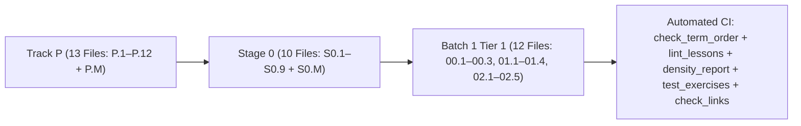

# Changelog — Beginner-First Mechatronics Roadmap Rewrite

All structural changes, lesson splits, curriculum reorderings, angle-convention standardizations, and automated verification additions are logged below.

---

## [2026-10-16] — Run 3: Term-Order Hardening, Falstad CI Mirrors Moved to `tests/` & Batch 1 (`Tracks 00, 01, 02` Tier 1)

### 1. Part A Hardening (`check_term_order.py`, `lint_lessons.py`, `density_report.py`, Multi-URL Heading Check & Falstad CI Mirrors)
- **Added `scripts/check_term_order.py`:** Verifies all 89 glossary terms in `resources/glossary.md` against all 35 beginner lessons in curriculum path order (`P.1`–`P.M` $\to$ `S0.1`–`S0.M` $\to$ `00.1`–`00.3` $\to$ `01.1`–`01.4` $\to$ `02.1`–`02.5`), failing if any lesson uses a glossary term before the lesson that defines it, and checking `PLAN-batch-1.md` prerequisites.
- **Reordered Stage 0 (`S0.2` $\leftrightarrow$ `S0.4` $\leftrightarrow$ `S0.5`) to eliminate forward term references:**
  - `S0.2-series-parallel-and-voltage-dividers.md` now comes immediately after `S0.1` (Ohm's Law), before `S0.3` (Breadboards & Short Circuits), `S0.4-leds-and-resistor-power.md`, and `S0.5-multimeters-and-current-limited-supplies.md`, so **Series** and **Parallel** are defined before sizing a series LED resistor (`S0.4`) or probing voltage in parallel vs. current in series (`S0.5`).
- **Upgraded `scripts/lint_lessons.py`:** Compares each lesson's `## Learn` headings and `### Bridge Notes` against its declared YAML `ideas:` list, failing on extra topics or missing `ideas:` coverage in `### Bridge Notes`.
- **Added `scripts/density_report.py`:** Computes per-lesson word count, new glossary terms, resource count, and code-block count across all 35 beginner lessons, sorted by cognitive density score.
- **Moved Falstad CI Python Mirrors (`S0.1`–`S0.6`, `01.1`) to `tests/test_exercises.py`:** Confirmed that the Python blocks in `S0.1`–`S0.6` and `01.1` only mirrored Falstad circuit calculations for CI; moved them into `tests/test_exercises.py` so learners in `S0.1`–`S0.6` and `01.1` interact directly with the Falstad netlists (`falstad/*.txt`).

### 2. Part B Batch 1 — Tier 1 Beginner Lessons for Tracks 00, 01 & 02 (`PLAN-batch-1.md` + 11 New Lesson Files)
- **Track 00 (`00-foundations/`, 3 lessons):**
  - `00.1-effort-flow-and-first-order-lag.md`: Effort/flow power ($P = V \cdot I = F \cdot v = \tau \cdot \omega$) and first-order lag step response ($\tau$, $63.2\%$ at $1\tau$, $99.3\%$ at $5\tau$).
  - `00.2-mass-spring-damper-oscillations.md`: Hooke's Law spring ($F_s = -kx$), viscous damper ($F_d = -bv$), natural frequency ($\omega_n = \sqrt{k/m}$), and damping ratio ($\zeta$: underdamped, critically damped, overdamped).
  - `00.3-modeling-discipline-and-sanity-checks.md`: 4-step workflow (`Diagram -> Symbolic Equations -> Code -> Sanity Check`) and dimensional/limiting-case checks.
- **Track 01 (`01-electronics-and-power/`, 3 new lessons after `01.1`):**
  - `01.2-h-bridge-and-stall-current.md`: 4-switch H-bridge (`Forward`, `Reverse`, `Coast`, `Brake`), shoot-through prevention, back-EMF ($V_{\text{emf}} = K_e\omega$), and stall current ($I_{\text{stall}} = V_s/R_a$) using Falstad (`falstad/01.2-h-bridge.txt`) and Wokwi Arduino Uno firmware (`IN1/IN2/PWM` with no motor in Wokwi).
  - `01.3-power-regulators-and-power-budget.md`: Linear (`LDO`) regulator heat loss vs. switching (`Buck`) power conservation and worst-case robot power budgets.
  - `01.4-grounding-and-rc-lowpass-filters.md`: High-current ground bounce ($V_{\text{ground}} = I_{\text{motor}}R_{\text{wire}}$), star grounding, and passive RC low-pass filters ($f_c = \frac{1}{2\pi RC}$, `falstad/01.4-rc-lowpass.txt`).
- **Track 02 (`02-mechanics-kinematics-dynamics/`, 5 lessons ramping `1-link FK -> 2-link FK -> IK`):**
  - `02.1-1d-link-fk-and-coord-frames.md`: 2D coordinate frames, right-hand CCW angle sign convention, and 1-link planar forward kinematics ($x = L\cos\theta, y = L\sin\theta$).
  - `02.2-2link-planar-forward-kinematics.md`: Cumulative link angle ($\theta_{12} = \theta_1 + \theta_2$), chaining 2-link tip-to-tail vectors, and annular reach envelope.
  - `02.3-2link-planar-inverse-kinematics.md`: Law of Cosines for elbow angle, reachability clamping (`[-1, +1]`), elbow-down vs. elbow-up solutions, and shoulder angle via `math.atan2`.
  - `02.4-rotational-inertia-and-gear-ratios.md`: Rotational Newton's Second Law ($\tau_{\text{net}} = I_{\text{rot}}\alpha$), moment of inertia ($I_{\text{rot}} = mr^2$), gear ratio ($N$), and reflected rotor inertia ($I_{\text{reflected}} = N^2 I_{\text{motor}}$).
  - `02.5-bearings-belts-and-3d-printing.md`: Cantilevered vs. double-shear shaft support, `GT2` timing belt ratios ($N = N_{\text{driven}}/N_{\text{driver}}$), and 3D-printed layer orientation.
- **Removed Tier 1 Jargon Leaks:** Purged Jacobian determinants, phase-space ellipses, complex numbers ($j\omega$), decibels ($\text{dB}$), Laplace $s$, and Euler-Bernoulli beam deflection formulas ($\delta = \frac{FL^3}{3EI}$) from all Tier 1 sections while keeping Pass 2 / Pass 3 material intact under Advanced (Later).
