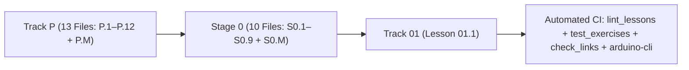

# Changelog — Beginner-First Mechatronics Roadmap Rewrite

All structural changes, lesson splits, curriculum reorderings, angle-convention standardizations, and automated verification additions are logged below.

---

## [2026-10-16] — Run 2: Strict "Max 2 Ideas" Re-Split, Wokwi Arduino Sketch CI & Static Heading Verification

### 1. Enforced "Max 2 New Ideas per Lesson" Across All 24 Beginner Files
- **Re-split Track P from 8 lessons into 13 files (`P.1`–`P.12` + `P.M`):**
  - `P.1-variables-and-data-types.md`: (1) Storing values in named variables; (2) Fundamental data types (`int`, `float`, `str`, `bool`).
  - `P.2-arithmetic-and-order-of-operations.md`: (1) Computer arithmetic operators; (2) Parentheses and order of operations.
  - `P.3-decisions-and-clamping.md`: (1) Conditional branching (`if/elif/else`); (2) Clamping actuator commands within safe limits.
  - `P.4-lists-and-for-loops.md`: (1) Ordered lists with zero-based indexing; (2) Repeating actions with `for` loops.
  - `P.5-functions-and-while-loops.md`: (1) Reusable functions (`def` and `return`); (2) Condition-controlled `while` loops.
  - `P.6-modules-and-automated-asserts.md`: (1) Loading standard-library modules (`import`); (2) Automated self-checks (`assert`).
  - `P.7-si-units-and-metric-prefixes.md`: (1) Base SI units for mechatronics; (2) Metric prefixes (`M`, `k`, `m`, `µ`).
  - `P.8-frequency-and-binary-bits.md`: (1) Cycle frequency (`Hz`) and period ($T = 1/f$); (2) Binary bits and powers of 2 ($2^N$).
  - `P.9-rearranging-formulas-and-scaling.md`: (1) Rearranging three-variable physics formulas; (2) Linear range scaling.
  - `P.10-radians-and-right-triangle-trig.md`: (1) Measuring angles in radians and rotational speed (`rad/s`); (2) Right-triangle trigonometry (`cos`, `sin`, `atan2`).
  - `P.11-reading-time-series-graphs.md`: (1) Graph slope as rate of change; (2) Area under a curve as accumulated change.
  - `P.12-forces-and-lever-torque.md`: (1) Linear force ($F = ma$) and gravitational weight ($W = mg$); (2) Lever torque from horizontal arm angle ($\tau = mgL\cos\theta$).
  - `P.M-track-p-milestone.md`: (1) End-to-end sense-compute-simulate loop.
- **Re-split Stage 0 from 8 lessons into 10 files (`S0.1`–`S0.9` + `S0.M`):**
  - `S0.1-closed-circuits-and-ohms-law.md`: (1) Closed DC circuit loop and ground reference (`0 V`); (2) Voltage ($V$), current ($I$), resistance ($R$) and Ohm's Law.
  - `S0.2-leds-and-resistor-power.md`: (1) One-way diodes and LEDs ($V_f$ and series current-limiting resistor); (2) Electrical power dissipation ($P = VI = I^2R$).
  - `S0.3-breadboards-and-short-circuits.md`: (1) Schematic symbols and solderless breadboard internal connections; (2) Accidental short circuits ($R \to 0\ \Omega$) and why Falstad is used instead of Wokwi.
  - `S0.4-multimeters-and-current-limited-supplies.md`: (1) Parallel voltmeter versus series ammeter probing; (2) Current-limited (`CC/CV`) bench power supplies.
  - `S0.5-series-parallel-and-voltage-dividers.md`: (1) Series versus parallel resistor networks; (2) Resistor voltage dividers and potentiometers.
  - `S0.6-capacitors-and-decoupling.md`: (1) Capacitor charge storage and RC time constant ($\tau = RC$); (2) Power-rail decoupling (bypass) capacitors.
  - `S0.7-arduino-uno-digital-io-and-pullups.md`: (1) Microcontroller program loop (`setup`/`loop`) and digital output (`pinMode`/`digitalWrite`); (2) Digital input (`digitalRead`) and active-low pushbuttons with `INPUT_PULLUP`.
  - `S0.8-adc-analog-read-and-serial-monitor.md`: (1) 10-bit Analog-to-Digital Conversion (`analogRead` `0..1023` at $5.0\text{ V}$); (2) Serial UART telemetry (`Serial.begin` and `Serial.print`/`println`).
  - `S0.9-pwm-duty-cycle-and-analog-write.md`: (1) PWM duty cycle and average voltage ($V_{\text{avg}} = \text{Duty} \times V_{\text{cc}}$); (2) 8-bit Arduino PWM output (`analogWrite` `0..255`) and carrier frequency.
  - `S0.M-stage-0-milestone.md`: (1) Hardware-software safety override loop (`Sense -> Decide -> Act`).
- **Enforced in `scripts/lint_lessons.py`:** Every lesson now requires YAML front matter (`ideas:` list with 1 or 2 items) and fails if `## Learn` contains more `### Idea N:` headings than listed or any extra topic headings.

### 2. Stage 0 Order Log & Restoration of Current-Limited (`CC/CV`) Bench Power Supplies
- **Why Stage 0 order was refined (`S0.3` Breadboards/Shorts & `S0.4` Multimeters/`CC/CV` Supplies before `S0.5` Series/Parallel & Dividers and `S0.6` Capacitors):**
  - Teaching breadboard row connectivity (`S0.3`) and multimeter probing + `CC/CV` current limiting (`S0.4`) immediately after single-resistor Ohm's Law (`S0.1`) and LEDs (`S0.2`) ensures learners know how to wire breadboard nodes without shorting rows and how to probe voltage in parallel vs. current in series **before** building multi-resistor series/parallel networks and voltage dividers in `S0.5`.
- **Where Current-Limited (`CC/CV`) Bench Power Supplies live:**
  - Taught as **Idea 2 of `stage-0/S0.4-multimeters-and-current-limited-supplies.md`** (with a hands-on Python exercise modeling `CV` mode vs. `CC` voltage foldback during a $0.05\ \Omega$ short circuit) and reinforced in **`resources/safety.md` (Section 1)** and **`resources/glossary.md`**.

### 3. Single Consistent Torque Angle Convention ($\tau = mgL\cos\theta$)
- Standardized **one angle convention everywhere** (`P.10`, `P.12`, `P.M`, `resources/glossary.md`, and `tests/test_exercises.py`):
  - Arm link angle $\theta$ is always measured upward from the **horizontal $x$-axis** ($0^\circ$ = horizontal, $90^\circ$ = straight up).
  - The **lever arm** ($r_\perp$) is defined as the **perpendicular distance** from the pivot axis to the vertical line of action of gravity ($r_\perp = x = L\cos\theta$), giving $\tau_{\text{grav}} = W \cdot r_\perp = m \cdot g \cdot L \cdot \cos\theta$ (maximum $mgL$ at $\theta = 0^\circ$ horizontal; $0\text{ N}\cdot\text{m}$ at $\theta = 90^\circ$ vertical).

### 4. Wokwi Arduino Sketch Testing (`arduino-cli` CI + Host C++ Execution) & Python Mirrors Moved to `tests/`
- Removed the duplicate Python mirror exercises from the 4 Arduino Uno Wokwi lessons (`S0.7`, `S0.8`, `S0.9`, `S0.M`) so learners only complete the Wokwi C/C++ sketch and compare its Serial Monitor output against the stated `Expected Output`.
- Moved the Python numerical mirrors for `S0.7`, `S0.8`, `S0.9`, and `S0.M` into `tests/test_exercises.py`.
- Added `scripts/extract_and_compile_sketches.py` and updated `.github/workflows/link-check.yml` to install `arduino-cli` + `arduino:avr` core in CI and compile all 8 Arduino sketches (Starter Code + Full Solution for `S0.7`, `S0.8`, `S0.9`, and `S0.M`) targeting `arduino:avr:uno`. Also added local host C++ (`g++`) compilation and execution against an Arduino Uno mock header in `tests/test_exercises.py`.

### 5. Static-Page Heading Verification in `scripts/check_links.py` and `LINK_REPORT.md`
- Upgraded `scripts/check_links.py` to parse every named heading referenced in each lesson's `What to read` / `Alternative resource` bullets and verify whether each heading text actually appears on static HTML pages, recording per-URL heading results in `LINK_REPORT.md`.
- Marked all interactive SPA/app chapter and menu names (`futurecoder.io`, `falstad.com`, `phet.colorado.edu`, `wokwi.com/projects/...`) as `[verify in-app]` only.
