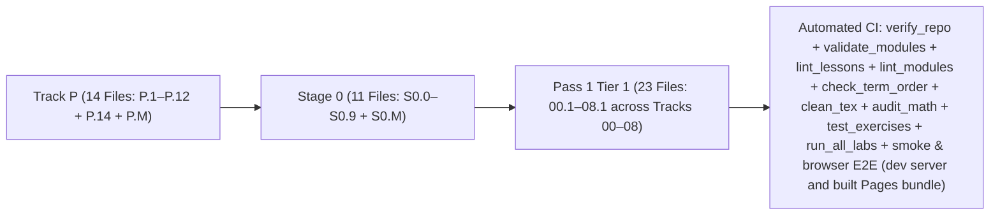

# Changelog — Beginner-First Mechatronics Roadmap Rewrite

All structural changes, lesson splits, curriculum reorderings, angle-convention standardizations, and automated verification additions are logged below.

**Release identity: `3.2.0`.** `package.json` is the one place the number lives; the workbench's footer
prints it (through the define `vite.config.ts` injects), and `npm run test:smoke` and
`npm run test:e2e:pages` pin the footer to the file. Entries below keep the run numbers they shipped
with; they are a record, not a second version.



---

## [2026-10-26] — Run 256: every page gets its picture

Run 254 gave the reader its first figures and its map: 21 named scenes, 39 pages, and the page's own
single-chain flowchart drawn as numbered steps. A beginner page still opened on a wall of prose — 53 of
the 92 pages had no named figure at all — and a branching flowchart was dropped. This run closes both.

**Six new kinds of picture.** `app/src/visuals/Diagram.tsx` gains a renderer for each, and
`scenes.ts` gives each one real data: `plot` (two labelled axes with units and shaded windows —
efficiency, three-phase currents, pole-zero maps, a notch, the loop-inductance spike), `matrix` (a 4×4
transform, a state update, a stackup, a byte frame, a struct's field map), `bits` (a register, high bit
left, fields bracketed above), `reach` (a ring with its two limits and marked radii — the arm's
workspace, a datasheet's min/typ/max), `schematic` (parts on a wire with a shunt to ground — the RC
charge and the brake chopper) and `graph` (boxes and labelled arrows, layered from the edges — ROS 2,
a devicetree, a launch tree, an autograd chain, an asset tree). The scene library went from 21 to 72.

**A branching page keeps its map.** The generator's `flow_graph` parses a Mermaid `flowchart` that fans
out into `nodes` and `edges`, including the label on an arrow, and the payload format moved to v4 to
carry it. Ten pages now draw their graph instead of dropping it. Two things are still refused: a
diagram that is not a flowchart, and a graph past 14 boxes or 24 arrows — a hairball is not a picture.
A quoted node label may now contain brackets (`R3["state = [q, qd]"]`): the old token pattern stopped
at the inner `]` and silently lost the graph.

**Every page carries one.** 63 figure directives were placed at the section they illustrate — the
beginner track's `Learn`, a module's `2. Intuition first` — taking the payloads from 39 figures on 39
pages to **106 on 92** — 107 after the walkthrough below. The pages that were still a wall of prose got a second: the capstone's build
order, the ROS 2 executor's deadline, the six-layer worked example's loop-inductance spike (which also
split one 2,614-character paragraph into the four questions it was hiding).

**The pace is a gate.** `tests/test_lesson_pages.py`'s `ReadingPace` reads the committed payloads and
fails when a page has no named figure, no map (route or graph), or a teaching run of consecutive
paragraphs over **1,400 characters on the beginner track** and **2,500 in a module, ramp page or
chapter** — exam sections exempt, because a paper is read one question at a time. Paragraph runs only:
a heading, list, table, formula, code fence or picture already ends one. The test also shows itself
failing on a 2,000-character paragraph, so the number is not vacuous.

**Five fans drew one box on top of another.** Walking the pages found `parse-tree` (P.2),
`decision-fork` (P.3), `devicetree`, `launch-tree` and `autograd-graph` each handing two nodes the same
`(level, row)` cell — in `TD` the row *is* the column, so two siblings both given `row: 1` drew in one
place and the fan the figure existed for was gone, with no broken link and no missing scene to notice.
Each scene now names one lane per box, and `graphLayers` moved out of `Diagram.tsx` into
`app/src/visuals/graphLayout.ts` so `test:visuals` calls the same layout the renderer does and fails a
scene whose boxes collide (`collidingCells`). The one kind no page used got its page: the reach dial now
sits under 02.3's reachability idea, so all twelve kinds are drawn somewhere in the reader.

**Verified.** `npm run test:visuals` 15/15 (each kind checked against its own data: a graph's arrows land
on boxes it has and no two boxes share a cell, a matrix's cells match its labels, a bitfield spans bits
that exist, a plot's points stay inside its axes, a schematic's shunt hangs off a drawn part);
`python3 -m unittest tests.test_lesson_pages` **28/28** (route and graph parsing, the cycle case, the
size ceiling, the pace gate); `npm run test:reader` 21/21; `npm run test:e2e:pages` green in Chromium
and Firefox, including a new assertion that R.1's branched map draws **5 boxes and 4 arrows** with a
name and a caption; `check:snapshot` 48 surfaces, `check:axe` clean, `check:weight` re-recorded with
two ceilings moved by hand (entry 522.1 of 530 kB, largest 338.3 of 344 kB — 11.7 kB of new renderers and
scenes on the first-screen chunk; the reader's payloads are 685.8 of 720 kB, 107 figures).

**Decisions.** A picture is placed at the section it illustrates, never dropped into a paragraph at
random; the renderers share the seven theme variables, so no palette needed a special case; nothing
animates, so `prefers-reduced-motion` has nothing to switch off; and the pace gate measures paragraphs,
not lists — a bulleted list is already scannable, a twelve-paragraph block is not.

---

## [2026-10-26] — Run 255: the same gates, in four lanes

The run had grown into one long job: a Python matrix, a macOS install check, then a single
`build-workbench` that built the bundle and went on to run fourteen browser suites one after another.
A push to a branch with an open pull request started *two* of those. Nothing here removes a gate; the
shape around the gates changed.

**One run per push.** `on.push.branches` was `["main", "master", "**"]`, so a branch push started a
run of its own and the pull request's `synchronize` event started a second, identical one. A push now
starts a run on the deployed branches only; a feature branch is graded by its pull request. A
`concurrency` group keyed on the pull request number (the ref elsewhere) cancels the run a newer push
supersedes — on pull requests only, because a cancelled `main` run is the publish that never happened.

**Four lanes instead of one queue.** `build-workbench` now ends at the gates that need no browser
(typecheck, build, the unit suites, the weight budget and the perf page) and publishes `dist/` once as
the `workbench-dist` artifact. Three jobs fetch it and run side by side:

| Job | Suites |
| :--- | :--- |
| `workbench-suites` | `test:workbench` (smoke, dev-server E2E, built bundle, control pairs) and `test:e2e:game` |
| `audit-suites` | `test:theme:e2e`, `check:axe`, `check:lighthouse`, `check:snapshot`, `check:labels` |
| `runtime-suites` | `test:runtime` and `test:offline` |

None of them builds: the bundle arrives newer than the checkout, so each suite's `ensureBuilt` reuses
it — and a lane that remade it would be a second copy of the same commit's bytes. That last sentence
needed a step rather than a hope: an archive keeps the build job's timestamps, and a fresh checkout is
newer than that clock, so each lane stamped the restored `dist/` to now (`find dist -exec touch {} +`)
before asking. Measured locally on the real tree: an archived bundle with old mtimes reads as **308
stale source files** and would rebuild; one `touch` later it reads as **0** and every suite reuses it. `deploy-pages` now `needs` all four, so a red audit
cannot publish the bundle it graded — before, the browser suites ran inside the job that uploaded the
Pages artifact.

**The browser download is cached.** Each suite job restores `~/.cache/ms-playwright` under a key that
follows `package-lock.json`, so an upgraded Playwright cannot be handed the old browser build. The
install step still runs on a hit, because the OS libraries are not in that cache and a cached browser
is a no-op to `playwright install`.

**The shape is guarded, not just written.** `tests/test_workflows.py` grows `WorkflowSpeedTests`: a
branch push must start one run, the concurrency block must cancel a superseded pull-request run (and
must not cancel `main`), every one of the nine browser commands must appear exactly once, each suite
job must depend on the build and download `workbench-dist` and must contain no `npm run build`, every
suite job must cache the browsers by lockfile hash, and the deploy must wait for all four jobs.
`python3 scripts/check_workflows.py` still gates the file itself, and now also validates an
`on:`/`concurrency:` pair that actionlint is happy with.

**Verified.** `python3 scripts/check_workflows.py` — 3 workflows, built-in scan clean, **actionlint
clean**; `python3 -m unittest tests.test_workflows` **9/9** (six new); `python3 scripts/check_all.py`
**36/36**; the artifact stamping measured against `buildFreshness.staleBuild` (308 stale → 0). Wall-clock is not measured here: it is a property of the runner, and the honest claim is the
shape — one run instead of two per branch push, a cached browser, one build shared by the lanes rather
than three rebuilds, and the browser work in three lanes instead of in sequence behind the build.

---

## [2026-10-26] — Run 254: the pages get their pictures

Ninety-two reading pages, most of them fifteen to twenty-nine thousand characters of prose, and eleven
of them carried a diagram. The complaint was fair: the course explained chains, loops, timings and
routes in words while the site showed almost none of them. This run makes the pictures part of the
water rather than an occasional flourish, and it does it without an image file or a renderer dependency.

**A named scene library.** [`app/src/visuals/scenes.ts`](app/src/visuals/scenes.ts) is 21 scenes as
data — chains, loops, timings, state gates, bars — and one renderer per kind in
[`Diagram.tsx`](app/src/visuals/Diagram.tsx). A page asks for one with a comment
(`<!-- figure: control-loop | … -->`), which GitHub hides and the workbench draws. 39 pages now carry a
figure, up from 11: the control loop in Tier 1 control, encoder edges in the sensor module, aliasing in
the sampling lesson, Bode margins, a Kalman step, the ISR-to-output chain, the toolchain, the debug
loop, the water analogy at the start of electricity, motion's three rates of change, and the trajectory
in the robotics module.

**The route the pages already wrote.** 170 pages contain a Mermaid `flowchart` and every one of them
was dropped by the generator, because the app had no renderer. It has one now, for the shape nearly all
of them have: a single chain. `generate_lesson_pages.py` parses ordered flowcharts into a `route` block
(payload version **3**) and the reader draws numbered steps — 82 of the 92 pages show their own map, and
the ten that branch (two prerequisites into one lesson, a Jacobian fan-out) are still left out rather
than redrawn as a list. That is also why an assertion changed rather than being deleted: the suite that
used to require Mermaid to be *absent* now requires its source to be absent and its picture present.

**The arm you can grab.** [`visuals/Hologram.tsx`](app/src/visuals/Hologram.tsx) is the dashboard's top
tile: a two-link arm projected from 3D, with a view you can orbit and two joints you can pose, and its
geometry in [`holoModel.ts`](app/src/visuals/holoModel.ts) as pure functions. The suite proves what the
component claims — the joints clamp at their stops, inverse kinematics round-trips forward kinematics
inside the reach and refuses a target outside it, the demo's figure-eight never leaves the hardware's
range, the projection is deterministic and the trail is bounded — so a future Three.js view inherits the
assertions instead of starting over.

**Three bugs the work found.** (1) A node named again later in a flowchart (`B --> C`) was overwriting
the label the first line gave it, so every second step of a route read `B`; labels now survive a repeated
mention, which is what `test_a_repeated_node_keeps_the_label_it_was_given` pins. (2) The old figure
lookup in the browser probe matched the start-here card's own route before the lesson had fetched its
page, so the suite could pass on the wrong picture — the wait is now for the lesson's route. (3) The
reader's `route` figure needed a vertical layout, not the five-box chain: page titles are long and a row
of them ran each label into its neighbour, so a route wraps to two lines and ellipsizes the third.

**Verified.** `npm run test:visuals` **14/14**; `python3 -m unittest tests.test_lesson_pages` **20/20**;
`npm run test:e2e:pages` (the reader block now asserts a named figure, the page's route with at least
three numbered steps, a name and a caption on each); `npm run check:snapshot` **48 surfaces**;
`npm run check:axe` **12 tabs × 4 themes**; `npm run check:weight` with the record refreshed — entry
510.4 kB / 520, largest 326.5 / 335, reader 680.8 / 720, total 2.40 / 2.46 MB. A focused browser probe
drove the built bundle: four chapters' figures painted with their captions, a module's flowchart drew
four numbered steps with its own labels, and the dashboard hologram mounted and described itself.

---

## [2026-10-26] — Run 253: the sweep commits its own chart

`main` went red on `be434a0`: the weekly sweep's bot appended a link-sweep row to
`docs/link-check-history.jsonl` and committed it alone, while `ci.yml` runs
`generate_link_history_data.py --check` on the module generated from that file. Every PR then failed a
gate nobody had touched, and PR #47 had to regenerate the module by hand before it could merge.

**The record step regenerates before it commits.** `Record the sweep's counts and regenerate the link
history (scheduled runs only)` now runs the generator *first*, compares both files to decide whether
there is anything to record at all, and stages `docs/link-check-history.jsonl` and
`app/src/data/linkHistoryData.ts` in one commit. A generator that fails fails the step rather than
pushing half a record, and generation comes before the empty-diff check so a row that somehow wrote
nothing still repairs a stale module.

**Guarded, not just fixed.** `tests/test_link_history_data.py` grows `SweepWorkflowTests`: the record
step's block in the workflow must run the generator (and not with `--check`, which writes nothing),
before it reads the diff, and must stage both paths in a single `git commit`. Reverting the step to
row-only fails those two tests.

**Verified.** `python3.12 -m unittest tests.test_link_history_data` **14 tests** (two new); the
negative case reproduced in a scratch clone — a row-only commit still makes `--check` exit 1, which is
the red this closes; a row appended, generated and committed as one change leaves `--check` green at 6
runs and all rows plottable; the workflow YAML parses with the new step body; `check_workflows.py`
(3 workflows, actionlint clean); `check_all.py` **36/36**.

---

## [2026-10-26] — Run 252: real lo-fi, and a panel to set it by

Sound v2 gave the workbench an interface and a room; the music was still two oscillator drones. This
run makes it music, and gives the learner a settings panel to shape all of it.

**Two CC0 beds, cut rather than composed.** *Snow Drift* and *Fire Place* by holiznacc0 (*Winter
Lofi*, Free Music Archive, CC0 1.0 Universal) are the plan's named beds: **Lab Night** at the bench,
**Focus Current** in focus. `scripts/build_music.mjs` cuts a 60-second window at a fixed start, folds
the two seconds after it back over the head with an equal-power crossfade, peak-normalises both to the
same level, and encodes stereo AAC at 56 kbps — 434 kB each. The 7 MB sources are not committed
(`.cache/music/` is ignored); the provenance, the windows and the licence are in
[`app/src/audio/assets/music/NOTICE.md`](app/src/audio/assets/music/NOTICE.md). The drone is now the
**fallback** and a choice: a browser without AAC, an offline visit, or a learner who picked **Drone**
hears the drones, and the debug snapshot says which (`musicSource`).

**The panel.** `components/SoundSettingsPanel.tsx` replaces three sliders in a popover: Sound (master
and whether a remembered "on" is armed), Music (fader and *which* music), Room, Cues, Interface (a
switch for the ticks plus three previews), and a credit line with Reset. Two new prefs — `clicks` and
`beds` — join the store, with old records migrated; Reset restores the levels and switches but never
switches the learner's sound off or changes the music mid-phrase.

**Three bugs, found by the tests rather than by luck.** A press is dispatched on `pointerdown` and the
control's handler runs after it, so an async hop to the engine let the *press that switches the
clicks off* swallow its own sound — the handler is now kept beside the engine and called inside the
event. A preview was being eaten by the same press under the 35 ms click gap, so previews are exempt
from the gap (and from the switch: asking to hear a tick is not chatter). And the browser suite's duck
check raced a fast run; the engine now keeps a bounded `duckHistory`, so the assertion is about what
happened rather than about catching it.

**Weight.** The beds are a new **`music`** metric at their own bytes — 867.7 kB against 1.00 MB — kept
apart from `audio` so a track cannot hide in a room-tone ceiling. `total` moved by hand to 2.40 MB
local and 2.46 MB signed-in; `entry_gzip` and `largest_js_gzip` did not, because nothing musical is on
a first paint.

**Verified.** `test:audio` **32 checks**; `test:e2e:game` **16** in Chromium (the panel's sections and
faders, a preview named by its label, the Interface switch, the Music source reporting `file`);
`test:weight` 27; `check:weight --record` clean (music 867.7/1000 kB, total 2.39/2.46 MB); `tsc`;
`build`; `build_music --check`; the full workbench matrix, the snapshot surfaces and `check_all`.

---

## [2026-10-26] — Run 250: the room you can hear

Sound v1 was three cues and two beds; this run makes it a place. The bench now has an interface that
answers under the pointer, a room with four layers instead of one drone, a limiter that no burst can
clip, and a rain loop that arrives only after someone asks for sound.

**The interface.** Seven kinds of control, one sound each (`nav`, `primary`, `toggle`, `row`, `chip`,
`slider`, `close`), classified from what an element already says about itself — `data-sound`, a role,
`aria-pressed`, a close word — so no second styling system was added to the app. One delegated
listener in `SoundClicks` (mounted in all three of `App`'s branches) reads the control under the
pointer or the one the keyboard activated and places the tick by its x position, clamped to ±0.35.
Ticks have their own gap (35 ms), their own ceiling (0.1 per tone), and a cap of 16 per second, and
they never duck and never eat a cue's gap. A disabled control is silent; `data-sound="none"` silences
a subtree; text fields were never a sound in this design.

**The room.** `audio/ambience.ts` is a table — rain, floor, city, bench — with a row for home, focus
and a run. The bench is the one layer on the effects bus, so a run makes the machine louder while the
bed and the room duck; a run in focus keeps the machine and pulls the rain and city back. A failed
run pulls one gust of rain (1.55×, half a second down), which is the room reacting to the machine
rather than a punishment sound.

**The mixer.** A room bus of its own, so the new **Room** fader is independent of Music; a
`DynamicsCompressorNode` limiter at −6 dB as the last thing before the speakers, with nothing
bypassing it. The store gained `room` and migrates a record written before it existed.

**The one recorded file.** `app/src/audio/assets/rain-loop.m4a` — 24 s of rain, mono AAC at 40 kbps,
127 kB — rendered by `scripts/build_ambience.mjs` from a seeded PRNG (so it has no third-party rights
and rebuilds byte-for-byte; `--check` proves the committed file is current). It is fetched only after
the gesture, has a synthesised fallback for a browser that cannot decode AAC, and is measured by a new
**`audio`** metric at its own bytes. That metric moved `total` by hand: 1.40 → 1.53 MB local and 1.46
→ 1.59 MB signed-in; `entry_gzip` did not move, because nothing audio is on a first paint.

**Verification.** `npm run test:audio` is 27 checks (the graph, the limiter, the room table, the click
vocabulary, pan, the cap, both rain paths); `npm run test:e2e:game` is 13 in Chromium, now including
the room arriving from the real file, a click heard as a `toggle`, and a muted interface scheduling
nothing. `npm run check:weight` records `audio 127.0 kB / 150 kB`.

**Docs.** [`docs/AUDIO.md`](docs/AUDIO.md) is rewritten around the two kinds of sound (furniture and
place); [`app/src/audio/assets/README.md`](app/src/audio/assets/README.md) carries the loop's
provenance; `docs/README.md` and `app/README.md` list the four new modules.

---

## [2026-10-26] — Run 249: the lab comes out

The walkable room is removed. It was a place beside the course — the header's **Lab** door, its own
`?view=lab` address, a palette command and a lazy chunk — and the owner judged that a 2.5D game does
not belong in a workbench whose job is to get someone to a lesson and a verified check. It arrived
whole in 3.2; it leaves whole rather than shrinking into something that is neither a game nor a page.

**What left.** `app/src/workshop.ts` (the room's rules), `app/src/components/game/Workshop.tsx` (the
screen), their two suites (`test:workshop`, `test:e2e:workshop`), `docs/WORKSHOP.md`, the header's
door and its `onOpenLab` prop, the `lab` member of `WholePage` and of `?view=` parsing, the
palette's `action-open-lab`, the two `package.json` scripts and the two rows in the `test:workbench`
matrix.

**What did not move.** Every lesson, the runner, the roadmap, the reward ledger, Mission Control,
the Black Box, sound and focus mode are untouched: the room never gated a lesson, so nothing a
learner earned was stored in it. A bookmarked `?view=lab` now falls back to the workbench, which is
what every unknown `?view=` value already did.

**Docs.** `docs/README.md` and `app/README.md` no longer list the room; `docs/VERIFICATION.md` no
longer claims its two suites. Run 248 stays in this file as the record of the room arriving; this
entry is the record of it leaving.

---

## [2026-10-25] — Run 248: MechaLab 3.2 — The workshop you can walk

The plan's fourth layer is a place, and this is its first shippable version: one 2.5D room under the
rail arch, two depth lanes (the bench at the back, the floor at the front), and the three hotspots
the story names — the **bench terminal**, **H-7**, and the **alley door**. It opens from the header's
new **Lab** button or `?view=lab`, and it is its own lazy chunk, so a learner who never walks in pays
nothing for the street outside.

**Atmosphere is never a gate.** Continue sits above the room and opens the lesson the workbench would
resume in one press; the door leaves for the workbench; every hotspot is also a row in the menu under
the room, generated from the same list the room is drawn from. A / D walk, W / S change lane, E uses
what you stand at, and tapping the floor walks there; `prefers-reduced-motion` turns the 240 ms walk
into an instant move, and the room has no loops, no autoplay and no lock. H-7's card reads the
verified store — capabilities restored, the next mission, the names already earned — from the same
numbers the LV bar and Rebuild meter use.

**Where it lives.** `app/src/workshop.ts` owns the rules (start pose, step 0.06, reach 0.075, the key
map, clamping, the status sentence) and `app/src/components/game/Workshop.tsx` draws them; the page
is `React.lazy` in `App.tsx`, and the palette's *Walk into the lab* is a second door that works
signed out.

**Verified.** `npm run test:workshop` 10 checks (walls, lanes, reach, the key map, a breadth-first
walkability sweep, the status line); `npm run test:e2e:workshop` 9 browser checks (the header's door,
`?view=lab`, A/D/W/S, E at the terminal, a hotspot clicked from across the room, the menu copy,
Continue, the alley door, reduced motion, and axe serious/critical clear in both default palettes);
`check:snapshot` re-recorded 48 surfaces with the intended diff — exactly `buttons +1` on each, the
new door — and re-checked; `check:axe` 12 tabs × 4 themes unchanged; `test:weight` and `check:weight`
pass in both bundle shapes (local 1.38 MB / 74 files, signed-in 1.44 MB; entry 502.3/504.4 kB against
a raised 510 kB ceiling, js 798.1/857.9 kB against 810/870 kB); `tsc -b` clean; docs and plan rows
current.

## [2026-10-25] — Run 247: MechaLab 3.1 — Sound, off by default

Sound v1 is the plan's phase 5, and it ships with the two rules that keep atmosphere from getting in
the way: **nothing autoplays** — a remembered "on" is armed and starts on the first pointer or key
press — and **the mute is one press** from the header and from the focus pill, because focus hides the
header and a mute you cannot reach is not a mute. Every cue has a visual already on screen (the pips,
the stamp, the award card), so a muted learner loses no information.

**No audio files.** Five cues and both named beds (Lab Night at home, Focus Current in focus) are
synthesised from oscillators and gain envelopes when they play, so there is no media pack, no licence
to track, no third-party request, and nothing to cache. The graph is `music bus → duck → master` and
`sfx bus → master`, with the bed at `level × scene × duck`: a run ducks it to 0.32, focus keeps it at
0.45, and the two compose because they are separate nodes — the bug this shape prevents.

**What a learner hears.** A relay click on Run; a neutral low tick on a failure, never a buzzer; the
pips cascade on a pass; the stamp's sub-second stinger on the first verification of a lesson, and the
shorter pip phrase when already-passed work is run again. A **watch run** — the machine repeating a
check on the learner's behalf — is silent: it did not press Run. The boot swell plays once, when sound
is first enabled.

**Cost.** The synthesiser is a lazy chunk (2.0 kB gzipped) and the control sits behind a `React.lazy`
boundary (2.4 kB), so `entry_gzip` did not move for anyone who never enables it: 503.6 kB measured
against 505.0. `js_gzip` counts every emitted byte, and the whole feature is 4.3 kB, so the signed-in
ceiling moved by hand from 850 to 860 kB — 8 kB of headroom with the reason in
`docs/weight-budget.json`, not a blank cheque.

**The preference does not travel.** Like the palette, the layout and the fold keys, sound is a
choice about this machine, so a backup leaves it behind and the archive's README now says so beside
the others. Returns, restores and a second device never change what the first one sounds like.

**Verified.** `test:audio` 17 checks (defaults, clamping, no context before a gesture, the graph built
once, cue length and peak ceilings, the 60 ms gap, ducking, the focus factor, the bus); `test:e2e:game`
9 browser checks, three of them new — off by default, one press on with the choice stored, a verify cue
with the duck lifted, and a reload that arms instead of autoplaying; `test:workbench` on one dev server
and one built bundle; axe 12 tabs × 4 themes; label sizes; the surface snapshot re-recorded for the
header's new controls and re-checked; weight PASS in the shipped shape.

Files: `app/src/audio/{prefs,facade,engine}.ts`, `app/src/components/{SoundControl,SoundControlLazy}.tsx`,
`app/src/components/Header.tsx`, `app/src/App.tsx`, `app/src/components/tabs/TabPyodideRunner.tsx`,
`app/src/backupBundle.ts`, `scripts/test_audio.mjs`, `scripts/e2e_game.mjs`, `scripts/test_workbench.mjs`,
`package.json`, `docs/AUDIO.md`, `docs/README.md`, `docs/VERIFICATION.md`, `docs/weight-budget.json`,
`README.md`, `app/README.md`, `CHANGELOG.md`.

Also in this release: 3.0 was squash-merged as `8e64a17` in PR
[#42](https://github.com/TLE47/Mechatronics-Roadmap/pull/42), green through the Pages deploy.

## [2026-10-25] — Run 246: MechaLab 3.0 — The Last Hands

3.0 is one idea with two halves. **The repository is the source of truth**, and **the story is the
wrapper, never the work**. Ten missions, ten Black Box recordings, the LV ladder, the reward rules and
the robot's parts are reviewed files under `content/`; `scripts/build_content.py` validates them and
builds the site's bundle, and `--check` in CI fails if the two ever disagree. Nothing in the app
hard-codes a mission or a reward.

**The game cannot be farmed.** A level is the count of missions verified in an unbroken run — every
check that spine step's arm pass lists, executed and passed here. The reward engine has no clock and
no `Math.random`; Neon relights the street and never moves a level; a hint costs nothing; a missed
night shift erases nothing; and an award is a stable id in an idempotent ledger, so a restore or a
replay cannot grant it twice. `scripts/test_gamification.mjs` asserts each of those.

**What a learner sees.** A four-line prologue card on the first visit that says, in writing, that the
starter code is designed to fail — the red result is the lesson working, not the learner breaking it.
Mission Control (the dashboard) opens with the LV bar, the current mission's real checks, this
week's night shifts, Scrap and proof marks; then the ten-mission journey map, in which every row opens
its next unverified check (no lesson is ever locked) and the Black Box, where a recording unlocks when
its mission verifies and stays replayable. A passing run files the award and shows it in a quiet
corner card that never takes focus.

**Weight stayed inside the budget without raising it.** The recordings are 9 kB of prose only the
dashboard reads, so they are a generated file of their own; the reward engine, the toast and the
verification stamp are fetched when a verification needs them. `entry_gzip` is 502.9 kB against the
505.0 kB ceiling, and `largest_js_gzip` 319.4 kB against 325.0 kB.

**The repository plays too.** Four issue forms (Work Order, Field Service Call, Black Box Voice,
Leave a Recording — `work-order.yml`, `field-service-call.yml`, `black-box-voice.yml` and
`leave-a-recording.yml`), a bench-task PR template that asks for the lesson id and the checks run, and
`labels.yml` / `milestones.yml` as reviewed files — the ten missions are the ten milestones.

**Verified.** `test:content` 15 checks and `test:game` 17 checks; `test:e2e:game` 7 browser checks
(the prologue and its warning, LV 1 with Mission 2 in progress, the Perk panel's Now/Next/Later, the
Black Box's open and locked rows, a real pass earning Cold Boot, and a reload that does not duplicate
it); `tests/test_content_build.py` 18 cases including the validator's own negative paths; the full
workbench matrix on one dev server and one built bundle (smoke, dev e2e, built-bundle e2e, control
pairs, the tour and every unit suite) PASS; axe 12 tabs × 4 themes; the surface snapshot re-recorded
for the landing screen only (+1 heading, +2 buttons, +276 px) and re-checked; label sizes PASS after
the new card was brought to the 11 px metadata / 12 px control floor; weight PASS; `python3 -m
unittest discover -s tests` and `check_workflows` clean.

The validator's README-size claim moves with this entry: the page is `111 KB $\to$ 21 KB` now that the
README carries the 3.0 rows.

Files: `content/**`, `schemas/*.schema.json`, `scripts/build_content.py`, `scripts/test_content.mjs`,
`scripts/test_gamification.mjs`, `scripts/e2e_game.mjs`, `tests/test_content_build.py`,
`app/src/{content,gamification,story.ts}`, `app/src/components/game/{LevelBar,JourneyMap,BlackBoxPage,AwardToast,StoryCard}.tsx`,
`app/src/components/LearnerDashboard.tsx`, `App.tsx`, `package.json`, `.github/{workflows/ci.yml,ISSUE_TEMPLATE/*,pull_request_template.md,labels.yml,milestones.yml}`,
`docs/{STORY,CONTENT,REPO_GAME}.md`, `docs/{VERIFICATION,README,surface-snapshot.json}`,
`README.md`, `CHANGELOG.md`.

## [2026-10-25] — Run 245: the archive says what it leaves out

Runs 243–244 added three folds, all of them preferences in `localStorage` and none of them in the
backup. That was the right line — a fold, a palette and a layout are choices about reading on one
screen — but the archive never said so: a learner who restored on a new laptop and found every card
unfolded had nothing to read but the code.

**`README.txt` now carries a "What is not in this zip" section.** It names the preferences that stay on
the device — theme and palette, layout and which side a panel is docked on, focus mode, breakpoints and
watch expressions, the lesson the next visit reopens, and the fold of each roadmap card — and lists the
three keys (`mechalab_resume_collapsed_v1`, `mechalab_trail_collapsed_v1`,
`mechalab_board_collapsed_v1`) rather than saying "settings are not included". The same section keeps
the one deliberate exception beside it: `tour.json` travels because the tour having been *shown* is a
fact about the learner, not a preference about a screen.

**`test:backup` pins the claim both ways.** The README must say what it leaves out and name each fold
key, and no file in the archive may contain one — so a fold added later cannot quietly start riding
inside a store, and a README edit cannot drop the section without failing a suite.

## [2026-10-25] — Run 244: every roadmap card folds the same way

Run 243 gave the trail a fold. The two cards beside it grow the same way and had no answer to it: the
resume card carries a sentence about the state and, once a draft exists, a second line about it, and
the Board card is the tallest thing above the ten steps — a sketch and a prediction box side by side.

**One implementation, three cards.** `app/src/fold.ts` owns the stored fold and `useFold`, and
`app/src/components/FoldToggle.tsx` owns the button — `aria-expanded`, the visible word first in the
accessible name (WCAG 2.5.3), an `aria-hidden` chevron. The trail moved onto both instead of keeping
its own copy. The keys sit beside the palette and the layout in `localStorage`, one per card, and none
of them is in the backup: a restored archive has no business deciding which cards this device has open.

**What a fold keeps is the point of it.** The Board card keeps its heading, the lesson it holds and the
lesson count; the sketch, the picker and the simulator steps go behind the press. The offer keeps
`id · title`, a two-word badge read from the same fields in the same order as the sentence it replaces
(`passed`, `marked complete`, `tried 3×`, `edited, not run`), and — deliberately — the button that
continues the lesson, because a fold that hid the one press the card exists for would only be unfolded
again. Each card carries `data-collapsed`, so a test reads the state rather than a class.

**Verified.** `npm run test:e2e` PASS (51 steps) with the two new ones: the offer folds at step 7c.5
and the Board card at 15b, each reloaded and found folded before it is unfolded again;
`npm run test:e2e:trail` still folds the trail across a reload; `check:snapshot` PASS over 48 surfaces
(re-recorded: one button more on the roadmap in each palette, the board card's toggle — the offer and
the trail are absent on the seeded empty profile); `check:labels` PASS (227 rows), `check:axe` PASS
(12 tabs × 4 palettes, no exceptions), `test:trail` 27/27, `test:board` 12/12, `tsc` clean,
`check_all` 35/35, `check_doc_commands` 436 commands.

**One flake fixed in the harness.** `scripts/e2e_toolbar.mjs`'s `openMore` now presses the disclosure
at most twice, guarded on `aria-expanded`. A run under load failed a step after a tab switch because
the press landed on a render that then remounted, and `waitFor` only polls visibility — it never
presses again. Two unrelated editor steps (`# %%` markers, Vim `dd`) timed out in other runs with the
host at load 7.7; the same `dd` timeout is in an earlier sweep log, so that is the machine, not this
change.

## [2026-10-25] — Run 243: the trail folds to one line

The roadmap's trail card is the most useful thing on that page after a fortnight and the tallest thing
on it after a week: every day, every row, and the readings above them. A learner who wants the totals
still had to scroll past the transcript to reach the steps underneath.

**One toggle in the header, and the totals stay.** Folded, the card is its summary line — `1 day ·
under a minute measured · 4 runs` — and the days, rows, readings and the omitted-days sentence go
behind one press. That line is already the card's own arithmetic (`trailSummary`), so the fold hides
rows rather than dropping numbers. It also makes the one-day case honest: expanded, a single day is not
summarised twice and the summary is absent; folded, that day's own line is gone, so the summary is what
appears.

**The choice is a preference, not data.** `mechalab_trail_collapsed_v1` sits in `localStorage` beside
the palette, the layout and the last lesson, and is deliberately **not** in the backup — a restored
archive has no business deciding whether a card on this device is folded, which is the same line
`tour.json` crosses in the other direction ("shown" is a fact about the learner, not a preference).

**It is one button with a name, not a colour.** `aria-expanded` carries the state and the accessible
name begins with the visible word (`Show the trail` / `Hide the trail`, WCAG 2.5.3), the chevron is
`aria-hidden`, and the card carries `data-collapsed` so a test reads the state instead of a class.

Verified: `npm run test:e2e:trail` folds the card (no rows, no readings, `aria-expanded="false"`, the
summary still naming the day), reloads and finds it still folded, then unfolds it and finds every row
back; `check:snapshot` (48 surfaces) and `check:labels` (227 rows) unchanged, `check:axe` PASS,
`npm run test:trail` and `npm run test:smoke` PASS, `tsc --noEmit` clean.

## [2026-10-24] — Run 242: the first lesson explains itself, and waits for you to do it

The starter fails on purpose. A beginner's very first *Run & Verify Output* therefore prints red checks
— and a beginner reads red as "I broke it" well inside two minutes. Nothing on the page said otherwise:
the per-lesson brief (`first-lesson-guide`) names the holes and the finish line in three columns of
prose, which is a paragraph where a beginner needs a pointer.

**A six-step first-run tour, two steps of which have no Next button.** `app/src/tour.ts` holds the table
— welcome, the brief, the editor, Run, the red checks, the hints — and the gate each step waits on: a
press for the words, **the editor text changing** for step 3, **a run finishing with a verdict** for
step 4. The reducer is pure (`reduceTour`), so those rules are tested without a browser; a signal the
current step does not ask for returns the same object and React reads it as no change. A learner who
passes on the first attempt skips the red-checks step entirely, because it would then be a sentence
about something that did not happen.

**A ring, not a backdrop.** The coach mark draws its shadow round a cut-out (`pointer-events: none`) so
the highlighted control and everything around it stay clickable — a step that asks for a press must not
be covered by the thing asking. On a phone (below 768 px) the card becomes a bottom sheet above the
safe area, its buttons 44 px, and the step's own `mobileView` puts the region it is talking about on
screen. The preset a step needs is applied through `shownLayout` and **never written**: `writeLayout`
is still only called by the layout buttons, so the learner's own choice is exactly where they left it
when the tour ends.

**Where it opens.** `app/src/tourState.ts` answers that with `tourOffer`: a first visit with nothing
saved opens it; any verified or completed lesson, or a draft, is a returning learner and gets nothing; a
deep link into a later lesson gets a chip instead (*New here? … Take the tour*); a page left mid-tour
gets a resume chip that names the step (*Resume tour (step 3 of 6)*) once. Esc dismisses, the ×
dismisses, and neither ever reopens it. The record is versioned, and `mergeTourStates` means a restore can
never move it backwards — **`tour.json` is the one non-preference a backup carries**, because "this
learner has been shown the tour" is a fact about them, not a look-and-feel choice.

**Measured, locally.** The learning log gains one kind — `tour`, with `action` (`shown`, `resume`, `step`,
`skipped`, `completed`) and the step number — so a pilot can tell "walked it" from "closed it at step two"
without watching anyone. It never leaves the browser, like every other event, and the friction report
counts the kinds it knows and ignores the rest. Measured in the browser while wiring it: one `shown` on
a first visit, `step 2` on Next, `skipped 2` on the ×.

**Replayable from both doors a stuck learner tries.** `Replay the first-lesson tour` is a palette command
and a button on the `?` sheet; both bump a `tourRequest` nonce, the same idiom `runRequest` and
`formatRequest` already use, because the shell outlives the runner and must not hold its functions.

**Pinned, because a tour that loses its target is worse than none.** Five `data-tour` anchors name the
elements; `npm run test:firstrun` (`scripts/test_tour.mjs`, 27 checks) reads the app's own source and
fails if an anchor disappears *or* if an anchor is left behind with no step pointing at it. It also
pins the gate per step (an action step that became skippable would be the slideshow this design exists
to avoid), the store's validation of junk and of a future version, the offer rule in all five
situations, and the merge.

**Two harness defects, both found by this feature measuring pixels.** The first is the suite's own dev
server: `startDevServer` called `createServer({ root: 'app' })` with no `configFile`, and Vite resolves a
config from *its* root — so the project's `vite.config.ts` at the repository root was never read and
**every browser suite was driving the app without Tailwind**. No `fixed`, no `min-h-[44px]`, a page 8002
px tall instead of 2781: data attributes and text still worked, which is why it went unnoticed. The
tour's ring check is the first assertion in the harness that asks where something *is*, and it answered
`position: static` and 1048 px from the bottom of the screen. `configFile` now points at the root config,
and the base URL comes from `viteServer.config.base` instead of a hard-coded Pages path the dev server
only answered through its SPA fallback.

The second is the coach mark's measurement. On a cold first visit the lesson list and reader populate
*after* the tour mounts, so a brief measured at 6 px was found 4819 px lower by the time a learner read
the card — nothing had scrolled and the anchor's own box had not resized, so scroll, resize and its
ResizeObserver all stayed silent. The document's height is what changes when content arrives above an
anchor, so `FirstRunTour` observes that too, with a 250 ms poll as the backstop for a reflow that leaves
the height alone. `e2e_tour` waits, bounded, for the ring and the sheet to settle instead of asserting on
a 400 ms stopwatch: the assertions are unchanged, and it still fails if they never land.

**The gate was not the gate, and JSON hid it.** The first version of this file registered as
`test:tour` — a name `package.json` already used for the presets walker. Duplicate keys are not a JSON
error; the last one wins, so `npm run test:tour` kept running the presets suite and these 27 checks ran
nowhere, exactly as the docs said to invoke them. The suite is now `test:firstrun`, and its last check
reads `package.json` and refuses *any* duplicated script key, so the next collision fails loudly
instead of quietly deleting a gate. The same rename also left `test_tour.mjs` in the `test:workbench`
list twice — `firstrun 1.0s` and `firstrun 0.5s` in one suite report is what a duplicate looks like — and
that second registration is gone.

**The axe gate had been auditing a placeholder.** The same missing stylesheet had a second cost: with no
page rendered properly, three `pre`/scroll boxes never appeared wide enough to scroll, so
`scrollable-region-focusable` — a serious rule — had nothing to report in twelve tabs. With the config
read, `check:axe` failed on the first real sweep: a `<pre>` of pinned sketch lines in `BoardBridge`, a
governing equation in `tab-arch`, and the run output in the lesson reader each scroll with no way for a
keyboard to reach that scroll. All three now carry `tabIndex={0}` and a name (`role="group"` with the
formula's or the sketch's own words), the pattern `MathPanel` already used. Nothing else moved — the
snapshot and label baselines came back at their exact previous numbers.

**Then it failed once on `main` and passed everywhere else, and the test was wrong.** The dismiss check
pressed Escape 700 ms after a fresh visit and then asserted the card was gone; on a runner sharing one
dev server with three other browser suites the coach mark mounts *after* that sleep, so the key went
into a page with no listener and the card appeared a moment later (`1 !== 0`). The next run of the same
three-instance contention found the other half of the same assumption (`null !== 'welcome'`). `go()` now
waits for the shell (`btn-theme-toggle`) instead of sleeping, presses only once the card is on screen,
and waits bounded for the dismissal — the assertions are unchanged, and the case still fails if the
mark never opens or Escape never closes it. Proven by pressing Escape before the mount on purpose
(`.fb-scratch/probe_esc_race.mjs`: card opens, record stays `active`) and by three concurrent runs of
the suite, which is the contention that produced both shapes.

**Then the rest of the file, and one suite beside it, for the same reason.** `e2e_tour` had twelve more
`click, waitForTimeout, assert` sites — the step after each Next, the edit gate, the Finish record, the
palette replay, the chip start, the resume return, and the phone's two presses. Each now waits, bounded,
for the state it claims (`waitForStep`, `waitForRecord`), so the assertion *is* the timeout instead of a
stopwatch in front of it. The run gate was worse than slow: it slept 600 ms and then skipped the predict
gate, so a gate arriving late was never answered and the tour could not advance for two minutes — it now
waits for whichever comes first, the gate or the results step, and only then skips. `e2e_predict_gate`
had the same shape in the other direction: `Run`, 400 ms, "no gate on screen" could pass while a card was
still on its way in, so it reads that absence after the run's own output arrives. What is left in both
files is a paint wait and the settle after a readiness selector, each with its reason in a comment.
**And the presets suite, whose failure reads as an app bug.** CI then failed `tour` on
`cad_flexure_stage: the readout already matches before its own card is applied`. That case is primed
*because* the tab's default already matches its preset, so any read taken before the priming card's
preset has landed reports exactly that sentence — and the only gate in front of the read was
`settle()` (two frames plus 50 ms). The Apply side already waits with `waitForFunction`; the prime side
now waits, bounded, until the tab has left the preset, so the message can only mean what it says.
Verified with the contention that started this: three concurrent runs of `e2e_tour`, of
`e2e_tour_presets` and one `e2e_predict_gate` against one dev server, all green.

`npm run test:e2e:tour` (`scripts/e2e_tour.mjs`, **12 checks in a real browser**) walks the whole thing:
the ring's geometry against the brief and that the brief is still clickable through it, the missing Next
button on step 3 and that typing alone advances it, the predict gate handled the way a learner handles
it, red-checks-after-a-failed-run, Finish, no reopen on reload, dismissal, the deep-link chip, the
resume chip continuing at step 2, the phone sheet and its region switching, and the palette replay.

**The harnesses are not first-time visitors.** A fresh Playwright context is exactly the visitor the
tour is for, so the coach mark appeared over the workbench in every suite that drives it — and
`check:snapshot` proved it by failing on an intercepted click. All 20 app-driving suites now seed the
record first (`scripts/tour_seed.mjs`); `e2e_tour.mjs` is the one that does not, because it measures the
tour. With the seed, `check:snapshot` (48 surfaces, 4 palettes) and `check:labels` returned to their
exact previous numbers — 227 metadata rows, not the 232 the card had added — which is the diff that
proves the feature is the only thing that changed.

Verified: `test:firstrun` 27/27, `test:e2e:tour` 12/12, `test:backup` 22/22 (including the new round trip:
completed beats dismissed, a stale archive cannot un-finish it, and a nonsense record is skipped out
loud), `check:snapshot` PASS (48 surfaces, unchanged), `check:labels` PASS (227 rows, unchanged),
`check:axe` PASS (12 tabs × 4 palettes, 0 exceptions — over the real page, for the first time),
`test:smoke` PASS, `test:pairs` 17/17, `test:e2e` PASS with the prose row now matched case-insensitively
as the uppercase label it renders, `tsc --noEmit` clean, and `npm run test:workbench` green across every
suite on one dev server and one built bundle.

## [2026-10-24] — Run 241: the course-level nav is drawn only where it changes something

The header's four links — Start here, Beginner, Applied, Advanced — are a stored preference, and two
panes read it: the Start Here roadmap cuts its ten steps by the pass, and the simulator tabs swap their
guide banner (`SIMULATOR_TIER_GUIDES`). The nav was rendered on **all twelve** workbench views anyway,
so on the other nine a press moved the highlight and changed nothing else. Measured on the live site:
pressing Advanced on *Run Python Lessons* moved `aria-current` from `btn-pass-tier1` to
`btn-pass-tier3`, wrote `mechalab_active_tier_pass_v1`, and left the page's text at the same length —
a filter that filtered a third of the screens, presented as if it filtered all of them.

**The nav now follows the content.** `app/src/courseLevels.ts` answers one question — does this view
read the pass — and `Header` draws the nav only when the answer is yes. The answer is derived from the
guides themselves (`Object.keys(SIMULATOR_TIER_GUIDES)`), plus the roadmap, so a tab that gains a guide
is covered the day its guide exists and a tab that loses one cannot leave the nav behind. A partial
guide does not count: a banner written for `tier1` alone would leave three of the four links dead, so a
tab qualifies only when all four passes are present. The dashboard, the admin area and a lesson's
reading page pass `false` — those are whole-page views with no tab pane to re-cut.

**Pinned, because the failure mode is invisible.** `npm run test:levels`
(`scripts/test_course_levels.mjs`, in `test:workbench`'s matrix) reads the tab table and fails if any
tab is left without an answer, if the roadmap or a four-pass banner is excluded, if the Python runner,
placement quiz, board or link survey claims to read the pass, or if a half-written guide keeps the nav.
The prop is required, not optional, so a new header site cannot forget to decide.

Verified in the browser against the local build: at 1280 px the nav is `flex`/314 px on the roadmap and
on the vibration lab, and **absent from the DOM** on *Run Python Lessons* and the placement quiz, on a
lesson page (`?lesson=P.4`) and on the dashboard (`?view=dashboard`). `tsc --noEmit` clean.

## [2026-10-24] — Run 240: the staging pass, and the two defects it found

The accounts work had never met a live project. Staging (`mechalab-staging`, us-west-1) now exists: both
migrations applied, three Edge Functions deployed with `APP_ORIGIN`, Auth pointed at localhost and the
Pages base, and the first admin granted out of band. Running the release checks by hand found two
things no local gate could see.

**Every admin was locked out.** `requireAdmin` asked
`auth.mfa.getAuthenticatorAssuranceLevel()` for the session level, but that helper reads the *stored
session* of the client it is called on, and the function's client is stateless by design — it carries
the caller's header and nothing else. It answered `null` for every request, so a genuine `aal2` session
was refused with the MFA sentence and `ADMIN_REQUIRE_MFA=0` was the only way in. The check now decodes
the `aal` claim of the token `getUser()` has already validated.

**A first admin had no way to enrol a factor.** The panel could sign in, sync, export and delete, and
the admin area existed, but nothing offered Supabase's TOTP enrolment — so the MFA requirement was
unreachable from the app. The account panel now has a **Two-factor** section for an admin: *Set up
two-factor* shows the base32 secret and `otpauth://` link, a six-digit code turns the session `aal2`,
and a returning admin is asked for a code instead of being shown the secret again (`enrolTotp`,
`verifiedTotpFactors`, `verifyTotp`, `currentAssurance` in `app/src/accounts.ts`).

The pass is scripted rather than retyped: `npm run check:staging` (`scripts/staging_checks.mjs`) creates
confirmed test accounts and runs **18 checks** — isolation in both directions, the role self-write
refusal, learner refusals from both functions, `aal1` refused and `aal2` admitted, announcement write /
public read / clear, promote and demote, the last-admin `409`, audit rows, export, deletion of user and
rows, and `curriculum-pr`'s `501`. `npm run test:e2e:two-factor` (`scripts/e2e_two_factor.mjs`) drives
the panel in a browser through both branches. Both skip CI and skip production; staging's test data is
deleted after the run. All local gates stay green: check_all 35/35, `test:accounts` 25, `test:schema` 18,
`test:merge` 9, build and `check:weight` (entry 495.4 kB of 505, total 1.41 MB of 1.46).

**The surface snapshot was re-recorded, and the diff is the reasoning.** The Start Here card's new
sentence — *an account is optional, for carrying progress between devices* — is one line taller in all
four palettes, so the sweep failed 16 numbers on the pyodide tab only: the card's panel 336 → **363 px**,
main 2281 → 2307, the footer 2395 → 2421 and the document 2438 → 2464. Nothing else in 48 surfaces
moved, which is what makes a one-tab diff readable as an intended change rather than drift. Run 1's CI
job caught it; the same numbers were reproduced locally before recording, so the baseline was not
assumed to be the platform's fault.

## [2026-10-24] — Run 239: the formulas ship with the page

Every equation in the course borrowed its stylesheet from a CDN. `app/index.html` carried a jsdelivr
`<link>` pinned to **0.16.21** while `katex` in `package.json` was **0.16.47**, so the layout rules were
a version older than the JavaScript that wrote the markup, and a page with `$f_c = 1/(2\pi R C)$` needed
jsdelivr to answer before it could be read. The weight gate could not see it either: `entryNames` skips
a stylesheet that is not under `assets/`, so the `entry_gzip` it reported was the bytes this repository
serves, not the first paint a learner waits for.

Maths is self-hosted now. `app/src/main.tsx` imports `katex/dist/katex.min.css` with the UI fonts, so
Vite emits it as `vendor-katex-*.css` and links it from the built document — styled at first paint, from
this origin, offline. The `woff`/`ttf` sources of each face are trimmed by a plugin in `vite.config.ts`
(`katexWoff2Only`): the untouched stylesheet would have put **1.08 MB** of fonts in `dist/` (woff2 plus
303 kB of woff and 514 kB of ttf) for the 260 kB of woff2 a current browser actually asks for. Nothing
else about the typesetting changed.

**The budget moved by hand, with the measurement.** `fonts` 302.7 → **558.9 kB** (19 KaTeX faces),
`css_gzip` 14.7 → **22.2 kB** (the rules and 19 `@font-face` blocks), `total` 1.08 → **1.35 MB** local
and 1.14 → **1.41 MB** signed-in. `entry_gzip` took only the stylesheet link (485.1 → 492.8 kB local,
481.4 → 494.8 signed-in) and keeps its 505 kB ceiling: the KaTeX JavaScript chunk was already preloaded,
because `MathView` is statically reachable. The ceilings are 600 kB fonts, 26 kB css, 1.40/1.46 MB total
— room for one more small feature, not another font family. `fonts` counts emitted bytes, not a visit: a
browser fetches a face only when a rendered glyph needs it, and the browser check below measured a
lesson page loading three of the nineteen.

**Pinned, not assumed.** `npm run test:fonts` now fails if `app/src/main.tsx` stops importing the
stylesheet, if the built document or the emitted CSS names another origin, if a face the CSS names was
not emitted, if a `woff`/`ttf` face survives the trim, or if the KaTeX stylesheet is not linked from
`dist/index.html`. The gate that measured the old CDN as invisible was updated in the same run.

**Offline is a test, not a hope.** `npm run test:offline` opens lesson 01.4 while the network is still
there — 100 formulas, and the worker keeps its payload, the stylesheet and the three faces the page
asked for — then **empties Chromium's HTTP cache** before going offline, so a glyph served after that
can only come from `mechalab-assets-v1`. The offline reload still sets 100 formulas in `KaTeX_Main` and
prints no raw `$…$`. The check is real: putting the jsdelivr `<link>` back (and dropping the import) fails
the suite at `expected the KaTeX stylesheet in the asset cache; found: nothing`.

Verified: `check:weight` PASS in both shapes (local 1.35 MB, signed-in 1.41 MB, tightest `css_gzip` 3.8 kB
left), `test:fonts`, `test:weight` 25/25, `test:offline` PASS (offline formulas, HTTP cache cleared), and
a browser run of the built bundle at the Pages base with every third-party request blocked — lesson 01.4
rendered **100** formulas, none of them raw `$…$`, glyphs `KaTeX_Main` fetched 200 from `assets/`, and
only the Pyodide interpreter (its documented CDN, by design) left this origin.

## [2026-10-24] — Run 238: the account is optional, the admin area is a role

The workbench could sign a learner in with an emailed link and sync three progress maps. Accounts now
run the full product decision: **learning stays open without an account; an account is for carrying
work between devices; administration is a role checked on the server.**

**Sign-in** grew into one flow: the same Google button for new and returning learners, email + password
with confirmation and reset, and the old sign-in link kept as an alternative. A round trip returns to
the lesson or dashboard it started from, through `returnTo.ts`, which accepts only this origin's base
path and refuses a scheme, `//host`, a backslash and `..`; Supabase's redirect allow-list is the second
lock. Account settings list the connected methods and offer export and delete.

**Workspace sync is opt-in and never chooses silently.** `workspaceMerge.ts` keeps a draft or note that
exists on one side, collapses identical copies, and when two devices hold different text keeps the newer
in the lesson's slot **and the other in a conflict entry** with its origin and time. Highlights union by
quote; two comments on one quote keep both. The account panel shows what each side holds before the
merge writes, and the dashboard counts the kept versions.

**A learner dashboard** (`?view=dashboard`) reads the same stores as the workbench: Continue (from
`lessonOffer`, so it never sends anyone back to a verified lesson), progress counts, recent study, saved
work, due review and the account/sync scope. It is a home base, not a gate: the back button returns to
the lesson, and a signed-out visitor can open it.

**The admin area** (`?view=admin`) is hidden by role and protected by everything else: five tables with
RLS **and explicit grants** (Supabase's default `grant all` revoked first), a role table the browser can
only read, and three Edge Functions that read the caller from the JWT, re-read the role with the
service-role client, and require an `aal2` session. It ships an announcement (public read), a fixed
feature flag (`guided_tour`, on unless written), a role control that refuses to demote the last admin,
an audit log written by the server, and a curriculum workflow that opens a **pull request** through a
GitHub App — CI and the generators remain the publishing gate.

Files: `app/src/{accounts,accountActions,accountRules,returnTo,workspaceMerge,workspaceSync,dashboardData,adminModel,siteSettings,siteSettingsModel}.ts`, `app/src/components/{AccountPanel,LearnerDashboard,AdminDashboard}.tsx`, `app/src/App.tsx`, `app/src/lessonDraft.ts` (`replaceDrafts`), `supabase/migrations/000{1,2}_*.sql`, `supabase/functions/{_shared/http,account-action,admin-action,curriculum-pr}`, `scripts/test_accounts.mjs`, `tests/test_accounts_schema.py`, `package.json`, `.github/workflows/ci.yml`, `docs/ACCOUNTS.md`, `docs/ADMIN.md`, `docs/VERIFICATION.md`, `docs/README.md`, `README.md`, `app/src/data/startHere.json`, `docs/weight-budget.json`.

Verified: `npm run test:accounts` 25 checks; `npm run test:schema` 18 tests; `python3.12
scripts/check_all.py` 35/35; `npm run lint` and `npm run build` clean; `npm run check:weight` within both
shapes (entry 485.1 kB local / 487.1 signed, js 762.6 / 822.4 of the raised 790 / 850 ceilings, tightest
metric 277 B). The three new screens are `React.lazy` chunks, so a visitor who never opens them does not
download them. What these checks cannot prove is a live project: the staging checklist in
[`docs/ACCOUNTS.md`](docs/ACCOUNTS.md) — Google round trip, two-account isolation, MFA, export/delete and
a real PR — is written down and has **not** been run from this environment.

## [2026-10-24] — Run 237: a clipped formula copy is not a spill

The first CI run on the release (`5e5c506`) failed one assertion, and only on Linux: at the 834 px
tablet width, Firefox laid out **34** elements past the right edge with the document itself scrolling by
0 px. The worst was an `<mo>` at 948 px, which named the cause — KaTeX writes a second, screen-reader-only
copy of every formula as MathML inside `.katex-mathml`, clipped to a sliver by its own stylesheet. Its
boxes keep their layout rectangles after the clip, and Firefox on Linux gives them wider metrics than
macOS does, so a page that is correct to look at failed a check that counted drawing geometry.

The check already knew this shape: an SVG `<path>` inside a stretchy delimiter is excluded for the same
reason. It now excludes a descendant of `.katex-mathml` **only when that copy is actually clipped**
(`clip-path`/`clip` off `none`/`auto`), so an unclipped math box is still counted and a broken render is
still a failure. The skipped boxes are counted and printed on the pass line, so the exemption is visible
rather than silent. Local runs now say `4 clipped SVG/MathML box(es) skipped`; the assertion itself —
document overflow `≤ 0` and no unexempted element past the edge — is unchanged.

Files: `scripts/e2e_pages_bundle.mjs`, `docs/VERIFICATION.md`, `CHANGELOG.md`.

Verified: `npm run test:e2e:pages` PASS on chromium and firefox (tablet overflow 0 px, 4 clipped boxes
skipped); `python3.12 scripts/check_all.py` 35/35; `npm run lint` and `npm run build` clean.

## [2026-10-24] — Run 236: the results page is rendered from the folders

[`docs/pilot-results.md`](docs/pilot-results.md) is the one pilot artefact a reader cannot check for
themselves: the participant folders behind it are git-ignored, so a typed `N = 3` looked exactly like a
measured one. It is generated now.

`scripts/pilot_results.py` renders the page from `pilot-data/*/`. The count is
`pilot_sitting.counted()` — the same predicate `--status` prints — **plus** `audit()`, so a record that
claims more than its evidence supports is left off the page and named in a `not counted` line rather than
published. Each sitting now names its stage (`--new --stage smoke|p1|p2|p3`, validated by the record's own
audit), so the stage and funnel tables group by a choice instead of a guess. Time per stage is median and
range, the top-10 stuck points are the records' own `stops` grouped by page and kind, the transfer table
reads `follow-up.json`, and the per-lesson help split counts only a sitting that covered exactly one
lesson — one help event cannot be apportioned to one of several pages without inventing the split.

`--check` fails when the committed page and the folders disagree, and `npm run check:pilot` runs it as
"results are current" (eight gates now), so a hand-typed count cannot survive a gate. The author walk
moved to [`docs/AUTHOR_WALK.md`](docs/AUTHOR_WALK.md) and is inlined into the generated page, with a
mermaid of the nine runs its own gate requires, so the narrative keeps one copy and the page can be
generated whole.

Files: `scripts/{pilot_results.py,pilot_sitting.py,check_pilot_kit.py}`,
`tests/{test_pilot_results.py,test_check_pilot_kit.py}`,
`docs/{pilot-results.md,AUTHOR_WALK.md,PILOT.md,PILOT_KIT.md,README.md,VERIFICATION.md}`, `CHANGELOG.md`.

Verified: `python3 tests/test_pilot_results.py` 12/12; `python3 tests/test_check_pilot_kit.py` 8/8;
`python3 -m unittest discover -s tests -p "test_pilot*.py"` 88/88; `npm run check:pilot` PASS (8/8);
`python3.12 scripts/lint_assertions.py` 0 weak; `python3 scripts/check_doc_commands.py` PASS (421
commands); `python3.12 scripts/check_all.py` 35/35. The page renders the shipped N = 0 template from zero
folders, and a scratch folder elsewhere in /tmp produced a one-participant page and was removed, so the
repository still publishes no participant.

## [2026-10-24] — Run 235: §5's criteria are a record a gate reads

§5 of [`docs/PLAN-2.1a.md`](docs/PLAN-2.1a.md) asks for three beginner sittings. Runs 232–234 built the
instrument; what was still missing was the plan's **first** success criterion — *finds the first lesson,
unaided* — whose two fields (`reached_lesson_1`, `minutes_to_lesson_1`) sat in the record written by
nothing and checked by no gate. A `yes` with no minute was the same shape of claim as a finished sitting
with no verified export: true and useless.

`--debrief` now writes them together (`--reached-lesson-1 yes|no`, `--minutes-to-lesson-1 N`), refuses a
minute with no find, and clears a stale minute when the answer becomes `no` — a find that did not happen
has no minute, and one left behind would read as a slow find. `--check` refuses a `yes` with no minute, a
minute beside a `no`, a minute outside 0–240, and a minute longer than the sitting itself.

The plan page records what now exists rather than what was planned: §5 carries a criterion table — the
criterion, the field, the command that writes it, and what that command refuses — and says plainly that
the instrument is done and the participants are owed. `docs/README.md`'s plan row says the same, so the
release cannot read as finished on the strength of its own tooling. Nothing in the plan claims
"convenient" before three non-author beginners have sat down.

Files: `scripts/pilot_sitting.py`, `tests/test_pilot_sitting.py`,
`docs/{PLAN-2.1a.md,README.md,PILOT_KIT.md,VERIFICATION.md}`, `CHANGELOG.md`.

Verified: `python3 tests/test_pilot_sitting.py` 51/51;
`python3 -m unittest discover -s tests -p "test_pilot*.py"` 76/76; `npm run check:pilot` PASS (6/6);
`python3.12 scripts/lint_assertions.py` 0 weak; `python3 scripts/check_doc_commands.py` PASS (415
commands); `python3.12 scripts/check_all.py` 35/35. The operator path was walked once more in a scratch
folder with the find included — open, one stop, finish (9 active / 40 elapsed), a full debrief, `--check`
PASS with one counted participant — and removed, so `--status` still says `N (non-author) = 0`.

## [2026-10-24] — Run 234: the answers are written once, and refused before they land

The record's post-sitting fields — `understood_error`, `knew_next`, `their_fix` and the graded loop —
were answered by editing `sitting.json` by hand. A JSON edit has no gate: a field name spelled wrong is
silently accepted, `finished: true` lands with no `run_verify`, and the operator finds out at `--check`
half an hour after the participant has gone.

`--debrief` writes them in one command. It takes `--understood yes|partly|no` with the message it is
about (`--error-quote`), `--knew-next`, `--their-fix` in their words, `--run-verify`, `--finished` and
`--finished-minutes` — writes each into the record, and **audits a copy before writing**. An answer that
would make the record unfilable is refused with the finding that names it, and nothing is written at all:
`finished yes` with no graded loop, `finished yes` with no finish minute, a minute longer than the
sitting. `finished no` clears any stale `finished_minutes`, because a sitting that ended early has no
finish line. When it succeeds it prints which fields it recorded and what is still unanswered, so the
operator does not have to read the JSON to know what is missing.

It also refuses to run before the export is in the folder: these answers describe the sitting those
numbers measured, so they are written after `--finish`, not instead of it.

Files: `scripts/pilot_sitting.py`, `tests/test_pilot_sitting.py`,
`docs/{PILOT_KIT.md,VERIFICATION.md,BEGINNER_TEST.md}`, `CHANGELOG.md`.

Verified: `python3 tests/test_pilot_sitting.py` 45/45;
`python3 -m unittest discover -s tests -p "test_pilot*.py"` 70/70; `npm run check:pilot` PASS (6/6);
`python3.12 scripts/lint_assertions.py` 0 weak; `python3 scripts/check_doc_commands.py` PASS (415
commands); `python3.12 scripts/check_all.py` 35/35. The whole operator path was walked once in a scratch
folder — open, one stop, finish (9 active / 40 elapsed), a three-answer debrief, the graded loop, `--check`
PASS with one counted participant, `--issue` — and then removed, so the repository still holds no
participant data.

## [2026-10-24] — Run 233: the ticket is rendered from the sitting, not retyped

The observation ticket and the sitting record now share a vocabulary, but a stop written in the room
still had to be typed a **second time** to file it — and a retyped row is exactly where a claim drifts:
move a minute, soften a kind, drop the `resolved` line, and the ticket and the record describe two
different sittings.

`scripts/pilot_sitting.py --issue` renders the body from the closed record instead. It fills
[`beginner-session-log`](.github/ISSUE_TEMPLATE/beginner-session-log.md)'s sections from the record's
own fields — the background table, the reaching-Lesson-1 answers, every stop as a table row with its
`kind`, the minutes the export measured, the help type, the graded loop, the course bug and the limits —
prints it on stdout, and writes the identical text with `--out sitting.md` (temp file, `fsync`, rename) so
`gh issue create --body-file` is the next command. A suggested title goes to stderr; stdout carries the
body and nothing else.

Two rules travel with the render, because a ticket is public. **A record its evidence does not support is
refused**, with the same findings `--check` prints and **no body on stdout** to copy — a row cannot say
*finished* for a sitting nothing verified. And **an unanswered field is said out loud**: `not answered`
for a yes/no and `—` for a number or a line, never a blank that a reader takes for `no`. The empty
record renders too — it claims nothing, so it is a prompt to go and ask, not a result.

Files: `scripts/pilot_sitting.py`, `tests/test_pilot_sitting.py`,
`.github/ISSUE_TEMPLATE/beginner-session-log.md`,
`docs/{PILOT_KIT.md,VERIFICATION.md,BEGINNER_TEST.md}`, `CHANGELOG.md`.

Verified: `python3 tests/test_pilot_sitting.py` 37/37;
`python3 -m unittest discover -s tests -p "test_pilot*.py"` 62/62; `npm run check:pilot` PASS (6/6);
`python3 scripts/check_doc_commands.py` PASS (414 commands); `python3.12 scripts/check_all.py` 35/35.
The render was walked once in a scratch folder (`--new`, one `--stop`, `--issue --out`) and read line by
line, then removed — no participant data exists and `--status` still prints `N (non-author) = 0`.

## [2026-10-24] — Run 232: the sitting is a record, and a claim needs its export

§5 of 2.1a cannot be written by the author — it needs three beginners — so what can be built is

*the instrument*: a record of where each participant stopped that cannot claim more than its evidence
supports. Until now that was a free-text cell on the observation sheet ("stuck points (time, page, what
they tried)"), which cannot be counted into the top-10 table, cannot be joined to the participant's
export, and would have let a row read *finished* for a sitting where nothing was ever verified.

`scripts/pilot_sitting.py` writes one JSON record per participant beside their export in the
git-ignored `pilot-data/<date>-<initials>/`: `--new` opens it empty (no minutes, no `verified`, no
`finished`), `--stop` adds one row per place they stopped — minute, page, what they tried, and a kind
from the protocol's vocabulary — and `--finish` closes it **from the export**, copying
`active_minutes`, the run and hint counts and `verified`, and computing `overhead_minutes`. `--check`
is the gate over the answers: `finished: true` without a verified export and `run_verify` is refused,
`active_minutes` that drifted from the export's sittings is refused, an `overhead_minutes` that is not
`elapsed - active` is refused, a stop without a minute, page or kind is refused, and a help type the log
contradicts is refused. `--status` counts participants, and a folder counts only with an export and a
closed record behind it: with none it prints `N (non-author) = 0` and says the results page stays a
template.

The one-off observation ticket now speaks the same language. The
[`beginner-session-log`](.github/ISSUE_TEMPLATE/beginner-session-log.md) template used to offer `install`
and `error message` where the record's kinds are `setup` and `error`, so a stop copied from a ticket
would have been refused by `--check` and the top-10 table would have grouped the two forms differently.
It now carries the record's `kind` vocabulary, its `minute · page · tried · kind · resolved` columns, its
help types and its graded-loop field names (`run_verify`, `understood_error`, `knew_next`,
`finished_minutes`), and says at the top that an observation is **not** a pilot row — `PILOT.md` §6's
rule, which the ticket had left for the reader to remember. A test reads the template and fails if
either side moves alone.

The kit's own gate learned the record too: `npm run check:pilot` now runs six gates (30 checks over the
sitting rule, including a template that invents nothing, a counted participant that has no export, and
the observation ticket's own vocabulary),
and the operator's order in [`docs/PILOT_KIT.md`](docs/PILOT_KIT.md) gains the record at the three
moments it is written: before the sitting, during it, and after the export.

Files: `scripts/pilot_sitting.py`, `tests/test_pilot_sitting.py`, `scripts/check_pilot_kit.py`,
`tests/test_check_pilot_kit.py`, `.github/ISSUE_TEMPLATE/beginner-session-log.md`,
`docs/{PILOT.md,PILOT_KIT.md,BEGINNER_TEST.md,pilot-results.md,README.md,VERIFICATION.md}`, `CHANGELOG.md`.

Verified: `npm run check:pilot` PASS (6/6); `python3 tests/test_pilot_sitting.py` 30/30;
`python3.12 -m unittest discover -s tests -p "test_pilot*.py"` 55/55;
`python3 scripts/check_doc_commands.py` PASS (407 commands); `python3.12 scripts/check_all.py` 35/35.
The operator's own path was walked once in a scratch folder — `--new`, `--stop`, `--finish` (15 active
of 40 elapsed minutes, 25 overhead, help `person`), `--check` PASS — and then removed, so the
repository still holds no participant data and `--status` still prints `N (non-author) = 0`.

## [2026-10-24] — Run 231: the visit is timed, on a laptop and on a throttled phone

Every gate in this repository measured a fact — a bundle's weight, a document's audits, a surface's
shape — and none measured **time**. `check:lighthouse` says why it will not, and is right to: a score
that moves with the runner is not a gate. That argument settles a gate and not a claim, and *"it feels
slow to open"* is the first sentence a beginner says. `scripts/perf_walk.mjs` (`npm run test:perf`) is
the answer: six moments, in the order a first visit happens, on the built bundle served at the Pages
base path — the artifact Pages actually ships — in the same real Chromium the runtime suite drives.

| Moment | Laptop (1440×900, unthrottled) | Phone (390×844, 4× CPU, Slow 4G) |
| :--- | ---: | ---: |
| Navigation → lesson text | 425 ms | 11 239 ms |
| Lesson text → first keystroke | 162 ms | 6 136 ms |
| First run → first output | 1 536 ms | 24 855 ms |
| Warm run → first output | 86 ms | 139 ms |
| Lesson switch → usable editor | 177 ms | 244 ms |
| Reload → draft restored | 230 ms | 13 452 ms |

The phone column is the one worth reading. A first visit there pays for the bundle, then the lesson
payload, then the interpreter — and once it has paid, a run is 139 ms and a lesson switch 244 ms. The
measurement also shows that the app's idle warm-up is doing its job: the 24.9 s first run already
includes whatever Pyodide download the warm-up had finished while the learner was reading.

Two profiles, not an average of them, because an average describes neither machine. Both pin the
light palette and ask for reduced motion so a stored palette or a fade's duration cannot become a
second variable. The throttling is Lighthouse's own mobile preset over the DevTools protocol
(`Emulation.setCPUThrottlingRate`, `Network.emulateNetworkConditions`), applied before the first
navigation rather than simulated afterwards.

What is graded is a **ceiling per moment**, not a score, and the ceilings sit at roughly three to four
times the recorded number ([`docs/perf-budget.json`](docs/perf-budget.json)). A moment the run could not
measure, or one the budget forgets to name, fails as loudly as an overrun: a gate that passes by
omission is worse than no gate. Numbers are recorded with `--record` into
[`docs/PERF.md`](docs/PERF.md) with the machine and the date beside them, one row per date, machine and
profile — a re-run replaces its own row rather than contradicting it.

The walk is deliberately **not** a CI step: six wall-clock moments on a shared runner would be a
function of its contention, which is exactly why Lighthouse's performance category is not gated either.
CI runs `npm run test:perf:unit` instead — no browser, about 60 ms — which fails when the page, the
budget and the walk stop describing the same six moments, or when a recorded row sits above its own
ceiling.

Files: `scripts/{perf_walk.mjs,test_perf_walk.mjs}`, `docs/{PERF.md,perf-budget.json,PLAN-2.1a.md,
VERIFICATION.md,README.md}`, `package.json`, `.github/workflows/ci.yml`, `app/README.md`, `CHANGELOG.md`.

Verified: `npm run test:perf` PASS on both profiles (rows above); `npm run test:perf:unit` 21/21;
`npm run lint`; `python3.12 scripts/check_all.py` 35/35; `python3 scripts/check_workflows.py` OK;
`python3 tests/test_check_all.py` OK; `python3 scripts/check_doc_commands.py` PASS (399 commands).

## [2026-10-24] — Run 230: the row says what to do next, and the type scale is measured

The runner's toolbar carried thirteen action buttons beside Run & Verify — Format, History, Diff,
Reset Starter, Reset Runtime, Load Solution, Breakpoints, Share, Pair, Predict, Vim keys, Watch and
Self-Mark — most of them at 11–12.5 px. At rest the row is now four layout presets, the dock toggle,
**More ⋯** and **Run & Verify**; **Pause** and **Stop** join only while a program runs, and **Next
lesson** stays in the passed card. More is a disclosure (`aria-expanded` / `aria-controls`, a
`role="group"` panel, `Escape` closes it), it folds itself away after one action, and focus returns
to it with `preventScroll`, so a learner who scrolled down to a result is not thrown back to the top
of the page.

Nothing was removed. The thirteen controls keep their testids, titles and handlers, and `hidden` is a
visual fold rather than a smaller type size: the suites reach each of them through More
(`scripts/e2e_toolbar.mjs`, 43 call sites rewritten), and Playwright's refusal to click a hidden node
is what proves the fold is real rather than decorative.

The type scale moved from *pending the rendered check* to a gate. `scripts/check_label_sizes.mjs`
(`npm run check:labels`, a CI step beside axe, the snapshot and Lighthouse) opens the built bundle in
Chromium at 1280×800 and reads computed sizes: **seven controls at rest by id**, More revealing all
**thirteen**, primary actions at least **13 px**, every other control **12 px**, metadata **11 px**,
and lesson paragraphs **17–18 px**. It caught what a source audit had missed — the first-lesson
guide's four buttons and the offline button at 11 px, the chooser's track filters at 11 px, the
editor's file tab at 11.5 px — and those are raised here. The lesson text is 17 px (h2 22, h3/h4 18,
quotes 15.5), the study panel's controls 12.5 px with 11.5 px metadata, the reader's own toolbar and
status lines 13 and 12 px, and the layout chips 13 px.

Files: `app/src/components/tabs/TabPyodideRunner.tsx`, `components/{StudyPanel,LessonReader,LessonChooser}.tsx`,
`scripts/{check_label_sizes.mjs,e2e_toolbar.mjs,e2e_browser_workbench.mjs,e2e_runtime.mjs,
e2e_predict_gate.mjs,e2e_trail.mjs}`, `package.json`, `.github/workflows/ci.yml`,
`docs/{PLAN-2.1a.md,VERIFICATION.md,surface-snapshot.json}`, `app/README.md`, `CHANGELOG.md`.

Verified: `npm run lint`; `npm run check:labels` PASS (7 at rest, 13 behind More, lesson text 17 px);
`npm run test:e2e` PASS; `npm run test:e2e:pages` PASS (chromium and firefox); `npm run test:e2e:predict`,
`npm run test:e2e:trail` and `npm run test:runtime` PASS (Breakpoints and Format now go through More);
`npm run check:axe` PASS (12 tabs × 4 palettes, 0 exceptions); `npm run check:snapshot` PASS after one
intended re-record; `npm run check:weight` PASS in both shapes (entry 479.8 kB of 495 kB local and
481.9 kB signed-in; the tightest metric is `css_gzip` with 403 B left); `npm run test:workbench` PASS
(59/59 suites on one dev server and one built bundle); `npm run check:lighthouse` PASS (best-practices,
SEO and accessibility 100 in both pinned palettes); `python3.12 scripts/check_all.py` 35/35.

## [2026-10-23] — Run 229: the lesson is read in the workspace, not in another tab

The runner has always shown the code and sent the learner to GitHub for the words that explain it. Every
lesson switch was two tabs, a search for the paragraph and a scroll position lost going back — and the
**Read** preset, the one named for reading, showed the *results*. The lesson is a pane now: Study puts it
beside the editor, Read gives it the window, and where you stopped is where you come back to. The fourth
preset, which was called Split, is **Debug** now — the editor and the results side by side, which is the
task it actually serves; a browser with `split` or the old results-only `read` stored still opens on a
preset, not on a blank page.

**One source, generated from the pages themselves.** `scripts/generate_lesson_pages.py` reads each
registry entry's own Markdown page and writes `app/public/lesson-pages/<path>.json` — 92 files, fetched
one at a time as lessons open, never bundled. The page list is the registry's, not a glob. The payload is a
small block list (headings with GitHub's anchors, paragraphs, nested lists, tables, code, safety quotes,
display maths, images) rather than HTML: a block this build does not know is refused, so a stale payload
cannot paint raw markup. Inline emphasis, code spans, links and `$…$` maths stay Markdown in the payload
and are parsed once in `app/src/readerMarkdown.ts`; KaTeX draws the maths. The generator deliberately
leaves out the **Full Solution** (Load Solution keeps it behind one door and the pane must not open
another), the generated run callouts (the reader is already the workbench), the ladder-gate exam and
Mermaid.

**The place is kept, and it is not a draft.** `app/src/readingPosition.ts` stores the heading at the top of
the pane plus the pixel offset, per lesson, in `localStorage` under its own key: opening a lesson does not
mark it edited, and clearing a draft does not send the reader to the top. The anchor is what survives a
page regenerated after a sentence changed; the offset is the fallback when a heading is gone. Writes are
one per scroll pause and one on the way out. Selecting text in the pane offers **Highlight**, which writes
the same quote-keyed highlight the notes panel reads.

GitHub is demoted to *View source on GitHub ↗* in the pane's footer — copying, printing, filing an issue —
and the failure path still offers it when a payload cannot be fetched. **Read** now means the lesson text
at the window's height; Write and Debug do not render the pane at all, so they cost no fetch. The chooser
became a rail rather than a third of the work area, which is where the width for the text came from.

| Changed | What it does |
| :--- | :--- |
| [`app/src/components/LessonReader.tsx`](app/src/components/LessonReader.tsx) | The pane: blocks as React, maths through KaTeX, position restore and flush, Highlight, Top, the source link |
| [`app/src/lessonPage.ts`](app/src/lessonPage.ts) | The payload's shape and guard, where it is served from, one fetch per page, a failure forgotten so Retry is real |
| [`app/src/readerMarkdown.ts`](app/src/readerMarkdown.ts) | Inline Markdown (emphasis, code, links, maths) and the heading anchors, GitHub's rule including `-1` |
| [`app/src/readingPosition.ts`](app/src/readingPosition.ts) | Anchor + offset per lesson, validated on read, cleared by Top, kept apart from the draft store |
| [`app/src/components/LessonChooser.tsx`](app/src/components/LessonChooser.tsx) | The list extracted into a rail: search, the four filters and the rows unchanged |
| [`app/src/components/tabs/TabPyodideRunner.tsx`](app/src/components/tabs/TabPyodideRunner.tsx), [`app/src/workspaceLayout.ts`](app/src/workspaceLayout.ts), [`app/src/index.css`](app/src/index.css) | Study = text beside editor; Read = text at window height; Split renamed Debug with `split`/`read` read back as presets; the lesson region in the preset table and its dock (`Lesson → Right`); the grid that places a panel by side rather than by order |
| [`scripts/generate_lesson_pages.py`](scripts/generate_lesson_pages.py), [`tests/test_lesson_pages.py`](tests/test_lesson_pages.py) | The generator and its contract; `--check` is the drift gate in `check_all` and CI |
| [`scripts/generate_python_lessons_data.py`](scripts/generate_python_lessons_data.py), [`app/src/data/pythonLessonsData.ts`](app/src/data/pythonLessonsData.ts) | Every entry's `readerPath`: its own page, or the module that set it |
| [`scripts/test_reader.mjs`](scripts/test_reader.mjs), [`scripts/test_workbench.mjs`](scripts/test_workbench.mjs) | 21 checks without a browser: the inline rules, anchors, the payload guard, the position store — and the suite is registered in the matrix, so CI runs it rather than a script nobody invokes |
| [`tests/test_lesson_pages.py`](tests/test_lesson_pages.py) | 14 checks on the generator, each assertion carrying what it expected and how to check it — the repository's assertion ratchet starts a new file at zero debt |
| [`scripts/e2e_pages_bundle.mjs`](scripts/e2e_pages_bundle.mjs), [`scripts/e2e_browser_workbench.mjs`](scripts/e2e_browser_workbench.mjs) | Built bundle: the text renders beside the editor with headings, an equation and code; a reload returns to the same heading. Dev: the four presets show and hide the pane, and it docks |
| [`scripts/weight_budget.mjs`](scripts/weight_budget.mjs), [`scripts/check_weight_budget.mjs`](scripts/check_weight_budget.mjs), [`docs/weight-budget.json`](docs/weight-budget.json) | `reader_gzip` as its own line (the payloads are fetched per lesson, never a first paint), and four shell ceilings moved by hand with the measurement recorded |
| [`scripts/e2e_browser_workbench.mjs`](scripts/e2e_browser_workbench.mjs) | The dev server every suite shares now sets the `__APP_VERSION__` define from `package.json`: rooted at `app/`, it loaded no project config, so the smoke suite's footer assertion read `v0.0.0-dev` inside `test:workbench` while passing standalone. The Vim step now proves the text is in the live editor and puts the caret on line 1 before pressing `dd`, and sends both `d`s as one `type` batch: the step failed twice inside `test:workbench` by timing out on a keystroke whose line depended on where the caret had been left, while passing alone |
| [`scripts/snapshot_surfaces.mjs`](scripts/snapshot_surfaces.mjs), [`scripts/axe_tabs.mjs`](scripts/axe_tabs.mjs), [`docs/surface-snapshot.json`](docs/surface-snapshot.json) | Both sweeps wait for the pane's payload before measuring or auditing: a surface read while it says *Loading the lesson text* is 71 px shorter with 3 headings instead of 17. The snapshot also waits until `#main` has stopped resizing for 250 ms, because a 3 px late reflow was flipping `tab-links` between 2411 and 2414 px across full sweeps with nothing changed in the app. The baseline is re-recorded — only the four `tab-pyodide` surfaces moved, which is the pane |
| [`docs/PLAN-2.1a.md`](docs/PLAN-2.1a.md), [`docs/PLAN-2.0-GAP.md`](docs/PLAN-2.0-GAP.md), [`app/README.md`](app/README.md), [`docs/VERIFICATION.md`](docs/VERIFICATION.md) | §2 marked done with its acceptance; the presets' row says what Read reads now |

| Verified | Result |
| :--- | :--- |
| `npm run test:reader` | 21/21 — a price is not a formula, `K_p` keeps its underscore, a repeated heading gets `-1`, a stale payload is refused, a `NaN` offset cannot scroll anywhere |
| `python3 scripts/generate_lesson_pages.py --check` | current: 92 pages, 4,851 blocks, 653.3 kB gzipped |
| `python3 tests/test_lesson_pages.py` | 14/14 |
| `npm run test:layout` | 24/24 — the four presets and their regions, the dock field, Debug's divider |
| `npm run test:e2e:pages` | `[PASS]` in Chromium (all 50 exercise entries) and Firefox; Study puts the text left of the editor at 1440 px, 3+ headings and an equation in the DOM, and a reload restores the same heading |
| `npm run test:e2e` | `[PASS]`, the presets showing and hiding the pane |
| `npm run test:workbench` | all 59 suites pass on one dev server and one built bundle, the new `reader` suite (1.5 s) alongside `e2e` (201.3 s) and `pages` (173.8 s) |
| `npm run check:snapshot` | `[PASS]` — 48 surfaces, after one re-record and two consecutive gates; only the four `tab-pyodide` surfaces moved |
| `npm run check:axe` | `[PASS]` — 12 tabs × 4 themes clear every serious/critical rule, 0 exceptions |
| `npm run check:lighthouse` | `[PASS]` — dark and light each 100/100/100, one explained finding, none stale |
| `npm run check:weight` | `[PASS]` — 1.07 MB in 39 files, entry 479.4 of 495 kB; `reader_gzip` 669.2 of 720 kB; signed-in 1.13 MB, entry 481.4 kB |
| `npm run build` | clean (`tsc -b` and the bundle) |
| `python3.12 scripts/check_all.py` | 35/35 on every push (and `--full` 37/37) |

## [2026-10-23] — Run 228: the release names its version, and the lab switch counts the registry

Two labels disagreed with the code. The view switch offered **All 10 Engineering Labs** while the rail
rendered twelve, and `package.json` still said `1.0.0` even though the docs, the plan and the adjudication
all called this workbench 2.0. Neither is a rendering bug: both are numbers typed once and never read
back when the thing they count changed.

**The count is the registry's.** `labsSwitchLabel(count)` in [`app/src/tabNames.ts`](app/src/tabNames.ts)
is called with `WORKBENCH_TABS.length`, so adding a tab changes the switch without an edit in App.tsx.
`scripts/check_tab_names.py` now fails if the label hard-codes a number again or if App.tsx stops
passing the registry count.

**The version is settled at 2.0.0.** `package.json` is the only file that carries it. `vite.config.ts`
reads that file once and injects `__APP_VERSION__`; [`app/src/appVersion.ts`](app/src/appVersion.ts)
prints it in the footer, so a bug report can name the build it came from instead of asking which deploy
it was. The fallback names a development build rather than inventing a release. `test:smoke` checks the
SSR footer against `package.json` and the file against semver; `test:e2e:pages` checks the built bundle's
footer in Chromium and Firefox, which is what proves the define survived the build.

| Changed | What it does |
| :--- | :--- |
| [`app/src/tabNames.ts`](app/src/tabNames.ts) | `labsSwitchLabel(count)` — one wording, the caller supplies the registry's number |
| [`app/src/App.tsx`](app/src/App.tsx) | Renders `labsSwitchLabel(WORKBENCH_TABS.length)`; the footer prints `APP_VERSION` under `data-testid="app-version"` |
| [`app/src/appVersion.ts`](app/src/appVersion.ts), [`vite.config.ts`](vite.config.ts) | The version module, and the one read of `package.json` that injects it |
| [`package.json`](package.json), [`package-lock.json`](package-lock.json) | Release identity `2.0.0`, both copies |
| [`scripts/check_tab_names.py`](scripts/check_tab_names.py) | Refuses a typed lab count, and refuses an App.tsx that stops deriving it |
| [`scripts/smoke_test_workbench.mjs`](scripts/smoke_test_workbench.mjs) | Pins the rendered switch label and the footer version; standalone `npm run test:smoke` now exits after its pass instead of waiting on Vite's dependency scanner |
| [`scripts/e2e_pages_bundle.mjs`](scripts/e2e_pages_bundle.mjs) | Asserts the built footer prints `package.json`'s version, in both browsers |
| [`scripts/e2e_same_task_pairs.mjs`](scripts/e2e_same_task_pairs.mjs), [`docs/PLAN-2.1a.md`](docs/PLAN-2.1a.md) | Stop repeating "All 10"; the plan's §0 is marked done, with its acceptance |

| Verified | Result |
| :--- | :--- |
| `npm run lint` | clean (`tsc -b`) |
| `npm run check:tabnames` | `OK: 12 tab names, no position numbers in 297 pages or app sources` |
| `npm run test:smoke` | `[PASS]` — the rendered switch says *All 12 Engineering Labs (Technical Names)*, the footer says `v2.0.0`, and the command exits 0 |
| `npm run build` | succeeds; `v2.0.0` is in `dist/assets/index-*.js` (the define reached the bundle) |
| `npm run test:e2e:pages` | `[PASS]` in Chromium (all 50 exercise entries) and Firefox (9-entry sample), including the new footer assertion |
| `python3.12 scripts/check_all.py` | 34/34 |

## [2026-10-23] — Run 227: authored work stops being cache

A review of 2.0 found the riskiest thing in the release was its retention policy: `lessonDraft.ts` kept
twelve drafts and dropped the least-recently-edited, `studyNotes.ts` kept twenty-five lessons and
dropped the least-recently-written, and a restore went through the same capped writer. The thirteenth
edited lesson sent a learner back to the starter without saying so; the twenty-sixth lesson lost a note
from week one. Both were working as written, which is the problem: the work in progress *is* the
progress.

Every lesson now keeps its latest draft and everything written about it. The count caps and their
eviction sorts are gone; `MAX_DRAFT_CHARS` per draft, `MAX_NOTE_CHARS` per note and `MAX_HIGHLIGHTS`
per lesson stay, because those bound one page rather than a learner's history. A write the browser
refuses now returns false, and the surface says *Not saved — storage is blocked or full*: a note, pin
or comment that did not land leaves the box dirty and the selection in place, and a restore whose study
write is refused reports `study.json (the store refused the write)` instead of counting notes it never
stored.

| Changed | What it does |
| :--- | :--- |
| [`app/src/lessonDraft.ts`](app/src/lessonDraft.ts) | `MAX_DRAFTS` and the eviction sort are gone; `saveDraft` returns false when the write is refused, and its header says why every edited lesson is kept |
| [`app/src/studyNotes.ts`](app/src/studyNotes.ts) | `MAX_NOTE_LESSONS` and the eviction sort are gone; `writeStudy` trims only per lesson, `saveNote`/`addHighlight`/`setComment`/`replaceStudy` report a refused write |
| [`app/src/components/StudyPanel.tsx`](app/src/components/StudyPanel.tsx) | A refused note, pin or comment says so; the box stays dirty and the selection is kept for the next attempt |
| [`app/src/backupBundle.ts`](app/src/backupBundle.ts) | A study write the bucket refuses is reported, not counted as restored |
| [`scripts/test_lesson_draft.mjs`](scripts/test_lesson_draft.mjs), [`scripts/test_study.mjs`](scripts/test_study.mjs) | The retention rule is the test: 14 edited lessons and 40 notated lessons all survive, and a restore keeps 30 of 30 |
| [`scripts/test_backup.mjs`](scripts/test_backup.mjs) | The size check now guards the archive's receipt limit (the absolute ceiling) rather than claiming the 5 MB bucket fallback holds a full course |
| [`scripts/e2e_pages_bundle.mjs`](scripts/e2e_pages_bundle.mjs) | The cheat check opens a fresh browser context: the sweep before it writes a draft for every entry, and those drafts are now correctly still there |
| [`app/src/studyCards.ts`](app/src/studyCards.ts), [`app/README.md`](app/README.md), [`docs/VERIFICATION.md`](docs/VERIFICATION.md), [`docs/PLAN-2.0-GAP.md`](docs/PLAN-2.0-GAP.md), [`scripts/test_workbench.mjs`](scripts/test_workbench.mjs) | Say what is kept, what is still capped, and what the fallback bucket can no longer promise |
| [`docs/PLAN-2.1a.md`](docs/PLAN-2.1a.md) | The review's 2.1a plan, checked against `b93036a`: each finding marked verified, stale or fixed, the retention rule written down, and the remaining slices ordered |

| Verified | Result |
| :--- | :--- |
| `npm run test:draft` | 19/19 — fourteen edited lessons all kept, the oldest read back exactly, a refused write returns false |
| `npm run test:study` | 20/20 — forty notated lessons all kept, a restore keeps all thirty in the file, a refused write reports |
| `npm run test:backup` | 21/21 — restore keeps every lesson; worst case measured at 6,540 k characters → ~13.1 MB, under the 25 MB the restore refuses |
| `npm run test:workbench` | 57 of 58 — `pages` failed in its cheat check, correctly: the sweep's drafts are no longer evicted. Fixture fixed (fresh context), then: |
| `npm run test:e2e:pages` | `[PASS]` in Chromium (all 50 exercise entries) and Firefox (9-entry sample), including the two cheat cases |
| `npm run lint` | clean (`tsc -b`) |
| `python3.12 scripts/check_all.py` | 34/34 |

What this deliberately retires: the claim that the `localStorage` fallback holds the whole worst case.
The fallback is used only when a browser refuses IndexedDB; it can fill, and the write then says so
rather than deleting an older lesson. The archive ceiling is still measured and still gated.

## [2026-10-23] — Run 226: the weight gate grades the bundle CI ships, locally

Run 207's entry breach — 532.6 kB against a 480 kB ceiling — existed only in the signed-in build, and
the first time anyone saw it was on the runner. `npm run check:weight` measured `dist/`, which on a
clone is always `local_only`: the account branch folded away and `vendor-auth` a one-byte stub. A gate
that only ever sees one shape cannot fail on the other.

The gate now always grades the shape that ships. When `dist/` is the local-only build it builds
`signed_in` into `dist-signed-in/` — a bare Vite build with placeholder Supabase values, about five
seconds — measures it against the `signed_in` ceilings, and removes the directory. CI's `dist/` is
already signed-in, so it builds nothing extra. The result is checked rather than assumed: the shape is
read from the account chunk's contents, and a build that came out the wrong one exits 2 instead of
being reported as the shape it was asked for.

| Changed | What it does |
| :--- | :--- |
| [`scripts/check_weight_budget.mjs`](scripts/check_weight_budget.mjs) | Grades `dist/` and, when it is `local_only`, the signed-in shape built beside it; both reports print, `--json` carries a `shapes` array and is now the only thing on stdout (the PASS summary moved to stderr with the rest of the chatter), and the temporary directory is removed on success and on failure |
| [`scripts/weight_budget.mjs`](scripts/weight_budget.mjs) | `shapeToBuild` (the shipped shape is the one still to build) and `signedInEnv` with build-only placeholders; `accountsConfigured` is false only without them, so nothing here is a credential |
| [`scripts/test_weight_budget.mjs`](scripts/test_weight_budget.mjs) | Pins which shape gets built, and that the placeholders come from the process environment rather than a `.env` file |
| [`.gitignore`](.gitignore) | `dist-*/`, so a killed run's leftover is never a source |
| [`docs/weight-budget.json`](docs/weight-budget.json), [`docs/VERIFICATION.md`](docs/VERIFICATION.md), [`docs/README.md`](docs/README.md), [`app/README.md`](app/README.md), [`CONTRIBUTING.md`](CONTRIBUTING.md), [`docs/PLAN-2.0-GAP.md`](docs/PLAN-2.0-GAP.md), [`.github/workflows/ci.yml`](.github/workflows/ci.yml) | Say what every run now grades, and why the second build is not CI's cost |

| Verified | Result |
| :--- | :--- |
| `npm run check:weight` | `[PASS]` — local_only 1.06 MB (entry 473.3 kB), signed_in 1.12 MB (entry 475.3 kB), ~5 s including the second build |
| The `signed_in` `js_gzip` budget lowered to 700 kB | exit 1: `signed_in: js_gzip is 801.2 kB … over by 101.2 kB` |
| `signedInEnv` returning the environment unchanged | exit 2: the `signed_in` build `came out local_only … the shipped shape was not graded`, no directory left behind |
| `npm run test:weight` | 24/24 |
| `python3.12 scripts/check_all.py` | 34/34 |

`--record` still writes the measurement of the build in `dist/`; it does not build the second shape.

## [2026-10-23] — Run 225: the Lighthouse gate asks for a palette instead of reading the desktop

Run 223 fixed every contrast finding the runner's light palette exposed and left the cause in place:
Lighthouse has no setting for `prefers-color-scheme`, so the audit graded whatever the machine reported
— dark on this Mac, light on a bare runner. The same commit scored 100 here and 97 there, and a
regression that only broke light had nowhere to show up.

Both palettes a first visit can open on are now asked for explicitly, and the browser is asked which one
it took before the audit begins.

| Changed | What it does |
| :--- | :--- |
| [`scripts/check_lighthouse.mjs`](scripts/check_lighthouse.mjs) | Two runs, dark then light, each in its own browser launched with `--blink-settings=preferredColorScheme=0` / `=1`; `readPinnedScheme` evaluates both media queries over the launched browser's DevTools socket first, and a browser that reports anything else fails the run with exit 2 naming the flag. Findings, scores and `--json` carry the palette; `max_items` is read per palette and an entry may name a `theme` |
| [`docs/lighthouse-allowlist.json`](docs/lighthouse-allowlist.json) | `_why` records the two palettes and the optional `theme` |
| [`docs/VERIFICATION.md`](docs/VERIFICATION.md), [`docs/THEME.md`](docs/THEME.md), [`docs/README.md`](docs/README.md), [`app/README.md`](app/README.md), [`docs/PLAN-2.0-GAP.md`](docs/PLAN-2.0-GAP.md), [`.github/workflows/ci.yml`](.github/workflows/ci.yml) | Say which palettes the gate runs and why they are pinned |

| Verified | Result |
| :--- | :--- |
| `npm run check:lighthouse` | `[PASS]`, dark and light both `100/100/100`, two explained findings, none stale, 41 s for both palettes |
| The same run with the light flag set to `preferredColorScheme=2` (no preference) | exit 2: `asked the browser for light (--blink-settings=preferredColorScheme=2) and it reported "none"` |
| The same run with `valid-source-maps` narrowed to `"theme": "dark"` | exit 1 naming `light/best-practices/valid-source-maps`; dark still `ok`, the entry not stale |
| `python3.12 scripts/check_all.py` | 34/34 |

High contrast and paper are not run: they are never a first visit's palette (high contrast is taken only
when the OS asks for it), and `check:axe` and `test:theme:e2e` already measure all four.

## [2026-10-23] — Run 224: the surface snapshot records what the app asked for

With the contrast finding closed, the same job reached the surface-snapshot step and failed on all 48
surfaces with a font stack nobody had changed: the baseline expected
`-apple-system, "system-ui", …` and CI measured `-apple-system, BlinkMacSystemFont, …`. Chrome on
macOS serialises `BlinkMacSystemFont` as `"system-ui"`; Chrome on Linux keeps the name. The gate had
never survived a Linux runner, because every earlier run failed above it.

| Changed | What it does |
| :--- | :--- |
| [`scripts/snapshot_surfaces.mjs`](scripts/snapshot_surfaces.mjs) | `fontFamily` is recorded with the three platform aliases (`-apple-system`, `BlinkMacSystemFont`, `system-ui`) removed: the app's claim is *which* typeface it asked for, and those three are the browser's substitution, not the app's choice |
| [`docs/surface-snapshot.json`](docs/surface-snapshot.json) | Re-recorded |

Re-recording also caught a stale baseline of the kind the weight gate was fixed for: the runner tab's
main pane is 16 px taller than the committed numbers in every palette, and that is *not* this branch —
rebuilding with `5ece6a9`'s own `TabPyodideRunner.tsx` and `index.css` measures the same 2261 px, so the
baseline was recorded from a `dist/` older than the commit that shipped it (`ensureBuilt` skips a
rebuild while `dist/` is fresh). 144 font-stack values and 12 box values moved; every region, control
count and colour is unchanged.

| Verified | Result |
| :--- | :--- |
| `npm run check:snapshot` after recording | `[PASS] Surfaces: 48 measured … every tab in every palette matches` |
| Two consecutive `--record` sweeps | byte-identical files, so the gate is still deterministic |
| The same sweep with `5ece6a9`'s app sources | the same 2261 px runner, proving the 16 px predates this branch |

## [2026-10-23] — Run 223: the palettes the runner actually gets

Run 40050153030 cleared the weight gate and all 58 workbench suites, then failed the Lighthouse step:
`accessibility/color-contrast`, score 97, eight nodes. Locally the same gate read 100 — the audit
follows the machine's `prefers-color-scheme`, this Mac is dark, and CI has no preference at all, so the
runner audited the **light** palette. Every finding was in light (eight) or paper (four); dark and
contrast were clean, and the theme suite's floor is 3:1, so its 3.28:1 shortcut label passed there.

| Finding | Measured | Fixed by |
| :--- | :--- | :--- |
| `.text-emerald` status line on its own wash | 4.41:1 | light `--emerald` `#047857` → `#02654a` (4.81:1 on `emerald/20`) |
| `btn-guide-hint`, `btn-reveal-hint`, `Show Hint N` on `bg-amber/15` | 3.77 / 4.02 | `text-amber` → `text-amber-strong` (`#854d0e`, 4.67:1 on `amber/25`) |
| The four layout presets' `⌥1`–`⌥4` at `opacity-70` | 3.28 inactive, 4.0 pressed | `opacity-70` → `opacity-90` (5.10 / 5.48) |
| The editor's comment ink on the active-line wash | 4.47:1 | light `--dim` `#626d7e` → `#59636f` (5.21:1) |

| Verified | Result |
| :--- | :--- |
| axe `color-contrast` on the built bundle, one run per palette | light 8 → **0**, dark 0, contrast 0, paper 4 → **0** |
| `npm run check:lighthouse` | best-practices 100, seo 100, accessibility 100 |
| `npm run check:axe` | 12 tabs × 4 themes, every serious/critical rule clear, 0 exceptions |
| `npm run test:theme:e2e` | 52 tab/theme pairs, lowest measured run **4.57:1** (was 3.28 in light) |
| `npm run test:theme`, `test:theme:tokens`, `tests/test_theme_docs.py` | 12/12, 10/10, 11/11 (the page's hex table now matches the tokens) |
| `python3.12 scripts/check_all.py` | 34/34 |

The audit still follows the runner's colour scheme — Lighthouse has no setting to pin
`prefers-color-scheme` — so both palettes are now clean instead of one being clean by luck.

## [2026-10-23] — Run 222: a divider drag ends where the pointer is released

The push after Run 221 went green on the weight step and red one step later, in the built-bundle
suite: `firefox: dragging to 65% of the width with the results on the left must leave the editor at
35%, got 39%`. The 4% is not noise. The drag is 8 pointer moves, so one move is 4.4% of the free
width — the boundary was one move behind the pointer.

`endSplitDrag` committed `splitRatioRef.current`, which is assigned during render, and a
`pointermove` is a *continuous* event whose `setState` can still be queued when the release arrives.
Under load the last move had not rendered, so the release wrote the ratio from the move before it,
and that write is last, so it won. Local runs never hit the window, which is why this only ever
failed on the runner.

| Changed | What it does |
| :--- | :--- |
| [`app/src/components/tabs/TabPyodideRunner.tsx`](app/src/components/tabs/TabPyodideRunner.tsx) | `endSplitDrag` computes the ratio from the **release position** (`event.clientX`) instead of the last rendered one, so the boundary lands where the pointer let go however the moves were coalesced. A `pointercancel` carries no position and still commits what it has |

| Verified | Result |
| :--- | :--- |
| `PLAYWRIGHT_BROWSERS=both npm run test:e2e:pages` | green, 32 checks, both browsers, on the rebuilt bundle |
| `npm run test:workbench` (the CI step: 58 suites on one dev server and one built bundle) | all 58 pass, `pages` 106.8s |
| `npm run build` | typecheck and bundle clean |
| `python3.12 scripts/check_all.py` | 34/34 |

The race itself was not reproduced here (it needs the loaded runner); the offset names the mechanism,
and the fix makes the release position authoritative rather than the last render.

## [2026-10-23] — Run 221: the weight gate now measures the build CI actually makes

Push `5ece6a9` went red on the runner and green here, and the difference was not the code. CI builds
with `VITE_SUPABASE_*` set from repository variables, so the account panel's library is live; the
catch-all chunk rule parked `@supabase/supabase-js` in the statically preloaded `vendor` chunk, and
the runner measured `entry_gzip` at **532.6 kB against the 480 kB ceiling**. On a fresh clone the same
branch folds away and `dist/` is 472 kB, so the gate had never seen the shape that ships.

| Changed | What it does |
| :--- | :--- |
| [`vite.config.ts`](vite.config.ts) | `@supabase/*` gets its own `vendor-auth` chunk, fetched only when the account panel opens: the fix is a split, not a ceiling. Signed-in `entry_gzip` measured 475.1 kB after it |
| [`scripts/weight_budget.mjs`](scripts/weight_budget.mjs) | `buildVariant(files)` and `budgetsFor(file, variant)`: the measurement says which shape it is, and the ceilings for that shape are compared |
| [`scripts/check_weight_budget.mjs`](scripts/check_weight_budget.mjs) | Names the shape it measured (`accounts configured: signing-in build`), compares against that shape's ceilings, and records which variant the `measured` block describes |
| [`docs/weight-budget.json`](docs/weight-budget.json) | A `signed_in` block: `js_gzip` 810 kB, `total` 1.14 MB, both from this run's measurement, with the reason. `entry_gzip` keeps one shared 480 kB — a first paint that differs between the shapes would mean the split regressed |
| [`scripts/test_weight_budget.mjs`](scripts/test_weight_budget.mjs) | Two checks: a 1-byte `vendor-auth` stub is `local_only` while the real chunk is `signed_in`, and the overlay leaves unspecified metrics at their base ceilings |

Both builds emit a `vendor-auth` file — with the variables unset the branch is folded and Rollup
leaves a one-byte stub — so the shape is read from that chunk's raw size, not from its name. Reading
`process.env` would not help either: CI sets the variables on the build step only, not on the gate.

| Verified | Result |
| :--- | :--- |
| Signed-in build (the CI configuration), then the gate | `[PASS] … 1.12 MB … signed_in budgets`, `entry_gzip` 475.1 kB of 480 kB, exit **0** |
| Local-only build (a fresh clone), then the gate | `[PASS] … local_only budgets`, `1.06 MB`, `entry_gzip` 473.1 kB, exit **0** |
| `node scripts/test_weight_budget.mjs` | 22/22 |
| `--record` on the local build | `measured` refreshed, `variant: local_only` |

## [2026-10-23] — Run 220: one command says whether the kit works

The kit's pieces were covered by four separate gates, and a person about to run a sitting had to
remember four commands — or read a four-hundred-test matrix to learn that a script the kit names had
been renamed.

| Added | What it does |
| :--- | :--- |
| `scripts/check_pilot_kit.py` (`npm run check:pilot`) | Runs the kit's five gates in about a second and prints one line each, ending in `[PASS] 5 pilot gate(s)` or the name of the red one. Every gate runs even when an earlier one fails |
| `tests/test_check_pilot_kit.py` | 8 checks on the runner: the real gates, the five names, every path it runs existing, a failing gate exiting 1 with its name, a gate that cannot start reading as a failure, `--only` selecting one or refusing a typo with exit 2, and `--json` agreeing with the human report |
| `docs/PILOT_KIT.md` | *What ready means* now leads with the one command and keeps the individual gates as detail |

The five gates: the preflight's 13 tests, the follow-up's 12, the aggregate's 11, `friction_report.py
--check` (the committed page is current), and `check_doc_commands.py` (every command the kit names
exists). It is deliberately **not** wired into `check_all`, which already runs all five through its
`tests` and `doc_commands` gates — this is the five-second answer before a sitting, not a second CI.

| Verified | Result |
| :--- | :--- |
| `npm run check:pilot` | `5 pilot gate(s) in 0.4s — the kit is ready for a sitting`, exit 0 |
| The same command with a stale byte appended to `docs/friction-report.md` | `3 of 5 pilot gate(s) passed`, the failing gate named with the script's own words, exit **1** (captured without a pipe, so the status is npm's) |
| The page restored | `--check` reports it current; `git status` clean for it |
| `npm run check:pilot --only follow-up` | one gate, exit 0; an unknown name exits 2 rather than passing quietly |
| `python3 tests/test_check_pilot_kit.py` | 8/8 |
| `python3 scripts/check_doc_commands.py` | 374 commands across 7 pages, all real — `npm run check:pilot` among them |
| `python3 scripts/check_all.py --full` | 36/36 gates |

## [2026-10-23] — Run 219: the transfer question gets a due date

`docs/PILOT.md` asks the transfer question 7–14 days after the sitting, and the kit had no follow-up
step at all: the sheet's `transfer` column would stay `-`, and the pilot would report comprehension
nobody tested. The delay is the problem — it is exactly long enough for a promise made to a stranger in
a makerspace to be lost.

| Added | What it does |
| :--- | :--- |
| `scripts/pilot_followup.py --add` | Records the lesson and the day the question falls due in the participant's folder, defaulting to day 10; `--days` outside 7–14 is refused, because a question on day 3 measures memory |
| `--due` | Lists who is due, who is overdue, and — the line that matters — any folder with an export and **no** due date: a sitting whose transfer will be forgotten. Non-zero exit while one exists |
| `--grade` | Records pass or fail with one line of what they said, which is what the `transfer` column and the results page quote |
| [`docs/PILOT_KIT.md`](docs/PILOT_KIT.md) | The follow-up section: ask it without a screen, grade it while you are there, and copy the verdict into the sheet |
| `docs/PILOT.md` §2, `docs/BEGINNER_TEST.md` | The rule now points at the check that keeps it, and the observation sheet has the row |
| `tests/test_pilot_followup.py` | 12 checks: the default date, both ends of the window refused, the due day and every day after it, an export with no record, a hand-written date outside the window, grading, and a pilot with no participants yet |

| Verified | Result |
| :--- | :--- |
| The whole cycle on a real folder | `--due` → *export present, no follow-up record … will be forgotten* (exit 1); `--add` → due 2026-11-02 (day 10); `--due --today +11d` → *overdue by 1 day* (exit 1); `--grade … pass` → *transfer pass*; `--due` after → `1 graded`, exit 0 |
| `python3 tests/test_pilot_followup.py` | 12/12 |
| `python3 scripts/check_doc_commands.py` | 371 commands across 7 pages, all real |
| `python3 scripts/check_all.py --full` | 36/36 gates |

## [2026-10-23] — Run 218: the aggregate can be tried before it is published

`friction_report.py` had one output: the page this repository commits. Running it over a first set of
real logs therefore published before anyone had read the numbers — and the only way back was to re-run
it with no arguments. The pilot kit's own step four needed the dry run the script could not offer.

| Change | Where | What it fixes |
| :--- | :--- | :--- |
| `--out PATH` writes the report there | `scripts/friction_report.py` | A trial aggregate, and `--check` follows the flag so the trial can be validated too |
| An unreadable log is a finding, not a traceback | same | The operator gets `[FAIL] <file>: schema … is not` on one line, exit 1, instead of a stack trace |
| An unwritable `--out` says so | same | Exit 2 and `cannot write …`, rather than a crash or a silent success |
| Paths print as absolute outside the repository | same | `wrote ../../../tmp/aggregate.md` is true and unhelpful; `/tmp/aggregate.md` is the file |
| The kit's aggregate step uses it | `docs/PILOT_KIT.md` | The first run over real logs is an experiment; the committed page changes once the numbers are read |

| Verified | Result |
| :--- | :--- |
| `python3 scripts/friction_report.py --out /tmp/aggregate.md pilot-data/*/*.json` | Wrote the populated report; `docs/friction-report.md` untouched (`git status` clean for it) |
| `python3 scripts/friction_report.py --check --out /tmp/aggregate.md <same logs>` | `is current`, exit 0 |
| `python3 scripts/friction_report.py --check` | `docs/friction-report.md is current`, exit 0 |
| `python3 tests/test_friction_report.py` | 11/11 — the dry run, the check, the unwritable path, the unreadable log |
| `python3 scripts/check_all.py --full` | 36/36 gates |

## [2026-10-23] — Run 217: the pilot run kit

The protocol, the sitting script and the sheet all existed; what did not was the order an operator does
them in, and any check on the participant's export while they were still in the room. An export that
was empty, from an older build, or missing its sittings could only be discovered a week later, when the
row it was meant to fill was already wrong.

| Added | What it does |
| :--- | :--- |
| [`docs/PILOT_KIT.md`](docs/PILOT_KIT.md) | The run book: dry-run the export before anyone sits, then during, then the export → preflight → row → aggregate → publish order, with the command at each step and a table mapping the preflight's `sheet` line onto the sheet's fields |
| [`scripts/pilot_preflight.py`](scripts/pilot_preflight.py) | Reads one participant's export in ten seconds: schema, `sittings` present, a visit logged once, the sitting's run count against the log's, and the numbers the row needs. `FAIL` cannot be logged (re-export now); `WARN` can, and goes in the sheet's notes |
| `pilot-data/` in `.gitignore` | Where exports live. One folder per participant, named by date and initials |
| `tests/test_pilot_preflight.py` | 13 checks: the clean export and its sheet arithmetic, a doubled visit and its 7 ms gap, a missing or empty `sittings` array, a foreign schema, a clock/log disagreement, a no-run visit, an unknown event kind, `--json`, a missing file, unparseable JSON |
| `BEGINNER_TEST.md`, `PILOT.md` §4, `docs/README.md` | Point at the kit rather than describing half of it in each page |

Two of the preflight's checks are the defects Runs 214–216 found, kept as checks rather than as a story:
a visit counted twice, and the clock's run count disagreeing with the log's.

| Verified | Result |
| :--- | :--- |
| A real export, taken from the dev app with the header's own button | `1 opens` — the Run 216 fix, seen in a real document rather than a fixture |
| `python3 scripts/pilot_preflight.py pilot-data/2026-10-24-ab/*.json` | Prints the row: `active_minutes 0 · hints_used 0 · help none · verified no · lessons P.1`, with the expected WARN that nothing was run |
| `git check-ignore pilot-data/2026-10-24-ab/…json` | The export cannot be committed by accident |
| `python3 scripts/friction_report.py pilot-data/*/*.json` | Wrote the populated page from that export, then restored the empty one with no arguments |
| `python3 tests/test_pilot_preflight.py` | 13/13 |
| `python3 scripts/check_doc_commands.py` / `npm run check:assertions` | 366 commands across 7 pages real; 0 weak assertions |
| `python3 scripts/check_all.py --full` | 36/36 gates |

## [2026-10-23] — Run 216: one visit, one open

Run 214's second defect. `main.tsx` mounts under `React.StrictMode`, which in development runs every
effect a second time on the same instance, so the runner's `lesson_open` fired twice 7 ms apart and a
pilot exporting from `npm run dev` read its visit count doubled — the denominator of the abandon rate
that `docs/PILOT.md` asks for.

| Change | Where | Why there |
| :--- | :--- | :--- |
| The lesson already filed is remembered in a ref the replay cannot clear | `app/src/components/tabs/TabPyodideRunner.tsx` | The replay re-runs the effect on the *same* instance, so a ref is exactly the state that survives it; a real re-open is a new instance, whose ref is empty, so A → B → A still files three |
| One open per visit, checked on the dev server | `test:e2e:focus` — the log is read after the first visit and counted | StrictMode's replay only exists in development, so the built site cannot reproduce the defect and a unit test cannot reach it |

`StrictMode` stays. Deleting it would hide this and every other effect that cannot be replayed, which is
the reason it is on.

| Verified | Result |
| :--- | :--- |
| `npx tsc --noEmit` | clean |
| `npm run test:e2e:focus` | PASS — 6 checks, the new one included |
| `npm run test:e2e:trail` | PASS — 5 rows on the first visit, 6 after the reload: one open per visit, which is what the card now reads |
| `npm run check:all:full` | 36/36 gates |

**The check was shown to fail on the defect.** With the guard removed the focus suite reports *one visit
must file one open; got 2*.

## [2026-10-23] — Run 215: the clock line keeps up with the run

Run 214 timed a seven-hole walk with the sitting clock and found the panel printing the number from
when the lesson mounted: 232 s in the store, *Today under a minute* on screen. The cause was a reader,
not the clock — `StudyPanel` re-read the sittings on mount and on a card rating, and a run is written by
the runner, one component over, so nothing told it to look again.

| Change | Where | What it fixes |
| :--- | :--- | :--- |
| The clock announces each write | `app/src/sittingClock.ts` — `SITTING_RECORDED_EVENT`, dispatched from `recordSittingEvent` after the store is written | One announcement at the single write point, rather than a timer guessing when the store moved |
| The panel re-reads on it | `app/src/components/StudyPanel.tsx` | Only the clock line: a full reload would pull the note box back from the store mid-sentence |
| The line carries its run count | `data-sitting-runs` on `study-sitting`, beside the printed duration | The suite can compare what the panel shows with what the store holds |
| The announcement is pinned | `test:sitting` — three writes, three events, each after the store already holds it | The ordering matters: a listener that re-reads must not see the old value |
| The live beat is pinned | `test:e2e:runtime` — run a program, compare the panel's count with the store's | The defect was in the browser, so the check is too |

The event uses the page's own `CustomEvent`, the lesson `focusMode.ts` already learned: an event built
by another realm's constructor is silently not dispatched, and the symptom is a listener that never
fires.

| Verified | Result |
| :--- | :--- |
| `npm run test:sitting` | 21/21 |
| `npm run test:e2e:focus` | PASS |
| `npm run test:e2e:runtime` | PASS — 51 checks, the new one included |
| `npm run check:all:full` | 36/36 gates |

**The check was shown to fail on the defect.** With the announcement short-circuited, the runtime suite
reports exactly one failure — *the panel shows 0 run(s) and the store holds 2* — and every other check
in it still passes. That is the original walk's symptom, reproduced on demand.

Two earlier runs of that suite timed out waiting for Jedi's completion list (`math.` with no popup). The
analyzers install from PyPI on the first request of a fresh worker, so that step is the suite's one
network dependency; with the announcement live and the worker warm it passed, and the remount-then-ask
sequence was checked on its own in a fresh page before that.

## [2026-10-23] — Run 213: the pass state, proven in the browser

Runs 211 and 212 proved the loop moves; neither proved it *ends*. Section 8 of the predict-gate suite
now finishes the same exercise and asserts what a learner sees when a graded exercise is done.

| Step | How | What it pins |
| :--- | :--- | :--- |
| Fill the remaining six holes | The app's own **Load Solution** button | Zero `raise NotImplementedError` left — a correct file, with the code's contents owned by `scripts/run_exercise.py` rather than duplicated here |
| Run | Run & Verify | The toast appears first and says *"Behavioural checks and output both green"* — both halves, not only stdout |
| Read the output | `pre-actual-stdout` | `SELF-CHECK PASS: 4 checks …`, the line the exercise is graded against |
| Durable state | `status-assert-passed`, `guide-passed`, `runner-verified-count` | The badge, the card's *"That is the whole loop"*, and the verified count moving by exactly one |

The toast is read before the badge on purpose: it clears itself after six seconds, so a suite that
waits for the durable badge first can lose it.

| Verified | Result |
| :--- | :--- |
| `npm run test:e2e:predict` | PASS — 8 sections, the eighth new |
| `npm run check:all:full` | 36/36 gates |

## [2026-10-23] — Run 212: the card follows the hole that is actually open

Run 211 proved the red line advances; the card above it did not. After hole 1 was written, the guide
still said *"Start with: multiply the speed by the time step"* — work already done — because the brief
was built from `starterCode` and never looked at the draft. The roadmap card beside it had already
moved on (`1 of 7 written`), so the two surfaces disagreed about where to look next.

| Change | Why |
| :--- | :--- |
| **`draftHoles` is the one judgement** | The per-hole filled/not-filled rule that `draftProgress` counted now returns rows, and `firstOpenHole` picks the first `!filled` one — so "2 of 7 written" and "start with the third" cannot disagree about which hole is which |
| **`coachForLesson(lesson, draftCode?)`** | The card is built from the editor's text when there is one; called without it, the coach is the starter's (which is what SSR and the per-lesson copy checks read) |
| **The first check follows too** | A package's check line said "stops at hole 1" after hole 1 was filled; it now names the hole the run will actually stop at, and says the self-check "now reaches every check" when none is left |
| **A third state in step 1** | All holes written but not verified: the card says so instead of counting holes it cannot point at |

No behaviour changed, and no count moved: `holeCount` is still the starter's, so the roadmap's
`N of 7` and the guide's denominator stay the same number. The pointer is the part that follows the
draft.

| Verified | Result |
| :--- | :--- |
| `npm run lint` | clean |
| `node --experimental-strip-types scripts/test_lesson_draft.mjs` | 19 passed — pointer moves on an exercise and on a TODO lesson; every hole written reads as none |
| `npm run test:e2e:predict` | PASS — the exercise section now checks step 1 names hole 2 and not hole 1, and that the check line agrees |
| `npm run test:smoke` | PASS — every entry's brief unchanged with no draft passed |
| `npm run check:all:full` | 36/36 gates |

## [2026-10-23] — Run 211: the first fixed hole moves the red line

Run 210 left one thing named and unmeasured: a graded exercise's self-check stops at the first hole it
meets, so nothing proved that the red line *advances* rather than repeating. Measured in the browser
first — filling `step_position` turned `NotImplementedError: TODO 1 …` into `NotImplementedError: TODO 2
…`, with the hole-aware `WHAT TO FIX` copy intact — then pinned in the suite.

| Change | Why |
| :--- | :--- |
| **A seventh section in `e2e_predict_gate.mjs`** | It already has the exercise open and failing at hole 1; it now replaces that raise with the docstring's return through the editor bridge, runs, and waits for the panel to name `TODO 2` |
| **Two-sided assertion** | The new failure must name `TODO 2` *and* not name `TODO 1` — a grader that keeps reporting the filled hole would pass the first half alone |
| **The marker copy is checked again** | The second failure is still the starter's `raise`, so `WHAT TO FIX` must still say so rather than falling back to "Python's own error" |

No app code changed: the loop already worked, which is why the answer is a test rather than a fix.
The dogfood log's Run 77 gains the result and keeps what remains: six more holes, the pass state, and
whether the card's "start with" hole stays useful once it has been filled — that last one was noticed
while checking the advance and is left recorded, not changed.

| Verified | Result |
| :--- | :--- |
| `npm run test:e2e:predict` | PASS — seven sections, the seventh new |
| `npm run check:all:full` | 36/36 gates |

## [2026-10-23] — Run 210: the first graded exercise, and the gate's copy on it

Run 76 sat the first hand-written lesson; this one sat the other half of the catalogue — a graded
exercise, 50 of the 92 entries — with the predict gate on. Three copy defects sat on the same path a
beginner walks, and all three were measurable at the screen, not inferred from the code.

| Defect | What it said | What it says now |
| :--- | :--- | :--- |
| **The gate's example was P.1's answer** | placeholder `Encoder Ticks: 425 \| Battery: 12.15 V` on all 92 entries — half of P.1's expected output, another lesson's numbers elsewhere | a shape: `one line per line the program prints, e.g. Label: value \| Label: value` |
| **Wrong question for an exercise** | "what will this print?" — the starter raises, so the honest answer is the traceback, which can never match the finished self-check line; the verdict then said the guess was in neither the output nor the screen | "what will a finished run print?", plus one sentence saying the starter stops at its first `NotImplementedError` and the traceback is not the guess |
| **The red line read as the learner's bug** | *"That line is Python's own error, naming what it could not do"* — false for the `raise` the card had just counted | *"That is the hole the starter leaves — the `raise` is its marker, not a mistake you wrote"* while the file still holds a hole |

Also fixed: the guide's step 2 wrapped a package's sentence-long hole in quotes and called it a
failure ("which fails first on \"…\""). It now ends at the hole unwrapped — `which stops at …` — and
the smoke gate asserts that ending on every entry, so the quotes cannot return. And the card's own
sentence now asks what the gate asks — "what a finished run will print" on an exercise — because the
two had drifted apart again the moment the gate's question changed; the browser suite pins that
agreement beside the gate itself.

**What did not change.** The scoring rules in `predictGate.ts` (lines, order, four verdicts) are
untouched: every fix is the words around the judgement, plus one branch that reads the current file.
`docs/dogfood-log.md` carries the sitting as Run 77, with the half it could not do stated: seven holes
were not attempted, so the pass state on an exercise remains unmeasured.

| Verified | Result |
| :--- | :--- |
| `npm run lint` | clean |
| `npm run test:predict` | all checks passed (scoring unchanged) |
| `npm run test:e2e:predict` | PASS — six sections, the sixth being the new graded-exercise one |
| `npm run test:smoke` | PASS — every entry's check now ends at its hole |
| `npm run check:all:full` | 36/36 gates |

## [2026-10-23] — Run 209: the first-lesson card stops answering its own question

A first-lesson sitting with the predict gate on (every other browser suite switches it off) found the
one thing no gate checks: the guide card and the gate contradicted each other. The card's step 3
printed the finished output — `Encoder Ticks: 425` — thirty lines above the text box asking the
learner to say what the run would print, and step 2 still scripted the pre-gate flow ("Run it
untouched", expecting a red line) while the first Run opens a question instead.

| Change | Why |
| :--- | :--- |
| **Step 2 is `PREDICT, THEN RUN`** | It says the first Run asks, a guess is enough, and Skip is allowed — the flow that actually happens |
| **Step 3 withholds the finish line until something has run** | The card had the gate's answer in it; the line returns as soon as `stdout`/`stderr` is non-empty, when it can no longer give anything away |
| **Two suites, not one** | The SSR smoke gate pins the withheld text (fast, no browser); the predict-gate browser suite pins the live card while `asking`, the line's return after the run, and now opens P.2's gate through the guide's own button so the card cannot route around it |

Only `app/src/components/tabs/TabPyodideRunner.tsx` changed in the app; `docs/dogfood-log.md` carries
the sitting as Run 76, labelled an author proxy rather than beginner evidence. The Expected Output
panel still shows the target before a run: it is the reference the red line is read against, and
hiding it was judged a bigger loss than the copy it offers a scroll-down reader.

| Verified | Result |
| :--- | :--- |
| `npm run lint` | clean |
| `npm run test:smoke` | PASS — guide names the predict step and withholds `Encoder Ticks: 425` |
| `npm run test:e2e:predict` | PASS — withholding, the line's return, and P.2's gate via the guide's button |
| `npm run check:all:full` | 36/36 gates |

## [2026-10-23] — Run 208: closing the 2.0 phase

The plan has read `ships` on every row since Run 202, and Runs 203–207 made the page checkable. What
was missing is the thing a reader wants before the detail: a short statement of what this phase
actually is. It closes the page, and `docs/README.md` now describes the page as closed rather than as a
gap list.

| Decision | Why |
| :--- | :--- |
| **A summary, not another table** | The rows are the evidence; a closing section that repeated them would be a second place to keep true. It names the surfaces in one paragraph, the guarantees in one, and the boundaries as a list |
| **The boundaries are stated, not implied** | The Board tab runs the compiled reference; the archive leaves the sitting clock out; wall-clock is measured but never gated; run-owned counts belong to the run; and data stays local. Each is a decision a reader could mistake for an omission |
| **It points at the machinery** | The gate, the facts registry and `docs/VERIFICATION.md` are named in the last line, so the summary does not have to carry its own proof |

**What changed.** `docs/PLAN-2.0-GAP.md` (the closing section, ~35 lines); `docs/README.md` (the page's
row now says closed, and `plan-facts.json` gets a row of its own). No gate, fact or code changed: the
section is prose the existing gate already reads, and it passes without a marker because it quotes no
number whose owner is a file.

| Verified | Result |
| :--- | :--- |
| `python3 scripts/check_plan_rows.py` | PASS — the section adds no row and no number, and every cited check still resolves |
| `python3 scripts/check_doc_commands.py` | PASS — 357 commands (the docs index's new names all exist) |
| `python3.12 scripts/check_all.py --full` | 36/36 gates |

## [2026-10-23] — Run 207: the last unbacked numbers on the page

Run 206 left one gap it named itself: numbers whose owner is a suite run rather than a file. The page
quoted three check counts (`test:avr` 14, `test:help` 20, `test:pair` 22) that no gate could read, and
it cited the runtime suite's checks by number, which nothing resolved. Both are closed, one by check and
one by removal.

| Decision | Why |
| :--- | :--- |
| **`checks 15–16` is now resolved, like a browser step** | The row names *which* runtime check pins the claim; that is evidence, and the gate can read it from the numbered comments in `scripts/e2e_runtime.mjs`. A renumbered suite now fails the page instead of silently pointing the row at a different check |
| **The three check counts were removed, not gated** | A count that changes whenever a suite gains a case belongs to the run that produced it. Gating it would mean either running Node inside the Python verify step or trusting a file nothing refreshes — both worse than not quoting it. The suites print their own number when they run |
| **Every number in the page is now one of three things** | A fact with an owning file, an id resolved against a suite (`browser step`, `checks N`), or a design value the row explains (a 2,000-character cap, a 300-step trace). Nothing is left for the next sweep to find |

**What changed.** `scripts/check_plan_rows.py` (`RUNTIME_CHECK`, `runtime_checks()`, the check ids
resolved inside `evidence()` alongside paths and browser steps); `tests/test_plan_rows.py` (19 → 20: a
real `checks 14` / `checks 15–16` passes, an invented `checks 99` fails naming the suite);
`docs/PLAN-2.0-GAP.md` (three parenthetical counts removed, check ids kept); `docs/VERIFICATION.md` (the
boundary, stated).

| Verified | Result |
| :--- | :--- |
| `python3 scripts/check_plan_rows.py` | PASS — 20 rows, 11 numbers match their facts, every cited check resolves |
| `python3 tests/test_plan_rows.py` | 20/20 |
| `python3 scripts/check_doc_commands.py` | PASS — 357 commands |
| `python3.12 scripts/check_all.py --full` | 36/36 gates |

## [2026-10-23] — Run 206: the page's numbers, measured on every push

Run 204 swept the gap page's numbers by hand and found eight stale ones. A sweep that must be repeated
is a memory with extra steps, so the numbers whose owner is a file are now data: the page writes a
marker after them, `docs/plan-facts.json` says what owns each, and `check_plan_rows.py` recomputes them
on every push.

| Decision | Why |
| :--- | :--- |
| **A marker, not a table of prose** | `36<!-- plan-fact:gates_total -->` renders as `36` and keeps the claim where the reader meets it. Parsing prose for numbers would bind the gate to sentence wording; a marker binds it to the number |
| **Only counts with one owner** | Gates come from `check_all.GATES`, tabs from the registry, pairs from the snapshot, pages from the prose index, error entries from the generated index, firmware from the `.hex` files, the total from `weight-budget.json`, starters from disk. A suite's check count (`test:avr` 14) belongs to a run, not a file, and is not pretended otherwise |
| **Defined but unquoted is a failure** | Deleting a claim must not leave a fact measuring something the page no longer says; the registry and the page have to move together |
| **Unmeasurable is reported, never skipped** | A missing file or a bad pointer is a finding — a fact that quietly resolves to nothing is the failure mode the whole gate exists to prevent |

**What changed.** `scripts/check_plan_rows.py` (fact resolution by kind: `check_all_gates`, `json_count`
with an optional path prefix, `regex_count`, `glob_count`, `glob_kb`, `json_mb`; marker, unknown-fact,
unquoted-fact and unmeasurable-fact checks; the pass line now counts the numbers it compared);
`docs/plan-facts.json` (new, eleven facts); `docs/PLAN-2.0-GAP.md` (a marker on each stale-prone count,
and a sentence in the CI row saying so); `tests/test_plan_rows.py` (14 → 19: a matched number passes, a
stale one fails by name, an undefined marker fails, an unquoted fact fails, an unmeasurable fact fails);
`docs/VERIFICATION.md` (the section above).

| Verified | Result |
| :--- | :--- |
| `python3 scripts/check_plan_rows.py` | PASS — 20 rows, 11 numbers match their facts |
| stale numbers, in memory | 36→35, 51→56, 1.06→1.02 and an undefined marker each fail naming the fact |
| `python3 tests/test_plan_rows.py` | 19/19 |
| `python3 scripts/check_doc_commands.py` | PASS — 357 commands |
| `python3.12 scripts/check_all.py --full` | 36/36 gates |

## [2026-10-23] — Run 205: the archive, six stores by decision

Run 204 corrected the gap page from "seven stores" to six and recorded the sitting clock as the one
left out. Reading why turned the finding into a decision to protect rather than a gap to close:
`sittingClock.ts` has said since it shipped that **sittings are deliberately not backed up** — a sitting
is a fact about one machine's clock, and merging two machines' would count the same hour twice, which
is the number the clock exists to keep honest. So the archive was not changed. What changed is that the
decision is now stated where a reader meets it, and pinned where a future change would break it.

| Decision | Why |
| :--- | :--- |
| **The zip keeps six stores, and the page says why** | The row now names the exclusion and its reason, with the module that states it, instead of leaving "six" looking like something missing |
| **A test pins the absence, not just a comment** | `test:backup` records a sitting, builds the archive, and asserts no `sittings.json` in it — then builds a doctored archive that carries one and asserts the restore writes nothing into the clock. Comments drift with the code; a check does not |

**What changed.** `docs/PLAN-2.0-GAP.md` (the explanation in the persistence row),
`scripts/test_backup.mjs` (one new check, 20 → 21). No app code: `backupBundle.ts` and `sittingClock.ts`
are untouched.

| Verified | Result |
| :--- | :--- |
| `npm run test:backup` | 21/21, including the new exclusion check |
| `npm run test:sitting` | unchanged, still green |
| `python3 scripts/check_plan_rows.py` | PASS — 20 rows |
| `python3.12 scripts/check_all.py` | 34/34 fast gates |

## [2026-10-23] — Run 204: the plan's numbers, measured

Run 203 gated the gap page's shape — every row closed, every claim pointing at something runnable. It
did not check the numbers *inside* those rows, and a page that is now the contract has to be right
about them. This run took every count and measured value on the page back to the file or suite that
owns it. Eight claims were wrong; the rest were exact, and both lists are recorded here so the next
reader can tell which is which.

| Number | Was | Now (measured where) |
| :--- | :--- | :--- |
| `npm run test:pair` checks | 18 | **22** (`npm run test:pair`: `pair: 22 passed`) |
| Board firmware | 56 kB | **51 kB** (`app/public/firmware/*.hex` × 5 = 51,164 B; 56 was `du`'s 8 block units) |
| `avr8js` chunk | 9.3 kB gz | **9.2 kB** (`dist/assets/vendor-avr-*.js`, 9,184 B gzipped) |
| The repo's total weight, as quoted in the debugger row | 1.02 MB | **1.06 MB** (`docs/weight-budget.json` measured: 1,059,539 B) |
| Stores in the backup zip | seven | **six** (`collectBackup`: progress, drafts, history, study, study-cards, learning-log) |

The same two Run-202 figures were repeated in `app/README.md` and `docs/VERIFICATION.md` (the archive's
size and the emulator chunk); both are live references to files on disk, so both now read 51 kB and
9.2 kB. The changelog entry for Run 202 is left as written, like every entry: it records what that run
reported.

**What it confirmed, so it is not re-measured next time.** `--list` prints **36 gates, 34 on every push**;
`workbenchTabs.json` holds **12 tabs**; `docs/surface-snapshot.json` **48 pairs**; the theme audit walks
12 tabs plus the palette reference page (**52 pairs**, lowest 4.52:1, and `a11y-allowlist.json` is
empty); `prose-index.json` is **65 pages — 48 prose and 17 arm modules**, 206,644 B gzipped (207 kB);
`test_workbench.mjs` runs **58** suites (57 listed + smoke); `test:avr` **14**, `test:help` **20**
checks; the error index has **15** entries; `BULK_KEYS` is **six** stores; `TRACE_STEP_CAP` 300,
`TRACE_NAME_CAP` 6, `TRACE_VALUE_CHARS` 40, `MAX_INLINE_CHARS` 48, `MAX_SHARE_URL` 2,000,
`ATTEMPT_MAX_CHARS`/`COLLAB_MAX_TEXT` 24,000, `OPS_PER_MESSAGE` 200,
`HELP_CODE_LINES` 120 / `HELP_BLOCK_CHARS` 1,200 / `HELP_QUESTION_CHARS` 500 / `HELP_MAX_CHARS` 4,000 /
`HELP_ISSUE_URL_LIMIT` 7,000,
`MAX_HIGHLIGHTS` 20 / `MAX_NOTE_LESSONS` 25 / `MAX_CARDS` 500, `MAX_SNAPSHOTS_PER_LESSON` 5,
`WATCH_DEBOUNCE_MS` 1,500, `DEFAULT_CONTEXT` 3; **five** Arduino lessons and **eight** CI sketches;
**three** try-it links on three pages; **seven** slider lessons; `avr8js` 165 kB raw / 28.8 kB gzipped.
The editor row's rationale was re-derived rather than trusted: **100** starters and solutions, **740**
E501 hits at Black's 88 columns (pycodestyle 2.15.0), and **2** notes from the shipped slice — the same
numbers the row quotes.

**What changed.** `docs/PLAN-2.0-GAP.md` (the five corrections above), `app/README.md` and
`docs/VERIFICATION.md` (the two repeated figures). No code, no gate, no budget.

| Verified | Result |
| :--- | :--- |
| `python3 scripts/check_plan_rows.py` | PASS — 20 rows, all closed, all backed |
| `python3 scripts/check_doc_commands.py` | PASS — 357 commands |
| `python3.12 scripts/check_all.py` | 34/34 fast gates, 13.7 s |
| `npm run test:pair` / `test:avr` / `test:help` / `test:try` | 22 / 14 / 20 / 18 passed |

## [2026-10-23] — Run 203: the plan, checked as a contract

Run 200 corrected two rows of the 2.0 gap page that had stayed `partial` after the work landed, and Runs
201–202 closed the last one. That makes the page a claim rather than a wish list — every row built, every
row provable — and a claim nobody reads is how two rows drifted in the first place. Run 203 adds the gate
that reads it.

| Decision | Why |
| :--- | :--- |
| **Both directions fail, not just one** | A `partial`/`missing` row reopens a plan that says it is closed, and a `ships` row with nothing behind it is a memory — the two failure modes Run 200 found were exactly these, in opposite directions. `scripts/check_plan_rows.py` refuses both, and names the row |
| **Evidence means something runnable** | A `ships` row must name an `npm run <script>` in `package.json`, a `scripts/…` or `tests/…` path on disk, or a `browser step <id>` one of the Playwright suites numbers. Prose about how good it is does not count |
| **It reads the page, not the suites** | Running the suites is `check_all.py`'s job; a page gate that took four minutes would be skipped. This one is 0.06 s and catches the failure that matters: a claim that no longer points at anything |
| **A table inside a fence is a quotation** | The page carries an example table in prose; a gate that read it would report a plan row the page never claimed. The reader skips fences, and a page whose table stopped parsing fails on a 20-row floor rather than reading as empty |
| **The gate's first run fixed the page's own defects** | The worker-runtime and CodeMirror rows said `ships` with no command named; and the debugger row's cell had grown a blank line, so its verdict had fallen out of the table and Markdown rendered the row without one. The board paragraphs moved to their own section, and both rows now name the suite that pins them |
| **The count in the CI row moved with it** | 33 gates / 31 on every push was already one behind Run 202's `firmware` row; the page now says 36 / 34, which is what `--list` prints |

**What changed.** `scripts/check_plan_rows.py` (new): verdict vocabulary, no open row, no repeated plan
item, a `ships` row's commands/paths/steps resolved against the tree, `--json`, `--root`, typed exit codes
(`1` a finding, `2` the page could not be read or the command line was wrong);
`tests/test_plan_rows.py` (new, 14 checks): each rule pinned on small plans in a temporary tree — a
reopened row, an invented verdict, a dead script, an absent path, a step no suite numbers, a repeated
item, a truncated row, a fenced example, a page with no verdict column, a short read, and the exit codes —
plus this repository's own page; a `plan_rows` row in `scripts/check_all.py` after `doc_commands`, its line
in the CI verify step, and `docs/VERIFICATION.md` (the run block and a section on what the gate refuses);
`docs/PLAN-2.0-GAP.md` — the two uncited rows now name their suites, the debugger row closed with a verdict
in the table, and the board narrative moved under **The board row, in full**.

| Verified | Result |
| :--- | :--- |
| `python3 scripts/check_plan_rows.py` | PASS — 20 rows, all closed, all backed |
| the gate on a mutated plan | FAIL by name — a reopened row, a dead `npm run`, an invented verdict each exit `1` |
| `python3 tests/test_plan_rows.py` | 14/14 |
| `python3 scripts/check_doc_commands.py` | PASS — 357 commands, 6 pages, 2 workflows |
| `python3.12 scripts/check_all.py` | 34/34 fast gates, 13.9 s |
| `python3 scripts/lint_assertions.py` | OK — 0 weak assertions at the baseline |

## [2026-10-23] — Run 202: the board, with a board in it

Run 201 bridged the C lessons to a third-party simulator. Run 202 closes the gap on this side: the
app now has an emulated Arduino Uno, and the program it runs is the lesson's own compiled sketch.

| Decision | Why |
| :--- | :--- |
| **The firmware is committed, not built in the tab** | `--write-firmware` compiles each `Full Solution` for `arduino:avr:uno` with `arduino-cli` and writes `app/public/firmware/<id>.hex` (56 kB of Intel HEX, served not bundled) plus `firmware.json` with the sketch and file hashes. A C toolchain in wasm does not fit this bundle, and the program that teaches is the reference |
| **Two gates, because a rebuild cannot be byte-compared** | A newer toolchain changes the machine code while printing the same thing. `--check-firmware` proves each hex was built from the sketch the page ships *today*; `npm run test:avr` runs every hex through the tab's own module and asserts the serial equals the lesson's `### Expected Output` |
| **Its own vendor chunk** | `avr8js` is imported inside the Run handler, so the tab pays nothing until pressed — but the catch-all `vendor` chunk is preloaded, and leaving the emulator there put 9.6 kB into every first visit for a tab nobody opened. `entry_gzip` read 481.7 kB against a 480 kB ceiling; `vendor-avr` (9.3 kB gz) brought the entry back to 472.4 kB |
| **The guess is graded against the USART, not the page** | The page's text is the run's stop condition; the verdict compares the learner's prediction with what the emulator actually transmitted, so a divergence between page and program surfaces as a mismatch |
| **Inputs float at 0, and the tab says so** | No ADC is attached, exactly like `--host-verify`'s host mock — which is why the lesson's serial is what the emulator prints. A board with a pin connected differs in the numbers, not the code |
| **A twelfth tab, and everything it moves** | `check_tab_names` 11 → 12, the surface snapshot 44 → 48 pairs (re-recorded), axe 11 → 12 tabs × 4 palettes (0 exceptions), theme e2e 48 → 52 pairs (lowest 4.52:1), and `js_gzip` 735 → 750 kB with `total` 1.06 → 1.08 MB — by hand, with the reason in `docs/weight-budget.json` |

**What changed.** `app/src/avrSim.ts` (Intel HEX parsing with checksums, `AvrSketch` over `CPU`/`AVRTimer`×3/`AVRIOPort`×3/`AVRUSART`, chunked stepping, `runSketch` stopping on the expected serial rather than an idle timer — a lesson with `delay(500)` is silent for 8M cycles);
`app/src/components/tabs/TabBoard.tsx` (picker, Run/Stop/Reset, serial monitor, cycle clock, the guess graded against the printed serial, a `run` event filed in the learning log);
`scripts/extract_and_compile_sketches.py` gained `--write-firmware` / `--check-firmware`; `app/public/firmware/*.hex` and `app/src/data/firmware.json` (new); `scripts/test_avr.mjs` (14 checks) with `npm run test:avr`; `tests/test_firmware_data.py` (6 checks against a copied tree: a hand-edited hex, a stale sketch hash, a missing index, an entry with no lesson);
`App.tsx` / `types.ts` / `workbenchTabs.json` / `check_tab_names.py` / `tests/test_tab_names.py` for the twelfth tab; `vite.config.ts` for `vendor-avr`; a `firmware` gate row in `scripts/check_all.py` with its CI step; browser step 16 (the tab printed both serial lines, the clock counted cycles, Reset cleared the monitor, and a guess equal to the printed serial passed).

## [2026-10-23] — Run 201: the board, without the board

The plan's last open row was embedded C/AVR. Five lessons are Arduino sketches — Stage 0's four plus
Track 01's H-bridge lab — and this app runs CPython in a tab, so the row's real question was never
"which emulator" but "what can this page honestly claim about a program it cannot run". The answer ships as a bridge, and it says where the seam
is.

| Decision | Why |
| :--- | :--- |
| **A link, not an `iframe`** | The document is served under `COEP: require-corp` (that is what makes `SharedArrayBuffer` exist and Stop interruptable), and neither Wokwi nor Tinkercad sends CORP — a cross-origin frame renders as an empty box. Wokwi's own embed is an unsupported prototype. A new tab is the only shape that works |
| **The sketch is generated, never copied** | `--write-panel` writes `app/src/data/boardBridges.json` from the five lesson pages; `--check-panel` is a gate row in `check_all` and a CI step. A hand-kept copy teaches the old program the first time a lesson edits its solution |
| **The serial that is graded is the one CI proves** | `--host-verify` already compiles each solution against a host mock of `Arduino.h` and compares `setup()`'s output with the lesson's `### Expected Output`. The card asks *what does it print?* and grades the answer against exactly that text, with the runner's own whitespace rule — spacing forgiven, a wrong value named by line |
| **The card names the seam** | Third-party simulators need the network, Tinkercad wants an account, and nothing pasted there comes back. Saying so is cheaper than a `partial` that implies otherwise |
| **The emulator stays on the record, unbuilt** | The `avr8js` panel was measured (0.21.1: 54 kB minified, 14 kB gzipped in a lazy chunk) and deliberately not built: it also costs a twelfth surface, which moves the tab-name gate and takes the snapshot from 44 pairs to 48. That is an owner's call, not a gap |

**What ships.** The roadmap's **Board** card, beside the on-ramp it belongs to: a lesson picker over
the five pages, the lesson's `Full Solution` with Copy, a prediction box graded against the verified
serial with **Show the verified serial**, and hand-offs to Wokwi (primary) and Tinkercad with their
steps in order. A graded prediction files `{ kind: 'run', lesson, outcome }` in the learning log, so
the friction report sees it like any other attempt.

**What changed.** `scripts/extract_and_compile_sketches.py` gained `--write-panel` / `--check-panel`;
`app/src/data/boardBridges.json` (new, 5 bridges), `app/src/boardBridge.ts` (validation, grading, the
simulator list and the COEP note), `app/src/components/BoardBridge.tsx` (new), wired into the roadmap
tab; `scripts/test_board_bridge.mjs` (12 checks) with `npm run test:board`, and
`tests/test_board_bridge_data.py` (6 checks, including the CLI's exit 1 on drift); a `board_panel` gate
row in `scripts/check_all.py` and its CI step; browser step 15 in `scripts/e2e_browser_workbench.mjs` —
the card's real sketch, a wrong prediction refused with its line, the verified serial accepted, and
Copy read back out of the clipboard; the tab-arch surfaces re-recorded (4 palettes).

## [2026-10-23] — Run 200: the plan tells the truth

Run 199 gated what the screen is. Run 200 is about the page that says what is left: a gap page earns
its authority only from verdicts that are true, and by this run two of them were not, and one row was
standing in for a decision nobody had written down.

**Two verdicts were wrong, in the direction that sells work.** The IndexedDB row read `partial`
because the archive and the timeline were missing when it was written; Runs 152-156 shipped both, and
every clause the row names is covered by a suite this repository runs (`test:storage`, `test:history`,
`test:backup`, `test:trail`). The Scope row read `partial` with "no uPlot zoom/cursors, no A/B overlay"
while the reader directly below it recorded all three, measured on a canvas (browser steps 7h-i and
7h-ii). uPlot was never the requirement; the reading was. A `partial` that names no work costs the page
the only thing it has to sell, so both rows now say `ships` and say which run proved it.

**The one open row is now an owner's decision, not a placeholder.** Embedded C/AVR stays `missing`, but
the row records the three options and what each costs, with the emulator measured rather than guessed:
`avr8js` 0.21.1 bundles to **54 kB minified, 14 kB gzipped**, and would ride in its own lazy chunk, so a
first visit still pays nothing. The panel would run the `.hex` that CI already builds and print the
serial monitor; a client-side C toolchain does not exist at that weight, and a hosted compiler is out
under the offline-first charter. The five Arduino sketches are compiled and run in CI today, so what is
left is an owner's call about a surface, not a repair.

**And the instructions are gated now.** `scripts/check_doc_commands.py` reads the six pages that
instruct a reader - this plan, `README.md`, `CONTRIBUTING.md`, `docs/README.md`, `docs/VERIFICATION.md`,
`app/README.md` - plus both workflow files, and fails when a `npm run <script>` or a `scripts/<name>.py`
they name does not exist, printing the page, the line and the missing target. Its first run found
`npm run test:e2e:storage` quoted in the plan with no script behind it: `scripts/e2e_storage.mjs` had
been committed long before, only the `package.json` entry was never added, so a reader following the
plan got `Missing script`. It is deliberately not `check_all`-only housekeeping: the script is a row in
`check_all.py` (33 rows, `--list` names them), a step in CI's verify step before the build, and
`tests/test_doc_commands.py` pins the rules with a temp repository - a renamed script fails, a deleted
page fails, a missing file path fails, `npm run test:` as a family does not, and history
(`CHANGELOG.md`, the pilot notes, the dogfood log) is never scanned, because those pages record what was
true on the day they were written. A gate that rewrote the past would be asking it to keep up.

## [2026-10-23] — Run 199: what the screen is, gated

The plan's CI row had been **partial** on two words since it was written: *Lighthouse* and
*visual-regression snapshots*. Run 199 ships both — and the row's own sentence is why one of them does
not do the obvious thing.

| Decision | Why |
| :--- | :--- |
| **Lighthouse, without `performance`** | The row already says wall-clock timings are not gated, because CI variance is larger than any regression this app could ship. Gating a performance score would gate the runner; printing one nobody gates is a promise the build does not keep. So the gate runs the three categories whose audits are facts — `best-practices`, `seo`, `accessibility` — and does not run the fourth at all |
| **It runs on the built bundle** | The audits read the document, the manifest and the service worker, and the thing that ships is `dist/` — served at the Pages base path by the same static server the Pages sweep uses |
| **The allowlist is a ratchet, both ways** | Same three rules as the accessibility list: an audit below a full score that is not listed fails, an entry that fires on more items than its `max_items` fails, and an entry nothing fires on fails as **stale**. One entry exists (`valid-source-maps`) with its reason in prose |
| **A surface snapshot is structure, not pixels** | A screenshot baseline taken on the Mac this was written on does not survive the trip to the Linux runner; a gate whose first red build is antialiasing is a gate people disable. What is portable is what gets recorded: where the header, rail, main pane and first panel sit, how many controls the tab has, and which colours, type and tokens resolved |
| **2 px of tolerance, then exact** | A line box can differ by one between two builds of the same browser on the same bundle. Boxes are compared with a 2 px tolerance per number; counts and resolved styles are exact, because those are the facts a regression shows up in |
| **Determinism is the claim, and it is measured** | Two consecutive sweeps record byte-identical files; the fonts are awaited and the tab settles 400 ms before it is measured. A snapshot that drifts on its own is a flaky gate, not a baseline |

**What changed.** [`scripts/check_lighthouse.mjs`](scripts/check_lighthouse.mjs) is new: it serves the
built bundle, launches the Chromium Playwright already installed, runs Lighthouse for the three
categories, compares every failing audit against [`docs/lighthouse-allowlist.json`](docs/lighthouse-allowlist.json)
and fails on an unlisted, widened or stale entry — with `--json` and `--verbose` modes.
[`scripts/snapshot_surfaces.mjs`](scripts/snapshot_surfaces.mjs) is new: it walks all eleven tabs in
all four palettes, measures one surface each, and compares them to
[`docs/surface-snapshot.json`](docs/surface-snapshot.json) (`--record` to re-baseline, `--png` for a
picture per surface, `--tab`/`--palette` to narrow a run). Both are npm scripts (`check:lighthouse`,
`check:snapshot`) and both are CI steps in `build-workbench`, after axe and before the worker suite.

**Lighthouse found three real defects, and they are fixed in this run rather than allowlisted.** Two
header buttons — **Export Progress (.md)** and **1-Page Cheat Sheet** — draw their words with `hidden
2xl:inline`, so below 1536 px they were icon buttons with no accessible name at all; each now carries an
`aria-label` that repeats the visible words rather than describing them. A lesson card's heading was an
`h3` under the page's only `h1`, skipping a level; both lesson headings are `h2` now. The docking
control (`List → Right`) had an `aria-label` that described the action without containing the visible
words, which is WCAG 2.5.3; its name now begins with them. **The axe gate had passed all three** — the
two rulesets disagree about text hidden with `display:none`, which is exactly why the plan wanted both.
The fourth finding, source maps, is the single allowlisted entry.

**Verified.** `npm run check:lighthouse`: `best-practices` 100, `seo` 100, `accessibility` 100, one
explained finding, none stale. `npm run check:snapshot`: 44 surfaces at 1440×900, two consecutive runs
identical, and the negative path measured — a baseline perturbed by 12 px and one button fails with both
fields named (exit 1), a 2 px nudge passes (exit 0). `tsc` clean; `python3.12 scripts/check_all.py`
30/30; `python3.12 scripts/check_workflows.py` and `tests/test_check_workflows.py` green;
`npm run check:native` unchanged by the one new dev dependency (`lighthouse@13`). Full
`npm run test:workbench` green across 56 suites, including axe over 44 tab/palette pairs after the
heading and label changes.

**Weight.** Neither gate ships in the bundle: `lighthouse` is a dev dependency and the snapshot runs
against `dist/`. The two accessibility fixes are attributes and one heading level, so the measured
bundle is unchanged (1.04 MB, entry 472.0 kB).

---

## [2026-10-23] — Run 198: two people, one file

Run 197 connected two workbenches; the gap page's share row still ended on one deliberate word — an
attempt was a **hand-off**, not a shared document. Run 198 makes the editors one: the host offers, the
guest accepts, and from then on every local edit is on both screens. The transport did not change. The
thing that had to be decided was what happens when both of you type at once.

| Decision | Why |
| :--- | :--- |
| **A CRDT, and the smallest one that converges** | An RGA: each character carries `{workbench, sequence}` and the id it was typed after, and the file is a depth-first walk of that tree with siblings newest-first. Two people typing at the same spot get the same order on both machines with no server, no clock and no leader — which is the whole reason a static, offline-first bundle can co-edit at all |
| **A local edit is a diff, not an event log** | The editor only ever says "the text is now this"; the common prefix and suffix are found and the middle becomes deletes of ids and inserts of characters. One path therefore covers typing, pasting, Format's rewrite, Load Solution and a slider — no per-feature hooks, and nothing that edits the text can escape it |
| **The text travels once** | Both sides seed the *same* character ids from the starting text, so opening a session is one message rather than a transcript of the file. The guest's editor is replaced only when they press **Accept and co-edit** |
| **Undo is yours** | A peer's edit is applied with `Transaction.addToHistory.of(false)` (`applyWithoutHistory`), so ⌘Z steps back through what you typed and never through what they did. The one honest limit is on the sheet: typing inside the exact range you undo takes those characters too, as if you had selected and deleted |
| **A paste is split, never refused** | Ops travel in batches of 200, in order; the channel is ordered, so applying them in order leaves both copies holding the same text. A file past 24,000 characters ends co-editing with a sentence instead of a half-applied paste |
| **The lesson is the boundary** | Moving lesson, stopping, or the session ending ends co-editing on both screens, with the sentence that says which — a shared document never quietly writes into another lesson |
| **Not presence** | No remote cursor and no roster: the two people are already talking over whatever carried the invitation. The sheet says what it is rather than implying a room |

**What changed.** [`app/src/collab.ts`](app/src/collab.ts) is new: `CollabText` (ids, the origin tree,
tombstones, `localOps` diffing the editor's text into ops, `apply` for the other side's), `CollabText.seed`
for the shared starting text, `chunkOps`/`toWire`/`fromWire` with the wire rules and the 200-op and
24,000-character caps. [`app/src/pairing.ts`](app/src/pairing.ts) gained `collab-start`,
`collab-ops` and `collab-stop` as validated message kinds; [`app/src/usePairSession.ts`](app/src/usePairSession.ts)
gained a `role` and the three senders. [`app/src/components/pythonEditorImpl.tsx`](app/src/components/pythonEditorImpl.tsx)
and [`app/src/components/PythonEditor.tsx`](app/src/components/PythonEditor.tsx) gained
`applyWithoutHistory` — the smallest change that reaches the text, outside the undo history.
[`app/src/components/tabs/TabPyodideRunner.tsx`](app/src/components/tabs/TabPyodideRunner.tsx) owns the
session: `commitCode` turns local changes into ops, `applyPeerOps` applies theirs, a
`Co-editing P.2 · 3 of their edits · undo is yours` strip sits above the editor, and lesson changes or
session ends close it with a reason. [`app/src/components/PairSheet.tsx`](app/src/components/PairSheet.tsx)
shows the offer, the accept, and the live state on both sides.

**Verified.** `npm run test:collab` **26 checks** pins the merge: a seeded document reads back with ids
in order, one keystroke is one insert with the right origin, a middle insert points where the caret was,
a delete names its id, a replaced character is a delete and an insert, and a run is a chain — then
convergence: an insert replayed on a second copy, two workbenches inserting at one origin and at
different ones, an insert beside a delete of neighbouring text, two people typing a loop into one file,
and a hundred random edits per side applied as alternating batches on one copy and as each stream in
turn on the other, all leaving one text. It also pins the honest edges: an unknown origin places its
character rather than dropping it, a duplicate insert and a double delete change nothing, a character
typed after a tombstone keeps its place, every malformed batch is refused whole, and a 450-character
paste splits into three batches inside the message cap. `test:pair` grew to **22 checks** for the three
new message kinds and their refusals. Browser step 7g-i-d runs **two pages**: the host offers, the
guest's sheet names P.2, accepting leaves both editors on one text, a keystroke on the guest arrives on
the host and one on the host arrives on the guest, **the host's ⌘Z takes back only the host's line while
the guest's line survives**, and after **Stop co-editing** a keystroke stays on its own screen. The full
browser suite PASSes, `npm run test:workbench` and `python3.12 scripts/check_all.py` green, `tsc` clean.

**Weight.** Co-editing is app code on the runner chunk — the tab the app opens on — so `entry_gzip` went
468.8 → 472.0 kB and `js_gzip` 717.1 → 720.5, largest 296.6 → 299.9. Run 197's hand-raised ceilings
had the room (8 kB of entry, 14.5 kB of js), so no budget moved this time; the record was refreshed and
`docs/weight-budget.json`'s `_why` notes the measurement.

---

## [2026-10-23] — Run 197: pair study, with the connection carried by hand

The gap page's share row had one word left: *pair study*. The workbench is a static Pages bundle
that also runs offline, so there is no room to join and no relay to join it through — and adding a
server would undo the reason the app loads from a cache. Two browsers can still talk **directly**, and
the only thing a data channel lacks without a server is *signalling*. Run 197 carries that signalling
by hand: an invitation, a reply, and then the two pages talk only to each other.

| Decision | Why |
| :--- | :--- |
| **Three pieces of text, no server** | The host copies `mechalab-pair-1:` + base64url SDP, the guest returns a reply, the host pastes it. Nothing is posted; there is no room id because there is no room, and the sheet says that instead of implying a service |
| **No ICE servers** | Two tabs, or two machines on one network, find each other from their own host candidates (~650 characters of SDP measured). A STUN address would tell a third party who is pairing; without one a restrictive network may not connect, and the status line says so rather than waiting quietly |
| A signal **knows which box it belongs in** | Pasting the invitation into the reply field is the likeliest mistake two textareas allow, so the refusal names it — and a code from another build is refused before `setRemoteDescription` sees it |
| Gathering is **bounded** | The invitation exists after ICE completes or 3 s: a button that waits forever is a button that never answers |
| **An attempt is offered, never applied** | Send is the learner's press; on the other side the attempt is a card with its line count, and **Load their code** is what replaces a draft — the share link's rule, because it is the same thing |
| The card **knows the lesson** | An attempt carries its lesson id; on a different lesson the card says which and offers **Open P.2** first, so code cannot land in another lesson's draft and no mid-merge lesson switch exists to get wrong |
| Messages are **validated field by field** | The other side is a program: wrong version, unknown kind, a non-string code, or an attempt past 24,000 characters is dropped rather than truncated into an editor with its ending missing |
| It is **not** simultaneous editing, and says so | Two people typing in one document needs an operational-transform or CRDT decision and an answer to "whose undo?". This run ships the session and the hand-off; the sheet's own words are "two workbenches, directly", not "live collaboration" |

**What changed.** [`app/src/pairing.ts`](app/src/pairing.ts) is new: `encodeSignal`/`decodeSignal`
(the prefix, base64url, the two SDP kinds and their four refusals), `handleFrom` (two-word handles),
the four message shapes with `parseMessage`'s field rules and the two caps, `attemptLines`, and
`pairSummary`. [`app/src/usePairSession.ts`](app/src/usePairSession.ts) is the transport: one
`RTCPeerConnection`, one ordered data channel, bounded gathering, `hello`/`lesson`/`attempt`/`bye`,
and a sentence for every failure. [`app/src/components/PairSheet.tsx`](app/src/components/PairSheet.tsx)
walks host and guest through the two pastes and then shows **Connected to Brave Otter · they are on
P.2**, **Send my attempt** and **Leave**. [`app/src/components/tabs/TabPyodideRunner.tsx`](app/src/components/tabs/TabPyodideRunner.tsx)
ows the session (so closing the sheet does not drop it), announces the lesson as it changes, adds
**Pair** beside Share, and renders an arriving attempt as a card that loads on one press.

**Verified.** `npm run test:pair` **18 checks**: both signals round-trip as base64url only, the two
wrong-box pastes each name their mistake, a foreign prefix, a cut-off code, an empty paste and a
16,000-character one are refused, every message kind round-trips while junk, a wrong version, a
missing lesson, a non-string code and a 1-character-over attempt are dropped; a frozen message parses
without being touched (a parse is not a write); handles, line counts and every session state have
their sentences. Browser step 7g-i-c runs **two pages**: the host starts a session and copies the
invitation, the guest joins from a fresh context (its own lesson is P.1) and returns a reply, the host
pastes it, both read **Connected**, **Send my attempt** arrives on the guest as a card naming P.2 while
the guest's editor is untouched, **Open P.2** then **Load their code** is what loads it, and leaving
ends the session. `tsc` clean; `npm run build` and `npm run check:weight` PASS after the ceilings moved
by hand (see below); `npm run test:workbench` and `python3.12 scripts/check_all.py` green.

**Both new features cost the first screen.** The help sheet and the pair session are app code in the
runner chunk, which is the tab this app opens on, so `entry_gzip` went 464.5 → 468.8 kB and `js_gzip`
712.8 → 717.1 — against ceilings that had 1.2 kB and 2.9 kB left. A budget that fails on the next
control is not a budget, so `docs/weight-budget.json` moved deliberately: entry 480 kB, js 735 kB,
largest 305 kB, total 1.06 MB, with the measurement and the reason written into its `_why`.

---

## [2026-10-23] — Run 196: a failed run becomes a message

The gap page's share row had two words left: *ask for help*, and pair study. Share sends the work and
says nothing about what went wrong; the moment a beginner needs a person is a red verdict, and what
they do then is retype four things — the lesson, the code, what the check said, Python's last line —
into a chat, losing the half that mattered. Run 196 builds that message from the screen.

| Decision | Why |
| :--- | :--- |
| **The app sends nothing** | There is no endpoint in a Pages bundle. The sheet copies Markdown, or opens GitHub's own `issues/new` pre-filled; the learner presses the button that files it. The code is in the report, so the footer says to send it where they would send the file — the same honesty the share link's "encoded, not encrypted" line already had |
| **The preview *is* the report** | One string is rendered, copied and put in the issue body. A summary next to a different payload is how a learner sends something they never read — including this build's cap sentences |
| **The learner's question opens it** | A dump of output is not a question. The textarea is focused on open and capped at 500 characters; the report rebuilds as it is typed, so the preview and the clipboard never disagree |
| The ladder **never** travels | The report prints `Hints opened: 2 of 3`, never a rung's text or the solution. A report that carried them would make "ask for help" a way around `checkHints.ts`'s pacing, and a helper's reply would quote the answer back |
| Every cap **prints itself** | 120 lines of code (`# … 80 more lines not included`), 1,200 characters per output block, 4,000 characters of Markdown (`_Report shortened: N characters were left out._`). A report that silently drops the failing line is worse than no report |
| The issue door is **measured** | GitHub's form accepts anything a URL can carry, so the URL is capped at 7,000 characters and a report past it is refused *in the sheet* with its size while Copy still works — the share link's rule, applied to the second door |
| The verdict is the **badge's own words** | `ERROR · Syntax / Runtime Error`, `HARNESS FAILED · 3 / 5 metrics at target`: a helper reading the report sees what the learner saw, not a second vocabulary for the same failure |

**What changed.** [`app/src/helpReport.ts`](app/src/helpReport.ts) is new: `buildHelpReport` (sections,
caps, omission counts), `verdictLabel`, `helpIssueUrl` (GitHub's form plus its own limit) and the four
caps. [`app/src/components/HelpSheet.tsx`](app/src/components/HelpSheet.tsx) is the sheet — question
field, the report as a `<pre>`, **Copy report**, **Open a GitHub issue**, Escape to close, and a status
line that names the clipboard's refusal rather than pretending. [`app/src/pageUrl.ts`](app/src/pageUrl.ts)
gains `REPO_WEB_BASE` and `REPO_ISSUES_URL`, so the page links and the issue link cannot point at
different repositories. [`app/src/components/tabs/TabPyodideRunner.tsx`](app/src/components/tabs/TabPyodideRunner.tsx)
assembles the report's input from the run it already holds (the traceback, the explainer entry, the
capstone's metrics, the failing checks, the code that ran) and shows **Ask for help** under the
verdict of any run that did not pass — absent after a pass, because a report about a run that worked
is not a question.

**Verified.** `npm run test:help` **20 checks** without a browser: the header's lesson, page and
verdict; each failure shape (traceback with its line and entry, the checks' own detail, a capstone's
metric lines, a stop with no error section); the ladder's text absent while its count is printed; the
three caps and their sentences; and the issue URL round-tripping through `URLSearchParams` — a `<` in
the learner's own words stays data — with an oversized report refused at its measured length and the
worst capped report still fitting. Browser step 3c: after a `NameError`, **Ask for help** opens the
sheet, the preview carries the lesson, Python's line and the code, the question appears in it as it is
typed, **Copy report** puts the whole thing on the real clipboard (≤ 4,000), the issue anchor decodes
to `github.com/TLE47/Mechatronics-Roadmap/issues/new` with that same body, and Escape closes.
`npm run build` and `tsc` clean; `npm run check:weight` PASS with the numbers recorded (entry
464.5/470 kB, js 712.8/720 kB, total 1.03/1.04 MB — the sheet and its builder cost 3.2 kB of entry);
`npm run test:workbench` green in one run (the smoke suite plus 53 others on one dev server and one
built bundle) and `python3.12 scripts/check_all.py` **30/30**.

One bug the matrix caught is worth naming: the runner's report input read `window.location`, and the
smoke suite's SSR shim sets `window = globalThis` with no `location` — so the first pass rendered an
App without the runner and the beginner-view assertion failed on a screen that never had a chance. The
memo now guards on `location`, not on `window`: a shimmed window is exactly the case `typeof window`
cannot see.

---

## [2026-10-23] — Run 195: the sheet becomes an editor

The plan's last keyboard item was a keybinding editor, and the sheet had been a *reading* of the keys
since Run 192: one table, printed on `?`. A learner whose keyboard has no `?`, or whose hands already
know `⌘⇧K` rather than `⌘K`, could read the sheet and still not change what the machine answers. Run
195 makes six of its rows buttons: press one, press a chord, and that is the key.

| Decision | Why |
| :--- | :--- |
| **A chord is physical** — `KeyboardEvent.code` plus modifiers | The app already read `code` for the layout presets, because `⌥1` types `¡` on a Mac. The same fact applies to a key the learner chooses: matching on `event.key` would give them a shortcut that works on their layout only, and `⌘⇧F` would stop being findable on a keyboard where Shift+F is something else |
| **One rule for both families** | `metaKey \|\| ctrlKey` becomes `mod`, so an action cannot have a different key on a Mac and a PC, and the sheet prints the modifier the learner actually has. Everything else is exact, so `⌘K` and `⌘⇧K` are two different keys |
| **`?` is stored as the character** | It is Shift+Slash on a US layout, a key of its own on a French one, and synthesised with no shift at all by a test. Storing the chord would have made the sheet's own door layout-specific, which is the one key that must open everywhere |
| A new key **needs ⌘ or ⌥** | A bare letter is typing. A rebinder that accepts `j` takes `j` away from the editor, and the learner finds out by typing it |
| A clash is **refused with a name**, and the move frees the old key | Two actions on one chord means the later press is the only one that can ever fire — a shortcut that silently stops working. Naming the holder (`⌘K is already the palette.`) says what to change; freeing the old chord means nobody has to park an action on a spare key first |
| A stored map is read **field by field** | Same rule as the preset, the divider and the dock: one action this build does not know, or a chord the rules now refuse, falls back to its default and leaves the other five alone. A duplicate keeps the first action in table order, because a map with two actions on one key is not one anybody meant |
| Six are rebindable, and the sheet **says which are not** | The four presets are a positional family (⌥1–⌥4 *are* the first to fourth arrangement), F9/F12 belong to the caret, Escape and Tab belong to dialogs. A rebinder that let ⌥2 become something else would break the family, and hiding the fixed rows would make the list look incomplete |
| The store is a module cache **plus an event**, read through `useSyncExternalStore` | `App`'s handler and the runner's both answer keys, and a prop threaded through the lazy tab tree would be a second source of truth for the map. The event also covers a second tab and a `storage` write |

**What changed.** [`app/src/keymap.ts`](app/src/keymap.ts) is new: `KEYMAP_ACTIONS` (palette, lessons,
search, sheet, run, focus), `DEFAULT_KEYMAP`, `chordFromEvent`, `chordsEqual`, `formatChord`,
`keymapIssue`, `rebind` (returns the map to render *and* the sentence to say), `normalizeKeymap`,
`isDefaultKeymap`, `resetKeymap`, and the `mechalab_keymap_v1` store with `subscribeKeymap`.
[`app/src/useKeymap.ts`](app/src/useKeymap.ts) is the React binding.
[`app/src/components/ShortcutsModal.tsx`](app/src/components/ShortcutsModal.tsx) makes a row's key a
button (`btn-rebind-<action>`), states `Press keys…` while it waits, listens in the **capture** phase
so a chord being learned cannot also trip the dialog's Escape or the page's own handler, and offers
**Reset all keys** only when something is off its shipped key. [`app/src/shortcuts.ts`](app/src/shortcuts.ts)
grows `keymapAction` on the six rows and `shortcutRows(keymap)`, so the sheet prints the map it is
editing rather than a copy of the defaults. [`app/src/App.tsx`](app/src/App.tsx) and
[`app/src/components/tabs/TabPyodideRunner.tsx`](app/src/components/tabs/TabPyodideRunner.tsx) match
their keys through `actionForEvent` instead of comparing `event.key` by hand.

**Verified.** `npm run test:keymap` **16 checks** without a browser: the shipped six print as they
always have, ⌘ and Ctrl are one chord, `?` is the character whichever key typed it, a rebind frees its
old key, a clash names its holder and leaves the map untouched, a browser key and a bare letter are
refused with their own sentences, a stored map is read field by field with a duplicate resolved in
table order, the reset puts all six back, and no two rows ever print the same key.
`npm run test:e2e` step 12b in Chromium: the row says `Press keys…`, Ctrl+Shift+J is taken and printed
as `⌘⇧J`, the pill opens on that chord, a **reload** keeps it, ⌘K is refused with *already the
palette* while the row keeps waiting, Escape during capture cancels the key rather than the sheet,
**Reset all keys** restores `⌘.` (and the button goes away), `?` in the editor is still a character,
and `⌘K` → `shortcuts` still opens the sheet. `npm run test:workbench` is **green in one run** on the
final code — the smoke suite plus 52 others on one dev server and one built bundle — and
`python3.12 scripts/check_all.py` **30/30**, `tsc` clean, `npm run check:weight` PASS with every metric
where it was (entry 461.3/470 kB, js 709.6/720 kB, total 1.03/1.04 MB).

---

## [2026-10-23] — Run 194: docking, and the rail grows up

The workspace row of the plan had two words left in it: docking and an activity bar. Split already put
the editor and the results side by side (Run 179) and let the boundary be dragged (Run 191), but the
sides were fixed, and at 1440 px the eleven tabs still ran off the right edge of a horizontal scroller.
Run 194 lets a panel that sits beside another take either edge, and turns the rail into an activity
bar above 1280 px.

| Decision | Why |
| :--- | :--- |
| **One dock button**, named for the preset in force | Study can only move the chooser and Split can only move the results. A second control for the panel that is not on screen would be a button that appears to do nothing; `List → Right` / `Results → Left` says what the press will do, and Write and Read draw no button at all because neither has a panel beside anything |
| The stored share stays the **editor's** | A ratio that came to mean "the first column" would hand the results 70% the moment they were docked. Reversing the grid template, the pointer mapping and the two arrows together keeps the arrangement the learner chose, whichever side it is on |
| `Home`/`End` follow the **handle**, not the number | With the results on the left, the container's left edge is the editor at its *widest*. The keys move the divider the way `←`/`→` always have, and the announcement stays the editor's share |
| Columns are placed by **CSS**, not by document order | The editor is first in the DOM because it is what the results are about — that is the reading order of the pair. The docked side is a column swap, and `dense` packing is what stops the auto-placement cursor from pushing a column-1 item to a row of its own |
| Both sides are stored, and validated **field by field** | A side this build does not know (`'up'`, `'top'`) must not also forget the other panel's side. Same rule as the preset and the divider: a stored value is read, not trusted |
| The rail is the same **buttons** with different classes | A second vertical copy of eleven tab cards is a second thing to keep in step with `workbenchTabs.json`. `xl:flex-col` on the row, a 196 px strip, and a sticky inner block keep every label visible while a long lesson scrolls |

**What changed.** [`app/src/workspaceLayout.ts`](app/src/workspaceLayout.ts) gains `DockSide`,
`WorkspaceDock`, `readDock`/`writeDock`/`normalizeDock`, `dockTarget`, `flippedDock`, `dockControl`,
and side parameters on `splitGridTemplate`, `splitRatioAt` and `splitRatioAfterKey`. The runner reads
the dock once at mount, draws `btn-dock-toggle` in the preset row, reports the side as `data-dock` on
the work area and `data-list-dock` on the chooser, and puts the divider on the results column's right
edge when the results are docked left. [`app/src/index.css`](app/src/index.css) carries the two column
swaps and the `dense` flow. [`app/src/App.tsx`](app/src/App.tsx) wraps the rail and `main` in a row,
makes the rail a 196 px sticky activity bar at `xl`, and keeps the horizontal strip (and its fade)
below it.

**Verified.** `npm run test:layout` **23 checks**: the defaults, the button's words in all four
presets (and its absence in Write and Read), a flip moving only the visible panel, a stored side read
back and junk rejected per field, a blocked store, and the reversed template, pointer and keys —
including `Home` landing on 70% when the results are docked left. `npm run test:e2e` step **5d-ii**:
the button names `Results → Left` in Split, the press reports `data-dock="left"`, the divider's handle
moves to the right edge and offers `Results → Right`, a reload keeps the side, Study offers
`List → Right` and adds `lg:order-2`, and Write and Read show no button. On the **built bundle** at
1440 px (`npm run test:e2e:pages`): the results end before the editor starts on the same row, the
editor keeps 70% on the right, a pointer drag to 65% of the free space leaves a **35%** editor,
`Home` puts the handle at the left edge (70% editor), a reload restores both the side and the share,
Study's chooser takes the second cell (388 px, starting where the work area ends at 1012 px) and comes
back there after a reload, and the rail is a column beside the workbench with no sideways scroll and
every label over 120 px wide. The suite's drag helper also learned something the docked run exposed: the handle is as tall as
the results column, so aiming at its centre can put the pointer below a 900 px viewport, where no
mouse event lands — it now scrolls the handle into view and aims inside its top 240 px.

---

## [2026-10-23] — Run 193: the reading pages join the search

`⌘⇧F` could find a lesson by a word in the runner's text — the starter, the hints, the checks, the
expected output — but not by a word in the page a learner *reads*. The 65 reading pages (48 prose
lessons and the 17 arm modules) are Markdown in this repository, and Pages serves only the built app,
so their words were in neither the bundle nor the search. Run 193 copies what is searchable out of
them into a file the app fetches on demand, and puts a `Course pages` group in the same dialog.

| Decision | Why |
| :--- | :--- |
| A **separate file**, not bundle data | 684 kB raw / 207 kB gzipped of prose is not something a visit should download. `app/public/prose-index.json` is fetched the first time `⌘⇧F` opens, cached by the service worker after that, and never touched by a learner who does not search |
| The page list is **`route_model.py`'s** | The 48 lessons and 17 arm modules are exactly the pages a step sends a learner to. A glob of the folders would index READMEs and extensions nobody is routed to, and a page added to a step would be missing until someone remembered |
| The index is **prose, not a transcript** | Code fences, tables and inline-code markers go; so do the `run-callout`/`try-link`/`next-step` blocks a script writes into every page. Indexing those would make every page match the next page's title |
| The **ladder-gate exam** is left out | It is one paper rendered on every page of a ladder. Indexed, one search would answer with ten identical hits under ten page ids |
| A heading hit **outranks** a body hit; 2 sections per page, 15 rows | A learner typing `encoder` wants the section called that before a paragraph that says the word, and a page that says a word forty times is one page, not forty rows |
| The anchor is **GitHub's slug rule** | The slug is `github-slugger`'s: lower-case, letters/numbers/marks/`_`/`-`/space kept, spaces to hyphens, and the `-1` suffix a repeated heading gets. A tidier slug of our own would land at the top of a 300-line page |
| A hit **leaves in a new tab, at its section** | Reading a page is not a workbench tab; opening it in place would throw away the draft. The row says `GitHub ↗`, and the workbench stays behind it |
| The fetch is **one attempt per open**, and the footer says so | 207 kB over a train connection looks broken with no feedback. The note reads `course pages loading…`, then `course pages unavailable offline`; a failed fetch is retried the next time the door opens, never on a keystroke |
| `prose_gzip` is its **own budget line** | It is neither JavaScript nor part of a first paint. Folding it into `total` would charge a learner who never searches for it, and leaving it out of the gate entirely would let the course's text grow unwatched |
| The dialog clears its field in a **layout effect** | Building the test caught a real one-frame race: the passive reset could run *after* a keystroke that arrived as the dialog appeared, erasing it. A driven browser hits that every time; a fast typist can |

**Verified.** `npm run test:prose` 8 checks: the index is the route's 65 pages in course order, no
page carries code/tables/generated callouts, the anchor rule (including `a--b` and `summary-1`), a
word that exists **only** in prose finds its page with the matching line as the snippet, a heading
beats a body hit and the row's href is the GitHub anchor, one letter is not a search, the 2-per-page
and 15-overall caps hold with unique row ids, and a malformed page is dropped without losing the rest.
`python3 scripts/generate_prose_index.py --check` is a CI gate and a `check_all.py` gate: editing a
page without rebuilding the index fails. `npm run test:weight` 20 checks, including that the prose
index is measured on its own and that a missing file fails the gate rather than passing as nothing.
`npm run build` + `check:weight`: **206.6 kB** measured against the new 220 kB `prose_gzip` budget,
shell totals unchanged (1.02 MB of 1.04 MB; tightest metric `css_gzip` with 1.1 kB left).

The browser suite's step 12b drives it keyboard-only on a fresh context: `⌘⇧F` + `decoupling` puts a
`Course pages` group under its own heading, the row reads `S0.6 · … § Idea 2: Power-rail decoupling`
and carries `…#idea-2-power-rail-decoupling-bypass-capacitors`, the footer has nothing to say once the
file is in, and `↵` opens a stubbed GitHub tab at exactly that URL while the workbench stays on
`?lesson=…` underneath.

**The suite caught a real bug, and not in the test.** The index was fetched relative to
`document.baseURI`, which is the *document's* URL — and this repository's own browser harness serves
the app at `/Mechatronics-Roadmap/` while Vite's development base is `/`. The fetch therefore asked
for a file that did not exist, Vite answered with the SPA fallback's `index.html` and a **200**, and
the silent `response.json()` failure read as "no course pages". The URL is now Vite's
`import.meta.env.BASE_URL` (read at call time, so the unit suite can import the module), the same base
the assets use, and an HTML content type is refused outright rather than left to the parser. The
second half was a one-frame race in the dialog: its passive reset could clear a query typed as it
appeared. It is a layout effect now, before paint.

---

## [2026-10-23] — Run 192: the palette's other two doors, and the sheet that names them

The plan's palette row asked for three things the one-door palette did not have: `⌘P` to open a lesson
the learner already knows the name of, `⌘⇧F` to find a word *inside* the lessons, and a `?` sheet that
says which keys exist. Each was a different question asked of the same list.

| Decision | Why |
| :--- | :--- |
| `⌘P` takes the key from the browser's **Print** | This is a code editor, and quick-open is the habit a learner brings to one. The cheat sheet's own **Print** button still prints the page, so nothing is lost |
| One dialog, three modes, one input | A text search should not look like a lesson list: each door brings its own placeholder, its own accessible name and its own empty-list sentence, and switching doors clears the query |
| `⌘P` lists **lessons only** | The learner who types `P.9` is not looking for a command that happens to contain those letters |
| A search hit is a line of a **field**, not of the file | Line numbers count lines *within the field*: a starter hit opens the editor on that line; a hint, check or output hit names its panel, because line 3 of a hint block is not line 3 of `main.py` |
| The **solution is not indexed** | The diff panel refuses to show it until it is earned. A search box that echoed solution lines would be the same answer through a different door |
| Two characters minimum, **3 per lesson, 40 overall** | One letter is in every lesson, and a common word would otherwise build a two-hundred-row dialog |
| Results keep **course order**, never a ranking | The catalogue's order *is* the curriculum; a result list that reorders it is a second curriculum to keep honest |
| The hit's line travels as a **mount prop**, not a ref call | The pick switches lessons, and the editor is keyed by the lesson it holds, so a new one mounts. A reveal asked of the old editor lands in text about to be replaced — measured: the caret ended on line 1 of the right lesson. A strict double mount then made it worse: the revealed editor was destroyed a frame later. `initialLine` survives both, because whichever editor mounts is born on the line |
| A jump is tagged with the lesson it was asked for | A line is a position in one file; a leftover jump from another lesson would put this file's caret on that file's line |
| `?` is a character first | Inside the editor or a field it stays text; everywhere else it opens the sheet. The sheet's rows are one table ([`app/src/shortcuts.ts`](app/src/shortcuts.ts)), so a changed key cannot leave a stale list behind |

**Verified.** `npm run test:palette` 15 checks (the three modes' wording, the sheet's 12 rows once each,
`⌘K` finding the sheet by typing `shortcuts`). `npm run test:search` 7 checks: a starter hit is the
editor's line, a hint hit is not, a word that exists **only** in a solution finds nothing, one letter is
not a search, the per-lesson and overall caps hold, row ids are unique and the course order survives.
The browser suite's step 12b drives all of it keyboard-only: `⌘P` reduces 92 lessons to 92 rows with no
tab and no command (and its footer says `92 of 92`), `P.9` then `↵` opens that lesson; on a fresh
context `⌘⇧F` + `mechalab_plant` walks the highlight down to a starter row, `↵` opens *another* lesson
with the caret on **that line**, the caret's line is the line that matched; `?` opens the sheet, `?`
inside the editor is a character, and `⌘K` + `shortcuts` reaches the sheet for anyone who never guessed
the key.

---

## [2026-10-23] — Run 191: Split's divider drags, and remembers

The workspace row's third absence. Three presets were sets of hidden regions and Split was the one
*arrangement*; its two columns were 1fr each, so the one thing a learner with a wide screen wants —
more code, or more output — needed a drag that did not exist.

| Decision | Why |
| :--- | :--- |
| The stored value is a **share of the work area**, not a pixel width | The same learner moves between a laptop and a monitor. 42% is the arrangement they chose; 480 px is two different amounts of code |
| Neither column may go below **30%** | At 1440 px that is a 345 px editor — a line of Python without wrapping. A divider that squeezes the code until it wraps changes what the program looks like in order to show the output |
| `fr` tracks, not percentages | The 16 px gap comes out of the free space first, so 50/50 is two equal columns instead of 100% plus a gap and a sideways scroll |
| The drag is measured against **free space** (`width − gap`) | Otherwise the boundary trails the pointer by half the gap on every drag |
| Pointer capture on the handle, no window listeners | Letting go outside the window still ends the drag, and nothing can leak between mounts |
| One write, at the end | A pointer move per pixel would be a stored key per pixel |
| The handle is a real `role="separator"` | `aria-valuenow` in whole percent, `←`/`→` in 2% steps (`Shift` 10%), `Home`/`End` to the clamps, and it hides below `lg` where the halves stack and there is no boundary |

**Verified.** `npm run test:layout` 15 checks (7 new: the clamp, the announcement, the template's two
fractions, a pointer to a share, the arrow keys at the clamps, a stored `0`/`1`/junk, and a store that
throws). `npm run test:e2e:pages` on the built bundle at 1440 px: a pointer drag to 35% leaves a
**484 px** editor of 1383 px free, `aria-valuenow` says 35, `Home`/`End` reach 30%/70%, and a reload
puts the divider back at 70%.

---

## [2026-10-23] — Run 190: the style half of the lint (pycodestyle)

The lint/format row's last sentence: pyflakes names what the code *does*, and nothing named how it is
written. Ruff's style rules are pycodestyle's rules — Ruff is a faster reimplementation of them — so
**pycodestyle** installs beside pyflakes in the same worker and answers into the same Checker strip.

| Decision | Why |
| :--- | :--- |
| The rule slice is **measured against this repo's own lesson code** | The 100 `starter.py`/`solution.py` files are the material a learner starts from, so the slice has to be quiet on them. E4/E7 + W291/W293/W605 produce **two** notes across all 100; that is the bar |
| **E501 stays off** | At Black's 88 columns it fires **740 times** on those same files. A learner who edits one line would be handed notes about lines the lesson shipped — the app complaining about its own exercise |
| **E741 stays off** | In this course a bare `l` is a link length or an observer gain (it is the observer lesson's own parameter). Telling a beginner to rename the course's notation is the checker arguing with the material |
| W291/W293/W605 are **added** | They name characters nobody can see — trailing whitespace, whitespace on a blank line, an escape Python reads literally — and the material trips none of them |
| One list, in reading order | Two tools answering into two lists would make the strip an inventory of analyzers; sorted by line then column it is an inventory of the code |
| The pyflakes half survives a style failure | The style check is wrapped: notes already collected are true, and a checker that goes silent because its second tool failed is worse than one that answers with what it has |
| The strip says which tools answered | `Checker · pyflakes + pycodestyle`; the rule code (`E711`, `W291`) is in the note, because the code is the part that can be looked up |

**Verified.** `npm run test:analysis` 39 checks (one new: a pycodestyle message reads with its rule
code, and a merged list keeps the worker's order). `npm run test:runtime` — a buffer with both
`if value == None` and a 90-character literal is answered with `E711` on its line, with **no `E501`**
and with `pycodestyle` named in the strip; the unused-import note still clears when the import is used.
The Python half was first measured in a Pyodide probe (`micropip` installs both wheels in 716 ms;
`E711`/`W291`/`W605` named with 1-based columns; `E741`, line length and a syntax error all silent
from the style side).

---

## [2026-10-22] — Run 189: Format with Black

The last named piece of the lint/format row. The plan asks for *Ruff lint + format*; Ruff is a Rust
binary and cannot run in Pyodide at all, but the formatter does not have to be Ruff's. **Black** is pure
Python, so it installs into the same worker and re-indents the learner's file in place — as **one undo
step**, with a sentence saying which of three things happened.

| Decision | Why |
| :--- | :--- |
| Black, in the worker, installed on first press | Ruff cannot run here, and shipping a JS formatter would be a second set of rules to keep honest. Black is the formatter `black file.py` runs; through micropip it costs the bundle **nothing** |
| The request rides the analysis channel | Same worker, same "installs on first use" wait, same one-answer-per-request contract — and its `format-status` notice puts the request on the install budget instead of timing it out at 8 s |
| The parser's refusal is answered as **data**, not a thrown error | Measured: the `PythonError` message is a whole traceback whose tail said `ParseError: bad input`, which is not a sentence a learner can act on and changed shape between Black versions. A JSON answer says "this is the learner's syntax" in the one place that knows, and the bar shows `InvalidInput: cannot parse: 1:6 · def f(:` |
| A refused format **touches nothing** | The file is only replaced when Black produced text; the parse sentence names the position, which is the useful half |
| Refused, not queued, during a run or a park | The worker is one thread: a format asked then waits behind the very program it is meant to tidy |
| The answer is applied only to the text it was asked about | A learner who typed while the worker worked keeps what they typed and is told to press again — replacing their last sentence with a tidy version of the previous one is the one outcome nobody would forgive |
| Enabled from `⌘K` through a counter | The palette outlives the runner, so it bumps `formatRequest` rather than holding the function, the same rule the Run command follows |

**The bundle, settled deliberately.** The feature measured **700.4 kB** of JS against a 700 kB budget, and
the first honest reading was that `total` had 1.1 kB left too. Rather than shave 400 B out of a feature
to fit a number nobody re-examined, `js_gzip` moved to 720 kB and `total` to 1.04 MB, with the reason
written into [`docs/weight-budget.json`](docs/weight-budget.json)'s `_why`: both are app code, Black
ships in no chunk at all, and the only way out of this metric would be splitting the runner itself — an
extra round trip on the tab that opens first.

**Verified.** `npm run test:analysis` 38 checks (four new: the tidied text, the parser's sentence as
`syntax: true`, an install failure as *not* the learner's fault, and the `format-status` notice holding
the request open), `npm run test:runtime` — Format rewrites `x=1 / if x>0: print( x )` to Black's own
output, **one Ctrl/⌘Z puts the learner's text back**, a second press says "already tidy", a broken file
is refused in the parser's words with its bytes untouched, and `⌘K` → "format" → Enter formats through
the runner's request counter. Bundle: js 700.4/720 kB, total 1.02/1.04 MB, entry 452.9/470 kB.

---

## [2026-10-22] — Run 188: Watch Expressions

The debugger row's last gap. The paused bar could show the frame's own values, which answered the
learner only when the name they were thinking about happened to be a local of the frame they stopped
in — `total` inside the loop, but not `plant.L1`, not `n * 2`, not the accumulator of a caller they
stepped out to. A **watch** is an expression pinned once and evaluated **in every frame the run parks
in**, so the same question is answered at every stop.

| Decision | Why |
| :--- | :--- |
| A watch is an **expression**, not a name | `n * 2`, `len(items)` and `plant.L1` are one operation to the worker — a single `eval` in the parked frame — so the store holds strings and knows no Python |
| Pinned **from the bar**, and answered in that same frame | A chip with nothing beside it until the next Step would look broken. The parked worker reads the expression from the frame-edit buffer (the buffer a value edit already rides) and posts the line again, so the answer arrives where the learner is standing |
| A watch that raises **does not move the run** | `n` before the loop binds it is a question this frame cannot answer, not a failure of the program: the chip carries the interpreter's sentence and the run stays parked |
| **Five per lesson**, remembered per lesson | Five is what fits beside the frame's own values at the narrowest layout, and `total` is one file's variable — so the list travels with the lesson like its dots. At the cap the bar refuses in words rather than evicting a watch the learner chose |
| Trimmed, deduped, one line | The field is submitted and cleared, unlike a breakpoint's condition whose input **is** the stored string: a trailing space here can only be a typo, and a duplicate would cost a second `eval` at every park |
| The park payload carries the **worker's** list | The chips are the interpreter's answer, not the page's hope: a watch the worker refused cannot appear as a chip the next park will not evaluate |
| Compiled once per run, like a condition | A park in a loop would otherwise pay a compile at every stop; an expression that will not compile is kept with its sentence instead of vanishing |

**The test trap, and it was mine.** The first browser run hung for twenty seconds after Continue. The
cause was not the worker: the test armed an *unconditional* dot inside the loop, so Continue parked
again on the second pass and the program never finished. Narrowed to `n == 1`, Continue really runs to
the end — which is also the honest way to read a loop with a watch on it.

**Verified.** `npm run test:runtime` 44 checks, 0 failed — five new: a watch pinned while parked answers
`total = 0` in that frame (not one Step later), the same watch reads `total = 1` after a Step, a
`missing` watch shows its `NameError` and leaves the run parked, the store holds `['total', 'missing']`
for the lesson, unpinning removes one without moving the run, and the loop finishes with `6`.
`npm run test:watches` 11 checks (one line and a width, pinned once, the cap, per lesson, junk in the
store, a blocked store). `npm run test:breakpoints` 20/20, `npm run test:workbench` 50 suites on one
dev server and the rebuilt bundle, axe 11 tabs × 4 palettes with 0 exceptions, weight 1.02 MB
(js 699.2/700 kB — 765 B left, css 13.7/15 kB), `check_all` 29/29, lint clean.

[PLAN-2.0-GAP.md](docs/PLAN-2.0-GAP.md) now records the debugger row's half as complete, so its
remaining gap is embedded C/AVR alone. Only the pre-existing `.fb-scratch/` is untracked.

---

## [2026-10-22] — Run 187: Step Out to the Caller

The debugger row's last control: a frame could be entered and walked, but not left in one press.
**Step out** finishes the frame that is parked and stops in its caller, on the line that made the call.
From the shared plant it lands back in the learner's file; at top level there is no caller, so it runs
on to the end like Continue.

| Decision | Why |
| :--- | :--- |
| The park is on the frame's **return**, not on the caller's next line | A call is usually the last thing on its line (`print(f(x))`), and the caller never gets another line event: waiting for one would run the program to its end. At the return event the caller's line is still the call, which is exactly the line to show |
| The *caller's* frame is what gets posted | The bar is a statement about where the program is going next, and the values it shows must be the caller's — the frame that has a line left to run |
| A step out parks **strictly shallower** than the frame that asked | Its caller, not the frame being left; the same depth rule that lets a step over stay in one function now has a second reading |
| At top level it runs to the end | There is no caller to stop in; a button that did nothing there would look broken, and running on is what the learner asked for |
| The timeout budget is checked outside the event branches | It was moved inside the return branch for a moment while adding the new event, which would have made a runaway loop notice its budget only when a function returned |

**The trap, third time.** The Python harness is a JavaScript template literal, and a backtick inside one
of its comments ends the string: `tsc` stayed green while the worker chunk would not parse. `npm run build`
is what found it, and it found it before the browser suite did.

**Verified.** `npm run test:runtime` (38 checks; four new: Step out from `double`'s body stops on
`print(double(21))` in the caller with `top level` in the header and no file label, the run then finishes
with `42`; Step out of the plant's `fk` lands on the call line in the learner's file, and the rest of the
program — the tuple and `done` — still runs), `npm run test:breakpoints` (20), `npm run test:workbench`
(50 suites on one dev server and one rebuilt bundle), axe 11 tabs × 4 palettes with 0 exceptions, weight
1.02 MB (js 697.3/700 kB, css 13.7/15 kB), `check_all` 29/29, lint clean.

---

## [2026-10-22] — Run 186: Step Into the Call

The debugger row's last named gap: a step could only run a call to its end. **Step in** parks on the
called function's first line instead — in the learner's own file, and in a file that is not theirs,
which is what "step into library code" means here: the lesson's helper tabs and the shared plant are
code they can open, so they are places a step may stand. A park now carries **which file** it is in, so
the bar names it and quotes **that** file's line instead of `main.py`'s.

| Decision | Why |
| :--- | :--- |
| A step lands in **any file the page can show** | The plant and the helper tabs are readable; a CPython frame has no source in the editor, so a Step in on `math.sqrt` behaves as a Step. Parking on a line nobody can read would be a park nobody can check |
| A frame's filename is compared **without its leading slash** | A module loaded from `sys.path` says `/mechalab_plant.py`; the page's helper is `mechalab_plant.py`. One comparison covers both, and the park reports the name the page can draw |
| Every parked step carries its **file** | The bar quotes one line. Quoting main.py's line 116 for a line of the plant is a sentence about a different program |
| A step over parks at the **depth that asked for it or shallower** | That keeps Step talking about the function being read (a Step inside the plant stays in the plant) and makes a returning call land back in its caller — the way out without a Step out button |
| `_trace_depth` counts **project frames**, not just the lesson's file | Depth is the rule a step over uses; counting only `<lesson_editor>` would make every helper frame look one level deep, so a Step inside the plant would jump straight back to main |
| Breakpoints stay in the file whose **gutter** drew them | A helper's line 3 must not fire the dot armed on main.py's line 3: the list and the line numbers are the lesson file's |
| Pause still parks in the learner's own file | It is the button that promises the next line **of your file**; a step in is how a helper becomes a place to stand |

**What it looks like.** At a park on `print(double(21))`, Step in moves the bar to `return x * 2`
with `double()` in the header; at a park on `print(plant.fk(0.1, 0.2))`, Step in moves it into
`mechalab_plant.py` — `Paused · fk() · line 117 · mechalab_plant.py` — and quotes the plant's own
line, with the callee's `q1`, `q2`, `l1`, `l2` beside it.

**One bug the probe caught before any gate ran.** A module imported from `sys.path` reports its
frame's file as `/mechalab_plant.py`, while the page names files the way its tabs do
(`mechalab_plant.py`). The first version compared the two forms, so the plant was never a place a step
could stand and a Step in on it silently behaved as a Step over — a park that never happened, which is
the failure mode this row has been chasing all along. The comparison now strips the leading slash, and
the payload reports the name the page uses.

**Verified.** `npm run test:runtime` (34 checks; four new: Step in stops at the called function's first
line and names the frame, the program finishes with `42` afterwards, Step in lands in the plant with the
bar naming the file and quoting its own line 117, and Step inside the plant stays there rather than
jumping back to main), `npm run test:breakpoints` (20, unchanged and still green), `npm run test:workbench`
(50 suites on one dev server and one rebuilt bundle), axe 11 tabs × 4 palettes with 0 exceptions, weight
1.02 MB (js 696.8/700 kB, css 13.7/15 kB), `check_all` 29/29, lint clean.

---

## [2026-10-22] — Run 185: A Breakpoint That Waits for a Pass

The debugger row's last debugging gap: a dot could stop a loop, but only on its **first** turn. A
breakpoint now carries a **condition** — a Python expression the worker compiles once per run and
evaluates in the frame that reached the line — so `n == 3` parks the third pass and lets the first two
run through. The toolbar's **Breakpoints (N)** panel lists every dot with one line for its condition,
and a narrowed dot is drawn **hollow** in the gutter.

| Decision | Why |
| :--- | :--- |
| A breakpoint is `{ line, condition }`, not a number | The two are one park: a condition with no dot is invisible state, and a dot that loses its condition when a line is inserted above is a bug nobody would find by reading the gutter |
| The condition lives **in the editor's position entry** | Run 183 made a dot follow its statement through an edit; a condition stored beside the line number would stay at the old line while its statement moved, so a park that waited for `n == 3` would silently widen |
| The older store is **read, not rejected** | `mechalab_breakpoints_v1` holds bare numbers on every machine that has armed a line; those read back as parks that always stop, and a mixed list reads entry by entry |
| The worker **compiles each condition once per run** | A dot in a loop body is reached thousands of times; a `compile` per pass would turn the debugger into the slow part of the program |
| A condition is stored **as typed** — whitespace runs collapse, nothing is trimmed | The panel's input *is* the stored string, so trimming on change would swallow the space bar: `n` + space would read back as `n`, and `n == 3` could never be written. Emptiness is decided by `.trim()` where it matters, at the dot and in the worker |
| A condition that raises **parks anyway**, with the interpreter's sentence | Silently skipping the park hides the learner's typo; ending the run turns it into a failure with no line to look at. The bar names it where the breakpoint is |
| The panel is where a condition is **written**, the gutter where it is drawn | A nine-pixel dot has no room for a form; the panel also says how many dots are armed, which a column of dots does not |
| Conditions reach the interpreter **with the next run** | Same rule as the dots themselves: a message cannot reach a worker inside Python, so the panel's footer says so rather than letting a mid-run edit look applied |

**What the section is for.** The panel is the one place a learner can see *why* a dot is there — line 3
and `n == 3` beside it — and it is reachable before a run, which a paused bar is not.

**One bug the build caught.** The Python harness is a JavaScript template literal, so a backtick in a
comment inside it ends the string — one in a sentence about what a condition reads broke the worker
chunk (`Expected a semicolon`) while `tsc` stayed green, because that file is JavaScript only Vite
parses. `npm run build` is what found it.

**Verified.** `npm run test:breakpoints` (20 checks: a condition is one line that keeps the space a
learner types, it belongs to an armed line and leaves with the dot, the last write wins on a duplicate,
an older store of bare numbers reads back as unconditional parks, and the condition rides the dot
through an edit), `npm run test:runtime` (29 checks; three new: the loop parks on the third pass with
`n = 3` after the condition was **typed** into the panel, both skipped passes still ran, and a
condition that raises parks with the interpreter's `NameError` under the line), `npm run test:workbench`
(50 suites on one dev server and one rebuilt bundle, including the gutter step whose stored-list
assertion now reads entries), axe 11 tabs × 4 palettes with 0 exceptions, weight 1.01 MB (js
695.8/700 kB, css 13.7/15 kB), `check_all` 29/29, lint clean.

---

## [2026-10-22] — Run 184: Change a Value While It Is Parked

The debugger row's last live-debugging gap: a park you can read but not steer. Every value in the paused
bar is now a **button** — it opens a one-line form prefilled with that value, and **Set** evaluates what
you type **in the frame the interpreter is stopped in** and writes it back, so **Continue** runs the next
line with it. The run does not move while you edit: the worker re-posts the same park with the frame's new
values, and a refused expression is reported in the interpreter's own words (`npm run test:runtime`,
checks 14).

| Decision | Why |
| :--- | :--- |
| The payload rides a **shared buffer**, the command word decides | A message queues behind the very park it is meant to steer; the bytes cannot fit in a word, so `PAUSE_EDIT` plus an `[length, bytes]` buffer is the only channel that reaches a parked worker |
| The expression is evaluated **with the frame's own globals and locals** | "What if `total` were 41" must see the names the bar just read, not a fresh namespace |
| The worker **stays parked** and re-posts the bar | Applying an edit is not a decision about where the program goes next; Step and Continue still are |
| A function frame needs `PyFrame_LocalsToFast` | On CPython 3.12 a function's `f_locals` is a snapshot: writing it changes what the debugger reads, not what the function will use. The private call pushes it into the fast locals, and a failure is **reported** rather than leaving a value that only looks applied |
| The learner's **file** is never touched | This changes one run of one program; the draft, the history and the diff describe the code, not the debugger |

**Two bugs the probe caught before any gate ran.** `new Uint8Array(bytesView, 8, length)` treats a typed
array as an *array-like* and copies the whole buffer, ignoring the offset — the payload decoded as
control characters. And `TextDecoder.decode` refuses a view over a `SharedArrayBuffer` ("The provided
ArrayBufferView value must not be shared"), which is why `readStdin` already slices before decoding; the
edit path now does the same.

Verified: `npm run test:runtime` (four new checks: a refused expression names itself and the run stays
parked, an edit updates the bar's values without touching the code, the program continues with the new
value, and a local inside a function is changed for the frame that holds it), `npm run test:workbench`
(50 suites), axe 11 tabs × 4 palettes, weight, lint clean.

---

## [2026-10-22] — Run 182: Breakpoints in the Gutter

Run 181's pause had one hole left, and the plan named it: *"a park is asked for, not placed on a
line."* The column beside the line numbers is now a breakpoint gutter — click a line, or put the
caret on it and press **F9**, and the run stops **there** without anyone reaching for Pause. Clicking
an armed line disarms it, each lesson keeps its own list, and the list is remembered across a reload
([`app/src/editor/breakpoints.ts`](app/src/editor/breakpoints.ts),
[`app/src/editor/breakpointGutter.ts`](app/src/editor/breakpointGutter.ts), `npm run test:breakpoints`).

| Decision | Why |
| :--- | :--- |
| The gutter draws a **slot on every line** | A marker only on armed lines leaves an invisible column with nothing to click; the slot is the click target *and* the dot |
| The click leaves the editor as a **bubbling event** | The gutter's config is built once and has no React props; the runner owns the list (per lesson, persisted, carried by the run), the same seam cells and focus mode use |
| The list is **per lesson**, in `localStorage` | A park belongs to the file it was placed in; it is a reading preference, not work, so it sits beside the theme rather than in IndexedDB |
| 25 lines per lesson, 60 lessons, **newest written last** | A runaway list is paid for on every read; deleting and re-adding a key makes eviction drop the longest-untouched lesson |
| The worker is sent only lines **this document can execute** | A stored line past the end of the file, or a blank one, can never fire; filtering in one place keeps the dots and the parks in agreement |
| The bar says **Breakpoint**, not Paused | The reason travels with the step: a park the learner placed and one they asked for answer different questions |
| `F9` arms the caret's line | A gutter is a mouse target, and a mouse-only feature is half a feature |

A dot **follows its statement**: while the editor is open a breakpoint is held as a document position,
so CodeMirror's own change mapping carries it through an edit (type a newline above one and it moves
down, undo brings it back), and the line numbers it lands on are reported to the runner, which is what
a reload restores ([`app/src/editor/breakpointState.ts`](app/src/editor/breakpointState.ts)). A
whole-document replacement — Load Solution, Reset Starter, a restored draft — re-seeds the dots from
the stored lines instead of mapping them, since every position would otherwise collapse to one end of
the file. One limit is deliberate and written down: the list is the one that **travelled with the
request**, so a dot added while a program runs is for the next run — the toolbar's Pause is what catches
a loop already spinning. The paused bar now carries `data-paused-reason`, so a suite can tell the three
parks apart.

Verified: `npm run test:breakpoints` (15 checks: the toggle, the per-lesson store, its caps and
eviction, a refused write, the lines a run is sent, and the mapping that carries a dot through an edit),
`npm run test:runtime` (a breakpoint parks on the armed line and Continue finishes the program),
`npm run test:workbench` (50 suites), the built bundle's browser sweep (step 5i: gutter click, F9, a
reload, and a newline typed above a dot moving it with its statement), axe 11 tabs × 4 palettes,
weight, lint clean.

---

## [2026-10-22] — Run 181: Pause, for Real

The plan's debugger row ended with *"no breakpoints, no step-in and no pause"*, and Run 178 recorded
why: Pyodide runs a program inside one `runPythonAsync` call. That is still true — and a trace hook
can park inside it. **Pause** stops the program at the next line of the learner's own file, **Step**
walks it one line at a time with that frame's values, **Continue** runs on, and **Stop** wakes a parked
run leaving the interpreter loaded ([`app/src/runtime/pythonWorker.js`](app/src/runtime/pythonWorker.js),
`npm run test:runtime`).

| Decision | Why |
| :--- | :--- |
| The command is a **shared word**, not a message | A message queues behind the very loop it is meant to steer; this is the same reason Stop writes an interrupt buffer |
| The worker **parks** with `Atomics.wait`, it does not spin | A paused run costs no CPU and the page's thread stays free, so Step is clickable while Python is stopped |
| The step is posted **before** the park | `postMessage` queues from a blocking worker, so the bar appears without the page polling shared memory |
| The pause lands on a line of `<lesson_editor>` only | Stepping into `math.sqrt` is reading CPython, not their program — the same rule the recording follows |
| Paused wall time is added back to the harness's `t0` | The timeout is a wall clock; a learner reading their own line is not a slow loop |
| The page watchdog is cleared while parked and re-armed by Step/Continue | A paused run is not a slow run, and one that never wakes must not be killed as a timeout |
| `Pause` is **absent**, not disabled, without shared memory | A park needs a word to wait on; a button that cannot work is worse than one that is not offered |

**Two bugs the gates caught.** A backtick in a Python comment inside the worker's template literal ended
the string early — the class `test:trace` already guards with `node --check`, and it fired immediately.
The second was `UnboundLocalError: t0`: the clock shift assigns `t0` inside `_trace_guard`, which makes
it a local there unless `nonlocal` says otherwise, and every run failed on its first line.

Verified: `npm run test:runtime` (four new checks: park, step, stop a parked run with the same boot id,
continue to the program's own output), `npm run test:workbench`, `npm run test:e2e:pages`, axe 11 tabs
× 4 palettes, weight, lint clean. The trace panel's sentence changed with the feature: it is a recording
of a run that has already finished, not "nothing is paused".

---

## [2026-10-22] — Run 180: The Third Reference Is Your Own Work

`docs/PLAN-2.0-GAP.md`'s diff row ended with *"no diff against a filed version."* The Diff panel had
two references — the starter, a fixed origin nobody edits, and the solution, an answer — and neither
can say the thing a learner actually asks after a run: **what have I changed since then?** Every filed
run's code is now a reference ([`app/src/diffReference.ts`](app/src/diffReference.ts), browser step
7g-i, `npm run test:codediff`).

| Decision | Why |
| :--- | :--- |
| `run:<i>` is a position in the lesson's filed history, newest first | The list is the one the History panel restores from, so the panel and the button cannot disagree about which attempt is which |
| Each button prints its verdict and its age (`vs run 2 · passed`) | "The version that passed" is the one a learner means; a bare index is a puzzle |
| A target the history no longer holds falls back to the **starter**, and says so | Five versions are kept and the list can be cleared while the diff is open; an empty diff of nothing is worse than an honest fallback |
| The lock on the solution lives in the module, not in a `disabled` attribute | A reference that is only *hidden* by a button is one keystroke from being read |
| Switching lessons puts the panel back on the starter | `run:2` belongs to one lesson; carrying it across a switch would describe somebody else's work |

Verified: `npm run test:codediff` (six new checks, 19 in the suite), browser step 7g-i with the filed
run as the reference, `npm run test:workbench`, `npm run test:e2e:pages`, lint clean.

---

## [2026-10-22] — Run 179: Split, the Fourth Preset

`docs/PLAN-2.0-GAP.md`'s workspace row asked for layout presets beside dockable panels. Three shipped
in Run 173; **Split** is the fourth, and the only one that is an *arrangement* rather than a set of
hidden regions: the editor in the first column, everything that reports on it in the second
([`app/src/workspaceLayout.ts`](app/src/workspaceLayout.ts), browser step 5d,
`npm run test:e2e:pages`).

| Decision | Why |
| :--- | :--- |
| Two rules kept apart — *which* regions a preset shows, *how* the ones left are arranged | Split shows the same two regions as a Study with the chooser hidden, so a table that conflated them could not pin either |
| The columns are pinned **by placement**, not by document order | The predict gate, a share banner or a checker strip sits between the editor and the results; in document order the editor landed in the second column. `[data-layout='split']`'s children span the row, and the two halves name their column |
| The second column is one wrapper — checker, trace, scope, output | A preset that moved only the output would put a verdict beside nothing |
| Columns from `lg`, stacking below it | A 375 px phone is not asked to split two 180 px columns |
| `KeyboardEvent.code`, not `key` | `⌥2` types `™` on a Mac, so the shortcut is the physical key |

**A gate that was measuring nothing.** The two columns are Tailwind utilities, and the dev server the
workbench suites share resolves the config **without the Tailwind plugin** — `display` reads `block`
on that container, so the first assertion written against it could only ever fail, and the ``stacked``
assertion before it had been passing vacuously (`gridTemplateColumns` is `none` on a non-grid). The
dev step now pins the structure and the built-bundle suite presses `⌥4` at 1440 px and measures two
grid tracks with the results starting where the editor ends.

Verified: `npm run test:layout` 8/8, browser step 5d, `npm run test:e2e:pages` (two columns
692 + 692 px, results from 728 px), `npm run test:workbench`, `npm run check:weight`.

---

## [2026-10-22] — Run 178: The Run Trace, and the Warning That Was Ours

`docs/PLAN-2.0-GAP.md`'s last **missing** row was *"debugger + time travel"*. Pyodide runs a program
inside one `runPythonAsync` call and the page's only lever is the interrupt word, so nothing can be
*paused* — but the question a beginner actually asks, **"why did this loop do that?"**, is answerable
from a recording. Every run now records the lines it executed with the values each line could see, and
the **Trace** panel beside the output replays it
([`app/src/runTrace.ts`](app/src/runTrace.ts), [`app/src/components/TracePanel.tsx`](app/src/components/TracePanel.tsx),
the Python half in [`app/src/runtime/pythonWorker.js`](app/src/runtime/pythonWorker.js)):

| Decision | Why |
| :--- | :--- |
| A step is an executed line **in `<lesson_editor>`** | Frames from the harness, the plant and the appended self-check are not steps; stepping through `math.sqrt` would be reading CPython, not their code |
| The frame's values ride with the step — six names, reprs cut to 40 characters | A whole frame is a wall a beginner cannot read; the worker formats each repr once and skips one that raises, so recording cannot become a second failure |
| **300 steps kept, every line counted** | Past the cap the recorder stops collecting and keeps counting, so the panel prints `300 of 12,431 steps · capped` rather than implying the program stopped there |
| The quoted line comes from **the text that ran**, not the editor | A replay describes a program, so it survives an edit; the next run replaces it, and **Show line** puts the caret on the step's line |
| A stop and a timeout keep their partial traces | "Where was my loop when I stopped it" is what Stop is pressed to answer |

**Two bugs, both found by the gates rather than by reading.** The Python harness lives inside a JS
template literal, and a backtick in a Python comment ends it early: the worker then fails to parse,
Pyodide never reports `ready`, and every run in the product hangs with nothing on screen — R.5's
reference and the tour presets were the first things to say so. `npm run test:trace` now runs
`node --check` on the worker. The second was subtler: reading `frame.f_locals` makes CPython announce
`RuntimeWarning: assigning None to unbound local` for a name a PEP 709 comprehension left unbound — and
that notice went **into the learner's stdout**, turning R.5's verified reference into `DIFFERS`. The
run now silences exactly that message around the traced `exec`; a probe confirmed the name still raises
`NameError` afterwards, so the program's behaviour is unchanged and only the notice is gone.

Pinned by `npm run test:trace` (14: untrusted payloads, dropped non-steps, both value caps, the honest
total, clamping, the quoted line, and the worker still parsing) and browser step 5h, which runs a
four-line loop as a cell and asserts its seven steps, the values that were in scope, the range's `End`
key, **Show line** landing the caret on the step's line, and the quote staying the run's text after an
edit.

Verified: test:trace 14/14, 49 workbench suites, check_all 29/29, axe 11 tabs × 4 palettes, browser
E2E all steps incl. 5h, Pages bundle (ramp R.1–R.6, 50 exercise entries), lint clean, weight 1.01 MB
(entry 447.5 kB of 470 kB, js 688.7 kB of 700 kB).

## [2026-10-22] — Run 177: Vim Keys, in a Chunk Nobody Downloads

`docs/PLAN-2.0-GAP.md`'s theme row ended with *"No keymap (Vim/Emacs)"*, and CodeMirror's default already
carries the emacs-style line motions, so the real gap was Vim. It ships as a **remembered toggle in the
runner's toolbar** and a badge beside the line count
([`app/src/vimMode.ts`](app/src/vimMode.ts), [`app/src/components/pythonEditorImpl.tsx`](app/src/components/pythonEditorImpl.tsx)):

| Decision | Why |
| :--- | :--- |
| [`@replit/codemirror-vim`](https://github.com/replit/codemirror-vim) rather than a hand-written subset | It is the CM5 Vim emulation ported to CM6 — `dd`, `ciw`, visual blocks, registers, `:` commands. A subset would be a different editor half the time, and a learner's muscle memory is the one thing this cannot get wrong |
| The plugin lives in a **compartment of the editor's own state** | The toggle reconfigures the editor instead of mounting a second one: the document, the caret and the undo history survive it |
| Off by default; remembered once asked for | Normal mode reads a beginner's first `i` as a command. A first visit that opened in it would look like a broken editor, not an unusual one |
| A badge printing `NORMAL` / `INSERT` / `VISUAL LINE` | A mode nothing on screen names is the same broken editor, one keystroke later. It is a live region, so a screen reader hears the mode too — and `UNAVAILABLE` when the chunk could not be fetched, rather than a badge claiming keys that are not there |
| A **dynamic import** into its own `vendor-vim` chunk | 39 kB gzipped that only the learner who presses the button pays for |

**The weight lesson is the interesting part.** The first build imported the package statically, inside the
lazily loaded editor chunk — which is already off the entry's preload list. It cost **+189 kB of
`entry_gzip`** anyway: `@replit/*` fell into the catch-all `vendor` chunk, that chunk *is* statically
reachable from the entry, and `vendor` now imported `@codemirror/*` — so 149 kB of CodeMirror and two
other chunks went back into a first paint that had spent three runs getting them out. `vite.config.ts`
gives the package its own chunk and the editor imports it with `import()`, so the first paint is back to
**446.0 kB** (+0.6 kB) and nothing is fetched until the keys are turned on. `js_gzip` — which counts every
emitted byte, fetched or not — moved to 700 kB with that reason in `docs/weight-budget.json`.

Pinned by `npm run test:vim` (7: off with no storage, the stored value read back, a foreign value read as
off, throwing storage costing the memory and not the toggle, and the mode word for absent, unknown and
two-word modes) and browser step 5g: `dd` deletes the line rather than inserting the letter, `i` then a
keystroke inserts, the badge follows both, the choice survives a reload, and turning it off leaves an
editor that types again.

Verified: test:vim 7/7, 48 workbench suites, check_all 29/29, axe 11 tabs × 4 palettes, browser E2E
(all steps incl. 5g), lint clean, weight 1.00 MB in 34 files (entry 446.0 kB, js 686.2 kB of 700 kB).

## [2026-10-22] — Run 176: A Paper Palette, and a Fourth Palette Measured

`docs/PLAN-2.0-GAP.md`'s theme row ended with one sentence: *"No paper theme."* Dark is a bench
instrument, light is a warm sheet, high contrast is a request — and the long lesson pages had nothing
between them and a screen at night. **Paper** is the fourth palette: cream behind brown-black ink,
for reading rather than working ([`app/src/index.css`](app/src/index.css),
[`app/src/theme.ts`](app/src/theme.ts), [`app/src/components/Header.tsx`](app/src/components/Header.tsx)):

| Decision | Why |
| :--- | :--- |
| Never a default — only a stored pick reaches it | Contrast is the OS's request (`prefers-contrast: more`); paper is a preference about reading, and a first visit that opened on cream would look like a mistake on a work laptop |
| A third on/off button (book icon), not a step in a cycle | `aria-pressed` has to state what is drawn; contrast is the same shape, and the flip stays dark ↔ light, returning either extra palette to the OS's own |
| Accents darkened until they clear 4.5:1 on `--panel-3` **as well as** `--panel` | A hovered row is where a 12px status label spends much of its life |
| The plot face unchanged, as in every palette | The traces are literal colours tuned against one ink; a brighter chart would wash them out |

The measurement is the point of the run. `npm run test:theme:e2e` now walks **eleven tabs plus the
reference page in four palettes — 48 pairs**, compositing each text run over the backgrounds it
actually sits on: every pair clears 3:1 and the lowest measured run is **4.52:1** (high contrast still
holds 7:1: its floor measures 7.04:1). `npm run check:axe` covers the same four palettes. The token
reference (`?view=theme`) prints a paper column per row and a third control, both pinned by
`npm run test:theme:tokens` and the workbench smoke step; `tests/test_theme_docs.py` checks all four
palettes against the stylesheet.

Verified: test:theme 12/12, test:theme:tokens 10/10, test_theme_docs 11/11, 47 workbench suites,
check_all 29/29, axe 11 tabs × 4 palettes (0 exceptions, none stale), theme e2e 48/48 pairs
(min 4.52:1), lint clean, weight 963.3 kB (+1.0 kB).

## [2026-10-22] — Run 175: The Page's Own Code, in Scratch

`docs/PLAN-2.0-GAP.md`'s last content-side gap was one sentence: *"Try-it blocks are still absent."*
Every module page opens its worked example with **Predict first (before you run it)** — and had no Run
to press. The Markdown fence is inert, and the workbench is a page away with a different lesson in its
editor. A page now marks that fence with `<!-- try -->` on the line above it, and a generator writes
the link that opens it ([`app/src/tryLink.ts`](app/src/tryLink.ts),
[`app/src/tryLinks.ts`](app/src/tryLinks.ts), [`scripts/generate_try_links.mjs`](scripts/generate_try_links.mjs),
`npm run test:try`, `npm run check:try-links`, browser step 5f):

````markdown
<!-- try -->
```python
CPR, dt = 4096, 1e-3
counts = [4094, 4095, 0, 1]   # the wrap: 4095 -> 0 is +1 count, not -4095
```
````

| Piece | Where |
| :--- | :--- |
| The payload, and the fragment that carries it | `#try=…`, the app's own share codec under its own key |
| The page rule: the marker, the lesson, the generated line | [`app/src/tryLinks.ts`](app/src/tryLinks.ts) |
| The file walk, `--check` and `--dry-run` | [`scripts/generate_try_links.mjs`](scripts/generate_try_links.mjs) |
| Scratch in the runner, and the card that says so | [`app/src/components/tabs/TabPyodideRunner.tsx`](app/src/components/tabs/TabPyodideRunner.tsx) |
| Tests | `npm run test:try` (18), browser step 5f |

The four decisions that shaped it:

- **Scratch, not an attempt.** A page's block is the page's, and it is usually not an answer to the
exercise — so running it must not grade it. Arriving through `#try=` puts the runner in scratch: every
run there takes `{ grade: false }` however it was started (the button, ⌘↵, the palette, watch, a
slider), so nothing is verified, no version is filed, no `run` is logged and the hint ladder does not
move. The predict gate is skipped for the same reason — it asks what the *lesson* will print. A
sitting still counts: the learner was at the screen, working.
- **The draft is never touched.** Scratch text is not written to the draft store, and leaving scratch
restores `readDraft(id) ?? starter`. This is the rule the share card already set — a link opening a
page must not be able to replace the work behind it — and the browser step proves it the only way that
matters: leave scratch, reload without the fragment, and the same draft is there.
- **One codec, two keys.** `#try=` carries exactly what `#share=` does, decoded by `decodeAttempt`, and
is capped at the same measured 2,000 characters. A second encoder written in the generator would have
been a second thing that can disagree with the decoder by one byte, and base64url of JSON disagrees
silently. The generator imports the app's TypeScript for that reason.
- **The link goes under the printed output, and the page owns the id.** A worked example is followed by
`Expected output:` and a `text` fence, which `validate_modules.py` requires to sit directly under the
code — the first placement put the link between them and the gate said so. The lesson id is the one the
page's own run callout names, so a block cannot open a different entry from the link above it, and a
page that names none is reported rather than shipped with a link to nowhere.

Three worked examples carry one today — the slider loop (`00-foundations.T1.00a`), the half-bridge loss
comparison (`01-electronics.T1.01b`) and the encoder wrap (`00-foundations.T2.00a`). The 05-control
worked example is refused by the cap at **2,025 characters**, which is the rule working rather than a
page half-written: the largest examples stay read-only until someone splits them.

`npm run test:try` pins the marker rule (a fence that is not `python`, prose between marker and fence,
an unclosed fence), the id read from the page, a rewrite that is idempotent, an edit that makes the
page stale, an unmarked page whose line is removed, both refusals by their measured size — and then
reads every shipped link back through `readTrySnippet` to prove it carries the block it sits under.
`npm run check:try-links` is the drift gate. Verified on the final files: `npm run test:try` 18/18;
**47 workbench suites**; browser step 5f (scratch card, run → `10` with behaviour `UNTESTED` and the
verified count unmoved, **Back to my draft** restores, reload reopens the same draft); `npm run lint`
clean; `npm run check:axe` 11 tabs × 3 palettes; `check_all` 29/29 (and `validate_modules` 74 modules);
weight **962.3 kB** gzipped, +0.4 kB.

---

## [2026-10-22] — Run 174: A Boundary You Can Run To

`docs/PLAN-2.0-GAP.md`'s editor row ended on a bare fact: *"No `# %%` cells."* A cell is the one piece
of notebook furniture a learner writing a sixty-line program actually wants — somewhere to say *this
part is finished, run up to here* — and it now exists, in the plain-text form every Python editor
reads ([`app/src/editor/cells.ts`](app/src/editor/cells.ts),
[`app/src/editor/cellWidget.ts`](app/src/editor/cellWidget.ts), `npm run test:cells`, browser step 5e):

```python
x = 2

# %% Use it
print(x * 3)
```

**Run to here, not run this cell.** The worker executes each program in a fresh namespace, so a cell
run on its own would `NameError` on everything the earlier cells bound. The button therefore runs the
document **through the end of that cell** — the only stateless reading of "run this part", and the
one that matches a learner who is writing a program top-down. The button says so: `▶ Cell 2 · Use it`,
and its title spells out `Run to here: run everything through the end of Cell 2`.

**Ungraded, and that is the whole reason it needed a runtime change.** A prefix is not an attempt at
the lesson: `runPythonCode` now takes `grade: false` for a cell run, which sends **no instructor tests
and no bench** to the worker (a half-written program would fail checks it was never meant to meet, and
the failure would look like a verdict), skips the harness and output comparison, verifies nothing,
leaves the behaviour and presentation badges `UNTESTED`, and **does not count as a run** for the hint
ladder. An exception in a cell still reports: the traceback is the point of running one.

**What counts as a boundary is a written-down rule.** A marker starts at **column 0** — an indented
`# %%` is inside a function, and splitting there would cut a body in half. Everything above the first
marker is cell 1, so imports and constants are never silently excluded; when that preamble is empty it
is not a cell at all, so the first real cell is not numbered 2. A trailing blank line belongs to
neither cell.

**The click leaves the editor as an event.** The button lives in a `StateField` (block decorations
cannot come from a plugin), which has no access to React props, so it dispatches `mechalab:run-cell`
on the editor's element and `pythonEditorImpl` listens — the same seam focus mode uses, and the reason
a re-render cannot rebuild the editor's state.

**Verified.** `npm run test:cells` is **9 checks** — the preamble, a marker on line 1, an indented
marker, an empty cell, the last cell ending at the document, a trailing newline, an index that is not a
cell. Browser step 5e types a two-cell program, presses the second cell's button, and asserts stdout is
`6`, the behaviour badge is `UNTESTED`, the verified count has not moved and `never` (the third cell's
line) did not run; then removes the markers and asserts the buttons are gone. `npm run lint` is clean,
`npm run test:workbench` runs **46 suites**, `npm run check:axe` clears 11 tabs × 3 palettes,
`check_all.py` is 29/29, and the build is **961.9 kB** gzipped (+1.1 kB), every budget intact.

## [2026-10-22] — Run 173: The Screen Gives Its Width to One Thing

`docs/PLAN-2.0-GAP.md` called this row **missing** outright: *"one fixed two-column layout per tab; no
docking, no presets."* Docking is a framework; a preset is a decision about which region deserves the
screen right now, and the workbench only ever offered one answer. There are now three, on `⌥1`–`⌥3` or
three buttons, remembered across a reload ([`app/src/workspaceLayout.ts`](app/src/workspaceLayout.ts),
`npm run test:layout`, browser step 5d):

| Preset | Shows |
| :--- | :--- |
| **Study** `⌥1` | the lesson chooser, the editor and the results — what the tab opens as |
| **Write** `⌥2` | the editor alone; the chooser and the last run's output are hidden |
| **Read** `⌥3` | the results, with the editor and chooser out of the way |

**Three, not the plan's four.** The work area stacks the editor over the results rather than setting
them side by side, so there is no fourth arrangement to name — and inventing one ("everything
hidden") would be a preset whose only promise is an empty screen. Docking, an activity bar and a true
split are still listed as absent.

**Where the buttons go is a decision the test made.** The first draft put them in the editor's own
header, beside the file tabs — where they belong by subject. The browser step then failed with
*"element is not visible"*: **Read hides the editor**, so the control that got you into Read was the
one control Read removed, and the only way out was a shortcut. They now sit in the lesson card's
toolbar, which no preset hides.

**`⌥2` is `™` on a Mac.** Option composes a character, so `event.key` for the second preset is not
`2` at all; the handler reads `event.code` (`Digit2`) first and falls back to `key`. The unit suite
pins both spellings, refuses `Digit4`, and checks the two ways storage fails: a value that is not a
preset (`'grid'` from an older build) reads as the default rather than blanking the page, and a store
that throws on read or write costs the memory of the choice, never the toggle.

**Verified.** `npm run test:layout` is **7 checks**; browser step 5d drives `Alt+2`, `Alt+3`, the Read
button, a reload that keeps the preset, and `Alt+1` back to Study. `npm run lint` is clean,
`npm run test:workbench` runs **45 suites**, `npm run check:axe` clears 11 tabs × 3 palettes,
`check_all.py` is 29/29, and the build is **960.8 kB** gzipped (+0.6 kB), every budget intact.

## [2026-10-22] — Run 172: A Jump to the Line That Defines It

`docs/PLAN-2.0-GAP.md`'s predict row ended with *"try-it blocks and symbol linking are still absent."*
Of those two, symbol linking is the one a learner misses inside a single sitting: hover says what a name
is *called*, and nothing says where it is *written*. **F12** on a name — or ⌘-click / Ctrl-click on it —
now puts the cursor on the line that defines it ([`app/src/symbolIndex.ts`](app/src/symbolIndex.ts),
`npm run test:symbols`, browser step 5c).

**A lesson is two files, so the jump crosses tabs.** `main.py` and the read-only plant it imports: a name
like `fk` or `simulate_arm` is defined in the helper, and the jump opens that tab on its own `def` line.
The line rides in as `initialLine` rather than being asked of a ref, because the tab switch *mounts* that
editor — a ref to it does not exist yet, and the editor itself is behind a lazy chunk, so "wait a frame
and call it" would be a race with the module loader.

**What counts as a definition is a written-down choice.** `def`, `async def` and `class` at any indent
(a method is a definition a learner wants to read too), plus a top-level assignment, because `total = 0j`
is the other thing a name points at. The **first** occurrence wins: Python would keep the last, but a jump
to the bottom of the file is a worse answer than the line the name is introduced on. The scan is a line
regex, not a parser — a `def` written inside a triple-quoted docstring would be indexed — and that is the
same trade the completion list and the inline-value binder already make. An attribute is declined:
`z.real` belongs to whatever `z` is, and jumping to an unrelated `real` would be worse than not jumping.

**A miss is not a dead key.** The file strip already shows the line count, so that is where the answer
goes: `no definition for <name>`, in a `role="status"` so it is announced, cleared by the next edit, tab
switch or successful jump. Nothing new is placed on screen to dismiss.

**Verified.** `npm run test:symbols` is **8 checks** — the three kinds of definition, a method, a
commented-out and a docstring `def` refused, first-wins, the caret sitting after a word it just typed,
an attribute reported as one, the open file winning a tie, the helper still searched, and a name nothing
defines. Browser step 5c drives the real gestures: F12 in `main.py`, Ctrl held around a click on the call
line, an `from mechalab_plant import fk` jump that opens the helper tab on `def fk(`, and a name nothing
defines landing in the strip with the tab unchanged. `npm run lint` is clean,
`npm run test:workbench` runs **44 suites**, `npm run check:axe` clears 11 tabs × 3 palettes,
`check_all.py` is 29/29, and the build is **960.2 kB** gzipped (+0.9 kB), every budget intact.

## [2026-10-22] — Run 171: The Numbers Beside the Code

`docs/PLAN-2.0-GAP.md`'s editor row had one half left: *"Inline values"*. It is the difference between
a run you read and a run you can see the state of: `v = 3.2` on screen and `v` three lines later is a
number nobody should have to hold in their head. After a run that **finished**, the workbench now draws
what that run bound at the end of the line that bound it ([`app/src/inlineValues.ts`](app/src/inlineValues.ts),
[`app/src/editor/inlineWidget.ts`](app/src/editor/inlineWidget.ts), `npm run test:inline`).

**The line is the last top-level assignment, and that is a real choice.** The obvious rule — draw the
value where the name is assigned — is wrong for the most ordinary loop in the course: `err = 0` inside
`for _ in range(200)` runs two hundred times, so one chip there would claim a history the line does not
have. A nested assignment is therefore not a home; the top-level one that opened the loop is, and it
shows the value as of the end of the run, which is what "inline values" means in a notebook too.
Containers and `numpy` floats come through the same path: the worker's `repr` is flattened to one line
and cut at **48 characters**, so a list of four hundred samples is a chip that says how long it was
rather than a wall of text.

**Filtered in the worker, validated in the client.** Functions, classes, modules and dunders are
skipped before anything is sent — a chip reading `<module 'math'>` is noise, and shipping a namespace
of imports on every run is weight for nothing. The client does not trust the payload either: it
re-checks the shape, drops anything that is not a number or string, sorts by line, and re-cuts a long
value with its own ellipsis (`npm run test:inline`, **7 checks** independent of the worker).

**Stale is drawn as nothing.** The values belong to the text that ran, so the first edit clears every
chip — a number next to a line that has since changed is worse than no number — and a **stopped** or
timed-out run draws none at all, because a namespace frozen half-way through a loop describes a program
that was interrupted, not one that finished. The widget is a `StateField` on the doc end-of-line (block
decorations from a field, not a plugin) and reuses its DOM across value changes, so a re-run does not
blink the layout it is describing.

**Verified.** Browser step 5b in `scripts/e2e_browser_workbench.mjs` runs a snippet, asserts the chips
appear beside the right lines with the right text, then types one character and asserts they are gone.
`npm run lint` is clean, `npm run test:workbench` runs **43 suites** on one dev server and one built
bundle, `npm run check:axe` clears 11 tabs × 3 palettes, `check_all.py` is 29/29, and the build is
**959.3 kB** gzipped (+1.2 kB), every budget intact.

## [2026-10-22] — Run 170: Send Someone the Attempt, Not a Screenshot

`docs/PLAN-2.0-GAP.md` listed *share links, "ask for help", pair study* as one missing row. The moment
behind it is narrow and real: a learner is stuck, their attempt is thirty lines, and the person who
could help is not at their screen. A screenshot loses the code; a paste lands in the wrong lesson. So
the runner's toolbar has a **Share** button, and the link it copies opens *this* lesson with *this*
code ([`app/src/shareLink.ts`](app/src/shareLink.ts), `npm run test:share`).

**A URL is the most public thing this app emits, so the rules are written down.** The code rides in
the fragment (`#share=…`), which never reaches GitHub Pages or its logs; it is base64url, which is
encoding, not encryption, and the status line says so instead of implying a privacy the link does not
have. The whole URL is held to a measured **2,000 characters** — a refusal names its size rather than
producing a link a chat window will cut in half — and an editor with nothing in it produces no link
at all. Decoding is validation: version, alphabet, JSON shape, field types and the same length cap
are checked, and anything else returns nothing, so a malformed fragment opens the workbench normally
instead of half-applying someone's bytes. The address carries `?lesson=<id>` as well, so a client
that strips the fragment still lands on the right entry.

**Offered, never applied.** Receiving a link does not replace the draft behind it: the card says how
many lines arrived and what its button does, and only **Load their code** puts them in the editor —
at which point they are this lesson's draft like any other edit, and a reload keeps them. That is the
whole difference between a link that opens a page and a link that quietly overwrites work.

**Verified.** `npm run test:share` is **9 checks** — round trip for a program with emoji, accents and
CRLF; the URL-safe alphabet and a real `new URL(...).hash` parse; the measured cap on both sides of
the boundary; stale query (the palette page's `?view=theme`) dropped; fragments read with or without
their `#`; and eight malformed payloads that must all decode to `null`. Browser step 7g-i-b clicks
the button, reads the link out of the **real clipboard**, opens it in a second browser with no storage
of its own, proves the editor is still the starter, presses the card's button, checks the code arrived
and the card is gone, then reloads to prove it became a draft. `npm run lint` is clean,
`npm run test:workbench` runs **42 suites**, `npm run check:axe` clears 11 tabs × 3 palettes,
`check_all.py` is 29/29, and the build is **958.1 kB** gzipped (+1.6 kB), every budget intact.

## [2026-10-22] — Run 169: A Palette for the Reader Who Asked

`docs/PLAN-2.0-GAP.md` had one accessibility row left holding a plain gap: *"No high-contrast
palette."* Dark and light are two moods of the same 4.5:1 instrument; a reader who has asked their
system for contrast is not asking for a mood. So there is a third palette, and the first visit takes
it from `prefers-contrast: more` **ahead of** `prefers-color-scheme` — the one audience the palette
exists for should not have to find a button to get it.

**The palette.** [`app/src/index.css`](app/src/index.css) gains a `[data-theme="contrast"]` block:
pure white ink on black, the surface steps kept apart by 6:1 lines instead of tints, and every
signal lifted until it clears **7:1** as 12px text — the other two palettes aim at 4.5:1. The plot
face is deliberately unchanged: its traces are literal colours tuned against one ink, and a brighter
chart would wash them out rather than reveal them.

**Two controls, not a cycle.** The first draft made the header button cycle dark → light → contrast.
It was wrong twice over: the everyday flip would take two presses from half the palettes, and a
pressed state cannot describe a three-state cycle — `aria-pressed` would have meant nothing. So the
flip stays a flip (`btn-theme-toggle`, dark ↔ light) and high contrast is its own on/off
(`btn-contrast-toggle`, `aria-pressed`) with a title that says what it buys you. Turning contrast off
returns to the OS palette rather than to whichever side the learner came from: one rule, no
remembered third state. Both are labelled with the palette a press hands over, and the pre-paint
script in [`index.html`](app/index.html) applies the same order before the bundle loads, so nothing
flashes.

**Three palettes, checked three ways.** The reference page (`?view=theme`) and its parser gained a
column, and so did `docs/THEME.md` — then every gate was widened to match, rather than trusting the
new column by eye:

- `npm run test:theme` — **12 checks**: `prefers-contrast` outranks the colour scheme, the flip and
the contrast on/off are pure functions with the labels they promise, leaving contrast lands on the OS
palette, `color-scheme` stays dark for contrast, and the phone's chrome colour follows all three.
- `npm run test:theme:tokens` — **10 checks** over the page's parse, now against the contrast block
  too, including the mutation that a token no override block touches keeps its dark value.
- `python3 tests/test_theme_docs.py` — **10 checks**; the row parser now reads six cells and every
  palette's value is compared with the stylesheet, in both directions.

**Measured.** `npm run test:theme:e2e` drives both controls in Chromium (including that the contrast
block *paints*, not merely sets an attribute — it caught its own first read, taken mid-transition)
then composites every on-screen text run in 11 tabs × 3 palettes plus the palette page: **36 pairs,
no failures, no warnings**, lowest 4.57:1 in dark, 4.52:1 in light and **7.04:1 in high contrast**.
`npm run check:axe` clears 11 tabs × 3 palettes with no allowlist entries. `npm run lint` is clean,
`npm run test:workbench` runs **41 suites**, the build is **956.5 kB** gzipped (+1.4 kB, the new token
block and a button), and every budget holds — `css_gzip` is the tightest at 13.3 of 15.0 kB.

## [2026-10-22] — Run 168: The Verdict, Read Aloud

The workbench already had a polite live region, and it said one of two sentences: *passed*, or *has not
passed yet — read the failing line above*. That second half is the problem. The failing line is drawn,
coloured and inside a panel; a screen-reader user had to go and find it, so the part of the page a
sighted learner gets for free was the part they had to reconstruct. `docs/PLAN-2.0-GAP.md` listed it
plainly: "no screen-reader announcements for run results".

[`app/src/announce.ts`](app/src/announce.ts) composes the sentence now, and the rules are stated because
a live region interrupts whatever is being read:

- **One sentence, the verdict first** — `passed`, `has not passed`, `failed to run`, `was stopped` — so
  the outcome lands in the first words.
- **The specific reason, not the advice**: the two lines that differ (`expected "…", got "…"`), the
  harness's own sentence about the metric that is off, the exception's last line for a runtime error.
- **Short, and flat.** Trailing detail past 220 characters is cut at a word with an ellipsis, quotes are
  cut at 48, and a traceback's newlines collapse to spaces — a line break is a pause, and forty of them
  are forty interruptions.
- **Nothing to say is nothing.** An untested lesson announces an empty string rather than a status a
  reader might read out.
- **The prediction is a second sentence** when the gate was answered (`Your prediction was exact.`) or
  skipped (`You ran it without predicting.`).

**A bug the quoting found.** The diff the announcement quotes came from the *normalised* lines, so in
the default lenient mode `and a second` was announced as `andasecond`: the comparison strips whitespace,
which is right for grading and unreadable as a quote. `compareStdout` now carries `firstDiff` with both
the expected and the actual line **as written**, decided on the normalised line and reported in the
original — which is also what the panel could show next.

**Verified.** `npm run test:announce` is 15 checks: every verdict branch, the original-vs-normalised
quote, the word-boundary cut, an output that ends early (`(no line: the output ends here)` on the
correct side), the traceback's last line, an error with no message, the prediction sentences, and the
comparison the panel draws agreeing with the words announced. In Chromium, step 5 asserts a passing run
announces `/^Lesson .+ passed:/` and step 7g-iii asserts a failing one announces its verdict **and a
reason**, and never the old "read the failing line above". `npm run lint` is clean, the matrix runs
**41 suites**, `check:axe` clears 11 tabs × 2 themes, `check_all.py` is 29/29 (it caught a broken
`../scripts/...` link in this entry's predecessor), and `check:weight` reads 955.1 kB on a fresh build
(+0.7 kB for the composer), every budget intact.

## [2026-10-22] — Run 167: The Sweep Grades What It Just Built

Run 166 taught the weight gate to refuse a `dist/` older than its sources. The same hole was one suite
wider: `scripts/e2e_pages_bundle.mjs` built the bundle only when `dist/index.html` was **missing**, so
a leftover build was graded happily — fifty exercise entries, six ramp lessons and a tablet layout
measured against code the checkout no longer had, reported as a pass. That is worse than the weight
case, because the sweep's whole claim is that *this* bundle works.

The walk moved into [`scripts/buildFreshness.mjs`](scripts/buildFreshness.mjs), shared by the weight
gate, the Pages sweep and `npm run test:workbench`'s own dist server, so "built" means one thing in all
three. The pure rule is unchanged (`staleSources`): fresh when the newest output is at least as new as
every source. The two readers differ on purpose:

- the **weight gate** exits `2` and names the newer files — it must never report a number for bytes
  nobody is shipping;
- the **Pages sweep** and the matrix rebuild instead, printing what made them:

```
[build] dist/ is older than 1 source file(s) - rebuilding before grading it
[build]   app/src/watchMode.ts
```

**Verified on the real tree.** With `app/src/watchMode.ts` touched, `PLAYWRIGHT_BROWSERS=chromium npm
run test:e2e:pages` rebuilt, named the file, and passed — every ramp entry's starter unverified,
every reference verified, all 50 exercise entries graded. With the tree fresh it takes the no-op path,
which the full matrix exercised end to end (**40 suites**); `check_all.py` is 29/29 and the weight gate
still reads 954.4 kB against a fresh build.

## [2026-10-22] — Run 166: A Build Older Than Its Sources

Run 165 ended with a correction rather than a feature: `npm run check:weight` reported 950.3 kB, and
the number was real but of a `dist/` built before the predict gate and watch mode. A gate that can be
run against the wrong bytes is not a gate — the stale bundle fits every budget, has the right file
names, and looks exactly like a pass — so this run makes the byte budget refuse to measure one.

`staleSources` in [`scripts/weight_budget.mjs`](scripts/weight_budget.mjs) is the rule, kept pure:
**the build is fresh when its newest output is at least as new as every source.** The checker walks
`app/**`, `vite.config.ts`, `tsconfig.json` and `package.json` (skipping `node_modules` and `tsc`'s
`.tsbuildinfo`), compares them with the newest file in `dist/`, and on a stale build exits **`2`** —
the typed family's *nothing to measure* — naming the newest offenders and the two ways forward:

```
dist/ is older than 1 source file; the bundle on disk is not what the source tree describes, so
measuring it would report a number for code nobody is shipping. Run `npm run build` first (or
`--allow-stale` to measure it anyway):
  app/src/watchMode.ts
```

Equal timestamps count as fresh, because a filesystem with one-second resolution would otherwise
flake; a missing `dist/` reports every source as stale rather than as a clean tree; and
`--allow-stale` still measures an old build on purpose, saying so in the report and in `--json`
(`stale: [...]`) instead of quietly passing. `--record` inherits the same refusal, which is how a
wrong number gets written into the budget file in the first place.

**Verified in both states, not argued.** On the checked-out tree the gate passed with 954.4 kB; a
touched `app/src/watchMode.ts` then made it exit `2` and name that one file, `--allow-stale` passed
with its banner on the same build, and a rebuild put it back to a clean pass. `npm run test:weight`
grew from 13 checks to **19**: a fresh build, the newest stale file named first, one fresh asset
covering the rest of the outputs, the equal-timestamp boundary, nothing built at all, and a bare
checkout with no sources. The full matrix passes unchanged (**40 suites**), `check_all.py` is 29/29,
and CI already builds before it measures, which is now a requirement the gate enforces rather than a
habit it assumes.

## [2026-10-22] — Run 165: The Checks Run Themselves

The plan's row is "checks as a test runner + watch mode", and the runner half shipped long ago: a run
grades behaviour and output and names the check that is red. The loop was the missing half — change a
line, see the verdict change — and what its absence cost is specific: a beginner fixes one `TODO`,
presses Run, reads, fixes the next, presses again, and the pressing becomes the thing they think about
instead of the program.

**Watch** in the lesson header is the toggle, remembered like focus mode, and
[`app/src/watchMode.ts`](app/src/watchMode.ts) holds the rules — because an automatic run is a machine
spending the learner's attention:

- **Only after a graded failure.** `mismatch`, `harness_failed` and `behavior_failed` arm it. A first
  visit has nothing to watch, a pass ends the loop, a runtime error is usually mid-typing, and a Stop
  is the learner saying no — re-running either would be the machine arguing with them.
- **Only when the buffer changed.** The runner already holds the text its last run started from, so an
  unchanged buffer answers `wait`: the loop stops on its own verdict instead of spinning.
- **1.5 s of quiet**, longer than the slider's 450 ms settle, and a run in flight means wait rather
  than queue — the effect re-fires when the run ends, so continuous typing gets one run per pause.
- **The predict gate wins.** While a lesson's first run waits on a guess, the gate owns the next run;
  a watch mode that ran the code anyway would be the one path around it.

**An automatic run is not the learner's run.** It files no version (`recordSnapshot` is skipped, so a
fix loop cannot evict the attempts a learner actually made) and logs no `run` event (so the friction
report's denominators stay theirs). It does still extend the sitting and still record a pass, because
both are facts about their work.

**Verified.** `npm run test:watch` is 9 checks: the four arming verdicts, the four that must never
run, the unchanged-buffer stop, the in-flight wait, the gate's precedence, the debounce floor, and the
toggle against blocked storage. Browser step 7g-ii proves the loop end to end on the real dev server —
the run is armed by a failing `print("first watch")`, then `print("second watch")` is typed and
**nothing is clicked**: the output catches up after a measured **1702 ms** pause, which is also the
proof that it is not firing per keystroke. `npm run lint` is clean, the full matrix passes with the
new `watch` suite — **40 suites** — and the PLAN-2.0-GAP row moves to **ships**. `check:axe` clears 11
tabs × 2 themes, `check_all.py` is 29/29, and `npm run check:weight` on a **fresh** build records
**954.4 kB** (tightest `css_gzip`, 1.8 kB left).

That last number corrects the run before this one: Run 164 read 950.3 kB from a `dist/` that had not
been rebuilt, so neither that number nor the one before it measured the predict gate. `check:weight`
measures what is in `dist/` and says so only in its help text; the stale reading looked exactly like a
pass. What this means for the discipline rather than for the code: a weight claim made after a source
change costs a `npm run build` first, and the two features of Runs 163–165 together are ~13 kB
gzipped, which fits — but only because the budget was re-measured rather than assumed.

## [2026-10-22] — Run 164: The Run Asks First

The ladder's third move is *Predict* — commit to a prediction before running anything
([`docs/SYLLABUS.md`](docs/SYLLABUS.md) §C). Every page prints it as a paragraph, and the workbench,
where the running actually happens, asked nothing: a learner could press Run on the starter, read the
answer off the screen and never have risked a guess. A result that was not expected is not
remembered; a result that was guessed and missed is.

So a lesson's **first** Run now asks instead of running. *What will this print?* The run is held until
the guess is committed or deliberately skipped, and the guess is graded against the lesson's own
`expectedOutput` — which exists before any run, so the verdict costs no interpreter time.
[`app/src/predictGate.ts`](app/src/predictGate.ts) is the grading, and the rules are stated because
grading free text is a judgement:

- **Lines, not substrings.** Each line is trimmed and its inner whitespace collapsed, blanks dropped;
  a guess that is merely contained in the output is not a prediction of it.
- **Case and punctuation count.** `True` is not `true`; a prediction that says so is wrong in a way
  the learner can see. Nothing is lowercased and there is no fuzzy distance — a tolerance on numbers
  would be a judgement the copy could not show the learner.
- **Four verdicts, named for what happened**: `match` (every line, in order), `reordered` (every line,
  not in that order), `partial` (some — the count is reported), `miss` (none). A repeated line is
  matched once per occurrence, so `ok ok ok` against `ok ok` is not a match.
- **Skip is a record.** A learner with a cold hand can run without predicting, and the skip is stored
  with a timestamp rather than counted as a prediction; nothing is ever blocked for good.
- **One question per lesson**, and **Predict again** clears it for a real second attempt.

The card sits under the lesson toolbar, is reachable from a **Predict** button that keeps the answer
legible as a chip when the card is closed, and shows the verdict *before* the output arrives: an
exact hit, the right lines out of order, `n of m`, or none — with the guess read back verbatim.

**The blast radius, handled honestly.** The gate would have stalled every suite that drives runs, so
those suites switch the prompt off with `window.__mechalabPredictFirst = false` — the same convention
as `__mechalabPyodideCdnUrl` and `__mechalabExecutionTimeoutMs` — in six files, each with its reason
in a comment. What that would otherwise cost is the *default* path, so the gate has a browser suite of
its own ([`scripts/e2e_predict_gate.mjs`](scripts/e2e_predict_gate.mjs), `npm run test:e2e:predict`,
in the matrix): the first Run asks and awards no verdict, the held run executes on commit, a second
Run of the same lesson goes straight through, a second lesson asks its own question, Skip is recorded,
and the expected output typed back is the one exact hit.

**Verified.** `npm run test:predict` is 15 checks (the four verdicts, the trim rule, the multiplicity
rule, the store's cap and eviction, a corrupt file, a foreign schema, and P.1 judged by its own
expected output); `npm run test:e2e:predict` passes in 9.5 s; the full matrix passes — **39 suites**,
smoke 2.4 s through `e2e` 96.6 s — and the suite list now carries `predict` and `predict2e`. `npm run
check:weight` records 950.3 kB with every budget intact (tightest `css_gzip`, 1.9 kB left), and the
PLAN-2.0-GAP row moves from **missing** to **partial**: the gate ships, try-it blocks and symbol
linking do not.

## [2026-10-22] — Run 163: The Diff Says Which Lines

The roadmap card could say *how many* lines a learner had changed ([`app/src/lessonDraft.ts`](app/src/lessonDraft.ts)'s
`editedLines`) and nothing anywhere could say *which*. "What did I actually do to this starter" and "how
does my version differ from the solution" are the two questions asked at the end of a lesson, they are
asked in the editor, and the editor could not answer either. [`app/src/codeDiff.ts`](app/src/codeDiff.ts)
is that answer, and **Diff** in the lesson header draws it.

The rules, because a diff is a judgement:

- **A line is a line**, whitespace included. An indentation fix is a real change here on purpose - the
  lesson's output check is the lenient one, and this view is deliberately the opposite of it.
- **The longest common subsequence, not a line-by-line pair.** One line inserted into a forty-line file
  costs one added row, not forty changed ones.
- **A trailing newline is not a line.** `"a\n"` and `"a"` are the same program.
- **Past 250,000 table cells the file degrades honestly**: the common head and tail are kept and the
  middle is shown as replaced, which is still a true statement and is sayable in a sentence instead of
  freezing the tab.
- **Unchanged runs are context, not content.** Three lines either side of a change, with the skipped
  run counted (`… 12 unchanged`); changes closer than twice the context share one block.

The panel opens against the **starter** and offers the **solution** only once that reference is earned -
the solution opened in this visit, or the lesson verified - so the view cannot become the answer key for
a lesson nobody asked the answer to yet. The browser step checks exactly that: the solution target is
disabled on an untouched lesson, unlocks when Load Solution is pressed, and then reports its own text as
`no changes` rather than a wall of identical rows.

**One engine, two surfaces.** `editedLines` used to carry its own LCS count; it now calls `diffLines`
and adds up its sides, so the card's "N lines changed" and the panel's `+N −M` cannot drift. The unit
suite pins that as a cross-check rather than a comment: for every lesson the course ships, four edits
(an appended line, an inserted header, the file reversed, the file emptied) must read the same number
on both surfaces.

**Verified.** `npm run test:codediff` is 13 checks in 0.52 s - the rules above, the caps, the all-added
and all-removed ends, the summary's wording, and the card/panel agreement. `npm run test:draft` still
passes its 17 with the shared engine, `npm run lint` is clean, `npm run test:e2e` passes end to end
including the new step 7g-i, and the matrix gains one suite. Docs updated with it: the
[PLAN-2.0-GAP](docs/PLAN-2.0-GAP.md) row moves from **missing** to **ships**, and
[app/README.md](app/README.md) and [docs/VERIFICATION.md](docs/VERIFICATION.md) name the panel, its
rules and its suite.

## [2026-10-22] — Run 162: The Paint, Measured

Three runs of splits moved `entry_gzip` 627.5 → 585.5 → 432.9 kB on the theory that bytes before the
first paint are time before the first paint. The budget file could say what a visit *downloads*; nothing
could say what it *waited for*. [`app/src/paintTiming.ts`](app/src/paintTiming.ts) is that reading, and
it is taken by the browser:

- **`fcp`** from `PerformanceObserver` on `paint` — something is on screen;
- **`lcp`** from `largest-contentful-paint`, kept until the learner interacts — the lesson is readable;
- **`editor`** marked by `PythonEditor`'s impl where CodeMirror replaces the placeholder;
- **`run`** marked when the runner commits, which is when the Run button is clickable.

All four are milliseconds from navigation start, read from `performance` rather than `Date.now()`, so a
wall clock that jumps cannot move them.

**Why they are not log events.** The learning log is a record of what the learner did, and every surface
reads it that way — the trail draws a row per event, `attemptsByLesson` folds opens and runs, the
friction report counts kinds. A paint sample is a fact about *this build on this machine*; as an event
kind it would have become a trail row with no lesson and a denominator with no run. It keeps its own
small store instead (the newest 50 visits, one sample per navigation, replaced rather than duplicated
when the same visit flushes again on `pagehide` and on the export). The log export carries it beside the
events and the sittings — the file already transports measured data that is not an event — under
`paint: { schema, samples, summary }`, flushed *first* so an export made a second after load carries
this visit rather than the last one.

**What it measured on this machine.** A cold Chromium visit reports `first paint 385 ms · editor 582 ms
· Run 384 ms`: the lesson text, the code and the Run button are up in under 400 ms, and the editor
arrives about 200 ms later — which is what the lazy boundary buys (the reader is not waiting for the
syntax highlighter) and what it costs (the box swaps once). Wall-clock timings stay **un-gated** for the
reason the budget note gives — CI variance is larger than any regression this app could ship — so what
`npm run test:paint` and the browser suite gate is that the measurement *exists* and is read back, not
that it is fast.

**A second silent failure the verification found.** `npm run test:runtime` failed once on its Jedi step
while this run was being verified, then passed on the retry. The cause is the same shape as Run 160's: a
fresh worker installs jedi and pyflakes on the *first* analysis request (~1.5 MB through micropip), and
`ANALYSIS_TIMEOUT_MS` was 8 s. A cold cache crosses that, the request is answered with the keyword
fallback, and the keyword list has nothing to say about `math.` — so the first completion after a
tab switch silently does nothing, intermittently, depending on how fast the CDN was. The worker now
announces the install (`{ type: 'analysis-status', state: 'installing' | 'done' }`) and `AnalysisSession`
moves every pending request onto `INSTALL_TIMEOUT_MS` (60 s) while it runs, returning to the 8 s answer
clock the moment it reports done. The clock still suits a warm worker; it just no longer runs out while
what it is waiting for is an installation. `npm run test:analysis` grew two checks (34) — a pending
request outliving the answer clock during an install, and the clock coming back afterwards.

**Verified.** `npm run test:paint` (16 checks: the store, the newest-flush-wins rule, a store another
build wrote, medians with a missing metric absent rather than zero, the wording, and the export shape),
and `npm run test:e2e` now downloads the learning log and asserts the sample's `fcp`, `editor` and `run`
are real milliseconds with `fcp ≤ editor` — the first paint cannot be after the editor mounted.
`npm run lint` is clean, the matrix is 36 suites, `npm run test:runtime` passes its 16 checks, and
`npm run check:weight` records 950.3 kB with every budget intact.

## [2026-10-22] — Run 161: The Trail Says What It Means

The roadmap's trail answered "what did I do last Tuesday" and stopped there. A record is not advice:
three opens with no run, one lesson that took nine attempts, a review deck left alone for a week — the
same data, read for what it implies. [`app/src/trailReading.ts`](app/src/trailReading.ts) is that
reading, a pure function of the trail the card was already drawing, and the card prints it under
**What this says**:

- **the lesson that resisted** — three or more failed runs in this trail, named with its count, in the
  past tense when it later passed (`P.1: 3 failed runs before it passed.`) and in the present when it
  has not (`… and not passed yet.`), with the button that opens it;
- **the deck going quiet** — no card review for three whole local days, naming the day it stopped;
- **days that were only opens** — two or more, counted against the days on screen.

Three rules keep it a reading rather than a scoreboard. Every rule has a floor and below it the
reading is **absent**, not softened. It reads only the days the card draws, so the trail's caps cannot
be contradicted by advice about work the reader cannot see. And there are at most three, most
actionable first: a lesson resisting, then the deck, then the opens. `npm run test:trailreading` pins
twenty cases (floors, ties, the pass-then-past-tense rule, ordering, the cap, an empty trail), and
`npm run test:e2e:trail` runs a lesson three times before its pass and expects the card to read it
back in Chromium.

**A bug the new test found on the way in.** The runner's History panel never showed the version a run
had just filed. The snapshot is written from the effect that reports the verdict, and the panel's memo
was computed by the render *before* that write, keyed on the lesson, the verdict and an explicit
counter — so a fresh attempt stayed invisible until the lesson changed or the list was cleared. The
same effect now bumps that counter after filing ([`TabPyodideRunner.tsx`](app/src/components/tabs/TabPyodideRunner.tsx)),
and the trail suite's "a run has ended" signal is that entry appearing, which is also what pins it.

## [2026-10-22] — Run 160: The Status Outlived the Worker It Described

Run 159 left one repository gate red and recorded a hypothesis for it: `npm run test:runtime` failed at
its Jedi step, and the note said a reset transaction landing inside CodeMirror's 50 ms start debounce was
the likely culprit. The hypothesis was wrong. The cause was in this app, and it is the kind of bug a
screenshot shows only if you take it at the wrong second.

**A remount throws the runtime away and keeps its status.** Switching away from the runner runs its
cleanup effect, which terminates the worker; the component's state survives that remount, so when the
tab comes back it mounts already reading `ready` (`Python ready in 1.4 s`) and then spawns a *new*
worker to warm from scratch. For the whole re-download — 1.4–2 s in the probes — the chip claimed an
interpreter that no longer existed, and so did `pyodideStatusRef`, which is what `getReadyAnalysis`
gates every completion, hover, signature and lint on.

**What the failing suite walked into.** It waits for `[data-runtime-status="ready"]` before asking—
correctly, because a request sent into a cold worker would time out — and it resolved on the stale
`ready` about 30 ms before the new worker's own `loading` message landed. The completion source then
found no session, fell back to the keyword source, and the keyword source has nothing to say about
`math.`, so no tooltip was ever created. Typing one character worked, and so did a second explicit
start: by then the runtime was genuinely warm. That is exactly the shape the note described.

**The probe, and what it ruled out.** Instrumenting the worker's `postMessage` and `getReadyAnalysis`
showed the decisive fact: **no `complete` request ever reached the worker**. The gate logged
`status: 'loading'` at the moment of the first start while the DOM element still read `ready`, and the
same start 200 ms later logged `ready` and posted the query. So no transaction was resetting the
completion field, and the debounce was never involved — the app was answering a question about a
runtime it had already destroyed. (The lazy editor split from Run 159 was also exonerated the same way:
reproduced with CodeMirror imported statically.)

**The fix is three lines where the worker is created**
([`TabPyodideRunner.tsx`](app/src/components/tabs/TabPyodideRunner.tsx)): `getOrCreateWorker` sets
`pyodideStatus` back to `idle` and assigns the same value to `pyodideStatusRef` — the ref directly,
because it exists to answer without a render and the analysis gate reads it before React commits. A
new worker never inherits the last one's readiness; `reset` and `Stop` already reset it on the other
side, at destruction.

**Verified.** `npm run test:runtime` passes all fifteen checks, Jedi step included, against a real
interpreter in Chromium. `npm run test:workbench` passes its 34 suites on one dev server and one built
bundle, `npm run lint` is clean, the Python suite is 404 tests OK, and `npm run check:weight` and
`npm run check:axe` are unchanged and green. The suite that failed is the assertion that keeps this
fixed: without the three lines it fails at the same step, deterministically.

## [2026-10-21] — Run 159: The Editor Arrives After the Code Does

The tab split left one thing on the first paint that did not need to be there: the editor. CodeMirror
and its Python parser are 149 kB gzipped and they sat in the entry's preload list, so a learner waited
for a syntax highlighter before reading the first line of their lesson.

**The editor is now a `React.lazy` boundary, inside the runner rather than around it.**
[`PythonEditor.tsx`](app/src/components/PythonEditor.tsx) is the shell that stays mounted — the props,
the `PythonEditorHandle` type, and a placeholder that paints the learner's code as monospace text at
the editor's own metrics (`min-height: 288px`, `12.5px/1.6`, the gutter's 44px left inset). The
CodeMirror view moved whole into [`pythonEditorImpl.tsx`](app/src/components/pythonEditorImpl.tsx),
imported only there, and the ref is forwarded straight through the lazy component so the runner's
`guideEditorRef` has no new callers. Four consequences, each checked:

- `entry_gzip` **585.5 → 432.9 kB** (−152.6 kB, −26%), and `vendor-editor` left the modulepreload list:
  a first visit now waits for the document, React, KaTeX and the icons, then paints the lesson text,
the code and the Run button.
- `largest_js_gzip` 267.3 → **263.0 kB**; `total` 947.7 → 948.5 kB across 33 files (the shell and the
  glue are a 5.25 kB chunk that used to be folded into the entry).
- `window.__mechalabEditors[testId]` no longer exists at t=0 — it is a post-chunk promise. Every suite
  already waits through `scripts/editor-code.mjs`'s `waitForEditor`, and the three sweeps that had
  learned to wait out `[data-testid="tab-loading"]` now wait out `[data-editor-ready="false"]` too:
  the placeholder's own text runs are not the editor's, and auditing them would measure a page that is
  about to be replaced.
- The starter is readable while CodeMirror parses, so the placeholder is the code, not a spinner: the
  swap changes the surface's internals instead of the page's shape.

`docs/weight-budget.json` carries the new entry budget (620 → **470 kB**) with the number and the reason,
and `npm run check:weight`, `npm run test:weight` (13 checks) and `npm run lint` pass.

**The failure a lazy chunk adds, caught where it happens.** With the module behind a network fetch, a
deploy that replaced the hashed file — or an offline visit serving an index that names it — used to
throw out of the lazy component, and an app with no other boundary unmounts: the lesson, the Run
button and the learner's own code with it. `PythonEditor.tsx` now wraps the boundary in a small
`EditorBoundary` whose fallback is the same placeholder with a sentence saying which half is missing
and that Run still works. `npm run test:editor:deferred` (`scripts/e2e_editor_deferred.mjs`, now part
of `test:workbench`, 34 suites) pins both halves in Chromium: with the chunk aborted at the network the
code is readable, the notice is named, Run is pressable and no exception escapes; on an ordinary visit
the placeholder paints the starter, CodeMirror takes the box over, and an edit through the view reaches
the app.

**The matrix stops competing with itself.** Thirty-four suites used to be started in one `Promise.all`,
so thirty of them were driving Chromium against one dev server at the same moment; the first run of
this change produced three failures that were all that contention — a 30 s `page.goto`, a 5 s readout
wait, and a Suspense panel read as settled content. `test:workbench` now lists its suites as data and
runs the browser half **four at a time** (`runWaves`), and the pair sweep's `settle()` re-checks for a
skeleton *inside* its stability loop, so a tab opened by the pair's second click cannot be fingerprinted
while it still says "Loading this tab…".

**One repository gate is red, and it was red before this change.** `npm run test:runtime` fails at its
Jedi-completions step: the explicit start issued right after a runner remount (tab → other tab → back)
never opens the list, while typing one character does, and a second explicit start after the runtime is
warm does. Reproduced with CodeMirror imported statically (`const EditorImpl = StaticImpl`) — the
failure is identical, so it predates the lazy boundary rather than being caused by it. Not fixed here:
recorded in `docs/PLAN-2.0-GAP.md` as the next item, with the probe that isolates it.

## [2026-10-21] — Run 158: One Chunk Becomes an Entry, Five Vendors and Ten Tabs

The weight gate went up in the last run with a single 614 kB chunk behind it, which is the number it
was built to point at. It is gone: the bundle is now an **entry chunk of 267 kB gzip**, five vendor
chunks split by how often they change (`vendor-react` 69 kB, `vendor-editor` 149 kB, `vendor-katex`
77 kB, `vendor-icons` 8 kB), and **ten lazy tab chunks** of 3.5–11 kB each, fetched when the learner
opens that tab.

**What moved, exactly.** `entry_gzip` — the document plus everything it names: its module script, the
chunks it preloads, its stylesheets — went from **627.5 kB in one file to 585.5 kB across seven**, and
the largest single file fell **58% (614.1 → 267.3 kB)**. `total` went *up* 9.9 kB, from 937.8 to
947.7 across 32 files, and that is the honest shape of a split: every chunk is emitted whether or not
its tab is opened, so the bundle as a whole pays a few hundred bytes of headers per chunk while the
bytes a first visit waits for fall. The budget records both, so neither can drift silently.

**The runner stays static.** It is the tab the app opens on, so a lazy boundary there would only add a
round trip before the lesson appears; its code was never the part a visit could avoid. The other ten
are `React.lazy`, and the rail **prefetches on pointer-enter and focus** — the intent to open a tab,
not the act — so the chunk is usually in memory by the time the button is released and the Suspense
panel never shows. A tab the learner never points at is never fetched.

**One thing the split exposed in the gates.** The theme sweep clicks each tab and audits what is on
screen after a fixed 260 ms; with lazy tabs that wait could audit the *Suspense panel* instead of the
tab, which would pass every contrast rule while measuring a page that says "Loading this tab…". The
sweep (and the axe sweep, at 300 ms) now waits for `[data-testid="tab-loading"]` to be **gone** before
auditing — a state rather than a guess at the network's speed. `entry_gzip` was added to the budget for
the same reason the split exists: `total` cannot see this change, and the metric that can has to be the
one a first paint waits for.

- `npm run check:weight` gained `entry_gzip` (the document, its module script, its modulepreloads,
  its stylesheets — parsed from the built `index.html`), and `largest_js_gzip`'s budget came down from
  665 kB to **300 kB**, so folding the tabs back into the entry fails the gate rather than passing
  quietly.
- `npm run test:weight` grew three checks (**13**): the entry is the document plus the files it names,
  an entry naming a file the build never emitted is **unmeasured** rather than a smaller first paint,
  and a document that names nothing is unmeasured too.
- `vite.config.ts` carries the `manualChunks` split, with the reason: one chunk meant one cache key, so
  a sentence change in a tab re-downloaded React and CodeMirror with it.
- `npm run test:theme:e2e` and `npm run check:axe` wait for the tab's own markup; `npm run test:smoke`
  (SSR) still passes unchanged, because the tabs it renders — the runner — were never lazy.

## [2026-10-21] — Run 157: axe Found Three Real Bugs, and the Bundle Gets a Ceiling

The plan's last two gates were "an axe run over the tabs" and "a weight budget". Both exist now, and
the first one immediately found three things a screenshot could not: **every slider on all seven lab
tabs had no accessible name** (22 inputs — a screen reader announced "slider" and a number, on the
control each lab is built around), **the header's brand link reworded itself** in an `aria-label` that
did not contain the words on screen (WCAG 2.5.3), and **the editor's scroll region could not be
reached by keyboard** at all, so paging through a long file without moving the caret was impossible.
All three are fixed in this run, not allowlisted: names on the sliders, a screen-reader-only ", back
to top" on the brand link, and a tab stop on the CodeMirror scroller.

**`npm run check:axe`** (new) walks the same eleven tabs the theme suite walks, in both palettes,
with `axe-core` injected into the page. `serious` and `critical` findings fail; `minor` and `moderate`
are reported (46 of them: `page-has-heading-one`, `region`, `heading-order`), because a gate that
fails on a landmark suggestion is a gate people switch off. `color-contrast` is deliberately left to
`test:theme:e2e`, which composites the real ancestor stack and fails below 3:1 on all 22 tab/theme
pairs — two contrast gates that disagree would make the accurate one look wrong.
`docs/a11y-allowlist.json` is the sanctioned way to leave something unfixed, and it is a ratchet in
three directions: an unlisted finding fails, an entry that fires on more nodes than it recorded
fails, and **an entry that no longer fires fails as stale** — an exception nobody deleted is how a
gate quietly stops covering anything. It is empty today.

**`npm run check:weight`** (new) reads the built bundle and compares gzipped bytes against
`docs/weight-budget.json`: `js_gzip`, `css_gzip`, `fonts` (counted raw, because woff2 is already
compressed), `largest_js_gzip` (the total can stay flat while one chunk doubles) and `total`. Today's
bundle is **937.8 kB gzipped** across 16 files, and the budgets sit 8% above that. Two rules make it
a gate: a metric over its budget fails with the overshoot named, and **a budget with nothing measured
behind it also fails** — a metric the build stopped emitting would otherwise pass forever by being
absent. `og.png` (370 kB) is out of scope: no page fetches it, and a budget that counted it would
move whenever the social card is redrawn.

- `npm run test:weight` (**10 checks**, new): under budget, exactly at it, one byte over, a budget
  with nothing measured, the tightest metric, nothing measured at all, a metric outside the budget
  list, and the measurement itself (what counts as js, css, a font, the largest chunk, the no-js
  case, the formatting).
- `npm run check:axe` proven in both directions on the machine: with one slider's `aria-label`
  removed it fails with `new violation label (critical)` naming `input[min="0.02"]`; with a stale
  allowlist entry it fails with *no longer fires*; restored, both pass.
- `npm run check:weight` proven the same way: with `js_gzip` lowered to 500 kB it fails naming
  `619.7 kB … over by 119.7 kB (+24%)`; restored, it passes.
- CI grows two steps in `build-workbench` (weight after the build, axe after the Playwright install),
  `test:workbench` now runs **33 suites**, and `package-lock.json` carries `axe-core` as a dev
  dependency — the only new dependency, and a dev one.
- `docs/PLAN-2.0-GAP.md`'s CI-rigour row and its next list record both gates, and the next item is
  the 614 kB single chunk.

## [2026-10-21] — Run 156: The Fortnight as One Page

Every surface in the app answered a question about *one* lesson: the runner's attempts, the resume
card, the study panel's notes, the portfolio's per-lesson table. None answered "what did I do last
Tuesday", which is the question a self-paced course is asked by the person sitting it — and the log
has held the answer since it was written.

**`app/src/timeline.ts` is the reading, and it is pure.** `buildTrail(events, sittings, { now })`
folds the learning log and the sitting clock into days of work: newest first, the day named the way a
learner names it (`Today`, `Yesterday`, `Tue 20 Oct`), each row a time and a verb — `opened`,
`run · checks failed`, `verified`, `read hint 2`, `exported the portfolio`. Days are local, because a
sitting is a fact about someone's evening and not about UTC.

**The rules are the part that makes it a trail rather than a dump.** An open followed by work within
thirty minutes is that work — the row is dropped instead of doubling the list, and a re-mount that
logs the same open twice collapses to the later one. A verification inside ten seconds of a passing
run is that run's result, so a success is one row, not two. A sitting contributes *time*, not a row:
the runs are already there, so its duration lands on the day it started (a sitting across midnight
is filed where it began, and the total never counts it twice). And the whole thing is bounded — the
last 14 days, 30 rows a day, 120 in total — with the counts of what was cut, so the card says
"…and 6 more entries this day" rather than ending mid-list.

**A trail of opens is not work.** The app opens on the runner, so a brand-new profile logs one
`lesson_open` before the learner has done anything; a card headed *Your trail* over that one line is
noise on the most important screen the course has. `hasWork()` gates the card on a run, a hint, a
pass or an export, so the roadmap stays quiet for a beginner and speaks as soon as there is something
to say. A read-only visit after real work keeps its open row, because there the open is part of a day
that happened.

- `npm run test:trail` (**27 checks**, new): the local day and its label across a month boundary and
the 24-hour stamp, grouping from an unsorted log, the open fold at, inside and outside its window, a
fold that stays inside its own lesson, the double-mount collapse, the verification fold and the three
cases where it must not fold, every row's words, the failure line, a sitting filed on its start day
(including one crossing midnight), sittings with no events making no day, a backwards sitting, the
14-day / 30-a-day / 120-total caps and what each reports omitted, totals over what is on screen, an
empty trail, an unreadable timestamp, an unknown event kind, and `hasWork`.
- `npm run test:e2e:trail` (new) in Chromium: a fresh profile has no card; the starter runs to
  `status-behavior-failed` and the solution to `status-assert-passed`; the roadmap then shows today
  with both runs, one passing row (not two), and measured time in the summary; a reload keeps the
  trail and both runs; and clicking a row puts the runner back on that lesson.
- [`app/src/components/TrailCard.tsx`](app/src/components/TrailCard.tsx) sits under the resume card in
the roadmap tab, re-reading both stores when the tab opens and after a restore writes them. It renders
nothing without work, and its rows are links into the runner.
- `resolveChromiumExecutable` gained the two macOS app paths, and the Pages suite now uses it for
  Chromium: a developer machine without the downloaded Playwright browsers runs the browser suites
  instead of reporting `SKIP` for every one of them.
- `npm run test:workbench` now runs **32 suites**; `docs/PLAN-2.0-GAP.md`'s persistence row and its
  next list record the timeline, and the accessibility/weight budgets are what remains of that list.

## [2026-10-21] — Run 155: The Failure Is Read, Not Just Printed

The last editor item that was still prose: a red line printed CPython's traceback and stopped there.
Which frame was the learner's, and whether the failure was one of the twelve the course documents,
were both questions the learner had to answer from somewhere else.

**`app/src/traceback.ts` reads the text into data.** Frames, the exception, and one line for a log. It
takes the *last* block of a chained failure — the one that stopped the program — the **deepest** frame,
and the lesson's appended `_selfcheck` is recognised as harness code: when the check itself raises
there is no learner line to point at, and the card says so instead of moving the cursor to a line they
cannot edit. Both shapes parse, because the worker reports a compile failure itself:
`SyntaxError (line N): msg` with no frames, and CPython's own with a `File` line and a caret that is
not mistaken for a source line. Parsing rather than a structured payload, because a learner can print a
traceback of their own and the panel is handed whatever was printed.

**`app/src/errorIndex.ts` joins it to the page.** `docs/ERROR_EXPLAINER.md` is generated into
`app/src/data/errorIndex.ts` by `scripts/generate_error_index.py`, whose `--check` mode is a new gate:
editing an entry without regenerating fails the build rather than leaving a card that disagrees with the
document. The match comes from the entry's heading, which is the page's own organisation: a class and
the message it quotes, or a class alone. A `TypeError` only matches entry 2's quoted message; a
`NameError` matches nothing, and the card says so — a confident wrong diagnosis is worse than none.

**The worker sends the whole traceback** (`format_exc()` instead of `format_exception_only`) for an
uncaught exception, which is what gives the parser frames to read; the learning log's `fail` line is
now the parsed exception (`ZeroDivisionError: division by zero`) rather than the traceback header. The
card sits under the output, offers `Show line N` (a new `revealLine` on the editor bridge — a cursor
move, not a selection, so the study panel is not armed for a passage the learner did not choose), and
prints the matched entry's own check-first list.

**One regression, caught by the suite that already existed.** Sending the whole traceback made the
runner's `stderr.startsWith('AssertionError')` false, so a capstone whose appended self-check fired
reported a plain runtime error instead of a failed bench — the 08.1 scenario in `npm run test:e2e`
timed out twice on exactly that, reproducibly. The exception class is now read out of the parse
(`isAssertionFailure`), with the old prefix kept only for text that is a bare assertion message, and the
unit suite grew the check that would have named it.

- `npm run test:traceback` (**21 checks**, new): frames and source lines, the deepest frame, chains,
  `_selfcheck` raising vs calling a failing learner function, a custom harness list, both syntax
  shapes, captured stderr above the traceback, CRLF, non-failures, the assertion-vs-traceback
  regression, and the index join (numbered entries, a heading that is not an exception claiming
  nothing, the three matches and the misses).
- `npm run test:e2e` step 3 grew three checks in Chromium: a syntax error names its line and moves the
  cursor there while admitting the index has no entry; a `ZeroDivisionError` matches entry 3 and brings
  its bullets; a `NameError` is named and left outside the index.
- `check:errorindex` (**29 gates**) and `test:workbench` (**29 suites**) run the generator's drift check
  and the new unit suite; `docs/PLAN-2.0-GAP.md`'s traceback row records the join, and the next list moves
  on to the cross-lesson timeline and the accessibility/weight budgets.

## [2026-10-21] — Run 154: The Work Moves to IndexedDB

The caps on every store were sized against one 5 MB bucket, and after the study layer and the review
deck they measured ~4.0 MB of it — one big capstone draft away from a `QuotaExceeded` in the middle of
a debounced save. The six large stores now live in **IndexedDB**: drafts, filed versions, the learning
log, notes and highlights, review schedules and sittings.

**No store module changed its signature to get there.** Every one already read through a
`Storage`-shaped helper, so [`app/src/bulkStorage.ts`](app/src/bulkStorage.ts) is a `Storage` with a
write-behind cache underneath: `main.tsx` awaits `hydrateBulkStorage()` before the first render, which
opens the database, copies every entry into memory and migrates the bucket, and from then on reads are
synchronous out of that copy while writes land in IndexedDB on the next tick, coalesced per key. The
signatures, the fake buckets in the unit suites and React's `useState` initializers all keep working.
One object store and three operations did not earn a dependency, so
[`app/src/idbBackend.ts`](app/src/idbBackend.ts) is a hand-written wrapper whose every failure mode
resolves to `null`.

**The migration is the part that could eat work, so it is ordered for it.** Copy every key first,
delete only after the backend has it; the bucket's copy wins over the database's when both have a key,
because that copy is the one the previous build wrote. A browser that refuses a database — private
mode, blocked storage, a second tab holding an older version open — settles back on the bucket and
behaves exactly as before. The small first-paint keys (theme, focus, last lesson, view mode, progress
flags) deliberately stay in the bucket: they are read before React mounts, and a theme one frame late
is a flash.

- `npm run test:storage` (**13 checks**, new): the bucket-is-the-store fallback with no database, the
  copy-then-delete order, a refused copy leaving the bucket whole (and the next visit finishing),
  the bucket winning over a duplicate, coalescing three writes into one put, a clear reaching the
  database, a failed write going back on the queue, and `null` — not an empty store — before hydrate.
- `npm run test:e2e:storage` (new) starts as a learner from the previous build: a bucket holding all
  six stores, a reload, and then nothing lost (every value in the database, the bucket empty), the
  editor / note box / deck showing the carried work, a typed note landing in the database and not the
  bucket, and a further reload reading it back.
- The suites that read the bucket by hand now read the database through
  [`scripts/bulk_store_page.mjs`](scripts/bulk_store_page.mjs), and the workbench suite's "zero
  progress" reset clears both stores — clearing only the bucket would leave the log, drafts and notes
  the scenario is trying to forget. The same-task pair sweep's fingerprint gained the four bulk stores
  it used to compare in `localStorage`, in the same read.
- `npm run test:workbench` now runs **28 suites**; `docs/PLAN-2.0-GAP.md`'s persistence row records the
  move and keeps its **partial** on the cross-lesson timeline that is still missing.

## [2026-10-21] — Run 153: The Portfolio Carries the Work

The export was the last place where the study layer did not show up: a learner could write a note, keep
a passage, answer a card and spend two hours in the app, and the Markdown they handed to a mentor
contained none of it. It now carries all four.

**The builder moved out of `App.tsx` and became pure.** [`app/src/portfolio.ts`](app/src/portfolio.ts)
takes the three progress maps and an `extras` object (the notes store, the derived deck, the sittings
and `now`) and returns the document. `App` re-exports it so the smoke suite and the modal keep their
import, and the modal's string is built on the render that opens it — never a frame of empty preview,
and the download and the preview are the same text.

**Three new sections, each only when it has content.** _Study Notes and Kept Passages_ puts each
lesson's note in a blockquote, line by line, and its passages as one line each with the comment after an
em dash. _Review Deck (FSRS-5)_ reports cards, how many are due, when the next comes back, and lists
the first twenty with `seen 2× · in 2 days`, saying how many it left out. _Measured Study Time_ gives
the totals the pilot quotes, says the number was measured on this device, and prints the most recent
eight sittings as a table. A fresh browser still gets exactly the three progress sections: empty
headings that read as "did nothing" are worse than no headings.

**Two escaping rules that a screenshot would hide.** A note is quoted, so a line starting with `#` or
`---` cannot become a heading or a rule and swallow the section after it; a passage is collapsed to one
line before it is stored in the list. Both are pinned as text.

- `npm run test:portfolio` (**12 checks**, new): the progress record unchanged and proportional, notes
  in registry order with their line breaks quoted, passages collapsed with their comments, the `#`/`---`
  escape, the deck's due/next/cap wording, the table's rows agreeing with the totals, and two builds of
  one state byte-identical.
- `npm run test:e2e:review` opens the export in Chromium and finds the pinned passage, its comment, the
  deck section and the measured sitting in the file — the check that the export looks at the stores and
  not only at React's copy of them.
- `npm run test:workbench` now runs **27 suites**; `docs/PLAN-2.0-GAP.md`'s study-layer row moves to
  **ships**.

## [2026-10-21] — Run 152: Focus Mode, and a Clock Under the Pilot's Time Column

The last row of the study layer had two halves: a mode that takes the other tasks off the screen,
and a measurement of the sitting itself. Both ship here, and the second one closes the only column in
`docs/PILOT.md` that was still estimated.

**Focus mode is one CSS rule, not a prop through five components.** `App` puts `data-focus` on the
shell, every region that offers a different task carries `data-chrome` (header, mode bar, tab rail,
lesson list, tour bar, footer), and `[data-focus='on'] [data-chrome]` hides them; the pane that shared
a row with the lesson list takes the whole row. `⌘.`, the header's **Focus** button and the pill all
toggle it; `Escape` leaves it, but only when no dialog has claimed the key (`defaultPrevented`), so one
press never closes two things. The pill is the one control the mode does not hide — a focus mode you
cannot get out of is a trap — and the choice is remembered across a reload.

**The clock counts sittings, not seconds on a stopwatch.** [`app/src/sittingClock.ts`](app/src/sittingClock.ts):
any lesson open, run or review extends the sitting in progress; five minutes without one closes it; a
sitting is capped at three hours, so a tab left open overnight is not study time; a backwards clock
starts a new sitting rather than filing a negative one. The pure part takes `now`, so all of that is
pinned by a unit suite instead of by waiting. The study panel prints `Today 34 min · median sitting
18 min` (the median only once there are two sittings to take one of), and the learning-log export now
carries `sittings` beside `events`, which is what lets a pilot fill `active_minutes` from the file.
Sittings are deliberately **not** in the backup: a sitting is a fact about one machine's clock, and
merging two machines' would count the same hour twice — the exact number this exists to keep honest.

**Two defects found by running it.** `setFocus` dispatched a `CustomEvent` built in this realm; the
DOM in the test harness did not dispatch it, so the change reached the store and not the listeners —
the event is now built with the page's own constructor. And the same-task control-pair sweep began
failing, correctly: it compares `localStorage` between two runs of identical clicks, and a sitting is a
record of *when* the clicks happened, so it can never match. The sweep now filters the third
wall-clock key, with the reason written where the other two already were.

- `npm run test:sitting` (**20 checks**, new): the idle cutoff at the exact boundary, the three-hour
  cap, a backwards clock, lesson dedupe and its twelve-lesson cap, one entry per sitting, the
  200-sitting store and its eviction, a foreign store read as the part that parses, blocked storage
  never throwing, the exported log carrying the sittings beside the events, and totals (median odd and
  even, longest, today) — plus focus mode's store: the
  choice survives a reload, the toggle broadcasts once, and a refusing store still returns the state
  to render.
- `npm run test:e2e:focus` (new): every chrome region is visible, then hidden by the toggle while the
  editor, lesson and study card stay; `Escape`, `⌘.` and the pill each leave it; the choice survives a
  reload; and opening a lesson wrote exactly one sitting naming that lesson.
- `npm run test:workbench` now runs **26 suites**; `docs/PILOT.md`'s `active_minutes` row says it is
  measured and where the numbers come from.

## [2026-10-21] — Run 151: Review Cards — a Highlight Asked Back on a Real Schedule

Notes answered "what did I write down". This run answers the next question — *when do I read it again* —
by turning every commented highlight into a flashcard and scheduling it with **FSRS-5**, the published
algorithm, not a hand-rolled interval doubling.

**The algorithm is the published one, with its sources in the file.** [`app/src/fsrs.ts`](app/src/fsrs.ts)
carries the FSRS-5 default weights `w0`–`w18` exactly as the algorithm wiki publishes them, the
initial-stability and initial-difficulty formulas, the mean-reverting difficulty update, the forgetting
curve (`DECAY = -0.5`, `FACTOR = 19/81`, which makes `R(S, S) = 0.9` an identity rather than a
tuning), stability after a successful recall including the Hard penalty and Easy bonus, stability after
a lapse, the same-day branch, and the interval for a 90% desired retention. Two departures are stated
where they happen: the weights are the published defaults (there is no review history here to fit) and
the longest interval is 365 days, not the library's 36,500 — a card promised back in 2060 is a card
forgotten.

**A card's existence is derived; only its schedule is stored.** [`app/src/studyCards.ts`](app/src/studyCards.ts)
joins the notes store to a small schedule map on every read, so a card is exactly "a highlight with a
comment": deleting the highlight deletes the card, re-pinning the same passage keeps its progress
(the id is lesson + quote), and clearing the comment retires the card and prunes its schedule on the
next sync. Retiring one needed a new door in the notes store — `setComment` — because `addHighlight`
deliberately refuses a blank overwrite, and that rule is right for pinning but wrong for a learner who
has decided a passage is not a question after all.

**The panel asks, then reveals, then takes one of four answers.** [`app/src/components/StudyPanel.tsx`](app/src/components/StudyPanel.tsx)
gains a **Review (N due)** button that draws on the whole course's deck, a card that shows the quote
before the comment, the four FSRS ratings (Again/Hard/Good/Easy) only after *Show answer*, and a
sentence afterwards saying when the card comes back (`Rated · back in 6 days`).

**The deck travels with the backup and merges by how much was learned.** `study-cards.json` joins the
archive; a restore keeps the schedule that has been answered more (`reps`, tie broken by the later
review), so restoring an old file cannot un-learn a card. A backup taken before cards existed has no
such file — that is silent, not a skipped file.

- `npm run test:review` (**29 checks**, new): the `R(S,S) = 0.9` identity and interval = stability, the
grade ordering of both initial values, difficulty clamped over 40 reviews from both extremes, Easy >
Good > Hard, a late answer teaching more than an early one, a lapse shortening stability while a
success lengthens it, the same-day nudge, the 365-day cap, purity, and the card join: only commented
highlights, stable ids across re-pins, retirement by deletion *and* by clearing the comment, ordering
by due date, the merge rules, corrupt stores, and blocked storage never throwing.
- `npm run test:e2e:review` (new): a real DOM selection of the lesson heading, pinned through the real
  button, commented, then asked back through the deck — the answer hidden before *Show answer*, four
  ratings after it, `Good` writing `reps = 1` and a due date three days out, the reload keeping it, and
  clearing the comment retiring the card.
- `npm run test:backup` grows to **20 checks**: the deck file, its count in the manifest, a restore
  keeping the more-reviewed schedule and refusing to move a studied card backwards, and an older
  backup without the deck still restoring. The cap measurement now includes the deck: **~2.0 M
  characters, ~4.0 MB of the 5 MB bucket** — 80% of the bucket, which is what makes IndexedDB a
  decision rather than a someday.
- `npm run test:workbench` runs both new suites, so CI covers them on one dev server.

## [2026-10-21] — Run 150: The Study Layer Begins — Notes and Highlights

The gap page's largest *missing* block is the study layer, and it starts where the work is actually
lost: what the learner wrote down. Every lesson now has a **Study** card under the editor — a note box
that saves as they type, and **Pin selected text**, which keeps a passage (or a line of their own code)
with an optional comment. It is the one artifact a course cannot regenerate by pressing Run.

**One store, two shapes.** [`app/src/studyNotes.ts`](app/src/studyNotes.ts): a note per lesson
(whitespace-trimmed, capped at 4,000 characters, cleared by emptying the box — so "no note" is one
state rather than two) and highlights whose identity is the quoted passage, so pinning the same text
twice updates the comment instead of adding a duplicate row. A selection is collapsed to a single line
before it is stored, a comment is capped at a margin note's length, and the store is bounded like every
other one: 20 highlights per lesson, 25 lessons, least-recently-written evicted.

**It rides in the backup and merges like drafts.** `study.json` joins the archive (the manifest counts
notes and highlights, the README explains the file, the restore summary names what arrived), and a
restore never deletes: a note written on this machine wins and an empty one is filled from the file,
highlights union by quote, and an older file cannot erase a newer comment. `npm run test:backup`
re-measures the caps of all six stores: **~1.7 M characters, ~3.4 MB of the 5 MB bucket** — the study
store took most of the previous slack, which is now written down rather than discovered later.

**Two failures found and fixed while building it.** A note typed and then followed by a lesson switch
inside the 500 ms debounce was lost — the write now happens in the effect that leaves the lesson, under
the id the text was typed against, not the id the panel has just been given. And React's development
double-mount was calling the mount as an edit: the panel wrote its own empty box over a saved note, so
a note looked fine until the page reloaded and came back blank. Writes now happen only after a real
keystroke, which is a distinction the browser test proves — it types, pins, reloads, and finds both.

- `npm run test:study` (**20 checks**, new): notes stored and re-read with their line breaks, cleared to
  nothing by an empty box, capped; quotes collapsed and capped; the same passage pinned twice updating
  in place and keeping its first timestamp; a blank comment not erasing a written one; per-lesson and
  per-store eviction; corrupt, foreign, blocked and over-quota storage never throwing into the render;
  and the four merge rules a restore depends on.
- `npm run test:backup` grows to **18 checks**: `study.json` in the bundle and its counts, a restore
  that brings a lesson's highlights in while the note written here wins, and the caps re-measured.
- `npm run test:e2e` gains the browser check: a note typed into the panel reaches the store on pause, a
  selected line of code becomes a highlight, and after a reload both are still on screen.
- `docs/PLAN-2.0-GAP.md`: the study-layer row moves to **partial** with what ships and what does not
  (flashcards, focus mode, measured time), and the next list leads with the rest of that layer.
  `app/README.md` and `docs/VERIFICATION.md` describe the store, the panel, the backup and the checks.

## [2026-10-21] — Run 149: Hover and Signatures from the Same Jedi

The plan's next item was "hover and signature help on the same Jedi", and it cost no new download:
`jedi.Script.help` and `get_signatures` were already inside the wheel the completion list installs.
What it needed was a renderer, a rule for *where* to ask, and a way to ask without queueing behind
the learner's own program.

**Hover asks about the dotted name, not the word.** `math.acos` is one token, so a card opened over
`acos` describes `math.acos` with the position Jedi resolves (the end of the name). The card shows
the definition line (`def acos`), the call and the docstring's first paragraph. A constant shows
`pi: Final[float]` and **no** docstring: Jedi answers `math.pi` with `float()`'s "Convert a string or
number to a floating-point number", which is its *type's* documentation and the wrong answer to the
question the learner asked, so the worker drops the doc for a `statement` and keeps the definition
line.

**Signature help is the call the cursor is inside.** `callContext` walks back to the unmatched `(`,
masking strings and comments first so `print("(")` does not open a call at the string's bracket,
and counts top-level commas so `gain(2, gain(1, |` describes the inner call and underlines its second
argument. `splitSignature` cuts the label at top-level commas too, which is what makes the mark land
on `x` in `gain(k, x, scale=1.0)` and not on `x, scale=1.0`; an argument that is itself a call
(`f(g(1, 2), 3)`) does not split inside the inner one. Closing the paren, moving the cursor away or
starting a run closes the card.

**Both are safe in the ways the rest of the analysis path is.** A stale reply is dropped rather than
shown one keystroke late (the document is compared before the card is built), a hover with nothing
to say returns `ok: true, value: null` instead of a failure, and every card is drawn with
`textContent` - a docstring is third-party text and a tooltip is not a place to interpret it. The
request gate also tightened: `getReadyAnalysis` now refuses while a run is in flight, so a hover or a
completion can no longer sit in the worker's queue behind `while True:` and answer text nobody is
looking at.

Two defects found while building it, both fixed: the worker's Python helpers arrive through a JS
template literal, where `"\n"` is a real newline (the signature helper's `code.split("\n")` broke the
whole analysis module in Pyodide, and pyflakes' strip said the checker could not load); and a failed
analysis install left no trace for a maintainer, so it now logs the full error to the console while
the page keeps its one sentence.

- `npm run test:analysis` grows from 16 checks to **32**: the hover sanitiser and its safe defaults,
  the first-paragraph rule, a signature index that names a real parameter, the top-level-comma split
  (annotations, nesting, nothing to mark), the call under the cursor (innermost call, `[`/`{` are not
  calls, brackets in strings and comments, multi-line calls, a closed call), the dotted name under the
  pointer, and the hover/signature transport cases (a null answer is an answer; an unavailable one is
  not).
- `npm run test:runtime` grows from 11 checks to **16** in real Chromium: a real pointer moved onto
  `math.acos` opens the card with `def acos`, the call and the docstring, and it closes when the
  pointer leaves; typing `math.acos(` shows the signature with `x` marked as the active argument, and
typing `)` takes it away.
- `docs/PLAN-2.0-GAP.md`: the editor row keeps its Ruff note but now records hover and signatures as
  shipping, and the next list leads with the study layer, then IndexedDB, then parsed tracebacks
  (which replaces the hover item and names the file the matcher should read).
- `app/README.md`, `docs/VERIFICATION.md` and the workbench suite index describe the two cards and
  their checks; the styles for both cards live in `app/src/editor/theme.ts`, so light mode is not a
  second tooltip.

## [2026-10-21] — Run 148: The Editor Knows Python

The gap page's editor row was the plan's hardest ask - "Jedi completions/hover, Ruff lint + format" -
and half of it was answered wrong before it was written: **Ruff is a Rust binary and cannot run
anywhere in Pyodide.** What can run there is the same thing Ruff replaces, so that is what shipped:
Jedi answers completions and pyflakes answers the lint, both inside the interpreter that is already
loaded.

**Completions with the module kept.** `math.` offers `acos` with its signature (`acos(x:
SupportsFloat, /) -> float`) and the docstring beside it, and picking one replaces only the text after
the dot - `math.ac` becomes `math.acos`, never `acos`. That insertion point is computed in
[`app/src/analysisClient.ts`](app/src/analysisClient.ts) rather than taken from CodeMirror's word
match, which is the difference between a completion that works and one that eats the module name. The
keyword source the editor shipped with stays as the fallback for the three normal cases: the runtime
is still downloading, the analyzers were never installed, or the worker did not answer in time.

**A lint a learner can act on.** pyflakes answers structurally - line, column, message - instead of
being parsed out of its own prose report, so an unused import reads `line 1 · 'os' imported but
unused` in a Checker strip under the editor, and the strip disappears when the import is used. Only
the learner's own text is checked: a lesson's starter is the scaffold the lesson ships, and notes
about it would read as the app complaining about its own exercise.

**Installed on first use, not at boot.** `micropip` pulls Jedi and pyflakes (~1.5 MB) the first time
something is analysed, so a learner who never edits pays nothing and the first Run waits only for the
interpreter. If the install cannot happen - a first visit with no network - the completion source
falls back to keywords and the strip says the checker could not load, instead of showing an empty
list as if nothing were wrong. That is the one place this phase is weaker than the offline story: the
wheels come from PyPI, and only Pyodide's own CDN is in the service worker's cache.

The two features share one worker with runs, which is the part that could break a lesson. Answers
carry a request id and no run id, the session claims them before the run's own `onmessage` handler
sees them, a request that is never answered resolves as unavailable after eight seconds, and a late
answer to a dropped request is consumed rather than resolved twice. A `Reset Runtime` therefore
cannot strand a pending completion.

- `npm run test:analysis` (16 checks): the dotted insertion point, Jedi's 1-based-line/0-based-column
  pair, Jedi type to completion type, docstring to detail/info, which notes are drawable and how one
  reads, plus the transport cases - two answers that must not cross, a run outcome that must not be
  claimed, a timeout, a failed install, a cancelled request, and a worker that throws on post.
- `npm run test:runtime` grows from 7 checks to 11 in the real browser: `math.` completes to `acos`
  with its signature, typing `aco` filters and Enter produces `math.acos`, an unused import is named
  on line 1 and the note clears when the import is used, and a Run still works afterwards.
- Workbench suites: 21, was 20, all green; `test:offline` and `test:theme:e2e` unchanged and green.
- `docs/PLAN-2.0-GAP.md`: the editor row moves to **partial** with the Ruff reason recorded, and the
  next list now leads with hover and signature help on the same Jedi, then the study layer.
  `app/README.md` and `docs/VERIFICATION.md` describe the analysis path and its checks.

---

## [2026-10-21] — Run 147: The Backup, and What a Restore May Not Do

The gap page's persistence item had two halves. The second now ships: one press in the header writes
every store a learner's work lives in as a single `.zip`, and a restore merges it back. The first half —
IndexedDB — is deliberately not built, and this run is where that decision got a number: the caps bound
the five stores at ~1.2 M characters (~2.4 MB of the 5 MB bucket), so the move is not earned by size.

**The archive.** [`app/src/backupZip.ts`](app/src/backupZip.ts) writes and reads a stored-method zip by
hand - CRC-32, local headers, central directory, end record - because the payload is JSON and code text
and a stored archive needs no dependency, no worker and no async decompressor. `manifest.json` carries
the counts and the date, `README.txt` still explains the file years later, and the reader distinguishes
the three ways a chosen file fails: not a zip, a download that stopped short, and a zip a tool
re-compressed after it was unzipped (macOS Archive Utility does that by default, and a learner who
unzips and re-zips has done nothing wrong).

**The merge, which is the part that had to be right.** [`app/src/backupBundle.ts`](app/src/backupBundle.ts)
restores by merging: flags union, drafts fill only lessons this browser has no text for, versions union
by the timestamp they were filed at, and log events dedupe by identity - the same rule cloud sync uses,
because two merges that disagree about what one event is would eventually double a learner's log. Every
write goes through the store's own writer, so the caps and the eviction order still hold.

That exposed a real bug in the first design. Replaying versions through `recordSnapshot` files them in
arrival order, which is right for a Run and wrong for a replay: an *older* arriving version lands on top
of a newer local one and then evicts it. `mergeHistory`
([`app/src/draftHistory.ts`](app/src/draftHistory.ts)) orders by timestamp itself, dedupes by timestamp
plus text, and applies both caps - and the suite pins the case rather than the intent.

**Without a reload.** The restore writes the stores, not React's copy of them, so `BackupControls`
dispatches `mechalab:store-restored` and `App` re-reads the three maps: the tick returns on screen and
the learner keeps their tab and unsaved editor text. A toast reports exactly what changed (`Restored · 1
milestone · 1 draft · 1 log event`) or says the file has nothing new.

- `npm run test:backup` (17 checks): the published CRC vector, a round trip that returns every byte of
  an empty file and a non-ASCII name, the three refusals, the manifest counts, and every merge rule -
  including restoring the same file twice adding nothing, and the measured ceiling computed from the
exported caps rather than a comment in a doc.
- `npm run test:e2e:backup`: the header button in Chromium writes a 2.8 kB archive the app reads back,
  `localStorage` is cleared, and the restore brings back the milestone (without a reload), the draft
  (opened in P.3's editor) and the log event; a text file renamed `.zip` is refused and changes nothing.
- Workbench suites: 20, was 18, all green on one dev server and one built bundle.
- `docs/PLAN-2.0-GAP.md`: the persistence row records the backup as shipped and the ~2.4 MB measurement;
  the next list now leads with Jedi/Ruff, with IndexedDB after it. `app/README.md` gains a Backup
  section and the two new checks; `docs/VERIFICATION.md` explains what the format suite asserts.

---

## [2026-10-21] — Run 146: Take This Step Offline

The cache was warm by accident: a learner who had used the workbench was offline-ready, and one who
had not had no way to ask. The gap page's last offline item was a button that says "take this step"
and reports what it cost. It is now in the runtime strip.

**One press, and a measured answer.** [`app/src/offlineTakeAlong.ts`](app/src/offlineTakeAlong.ts) reads
this document's own `<script>` and `<link>` tags - the hashed bundle names change every deploy, so a
manifest list is the one thing that would go stale - and sends them to the worker. `sw.js` gains a
`message` handler that caches each URL with `cache: 'reload'` and replies with entries and bytes; the
worker never intercepts its own fetches, so each response is put into the cache explicitly, which is
also what makes the count possible. The runtime is then loaded if it is not up, and every `mechalab-*`
cache is measured. The button reads `Offline ready · 8.0 MB · 16 files`.

Two honesty rules: the interpreter's own files are required before the button says **ready** (a cached
shell that cannot run Python is a half answer, shown as `Take Python offline`), and a host that sends
its own isolation headers has no worker to ask, so it says `Offline: built site only` rather than claim
a cache it cannot build. The size is the transfer size served, not the decoded size on disk, and says so.

- `npm run test:takealong` (9 checks): the URL list (own origin only, prefetch excluded, duplicates and
malformed hrefs dropped), the size wording, and that a shell-only inventory never reads as ready.
- `npm run test:offline` now **starts from the button**: no lesson run first, press it, read the size,
find `pyodide.mjs` and the wasm in the cache, then go offline - reload, deep link, and a lesson run to
`BEHAVIOR FAILED` from the cache (8.0 MB, 16 files, 5 runtime files). It also uses the other suites'
Chromium resolver, so a machine with a system Chrome and no Playwright download can run it.
- `npm run test:theme:e2e` still passes with the new strip control: 24 tab/theme pairs, lowest text run
4.52:1. Both that suite and `test:offline` now use the other suites' Chromium resolver, so a machine
with a system Chrome and no Playwright download can run them (`resolveChromiumExecutable`).
- `docs/PLAN-2.0-GAP.md`: the offline row names the button; the next item is IndexedDB + backup zip.

---

## [2026-10-21] — Run 145: Read the Scope, and Compare Two Runs

The Scope drew the learner's own `scope.stream()` traces and then stopped there: no cursor, no zoom,
and one run on screen at a time, so the only way to see what changing `Kp` did was to remember the
old curve. It is now a scope you can read and compare.

**A cursor that reads every trace at one `t`.** `sampleAt` interpolates between the two samples around
the pointer (order-independent, `null` outside a trace's own span, never the nearest sample dressed up
as an answer), and the readout names each signal's value at that time. The arrow keys move the same
cursor when the canvas has focus, so nothing here is mouse-only.

**A time axis you can move.** Wheel zooms about the pointer, `Zoom +/−` about the middle of the view,
drag pans, `Fit`/`0` returns to the whole trace, and every window is clamped to the data and to a
1/1000-of-the-trace floor - the axis cannot end up in empty space a learner cannot scroll back from.
The y axis follows the visible window (`scopeBoundsIn`), because keeping the full trace's height while
zoomed into one edge leaves a flat line in the middle of the plot.

**An A/B overlay.** **Pin as A** keeps a run's traces on the axes; the next run draws over it as B,
dashed and lighter, with both in the legend and both read by the cursor at one `t`. That is the plan's
acceptance, and it is what a parameter change is: one `t`, two values.

- `npm run test:scope` grows from 14 checks to 25: exact and interpolated sampling, an out-of-order
trace, a series that ends earlier, zoom anchoring and clamping, the zoom floor, pan clamping at both
edges, and a y range that follows the window.
- Browser step 7h-i/7h-ii: point at the plot and read a value, move the cursor with `ArrowRight`,
narrow the axis with **Zoom +**, restore it with **Fit**, pin the run, double the trace, run again, and
read both values at the same `t` (asserting B is about twice A) before clearing A.
- `docs/PLAN-2.0-GAP.md`: the Scope row moves to **ships**; the next item is the offline "download this
step" button.

---

## [2026-10-21] — Run 144: The Check Names Its Hint

A failed run used to say *what* was red (behavioural or presentation) in one place, and offer the hint
ladder as an unrelated panel 400 px below it. The learner had to work out which of the two nudge
sentences answered the red line. Now the failing check names the rung that answers it.

**One card per failed check.** [`app/src/checkHints.ts`](app/src/checkHints.ts) turns the run's verdict
into the checks it left unproven, each with its own line and its own button:

| Check | What the card prints | Rung it names |
| :--- | :--- | :--- |
| Behavioural | the instructor's assertion sentence, `AssertionError:` stripped - expected value and got value | Hint 1 |
| Presentation | the output line that first differs from the Expected Output | Hint 1 |

Only those two open a card. A harness metric, a `SyntaxError` and a stopped loop keep the cards they
already had, because none of them is a graded check failing on a value - pointing any of them at a hint
would be guessing.

**And it opens one rung, never the ladder.** The button opens rung 1 and stops; the rung is then marked
*for the failing check* where the hint is read. Rung 2 is the formula or code block - on several lessons
it is nearly the full fix - so it is no longer unlocked by the run that was already on screen when the
nudge was opened. It waits for one attempt made *after* the nudge
(`hintLock`), for a check's card and for the ladder's own button alike.

- `npm run test:checkhints` (15 checks): the assertion line against a bare message and a full traceback,
the mismatch line number, the five verdicts that must not open a card, the gate's three states, and a
sweep of all 42 registry entries asserting each names rung 1 and never the block.
- Browser step 0a-i: the P.1 card names the behavioural check and Hint 1; opening it marks the rung,
leaves `btn-reveal-hint` disabled and reading **Run again to unlock Hint 2**, and puts exactly one rung
on screen. Step 0b then asserts the last rung leaves no control that opens another. Step 10a does the
same for the presentation card on 03.1, where the behaviour passes and only the table padding is wrong.
- `docs/PLAN-2.0-GAP.md`: the hint row moves from **partial** to **ships**; the next item is the Scope's
cursors and A/B overlay.

---

## [2026-10-21] — Run 143: A Lesson on a Plane

Run 142 could open the workbench offline but not run anything: Pyodide was loaded inside a **blob-URL**
worker, and a service worker does not control blob workers, so those CDN fetches never reached the cache.
The fix was structural, not an extra rule in `sw.js`.

**The worker is a real module file.** The 510-line source string that lived at the top of
[`TabPyodideRunner.tsx`](app/src/components/tabs/TabPyodideRunner.tsx) moved, verbatim, to
[`app/src/runtime/pythonWorker.js`](app/src/runtime/pythonWorker.js), and the page constructs it as

```js
new Worker(new URL('../../runtime/pythonWorker.js', import.meta.url), { type: 'module' });
```

A worker served from this origin is in the service worker's scope, so every request it makes is
cacheable. The blob URL, its `revokeObjectURL` bookkeeping and the string-within-a-string that made the
worker's own escapes easy to get wrong (run 141 lost an afternoon to exactly that) are gone.

**And it loads the ESM build.** A module worker has no `importScripts`, so the loader became
`await import(cdnUrl + 'pyodide.mjs')` - an ordinary request of a controlled client, which is what
`sw.js` now caches under `mechalab-pyodide-v1`, alongside the wasm binary, the stdlib zip and any wheel a
lesson imports. The protocol is untouched: `init`/`warm`/`run`/`stop` in; `status`/`scope`/`stdin-request`/
`result` out, the interrupt word, the stdin buffer and the scope batches all as they were.

| still true after the move | proof |
| :--- | :--- |
| Stop interrupts in place, the session survives | `npm run test:runtime` - stopped a `while True:` in 288 ms, same boot id afterwards |
| `input()` blocks the worker, not the page | same suite, round-trip |
| every lesson verifies on the built bundle | `npm run test:e2e:pages`, 50 exercises plus the ramp |
| the Scope still receives traces | `npm run test:e2e` step 7h |
| the workbench opens offline | `npm run test:offline`, reload + deep link |

**New this run: the offline suite runs Python.** After one online run it asserts the cache holds
`pyodide.mjs` and a `.wasm` file (5 files), then takes the browser offline, reloads, and runs the same
lesson to **the same verdict**, with the output checked against the CDN-failure text so a silent fallback
cannot pass. That is the difference between offline reading and the plan's "on a plane" claim.

---

## [2026-10-21] — Run 142: The Workbench, Offline

GitHub Pages could not send the isolation headers, and it could not keep the site working on a plane.
One worker did the first job; the plan's Phase 8 asked for the second. A page can only be controlled by
**one** service worker, so the two jobs had to become one file: [`app/public/sw.js`](app/public/sw.js)
replaces `coi-serviceworker.js` and does both.

| job | how |
| :--- | :--- |
| isolation without host headers | re-issues every **same-origin** response with `COOP: same-origin` + `COEP: require-corp` (third-party responses are left alone - only the top-level document decides isolation) |
| shell | precached on install (`./`, `index.html`, the manifest, the favicon), network-first on navigation so a deploy lands on the next load, cached document as the offline fallback |
| assets | cache-first with a background refresh, which is what makes a repeat visit instant |
| deep links | any navigation offline gets the cached shell, so `?lesson=P.4` opens its lesson from a URL the cache never saw |

The page half stays in the same file and still registers only when `crossOriginIsolated` is false, so the
dev server never has a worker between HMR and the page - the reason the old script was conditional is
still true.

**What it does not do, and says so.** Pyodide is loaded inside a blob-URL worker, and a service worker
does not control blob workers, so its CDN fetches never reach the cache. Offline **reading** ships -
reload, the lesson list, a deep link, all isolated. Offline **running** needs the worker moved to a real
module URL, which is the next slice and is written down in [`docs/PLAN-2.0-GAP.md`](docs/PLAN-2.0-GAP.md)
rather than implied.

**Measured.** `npm run test:offline` serves the built bundle **without** the header pair - the way Pages
does - and asserts, in order: the worker takes control and the document reloads isolated; the shell,
manifest and 5 built assets are in `mechalab-shell-v1` / `mechalab-assets-v1`; then it takes the browser
offline and asserts a reload paints the workbench with the tab rail and the lesson list, that the cached
document still carries the isolation pair, and that `?lesson=P.4` opens *Ordered Lists and Repeating
Actions* from the cache. `test:e2e:pages` still passes against the same bundle (its server sends the
headers, so the worker correctly does nothing).

---

## [2026-10-21] — Run 141: The Loop Draws Itself

A control lesson could only ask a learner to imagine the curve: forty printed numbers, and "does it
overshoot?" answered by eye over a terminal. The workspace plan's third item - a Scope the learner's
own code drives - was the largest missing piece of the lab, so it is the next slice.

**Python hands its samples to the panel.** Inside a run, `mechalab.scope` exists:

```python
from mechalab import scope
scope.stream("step response", ts, ys)   # lists, ranges or numpy arrays
```

The worker installs the module once per interpreter, buffers the points and posts them in batches of
500 plus one final batch **before** the run's verdict, so the curve grows while the loop runs and is
complete when the result lands. A runaway recording is capped at 20 000 points per series and labelled,
not silently truncated. Every path that ends a run goes through one `postResult()`, which is what makes
the final batch ordered before the verdict the panel is drawn beside.

**Nothing is drawn that cannot be justified.** [`app/src/scopeModel.ts`](app/src/scopeModel.ts) is a
pure module, and its rules are the edge cases a real lesson hits:

| payload | what is drawn |
| :--- | :--- |
| a NaN or an infinity from a diverging sim | the point is dropped - one bad sample would stretch the axis and flatten everything that did converge |
| `t` and `y` of different lengths | cut to the shorter, so the pairs cannot misalign |
| a flat trace (all five) | a unit of height, because a zero-height range divides by zero |
| more than 20 000 points | the **first** points and a `truncated` flag: the transient is what the learner is reading |
| no series at all | no panel, rather than an empty frame |

**Readable without colour.** [`app/src/components/ScopePanel.tsx`](app/src/components/ScopePanel.tsx)
draws one pair of axes for every trace, marks zero when the data crosses it, prints each trace's last
value beside its name, and **Show as table** renders the same run as twelve evenly spaced rows for
screen readers and for anyone who cannot separate amber from emerald. Switching to the table unmounts
the canvas, which is why `asTable` is a dependency of the draw effect - a bug the browser run caught
before this shipped: the panel came back blank.

**Measured.** `npm run test:scope` is 14 checks over the model (dropped NaN, alignment, unnamed
series, the cap and its flag, refusal of a non-list payload, scalars and typed arrays, shared bounds,
the flat-trace widening, the last-value legend, number formatting, table sampling, short-series
dashes). Browser step 7h runs a real lesson that imports `mechalab`, waits for the legend, and then
reads the canvas back: the trace must have **ink** (4.6% of pixels on a 926x400 canvas), the table's
last row must carry the settling value `0.9815`, and returning from the table must repaint.

---

## [2026-10-21] — Run 140: The Version Behind the Draft

Run 136 made the draft survive the tab. One text is not a history: a learner who tuned `Kp` until the
checks passed, changed one line, and ran again kept only the broken version, and "it worked before I
touched that" was a memory rather than a button.

**Every run files what it started from.** [`app/src/draftHistory.ts`](app/src/draftHistory.ts) records
the editor's text at the moment Run is pressed, with the verdict that run got, and the lesson header
grows a **History** button that lists the last five attempts with `just now` / `3 min ago` and
`passed` / `checks failed` / `output mismatch` / `stopped`. **Restore** puts that version back in the
editor and clears the badges, because they described the text that was just replaced.

| rule | why |
| :--- | :--- |
| snapshots on Run, never on typing | the unit worth restoring is an attempt; a per-keystroke history is unreadable and would fill the bucket |
| the same text run twice is one version carrying the newer verdict | pressing Run three times on a failing line must not bury the version that worked |
| the untouched starter is never filed | Reset Starter already restores it, so filing it would spend the bucket on the lesson's own text |
| 5 versions per lesson, 12 KB per version, 120 KB total | it shares the same 5 MB `localStorage` bucket as drafts and progress; over budget, the **oldest attempt anywhere** goes first |

Read and written in `draftHistory.ts`'s own idiom - one JSON key, never throwing when storage is
blocked, rejecting a store an older version wrote rather than guessing at it - so private mode loses
history and keeps the editor.

**Measured.** `npm run test:history` is 11 checks: filed with verdict and time, starter refused, the
dedupe rule, newest-first with the sixth attempt evicting the first, per-lesson isolation, the
per-snapshot cap, a store over budget losing its oldest attempt anywhere, a corrupt/truncated/foreign
store reading as the entries it can prove, blocked and absent storage, and the age and verdict
wording (including a clock that moved backwards). Browser step 7g runs P.4 to `checks failed`, opens
History, finds that verdict filed, types a worse edit, and restores the filed version into the editor.

---

## [2026-10-21] — Run 139: Tried Is Not Opened

Run 138 taught the card how much of a lesson was *written*. The roadmap still could not tell a starter
that had been **run and failed** from one **read and left**, because every lesson the learner had not
verified looked the same: `opened, not verified yet`. Those are opposite facts about a learner's
afternoon - one says come back and fix the failing check, the other says there is nothing here yet -
and the app already recorded both, in the learning log it exports and the friction report reads.

**One fold over the log, one vocabulary.** [`app/src/learningLog.ts`](app/src/learningLog.ts) gains
`attemptsByLesson()`: a pure fold of the events the runner already writes, giving each lesson its
`opens`, its `runs`, and the last run's outcome and failure line. No new storage key, no new event -
the facts were already on disk, unread.

| what the learner did | the card says | the step chip |
| :--- | :--- | :--- |
| nothing | `not opened yet` | `○ P.7`, "not opened here yet" |
| opened, left without running | `opened, never run` | `○ P.7`, "opened here, never run" |
| wrote something, never ran it | `edited, never run` | `○ P.7` |
| ran it, checks failed | `tried twice, not passed yet` | `● P.4`, amber |
| passed the checks | `executed and passed` | `✓ P.4`, emerald (unchanged) |

**Why the edit count survives.** "Edited, never run" is not the log's fact - it comes from the draft,
which knows the starter changed - so it keeps its place above the log's answer: a learner who has
written half a program and has not pressed Run needs "run it" far more than "open it again".

**Read once per tab, not per keystroke.** `App.tsx` folds the log in a `useMemo` keyed on the visible
tab, so opening the roadmap parses it and typing in the editor does not. The parsed map is passed down
as `lessonAttempts`, and the step chips read it only to choose between four states they already
rendered as one.

**Measured.** `npm run test:resume` is 19 checks, four of them new - the fold counts opens and runs
separately, keeps the last outcome and its failure line, ignores events with no lesson, and returns
`{}` for an empty log rather than a fabricated entry. Browser step 7f now runs P.4 expecting the
failure, then asserts the card says `tried once, not passed yet` **and** that the roadmap chips read
`data-state="tried"` for P.4 beside `data-state="passed"` for the verified P.6. `npm run test:e2e`
passes, `check_all.py` 28/28.

---

## [2026-10-21] — Run 138: Every Marked Step Is Countable

Run 137's denominator was honest and partial: P.4 marks two TODOs, only one of which had a placeholder
to compare, so the card said **1 of 1** under a guide that promised two lines. The measure skipped what
it could not compare instead of learning to compare it, and a learner reading the pair of numbers would
rightly wonder which one was wrong.

**Two kinds of hole, two rules, one parser.** [`app/src/lessonCoach.ts`](app/src/lessonCoach.ts) now
parses a starter's holes once, in `starterHoles()`:

| hole | probe | counted when |
| :--- | :--- | :--- |
| placeholder (`# TODO 1:` over `safe_cmd = cmd`) | that code, up to the first blank line | it changed, compared after whitespace squeeze, so re-indenting or moving the answer still counts |
| insertion (`# TODO 2:` over nothing at all) | none - the marker is an insertion point | **any** code appears directly under the marker |
| exercise raise | the `raise NotImplementedError(...)` line | it is gone |

The insertion rule is bounded by the first blank line after the marker, which is why it cannot be fooled
by typing elsewhere in the file: appending `print("a thought")` to the end of P.4 still counts **zero**
steps, exactly as it should.

**One number, not two.** `coachForLesson()` takes its `holeCount` and its first hole from that same
parse, so the guide's "leaves 2 TODO lines" and the card's "1 of 2 TODO lines written" are the same
two lines by construction. The old separate TODO and raise counters are gone, and with them the last
place where two surfaces could derive the same fact twice. Fifteen of the 92 entries now print a
different count than before - packages whose raises carry a computed message, and one whose starter
quotes none - because the parser counts what is actually marked rather than what a narrower regex
recognised.

**The smoke gate caught the parser's own gap.** 03.3 writes `# TODO 1:` on a line of its own and puts
its four steps in a numbered comment list under it, so the new parse gave that hole an empty label and
the guide fell back to "the first marked line in the starter" - the assertion that every entry names
its own first hole failed exactly where it should have. A numbered `# 1. ...` list is now folded into
the marker's sentence like an indented continuation is, and the guide names 03.3's four real steps.

**And the label that parse exposed.** An exercise's `track` is `modules`, so the card and the palette
both printed **Track MODULES** - a track no page teaches. `trackLabel()` now says `Graded exercises`
for a package and `Track 02` for a page whose directory carries more than the number
(`02-mechanics-kinematics-dynamics`), which the palette had been printing whole.

**Measured.** `npm run test:draft` is 17 checks, two of them new: every entry's card total must equal
its guide count (a sweep over all 92), and an insertion hole must count when typed under and stop
counting when only the surrounding file is edited. Step 7e of the browser suite now expects
`1 of 2 TODO lines written`. `test:workbench` 14/14, `check_all.py` 28/28.

---

## [2026-10-21] — Run 137: The Card Counts the Steps, Not the Lines

Run 136's card answered "how close is this to passing?" with **6 lines changed** - mechanically true,
and useless. A learner who appended one comment read as progress; a learner who wrote one step of two
read as six lines. Both are the diff, and neither is the work.

**The starter already knows its steps, so the card counts them.** `draftProgress()` in
[`app/src/lessonCoach.ts`](app/src/lessonCoach.ts) reuses the markers the guide has always counted, in
one definition of a hole:

| starter | probe | filled when |
| :--- | :--- | :--- |
| a `# TODO n:` lesson | the code directly under the marker, up to the first blank line (`safe_cmd = cmd`) | that code is no longer in the draft, compared after whitespace squeeze so re-indenting or moving the answer still counts |
| a graded exercise | the `raise NotImplementedError(...)` line, which is marker and placeholder at once | the raise is gone |
| a TODO with no placeholder under it | nothing to compare | never - it is left out of the denominator rather than guessed at |

The card now reads `Your unfinished edit is still here · 1 of 1 TODO line written · 2 lines changed`
(exercises: `1 of 4 NotImplementedError holes filled`). The raw diff stays beside it as detail; the
step count is the answer.

**What it does not claim.** This is a text measure: writing every marked step is necessary and not
sufficient, because the instructor's behavioural checks still have to run and agree. The card says how
much is written, never that it passes - the runner remains the only thing that can say that.

**Guarded.** Five more checks in [`scripts/test_lesson_draft.mjs`](scripts/test_lesson_draft.mjs)
(15 in all): an untouched starter is `0 of N`, replacing the first placeholder counts exactly one,
**appending unrelated code counts zero** - the precise case run 136 got wrong - a filled exercise raise
counts one and leaves the denominator alone, and a starter with no markers answers `0 / 0` instead of
inventing a total. `lessonCoach`'s registry import became type-only with a `.ts` extension so the
measure is testable in Node. Step **7e** of the browser suite now writes P.4's `TODO 1` and asserts the
card says `1 of 1 TODO line written`.

Measured on the run: `test:draft` 15/15, `test:workbench` 14/14, `check_all.py` 28/28.

---

## [2026-10-21] — Run 136: The Card Knows What Is Half-Written

Run 135 taught the card which lesson to offer, and then the button opened that lesson on its starter.
The editor's text lived in React state alone, so a half-written `for` loop survived exactly as long as
the tab stayed open: a learner who looked at the roadmap to decide what was left came back to a fresh
starter. The card was naming work it had already thrown away.

**The unfinished program is kept per lesson.** [`app/src/lessonDraft.ts`](app/src/lessonDraft.ts) stores
`mechalab_drafts_v1` - lesson id to editor text - and the runner reads it wherever it used to reach for
the starter: on mount, on `selectLesson`, and when a deep link or the card opens an entry. Three rules
make it safe to leave running:

| rule | why |
| :--- | :--- |
| stored only when it differs from the starter | "no draft" means nothing was typed, not "we copied the starter" |
| written on a 400 ms pause, and once more when a lesson is left | one write per thought, and the last keystrokes before a tab switch are not the ones lost |
| `Reset Starter` is the one edit that forgets | it is the learner asking for the starter back, and `saveDraft` with the starter deletes the entry |

Bounded, because it shares a 5 MB bucket with progress, theme and the log: **12 lessons** (least
recently edited evicted, and re-editing a lesson moves it to the newest slot) and **40,000 characters**
per draft. A store written by an older version, a full bucket, private mode and a missing `localStorage`
all read as "no drafts" instead of throwing.

**And the card says it.** `App` prices the draft with `editedLines()` - added plus removed lines against
the starter, computed as a longest-common-subsequence, so one appended line costs one and not the
sixty the file happens to have - and the card prints `Your unfinished edit is still here · 3 lines
changed from the starter`. The button distinguishes the three cases it can now be in: **Continue**
(the lesson they stopped on), **Start** (a lesson after it, untouched), **Resume** (a lesson after it
that already has typing in it).

**Guarded.** [`scripts/test_lesson_draft.mjs`](scripts/test_lesson_draft.mjs) pins ten cases without a
browser - byte-exact roundtrip, a starter storing nothing, Reset forgetting, an unknown id, eviction and
the re-edit reordering, an oversized paste refused without disturbing the rest, four kinds of unreadable
store, a blocked store, the server render, and the line count itself. It joins the workbench matrix as
`test:draft` (**14 suites**). Step **7e** of [`scripts/e2e_browser_workbench.mjs`](scripts/e2e_browser_workbench.mjs)
drives the promise in Chromium: a line typed into P.4 makes the card say `1 line changed`, a plain visit
reopens that exact text instead of the starter, and Reset Starter takes the line off the card.

Measured on the run: `test:draft` 1.0 s, `test:workbench` 14/14 (e2e 98.2 s, pages 110.4 s, pairs
110.0 s, tour 106.3 s), `check_all.py` 28/28.

---

## [2026-10-21] — Run 135: "Continue" Means Forward, Not Last Opened

Run 134's card named the lesson last opened, which was right until that lesson was passed: from then on
the one screen whose job is to say *what is next* was offering **Continue P.4** for something already
executed and passed. The memory was correct; the question was the wrong one. A learner finishes a
lesson, returns to the roadmap, and is asked to do it again.

**One function now answers both questions.** `lessonOffer()` ([`app/src/lastLesson.ts`](app/src/lastLesson.ts))
takes the stored id, the registry's order and the two flag maps, and returns `{ id, reason }` or
nothing:

| offer | when |
| :--- | :--- |
| `resume` | the stored lesson is unverified - including when it is self-marked, because that is a note, not a pass |
| `next` | the stored lesson is verified: the first lesson after it that is neither verified nor self-marked |
| none | nothing remembered, an untouched first entry, or every lesson verified |

The forward search wraps once it reaches the end, so a learner who skipped something early is shown
that gap before the course is called finished. Self-marking counts on the way forward (a lesson the
learner has declared done is not what they should be sent to next) and not on the way back (they may
still want it verified) - the asymmetry is the point, and it is written down where the rule lives.

**The card says which one it is doing.** The eyebrow reads `PICK UP WHERE YOU STOPPED` or
`NEXT UNVERIFIED LESSON`, the state line `opened, not verified yet` or `not verified yet`, and the
button `Continue P.4` or `Start P.5`; `data-resume-reason` carries the same distinction for tests.

**Guarded.** [`scripts/test_last_lesson.mjs`](scripts/test_last_lesson.mjs) now pins eight cases of
the rule (nothing stored, untouched first visit, an unfinished lesson offered back, a verified one
handing forward, skipping what is done, wrapping to the earliest gap, a fully verified course, an id
the list does not hold - 15 checks in all). Step **7d** of [`scripts/e2e_browser_workbench.mjs`](scripts/e2e_browser_workbench.mjs)
drives it in Chromium: with P.4 verified the card must name **P.5**, say `next`, refuse to describe it
as passed, and offer to **Start** it - then it restores the flag map so the portfolio counts asserted
right after stay at one verified and one self-marked lesson.

No new storage key, count or screen: the card is still one card, and it now answers the question it
was meant to answer.

---

## [2026-10-21] — Run 134: The Roadmap Opens With the Lesson You Stopped On

Run 132 taught the runner to reopen the lesson the learner was on, but it only helped someone who
went straight back to the runner. The tab that answers *what is next* - the roadmap - still opened at
Step 1 of ten, so a return visit read as a fresh start with a progress bar, and "continue" was a
scroll through ten steps and a search box. The memory existed; the place a learner looks first did
not use it.

**The roadmap now leads with it.** Above the ten-step pipeline, a card names the lesson by id and
title, says what state it is in, and continues it in one click. Nothing new is stored: it reads the
same `mechalab_last_lesson_v1` the runner writes ([`app/src/lastLesson.ts`](app/src/lastLesson.ts)),
and reads it at render rather than mirroring it in state, so opening the tab shows the current lesson
and there is no second copy to go stale.

| the card says | when |
| :--- | :--- |
| `executed and passed` | the runner's own verification flag is set for that id |
| `marked complete by you` | self-marked, not verified - the two are never conflated here either |
| `opened, not verified yet` | chosen and left; the honest state of a lesson in progress |

**Hidden on a first visit, by one rule.** The runner mounts on the first entry, so \"whatever was
stored\" would open a brand-new learner with an invitation to resume a lesson they never started.
`resumeCandidate()` ([`app/src/lastLesson.ts`](app/src/lastLesson.ts)) refuses that case and only
that case: the first lesson is left to the landing page's own Start here block, which already names
it. Anything past the first entry, or a first entry that is verified or self-marked, is offered back.

**Guarded in both layers.** [`scripts/test_last_lesson.mjs`](scripts/test_last_lesson.mjs) pins the
rule without a browser (nothing stored, an untouched first visit, a used first lesson, any later
lesson - 10 checks), and step 7c of [`scripts/e2e_browser_workbench.mjs`](scripts/e2e_browser_workbench.mjs)
drives the real card: it must name **P.4** and its title, must not claim the unverified lesson is
done, and its button must open that same lesson in the editor. The title is read from the runner's
own heading (`data-testid="lesson-title"`) rather than hand-copied, so renaming a lesson cannot leave
the test asserting yesterday's words.

The card is one card, not a second progress system: it adds no key, no count and no new screen, and
the track name it prints comes from the one `trackLabel()` both the palette and the roadmap use.

---

## [2026-10-21] — Run 133: One Typeface for the Bench, and the Browser Has It

`body` asked for `font-family: Inter, ...` and nothing in the bundle was Inter. On macOS that fell
through to the system face and looked close enough; on Windows and Linux the same page rendered in
Segoe or DejaVu, so two readers of the same lesson saw two different products. The code editor
carried its own hard-coded mono stack, and the editor's slider row read
`var(--font-sans, system-ui, sans-serif)` - a token nothing defined, so its fallback was the truth.

**Both faces are self-hosted and named once.** [`src/main.tsx`](app/src/main.tsx) imports
`@fontsource-variable/inter` and `@fontsource-variable/jetbrains-mono`, and
[`src/index.css`](app/src/index.css) defines `--font-sans` / `--font-mono` in an `@theme` block, which
is what gives Tailwind's `font-sans` and `font-mono` utilities the same two families and makes
`var(--font-sans)` resolve at all. `body` reads the token instead of spelling out a stack, and the
CodeMirror scroller asks for `var(--font-mono)` - so the editor's digits line up with the tables and
readouts beside them rather than being the only surface with a private font.

| | |
| :--- | :--- |
| on the wire, a Latin visit | **88 KB** (Inter 48 KB + JetBrains Mono 40 KB, weight-axis variable woff2) |
| in `dist/` | 12 subset files, 296 KB - unicode-range gated, so a Latin page fetches two |
| loading | `font-display: swap`; no blocking, no third-party request, no CDN outage |
| measured | `document.fonts.check()` true for both; exactly two woff2 requested; `body` and `.cm-scroller` resolve to the variable families |

**Guarded.** `npm run test:fonts` ([`scripts/test_fonts.mjs`](scripts/test_fonts.mjs)) fails when
an import goes missing, when a token stops naming the variable family, when a font CDN appears in
the shell or the stylesheet, and - against `dist/` - when the two Latin files are not emitted.

**No serif.** The plan this came from asks for a serif for lesson prose. The long-form reading lives
in the Markdown pages, rendered by GitHub; the workbench's own surface is an editor, a list and
tables, where a serif would be a costume rather than a reading improvement.

---

## [2026-10-21] — Run 132: The Workbench Reopens Where You Left Off

The address bar remembered a lesson (`?lesson=P.7`), and progress was stored - but the lesson itself
was not. A learner who bookmarked the plain workbench URL, or opened it from the browser's
most-visited row, was put back on **P.1** every time: on their tenth verification as much as their
first. The one thing a self-paced course has to get right is the cost of coming back.

**Where you were is now remembered, and it is one id.** [`app/src/lastLesson.ts`](app/src/lastLesson.ts)
writes the lesson on screen to `mechalab_last_lesson_v1` and reads it back, and `App` picks the
opening entry in the order the two promises imply:

| Order | Source | Meaning |
| :--- | :--- | :--- |
| 1 | `?lesson=<id>` | a deliberate link - a page's "Run this in the workbench" callout |
| 2 | `mechalab_last_lesson_v1` | the ordinary last visit |
| 3 | the registry's first entry | a genuinely new learner |

The runner records the id inside `selectLesson`, the same function that writes the address bar, so
the two cannot disagree. Unlike the address bar it records **every** selection, including the
mount-time one: that is what keeps a plain URL plain - the workbench reopens P.7 without rewriting
the address the learner typed into a deep link.

**The fallbacks are chosen, not accidental.** An id the registry does not list is never opened - it
falls back to the remembered lesson, and to P.1 only when there is none, because a broken link is not
evidence that someone wanted to start over. A store that throws (private mode, a blocked third-party
context) and a render with no storage at all both read as "nothing remembered" rather than crashing
the shell.

**Guarded.** `npm run test:resume` ([`scripts/test_last_lesson.mjs`](scripts/test_last_lesson.mjs))
pins the six behaviours without a browser - stored id, refused id, refused id not overwriting a real
one, a throwing store, no store - and the browser E2E gained the case that matters: choose P.4, visit
the plain URL, and the runner opens P.4 with the address still bare. Its unknown-`?lesson=` case was
updated to the new answer (resume, not P.1) and says why.

---

## [2026-10-21] — Run 131: A Workflow That Cannot Parse Fails Locally, Not on the Runner

The six commits of runs 129-130 went up, and the `ci.yml` run came back **`failure` in 0 s with no
jobs**. No logs, no test names, nothing that named a file: GitHub could not parse the workflow, so no
runner was ever created. Two step names carried an unquoted `: `

```yaml
- name: Check light/dark: toggle contract, and WCAG contrast on all 11 tabs in both modes
```

and YAML reads that second colon as the start of another mapping. The first of them arrived with the
seventh tab's theme work, so **every push since had been failing before it started** - and the local
gate could not have said so, because `scripts/check_all.py` re-runs the commands *inside* the job. A
workflow the runner refuses to start is a file no gate in this repository was reading.

**Quoted, first.** Both step names are now quoted strings, with the reason written above them: a
colon in a step name costs a full round trip to learn about, and it is a two-character fix.

**Then a gate that reads the workflow, not the job.** [`scripts/check_workflows.py`](scripts/check_workflows.py)
now runs first in the verify step and first in `check_all.py`, and it needs no YAML parser (PyYAML is
not a dependency of this repo, and adding one to catch a parse error would be the tail wagging the
dog). It applies the rule that was broken - in an unquoted scalar `:` is legal only when no space
follows - and it knows where that rule does *not* apply: the body of a `run: |` block is text, a
quoted value may hold any colon it likes, `check:native` is not a separator, and a `[...]` may span
lines. Alongside the colon it catches the neighbours of the same class: a tab in the indentation, a
quote that never closes, a flow collection left open, a key set twice in one mapping, a value that
starts with a reserved indicator, and a file with no `jobs:` at all.

| Where | What it costs | What it catches |
| :--- | :--- | :--- |
| the built-in scan | ~20 ms, stdlib only | the lines YAML would refuse, in every `.github/workflows/*.yml` |
| `actionlint`, when installed | ~0.1 s | the full lint: expressions, action inputs, shellcheck, and the parse itself |

`actionlint` is the second opinion, not the gate: GitHub's runners do not preinstall it, so it stays
optional and the scan is the half that has to hold everywhere. On the historical file the two find
different things - the scan reports **both** step names, `actionlint` stops at the first parse error -
which is why both run rather than one standing in for the other.

**Pinned by tests.** `tests/test_check_workflows.py` (`npm run test:workflows`) feeds the scanner the
broken line and the legal lines either side of it, and it pins the false positive that matters:
**every step of a workflow has a `name:`**, and a duplicate-key detector that cannot tell one step's
from the next step's would block every push instead of saving one. `tests/test_check_all.py` keeps
the new row and the workflow's command list equal in both directions, as it does for every gate.

**Measured.** `scripts/check_workflows.py` clean on all three shipped workflows, `actionlint` clean on
`ci.yml`, and the same script on the historical file exits 1 naming lines 175 and 182. `check_all.py`
28/28 (the new gate included), `tests/test_check_workflows.py` 14/14, `tests/test_check_all.py` 7/7.
The next push to `main` was the first since the theme commit whose five jobs actually started.

---

## [2026-10-20] — Run 130: The Lesson Opens With Its Numbers Already Tunable

Seven lesson starters now carry **14 `# @slider` parameters**, so the control and mechanics lessons
open with the values they are about already on sliders instead of asking a learner to retype a number
and re-run:

| Lesson | Sliders |
| :--- | :--- |
| 02.1 one-link FK | link length |
| 02.2 two-link FK | both link lengths |
| 02.3 two-link IK | both link lengths (the outer target sits on the reach limit at the defaults) |
| 02.4 inertia and gears | mass, gear ratio |
| 02.5 belts and fits | driver and driven tooth counts |
| 05.1 PID + anti-windup | `KP`, `KI`, `KD` |
| 05.2 complementary filter | gyro bias, `alpha` |

Each starter hoists the literals its demo already passed into named constants with a range and step,
and passes those constants into the same call. **Every default is exactly the literal it replaced**,
so the completed program still prints the page's Expected Output: filling each annotated starter from
its own reference solution and diffing stdout against the Expected Output block is 7/7 exact. The
reference solutions are deliberately left as the plain version, so **Load Solution** still shows the
canonical code rather than a second copy of the scaffold.

**Guarded, not just added.** `scripts/test_editor.mjs` now fails if any of the seven starters loses its
sliders, if a default falls outside its own range, or if a slider names a value the demo never reads -
a control wired to nothing is worse than no control. The browser E2E opens 05.1 and asserts three
range inputs (`Kp`, `Ki`, `Kd`) are mounted. `pythonLessonsData.ts` was regenerated from the pages;
`scripts/check_all.py` 27/27, `test:editor`, and the workbench suites pass.

---

## [2026-10-20] — Run 129: A Real Editor, and a Lesson That Is a Project

The runner's textarea is now **CodeMirror 6** ([`PythonEditor.tsx`](app/src/components/PythonEditor.tsx)):
Python syntax highlighting, line numbers, undo history, bracket matching and closing, in-document
search, indent with `Tab`, and completion from Python keywords plus the names the open file defines.
The colours are the app's own tokens ([`editor/theme.ts`](app/src/editor/theme.ts)), so light mode is
the same editor, not a second theme to audit. React still owns the document: edits go out through
`onChange`, an external change (another lesson, Load Solution, Reset) replaces it, and the run button
reads the state the screen shows.

**A lesson is a small project.** `main.py` is the learner's tab; a lesson whose starter, solution,
hints or tests mention `mechalab_plant` gets a second, **read-only** tab holding that plant
([`src/lessonFiles.ts`](app/src/lessonFiles.ts); 29 of the 92 entries do). The worker writes the same
text into Pyodide's filesystem, so the import resolves to what is on screen and the learner can read
the code the checks assume without being able to break it.

**A slider is a comment on a number.**

```python
Kp = 4.0   # @slider 0 20 0.1
```

puts a range control under that line; dragging **rewrites the literal in the file** and re-runs once
the drag settles (450 ms). There is no hidden parameter channel: the code on screen is the code that
runs, and the file stays ordinary Python. [`editor/sliderModel.ts`](app/src/editor/sliderModel.ts)
parses, clamps, snaps and formats (a drag inside one step dispatches nothing);
[`editor/sliderWidget.ts`](app/src/editor/sliderWidget.ts) draws it as a **state field**, because
CodeMirror refuses block decorations from a view plugin, and reuses the range input while only its
value moves so a re-render cannot abort the drag under the pointer.

**The suites follow the editor, not its markup.** Browser tests type and read through a two-method
bridge (`window.__mechalabEditors['editor-main']`,
[`scripts/editor-code.mjs`](scripts/editor-code.mjs)) instead of `.fill()`/`.inputValue()`; the Pages
sweep, which sets each package's reference solution inside one `page.evaluate`, now writes through
the same bridge. A new end-to-end scenario checks that Python is highlighted, that the plant tab is
read-only and holds the real module, and that a slider drag rewrites `4.0` to `8.0` and re-runs to
print `Kp=8.0`.

**Measured.** `scripts/test_editor.mjs` (`npm run test:editor`) covers the directive grammar, the
ignored malformed forms, clamping/snapping/formatting, and which lessons claim the helper tab; it
runs inside `npm run test:workbench`. Full matrix on the built app: 11 workbench suites (smoke,
links, theme, tokens, spine, palette, editor, e2e 66 s, Pages 71 s, pairs 79 s, tour 78 s),
`test:runtime`, `test:theme:e2e`, and `scripts/check_all.py` 27/27 - all passing, `npm run build`
clean.

---

## [2026-10-20] — Run 128: A Python You Can Stop, and ⌘K Over Everything

Two changes to the loop between typing and knowing: the runtime moved off the UI thread, and the
keyboard got one door to the whole course.

**Python runs in a dedicated Web Worker.** `TabPyodideRunner` used to own the interpreter on the
page's thread, which meant a runaway loop froze the editor, the tab strip and the Stop button with
it. The worker (`PYODIDE_WORKER_SOURCE`) loads Pyodide once, is warmed on idle so the first Run is a
warm run, and reports its measured boot so the status line can say `ready in 1.4 s` instead of
spinning.

**Stop interrupts instead of discarding.** A `SharedArrayBuffer` interrupt word handed to
`pyodide.setInterruptBuffer()` raises `KeyboardInterrupt` *inside* the running program: imports,
variables and the 10 MB runtime survive, and the Stop button answers in milliseconds rather than a
kernel restart. Where the buffer cannot exist the page falls back to terminating the worker, which
still stops the run. `input()` got the same treatment: the worker posts its prompt and waits on a
second shared word while the page shows an input box, so blocking `input()` never blocks a frame -
and Stop wakes that wait too.

**GitHub Pages can now be isolated.** Interruption needs `SharedArrayBuffer`, which needs COOP/COEP,
which a static host cannot send. `app/public/coi-serviceworker.js` (run 142 folded it into `sw.js`)
adds the pair and reloads once; `npm run dev` and `preview` send the same pair directly from
[`scripts/isolation-headers.mjs`](scripts/isolation-headers.mjs), so every browser suite runs isolated
without the service worker in the way. A blocked service worker degrades to the terminate fallback;
it never leaves a loop unstoppable.

**`⌘K` opens a palette over the whole course.** [`palette.ts`](app/src/palette.ts) holds the search
and [`paletteCatalog.ts`](app/src/paletteCatalog.ts) builds the list from the lesson registry (92
lessons and exercises) plus the rail's own tab metadata and twelve commands, so nothing is
maintained twice. Ranking is stated rather than tuned: whole-word prefix > token prefix > word start
> substring > in-order subsequence, stable inside a band - typing `P.1` opens lesson P.1, not P.10,
and a lesson's own ideas are searchable (`damping ratio` finds 00.2). The header gained a Search
button with the shortcut on it; the dialog is a real `role="dialog"` + `role="option"` list with
arrow keys, `↵`, `esc`, and a focus trap. Selecting a lesson lands on it in the runner and rewrites
`?lesson=`; "Run the lesson" bumps a nonce the runner watches, so the command works from any tab
without the palette holding a callback into an unmounted editor.

**Measured.** `scripts/test_palette.mjs` (13 checks) pins the catalogue's completeness and the
ranking order, including `P.1` vs `P.10`; it runs inside `npm run test:workbench`.
`scripts/e2e_runtime.mjs` (`npm run test:runtime`) drives the worker in Chromium: in-place Stop with
the session intact, `input()` answered mid-run, the isolation flags, and the Pages fallback. The
browser E2E suite now also opens `⌘K` with a keystroke, checks the empty catalogue is the whole
course, ranks P.1 first, opens it, and closes on Escape. Full matrix: `test:workbench`, `test:e2e`,
`test:runtime`, `test:theme:e2e`, `test:e2e:pages`, `test:tour`, `test:pairs` - all passing, with
`npm run build` clean.

---

## [2026-10-20] — Run 127: One Workbench, Two Lights

A light theme that is a real alternative rather than a filter, and a toggle that owns the page.

**Tokens replaced hexes in all eleven tabs.** `@theme inline` in [`index.css`](app/src/index.css)
registers the palette as Tailwind colours (`bg-panel`, `border-line`, `text-body`, `text-faint`,
`bg-emerald/20`, …) that resolve to the custom properties, and ~1,400 literal colour utilities were
rewritten to those names. Nothing else about a tab changed: same layout, same words, same tests.

**The choice is remembered, and still follows the OS until it is made.** The pre-paint script in
[`index.html`](app/index.html) writes `data-theme` from `localStorage` or `prefers-color-scheme`
before the bundle loads, so there is no flash; [`theme.ts`](app/src/theme.ts) is the documented rule
set (corrupt storage falls back, a blocked store never throws) and the header gained a Sun/Moon
toggle with `aria-pressed` and an honest label.

**Plots stay dark on purpose.** A canvas or chart sits on `.plot`, because its traces are literal
plot colours tuned against dark ink; light mode reads as warm paper around instrument faces.
Two token nudges came out of the audit rather than taste: dark `--dim` to #7a8aa3 (4.6:1 on the
lightest surface it labels) and light `--accent` to #0d6b64 (5.1:1 on the accent-soft chip).

**Measured, both ways.** `scripts/test_theme.mjs` (10 cases) pins storage, OS default and the
attribute; `scripts/e2e_theme.mjs` drives Chromium through the toggle contract and all eleven tabs in
both themes, compositing every text run over its real backgrounds. Result: 2,939 text runs, zero below
4.5:1, in either mode. The unit suite runs inside `npm run test:workbench`; the browser sweep is its own CI step, added
after that run went flaky with a seventh browser suite competing for the same machine.

---

## [2026-10-20] — Run 126: The Workbench Looks Like the Product It Is

The curriculum was stronger than its first screen. This run is presentation only: no lesson, count,
hour or generated block changed, and every string the smoke and browser suites assert is untouched.

**The landing screen now argues instead of describing.** [`StartHereCard.tsx`](app/src/components/StartHereCard.tsx)
is a two-column hero: the README's own Start-here words (still generated from `startHere.json`, so
the page and README cannot drift) beside `HeroArm.tsx`, a canvas running the capstone's figure-8
through two-link inverse kinematics. It pauses off-screen, draws one still frame under
`prefers-reduced-motion`, and caps at 2x device pixels. One primary button; the GitHub reading copy
is a quiet second line.

**Ten tiles became one rail.** The mode toolbar is a single segmented control with the three
counters beside it, and the tab grid - which used three rows at desktop width - is a horizontally
scrolling rail of icon + label + subtitle cards. The words are the generated ones; the rail just
stops them from pushing the editor off the first screen.

**The shell has tokens.** [`index.css`](app/src/index.css) went from 41 lines to a design system:
surfaces, ink, brand and semantic colours, a fluid type scale, `.btn`/`.chip`/`.kbd` primitives, one
visible focus ring for every interactive element, a skip link, tabular numerals, and a
reduced-motion branch that turns the animation off. The lab tabs keep their inline hexes - the same
family - so the workbench reads as one instrument without a risky rewrite of eleven simulators.

**A run started before the learner clicks.** Pyodide is ~10 MB from a CDN, and paying that inside
the first Run is what makes Run look broken. The runner now warms the worker on idle (one shared load
promise, so a click mid-download joins it) and the first click measured **116 ms** to a verdict with
the runtime already reading `Ready (Worker WASM)`; a metered or 2G connection keeps the download
until the learner actually asks. A pass now also raises a short toast with the next lesson in it,
and ⌘↵ / Ctrl+↵ runs from anywhere on the screen.

**Launch surface.** The page had `MechaLab` as its title and an empty favicon. It now ships an SVG
arm mark, a real title and description, Open Graph / Twitter cards pointing at the generated
1200x630 preview (copied to `app/public/og.png`), a theme colour, and a web manifest, so the
workbench can be installed to a home screen.

---

## [2026-10-20] — Run 125: One Command for Every Gate CI Runs

Two of the last three pushes were stopped by gates a contributor can run locally in seconds - a
stale generated `concepts` crosswalk and the term-order check reading a next-step line - and both
were found by CI instead of before the push. `scripts/check_all.py` now runs the verification
step's whole command list, in its order, as one command: 27 gates in ~12 s, with `--full` adding
the 48-package exercise sweep and the unittest discovery, `--list` naming the gates, `--only`
re-running one, and `--json` for a machine-readable report. It exits `2` on an interpreter other
than the pinned 3.12, because two gates execute module code that needs 3.10+ syntax.

The list is not a second opinion: [`tests/test_check_all.py`](tests/test_check_all.py) parses
`.github/workflows/ci.yml` as text and compares it with the script's table in both directions, so
a gate added to CI cannot be missing locally and one cannot be quietly dropped from the script to
make a pre-push run green. A failing gate keeps its own exit status, prints the tail of its output
and names the command that fixes it; that path is tested against a gate that exits 3.

[`docs/VERIFICATION.md`](docs/VERIFICATION.md) replaces its hand-typed "full local run" list with
the one command plus `--list`, and [`CONTRIBUTING.md`](CONTRIBUTING.md) makes it the pre-push step.

---

## [2026-10-20] — Run 124: The First Ten Seconds, and a Harness That Was 150x the Cost of the Work

**The ramp pass stopped costing 30 s a page.** Run 123's ramp loop drove Playwright locators, and
`item.click()`'s actionability wait burned ~30 s per entry before the first Run click - the six-entry
pass took minutes. The loop now runs *inside* the page like `gradeInPage`, and twelve ramp executions
finish in 0.2 s. Two assertion bugs fell out of the rewrite, both of which had let a verdict be read
rather than earned: a run is now complete only when the panel moves to a *changed* terminal status
(R.6's starter raises before printing, so "output arrived" can never be the signal), and the
reference's stdout must carry a distinctive line of **that page's** registry entry, so a verdict left
behind by the previous entry cannot be graded as this one's. Badges, terminal status and the PASSED
requirement are unchanged.

**The social preview is now a build artifact.** GitHub's 1200x630 social preview has no API - it is
uploaded by hand - so it used to be the one visual asset nobody could regenerate.
`scripts/generate_social_preview.mjs` renders it in Chromium from the repository's own hero GIF
(inlined as a data URI, because `setContent` pages silently drop `file://` images and produced a
broken-image icon on the first attempt) and the lesson count counted from disk (48; the milestone
pages `P.M`/`S0.M` are lessons too). `--check` asserts the PNG is 1200x630. The file is
[`docs/media/social-preview.png`](docs/media/social-preview.png).

**A repo a stranger can contribute to.** `CODE_OF_CONDUCT.md` (Contributor Covenant 2.1) names a
private reporting channel - the repository's Security tab - instead of a public issue, and says
plainly that beginner questions are the point. [`app/README.md`](app/README.md) documents the
workbench for developers: stack, the generate-before-build rule, which files are generated (never
hand-edited), the checks that cover it, and the Pages base-path trap that `test:e2e:pages` catches.
[`docs/README.md`](docs/README.md) gains an assets table naming both media files and the command
that regenerates each.

The generated blocks and every honest number are untouched: the README's route table, hour claims
and fault count still come from `scripts/route_model.py`, and the social preview's lesson count is
counted, not typed.

---

## [2026-10-20] — Run 123: The Ramp Graded Where It Is Used, and a Front Page That Says So

The previous two runs fixed the curriculum and the checks. This one proved the recovery path in a
browser and made the front page read like the product the pages already are.

**Every ramp entry is graded on the built bundle.** `scripts/e2e_pages_bundle.mjs` gains a ramp
pass: for R.1-R.6 it clicks the entry, waits for *that* page's starter (a per-page function marker,
because every ramp starter contains `TODO 1` and the previous entry's code lingers for a beat),
asserts the starter does not match or verify, then loads the registry's own reference and asserts
MATCHED output, PASSED instructor tests and `status-assert-passed`. The reference comes from
`pythonLessonsData.ts`, so the browser grades exactly what the runner ships; `RAMP_LESSONS` and the
markers are the only hand-typed lists, and each is asserted complete. Chromium and Firefox both run
it, and the suite's `[PASS]` line now names the ramp range.

**The new pass found a real platform bug on its first run.** R.5's last line printed `abs(Z)`, a
residual of ~4e-16 whose mantissa depends on the platform's `sin`/`cos`: CPython printed
`4.003e-16` and Pyodide `3.140e-16`, so the page's Expected Output was unmeetable in the browser
that grades it. The line now rounds before formatting (`0.000e+00` on both, the physics the lesson
is about) with a comment saying why; `check_ramp_lessons.py` still proves the page and its answer
agree. This is exactly the class of failure a registry-only check cannot see.

**Repo settings now match the content.** Description, sixteen topics and Discussions were applied
to `TLE47/Mechatronics-Roadmap` (they are repository settings, not files); the homepage was already
correct. `README.md` is rebuilt around the generated blocks, every marker and route row untouched:
centered title, tagline and badge row (workbench, Lesson 1, license, CI, link check, zero install,
\$0 hardware, Python 3.12), the start-here callout, the arm GIF as a hero, a Quick start table,
GitHub alert callouts for the honest timing caveat and the minimum finish, and new sections for the
repository map and the verification commands. `docs/README.md` is a short index of the maps, the
checks and the evidence, with a diagram so it passes the repo's own page rules.

The generated blocks stay generated: `generate_sim_route.py --check` still reports the README
current, `generate_start_here.py --check` is current, and the README size claim in Run 121's entry
was updated to the new 17 KB so `validate_modules.py` keeps passing.

Verified: pages e2e on the built bundle in Chromium and Firefox (50 exercises, the Tier 2/Tier 3
cheat cases, and all six ramp entries starter-fail/reference-verify), 372 Python tests (1 skipped),
`verify_repo` (158 files, 2007 links, 0 errors), `validate_modules`, `check_consistency`,
`check_tab_names`, `generate_sim_route --check`, `generate_start_here --check`, and a fresh build.

---

## [2026-10-20] — Run 122: The Check That Could Not See a Reversal

The read-through after Run 121 tested the tests. Four of its five findings were coverage, not
curriculum: the pages were right and the checks were not asking the question that separates a
correct answer from a plausible one.

**Anti-windup's missing case.** `05-control.T1.05a`'s browser self-check froze the accumulator only
while the demand was past a rail *and* the error pushed that way - and then only tested a demand
past the rail with the error pushing. An implementation that froze on **every** saturation passed
the browser. The self-check now walks both rails and both directions: `e = -0.4`, `u_raw = 15` must
land at $0.7952$ (0.8 is the freeze-on-any-saturation answer), the negative rail must freeze and
unwind the same way, and $u_{\text{raw}} = \pm u_{\max}$ exactly must **not** freeze. `test_behavior.py`
gains the same four cases under named messages and `test_transfer.py` gains the unwind on the
plant's own clamp, so the package is 53 tests. A sixth planted fault,
`anti_windup_freezes_any_saturation`, fails exactly the two tests named for it - and the browser
shows the freeze-on-any-saturation submission `Behavior Tests: FAILED` with *"the error reversed
while the demand is still past the positive rail"*.

**Two modules split without shrinking.** `04-embedded.T1.04a` keeps every topic but now ends §5's
interface with **four sittings** (widths and rollover, bit operations, structs and pointers, packing
a frame), each 40-50 minutes with the test subset that ends it (13, 9, and all 38 tests). Sitting 3
has no Python hole because the compiler owns that fact: a three-struct `frame.cpp` prints
`8 12 8` and shows the two bytes an un-packed `H f h` layout loses - which also corrected §8's
padding row, whose 12-vs-8 example was `H h f` and therefore wrong. `P.9` gains an **independence
check**: a belt-driven gantry word problem, different numbers, no supplied expression, a
units-before-code sentence, and a self-grading block (`0.0025 mm/microstep`, `55000` microsteps,
`250.0 mm/s`) whose answer explains why the reciprocal is the plausible wrong one.

**Two checkpoints that could mis-teach.** `docs/TIER1_EXIT_CHECK.md` left 11/14 with misses in
different lessons with no route; it now has a row (do both missed ramp lessons, retake those two)
and the flowchart draws it. Item 4 asked about "the average rate" with no interval; it now fixes
the interval at 0.4 s and separates average **velocity** (zero on a round trip) from average
**speed** (non-zero) - the distinction the item exists to teach. R.4's recap also said "twelve
items"; the check has fourteen.

**The recovery path now runs where the others do.** Every ramp page said "no workbench entry", so
the exit check could name the lesson that repairs a miss and then send the learner somewhere they
could not run it. All six are registry entries now (`generate_python_lessons_data.py` reads
`ramp/R.*.md`) with instructor tests on their own numbers: R.1's full/quarter turn and both rate
signs, R.2's three rules and the Q0 offset, R.3's old-speed tick and superposition, R.4's
`A x = [3, -7.5]` and `B u = [0, 20]`, R.5's two-part addition and 53.130 deg report, R.6's corner
gain and a measured phase against a known 0.5 rad lag. They are owned by `PRE_STEP_RAMP` rather than
by Step 1, because they are remedial and must not become a completion requirement; `test_spine.mjs`,
`test_practice_links.mjs` and `test_run_callout.py` each learned that one owner and assert every
R.x entry exists. R.1's starter also stopped crashing before its first TODO: its guard prints "no
reversal yet" instead of interpolating `None`, so the promise "runs as-is" is true. The reader's
rule for AI - *unblock an attempt, not make it* - is now five numbered steps in the README, with
"mark it assisted and rebuild it unaided" as the last one.

Verified: 372 Python tests (1 skipped), 53 tests in the changed package, six planted faults each
failing their named test, all six ramp entries failing on their starter and passing on their
reference (R.2 and R.4 also exercised in the real browser), workbench suites on the dev server and
the built Pages bundle (smoke, links, spine, e2e, pages, pairs, tour), `tsc -b` and `vite build`,
`verify_repo` (157 files, 1971 links, 0 errors), and every generator `--check`.

---

## [2026-10-20] — Run 121: The Links Walk the One Order, and a Unit Nobody Described

The same external read-through that produced Run 117 found the fixes had not reached every page.
The steps and the arm/depth split were right; the pages still pointed past them.

**Every page now names its successor in the same model.** `scripts/generate_next_links.py` writes
one `next-step` block per page from `route_model` (the arm route: 65 pages) and then the depth pass
in `docs/DEPTH.md` order (23 pages). What it replaced was three different answers: `00.3` pointed at
Track 01 and skipped all five Tier 1 foundations modules; `00-foundations.T1.00e` pointed at a
"Legacy Step 1.1" id that no longer exists; `08.1` sent the learner to the capstone README's Pass 2
instead of the arm's last page. The arm's last page now says the arm is finished and offers the
depth pass as optional; the depth pass ends at `EXTENSIONS.md`. `tests/test_next_chain.py` (9 tests)
follows the links from `P.1` as a learner would and requires exactly the routed pages in order, no
loops, no detours, and `--check` is in CI; `00-foundations/README.md` now says Track 01 is Step 4.

**A short is not zero flow — re-verified, not re-fixed.** Run 117 corrected `S0.0`; this run proved
the guard still bites: reverting the supplied solution to `return 0.0` for `opposition_ohm <= 0`
fails `tests/test_exercises.py` with *"a zero-ohm short must be rejected, not reported as zero
flow"*, and restoring it passes.

**A fifth unit with no rule of its own.** Run 117 asked the learner to choose the four units'
boundaries, but the four signatures were still described. `08.1` now adds **Unit E** (`TODO 6`): a
bench report only — $0.4575\text{ rad}$ reported for a $0.305\text{ rad}$ command, no sag, $4.0\%$
overshoot, tip error growing $15.2\text{ mm} \to 30.5\text{ mm}$ with the pose — and no rule above
covers it. `infer_encoder_scale` must name the cause as one number ($1.5$, not the described $4\times$
CPR fault) and `repair_encoder_cpr` must correct it. The instructor tests also require an honest
encoder to read $1.0$ and a constant-offset unit to *not* read as a scale, so the fix has to tell a
ratio from an offset rather than pattern-match the prose.

Verified: `generate_next_links`, `generate_step_docs`, `generate_python_lessons_data`,
`generate_sim_route`, `generate_readme_counts`, `generate_start_here`, `generate_spine_data`,
`generate_run_callouts`, `mentions_audit`, `lint_assertions`, `verify_repo` (157 files, 1970 links,
0 errors), `lint_lessons`, `lint_modules`, `validate_modules`, `audit_step_size`, `check_consistency`
all clean; the full Python suite passes; the broken-solution revert for `infer_encoder_scale` fails
the same suite, so the new test is not vacuous.

---

## [2026-10-20] — Run 120: One Name per Tab, and a Real Join Between Roadmap and Runner

Lesson P.1 recommended "2. Run Python Lesson" while the app showed "2. Run Python Lessons" and, in
the technical view, "9. In-Browser Python Runner". The same tab had two numbers and a lesson page
had a third name. The roadmap also showed a prose "Hands-On Exercise (1/10)" and a checkbox that
only recorded a click, while the runner listed the same work under a fourth numbering ("Step 1",
"Steps 3–5", "Steps 6–10") that belonged to neither.

- **One name, one file.** `app/src/data/workbenchTabs.json` now holds the 11 tab names and the
  workbench URL. `App.tsx` renders them through `app/src/tabNames.ts`; the page generator reads the
  same file, so P.1 asks for **Run Python Lessons** by the name the strip shows. `Tab 1…11` is gone
  from the app, every lesson and module page, the entry docs and the issue templates: 234 mentions
  across 65 files. A number cannot be true when the two views order tabs differently; a name can.
- **A guard against the next drift.** `scripts/check_tab_names.py` fails on any positional tab
  reference, a duplicate or missing name, or an `App.tsx` label typed by hand; `tests/test_tab_names.py`
  covers the table, the app and the callout. `CHANGELOG.md` is the only file exempt (it is history).
- **A derived join.** `app/src/practiceLinks.ts` maps each roadmap step to the workbench entries that
  carry the same track and pass (`EX.<track>.T<pass>.<n>`, plus the tier-1 readings). All 86 entries
  are claimed exactly once; `scripts/test_practice_links.mjs` asserts that, plus the `Track 06 & 07`
  step and the capstone step. Step 7 covers two tracks and step 8 is Track 08, so the mapping reads
  position in the pass rather than the milestone id's `tr07`/`tr08` suffix.
- **Both directions on screen.** Each roadmap step lists its entries as id chips with a
  `passed in this browser` count and one "open the next one I have not passed" button; the runner's
  header carries `Roadmap: T2 · Step 6 / 8 ↗`, which switches to that step's pass. The Python on-ramp
  (14 `P.` entries) is now shown above Level 0 — it had no step on the roadmap at all.
- **Honest wording.** The tick reads *Mark done (self-reported)*; the prose task is a *Deliverable
  (not auto-checked)*; the runner counts *lessons & exercises* and filters by *graded modules*,
  *track lessons* and *Python on-ramp*; the roadmap says *Opens: <tab name>* computed from the preset.
- Verified: `npm run lint` clean; `python3.12 -m unittest discover -s tests` 340 OK (skipped=1),
  including `check_tab_names` and the callout suite; `npm run test:workbench` all six suites pass.

---

## [2026-10-20] — Run 119: A Lesson Has an Address

The callout on 86 pages said to search for an id in Tab 2, which was one instruction more than the
link needed to carry. `app/src/lessonRoute.ts` gives the workbench an address: `?lesson=<id>` reads
the entry on load (validated against the registry, so an unknown id falls back to Lesson 1), lands
the page on the editor, and `selectLesson` writes it back with `history.replaceState` so a copied
URL reopens what is open. The mount-time sync does not write, so a plain visit keeps a clean URL.
`scripts/generate_run_callouts.py` now links `…/?lesson=P.1`, and the 86 callouts are regenerated.

The editor's metadata row was a single nowrap flex line whose spans could shrink: at tablet width
"Lesson P.1" broke across two lines and the pass badge across three. Its items now wrap as whole
units with `whitespace-nowrap` (the long page path truncates with its full value in `title`), and
the dotted separators are gone because one cannot dangle at the start of a wrapped line.

Verified: `?lesson=05.1` and `?lesson=EX.05-control.T2.05a` open those entries; clicking P.7 rewrites
the address; an unknown id falls back to P.1; the header measures 16px per item at 1024 and the new
tablet assertion flags the old layout (28–42px per item) so it is not vacuous. `npm run lint`,
`test:smoke`, `test:e2e`, `test:e2e:pages` (chromium + firefox, tablet 834x1112) PASS; 331 Python
tests OK; `generate_run_callouts --check`, `lint_assertions` clean.

---

## [2026-10-20] — Run 118: The Wordmark Gets a Definition

"MechaLab" appeared in the header of every screen and was explained nowhere: a first-timer met a
product name, two doors and a promise, and had to infer what the thing was and when a lesson
expected them to be in it.

The Start here block now opens with two plain sentences, both rendered from
`app/src/data/startHere.json` into the README and the landing screen so the two cannot drift:
**what MechaLab is** (this course's browser workbench — Python 3.12 and the circuit simulators run
inside the tab, nothing to install, no account) and **when to use it** (any time a lesson hands you
a starter file, which Tab 2 lists; read the page for the idea, then type, run and verify). The
when-line keeps the old promise that progress stays in the browser and nothing is saved on GitHub.

The smoke and browser suites had their own typed copy of the old sentence; they now read heading,
definition and note from the same JSON, so the next reword does not leave three versions of it.

---

## [2026-10-20] — Run 117: One Order, a Real Short-Circuit, and a Diagnosis You Must Infer

Three findings from an external read-through, all about what the course teaches by structure rather
than by copy.

**One learning order.** The ten-step table used to list each step's Tier 1 and Tier 2/3 modules in
one block, so Step 3's sixteen modules read as "finish the Tier 2 foundations before hardware" —
while `00-foundations/README.md` and every track README said the opposite. Each step now has an
**arm** layer (Tier 1 plus the capstone) and a **depth** layer (Tier 2/3). The README table shows
`arm + depth` counts and says: arm modules in Steps 3–10 first, then the depth modules in the same
step order. `SIM_ROUTE.md` labels every module row `· arm` or `· depth`, adds the arm finish, and
stops calling the depth layer required. The arm finish is still `MINIMUM.md`; the full course is
still 200–290 hours, now honestly split 17 arm + 23 depth modules.

**A short is not zero flow.** `S0.0`'s supplied `compute_flow` returned `0.0` for zero or negative
resistance, which teaches that a short draws no current. It now raises `ValueError` with a message
saying a short is outside the model; the hint ladder, full solution, instructor test and common
mistakes say why an open valve is not a zero-ohm resistor.

**Diagnosis without the decision table.** `08.1`'s TODO used to hand over the three thresholds and
their labels. It now gives four broken units' observable signatures and asks the learner to choose
the boundaries; the fourth (`encoder_zero_offset`, a small constant tip error) is new, and the full
solution is still available as one worked calibration.

Verified: `generate_sim_route`, `generate_readme_counts`, `generate_start_here` `--check` current;
`check_consistency`, `validate_modules`, `lint_assertions` clean; `npm run lint`, `build`, `smoke`
and the five-suite `test:workbench` pass; 315 Python tests OK (1 skipped). The two changed lesson
solutions and their generated instructor tests were executed directly: S0.0 rejects a zero-ohm
short, and 08.1 classifies all four cases.

---

## [2026-10-19] — Run 116: Hints After a Run, Hours That Add Up, and a Named P.13 Gap

Three polish issues from a read-through, none of them a broken lesson.

**Hint 2 now waits for a run.** The ladder was sequential, but a learner could click **Reveal
Hint 2** immediately after Hint 1; on many lessons Hint 2 is nearly the full fix. The first hint
stays open, and every later hint is disabled — labelled **Run to unlock Hint 2** — until that
lesson has completed at least one run. Attempts are counted per lesson, so an earlier try still
counts, and a failed or stopped run is a real attempt.

**The hour rows add up.** Rounding each step on its own made the README's ten rows sum to
202–291 beside a 200–290 total. One largest-remainder allocation now rounds the column so the
rows total the quoted figure, and both the README step table and the `SIM_ROUTE` stage rows use
it; Step 9 reads ≈14–18 and Step 10 ≈6–9. Page rows and the exact Core total (200.35–290) are
unchanged, and each document says which figure is rounded.

**P.13 and the Track P totals.** The id gap is deliberate — saved progress and links are keyed by
lesson id — and now says so in `track-p/README.md` and `SIM_ROUTE.md`. The Track P table's stale
`~10.5–14 h` total is replaced by the sums of its own two columns (≈12–17 h and ≈24–31 h), with
the generated ~17–43 h page-metadata estimate named separately.

Tests: the README row sum and the shared allocation are asserted in `test_readme_route.py` and
`test_sim_route.py`; the browser E2E checks that Hint 2 is disabled before a run and opens after
one.

## [2026-10-19] — Run 115: The Pass Selector Shows Which Step 1s Are Done

Each pass card in the roadmap selector now carries a green check beside its name when that pass's
own first milestone (`l0_m1`, `t1_tr00`, `t2_tr00`, `t3_tr00`) is checked — the same signal that
folds the pass's first step card. The check is per pass, so a finished Tier 1 does not mark Tier 2,
and it is absent entirely for a newcomer. It is exposed as
`pass-first-step-complete-<passId>` and labelled "Step 1 complete" for assistive technology.

Smoke renders the Tier 1 check beside unchecked Tier 2/Tier 3 and no check for a newcomer; the
browser E2E checks the marker appears with the milestone, survives a Tier 2 switch, and survives a
reload.

## [2026-10-19] — Run 114: Each Pass Collapses on Its Own First Step

The roadmap's collapsed first card was keyed to Lesson 1 (`P.1`) rather than to the pass on
screen. Verifying Lesson 1 therefore closed the first card of **every** pass — including Tier 2 and
Tier 3 before they were started — while checking a roadmap pass's own first milestone closed
nothing. The card now reads the active pass's first milestone (`l0_m1`, `t1_tr00`, `t2_tr00`,
`t3_tr00`) from the same `completedMilestones` map the pass counters use, so it closes only when
that pass's Step 1 is checked, reopens when the check is removed, and says **Step 1 complete**.
Expansion is kept per pass, so folding one pass's card does not unfold another's.

Smoke renders a completed Tier 1 first step, Tier 2 left whole by it, and the newcomer's whole
card; the browser E2E verifies Lesson 1 first and asserts the roadmap card is still whole, then
checks the milestone, expands and folds, switches to Tier 2 to see its card open, and reloads to
prove the collapsed state persists.

## [2026-10-19] — Run 113: One Source for the Start Here Block

The README block and the landing card were two typed copies held together by a checker that could
only report a drift after it shipped. The words now live once, in `app/src/data/startHere.json`:
the app imports that file, `scripts/generate_start_here.py` renders the README block from it
between markers, and the lesson path is resolved from the lesson pages by id. `--check` runs in CI
through `check_consistency.py`, and the guard now fails on a stale README **or** on a typed copy
reappearing in `startHere.ts`.

`docs/VERIFICATION.md` lists the new command; tests cover the generated block, the shared-file
import, the missing-marker error and the lesson-id resolution.

## [2026-10-19] — Run 112: The Roadmap Agrees, and the Line Can Go

The roadmap tab now does what the landing screen does once Lesson 1 is verified: its own first
step card closes to one line — **Lesson 1 verified · T1 · Step 1 / 8**, the step's title, its
milestone toggle and **Show details** — and expands back to the full card on request. A search
filter keeps the card whole, so a filtered list never hides a step the learner asked for.

The collapsed landing line is also dismissible for good now. The × is offered only while collapsed,
the choice persists across reloads, and the roadmap tab carries **Show the Start here block**, which
restores the line and returns to the landing screen where it lives.

Smoke renders the dismissed and restored states and the roadmap's collapsed card; the browser E2E
dismisses the line, finds the restore control on the roadmap, reloads to prove the choice sticks,
and brings the line back.

## [2026-10-19] — Run 111: The Start Here Block Steps Aside

The landing block was doing a first-timer's job forever. Once Lesson 1 is executed and passed it
now collapses to a single line — **Lesson 1 verified · Start here — your first 2 hours**, with the
same Lesson 1 link at the far right — so a returning learner is not made to scroll past a banner
that is no longer news. The first-timer block is unchanged, and the README-agreement check still
reads the same strings.

The smoke suite renders both states; the browser E2E runs P.1's reference solution in the real
runner and proves the block collapses without losing its link.

## [2026-10-19] — Run 110: The Start Here Block Reaches the Landing Screen

The README's opening block now also opens the workbench. The default Python tab renders the same
heading (**Start here — your first 2 hours**), the same Lesson 1 link — built from the generated
lesson dataset, at `track-p/P.1-variables-and-data-types.md` — and the same one-line promise, so
whichever door a newcomer opens, the first instruction is identical.

`scripts/check_consistency.py` now fails when the README block, the app's strings, or Lesson 1's
path disagree. The smoke and browser E2E suites assert the block's position, wording and href, and
the first-lesson guide no longer repeats "Start here" directly beneath it.

## [2026-10-19] — Run 109: The First Two Hours, and a Core Total

The README now opens with a single **Start here — your first 2 hours** block: one Lesson 1 link,
one editor, one Run button, no jargon. Everything else starts below the fold.

`docs/SIM_ROUTE.md` now states the **Core total: ≈200–290 focused hours** before its long table,
and `docs/ROUTE.md` repeats it on the Core-complete line. The Extensions total was already visible;
Core is now impossible to miss.

Beginner View's track matrix starts with the Beginner column only. The Tier 2 and Tier 3 columns
are behind a **Show deeper columns** button, and the matrix switch is renamed **Compare Tracks**;
Advanced View still opens the full three-tier matrix. The browser E2E now proves the columns start
hidden, appear on the toggle, and hide again.

## [2026-10-19] — Run 108: Focused Hours and a Real Finish Line

The front page said **200–290 hours** without saying what it counted, which reads as elapsed time
and turns hour 200 at Step 5 into evidence that the learner is slow. It now says **focused hours**
in the table, the route page and the Extensions page, and adds the calendar arithmetic a first
project actually needs: 200–290 focused hours is 8–11 months at 6 h/week before overhead, and a
**3–5 year project** at the same pace once a 5x first-time multiplier is counted.

The other half of the same problem was the absence of a stopping point. [`docs/MINIMUM.md`](docs/MINIMUM.md)
is now generated from the same page metadata as the full route: Track P, Stage 0, every Tier 1
bridge, the capstone's five prerequisites, and the capstone. That is 47 pages and 93–151 focused
hours, a real finished arm rather than a consolation prize. The README labels everything outside
it **someday**, and `generate_sim_route.py --check` now fails if the page list or total drifts.

Pilot logging separates `active_minutes` from `elapsed_minutes` and `overhead_minutes`, so the 5x
calendar multiplier can be calibrated by real sittings instead of asserted.

The architecture tables that used to sit inline in `docs/ROUTE.md` now live in
[`docs/CURRICULUM.md`](docs/CURRICULUM.md), so the README, the route plan and the ids each have one
home. `docs/ROUTE.md` keeps the ten steps and the two finish lines.

The workbench's first screen had the same problem in miniature: its header still said
`Stage 0: On-Ramp` and `Pass 1: Beginner`, and the Beginner View tab subtitles still read
`d-q FOC · SVPWM` and `Track P · Stage 0 · Pass 1–3 Matrix`. The header now says Start here,
Beginner, Applied and Advanced, and each tab carries a plain-English beginner subtitle while the
technical one stays in Advanced View.

## [2026-10-19] — Run 107: Every Lesson Teaches Its Own First Run

The first-run brief was P.1-only, so a learner who clicked P.2 or an exercise got the same generic
"change a TODO" paragraph. Every unverified lesson now derives its own three lines: how many holes
its starter leaves and the first one, the first instructor check it must satisfy, and the output
that means finished. Beginner pages count `# TODO` markers; exercise packages count the
`NotImplementedError` holes they actually raise.

Hiding a brief is now per lesson (`mechalab_first_guide_dismissed_v1` holds a JSON array of ids;
the old `'1'` value means P.1 was hidden, not every lesson), and a brief stays up for the run that
earns verification so its success line is seen. `app/src/lessonCoach.ts` is the single parser; the smoke suite checks
all 86 entries have a non-empty specific brief, and the browser E2E walks P.2 and P.3 to prove the
brief follows the selected lesson and that hiding one does not hide the next.

## [2026-10-19] — Run 106: Step 1 Teaches Itself

Step 1 used to need the README beside it: a newcomer had to know they were looking at an editor,
that the untouched starter was *supposed* to fail, and that the red assertion line already named
the fix. The runner's first visit now opens on Lesson P.1 with a three-panel guide — the editor and
its `# TODO` lines, a **Run the starter** button that executes the untouched code, and the
`WHAT TO FIX` panel that appears from the check's own expected/got line — or, after a traceback,
from its last line, where the `SyntaxError` or `NameError` actually is.

The guide is not a modal, so it can be read beside the lesson. It hides itself after P.1 verifies,
and **I have done this before — hide** remembers the choice in
`mechalab_first_guide_dismissed_v1`. The simulator tour stays off this screen; it remains on the
roadmap and every simulator tab.

`scripts/e2e_browser_workbench.mjs` walks the newcomer path (guide → run starter → behavior-failed
line → Hint 1), and the smoke suite checks the guide renders server-side without the failure panel.
The same-task pair sweep and tour test now open the roadmap first, because the tour is one click
away from the first lesson rather than above it.

## [2026-10-19] — Run 105: The Front Page Becomes a Beginner Entry

The README opened with a badge wall, seven acronyms and a `Track P → Stage 0 → Pass 1` route a
newcomer had to decode before finding a lesson. It is now three lines: a link to Lesson 1, one
sentence naming the finished arm, and the time and cost. The ten-step table is generated from
`scripts/route_model.py`; the tier/pass matrix, CI details and optional modules moved to
[`docs/ROUTE.md`](docs/ROUTE.md), [`docs/VERIFICATION.md`](docs/VERIFICATION.md) and
[`docs/EXTENSIONS.md`](docs/EXTENSIONS.md). The page is 111 KB $\to$ 20 KB.

Two contradictions surfaced while generating the counts:

- the README said "13 Track P lessons and the P.M milestone" beside a fourteen-row table;
- the route total omitted all 23 lesson pages inside Tracks 00-08. Including them moves the Core
  from 178–223 to 200–290 hours, and the ROS 2 pair moves to Extensions, so the required set is
  40 modules and 48 lessons.

`scripts/check_consistency.py` now fails CI on a quoted count that differs from the lesson files,
a step repeated or missing from the table, a second name for a step on the front page, and a stale
route or README figure. [`docs/BEGINNER_TEST.md`](docs/BEGINNER_TEST.md) is the 40-minute first
sitting script, with the [`beginner-session-log.md`](.github/ISSUE_TEMPLATE/beginner-session-log.md)
observation template; it records N = 0 until two real beginners have been watched. The two ROS 2 modules keep their graded packages and badges; the README
names the Docker and browser walkthrough and says the arm does not need a local ROS 2 install.

## [2026-10-19] — Run 104: The Rise Gate Compares URLs, Not Counts

The `--fail-on-rise` gate compared `not_checked` with the previous row's, which made a new bot wall and
a page recovering cancel out silently, and made the verdict a number nobody could act on. Each history
row now records the unverified URLs, and the gate fails only on URLs that are unverified now and were
not in the last committed row.

| case | before | now |
| --- | --- | --- |
| same 37 walls, another week | pass | pass, and the rows carry the list |
| one page recovers, one new wall appears (count flat) | pass, change invisible | fail, naming the new wall |
| the pile shrinks | pass | pass |
| first row after the change (no list in the old row) | compared against a count | baseline recorded, no failure |

`tests/test_link_cache.py` covers the same set in another order, the recovery-plus-new-wall case, a
shrinking set, a legacy row without the list, and the first run. Measured against a baseline row of 37
URLs with one URL removed from its list: the sweep exited `1` naming that URL, while the same tree
against the unmodified row exited `0` - a count-only gate would have passed both, since the counts
were identical.

## [2026-10-19] — Run 103: A Rising Pile Fails the Sweep, and the Ladder Hands Off

The history file recorded `not_checked` but nothing acted on it, a bot wall that lifted waited a full
week for the next sweep, and no track README pointed at the next track's first bridge page - a learner
finishing Track 04 had to go back to the root index to find Track 05.

| change | effect |
| --- | --- |
| `--fail-on-rise` on the weekly run | `not_checked` above the last committed row exits `1` with the delta, so a growing pile is a red job rather than a row nobody reads |
| `--revalidate-unverified` + `npm run links:revalidate` | re-fetches only verdicts that are not `PASS`; the ~470 served pages stay cached |
| `.github/workflows/revalidate-links.yml` (daily 07:00) | a lifted bot wall is re-checked the next morning, not the next Monday |
| handoff line in the eight READMEs before Track 08 | each bridge section ends by naming the next track's first Tier 2/3 page |
| `tests/test_track_bridge_lists.py` extended | fails when a handoff line is missing, with a negative control that proves the detector reports one |
| `tests/test_link_cache.py` extended | covers `needs_fetch` (revalidation keeps served pages, retries blocked ones) and the rise comparison, including a corrupt history line |

Measured with the cache restored from the weekly sweep: `--revalidate-unverified` re-fetched only the
unverified verdicts instead of all 513 URLs, and a run against a history row of `not_checked: 0`
exited `1` with `UNVERIFIED RISE`, while the same tree without the flag exited `0`.

## [2026-10-19] — Run 102: The Sweep Runs in Parallel, Remembers, and Reports Its Gap

The checker fetched 513 URLs one after another, re-fetched every one of them on every run, and named
three of the seven `resources/` pages as the ones in scope. A serial sweep took **9 m 12 s** here and
about the same on CI; the scan set is now derived from disk, the fetch runs in a pool, a verdict cache
survives between runs, and each run appends its own numbers so a growing unverified pile is visible.

| change | effect |
| --- | --- |
| `resources/*.md` and `resources/*/README.md` globbed into the scan set | 118 files and 513 URLs, up from 113/352; five reference pages that were never fetched |
| `--jobs` thread pool (default 8) | **9 m 12 s -> 1 m 14 s** on the same 513 URLs, same machine, cold cache |
| embedded verdict cache (`.link_cache.json`, gitignored) | 7-day TTL for served pages, 6 hours for anything unverified; warm run **0.1 s** |
| `--refresh`, `--no-cache`, `--cache-ttl-hours` | a citation that changed can be re-checked without deleting a file |
| `--history docs/link-check-history.jsonl` | one JSON row per sweep and a printed trend of `not_checked` |
| 308 follows on Python 3.9 | `folk.ntnu.no`, `modelcontextprotocol.io` and `prusa3d.com` answered 308 and were called FAIL by the 3.9 interpreter; they pass on 3.12, which has the handler |
| 418 is a bot wall | IEEE Xplore answers scripts with a teapot; that is `BLOCKED`, not a dead citation |

Four dead citations the wider scan set found, all in the reference pages:

| page citation | was | now |
| --- | --- | --- |
| ToOptix | `github.com/DerBaumeister/toOptix` 404 | the PyPI project page |
| microTVM | `tvm.apache.org/docs/topic/microtvm/` 404 | the Apache TVM repository |
| IEEE/ASME TMECH | `ieee-ims.org/publication/tmech` 404 | the IEEE Xplore journal page |
| IEEE/ASME AIM | `ieee-ras.org/.../aim` 404 | IEEE IES's conference list (AIM is an IES conference) |

`tests/test_link_cache.py` covers the cache rules (TTL, heading coverage, corrupt file, atomic write),
the pool (overlap, one crashed worker, every verdict kept) and a local 308 server;
`tests/test_track_bridge_lists.py` fails when a module page is missing from its track README;
`tests/test_link_scan_set.py` now also fails when a `resources/` page leaves the scan set.

Measured: cold sweep `Swept 513 URLs in 74.1s (0 cached, 513 fetched)`, warm `0.1s (513 cached)`,
both exit `0` with 476 served and 37 not checked; 223 tests pass; `verify_repo.py` reports
`links=1898 errors=0`.

## [2026-10-19] — Run 101: The T2.00f Split's Citations Follow It

Splitting `00-foundations.T2.00f` into `T2.00i` (pre-warped Tustin biquads) and `T2.00j` (Gaussian
variance, covariance and the predict step) rewrote Track 00's own ladder, but the other eight track
index pages kept sending learners to `T2.00f` — now Nyquist sampling and aliasing only — for
covariance, statistical bounds and notch design.

| page | was | now |
| --- | --- | --- |
| 03 pass 2 prerequisites, 03 variance propagation | `T2.00f` (*Gaussian Noise Variance & PSD*) | `T2.00j` (*Gaussian Variance & Covariance*) |
| 05 pass 2 prerequisites, 05 covariance propagation | `T2.00f` (*Gaussian Covariance Propagation*) | `T2.00j` (*Gaussian Covariance & the Predict Step*) |
| 07 pass 2 prerequisites | `T2.00f` (*Statistical Bounds*) | `T2.00j` (*Variance & Statistical Bounds*) |
| 07 pass 3 prerequisites | `T2.00f` (*Variance Addition & PSD*) | `T2.00j` (*Variance Addition & Covariance*) |
| 07 error-budget study link | `T2.00f` | `T2.00j` |
| 07 Tier 3 notch study link | `T2.00f` | `T2.00i` |
| 08 pass 2 boss range | `T2.00a–T2.00f` | `T2.00a–T2.00j` |
| 04 pass 3 prerequisites and Nyquist bullet | (*Sampling, Aliasing & Decimation*) | (*Nyquist Sampling & Aliasing*); decimation is `04-embedded.T3.04a` |

**A content gap the relabel exposes:** with the split, no module mentions a power spectral density or
Welch's method any more (`grep -ci 'PSD\|Welch'` is 0 in `T2.00f`, `T2.00i` and `T2.00j`), so the two
labels that promised PSD now describe what `T2.00j` actually teaches. The Allan-deviation table in
`03-sensors-and-actuators/README.md` still uses PSD language for white-noise densities, which is a
physics fact there rather than a lesson pointer.

The five citations that remain on `T2.00f` (three in Track 01, two in Track 04) all describe Nyquist
sampling or anti-alias filtering, which is what the module now covers. `verify_repo.py` reports
`links=1898 errors=0`.

One more citation in the nine index pages moved: the Skogestad & Postlethwaite book link in Track 05
pointed at `folk.ntnu.no/skoge/book.html`, which now answers `308` to `skoge.folk.ntnu.no`; it names
the canonical host instead of leaning on a redirect.

## [2026-10-19] — Run 100: The Track Index Pages Are Checked Too

`check_links.py` has named `00-foundations/README.md`, `01-…` and `02-…` in its external-scope
logic since `416f2d9`, but none of the nine track index pages was ever in the file list — a dead
branch for every one of them, so the pages a learner lands on first were the only ones whose links
nothing checked.

| change | effect |
| --- | --- |
| `TRACK_READMES` (nine paths) added to the scan set | all 113 scanned files now include every track index page |
| the Tier 1 external window deleted | every external URL on those nine pages is fetched, including the Tier 2/3 resource lists the window used to skip |
| sixteen dead or moved citations replaced | listed below |

| page citation | was | now |
| --- | --- | --- |
| AS5600 datasheet | `look.ams-osram.com` 404 | the canonical `ams.com` PDF |
| Hogan 1985 impedance control | `mec560sbu.github.io` 404 | the STIFF summer-school PDF |
| PCB bring-up (Hackaday) | 404 | Altium's first-power-on guide |
| Nav2 MPPI configuration | old docs path 404 | the versioned `jazzy` docs page |
| ETH RSL Robot Dynamics | `robot-dynamics.html` 404 | `robotdynamics.html` |
| Åström & Murray loop shaping | chapter PDF 404 | the free whole-book PDF |
| Computer-Controlled Systems | Lund course page 404 | the book's Google Books record |
| Piccoli & Yim anticogging | `seas.upenn.edu` 404 | the ModLab UPenn PDF |
| Control of Mechatronic Systems | Wiley product page 404 | the Wiley DOI page |
| System Identification (Pintelon) | IEEE Xplore book 418 | the Wiley DOI page |
| Flexures (Stuart Smith) | Google Books volume 404 | the Google Books record for the same book |
| Phil's Lab channel | `/c/PhilsLab` 404 | `@PhilsLab` |
| Infineon AN-978 | `dgdl` PDF 404 | Infineon's community-hosted PDF |
| Infineon MOSFET losses AN | `dgdl` PDF 404 | Infineon's application-note page |
| NXP AN5087 Allan variance | `nxp.com` 404 | a mirrored copy of the same note |
| LiteRT for microcontrollers | 302 to an OAuth challenge | the TFLite Micro repository |

Measured with `python3.12 scripts/check_links.py`: 113 files, **352 unique URLs**, **322 served**, 30 not
checked from this machine (14 bot walls, 1 server error, 15 timeouts or certificate failures),
**0 broken relative links**, **0 failed URLs**, exit `0`. The unverified set includes
`fbs-public_24Jul2020.pdf`, because `cds.caltech.edu` serves a chain this Python cannot validate; that
is the checker's *could not be checked* verdict, not a failure.

**The scan set is now guarded.** `tests/test_link_scan_set.py` derives the track index pages from disk
(`NN-*/README.md`) and fails when one is missing from `get_target_markdown_files()`, when `TRACK_READMES`
and the numbered track directories disagree (a new track nobody added, or a removed track's stale entry),
and when a declared path does not exist — the third case matters because the file list silently drops
missing paths rather than erroring. Proven by deleting `00-foundations` from the tuple: the suite exits
`1` naming that page, then passes again after the restore. `from __future__ import annotations` in
`check_links.py` keeps the module importable on the 3.9 interpreter CI's comment promises, so the test
runs under `python3` here (0.005 s, five tests) as well as 3.12; `npm run test:linkscan` is the shortcut.

## [2026-10-19] — Run 99: An Account, So Progress Outlives the Browser

Progress lived in `localStorage` and nowhere else: clear the cache, open a second browser, and a
learner's milestones, verified lessons and learning log were gone. The workbench is a static bundle on
GitHub Pages, so there is no server of ours to log in against — this run adds optional email-link
accounts and a one-row-per-learner cloud copy, and leaves the local-only build in charge when the two
build variables are absent.

| piece | what it does |
| --- | --- |
| `app/src/accounts.ts` | lazy `import('@supabase/supabase-js')`, send the magic link, subscribe to the session, sign out |
| `app/src/progressMerge.ts` | the merge: a `true` on either side survives, the newer snapshot's `false` removes, logs are unioned and de-duplicated |
| `app/src/cloudProgress.ts` | load and upsert one `jsonb` snapshot per `auth.uid()` |
| `app/src/components/AccountPanel.tsx` + header button | **Sign in** → email → link; signed in shows the address, the sync state and sign-out |
| `docs/ACCOUNTS.md` | the SQL, the redirect URL, the two repository variables, and what the row holds |

**The anon key is public by design** — row-level security (`auth.uid() = user_id`) is the boundary,
and the three policies ship as SQL in `docs/ACCOUNTS.md`. **A signed-out visitor downloads no SDK**:
the import is dynamic, so the build without variables contains no Supabase code (one 1.55 MB chunk,
unchanged) and a configured build adds a 228 KB chunk fetched on demand. **The merge never drops
work**: completions from either side survive, while an un-tick made on the newer device still sticks.

Verification: `npm run build` with and without the variables (both exit 0, the second emitting the
separate SDK chunk); `npm run test:merge` **9/9** (fresh browser, uncheck wins, older false, equal
stamps, no mutation, log union, malformed row refused); `npm run test:smoke` and `npm run test:pairs`
**17/17**. In the dev server, the unconfigured panel explains local-only mode, the configured panel
shows the email form, and a submit against an unreachable project reports "Could not reach the
sign-in service" instead of a raw fetch error. A real magic-link round trip is the one thing that
needs a live project: create one, run the SQL, set `VITE_SUPABASE_URL` and `VITE_SUPABASE_ANON_KEY`
as repository variables, and the next Pages build signs in.

One test oracle changed with it: `scripts/e2e_same_task_pairs.mjs` compares the whole `mechalab*`
storage after each pair, and the new "progress last changed" stamp is a wall clock that cannot match
between two runs. It is excluded next to the learning log's event stamps, with the same reason.

---

## [2026-10-19] — Run 98: Every Track Is Fetched, and Parenthesised URLs Survive

Run 97 put `modules/*.md` in the scan set; the six later tracks were still never fetched. Tracks `03`
through `08` are now lesson globs too: **104 files / 195 URLs** (was 93 / 167), and the 41
`[HTTP 200 — Verified …]` annotations those lessons carried are claims the checker can now test.

The scan found a bug in the checker before it found anything in the curriculum. `link_re` was
`\(([^)\s]+)\)`, so a target containing parentheses was cut at its first `)`: the Wikipedia links
`Pointer_(computer_programming)` and `Struct_(C_programming_language)` were fetched as
`…/Pointer_(computer_programming` and reported **404 twice** on pages that are fine. The target pattern
now allows one balanced pair — `((?:[^()\s]|\([^()\s]*\))+)` — and both come back 200.

Three citations were dead. Each is repointed at a live page that carries the same teaching:

| lesson | was | now |
| --- | --- | --- |
| `03.1` | SparkFun *Rotary Encoder Hookup Guide* (retired) | Dynapar *Quadrature Encoder Overview* |
| `03.3` | NI *Quadrature Encoder Fundamentals* (shop path gone; the docs replacement is client-rendered) | Dynapar, citing its quadrature-resolution section for the $4\times$ count |
| `05.2` | SparkFun *Accelerometer, Gyro and IMU Buying Guide* (retired) | SparkFun *Accelerometer Basics* |

Six quoted headings had drifted from the pages they name, and are now the pages' own words:

| page | was quoted | now quoted |
| --- | --- | --- |
| Cubic Hermite spline | `Unit interval (0, 1)` | `Unit interval [0, 1]` |
| Frequency response | `Estimation and plotting` | `Measurement and plotting` |
| Impedance control | `Principles` | `Principle` |
| Inertial measurement unit | `Disadvantages` | `Performance` |
| How to Use a Multimeter | `Measuring Continuity` | `Continuity` |
| struct (C programming language) | `Overview` | `Pointers` |

Today's run: **186 of 195 URLs served, 0 broken relative links, 0 missing headings**, exit 0. Nine
cannot be checked from this machine and are reported as `BLOCKED` / `SERVER_ERROR` / `UNREACHABLE`:
four bot walls, `fbsbook.org`'s 500, `analog.com` twice, `st.com`, and `myphysicslab.com`'s TLS
handshake. The tracks' own `README.md` index pages remain outside the scan, as the `00`–`02` ones
already were.

---

## [2026-10-19] — Run 97: The Link Checker Reads the Module Pages

`scripts/check_links.py` never opened a bridge module. Its scan set was the root `README.md`,
`PLAN-batch-1.md`, the `track-p` and `stage-0` lessons, the three track READMEs and the three `resources`
pages, so a module's `## 9. Resources` links were gated only by `validate_modules.py`'s
`resources_verified: true` — a flag a human sets, not a check that the URL still resolves. Adding
`modules/*.md` to `LESSON_GLOBS` takes the scan from 43 files / 91 URLs to 93 files / 167 URLs.

Four citations were dead, and each is repointed at the same document:

| module | was | now |
| --- | --- | --- |
| `04-embedded.T2.04d` | `micro.ros.org/docs/tutorials/core/first_application_rtos/zephyr/` | the same tutorial at `micro.vulcanexus.org` — micro.ros.org is now a redirect stub to the Vulcanexus docs |
| `04-embedded.T2.04b` | `freertos.org/.../03-Supported-devices/02-FreeRTOS-Documentation-and-Books` | `freertos.org/.../07-Books-and-manual/01-RTOS_book` |
| `01-electronics.T2.01a` | `ti.com/lit/pdf/slod006` — TI has withdrawn SLOD006 | the same SLOD006B PDF (byte-identical) on the MIT 6.101 reference shelf |
| `01-electronics.T3.01a` | Infineon `dgdl/...MOSFET_Power_Losses...` (404) | AN 70-41484 on `application-notes.digchip.com` |

The other eight failures were not rot, so the checker now says which instead of failing: **PASS**
(2xx/3xx), **FAIL** (a 4xx naming a missing document — the only verdict that breaks the run),
**BLOCKED** (401/403/429 bot wall: `w3.org`, `dl.acm.org`, `allaboutcircuits.com`,
`ctms.engin.umich.edu`), **SERVER_ERROR** (5xx: `fbsbook.org` answers 500 while its move to
`fbswiki.org` is half-done) and **UNREACHABLE** (connection error or timeout after one retry;
`analog.com` and `st.com` do not answer this network). A heading is only reported missing from a page
that was actually served, and the lesson that claimed `[HTTP 200 — Verified …]` for `fbsbook.org` now
says the host is down. Today's run: 159 of 167 URLs served, 0 broken relative links, 0 missing
headings. `LINK_REPORT.md` is regenerated but stays untracked (gitignored).

---

## [2026-10-18] — Run 96: Two Controls in One Task, Audited Pair by Pair

Run 95 fixed one instance of a class: a click handler that reads the state its last *render* captured, so
a second control clicked in the same task acts on the world before the first click. This run walks every
`useState` in `app/src`, pairs each with its writers and readers, and lands the sweep that keeps them
honest — `scripts/e2e_same_task_pairs.mjs` (17 pairs, 18.5 s standalone, the fourth suite in
`npm run test:workbench`).

| state | writers | readers | reads stale in one task? |
| --- | --- | --- | --- |
| `TabPyodideRunner.code` | Load Solution, Reset Starter, lesson select, typing | Run | **was** - fixed in Run 95 |
| `TabPyodideRunner.localCompleted` (standalone fallback) | Self-Mark Complete | itself | **was** - read-modify-write; now a functional update |
| `App.tourIndex` | Next Step, Prev Step | Next, Prev, Apply Demo Preset | **was** - Next+Next stepped once (2 vs 3), Next+Prev landed on step 8 instead of back on step 1 |
| placement quiz `answers` | option buttons, Reset | *Open Lesson* / *Open Matched Simulator Tab* | **was** - the jump opened the previous gap's lesson (P.14 vs 00.1) |
| `App.completedMilestones` | milestone toggles | toggles, export modal, progress counters | no - `prev =>` updates compose |
| `App.viewMode`, `App.activeTierPass` | mode buttons, header links, banner switcher | tab list, banner text | no - absolute writes |
| simulator inputs (`fbw`, `useSchroeder`, `lNh`, ...) | sliders, presets, FOC/ESKF toggles | their own panels, derived numbers | no - presets are absolute; both toggles are `prev => !prev` |
| `quiz.submitted`, `diagnosticMode`, modal flags | their own buttons | their own panels | no |

**The three fixes.** The tour keeps `tourIndexRef`, written by the two steppers and read by all three
buttons, so two tour clicks compose and Apply Demo Preset applies the step the learner is on. The quiz
keeps `answersRef` and resolves the recommended gap at click time (`openRecommendedLesson`,
`openRecommendedSimulator`). The runner's standalone self-mark fallback derives from `prev` instead of
reading the render. Two testids were added for addressable controls: `btn-milestone-<milestoneId>` and the
two recommendation jumps.

**The sweep's oracle is the app, not a written expectation.** For one ordered pair of controls it runs the
page twice from a clean load: *task* (both controls resolved from the pre-click DOM, clicked with no commit
between) and *separated* (click, let React commit, re-resolve, click). It fingerprints the page afterwards
- all visible text, every input value, the `mechalab*` storage except the learning log, whose timestamps
differ by design - and fails when the two disagree. Pairs that write absolute values are in the list as
controls: they must come out equal, which is what proves the sweep is not flagging every pair it tries.
Out of scope and said so in the script: a reader that only *exists* after the writer's click (open a modal,
then a button inside it) has nothing stale to read. The runner's own pair stays in
`e2e_browser_workbench.mjs`, which already pays for the Pyodide boot.

**Evidence.** With the two app fixes reverted (patch kept in `/tmp`, restored after): tour cases fail as
`task ... (Step 2 / 8 ...)` vs `separated ... (Step 3 / 8 ...)` and `Step 8` vs `Step 1`; with only the
pre-fix quiz handler back, the task arm opens `Lesson P.14` while human pace opens `Lesson 00.1`. Green
afterwards: 17/17 pairs, and `npm run test:workbench` smoke 1.6 s / e2e 24.1 s / pages 26.7 s / pairs 32.3 s.

**Found, not fixed.** The guided tour's *Apply Demo Preset* (and the roadmap's preset buttons) call
`onLoadPreset`, which in `App` only switches tabs: the prop is declared in eight tabs and called in
`TabArchitecture` alone, so no *simulator* ever receives a preset — and the tour's promise ("watch the filter surgically erase the
vibration peak") is not implemented anywhere. Presets need per-simulator values and a decision about
them; recorded here rather than guessed at.

## [2026-10-18] — Run 95: Run Reads the Editor, Not the Render

The stale-code bug Run 94 found and documented is fixed at its cause. `Run & Verify`'s click handler
closed over the `code` the button was *rendered* with, so when `Load Solution` and `Run` landed in one
task the solution's `setCode` had not committed yet and the starter ran instead — silently, and with
the starter's `NotImplementedError` reported as the reference's failure.

- **The editor's live text is what runs.** `codeRef` is written synchronously by every editor write
  (`commitCode`: lesson select, Reset Starter, Load Solution, typing) and re-confirmed after each
  commit, and `Run` executes `codeRef.current` at click time.
- **The lesson is resolved at click time too.** `runPythonCode` now takes the lesson it grades and
  derives its match mode from it, so a lesson switch and a run in the same task cannot grade the new
  text against the previous lesson's instructor tests.
- **Coverage that fails without the fix.** The dev-server suite's step 5 now clicks Load Solution and
  Run in one task (reverted: `status-assert-passed` times out, rc 1; with the fix: green). The bundle
  sweep no longer waits for React to commit the reference before running it, so all 48 packages
  exercise same-task Run, and a stale run there is named as such instead of as a missing PASS line.
- The sweep stays at **3.6 s** for 48 packages, so removing the commit wait costs nothing and the
  suite now proves the stronger claim.

## [2026-10-18] — Run 94: The ~100 ms Was the Harness, Not the Runner

Measured the runner's click-to-result cycle from **inside the page** (a MutationObserver on the status
and badges, `performance.now()` around a synthetic click) and from outside it:

| | measured |
| --- | --- |
| click -> badges updated, in the page | **8-14 ms** |
| long tasks during that cycle | **0** |
| the same cycle through Playwright (click, `waitForFunction`, reads) | **~100-130 ms** |

So there was nothing to cut in the runner: one run is two warm worker messages and a small React
commit, and the browser reports no long task at all. The 100 ms was the *test harness* - actionability
checks, an IPC round trip per locator, `waitForFunction` polling at rAF granularity.

- **The sweep moved into the page.** `gradeInPage` is one `page.evaluate` that clicks each lesson, waits
  for the editor to commit, runs the starter and the reference, and returns the stdout and badges it
  saw. Waits are 2 ms polls in the page instead of CDP polls, and the assertions run in Node on exactly
  the strings the page returned.
- **Run 93's two-page fan-out is gone**: it existed to hide CDP chatter, and with the loop in the page
  a second page measured +0.2 s (its own load and runtime) and buys nothing.
- Same assertions, same messages, plus a five-minute sweep budget and a per-entry `problem` naming the
  state it was stuck in, so a stuck app fails as `EX.… its starter run never reported (status …)`
  rather than a generic timeout.
- A real finding along the way: **Load Solution then Run in the same task runs the stale program** -
  the click handler captures the code it was rendered with, so the suite now waits for the editor to
  commit the reference before clicking Run. A human cannot click that fast; worth knowing anyway.

| | before | after |
| --- | --- | --- |
| Chromium sweep, 48 packages | 8.9 s | **3.6 s** |
| bundle suite, standalone | 15 s | **10 s** |
| `npm run test:workbench` | 17-19 s | **12-16 s** |

## [2026-10-18] — Run 93: The Sweep Is Latency, Not Python

Measured the bundle suite's 48-package sweep before touching it, and the hypothesis did not survive:
there is **no reload per package** — the sweep clicks through the lesson list in one page and reuses
one warm Pyodide worker. Per package, 12 of them instrumented: select 77 ms, starter run 174 ms, load
reference 37 ms, reference run 84 ms, reads 2 ms. The interpreter is a few tens of ms of that; the rest
is Playwright/CDP round trips.

| | before | after |
| --- | --- | --- |
| Chromium sweep, 48 packages | 13.9 s | **8.9 s** |
| bundle suite, standalone | 19 s | **15 s** |
| bundle suite, inside the combined run | 18-20 s | **16.3-18.0 s** |
| `npm run test:workbench` | 19-21 s | **17-19 s** |

- **Two pages, not one.** Each run is a warm round trip, so a second page of the same bundle grades the
  other half of the list: 48 packages took 13.4 s on one page and 8.7-9.6 s on two (measured with the
  page load included; three and four pages were no better, and the sample stays on one page where a
  second load would cost more than it saves).
- **One round trip per state.** The starter/expected text and each run's three badge/stdout readings
  are now single `page.evaluate` calls instead of four `getByTestId(...)` calls, and the explicit
  `scrollIntoViewIfNeeded` is gone (a locator click scrolls the entry into view itself).
- Every assertion is unchanged: the starter still must carry its holes and self-check, fail on a
  `NotImplementedError`, and not be graded MATCHED; the reference must match and pass the behavioural
  badge. A doctored expected output still fails the two-page sweep, naming the package.

On the runners the sweep is too noisy to claim a number: 17.4 s and 23.0 s for the same code on two
neighbouring runs, 18.4 s after. The Workbench step went 29 -> 26 s and the job 81 -> 74 s, which is
one sample each and within that spread. The clean comparison is the local one above.

## [2026-10-18] — Run 92: The Dev-Server Suite Shares One Runtime

Measured before changing anything, because the guess was wrong: a Pyodide boot costs **1.3-1.9 s**
and a warm run **0.04-0.06 s**, so the suite pays for the number of *boots*, not runs - and the
biggest single item in its 22-24 s was not a boot at all.

| | before | after |
| --- | --- | --- |
| bad-CDN scenario (the runtime must fail to load) | 10.4 s | **0.1 s** |
| formatting + shared-plant scenarios | own browser context (own page, own download, own boot) | same page, `mechalab*` keys cleared + reload |
| `npm run test:e2e`, standalone | 22 s | **13 s** |
| `npm run test:e2e`, inside the combined run | 23.8-24.7 s | **12.8-15.2 s** |
| `npm run test:workbench` | 24-26 s | **19-21 s** |

- **The CDN negative path pointed at an unresolvable host** (`invalid.cdn.mechalab.local`), so the
  loader sat on DNS for ~10 s before reporting the failure the suite asserts. It now points at
  `http://127.0.0.1:1/pyodide/` - a refused connection, the same "runtime could not be loaded"
  failure, answered in ~0.1 s. That one line was most of the suite's wall clock.
- **One page, one context.** The formatting and shared-plant scenarios used to open a second browser
  context: a second page, a second Pyodide download and a second runtime, for two scenarios that only
  needed the *progress counters* at zero. They clear every `mechalab*` key and reload instead.
- The runtime is still re-booted where a scenario is about the runtime dying - the trace-step limit,
  the Stop button, the load failure, and the reload that proves persistence - so those assertions are
  untouched. Locally the suite now hands the pole to the bundle suite: 12.8-15.2 s against 18-20 s.

**On the runners that win does not transfer**, and the log says why: the dev suite was 23.2 s before
and 22.9 s after, and the Workbench step stayed at 29 s because the bundle suite (28.0-28.7 s) is the
pole there. Most of my 10 s was a *local* macOS resolver sitting on the nonexistent CDN host for
~10 s; GitHub's resolver answers NXDOMAIN immediately, so that scenario was already ~0.2 s on CI. The
second context went too, for ~0.3 s. What this run buys on the runner is a simpler suite, not a
shorter step - the next lever is the bundle suite's 48-package Chromium sweep.

## [2026-10-18] — Run 91: Every Package Graded Once, the Second Browser Samples

The built-bundle suite graded all 48 exercise packages in Chromium *and* again in Firefox: 96
gradings, and every one is two Pyodide runs (starter, then reference), so the same 48 verdicts were
produced twice from the same bundle, the same interpreter and the same packages.

- **The exhaustive pass is still exhaustive.** The first selected browser (Chromium) grades all 48:
  starter fails on its `NotImplementedError`, the reference matches the expected output, and the
  behavioural badge passes. A single-browser run (`PLAYWRIGHT_BROWSERS=chromium|firefox`) is
  exhaustive too, so nobody loses the sweep by asking for one browser.
- **The second browser grades a sample** (`sampleExerciseIds`): the first package of every track (a new
  track is in the sample the run after it lands) plus both ends of the list - 9 of 48 here. Same
  assertions per entry, and the size is asserted, so a shrunken sample fails rather than passing
  quietly. The DOM count of `EX.*` entries is still the full 48 in *every* browser, so a bundle that
  dropped an entry still fails there.
- Gradings per workbench run: **96 -> 57**; Pyodide interpreter runs: **192 -> 114**.
- Measured (8-core Mac): the bundle suite 24.5 -> 18.9 s inside the combined run (21 -> 19 s on its
  own); Firefox's sweep 15.9 -> 4.1 s. The three-suite run itself stays ~24-26 s, because the
dev-server suite (23.8 s) is now the longest of the three - the saved work was no longer on the
  critical path.
- Negative path: with one sampled package's expected output doctored, the Firefox pass fails naming
  it (`firefox: EX.00-foundations.T1.00a reference must match its expected output`).

## [2026-10-18] — Run 90: One Workbench Run, One Server Pair

Measured on an 8-core Mac; same suites, same verdicts, same coverage.

| Workbench suite | before (one after another) | after (`npm run test:workbench`) |
| --- | --- | --- |
| `test:smoke` (SSR: App, Runner, Quiz, export) | 2 s | 0.9 s |
| `test:e2e` (dev server, Chromium, Pyodide) | 22 s | 23.5 s |
| `test:e2e:pages` (built bundle, Chromium + Firefox) | 38 s | 24.5 s |
| **the three, end to end** | **62 s** | **25 s** |

- **`scripts/test_workbench.mjs`** builds `dist/` only when it is missing, starts one dev server and
  one Pages-shaped static server, then runs the smoke suite in-process against that same dev server
  (its SSR modules come out of the graph the browser suites load) and the two browser suites side by
  side in child processes, each given a URL (`E2E_BASE_URL`, `PAGES_SERVER_URL`) instead of booting
  its own. Output is prefixed per suite, and any suite failing fails the run.
- **The built-bundle suite drives Chromium and Firefox at the same time**: separate browser contexts
  against the same served bundle, verdicts collected in the requested order, a missing browser still
  reported as SKIP. That is most of its 38 s.
On the GitHub runners, `main` at `8a6c8da` (run 39169605826) against this branch at `d3be7bd`
(run 39173331743), same matrix and same gates:

| job / step | before | after |
| --- | --- | --- |
| `verify-and-test`, macOS, Python step | 105 s | **32 s** |
| `verify-and-test`, ubuntu, Python step | 59 s | **36 s** |
| `build-workbench` | 89 s | **70 s** |
| run start -> `build-workbench` done | 228 s | **127 s** |

One sample per side, and the macOS Python step ranged 24-40 s across the neighbouring `main`
pushes, so 32 s is the fast end of that band rather than a new floor. Nothing was dropped: both legs
ran the same 18 gates, the 194-test discovery run and the 48-package sweep.

- **Firmware job:** `--compile-arduino-cli` now warms the `arduino:avr` core with one sketch before
  fanning out over the ten. The separate Arduino Uno workflow went red once on a fresh runner with a
  bare `collect2: error: ld returned 1 exit status`, and the rerun of that same job passed; the only
  state those ten processes share is the first build of the core archive, so the warm build leaves it
  complete for the rest to read (and a broken toolchain fails once, with one message). That is a
  narrowed window rather than a proven fix - local cold-cache repeats (three script runs, four rounds
  of all ten at once) never reproduced the failure.
- `test:smoke`, `test:e2e` and `test:e2e:pages` still run standalone, creating their own servers.
- **CI**: the KaTeX audit left the Python job to run in `build-workbench`, where `npm ci` has already
  installed `katex` from the lockfile - so neither `verify-and-test` leg sets up Node anymore, or
  re-fetches a pinned dependency with `npm install --no-save`. Playwright's browsers are installed in
  their own step, once, for both browser suites.

## [2026-10-18] — Run 89: The Verification Gates Run in Parallel

Measured on an 8-core Mac (4 performance cores); every number is wall-clock for the same work and
the same verdicts.

| gate | before | after |
| --- | --- | --- |
| `scripts/run_exercise.py` (48 packages, ~340 interpreters) | 39 s | **15 s** |
| `python3 -m unittest discover -s tests` (194 tests) | 57 s | **22 s** |
| the same, reusing CI's report (`RUN_EXERCISE_REPORT`) | 57 s | **15 s** |
| the CI `verify-and-test` Python step, end to end | ~105 s | **40 s** |
| `tests/test_module_full_solutions.py` (46 package discovers) | 6.3 s | **2.6 s** |
| `tests/test_exercises.py` (20 g++ compiles + 10 runs) | 6.1 s | **2.9 s** |
| `extract_and_compile_sketches.py --compile-arduino-cli` (10 sketches) | ~24 s | **4 s** |

- **Packages are checked in parallel.** `run_exercise.py` takes `--jobs/-j` (default: one worker per
  performance core, capped at 8); a package is an independent unit that spawns its own interpreters
  and writes only inside a temp dir, so two workers cannot tread on each other. `-j 1` is the old
  serial path, and the serial and parallel reports are byte-identical, ordered by package.
- **The 48-package sweep runs once in CI.** `run_exercise.py --report-file` writes the machine-readable
  report; `tests/test_exercise_package.py` reads it from `RUN_EXERCISE_REPORT` instead of running the
  sweep again, and refuses a report that does not name every package on disk, so a stale or partial
  report cannot quietly shrink the coverage. A doctored report is proved to fail the suite.
- **The other subprocess-heavy suites are parallel too**: the 46 per-module page-solution discovers in
  `test_module_full_solutions.py` (thread pool, verdicts asserted in discovery order) and the 20
  g++ compiles in `extract_and_compile_sketches.run_host_verify` (first failure in lesson order, so
  the message does not depend on timing).
- Nothing was dropped to get these numbers: 194 tests (2 new), every package still checked for its
  starter, both suites, its faults, its cheat submission and both flattened browser programs. The
  negative paths were re-run by hand: a broken sketch still fails the host g++ verify and still fails
  `--compile-arduino-cli`, and a doctored report file still fails the package suite.

---

## [2026-10-18] — Run 88: The Ratchet Now Covers the Suites That Grade the Rest

### 1. `tests/` is inside the assertion ratchet, and it was an f-string blind spot
- `scripts/lint_assertions.py` now reads `tests/*.py` as well as the graded exercise files. It had
  been scoring those 17 suites at **368 weak assertions**, and the measurement was wrong: the lint
  accepted only a bare string literal, so the f-string messages most of those suites already used
  (`f"{os.path.relpath(path, ROOT)} must not count as a ramp lesson"`) were reported as
  "not a literal string". An f-string is now flattened to its literal segments (each `{hole}`
  becomes `{}`) and its length and keyword checked like any other message.
- 368 → **0**, the same zero floor the exercise packages reached in Run 87, so a new test file or a
  new bare assertion in an existing one fails CI on the first push. `docs/assertion-baseline.json`
  stays at 0/0 files.
- Messages name the number a plausible bug produces and the formula to check it against, in the
  file's own terms: the plant's 2.40 mm peak error, the ladder paper's 0.3188 N.m holding torque,
  the skip store's `ceil(0.8 * count)` pass floor, the parity gate's `executable:shared_plant` item.

### 2. `--json` prints JSON and nothing else
- The human summary line (`OK: ...`) used to follow the JSON object on stdout, so
  `lint_assertions.py --json | jq` failed with "Extra data: line 6". It now goes to stderr, and
  `tests/test_lint_assertions.py` asserts stdout parses on its own and that a `1` exit carries the
  baseline problems that caused it.

### 3. A merge that merged the wrong content
- PR #16 was opened from a stale local branch, so it re-squashed the previous block's diff onto
  `main`; #17 carries the real Block 1 commit and is the one that landed. `git push -u origin
  <branch>` now names the refspec explicitly (`HEAD:refs/heads/<branch>`) so a reused branch name
  cannot push an older tip.

---

## [2026-10-18] — Run 87: Block 1 Closed — Every Graded Assertion Now Explains Itself

### 1. 593 → 0 weak assertions, 41 → 0 files
- The remaining 593 bare assertions are gone across four burn-down rounds (this entry also covers
  PRs #12–#15, which shipped without changelog entries of their own): the whole 01-electronics
  track (134), then two rounds of six packages each (186 and 142), then the final 131 in 12 files.
- Every graded assertion in `test_behavior.py`, `test_transfer.py` and `selfcheck.py` now carries a
  message naming **what was expected**, the number a plausible bug produces, and the formula to
  check — the Core-route learner studying alone has a mentor in the failure output.
- The ratchet in `docs/assertion-baseline.json` is now a plain zero floor: a new graded file, or a
  new bare assertion in an existing one, fails CI on the first push.

### 2. `python3 -m unittest discover -s tests` is the test entry point
- Discovery had been failing on the macOS system interpreter: `scripts/extract_and_compile_sketches.py`
  annotated `extra_dir: str | None`, a PEP 604 union that raises `TypeError` at import on Python 3.9.
  `from __future__ import annotations` makes the annotation a string, and 189 tests now pass on both
  3.9.6 and 3.15.
- CI's hand-maintained list of 15 `python3 tests/test_*.py` lines is replaced by one
  `python3 -m unittest discover -s tests`, which runs all **17** suites — including
  `test_sketch_host_verify.py` and `test_module_full_solutions.py`, which the old list never ran.
  `CONTRIBUTING.md`'s runbook gives the same command.

---

## [2026-10-18] — Run 86: Foundations Tail Closed, 737 → 593, and a Per-Track Report

### 1. The last four 00-foundations packages, plus the robotics runner-up
- `00-foundations.T3.00a` (37), `06-robotics.T2.06b` (37), `00-foundations.T1.00a` (35) and
  `00-foundations.T2.00c` (35) now carry a message on every graded assertion in both graded files.
  Every 00-foundations package is at zero.
- **144 messages**, baseline **737 → 593** across **49 → 41** files.
- The messages keep the theory where it belongs: R^T R must be the identity for long rotation
  vectors (the missing `sin(theta)/theta`), the first-order coefficient at a nanoradian (the 0/0
  branch), `range(n)` ending at n-1, and overshoot as `exp(-pi zeta / sqrt(1 - zeta^2))` rather
  than the short form that is only close at zeta = 0.5.

### 2. `lint_assertions --tracks`
- The report groups the same counts by track, worst first, and `--write-baseline` records the same
  breakdown under `tracks`, so the next round's packages are read off the data instead of
  recomputed in a one-off script. The ratchet itself is unchanged: it still reads `files` and
  `total` only, so the track table can never loosen the floor.
- Current shape: `01-electronics` 134 / 8 files, `00-foundations` 115 / 11, `05-control` 82 / 7,
  `04-embedded` 64 / 3, `02-mechanics` 58 / 4, `03-sensors` 58 / 3, `07-systems` 34 / 2,
  `06-robotics` 30 / 2, `08-capstones` 18 / 1.

### 3. Verification
- All four packages re-graded with `run_exercise.py --only <id>`: starter fails, solution passes,
  every fault fails its named test — exit 0 for all four.
- `git diff -U0 -- exercises | grep '^-.*def test_'` is empty: no test deleted, renamed or loosened.
- `lint_assertions` clean at the new floor (593 / 41); `test_lint_assertions` 15/15 including the
  four new track tests; 17/17 `tests/test_*.py`, plus `verify_repo`, `validate_modules`,
  `lint_lessons`, `check_term_order`, `audit_math`, `run_all_labs`, `npm run lint`, `npm run build`.

---

## [2026-10-18] — Run 85: Fifth Burn-Down Round — Foundations First, 975 → 737

### 1. Four foundations packages and two more, both graded files each
- `00-foundations.T1.00d` (41), `00-foundations.T2.00e` (41), `01-electronics.T2.01b` (40),
  `00-foundations.T2.00g` (39), `06-robotics.T3.06b` (39) and `00-foundations.T2.00h` (38) now carry
  a message on every graded assertion in both `test_behavior.py` and `test_transfer.py`.
- **238 messages**, baseline **975 → 737** weak assertions across **61 → 49** files.

### 2. What the foundations messages teach
- The four traps that share one page family get their own words: `atan(y/x)` losing the quadrant,
  a companion matrix whose poles are the physics, a PPO clip that must stay pessimistic for negative
  advantages, and a resonance peak that sits below wn. Each message names the wrong number the bug
  produces, not just the right one.
- Assertions inside measurement loops (the plant's lock-in Bode sweep, the shield's per-tick
  callback) carry a sentence about the whole loop, so no `%`-interpolated message re-enters the file.

### 3. Verification
- All six packages re-graded with `run_exercise.py --only <id>`: starter fails, solution passes, every
  fault fails its named test — exit 0 for all six.
- `git diff -U0 -- exercises | grep '^-.*def test_'` is empty: no test deleted, renamed or loosened.
- `lint_assertions` clean at the new floor (737 / 49); 17/17 `tests/test_*.py`, plus `verify_repo`,
  `validate_modules`, `lint_lessons`, `check_term_order`, `audit_math`, `run_all_labs`, `npm run lint`
  and `npm run build`.
- Remaining worst packages: `00-foundations.T3.00a` and `06-robotics.T2.06b` (37 each), then
  `00-foundations.T1.00a`, `00-foundations.T2.00c` and `01-electronics.T1.01d` (35 each).

---

## [2026-10-18] — Run 84: Fourth Burn-Down Round — The Next Six, 1247 → 975

### 1. The six worst packages, both graded files each
- `04-embedded.T1.04b` (48), `07-systems.T3.06a` (47), `04-embedded.T2.04a` (45),
  `06-robotics.T2.06a` (45), `04-embedded.T2.04d` (44) and `07-systems.T2.07a` (43) now carry a message
  on every graded assertion in both `test_behavior.py` and `test_transfer.py`.
- **272 messages**, baseline **1247 → 975** weak assertions across **73 → 61** files — the first round
  under a thousand, and all twelve touched files are at zero rather than merely lower.

### 2. What each message says
- Expected value with units, the wrong answer it stands against, the cause that usually produces it,
  and the line to check: the uint32 mask on `micros()`, the 14-byte PubSub header paid per frame, the
  half-buffer window built from N rather than 2N, the QoS offer-request inequality, the square-root
  bus voltage, the modulo-16 counter step.
- Loop assertions that used to interpolate the index with `%` now carry one literal sentence about the
  whole loop; `lint_assertions` only accepts literal strings, and the position was never the lesson.

### 3. Verification
- All six packages re-graded with `run_exercise.py --only <id>`: starter fails, solution passes, every
  fault fails its named test — exit 0 for all six.
- `git diff -U0 -- exercises | grep '^-.*def test_'` is empty: no test deleted, renamed or loosened.
- `lint_assertions` clean at the new floor (975 / 61); every `tests/test_*.py` green (17/17), plus
  `verify_repo`, `validate_modules`, `lint_lessons`, `check_term_order`, `audit_math`, `run_all_labs`,
  `npm run lint` and `npm run build`.
- Remaining worst packages: `00-foundations.T1.00d` and `00-foundations.T2.00e` (41 each), then
  `01-electronics.T2.01b` (40), then `00-foundations.T2.00g` and `06-robotics.T3.06b` (39 each).

---

## [2026-10-18] — Run 83: Third Burn-Down Round — Whole Packages, 1549 → 1247

### 1. Six packages, every graded file in each
- `05-control.T2.05a`, `01-electronics.T2.01a`, `02-mechanics.T3.02a`, `04-embedded.T1.04a`,
  `00-foundations.T1.00b` and `06-robotics.T1.06a` are now **clean as packages**, not just as behaviour
  suites: both `test_behavior.py` and `test_transfer.py` in each carry a message on every graded
  assertion. That is the difference this round was asked for — the last two rounds left transfer suites
  behind, so a "clean" file still sat next to a silent one.
- **302 messages**, baseline **1549 → 1247** weak assertions across **85 → 73** files.
- The cause in each message comes from the file it sits in (the `sqrt(1 - zeta^2)` factor, the
  `1 + t/(2R)` stress concentration, the uint16 subtraction width, the `6dq/T²` coefficient, the
  dropped Kelvin pad), so a learner who reads it is told where to look, not just that they were wrong.

### 2. Verification
- All six packages re-graded with `run_exercise.py --only <id>`: starter fails, solution passes, every
  fault fails its named test — exit 0 for all six.
- No test was removed or renamed in the diff (`grep '^-.*def test_'` over the changed files is empty),
  so the messages did not ride on deleted coverage.
- `lint_assertions` clean at the new floor; full local chain 42/42.
- Remaining worst packages: `00-foundations.T2.00e` and `07-systems.T3.06a` at 33, then five at 31.

---

## [2026-10-18] — Run 82: Second Burn-Down Round — 1768 → 1549

### 1. Six more suites, 219 more messages
- `04-embedded.T2.04c` (36), `03-sensors.T3.03a` (38), `01-electronics.T1.01c` (36), `05-control.T1.05a`
  (36), `03-sensors.T2.03a` (34) and `00-foundations.T1.00e` (35) now carry a message on every graded
  assertion: expected value, what a different answer implies, the cause the file's own comments name,
  and what to check.
- Two pre-existing messages in `T1.00e` were replaced rather than kept — both lacked a
  check/likely/expected keyword, and one was 39 characters, so the earlier `--write-baseline` had
  already counted them as weak. Replacing them is the burn-down working, not a regression.
- `docs/assertion-baseline.json` lowered: **1768 → 1549** weak assertions across **91 → 85** files.

### 2. Verification
- Each of the six packages re-graded with `run_exercise.py --only <id>`: starter fails, solution passes,
  every fault fails its named test (exit 0 for all six).
- `lint_assertions` clean at the new floor; full local chain **42/42, exit 0**.
- Remaining worst: `00-foundations.T2.00e` and `06-robotics.T1.06a` at 33 each, then five files at 31 —
  the next round's set.

---

## [2026-10-18] — Run 81: Assertions That Explain Themselves, and a Validator That Runs Anywhere

### 1. The assertion bar is a rule now (A4, first half)
- `scripts/lint_assertions.py` reads `exercises/*/test_behavior.py`, `test_transfer.py` and `selfcheck.py`
  with `ast`, and requires every graded assertion to carry a literal message of **at least 40 characters**
  containing **check**, **likely** or **expected**. `assertRaises`/`assertWarns`/`assertLogs` are exempt:
  their message is the exception and the test name already says what is refused.
- The rule runs against `docs/assertion-baseline.json`, a ratchet that fails in three directions: a file
  above its recorded count, a file with no entry at all (debt may not start), and a baseline *above* the
  tree (so a burn-down must lower it). `--write-baseline` is the only way the floor moves, and it
  regenerates the total in the same commit.
- `tests/test_lint_assertions.py` (11 tests) proves each clause of the bar — missing, short, no cause,
  non-literal, and the `assertRaises` exemption — plus each direction of the ratchet.

### 2. Six packages burned down: 2014 → 1768
- The six worst behaviour suites (`01-electronics.T3.01a`, `04-embedded.T2.04b`, `03-sensors.T1.03a`,
  `04-embedded.T3.04a`, `08-capstones.T3.07a`, `00-foundations.T2.00f`) now carry a message on **every**
  graded assertion — **246** added, each naming what was expected, what a different answer implies, the
  likely cause from that file's own comments, and what to check.
- Every package was re-graded with `run_exercise.py --only <id>`: starter still fails, solution still
  passes, all faults still fail their named test. No assertion value, delta or test was changed.
- The baseline records the new floor; CI fails if any of those six regains a bare assertion.

### 3. `validate_modules.py` no longer crashes on real YAML (the follow-up request)
- `scripts/frontmatter_lists.py`: `list_field(mapping, key)` normalises the four shapes an author can
  write — missing, `key:` empty (`None` under PyYAML, `[]` under the fallback parser), a bare scalar, and
  a list. `validate_modules.py` now reads every list-valued field through it (`legacy`, `prereqs`,
  `introduces`, `new_concepts`, `uses`, `owns`).
- The crash was environment-dependent, which is why CI never saw it: this Mac's Python 3.9 **has** PyYAML,
  so `uses:` parsed to `None` and `set(None)` raised `TypeError`; the 3.12 runner has no PyYAML, so the
  fallback parser returned `[]` and the same code passed.
- `tests/test_frontmatter_lists.py` (9 tests) pins all four shapes, the scalar-wrap rule, the refusal of a
  non-list, and asserts the validator has no remaining bare `.get(key, [])` on those fields. The script's
  docstring now states the one real requirement left: its page bodies execute, so it needs **Python 3.10+**
  for the pages' own `int | None` syntax (the front-matter handling itself is version-independent).

### 4. Verification
- `test_lint_assertions` 11/11, `test_frontmatter_lists` 9/9 on **both** interpreters (3.12 skips the
  PyYAML-only case), `lint_assertions` clean at the new baseline, all 47 exercise packages re-graded.
- `validate_modules.py` OK on 3.12; on 3.9 it now reaches page execution and stops only at the pages'
  `int | None`, which is the documented 3.10+ requirement rather than a front-matter crash.
- Full chain and CI results are recorded in the PR that lands this run.

---

## [2026-10-18] — Run 80: A Claim About Evidence, a Smaller Required Set, and a Log That Measures Friction

### 1. `docs/SIM_ROUTE.md` says what its hours are worth (A1)
- A generated status line, `**Route status: `<value>`**`, with exactly three values: `unvalidated`,
  `author-dogfood` (current), `pilot-validated`. `generate_sim_route.py` refuses to render the third unless
  `docs/pilot-results.md` declares **5+ non-author participants**; that page now carries the machine-readable
  count (`Participants (non-author): 0`), so the claim and the file that would justify it cannot drift apart.
- `tests/test_sim_route.py` grew from 6 to 10 tests: one status line with an allowed value, the gate's own
  negative case (four participants do not support `pilot-validated`), the declared count matching the
  declared status, and the README quoting the generated **module count** and **Tier 2 count**, not just the
  hours. A moved module was exactly the change that would have left "42 modules" standing while the table
  said 40.
- The 343-hour figure the plan asked to retire was already gone; the README and route doc agreed on
  `182.5–226 h` before this run. What was missing was the evidence field, not the arithmetic.

### 2. Two Tier 2 modules leave the required route (C1)
- `04-embedded.T2.04c` (Zephyr) and `04-embedded.T2.04d` (micro-ROS) move to Extensions, with the reason
  rendered next to them on the generated page: Zephyr is a second RTOS toolchain on top of the FreeRTOS unit
  that already teaches preemption and priority inversion, and nothing on the required route consumes the
  MCU-to-ROS-2 bridge. Both keep their ladder place, graded package and badge.
- Core is now **40 modules / 174.5–218 h** (Tier 2: 18 modules / 71.5 h); Extensions are **8 modules /
  37.5 h**. README, the generated route, the step-size audit (24 pages, regenerated) and the two sim-route
  totals all moved together; `tests/test_sim_route.py` fails if any of them disagrees.

### 3. The workbench records what a learner actually did (A3)
- `app/src/learningLog.ts`: an append-only, capped (5000 events) localStorage log of `lesson_open`, `run`
  (outcome, duration, first failing line), `verified`, `hint` (level), `solution_open` and `export`. No
  network, no identity; a disabled or full storage never breaks the runner.
- Wired into the runner at the points that matter: one event per lesson visit, one per execution recorded
  where every result branch converges rather than in six places, hint level on each reveal, solution loads.
- **Export Learning Log (.json)** button in the header. `scripts/friction_report.py` turns exports into
  `docs/friction-report.md`: attempts-to-verify P50/P80 (nearest-rank, no interpolation), help share,
  unfinished share, median minutes to first success, most common first failing assertion, active minutes
  excluding gaps over 15 minutes — and the plan's four red flags at their stated limits.
- The page is published empty and says N = 0; `tests/test_friction_report.py` (7 tests) proves the arithmetic
  against synthetic logs, that each limit fires, that a healthy log has no flags, and that a foreign schema
  is refused rather than averaged in. The browser E2E asserts the log was written by the real UI, including
  the first failing line from a failed run.

### 4. Verification
- `test_sim_route` 10/10, `test_friction_report` 7/7, `check_ramp_lessons` OK, `lint_lessons` OK (48 + 6),
  `generate_sim_route --check` and `friction_report --check` current, `validate_modules` OK on 3.12.
- Local chain and CI results are recorded in the PR that lands this run.

---

## [2026-10-18] — Run 79: Coming Back After a Break Gets a Twenty-Minute Path

### 1. `docs/REENTRY.md` — five paper tasks, three landings, no rereading
- The gap it closes: the ramp repairs a *first* learner, and the exit check tests one who is ready now.
  Neither serves the person returning after weeks away, who can explain a rate and cannot get `18.408`
  without a unit error. The page is a five-task, twenty-minute paper check drawn from exit items 1, 8,
  11, 12, 13 and 14, and a score table that sends `5/5` back to the page you left, `3–4` to the one or
  two ramp lessons for the misses, and `2 or fewer` to R.1–R.6 and then the exit check.
- The five tasks touch **all six** ramp lessons between them: task 3 carries both halves of the state tick
  (R.3) and the matrix form (R.4), because they are one operation and a learner who lost one has lost the
  other. Between them the tasks sample every ramp lesson, which a link check cannot see.
- `§3 Picking up the thread` names what to open from each stopping point (mid-lesson, between pages,
  after Gate 1→2) with the rule underneath: **a page is re-entered by running its code, not by reading
  it**. `§4 What to skip` argues the placement quiz, already-passing packages, the practical gates and the
  bench are all out of scope for a return.

### 2. The page is tested against the pages it borrows from
- `tests/test_reentry.py` (6 tests) parses the task table and requires every cited exit item to exist, to
  be repaired by the lesson the row claims, and every cited lesson to exist in `ramp/`. It requires the
  union of cited lessons to equal the ramp's own lesson set, so a dropped task cannot silently stop
  sampling an operation.
- Every decimal in the answer key must appear in `docs/TIER1_EXIT_CHECK.md`: the key is prose, and a
  change to item 11's answer fails this test until REENTRY moves with it. Four negative paths are asserted
  in the test itself — a missing item, a lesson outside `ramp/`, a dropped task, a drifted number.
- `README.md`, `docs/TIER1_EXIT_CHECK.md` and `ramp/README.md` all link the page, and the test fails if any
  of the three stops: a returning learner arrives from the last page they finished.

### 3. One repair outside the new page
- Writing §4 meant running the command it names, and `python3 scripts/run_exercise.py <id>` **ignores a
  bare id**: it re-graded all 47 packages instead of the one asked for. The flag is `--only`; §4 now
  states it, says what the bare form does, and `tests/test_reentry.py` runs the documented command and
  requires it to grade exactly one package in under a second (0.386 s, 11 checks for T2.00a).
- The same check found `docs/ERROR_EXPLAINER.md` entry 13 telling readers to run
  `python3 -m unittest discover -s exercises/<id> -p 'test_*.py'`, which fails with
  `EXERCISE_TARGET is not set` on every package. Entry 13 now gives the `--only` form and says why the
  discover form cannot work: the suite grades whichever submission it is pointed at.

### 4. Verification
- `tests/test_reentry.py` 7/7 including its four doctored-page negative paths and the live command check.
- `verify_repo.py`, `clean_tex`, `audit_math`, `validate_modules.py`, `check_ramp_lessons.py` and
  `lint_lessons.py` green; full local CI chain 37/37.

---

## [2026-10-18] — Run 78: The Ramp Reaches Phasors and Frequency Response

### 1. R.5 and R.6 finish the six operations
- `ramp/R.5-phasors.md`: a rotation and a length in one number, turning by multiplying, and arrows adding
  part by part. `3∠0° + 4∠90° = 3 + 4j` is `5` at `53.130°`, and three unit arrows 120° apart sum to
  `4.003e-16` - the reason a balanced three-phase set carries no neutral current.
- `ramp/R.6-frequency-response.md`: the joint shaken at `2`, `20` and `200 rad/s`, with gain and phase
  measured from one steady period and compared against `1/sqrt(1 + (omega*tau)^2)` and
  `-atan(omega*tau)`. The corner is `3.183099 Hz` (`tau = 0.05 s`), where the measured pair is `0.7074`
  and `-44.426°` against the formula's `0.7071` and `-45.000°`. The `200 rad/s` row keeps the honest
  discretisation gap (`-79.798°` measured vs `-84.289°` predicted) and explains it as the 1 ms hold.
- `concepts` stay at two per lesson: `lint_lessons.py` passes with 48 beginner + 6 ramp lessons.

### 2. The exit check is fourteen items
- Items 13 (`3 + 4j` -> `5` at `53.130°`) and 14 (corner `20 rad/s = 3.183099 Hz`, gain `0.7071`,
  phase `-45°`), each mapped to its lesson. Thresholds become `14/14`, `12-13`, `9-10`, `< 9`, and the
  score table, mermaid and answer block move with them. `ramp/README.md` and the README's ramp row now
  say six lessons / fourteen items, and the "deliberately absent" note is retired because nothing the
  plan named is absent any more.

### 3. One check change, and why
- `lint_lessons.py` banned `complex numbers` and `j omega` in "Tier 1 lessons", and the ramp files are
  linted by the same function. R.5 exists to introduce exactly that vocabulary numerically before Tier 2
  names it, so the ban now skips `ramp/R.*.md` only; `is_ramp_lesson()` names the exemption and the 48
  beginner lessons keep the check.
- Negative path, now automated in `tests/test_lint_lessons.py`: the same R.5 text copied one directory
  out of `ramp/` still fails with `Contains banned Tier 2/3 jargon in Tier 1 lesson: complex numbers /
  j*omega`. The test also asserts the waiver is load-bearing - that at least one ramp lesson really does
  use a banned term - so it cannot pass by the exemption quietly waiving nothing.

### 4. Verification
- `check_ramp_lessons.py` OK: 6 lessons print their Expected Output and every item points at one.
- `lint_lessons.py` OK: 48 beginner + 6 ramp lessons.
- `verify_repo.py` PASS 143 files / 144 diagrams / 1875 links / 0 errors; `clean_tex --check` OK;
  `audit_math` PASS; `validate_modules.py` OK (72 modules); `test_error_explainer` and `test_sim_route`
  green after the README edit that keeps the Core-route claim quoted from the generated page.
- `tests/test_lint_lessons.py` 5/5: the waiver covers the ramp, stops at its directory, and still has
  something to waive.
- Full local CI chain (36 steps) plus build, smoke and both browser suites: see the run log.

---

## [2026-10-18] — Run 77: The Ramp Gets Vectors and Matrices, and Every Open Limitation Gets an Artefact

### 1. R.3 and R.4 close the two ramp lessons the plan named
- `ramp/R.3-state-vectors.md`: the joint as `[q, qd]`, one 10 ms tick advanced with the **old** speed,
  and `add`/`scale` slot by slot. Two 0.20 N m runs from rest add to the 0.40 N m run exactly
  (`q = 0.697230 rad`, `qd = 4.256926 rad/s`, superposition error `0.000e+00`), which is the property
  `A x` depends on.
- `ramp/R.4-matrix-updates.md`: the same tick as `x + dt (A x + B u)` with
  `A = [[0, 1], [0, -2.5]]`, `B = [[0], [50]]`. The matrix path and the two-line path agree to
  `0.000e+00` over 30 ticks, so a transposed or mis-signed `A` shows up as a number on the first run.
- Both lessons are written against the existing template, so `lint_lessons.py` (48 beginner + 4 ramp
  lessons) and `check_ramp_lessons.py` (every Full Solution prints its Expected Output) hold them to
  the same standard as R.1/R.2, with no exceptions carved.

### 2. The exit check grows to twelve items
- `docs/TIER1_EXIT_CHECK.md` adds item 11 (old-vs-new speed on one tick, `0.110` vs `0.112 rad`) and
  item 12 (`A x = [1.0, -2.5]`, and what row 1 means), so each new lesson repairs a row. The score
  table, thresholds (`12/12`, `10-11`, `8-9`, `< 8`), mermaid and answer block all move with it.
- `ramp/README.md` and the README's maths-ramp row now say four lessons and twelve items. The
  "deliberately absent" note no longer claims vectors are skipped, because they are not.

### 3. `docs/ERROR_EXPLAINER.md` — fifteen failures, one sentence each
- Built from the **author-dogfood** sittings and the modules' own Common-mistakes sections, labelled as
  such on the page: there is still no beginner pilot, and the page says so rather than implying one.
- Each entry is the message a learner actually sees (`ValueError: matrix columns must match vector
  length`, `math.sin(30) = -0.988`, a counter wrapping at 65535, a print-only `SELF-CHECK PASS`),
  one plain sentence, two or three concrete things to check first, and the page that teaches it.
- `tests/test_error_explainer.py` guards it: fifteen or more numbered entries, each with the three
  required sections and at least two checks, every cited page resolving on disk, and the README linking
  the page. Wired into `ci.yml`'s verify step and named in the README's validation list.

### 4. `docs/PILOT.md` + `docs/pilot-results.md` — the protocol, and a template that says N = 0
- The pilot cannot be run by an agent, so what is missing is made explicit instead of implied: stages
  (smoke, P1, P2, P3), the 15-minute rule, the help budget (< 1 in 3 lessons), the logging fields, and
  the reporting rules (counts beside every percentage, medians and ranges, top-10 stuck points with the
  change each caused, limitations per stage).
- `docs/pilot-results.md` is published as an empty template with `N = 0` at every stage and no numbers
  invented. `CONTRIBUTING.md` §2 now states that a beginner-completion claim needs a beginner sitting.

### 5. The previous turn's open refs are gone
- `main-pre-pr1` deleted and `origin/wip/split-t2-00a` removed after PR #1 merged; local `main` equals
  `origin/main` and the working tree is clean.

### 6. Verification
- `check_ramp_lessons.py` OK: 4 lessons print their Expected Output and every exit-check item points at
  one of them. `lint_lessons.py` OK: 48 beginner + 4 ramp lessons.
- `tests/test_error_explainer.py` 5/5; negative path: pointing entry 1 at `R.9-missing.md` fails with
  `points at ../ramp/R.9-missing.md, which does not exist`, restored.
- `verify_repo.py` PASS 141 files / 142 diagrams / 1859 links / 0 errors, `clean_tex --check` OK,
  `audit_math` PASS — the three new docs each needed a Mermaid diagram, which the first run caught.
- Full local CI chain re-run on Python 3.12 after the fixes: see the run log; build, smoke and both
  browser suites unchanged by docs-only edits but run anyway.

---

## [2026-10-18] — Run 76: The README's Main Claim Is the Core Route

### 1. What the front page used to say
- `README.md` section 1 offered three equal "completion routes" (learn & simulate / build / production
  practice) and never said which one was the requirement, so "complete" meant whatever a reader
  assumed. Section 2 then quoted `326.5 hours`, `84.0 h` / `124.5 h` / `118.0 h` and
  `~345.5–351.5 hours` from the pre-split syllabus - a course that disagreed with
  `docs/SIM_ROUTE.md` (Core `182.5–226 h`) and that nobody had to finish.
- Section 1 now makes one claim: **complete = the Core route**, `42 modules plus the prose tracks`,
  `182.5–226 hours`, summed from each page's own `est_hours` / `typical_hours` /
  `slow_learner_hours`. The six Tier 3 Extensions (`29.5 h`) are stated as **optional**, still
  graded and still badgeable. Hardware became *how you take* the Core route rather than a second
  curriculum, so the safety boundaries survive without pretending to be requirements.
- Section 2 carries one total only and points per-stage figures at `docs/SIM_ROUTE.md`; Steps 3-4
  name module counts instead of stale hours. The validation list now runs
  `generate_sim_route.py --check` and `tests/test_sim_route.py`.

### 2. The guard, so the claim cannot drift again
- `tests/test_sim_route.py` gained `test_the_readme_main_claim_is_the_core_route`: it reads the Core
  and Extensions totals **out of `docs/SIM_ROUTE.md`** and requires the README to quote both
  exactly, link the page, and call the Extensions optional. The test duplicates no number, so a
  regenerated route moves the assertion with it.
- Two stale counts fixed while there: the header badge said `68 Modules` (real: 72 formal modules)
  and `CONTRIBUTING.md` said "all 68 modules".

### 3. Verification
- `tests/test_sim_route.py` 6/6 OK; negative path: a README edited to `183.5–226` fails with
  `'182.5–226 hours' not found in ...`, then passes again once restored.
- `generate_sim_route.py --check` current; `validate_modules.py` OK (72 modules: 24 legacy, 48
  bridge [16 Tier 1] across 25 ladders; 48 beginner lessons); `verify_repo.py` PASS 136 files / 137
  diagrams / 1804 links / 0 errors.
- The full CI chain was run locally on Python 3.12: **34 steps, all green** - the 27-command verify
  step, `audit_math`, `run_all_labs`, `npm run build`, `test:smoke`, `test:e2e` (Chromium +
  Firefox) and `test:e2e:pages`.
- The browser run re-proved the grading claim from fresh code rather than a commit message:
  `a Tier 2 and a Tier 3 entry print their own PASS line and stay unverified`.

---

## [2026-10-18] — Run 75: A Real Spaced-Review Question on Every Non-Root Page

### 1. The gap Run 74 left is closed
- Run 74 removed 28 decoration arrows and left 30 pages with no spaced-review item, recorded rather
  than hidden. **All 29 remaining non-root pages now carry one**, each written against the earlier
  page that teaches the concept, with its own key line, assert, pass-mark move and remediation
  pointer. The generator now prints
  `spaced reviews: 47 arrow(s) on 47 page(s); 1 page(s) carry none.`
- The one page without a review is `00-foundations.T1.00a`, the root: no earlier page exists to
  review, which is the exemption `docs/ASSESSMENTS.md` already states ("for non-root modules").
- Each question is answered **by** the concept its arrow names - a rotation of a point reviews SE(3)
  homogeneous transforms, a priority-inheritance question asks the priority the holder actually runs
  at, a rolling counter asks the wrapped value. The full table is in `docs/dogfood-log.md` Run 75.

### 2. What moved in the pages
- `resources/skip-tests.json`: 29 questions, 29 key lines, 29 pass marks. Marks move 4/4 -> 4/5 on 20 page(s); 3/4 -> 4/5 on 3 page(s); 4/5 -> 5/6 on 6 page(s);
  the bar stays $\lceil 0.8 \times N \rceil$, so no page's standard was lowered.
- Each `## 7. Checkpoint` sentence states the same fraction, and each pass mark names the review
  target for a reader who misses the new question. Safety-gated pages keep `100\%` on their
  `[SAFETY]` items; the added question sits after those items.
- `00-foundations.T2.00a`'s pass mark still read "($75\%$ rounded to the $80\%$ bar means all four;
  treat $3/4$ as a retry)" - a sentence about the old count. It now reads "($80\%$ of five is four;
  treat $3/5$ as a retry)".

### 3. Two defects the authoring exposed
- `04-embedded.T1.04a`'s answer key had no `import math`; it ran only because nothing in it used
  `math`. The first key line that did (`math.isclose`) crashed the page's key, and the store's
  "every key runs" check caught it. Fixed at the source.
- Three tests in `tests/test_skip_tests.py` hard-coded the fixture page's `$3/4$` and a comment
  reading "3/5 against four questions". A hard-coded count is the same defect the store was built
  to remove, so all three now derive the fixture from the store. A new test asserts the invariant
  the spec actually states: every page with prerequisites carries a spaced review, and the root is
  the only page allowed not to.

### 4. A third defect, found by asking what the bar means
- Auditing every page against the 80% floor `docs/ASSESSMENTS.md` states turned up
  `05-control.T3.05b`, whose Checkpoint promised `$\ge 80\%$` while asking `$3/4$` - 75%. Raised to
  `$4/4$`, and the generator now reports a mark under the floor as a finding, so the next such page
  fails the check instead of sitting quietly at 75%.
- The bar's arithmetic is spelled out for every count now: `$4/4$` on 4-Q tests, `$\ge 4/5$` on
  5-Q, `$\ge 5/6$` on 6-Q, with the `75%` numerical-question floor covering `5/6` too.

### 5. Verification
- `generate_skip_tests.py --check` - 48 pages, 236 questions, every key runs; 47 arrows on 47 pages.
- `verify_repo` (1803 links), `lint_modules`, `lint_lessons`, `validate_modules`, `audit_step_size`,
  `legacy_crosswalk`, `mentions_audit`, `module_parity` - all green after the page rewrites.
- `tests/test_*.py` - 19 skip-test tests and the rest of the suite green.

---

## [2026-10-18] — Run 74: The Spaced-Review Arrows, Judged One by One

### 1. The audit
- All 46 `[Spaced review -> ...]` arrows were judged against one rule: answering the question must
  **require** the named concept, not merely sit next to it. Fifteen were honest, three are borderline
  keeps (recorded with reasons in `docs/dogfood-log.md` Run 74), and **28 were decoration**.
- Every one of the 28 had the same shape: a good question about its own page's concept, carrying an
  arrow to a prior concept that never appears in the answer path. Examples: a devicetree `status =
  "disabled"` question reviewing priority inversion; a SeqLock question reviewing DMA ping-pong;
  a $Q$/$R$ scaling question reviewing Bode magnitude.

### 2. The repair is removal, not repointing
- No earlier page teaches the machinery those questions use, so moving the arrow would only relocate
  the lie. The arrows were removed; the questions keep their own `[Concept: ...]` tag and their keys.
- 18 arrows remain on 18 pages. **30 pages now carry no spaced-review item** — a real gap, printed on
  every run (`spaced reviews: 18 arrow(s) on 18 page(s); 30 page(s) carry none.`) and carried in the
  dogfood log, but deliberately not a failing check: failing would only push a false tag back.
  Writing 30 genuine review questions is the next authoring pass.

### 3. What the audit also proved about the pointer rule
- Two of the removed arrows had passed Run 73's pointer check because the crosswalk resolved them to
  pages whose *body* mentions the term (`04-embedded.T2.04b` for DMA, `07-systems.T2.07a` for OPC
  UA). A body mention is evidence a page references an idea, not that it teaches it as a tool; the
  rule is kept as a floor, and honesty is judged by reading.
- `tests/test_skip_tests.py` grew to 18 tests: the remaining arrows must still satisfy the pointer
  rule, and the spaced-review report must be computed from the store (no hard-coded counts).

---

## [2026-10-18] — Run 73: All 48 Skip Tests Sat, and What It Exposed

### 1. The sitting
- Every one of the 207 questions in `resources/skip-tests.json` was re-derived from its own numbers
  and compared with its key; every multiple-choice letter was read against the option it names.
  **207/207 agree after the fixes below** — one key was wrong inside its own tolerance, the rest were
  wording or structure.

### 2. Five content defects fixed
- `02-mechanics.T3.02a` Q3 printed the answer in the question ("by what multiplicative factor
  $2^{5/2}$…"); the prompt no longer names it.
- `03-sensors.T3.03a` Q3 had four phase commands missing their `*` (`$v_a^ = 18.0$`), which renders as
  a dangling caret; restored.
- `00-foundations.T2.00a` Q4's keyed option justified the missing start sample as "the first velocity
  is $0$ by definition" — a convention dressed as a definition. Rewritten to the telescoping reason.
- `01-electronics.T1.01c` Q5 was tagged `breadboard_internal_bus_connectivity` while computing an LED
  current; retagged as a spaced review of the Ohm/KVL page it actually tests.
- `00-foundations.T2.00f` Q2 asserted $749.4867\text{ Hz}$ where its own formula gives $749.48034$;
  the error sat inside the $\pm0.01$ Hz tolerance, so nothing caught it. Key corrected.

### 3. Thirty spaced-review arrows repointed
- 18 named legacy step ids (`00-foundations.T1.01`, `02-mechanics.T1.03`, `07-systems.T2.08`, …),
  which are not pages a reader can open; 12 more named a module that does not teach the tagged
  concept. All now point at the page that declares the concept, or - for legacy-only concepts - at
  the page `resources/legacy-prereq-map.json` proves carries its terms.
- The generator refuses an arrow that is not a page, and one whose target neither declares nor
  teaches the concept (`concepts_declared_by` / `concepts_map`).

### 4. A structural blind spot the sitting found
- All 51 multiple-choice questions kept their A-D lines in the store's free-form `extra` array, so
  the four-option check never ran and nothing compared the key's letter with the option text - a key
  naming `C` over the correct text at `B` would have passed. Options are structured now; the check
  counts them, requires the key to name a letter, and requires that letter to be asserted.
- `tests/test_skip_tests.py` grew to 16 tests (four-option rule, keyed letter, spaced-review target).

### 5. Verification
- `verify_repo`, `clean_tex`, `validate_modules`, `lint_modules`, both generators (`--check`), the
  step-size/crosswalk/mentions/parity audits, `generate_python_lessons_data`, `generate_sim_route`,
  `check_term_order`, every `tests/test_*.py` - all green; 48 pages render the store again.
- `docs/dogfood-log.md` carries the sitting as Run 73 with the defect table.

---

## [2026-10-18] — Run 72: Every Skip Test Is Generated From One Store

### 1. `resources/skip-tests.json` + `scripts/generate_skip_tests.py`
- All 48 bridge modules' Skip tests (207 questions, 48 executable keys) move into one store and are
  rendered between `<!-- skip-test:start -->` / `<!-- skip-test:end -->`. The extraction proved the
  render byte-identical to the hand-written sections before it wrote the store: only the markers
  were added, plus one blank line on the 8 pages that had none before the next heading and the
  collapse of a double blank on 18 that had two. No question, key or mark changed content.
- Five checks, all structural: the store and the pages agree on which modules exist; every page
  renders the store; the pass fraction's denominator equals the question count **and** any
  `(e/o)` the Checkpoint attaches to the Skip test matches the entry; every `new_concepts:` entry is
  named by at least one of the module's own questions (spaced review excepted, since it names an
  earlier page's concept on purpose); every key executes, evaluates a `qN` for each question and
  contains an assert.
- `tests/test_skip_tests.py`, 14 tests, including the negative paths: a drifted mark, a Checkpoint
  promise that disagrees, a foreign concept tag, an untagged concept, a key that skips a question,
  a key that raises, a missing role class, and a missing marker.

### 2. What the checks found on the way in
- `03-sensors.T2.03a` promised `($4/4$)` on a five-question Skip test whose mark is `4/5`; the
  Checkpoint now says `4/5`. That mismatch had been invisible because the checker's own regex
  matched only `(4/5)` and not the `($4/5$)` form every page actually uses — caught by the test that
  asserts the check fires on drift, not by reading the pages.
- `new_module.py` no longer scaffolds a hand-written Skip test; it points at the store, since a
  hand-typed section would be overwritten on the next render (and `--check` reports the module as
  having a Skip test with no entry until one is added).

### 3. Wiring
- `npm run check:skip` / `test:skip`, and both commands added to `.github/workflows/ci.yml` beside
  the ladder-gate pair. `docs/ASSESSMENTS.md` and `docs/QUALITY_SPEC.md` now say the Skip tests are
  generated from the store rather than typed per page.

---

## [2026-10-18] — Run 71: The Ladder Gate Becomes One Generated Paper

### 1. `scripts/generate_ladder_gate.py` owns the paper
- The Track 00 Tier 2 exit exam existed eight times, once per page, copied by hand: a renumbered
  question or a fixed answer key had to be repeated eight times and could silently disagree. The
  twelve questions, their options and the executable answer key now live in one file and are
  rendered byte for byte between `<!-- ladder-gate:start -->` / `<!-- ladder-gate:end -->` on every
  `00-foundations.T2.*` page.
- Four structural checks: a Tier 2 page on disk with no ladder entry (and the reverse) fails, a page
  whose block differs from the render fails, the question tags must equal the union of every ladder
  page's `new_concepts:`, and the key is executed before anything is rendered. A fifth refuses a page
  that attaches a score to the gate outside the block - `00f` still promised `$7/8$` after the paper
  became twelve questions.
- `tests/test_ladder_gate.py`, 12 tests: same-bytes-everywhere, the ladder is fully tagged, the key
  runs, the render is idempotent, one character of drift is caught, a marker-less page is a finding,
  the right answer is not always `A`, and the generated block is not page evidence.

### 2. The audits stop reading the paper as if each page taught it
- New `scripts/page_body.py`: the generated block is identical on all eight pages, so it cannot be
  evidence of what any one page teaches. The crosswalk, the step-size audit and the mention audit now
  strip it before searching. The first version of the step audit counted the paper's LaTeX as the
  first ladder page's new notation, and the first crosswalk run "confirmed" a concept on every page.
- The crosswalk's `00-foundations.T2.01` module entry now points at `T2.00f` (Tustin, notch, biquad,
  resonance) and `two_mass_torsional_resonance_anti_resonance` at `T2.00h`, the page that actually
  teaches it after the Run 70 split; `T2.00d` was standing in for content it no longer carries.
- Regenerated: `docs/STEP_SIZE_AUDIT.md` (26 pages, 8 flagged, 0 broken prerequisites),
  `docs/PASSING_MENTIONS.md` and `resources/mentions-decisions.json` (41 pairs: 18 dropped, 3 owned,
  20 kept), `resources/legacy-prereq-map.json` (102 concepts resolved, 0 unresolved).

### 3. `docs/dogfood-log.md` Run 71 - the paper sat once, as a learner
- Row `00-foundations.T2.00g`, 20 min, 0 hints, no stuck category, course bug `yes`.
- Five defects fixed, all in the paper or its copies: Q1 asked for $(A\vec{x})_1$ (the maths subscript
  is the first entry, the key evaluated the second); Q5's Run 70 rewording pointed at the third row
  (the $\vec x_2$ row, first entry $0$) while the key kept the fourth row's $0.25$; `00f` restated a
  `$7/8$` gate score; all four multiple-choice questions keyed `A`, now C, B, D, B; the preamble no
  longer claims a page's own tools are on the paper.
- The answers were re-derived independently of the key (`Ax = [-0.5, 11.5]`, $v_1 = -0.80$,
  $x_1 = 0.484$, row-4 entry $0.25$, $30\,\text{rad/s}$, $\zeta = 0.75$, $|Z| = 5.6569\ \Omega$,
  $-3.0103\,\text{dB}$, $\rho(A_d) = 1.024695$), and `docs/ASSESSMENTS.md` now describes the generated
  paper and the eight-page Step 2.1 ladder instead of an `8 Q` exam with a `7/8` pass mark.

---

## [2026-10-18] — Run 70: The Tier 2 Opener Splits, and Matrices Get Their Own Page

### 1. `00-foundations.T2.00a` now teaches one thing
- The page carried three concepts in a $4.0\text{ h}$ step: finite differences, matrix-vector multiplication, and the discrete state update. The step-size audit flagged it at 18.0, the largest in Tier 2. It is now **2.0 h and one concept** - backward difference, running integral, the telescoping identity, and the $1.534\text{ rad/s}$ quantisation floor of a 12-bit encoder at $1\text{ kHz}$.
- Its graded package shrank with it: three holes (`joint_velocity`, `running_integral`, `encoder_trace_angle`), **10 tests**, three faults (`missing_dt`, `no_wrap`, `hardcoded_counts`). The matrix functions and the `sequential_update` fault moved to the new page.

### 2. `00-foundations.T2.00g` - "Matrix-Vector Multiplication & the One-Step State Update"
- New module between `T2.00a` and `T2.00b` (two new concepts, 3.0 h, the cart as the teaching rig, the arm as the transfer rig). `T2.00b`'s prerequisite is now `T2.00g`.
- New package `exercises/00-foundations.T2.00g/`: six holes (`mat_vec` with a shape check, `state_matrices`, `one_step`, `simulate`, `two_mass_matrices`, `position_trace`), **19 tests**, four faults (`elementwise_product`, `sequential_update`, `hardcoded_matrices`, `force_in_position_row`), a browser self-check and a print-only cheat case.
- The $4\times4$ two-mass matrix is the point of the page: the same `mat_vec`/`one_step` code carries four states, and the decoupled limit must reproduce the two $2\times2$ matrices exactly.
- The transfer suite meets the plant twice: the arm's shoulder velocity decay matches `plant.step_arm` tick for tick to $10^{-12}$, and its two inertias run as a coupled drivetrain.

### 3. Ladder and route bookkeeping, regenerated not typed
- Every Tier 2 gate's ladder sentence names `T2.00g`; `00b`'s gate recaps the matrix page rather than `00a`.
- `_index.yaml`, `00-foundations/README.md`, `docs/SYLLABUS.md` (27 Tier 2 modules, 123.5 h; 71 formal modules, 325.5 h), `docs/SIM_ROUTE.md` (**Core 41 modules, 181.5-225 h**), `docs/STEP_SIZE_AUDIT.md`, `docs/coverage-table.md` and `app/src/data/pythonLessonsData.ts` were all regenerated or updated. The audit now measures `T2.00a` at 14.0 (unflagged) and `T2.00g` at 5.0.

### 4. Verification
- `run_exercise.py` **12/12 checks** for `T2.00g` and **11/11** for the trimmed `T2.00a`; `tests/test_module_full_solutions.py` 2/2, so both pages' Full Solution blocks pass their own suites.
- The full CI chain is green: `verify_repo` PASS (135 files, 136 diagrams, 1800 links, 0 errors), `validate_modules` (71 modules), `lint_modules`, `lint_lessons`, `check_ramp_lessons`, `check_term_order`, `clean_tex`, `mentions --check` (41 pairs: 18 dropped, 3 owned, 20 kept), `legacy_crosswalk --check` (102 resolved, 0 unresolved), `module_parity --check` (99.8% over 47 modules), `generate_sim_route --check`, `audit_step_size --check` (25 pages, 8 flagged, 0 broken), `test_plant`, `test_model_levels`, `test_sim_route`, `test_exercises`, `test_exercise_package`, `check_exercise_coverage` (47/47 graded), plus `audit_math` (0 failures) and `run_all_labs` (all tracks OK).
- Browser path: `npm run build`, `test:smoke` (83-entry Runner) and both E2E suites - **all 47 graded entries** graded on the built Pages bundle in Chromium and Firefox.

## [2026-10-18] — Run 69: A Second Owner for Quaternion SLERP, and CORDIC Comes Home

### 1. Shared ownership has a live example
- `06-robotics.T2.06a` now states what `tf2` does with the orientations it buffers: each frame's rotation is a unit quaternion, a lookup interpolates with `slerp` (not a linear blend), and `tf2` negates `q_b` when `q_a . q_b < 0` to take the short arc. Gate Q10 computes the scalar part of a 90-degree slerp at `alpha = 0.25` (`0.923879533`).
- The page declares `owns: [unit_quaternion_kinematics_slerp]`, so the concept now has **two owning pages** — `00-foundations.T3.00a` derives the chart, `06-robotics.T2.06a` applies and gates it — which is exactly what Run 68's rule change permits.
- Because a Gate test covers its whole track tier, `06-robotics.T2.06b` gained Q9 as well: the bag-replay sign flip, tested conceptually. Gates: 06a `8/10`, 06b `8/9`.

### 2. The last unresolved concept is closed
- `04-embedded.T3.04a` already calls the hardware `CORDIC` block from its Q1.31 item, so it now derives it: the microrotation recurrence with `sigma_i = sign(z_i)`, the shift-and-add property, the accumulated gain `K = prod sqrt(1 + 2^-2i) ~ 1.646760` pre-divided out, the residual bound `atan(2^-(n-1))`, and the 99.9-degree coverage that forces a quadrant fold.
- The page owns `q131_cordic_hardware_coprocessor` and gates it twice: `alpha_3 = atan(2^-3) = 0.124354995` and why no multiplier is needed. Gate `8/10`.
- `resources/legacy-prereq-map.json` now resolves **102 concepts with 0 unresolved** — the first time the crosswalk has no recorded gaps.

### 3. Verification
- Full CI Python step (23 commands) exit 0: `validate_modules` (both new `owns:` lists accepted, both tiers' Gate tests tag them), `module_parity --check`, `tests/test_module_parity.py` 19 tests, `mentions --check` (41 pairs, 18/3/20), `crosswalk --check` (102 resolved, 0 unresolved), `stepsize --check`, `verify_repo` PASS.
- `audit_math` PASS (markdown=16629, equations=27, mathviews=107, failures=0).

## [2026-10-18] — Run 68: Quaternion SLERP Gets a Home, and a Concept May Have Two Owners

### 1. The last substantive unresolved concept is taught, gated and resolved
- `00-foundations.T3.00a` is the rotation-representations page (hat map, `exp([phi]_x)`, Rodrigues), which is exactly where the unit quaternion's exponential belongs. `## 3. Formalization` gained item 3: the unit-quaternion chart `q(phi) = (cos(theta/2), u_hat sin(theta/2))`, the body-frame kinematics `qdot = (1/2) q (x) (0, omega)` with `|qdot| = |omega|/2`, and SLERP with `Omega = acos(q0 . q1)` plus the `q1 -> -q1` shortest-arc rule. The energy-balance item moved from 3 to 4 and every remediation reference was updated with it.
- The page now declares `owns: [unit_quaternion_kinematics_slerp]` and its Gate test tags it twice: Q9 computes the scalar part of the $90^\circ$ SLERP at $t=0.5$ ($0.707106781$), Q10 the tangent rate $\|\dot q\|$ at $3.0\ \text{rad/s}$ ($1.5$). Gate 8/10.
- `resources/legacy-prereq-map.json` resolves the id to that page with body evidence `kinematics, quaternion, slerp, unit`; **unresolved falls from 2 to 1** (only `q131_cordic_hardware_coprocessor`, which predates this work).
- The mentions verdict for the pair moved `drop` → `own`: the page that was correctly recorded as *not* teaching it now does.

### 2. A concept may have more than one owning page
- `mentions_audit.suggestion()` no longer requires the page to be the single crosswalk teacher. `own` now rests on the two facts a page controls: it engages the idea in §3/§4/§5, and its Gate test tags it. The crosswalk's `page` is reported, not enforced.
- This is safe because the Gate tag is already gated by `validate_modules`: a tag is accepted only for a concept the page introduces or owns, so a second owner has to declare the concept in `owns:` and pass that check.
- Current totals are unchanged — **18 dropped, 3 owned, 20 kept** — because no page that merely keeps a claim also tags it. The rule was exercised directly: a synthetic row with a Gate tag and a teacher elsewhere returns `own`; the same row without the tag returns `keep`, and without graded engagement `drop`.

### 3. The step-size cost, published rather than hidden
- `00-foundations.T3.00a` now answers step **12.5**, which is exactly the Tier 3 threshold, so `docs/STEP_SIZE_AUDIT.md` lists it as a `JUMP` (9 flagged pages, up from 8). That is the honest price of the added notation: the quaternion product symbol stays because it is the correct notation, while `arccos` was written as `cos^-1` to avoid a second new command for no gain.

### 4. Verification
- Full CI Python step (23 commands) exit 0: `validate_modules`, `module_parity --check`, `tests/test_module_parity.py` (19 tests), `mentions --check` (41 pairs 18/3/20), `crosswalk --check` (101 resolved, 1 unresolved), `stepsize --check`, `verify_repo` PASS (134 files, 135 diagrams, 1776 links, 0 errors). `audit_math` PASS (markdown=16588, equations=27, mathviews=107, failures=0).
- Negative path: deleting `owns:` from the page makes `validate_modules` exit 1 with `Gate test tags unknown concept 'unit_quaternion_kinematics_slerp'` (restored, exit 0).

## [2026-10-18] — Run 67: The Crosswalk Stops Confirming a Claim With the Claim

### 1. `legacy_crosswalk.py` now reads page bodies only
- `page_texts()` strips front matter before matching. A page's own `uses:` line names every legacy concept it claims to depend on, so counting front matter let the check validate a mapping against the very sentence that asserted it — `so2_rotation_matrix` and `augmented_kalman_disturbance_observer` had both been "confirmed" that way.
- Resolution is now two candidates in order — the committed page, then the page the legacy module maps to — and a candidate is accepted only when its **body** carries two of the concept's tokens or its rarest token. The old third branch, which scored every page purely on token rarity, is gone: it is what moved `khatib_operational_space_inertia_nullspace` to a page that merely says "operational space", and `astrom_furuta_energy_swingup` to a page that only names the rig.
- Anything weaker is recorded as `unresolved`, never guessed.

### 2. What the repair changed
| Concept | Before | After |
| :--- | :--- | :--- |
| `differential_bessel_anti_aliasing_filter` | `01-electronics.T3.01a`, evidence included `differential` | same page, evidence `aliasing, anti, bessel, filter` — the body never says "differential" |
| `unit_quaternion_kinematics_slerp` | `00-foundations.T2.00d`, evidence `unit` | unresolved: no page body names a quaternion or SLERP |

Totals: **100 resolved, 2 recorded unresolved** (the quaternion id joins `q131_cordic_hardware_coprocessor`). No mapping moved to a different page, which is the point — the heuristic had no business moving any.

### 3. The disturbance observer now has a teacher, a derivation and a gate
- `05-control.T2.05a` gains `owns: [augmented_kalman_disturbance_observer]`, a `## 3. Formalization` item 3 bullet deriving the augmented model ($A_{\text{aug}} = \begin{bmatrix} A_d & B_d \\ 0 & 1 \end{bmatrix}$, $C_{\text{aug}} = [C\ 0]$, $\hat d_{k+1} = \hat d_k + \ell_i r_k$), and Gate Q9–Q10: the per-tick estimate increment ($2.0\times10^{-4}$) and why the augmentation removes the steady-state bias. Gate 8/10.
- The crosswalk's evidence for that id is now `augmented, disturbance, kalman, observer`, all from the body.

### 4. Verification
- `legacy_crosswalk.py --check` exit 0 (`100 legacy concepts resolve to pages whose bodies carry their terms; 2 recorded as unresolved`); `--json` exits 1 while a problem is open, as before.
- Negative path: adding `unit_quaternion_kinematics_slerp` to a page's `uses:` no longer resolves it — front matter is ignored, the concept stays unresolved (restored immediately).
- Full CI Python step (23 commands) exit 0, including `validate_modules`, `module_parity --check`, `tests/test_module_parity.py` (19 tests), `mentions --check` (41 pairs: 19/2/20), `stepsize --check` (8 flagged, 0 broken) and `verify_repo` PASS (134 files, 135 diagrams, 1776 links, 0 errors); `audit_math` PASS (markdown=16556, equations=27, mathviews=107, failures=0).

## [2026-10-18] — Run 66: Two Legacy Concepts Promoted to `owns:`, Five More Claims Dropped

### 1. `own` became an applied outcome instead of a permanent zero
- `03-sensors.T2.03a` now names what its Park matrix *is*: `## 3. Formalization` item 2 gained one paragraph stating $R(\theta_e) \in SO(2)$, $\det R = 1$, $R(-\theta_e) = R(\theta_e)^\top = R(\theta_e)^{-1}$ and $R(\theta_a)R(\theta_b) = R(\theta_a + \theta_b)$ — the three facts the page was already using without naming. Gate Q9 (`[Concept: so2_rotation_matrix]`) tests the composition, and the gate moves from 8 to 9 questions (`8/9`).
- `07-systems.T2.07a` already taught the regen surge across all eight body sections (31 evidence lines). Gate Q9 (`[Concept: regenerative_braking_bus_voltage_surge]`) tests the unclamped bus voltage itself — $166.060230$ V for 13.5 J into 1000 µF from 24 V — which the gate previously skipped; `8/9`.
- Both ids moved from `uses:` to a new **`owns:`** front-matter block: removed from `uses:` because the page does not assume them, kept out of `new_concepts:` because each page already spends its three-concept budget on material of its own. `scripts/validate_modules.py`, `scripts/module_parity.py`'s ladder test and `tests/test_module_parity.py` all count `owns:` as ladder material for Gate tagging, and `validate_modules` rejects an id listed in both `owns:` and `uses:` (or `owns:` and `new_concepts:`).

### 2. The evidence rule was too loose, and the two failed near-owns proved it
- A line now counts only when it carries **two** of the concept's tokens or its **core term** — the previous "any rare token" arm counted a page mentioning "Kalman" six times as engaging `augmented_kalman_disturbance_observer`, and a page mentioning "rotation matrix" twice as engaging `so2_rotation_matrix`.
- The tightening flipped five pairs from `keep` to `drop`, and `docs/STEP_SIZE_AUDIT.md` independently confirms all five: they were on its "Assumptions no page teaches" list.
  | Page | Concept | Why it is a drop |
  | :--- | :--- | :--- |
  | `00-foundations.T2.00a` | `symplectic_euler_integration` | only a spaced-review tag and an answer option; the page uses plain Euler discretisation |
  | `01-electronics.T2.01a` | `star_grounding` | the phrase appears nowhere in the body |
  | `04-embedded.T2.04a` | `hardware_timer_isr_and_jitter` | only the spaced-review tag; the page teaches DMA ping-pong ISRs |
  | `04-embedded.T2.04a` | `packed_binary_telemetry_struct` | "packed" never appears; the frame size is arithmetic, not a layout dependency |
  | `05-control.T3.05a` | `augmented_kalman_disturbance_observer` | no `disturbance`, `observer` or `augmented` anywhere in the body |
- `legacy_crosswalk.py` re-resolved that last id to `05-control.T2.05a` (evidence `disturbance`, `kalman`, `observer`), which is the page that actually discusses a disturbance observer.

### 3. Current totals
- 41 pairs across 22 pages: **19 dropped, 2 owned, 20 kept**.
- `docs/PASSING_MENTIONS.md` regenerates from the decisions; `--apply` is idempotent (byte-identical doc and decisions on a second run).

### 4. Verification
- `mentions --check` exit 0 (`41 pairs decided and applied; 19 dropped, 2 owned, 20 kept`); `stepsize --check` exit 0 (8 flagged, 0 broken prerequisites); `crosswalk --check` exit 0 (101 resolved, 1 recorded); `validate_modules` exit 0; `module_parity --check` and `tests/test_module_parity.py` (19 tests) exit 0.
- Full CI Python step (23 commands) re-run locally, all exit 0, including `verify_repo` PASS (134 files, 135 diagrams, 1776 links, 0 errors) and `clean_tex --check`; `node scripts/audit_math.mjs .` PASS (markdown=16535, equations=27, mathviews=107, failures=0).
- Negative paths: an owned concept added back to `uses:` exits 1 with `concept in both owns and uses`; a Gate tag for a concept the page neither introduces nor owns exits 1 with `missing ladder concept` + `unknown concept`.

## [2026-10-17] — Run 59: The Cheat Test Reaches Tier 2, and the Route Gets One Page

### 1. Three claims that had been reported but not checked
- **The cheat case exists, but only at Tier 3.** `scripts/e2e_browser_workbench.mjs` step 2b printed `EX.05-control.T3.05a`'s own PASS line and asserted MATCHED presentation + FAILED behaviour + no verification. There was no Tier 2 entry, and a beginner's first graded package is Tier 2.
- **The ESKF reset is real.** `05-control.T3.05b` carries the fault `no_reset_double_counts`, which fails `test_a_zero_innovation_step_does_not_reapply_the_consumed_correction`; `scripts/run_exercise.py --only 05-control.T3.05b --verbose` reports `PASS fault no_reset_double_counts fails ...`, alongside `reset_drops_the_innovation` and the print-only case, 13/13.
- **The three bridges are already separate packages**, each with its own suite and faults: `T3.05a` Joseph covariance + NEES, `T3.05b` Rodrigues/inject/reset, `T3.05c` CBF. All three report 13/13; nothing needed splitting.

### 2. Both browser suites now spoof a Tier 2 entry as well
- `scripts/e2e_browser_workbench.mjs` step 2b and `scripts/e2e_pages_bundle.mjs` (after its 46-entry pass) now loop over `EX.02-mechanics.T2.02a` and `EX.05-control.T3.05a`: printing an entry's published PASS line must read MATCHED on presentation, FAILED on behaviour, and leave the verified count untouched.

### 3. `docs/SIM_ROUTE.md`, generated from page metadata
- `scripts/generate_sim_route.py` declares the Core route once and renders the document: Core = 40 modules (every Tier 1 and Tier 2 page, plus the rotation/covariance/ESKF/CBF depth line and one capstone) + 24 prose lessons; Extensions = the other 6 modules. Hours are summed from `est_hours`, `typical_hours` and `slow_learner_hours` - never hand-entered - and `--check` fails on drift.
- Measured: **Core 180.5-224 h**, Extensions 29.5 h. The "340+ hours" figure used in planning is not what the pages claim; the required route is already about two thirds of it.
- `tests/test_sim_route.py` (5 cases) pins the document to the pages, fails if any module appears in neither table, recomputes the Core total independently, and keeps the four Tier 3 bridges + one capstone on the required route. Wired into `npm run check:route` and the CI verify step.

### 4. Verification
- `python3 tests/test_sim_route.py` - 5/5 pass; `python3 scripts/generate_sim_route.py --check` exit 0 after regeneration, and exit 1 when a row is hand-edited (restored immediately).
- `npm run test:e2e` exit 0 - `[PASS] Real-browser Chromium E2E tests passed ...` with the new Tier 2 spoof in the loop.
- `PLAYWRIGHT_BROWSERS=chromium npm run test:e2e:pages` exit 0 - all 46 entries graded, then `ok chromium: a Tier 2 and a Tier 3 entry print their own PASS line and stay unverified`.

## [2026-10-18] — Run 63: Forty-One Legacy Claims in `uses:` Get a Verdict

### 1. What was measured
- `scripts/mentions_audit.py` reads every bridge page whose `uses:` names a legacy concept (41 pairs across 22 pages) and searches the body for the concept's **core term** (its rarest token, e.g. `so2`, `lqr`, `crc16`) plus its other tokens, requiring two tokens on a line or the rare one alone. It records the lines and the numbered sections they fall in, so "only in §1 Why it matters" and "used in §4 Worked example and §5 Exercise" are distinguishable claims.
- Decisions live in `resources/mentions-decisions.json` and the report in `docs/PASSING_MENTIONS.md`: **14 dropped, 0 owned, 27 kept**.

### 2. The 14 claims removed
| Page | Concept | Evidence |
| :--- | :--- | :--- |
| `00-foundations.T2.00a` | `so2_rotation_matrix` | 0 lines, no `so2` anywhere |
| `00-foundations.T3.00a` | `unit_quaternion_kinematics_slerp` | 0 lines, no `slerp` |
| `02-mechanics.T1.02a` | `so2_rotation_matrix` | 0 lines |
| `03-sensors.T3.03a` | `sar_adc_c0g_charge_bucket_design` | 0 lines, no `c0g` |
| `05-control.T1.05a` | `symplectic_euler_integration` | 1 line, §7 only |
| `05-control.T1.05a` | `hardware_timer_isr_and_jitter` | 1 line, §6 only |
| `05-control.T2.05a` | `discrete_pid_controller` | 1 line, §1 only |
| `05-control.T3.05a`, `05-control.T3.05b` | `discrete_infinite_horizon_lqr` | 0 lines, no `lqr` |
| `06-robotics.T1.06a` | `discrete_pid_controller` | 1 line, §7 only |
| `06-robotics.T1.06a` | `planar_2link_forward_kinematics` | 0 lines |
| `06-robotics.T3.06a` | `ruckig_time_optimal_jerk_limited_scurve` | 1 line, §8 only |
| `07-systems.T2.07a` | `can_fd_mit_impedance_packet_packing` | 5 lines, all prose (§2, §6, §7) |
| `07-systems.T3.06a` | `can_fd_crc16_rolling_counter_watchdog` | 0 lines, no `crc16` |

### 3. Why nothing was promoted to `new_concepts`
- `own` requires three things together: the page is the concept's crosswalk teacher, it engages the idea in §3/§4/§5, and its Gate test already tags the concept. Three pages passed the first two (`03-sensors.T2.03a` for `so2`, `05-control.T3.05a` for the disturbance observer, `07-systems.T2.07a` for the regen surge) and none passed the third, so the honest decision is `keep`. Promoting without the gate tag failed `validate_modules` with `Gate test missing ladder concept` — the gate is what makes ownership real, and it is not something a rename can supply.

### 4. Verification
- `python3 scripts/mentions_audit.py --check` exit 0 (`41 pairs decided and applied; 14 dropped, 0 owned, 27 kept`); re-adding a dropped id to `uses:` exits 1 with the document stale against the decisions (restored immediately).
- `python3 scripts/validate_modules.py` exit 0 under Python 3.12; `verify_repo.py` PASS (134 files, 135 diagrams, 1776 links, 0 errors); `module_parity --check`, `lint_modules`, `audit_step_size --check` (8 flagged, 0 broken prerequisites) and `legacy_crosswalk --check` (101 resolved) all exit 0.
- Wired into `npm run check:mentions`, the CI verify step and `README.md`'s validation list.

## [2026-10-18] — Run 62: Every Superseded Prerequisite Now Points at a Real Page

### 1. 38 citations on 24 pages, repointed
- Every `prereqs:` entry that named a module living only in `modules/_index.yaml`'s `legacy:` section now names the page that teaches that content: `00-foundations.T1.01` → `00-foundations.T1.00e`, `01-electronics.T1.02` → `01-electronics.T1.01b`, `02-mechanics.T1.03` → `02-mechanics.T1.02a`, `04-embedded.T2.05` → `04-embedded.T2.04b`, `05-control.T2.06` → `05-control.T2.05a`, `06-robotics.T3.07` → `07-systems.T3.06a`, `01-electronics.T3.02` → `01-electronics.T3.01a`, `03-sensors.T3.04` → `03-sensors.T3.03a`, and eleven more.
- Applied on 24 module pages and 24 bridge entries in `modules/_index.yaml`; duplicates collapsed (the capstone already listed its new prereq). The last two were on extension pages (`03-sensors.T3.03a`, `04-embedded.T3.04a`), which the Core-only audit table had not shown — the crosswalk check is now repo-wide for exactly that reason.
- Six pages gained the prerequisite that actually introduces a concept they `uses:` — `05-control.T1.05a` → `01-electronics.T1.01b` for `pwm_duty_cycle_effective_voltage`, `00-foundations.T3.00a` and the two 05-control Tier 3 bridges → `00-foundations.T2.00e` for `continuous_state_space_matrices`, `06-robotics.T2.06b` → `04-embedded.T2.04d`, `07-systems.T3.06a` → `07-systems.T1.07a`.

### 2. The resolution is data, and both checkers prove it
- `resources/legacy-prereq-map.json` holds the crosswalk: each legacy id → teaching page → evidence terms, plus a concept-level map for the 102 concept ids the legacy modules still own. `scripts/legacy_crosswalk.py` derives the concept half from page text and `--check`s it; 101 resolve, and 1 (`q131_cordic_hardware_coprocessor`) is recorded as unresolved because no page mentions it.
- `scripts/audit_step_size.py` now prints a **Resolved prerequisites** table and exits 1 when a legacy id is still cited, when a mapped page does not exist, or when an evidence term is missing from it. `validate_modules.py` reads the same map for concept reachability instead of treating the phantom legacy nodes as modules.

### 3. Verification
- `python3 scripts/audit_step_size.py --check` exit 0 (`24 pages, 8 flagged, 0 broken prerequisites`); exit 1 with `00-foundations.T1.01: still cited by 00-foundations.T2.00a` when a legacy id is pasted back, and exit 1 with `does not contain ['notpresent']` when one evidence term is wrong (both restored).
- `python3 scripts/legacy_crosswalk.py --check` exit 0 (`101 legacy concepts resolve to pages that contain their terms; 1 recorded as unresolved`).
- `/opt/homebrew/bin/python3.12 scripts/validate_modules.py` exit 0 — `OK (70 modules: 24 legacy, 46 bridge [16 Tier 1] across 25 ladders; 48 beginner lessons; all 46 Expected output blocks & script docstrings verified)`. The default `python3` on this Mac is 3.9, where `float | None` in a page block raises `unsupported operand type(s) for |`; that is the interpreter, not the page, and 3.12 is what CI uses. This entry also restores the README-size claim the validator expects (`111 KB $\to$ 33 KB`).
- Wired into `npm run check:crosswalk` and the CI verify step, and named in `README.md`'s validation list.

## [2026-10-17] — Run 61: Six Step-Size Signals, Eight Pages That Jump, and 100 Concepts Nobody Teaches

### 1. `docs/STEP_SIZE_AUDIT.md`, generated from the pages themselves
- `scripts/audit_step_size.py` reads the 24 Core Tier 2/3 pages (the route `generate_sim_route.py` declares) and computes six signals: declared `new_concepts`, how many of those ids bundle two objects with `_and_`, first-use LaTeX commands (a command no earlier Core page used), the `difficulty.math` change against the previous Core page in the same track, `TODO` holes in the scaffold, and prerequisite citations with no page on disk.
- `step = 2·concepts + 2·bundled + 0.5·notation + 1·max(0,Δ) + 0.5·max(0,todos−5)`, flagged at the tier's 75th percentile or above **and** an absolute floor of 8, plus two absolute rules (a math level jump of +2, or three bundled ids). Weights are stated in the script, every column is published, and `--check` fails on a hand edit.

### 2. Eight pages jump — each with its numbers
| Page | Step | Evidence |
| :--- | ---: | :--- |
| `00-foundations.T2.00a` | 18.0 | 18 first-use notation commands (plainest page in the repo: `frac`, `begin`, `cdot`, …), 3 concepts, one bundled |
| `00-foundations.T2.00d` | 17.0 | complex numbers + Euler + phasors + complex impedance + Bode in one page, three bundled ids |
| `00-foundations.T2.00b` | 15.5 | 13 first-use commands (`det`, `Sigma`, `hat`, …), linear independence + change of basis |
| `00-foundations.T2.00f` | 15.0 | Nyquist + Tustin pre-warping + biquad + Gaussian covariance, math 3 → 4 |
| `02-mechanics.T2.02a` | 11.5 | math 2 → 4, SE(3) + Jacobian + parallel-axis behind one id, 2 dangling prereqs |
| `04-embedded.T2.04b` | 14.5 | rate-monotonic RTA + priority inversion + CAN arbitration in one page, three bundled ids |
| `06-robotics.T2.06b` | 15.0 | ROS 2 launch/composition + rosbag2 replay + Gazebo/MuJoCo bridge, three bundled ids |
| `08-capstones.T3.07a` | 12.5 | RSS budget + latency budget + safety sign-off, three bundled ids |

### 3. The defect the numbers exposed
- **23 prerequisite citations on 12 of the 24 pages name a module with no page.** They point into `modules/_index.yaml`'s `legacy:` section, which the Quality Spec calls superseded; 15 distinct ids are cited. Not one of those legacy modules' **100** declared concepts is claimed by any of the 46 bridge pages' `new_concepts`, so there is no replacement page to be found by concept overlap.
- **13 pages assume 23 concepts that no page claims to teach**: `symplectic_euler_integration` and `so2_rotation_matrix` on `00.T2.00a`, `planar_2link_forward_kinematics` on `02.T2.02a`, `hardware_timer_isr_and_jitter` on `04.T2.04a`, `discrete_infinite_horizon_lqr` on all three 05-control Tier 3 bridges, and so on. That is the sharpest form of an unbridged jump: required, used, taught nowhere.
- **21 of 24 pages declare three `new_concepts`** against `QUALITY_SPEC.md`'s at-most-two contract, and **19 hide a third object inside an `_and_` id** — `bode_magnitude_db_and_phase`, `geometric_jacobian_and_parallel_axis_theorem`, `rss_and_worst_case_spatial_error_budget`.

### 4. Verification
- `python3 scripts/audit_step_size.py --check` exit 0 (`24 pages, 8 flagged, 23 broken prerequisites`); exit 1 against a hand-edited table row (restored immediately).
- `python3 scripts/verify_repo.py` PASS at 133 files / 134 diagrams / 1775 links / 0 errors, after the notation names were printed without a leading backslash (the checker rejects a LaTeX command in prose, inline code included). `clean_tex` PASS, `audit_math` PASS (`failures=0`), `module_parity --check` PASS, `ci.yml` parses.
- Wired into `npm run check:stepsize` and the CI verify step, and named in `README.md`'s validation list.

## [2026-10-17] — Run 60: The Exit Gate Is Ten Items, and Each Miss Names Its Lesson

### 1. `docs/TIER1_EXIT_CHECK.md` — the maths half of Gate 1→2
- Ten items, closed book, 30–40 minutes: five on reading a rate (units, sign, nine intervals for ten samples, average vs instantaneous at a peak, quantisation noise when the window halves) and five on accumulating one (signed area, triangle area, the starting value, bias drift, and left/right/trapezoid error bars).
- Every row carries an `Ramp lesson` column, and the two lessons it can name are the two that exist. Scoring is explicit (10/10 start Tier 2, 8–9 do the named lesson first, ≤7 do both, <6 start at the ramp) and every answer is in a `<details>` block, so the check can be taken without an instructor.
- The practical half is unchanged and still lives in the Workbench: Tab 10 → Tier 1 Exit Review's six gates.

### 2. `ramp/R.1-rate-of-change.md` and `ramp/R.2-accumulation.md`
- R.1 reads `dq/dt` off ten 100 Hz encoder samples: `18.408 rad/s` on the first step, `−12.272 rad/s` on the last, `4.943 rad/s` averaged over 90 ms, and `−1.150 rad/s` through the peak, so the average and the instantaneous rate disagree in the lesson's own numbers. R.2 runs the same trace backwards: left rule `0.300 rad`, right rule `0.280 rad`, trapezoid `0.290 rad`, `q0 = 0.5` gives `0.790 rad`, and a 0.02 rad/s bias is `0.600 rad` after 30 s.
- Both follow the Tier 1 lesson template exactly — front matter with ≤2 ideas, the seven H2 sections, `### Bridge Notes` in range, a starter with numbered TODOs, an executed Expected Output, two-plus common mistakes, three answered checks and a recap checklist — and both are linted by `scripts/lint_lessons.py`, whose 48-lesson count is now separate from the ramp count.
- `ramp/README.md` states the rule for a third lesson: a check item must exist whose miss has no lesson behind it.

### 3. The map cannot rot: `scripts/check_ramp_lessons.py`
- Runs each lesson's Full Solution and diffs its stdout against the published Expected Output, checks every starter `def` still exists in the solution, and verifies the mapping in both directions — every item's `Ramp lesson` exists, and every ramp lesson repairs at least one item. Wired into `npm run check:ramp` and the CI verify step; documented in `README.md`'s validation list and its track matrix.

### 4. Verification
- `python3 scripts/check_ramp_lessons.py` exit 0 (`OK: 2 ramp lessons print their Expected Output and every exit-check item points at one of them`); against a hand-edited Expected Output it exits 1 naming the lesson and diffing want/got; against `R.9` in a row it exits 1 naming every item that points at a lesson which does not exist (both restored immediately).
- `python3 scripts/lint_lessons.py` exit 0 — 48 beginner lessons **and** 2 ramp lessons; it caught two real defects first: R.1's expected output was 0.001 rad/s off the code's rounding, and R.2's aligned columns needed `output_match: "exact"`.
- `python3 scripts/verify_repo.py` now PASS at 132 files / 133 Mermaid diagrams / 1773 links / 0 errors. It had been failing on `docs/SIM_ROUTE.md` (no diagram) since that file was generated, so `scripts/generate_sim_route.py` now renders one and the document was regenerated; `test_sim_route.py` 5/5 and `--check` are green.
- `python3 scripts/clean_tex.py --check` exit 0, `node scripts/audit_math.mjs .` exit 0 (`failures=0`), `python3 scripts/generate_python_lessons_data.py --check` exit 0 (the ramp is prose, not a workbench lesson).

## [2026-10-17] — Run 58: macOS Cannot Get a Linux Lockfile Any More

### 1. The lockfile listed only one platform's binaries
- `package-lock.json` had been resolved on Linux, so it carried `@rollup/rollup-linux-x64-*` and nothing else: `npm ci` on a Mac installed no native binaries, and `vite build` died later with `Cannot find module '@rollup/rollup-darwin-arm64'`.
- Regenerated so every natively-executed dependency carries all four `os`/`cpu` pairs it supports - rollup, esbuild, `@tailwindcss/oxide`, lightningcss and `fsevents` now include darwin-arm64, darwin-x64, linux-arm64 and linux-x64. 173 packages, `lockfileVersion` 3, root dependency ranges unchanged.

### 2. A check that names the fault in one sentence
- `scripts/check_native_deps.mjs` (`npm run check:native`) reads the lockfile, keeps the optional packages whose `os`/`cpu` match this machine and whose parent is installed, and exits 1 listing any that are absent from `node_modules` - with the four `npm install --package-lock-only --os=… --cpu=…` commands that regenerate a complete lockfile.
- Proven against the exact regression: moving `node_modules/@rollup/rollup-darwin-arm64` aside exits 1 naming it; restoring it reports `[PASS] all 5 optional package(s) for darwin/arm64 are installed`.

### 3. CI installs on macOS from scratch
- New `native-install-macos` job (`macos-latest`): `npm ci`, then `npm run check:native`, then `npm run build` - the build is what loads rollup, esbuild, Tailwind's oxide and Lightning CSS natively, so a Linux-only lockfile fails this job at install and names the package on the pull request.
- `build-workbench` runs the same check after its `npm ci`, covering the reverse direction (linux/x64 entries dropped).

### 4. Verification
- Locally, the job's steps in order: `rm -rf node_modules`, `npm ci`, `check:native` -> `[PASS] all 5`, `npm run build` -> `✓ built in 1.77s`.
- The workflow parses with four jobs in order (`verify-and-test`, `native-install-macos`, `build-workbench`, `deploy-pages`).
- Limitation: the darwin/arm64 half runs on this Mac; the `linux/x64` assertion in `build-workbench` cannot execute here and is covered by `npm ci --dry-run --os=linux --cpu=x64` exiting 0.

## [2026-10-17] — Run 57: The Sketch Verifier Finds Its Own C++ Headers

### 1. The host gap was a broken Command Line Tools header directory
- `<CLT>/usr/include/c++/v1` on this machine holds only `__cxx_version`, while the active SDK ships the real libc++ (192 headers, `cstdio` included). Every sketch therefore failed with `fatal error: 'cstdio' file not found` even though the toolchain was complete.
- `scripts/extract_and_compile_sketches.py` now probes the compiler with `-fsyntax-only`; only when `<cstdio>` is missing does it add the active SDK's `usr/include/c++/v1` with `-isystem` (SDK path from `xcrun --show-sdk-path`, then the CLT `MacOSX.sdk` default). A healthy toolchain gets no extra flags.
- Five unit tests (`tests/test_sketch_host_verify.py`) drive the helper with fake compilers: already-working, fixed-by-`-isystem`, a candidate without `cstdio`, hopeless, and no candidates.

### 2. Verification
- `python3 -m unittest discover -s tests` - **93/93 pass, exit 0**, including `test_arduino_wokwi_lessons_python_mirrors_and_cpp_sketches` and the ten host-compiled sketches (their Serial output matched each lesson's Expected Output).
- Negative path: the same flag set still fails a sketch with a real C++ error (`cannot initialize a variable of type 'int'`), so the repair does not neuter the check.
- `scripts/verify_repo.py` exit 0 (126 files, 0 link errors).

## [2026-10-17] — Run 56: Every Tier at 100%

### 1. The eleven Tier 1 rows
- `01-electronics.T1.01a`/`b`/`c`/`d` (25/25/30/29 cases, Gates 11/11, 8/8, 13/13, 13/13), `02-mechanics.T1.02a` (29, 8/8), `03-sensors.T1.03a` (49, 8/8), `04-embedded.T1.04a`/`b` (38/45, 8/8 each), `05-control.T1.05a` (48, 8/8), `06-robotics.T1.06a` (27, 8/8) and `07-systems.T1.07a` (32, 8/8 with 3/3 `[SAFETY]`), every Gate answered before its key was read.
- Tier 1 parity **94.8% -> 100.0%**; all three tiers and all 46 modules now report **100.0%**.

### 2. Two ladders contradicted their own packages
- `06-robotics.T1.06a` said to hold the final pose "once $t \ge T$", but its suite asks for the cubic's terminal deceleration at exactly $t = T$ and the page's own full solution clamps only for $t > T$. The Starter TODO and the Common-mistakes row now say $t > T$ and name $-6\Delta q/T^2$.
- `07-systems.T1.07a`'s refusal item covered a "zero or negative phase budget" (readable as the total); the suite also rejects `(-1.0, 1.0, 1.0)`, a negative stage whose sum is positive. The item now names the negative stage.
- Neither package needed a code fix beyond those spec details, and no assertion changed: the suites already tested both behaviours.

### 3. Verification
- `module_parity --check` green after regenerating `docs/coverage-table.md` (100.0% overall, ratchet held), `validate_modules` exit 0, coverage gate 46/46 `unstated: 0`, `lint_modules` 46/46, `run_exercise --only` green for all eleven packages.

## [2026-10-17] — Run 55: Tier 3 Closed at 100%

### 1. The last four rows
- `00-foundations.T3.00a` (22 cases, Gate 8/8), `02-mechanics.T3.02a` (45, 8/8), `06-robotics.T3.06a` (20, 10/10 with 2/2 `[SAFETY]`) and `07-systems.T3.06a` (31, 8/8 with 2/2 `[SAFETY]`), every Gate paper answered before its key was read. Rows and section in `docs/dogfood-log.md`.
- Tier 3 parity **97.5% -> 100.0%** (all 12 Tier 3 modules); overall **97.5% -> 98.2%**. Tier 1 (94.8%) is the only tier still short: 11 of its 16 modules have no dogfood row yet.

### 2. `06a`'s 1% bar was relative to an unstated start
- The suite asks the loss to fall below 1% of its first value; the page never said which weight sweep to start from, so a correct init with `gauss(0.4)` weights and `gauss(0.1)` biases begins at 0.423 and ends at 0.0060 (1.4%), failing a bar the course init (1.95 -> 0.0061, 0.31%) clears. Ladder item 5 now names the init and both measured trajectories. No assertion changed.
- The other three ladders already stated every guard their suites check; three packages passed first try.

### 3. Verification
- `validate_modules` exit 0, gate 46/46 `unstated: 0`, `lint_modules` 46/46, `module_parity --check` green after regenerating `docs/coverage-table.md`.
- `python3.15 -m unittest discover -s tests`: 87 of 88 pass; the one error is `test_arduino_wokwi_lessons_python_mirrors_and_cpp_sketches`, where `/usr/bin/g++` cannot find `cstdio` in this environment - a missing C++ toolchain header, not a repository change.

## [2026-10-17] — Run 54: The `05-control` Tier 3 Trio

### 1. Three modules in one sitting
- `05-control.T3.05a` (17 cases, Gate 6/6), `T3.05b` (14, 7/7) and `T3.05c` (16, 6/6), all Gate papers answered blind. `05a` and `05c` passed their packages first try; rows and section in `docs/dogfood-log.md`.

### 2. `05b` refused one thing less than its suite
- `inject_rotation` also refuses a nominal rotation that is not $3 \times 3$; the refusal item named only the two-component correction, so a $2 \times 2$ nominal matrix raised `IndexError` from the multiply. The item now states both, with the reason.

### 3. Counts
- Instrumented parity **97.1% -> 97.5%**; Tier 3 **95.6% -> 97.5%**. `docs/coverage-table.md` regenerated, `--check` green.

### 4. Verification
- `validate_modules` exit 0, gate `unstated: 0`, page test 46/46, `lint_modules` 46/46, `module_parity --check`, `run_exercise --only` for all three packages.

## [2026-10-17] — Run 53: `03-sensors.T3.03a` and the Rail Boundary

### 1. The module dogfooded
- `03-sensors.T3.03a`: 34 cases (27 behaviour, 7 transfer), Gate **8/8 answered blind**, 2 minutes, 0 hints. Row and section in `docs/dogfood-log.md`.

### 2. A guard that was right in form and wrong at the boundary
- `svpwm_duties` must refuse a command past the rail, so `0 <= d <= 1` reads correct - but $V_{\text{bus}}/\sqrt{3}$ sits a leg exactly on $1.0$ and the sampled sinusoid lands on $1.0 \pm 10^{-16}$. The transfer test allows $\pm 10^{-9}$ and caught the strict guard. A sixth ladder item states the slack and the counterexample that must still raise (25 V on a 24 V bus).

### 3. Verification
- `validate_modules` exit 0, gate `unstated: 0`, page test 46/46, `lint_modules` 46/46, `module_parity --check`, `run_exercise --only 03-sensors.T3.03a`.

## [2026-10-17] — Run 52: The Page's Scaffold Was Stale, Across Nine Pages

### 1. `08-capstones.T3.07a` dogfooded
- 42 cases (34 behaviour, 8 transfer), Gate **8/8 answered blind**, 3 minutes, 0 hints. Row and section in `docs/dogfood-log.md`.

### 2. Its Starter block listed 6 of the 9 holes
- The page showed a six-hole scaffold with an `error_budget_3sigma` signature missing `sensitivities`, a "6 TODOs" print, and a "38 tests" claim against a 42-test suite. A learner writing to the page could not have passed. The block is now `starter.py` verbatim and the count is corrected.

### 3. Measured across all 46 packages, then gated
- **9 pages** defined a different function set from their `starter.py` (`00-foundations.T1.00a/b/c/d`, `T2.00f`, `02-mechanics.T2.02a`, `05-control.T2.05a`, `T3.05c`, `08-capstones.T3.07a`) and **7 pages** carried a stale test count. All repaired.
- `scripts/validate_modules.py` gained both checks: the page's scaffold must define the same functions as the package's `starter.py`, and a stated test count must equal the behaviour plus transfer tests. Breaking a block by one name makes the validator report both lists.

### 4. Verification
- `validate_modules` exit 0, gate `unstated: 0`, page test 46/46, `lint_modules` 46/46, `module_parity --check`, `run_exercise --only 08-capstones.T3.07a`.

## [2026-10-17] — Run 51: `06-robotics.T3.06b` Passes First Time

### 1. The third Tier 3 module dogfooded
- `06-robotics.T3.06b`: 28 cases (22 behaviour, 6 transfer), Gate **8/8 answered blind**, 1 minute, 0 hints, no repair. Row and section in `docs/dogfood-log.md`.

### 2. Why this one needed no fix
- Its ladder already carried the refusal item added in Run 50, so the seven guards the suite checks (empty rollout, discount of one, inverted clip range, non-positive ratio, zero step clamp, inverted limits, non-positive timeout) were part of the teaching rather than a discovery. The two Tier 3 modules before it each spent a round on exactly that class of miss: the documentation change is what turned a repair into a first-attempt pass.

### 3. Counts
- Instrumented parity **96.6% -> 96.7%**; Tier 3 **93.8% -> 94.4%**. `docs/coverage-table.md` regenerated, `--check` green.

### 4. Verification
- `check_exercise_coverage` 46/46 `unstated: 0`, `validate_modules` exit 0, page test 46/46, `lint_modules` 46/46, `module_parity --check`, `run_exercise --only 06-robotics.T3.06b`.

## [2026-10-17] — Run 50: The Gate Reads the Item, Not the Word

### 1. `04-embedded.T3.04a` dogfooded
- 40 cases (32 behaviour, 8 transfer), Gate **8/8 answered blind**, 2 minutes, 0 hints. Eight failures on the first pass, all refusals the page never stated. Row in `docs/dogfood-log.md`.
- Writing its refusal item pinned the normalised angle range the tests enforce: `[-1, 1)`, because `+pi` collides with the one value `Q1.31` excludes while `-pi` is exactly `-2^31`.

### 2. Run 49's rule was satisfiable by a passing phrase
- That gate matched *lines that speak of refusing*, and this page's package introduction ends "...and the refusal to take an angle outside it" while naming every hole. One such word made the whole paragraph the statement, so a page with no guard stated passed.
- The rule now matches the dedicated item `N. **What the suite refuses.**` and reads only that. A test reproduces the page's exact shape - an introduction that mentions a refusal and names both functions still fails.

### 3. Eight pages had no dedicated item
- `00-foundations.T1.00c`, `T2.00b`, `T2.00c`, `T3.00a`, `04-embedded.T3.04a`, `06-robotics.T2.06a`, `T2.06b`, `T3.06a`: each given one, written from its own suite's refusal calls.

### 4. Verification
- Gate 46/46 with `unstated: 0`, 14 cases in `tests/test_exercise_coverage.py`, `validate_modules` exit 0, page test 46/46, `lint_modules` 46/46, `module_parity --check`.

## [2026-10-17] — Run 49: Every Refused Function Is Named

### 1. The rule is now naming, not just mentioning
- `scripts/check_exercise_coverage.py` reads each behaviour suite with `ast`, collects every `submission.<fn>(...)` call inside an `assertRaises(ValueError)` block, and requires the page's refusal statement (the lines above `### Full Solution` that speak of refusing) to name each of them. A page that says "some inputs are refused" no longer passes.
- The finding lists the exact functions that are unnamed, so the repair is one sentence rather than an investigation.

### 2. Twenty-seven pages repaired
- Each page's refusal statement was rewritten or added from its own suite's refusal calls, naming function by function: `00-foundations.T1.00a`, `T1.00e`, `01-electronics.T1.01a/b/d`, `T2.01a/b`, `T3.01a`, `02-mechanics.T1.02a`, `T3.02a`, `03-sensors.T1.03a`, `T3.03a`, `04-embedded.T1.04a/b`, `T2.04a/b/c`, `05-control.T1.05a`, `T2.05a`, `T3.05a/c`, `06-robotics.T1.06a`, `T3.06b`, `07-systems.T1.07a`, `T2.07a`, `T3.06a`, `08-capstones.T3.07a`.

### 3. The check cannot be satisfied by accident
- Five cases in `tests/test_exercise_coverage.py`: a silent page fails and lists its missing names, a page naming one of two refused functions is still a finding, naming both passes, a mention only under the Full Solution does not count, and a suite that refuses nothing is exempt. Against `00-foundations.T1.00a` as it stood before the sweep, the gate exits 1 naming all five functions.

### 4. Verification
- `check_exercise_coverage` 46/46 with `unstated: 0`, `validate_modules` exit 0, page test 46/46, `lint_modules` 46/46, `module_parity --check`, coverage and parity suites green.

## [2026-10-17] — Run 48: Every Page States Its Refusals

### 1. The 18 remaining silent pages repaired
- Each refusal sentence was built from that page's own guard inventory, extracted with `ast` from its behaviour suite (`assertRaises(ValueError)` blocks and the arguments passed), not from a template: `00-foundations.T1.00b/d/e`, `01-electronics.T1.01c/d`, `T2.01a/b`, `02-mechanics.T1.02a`, `T3.02a`, `03-sensors.T1.03a`, `T2.03a`, `04-embedded.T1.04b`, `T2.04d`, `05-control.T1.05a`, `T3.05b`, `06-robotics.T1.06a`, `T3.06b`, `08-capstones.T3.07a`. All 41 pages whose suite refuses input now say so.

### 2. The gate that keeps it green
- `scripts/check_exercise_coverage.py` added a fourth job: a suite carrying `with self.assertRaises(ValueError):` requires the page's `## 5. Exercise` section - above `### Full Solution`, so the answer block is not the teaching - to state a refusal. It is a wall, not a ratchet, and it was deliberately not shipped while 19 pages would have failed it.
- Four cases in `tests/test_exercise_coverage.py`: a silent page fails, a stated page passes, a mention under the Full Solution does not count, and a suite that refuses nothing is exempt.

### 3. Verification
- `check_exercise_coverage` 46/46 graded, `unstated: 0`; `validate_modules` exit 0, page test 46/46, `lint_modules` 46/46, `module_parity --check`, the coverage and parity suites (12 + 27 tests).

## [2026-10-17] — Run 47: Tier 3 Opens on Its Riskiest Module

### 1. The pick was ranked, not chosen by feel
- Tier 3 modules were sorted by their own front-matter difficulty: `01-electronics.T3.01a` leads on math (5), tools (4), hardware risk (high) and safety (high), with 5 estimated hours and 39 package cases. Rows in `docs/dogfood-log.md`.

### 2. A missing refusal contract, three holes wide
- The first attempt failed exactly three of 39 tests, all refusals the hint ladder never stated: zero plane dimensions and a negative slew rate, a mutual term larger than either self-inductance, and a zero bucket capacitor or a non-positive acquisition window. The ladder now carries a *What the suite refuses* item naming every guard, including the thermal ladder's four.
- Measured rather than assumed: **19 of 41** pages whose behaviour suite refuses input never say so before their Full Solution block. The list is recorded in the log as the next queued job - one sentence per page, each matched to that page's own guards.

### 3. Counts
- Instrumented parity **96.2% -> 96.4%**; Tier 3 **92.5% -> 93.1%**. `docs/coverage-table.md` regenerated, `--check` green.

### 4. Verification
- `validate_modules` exit 0, page test over all 46 pages, `lint_modules` 46/46, `module_parity --check`, and `run_exercise --only 01-electronics.T3.01a` (12 checks).

## [2026-10-17] — Run 46: Tier 2 Closed

### 1. The last two Tier 2 modules done as the learner
- `06-robotics.T2.06b` and `07-systems.T2.07a`: hints only, packages at 24 and 26 cases, Gates **8/8 both**, about a minute each. Rows in `docs/dogfood-log.md`.
- Both passed their package on the first attempt with no repair - the first round of this log with no course bug at all.

### 2. An honest limit on the Gate evidence
- Each Gate paper was read with its answer key in the same window (`07a`'s page also showed its Full Solution beside the hints), so those 8/8s prove the keys agree with their own questions, not that two papers were answered blind. The exercise attempts were written from the hint ladders in a separate file and run through the same package CI runs, and both passed first time. The limit is recorded in `docs/dogfood-log.md` rather than left implicit.

### 3. Counts
- Instrumented parity **95.9% -> 96.2%**; Tier 2 **99.2% -> 100.0%** - every Tier 2 module now carries a dogfood row. `docs/coverage-table.md` regenerated, `--check` green; Tier 3 stays at 92.5%.

### 4. Verification
- `validate_modules` exit 0 (70 modules, 46 Expected-output blocks verified), page test over all 46 pages, `lint_modules` 46/46, `module_parity --check`, the parity and coverage suites (27 tests), and `run_exercise --only` for both new packages (12 checks each).

## [2026-10-17] — Run 45: The Tier 2 Bridges of Tracks 04-06

### 1. Five more modules done as the learner
- `04-embedded.T2.04b`, `04-embedded.T2.04c`, `04-embedded.T2.04d`, `05-control.T2.05a` and `06-robotics.T2.06a`: hints only, packages at 45/46/26/28/23 cases, Gates **10/10, 12/12, 8/8, 8/8, 9/9**, about a minute each. Rows in `docs/dogfood-log.md`.

### 2. Two refusal contracts were only in the tests
- `04b` and `04c` check that bad input raises: a value outside a packed field's range is refused (not clipped), a code outside the field is refused, and an inheritance request from a waiter that is not more urgent raises. The hint ladders never said so, so each now carries a *What the suite refuses* line listing every guard the suite checks.
- `05a`'s one failure was mine, not the course's: `A P A^T` where the Riccati step is `A^T P A`, which its hint explicitly warns about - logged as `tool`.

### 3. Counts
- Instrumented parity **95.1% -> 95.9%** (Tier 2 97.1% -> **99.2%**); `docs/coverage-table.md` regenerated, `--check` green. Only `06-robotics.T2.06b` is left in Tier 2.

### 4. Verification
- `validate_modules` exit 0, `lint_modules` 46/46, `module_parity --check`, the page test over all 46 pages, the five packages, `run_exercise` all packages.

## [2026-10-17] — Run 44: Every Page Now Passes Its Own Suite

### 1. The remaining 22 pages repaired
- Each failing page's `### Full Solution` was replaced with `exercises/<id>/solution.py` (guards, docstrings, helpers) followed by that page's own demo tail, located with `ast` so a multi-line demo or a second block could not be cut mid-line. Two pages (`05-control.T3.05b`, `05-control.T3.05c`) needed their demo-only helpers (`angle_of`, `determinant`, `stopping_speed`, `stopping_distance`) kept alongside the reference body, because their demo calls them.
- `04-embedded.T2.04a` also claimed a `Printed:` line its block deliberately cannot produce (its own comment says there is no `__main__` block); the stale sentence is gone.

### 2. The check can no longer be narrowed by accident
- `tests/test_module_full_solutions.py` no longer hard-codes a list: it discovers every package whose page prints a Full Solution block (46 today, with a floor assertion so a rename cannot empty it). That is the same measurement that found 26 broken pages; keeping it dynamic means a new module joins the check the moment its page gets a solution block.

### 3. Verification
- All 46 pages pass their packages; `validate_modules` exit 0, `lint_modules` 46/46, `module_parity --check` (95.1%, unchanged - this run touched prose and code blocks, not parity metadata), `run_exercise` all packages.

## [2026-10-17] — Run 43: Five Bridges, and the Page Drift Is Course-Wide

### 1. Five more modules done as the learner
- `00-foundations.T2.00f`, `01-electronics.T2.01a`, `01-electronics.T2.01b`, `03-sensors.T2.03a` and `04-embedded.T2.04a`: hints only, packages through `EXERCISE_TARGET`, Gate papers before their keys. Gates **8/8, 10/10, 8/8, 8/8, 11/11**, 0 hints, about a minute each in one sitting. Rows in `docs/dogfood-log.md`.

### 2. The finding: 26 of 46 pages fail their own tests
- Every one of the four new modules failed on its first attempt because the page's `### Full Solution` printed functions without the guards the suite checks (`r_shunt > 0`, `gain > 0`, `dt_ns > 0`, `di_amp > 0`, `tau > 0`). Running the page-vs-package check across all 46 bridge packages, instead of only the module being eaten, put the real number at **26 failing pages** - the drift is course-wide, not a Track 00 quirk.
- The four pages in this round now carry `solution.py`'s guarded body in front of their demo tail (with the `import math` the tail needs). The other 22 are recorded in `STATE.md` section 43; the fix is mechanical and identical.
- `tests/test_module_full_solutions.py` covers the fifteen repaired pages and is the check that keeps them honest.

### 3. Counts
- Instrumented parity **94.3% -> 95.1%** (Tier 2 95.0% -> 97.1%); coverage table regenerated, `--check` green.

### 4. Verification
- `validate_modules` exit 0, `lint_modules` 46/46, `test_module_full_solutions` 15 pages, the five packages at 21/34/39/21/34 cases, `run_exercise` all packages, `module_parity --check`.

## [2026-10-17] — Run 42: The Tier 2 Ladder Dogfooded

### 1. Five more modules done as the learner
- `00-foundations.T2.00a`-`e` each done with the hints alone (six or seven holes written by hand), the package run through `EXERCISE_TARGET`, then the module's Gate paper answered before its key. Gate scores **11/11, 11/11, 11/11, 12/12, 12/12**, 0 hints, about a minute each in one sitting. Rows are in `docs/dogfood-log.md`.

### 2. Two docstrings vs the tests
- `T2.00a`'s `running_integral` promised `out[k] = out[k-1] + values[k]*dt, out[-1] = 0`; the suite requires the first sample to be carried, so an attempt written to the docstring failed `test_constant_input` and `test_is_running_not_restarted`. The docstring now states `out[0] = values[0]*dt`.
- `T2.00e`'s `companion_state_matrices` said `B = [0, 1/J]`; the tests index `B[1][0]`, so `B` is a column. The flat form raised `'float' object is not subscriptable` in eight tests. Starter and page comment now show `[[0.0], [1.0/J]]`.

### 3. The page-vs-package test now guards both ladders
- `tests/test_module_full_solutions.py` covers all eleven Track 00 ladder modules. On its first run at Tier 2 it caught `00-foundations.T2.00f`'s page printing no `simulate_discrete` at all; that block now carries the reference implementation.

### 4. Counts
- Instrumented parity **93.5% -> 94.3%** (Tier 2 92.9% -> 95.0%); `docs/coverage-table.md` regenerated, `--check` green.

### 5. Verification
- `validate_modules` (70 modules, expected-output blocks), `test_module_full_solutions` across 11 pages, the five package suites (17/17/19/17/16 cases), `run_exercise` all packages, `lint_modules` 46/46, `module_parity --check`.

## [2026-10-17] — Run 41: The Tier 1 Ladder Dogfooded

### 1. Five modules done as the learner, with the clock running
- `00-foundations.T1.00a`-`e` were each done end to end from the in-course hints alone: the seven holes written by hand into a scratch copy, the package run through `EXERCISE_TARGET`, then the module's own Gate paper answered before the key was opened. Times (exercise + Gate): **2, 2, 2, 1, 2 minutes**, 0 hints, stuck `none`; Gate scores **10/10, 9/10, 12/12, 14/14, 8/8**.
- All five rows are in `docs/dogfood-log.md`, which credits `validated:dogfood_logged` for the ladder.

### 2. Every attempt failed on its first run, and every time the page was the reason
- The pages' `### Full Solution` blocks had drifted from `exercises/<id>/solution.py`: they printed functions with **no input guards**, while the suites test exactly those guards (`timestamps(0.0, 0.1, 0)`, `mean_of([])`, a calibration missing `"offset"`, a negative resistance, a zero inertia, a negative link length, a heading at the origin, a negative stiffness). `00-foundations.T1.00a`'s block had also lost `loop_total` - six of seven holes - so copying the page could never pass.
- The same page claimed a late start from `0.25 m` takes "three" ticks; its own test asserts **six** (`0.25 + 6 * 0.125 = 1.0`).
- Fix: each page's Full Solution now *is* the reference implementation the package runs, including the guards and `loop_total`.

### 3. The regression
- `tests/test_module_full_solutions.py` extracts every page's `### Full Solution` block, writes it to a temporary submission and runs that package's `test_*.py` against it through `EXERCISE_TARGET` - the same interface CI uses for the learner's file. Against the pre-fix `00-foundations.T1.00b` page it reports `1 failure, 6 errors`; on the repaired pages it is green.

### 4. Counts
- Instrumented parity **92.7% -> 93.5%** over 46 modules (Tier 1 92.5% -> 94.8%); the five ladder modules are at **100%**. `docs/coverage-table.md` regenerated, `--check` green, ratchet held.

### 5. Verification
- `validate_modules` (70 modules, 46 bridge, all expected-output blocks), `lint_modules` 46/46, `module_parity --check`, `test_module_full_solutions`, the five package suites from the scratch attempts (34, 31, 31, 33, 34 cases), and - as the negative path - the pre-fix `00b` page failing the new test.

## [2026-10-17] — Run 40: Every Module Runs on the Shared Arm

### 1. The plant question is settled, with the arm where it belongs
- **Before:** `executable:shared_plant` read **4/46**. Forty-two modules said nothing about the plant, so parity could not tell an exercise that runs on the capstone's arm from one that never mentions it.
- **The check that decided it:** every one of those 42 packages already calls `plant.*` in its `test_transfer.py` - the Transfer task genuinely runs on the shared arm - so all 42 declare `plant: tier1_arm_motor`; no module needed the `none` route.
- **What each page gained:** a `**On the shared arm.**` paragraph and a 3-8 line python block that reproduces one of that module's own Transfer figures from the plant's constants, then asserts it. Examples: the 1 kΩ/100 nF filter is exactly the plant's 1 ms tick; `4090 -> 10` wraps to 16 counts forward on its 12-bit encoder; the elbow's screw-axis linear part is `-L1`; the figure-8's amplitudes come back out of a 4000-sample lock-in at `plant.FREQ_HZ`; one encoder count at the 0.20 m reach already breaks the capstone's 0.50 mm spec at 3σ.
- **One hand-derived assert was wrong and the runner caught it:** `02-mechanics.T1.02a` compared the 8:1 gear's reflection ($64\,I_1$) against the 4:1 figure ($16\,I_1$). The block now uses the 4:1 ratio for the reflected-inertia claim, which is what the module actually teaches.

### 2. The decision is now a test
- `tests/test_module_parity.py` gains `TestNoModuleLeavesThePlantUndecided`: no module may be `undeclared` or `unhooked`, and the negative path pins both honest answers (a declaration with no import, and a `none` with no reason) at zero. 19 tests.

### 3. Counts
- Instrumented parity **87.2% -> 92.7%** over 46 modules (Tier 1 92.5%, Tier 2 92.9%, Tier 3 92.5%); `executable:shared_plant` **4/46 -> 46/46**; baseline re-recorded.
- One item remains: `validated:dogfood_logged` (45 modules). Every other instrumented item is at 46/46.
- `resources/plants/README.md` was stale in two places (it still said the 44 bridge modules ship no scaffold, and that the scored plant item was "currently unused"); it now states the 46-arm arrangement.

### 4. Verification
- `validate_modules` (every new block executed), `lint_modules` 46/46, `module_parity --check` after the re-record, `test_module_parity` (19), `test_plant`, `verify_repo` (1739 links, 0 errors), `audit_math`, `clean_tex --check`, `generate_python_lessons_data --check`, `lint_lessons`, `test_exercise_package`, `test_exercise_coverage`, `check_exercise_coverage` (46/46).
- Not re-run, because no package or app file changed: `run_exercise`, `tsc -b`, the smoke test and the browser E2E.

---

## [2026-10-17] — Run 39: Every Tier 3 Module Splits Into Use and Derive

### 1. The supported-entry level and the derivation, in all 12 Tier 3 modules
- **Before:** `tier3_two_levels` read **0/12**. `docs/SYLLABUS.md` says Tier 3 is studied two ways - Level A *Use & Understand* (what the method does, when to reach for it, how to check it is physically sane) and Level B *Derive & Extend* (the derivation, then one step past it) - but no module carried either heading, so the split existed only in the plan.
- **After:** every Tier 3 module carries both, at the end of `## 3. Formalization` and before the worked example. Level A is 150-250 words: what the method is for, when it is the right tool, one run on the module's own published numbers, and the checks that catch a wrong result (units, `det R = 1`, covariance symmetry, limit margins, convex hull, watchdog window). Level B is a numbered first-principles derivation that **earns** a result the module already publishes, then one **Extend** paragraph:
  - `00-foundations.T3.00a` - Rodrigues from the exponential series with $K^3 = -K$, $\det\exp = 1$, then the SE(3) twist.
  - `01-electronics.T3.01a` - the Cauer ladder as the continued fraction of a distributed thermal impedance, and the maximally-flat-delay condition that places Bessel poles ($4\zeta^2 - 3 = 0$).
  - `02-mechanics.T3.02a` - Euler-Bernoulli notch stiffness reproducing $2Ebt^{5/2}/(9\pi\sqrt R)$, and passivity as the skew-symmetry of $\dot M - 2C$.
  - `03-sensors.T3.03a` - the hexagon's inscribed radius $V_{\text{bus}}/\sqrt3$, the mid-range offset, and the $2/N$ Fourier normalisation.
  - `04-embedded.T3.04a` - centre-aligned ARR, the two-dead-time window, the Q1.31 rounding bound $2^{-32}$, and the SeqLock retry expectation.
  - `05-control.T3.05a` - the Joseph form as $E[e^+e^{+\top}]$ and its collapse to $(I-KH)P^-$ at the optimal gain; NEES as $\chi^2_n$.
  - `05-control.T3.05b` - the right-multiplicative injection from the body-frame error, why a left update injects the wrong frame, and the reset's double-count.
  - `05-control.T3.05c` - the QP from its Lagrangian and complementary slackness, and $h(t) \ge h_0e^{-\alpha t}$ by Grönwall.
  - `06-robotics.T3.06a` - the tanh backprop chain to the published $-24.0$ / $3.20$ check, and the z-score statistics.
  - `06-robotics.T3.06b` - GAE unrolled to $\sum(\gamma\lambda)^l\delta$, the clipped objective's piecewise gradient, and ensembling as a convex combination.
  - `07-systems.T3.06a` - $\text{PFH}_d \approx 2\lambda_{DU}(1-DC) + \beta\lambda_{DU}$ and the AAS-to-NodeId bijection.
  - `08-capstones.T3.07a` - the $3\sigma$ budget, the ZOH half-sample delay, and the phase erosion $\omega_{gc}\tau(180/\pi)$.

### 2. The split is a test, not a heading count
- `tests/test_module_parity.py` gains `TestTier3CarriesBothLevels`: both headings for every Tier 3 module, at least 400 characters under each, and at least one inline maths span in the derivation. The negative case proves two bare headings - or 400 characters of prose where a derivation belongs - fail. 17 tests.

### 3. Repairs the checks forced
- `verify_repo` found **12 errors** in the new material: five display-math fences glued to their prose in `02-mechanics.T3.02a` and `03-sensors.T3.03a`, and one bare `|` inside display maths in `04-embedded.T3.04a`. All six were fixed at the cause - fences on their own lines with blank lines around, and the absolute-value bars written with the `lvert`/`rvert` commands - not suppressed.

### 4. Counts
- Instrumented parity **85.9% -> 87.2%** over 46 modules (Tier 1 86.5%, Tier 2 87.2%, **Tier 3 83.0% -> 88.0%**); `structure:tier3_two_levels` **0/12 -> 12/12**; baseline re-recorded.
- Two items remain: `shared_plant` (42 undeclared or unhooked) and `validated:dogfood_logged` (45).

### 5. Verification
- `validate_modules`, `lint_modules` 46/46, `module_parity --check` after the re-record, `test_module_parity` (17), `verify_repo` (1739 links, 0 errors), `audit_math` (0 failures), `clean_tex --check`, `generate_python_lessons_data --check`, `lint_lessons`, `test_plant`, `test_exercise_package`, `test_exercise_coverage`, `check_exercise_coverage`.
- Not re-run, because no package or app file changed: `run_exercise`, `tsc -b`, the smoke test and the browser E2E.

---

## [2026-10-17] — Run 38: Every Module States Its Difficulty and Its Verification Route

### 1. The two metadata blocks reached the 45 modules without them
- **Before:** `difficulty_label` read **1/46** and `verification_route_declared` **27/46**; only the reference module carried the difficulty block, and 19 modules never said how their work is checked.
- **After:** all 46 modules carry both. Each `difficulty:` block sets `math`, `coding`, `tools`, `hardware_risk` and `simulation`; each `verification:` is `ci-native`, because `scripts/validate_modules.py` executes and diffs every module's blocks and `scripts/run_exercise.py` runs every package on the runner - the value the 27 modules that already declared one used.
- **How the numbers were chosen, stated so they can be argued with:** `math` counts the new mathematical objects the module introduces (1-2 for a Tier 1 tool module, 3-4 for the Tier 2 state-space/control block, 5 for `SO(3)` tangent spaces, flux-cancelling loops and PPO); `coding` follows the package's own hole count and language surface (3 holes -> 2, 8 holes in embedded C -> 4); `tools` counts what `## 6. Simulation path` names (0 for pure Python, 4 for KiCad 4-layer work, Zephyr/west, or a full bring-up bench); `hardware_risk` follows the module's own `safety_level` (`high` -> high, `low` -> medium, `none` -> low), since a simulation-only module's hazard is the bench work it describes; `simulation` is `full` in all 46 because `hardware_required` is false in all 46.
- **Ten modules declare `math >= 4` and `tools >= 3`**, which by `docs/QUALITY_SPEC.md` section 2's own rule makes them split candidates: `01-electronics.T2.01b`, `01-electronics.T3.01a`, `04-embedded.T2.04a`, `04-embedded.T2.04c`, `04-embedded.T2.04d`, `04-embedded.T3.04a`, `06-robotics.T3.06b`, `07-systems.T2.07a`, `07-systems.T3.06a`, `08-capstones.T3.07a`. They are listed rather than split, because splitting is a content decision and this run only published the measurement.

### 2. Counts, regenerated
- Instrumented parity **77.6% -> 85.9%** over 46 modules (Tier 1 86.5%, Tier 2 87.2%, Tier 3 83.0%); `structure:difficulty_label` **1/46 -> 46/46** and `executable:verification_route_declared` **27/46 -> 46/46**; the baseline re-recorded at the new floor.
- The remaining 14.1% is exactly three items, named per module in `docs/coverage-table.md`: the dogfood row (45 modules), `shared_plant` (42 undeclared or unhooked) and `tier3_two_levels` (**all 12** Tier 3 modules lack the `### Use & Understand` / `### Derive & Extend` pair).

### 3. Verification
- `validate_modules` (70 modules, every block executed), `lint_modules` 46/46, `module_parity --check` after the re-record, `test_module_parity`, `test_plant`, `test_exercise_package`, `test_exercise_coverage`, `check_exercise_coverage` (46/46), `verify_repo` (1739 links, 0 errors), `clean_tex --check`, `audit_math`, `generate_python_lessons_data --check`, `lint_lessons`.
- Not re-run, because no package or app file changed: `run_exercise`, `tsc -b`, the smoke test and the browser E2E.

---

## [2026-10-17] — Run 37: Every Bridge Module Closes Its Ladder

### 1. 21 modules that stopped at a Skip test now publish the ladder's Gate test
- **Before:** `structure:checkpoint_tests` read **25/46**. A Gate test existed only at the end of each ladder, so a learner who reached `00-foundations.T1.00a` could skip one module and nothing else; the ladder's exit exam was 25 modules away.
- **After:** all 46 bridge modules carry a `### Gate test` in `## 7. Checkpoint`. Each exam spans **every** concept its track-tier ladder introduces - the contract `scripts/validate_modules.py` already enforced for any module that published one - led by the module's own `new_concepts:` and recapping the rest. Question counts follow the ladder: 4-7 where it introduces 3-6 concepts, 8-14 where it introduces 12-18. Every exam has a `[Concept: ...]` tag on every question, a `**Gate answer key:**` python block of `assert`s, and a pass mark that maps each question to the module that teaches it.
- **The 00.T2 ladder had no gate at all**, so its six modules needed the 18-concept exam designed first; `00.T2.00a-e` now each publish their own version of it, and `00.T2.00f`'s existing exam is unchanged.
- **This reverses Run 35's placement decision, deliberately.** That run kept the Track 05 Tier 3 gate in `05c` so it would not examine a CBF before the module that teaches it. Publishing the exam in every module means an earlier module's gate must still tag the later concepts; those are the ladder's exit questions, and each gate's pass mark names the module that teaches them, so a learner who stops at `05a` sees an exam that covers `05b` and `05c` too. The ladder-final copy remains the canonical one - same contract, no prerequisite broken.

### 2. The coverage is now a test, not a score
- `tests/test_module_parity.py` gains `TestEveryBridgeModuleClosesItsLadder`: every module must publish a `### Gate test`, its tags must equal exactly the union of its ladder's `new_concepts:` (no gap, no straggler), and its answer-key block must run to the last assert. 15 tests.
- The negative path is the 21 modules that had no gate: the check named each one before the work, and names a missing tag or a raising key if either returns.

### 3. Counts, regenerated
- Instrumented parity **74.8% -> 77.6%** over 46 modules (Tier 1 76.9%, Tier 2 79.7%, Tier 3 75.5%); `structure:checkpoint_tests` **25/46 -> 46/46**; the baseline re-recorded at the new floor.
- `docs/ASSESSMENTS.md` and `docs/SYLLABUS.md`: the two places that stated a gate exists "only in the final module of each ladder" now state the 46-gate / 25-ladder arrangement and name the ladder-final copy as canonical.

### 4. Verification
- `validate_modules` (70 modules; every Gate test's tags match its ladder exactly, and every gate answer key executed), `lint_modules` 46/46, `test_module_parity` (15), `module_parity --check` after the re-record, `verify_repo`, `clean_tex --check`, `generate_python_lessons_data --check`, `audit_math`.
- Not re-run, because no package or app file changed: `run_exercise`, `tsc -b`, the smoke test and the browser E2E.

---

## [2026-10-17] — Run 36: Every Bridge Exercise Opens From a Scaffold

### 1. 45 bridge modules gained the starter a learner can begin from
- **Before:** `executable:learner_exercise_scaffold` read **1/46**. A bridge module's §5 stated the exercise and pointed at a graded package, but handed over no file to start writing in and no route from a stuck point - so the exercise could be graded and never attempted.
- **After:** every module with a package carries the reference module's three blocks, in this order and before the unchanged `### Break it on purpose`:
  - `### Starter code` - the package's own function/class stubs with `...` bodies and named `# TODO`s, one per hole (three in the two control bridges, five to eight elsewhere), plus a closing count of holes.
  - `### Hint ladder` - three or four numbered hints, each built on that exercise's own numbers rather than generic advice.
  - `### Full Solution` - a runnable block that implements the stubs, asserts §5's published values, and prints them, with its output quoted below.
- **The count in the request was 23; the score's own missing list was 45** (23 is the `ladder:5_practice_host` figure the coverage table reports, which was already 46/46). 45 modules were scaffolded, because 45 is what the scorer could name.

### 2. The scored item is now a tested contract, not a word
- `tests/test_module_parity.py` gains `TestTheLearnerScaffoldIsARealOne`: for every module, §5 must hold `### Starter code` with at least three `...`-bodied TODOs, a `### Hint ladder` of at least three numbered hints, and a `### Full Solution` carrying a python block - the reference module's shape, checked for all 46 rather than asserted one at a time.
- The negative case is asserted too: "Full Solution" plus a `TODO` in a print statement fails with the two missing headings, and a headed-but-thin scaffold fails on its TODO count. The suite is now 14 tests.

### 3. Running the new blocks found four wrong claims
- `04-embedded.T3.04a`: the low-side window at $d_{\max} = 0.88$, $t_{\text{dead}} = 250\,\text{ns}$ and a $25\,\text{kHz}$ carrier is $4300\,\text{ns}$, but the assert passed $40\,000$ as the carrier - $2500\,\text{ns}$. Fixed to the 40 µs carrier the hint describes, and the block's $2^{30}$ claim moved to $\cos(\pi/3)$, which is the value §4 actually publishes.
- `08-capstones.T3.07a`: the $3\sigma$ budget is $0.425883\,\text{mm}$; the assert wrote $0.425885$, failing by $1.6\,\mu\text{m}$ at its own $10^{-6}$ tolerance.
- `00-foundations.T1.00d`: a `$\circ$` written inside a code span, outside math mode (`verify_repo` error, now a math span).
- Every ``Printed:`` line was then diffed against the block's actual stdout: **0 mismatches across the 46 full solutions**, so a learner who runs the reference sees the numbers the page promises.

### 4. Counts, regenerated
- Instrumented parity **69.0% -> 74.8%** over 46 modules (Tier 1 73.8%, Tier 2 76.2%, Tier 3 74.2%), and the baseline re-recorded so the ratchet holds the new floor.
- `lint_modules` ladder stage `5 Practice (scaffold)`: **10/46 -> 46/46**; every other gated stage stays 46/46.
- `02-mechanics.T2.02a` remains the only 100% module; the coverage table names what each of the other 45 still lacks (mostly `verification_route_declared`, `checkpoint_tests`, the difficulty label, the shared plant and the dogfood row).

### 5. Verification
- `validate_modules` (70 modules, 46/46 Expected output blocks, every python block in every module executed), `lint_modules`, `module_parity --check`, `test_module_parity` (14), `test_exercises`, `test_plant`, `test_exercise_package`, `test_exercise_coverage`, `check_exercise_coverage` (46/46), `verify_repo` (1722 links, 0 errors), `clean_tex --check`, `audit_math` (0 failures), `generate_python_lessons_data --check`, `lint_lessons`.
- Not re-run, because no package or app file changed: `run_exercise`, `tsc -b`, the smoke test and the browser E2E.

---

## [2026-10-17] — Run 35: One Bridge Becomes Three

### 1. `05-control.T3.05a` split into a covariance, a rotation and a safety module
- **Before:** one 5-hour bridge carried the Joseph-form covariance update, the $SO(3)$ tangent-space injection with its reset, and the 1D CBF-QP - three skills a learner could not fail independently.
- **After:** three 2-hour modules in the same ladder, each with its own worked example, Skip test and graded package:
  - [`05-control.T3.05a`](modules/05-control.T3.05a.md) - optimal gain, Joseph posterior, NEES consistency. 17 tests, 5 planted faults.
  - [`05-control.T3.05b`](modules/05-control.T3.05b.md) - Rodrigues, right-multiplicative injection, and the reset, tested by a **zero-innovation** second update so a stale mean reads `0.10 rad` where a correct filter holds `0.05`. 14 tests, 5 planted faults.
  - [`05-control.T3.05c`](modules/05-control.T3.05c.md) - safe set, forward invariance, closed-form projection. 16 tests, 5 planted faults, and the ladder's exit Gate test (six questions spanning all three bridges).
- **Why the gate moved:** `scripts/validate_modules.py` requires any module that publishes a Gate test to tag every concept in its track-tier ladder, so a gate in each of three modules would examine CBFs before they are taught. The ladder now has one gate, at its end, and 05a/05b checkpoint on their Skip tests; the validator's contract is unchanged.

### 2. Every registry follows the split
- `modules/_index.yaml`: three bridge entries, `05-control.T3.05b`/`c` added, `05-control.T3.06` now requires `T3.05c`, and `feeds_into` chains a -> b -> c.
- `docs/SYLLABUS.md` and [`README.md`](README.md): **44/68 -> 46/70** modules, Tier 3 **117.0 -> 118.0 h** and the 3-pass total **323.5 -> 324.5 h**, three week-37 rows, and the two concept ladders now name the module that teaches each half.
- `05-control-and-estimation/README.md`: the Tier 3 pointer lists all three bridges, and each exercise's study link points at the module that actually carries its topic.
- `tests/test_exercise_coverage.py`: the repository check read a literal `44/44`; it now reads N/N from the gate's own output, so a module added or split cannot turn it red for the wrong reason.
- `docs/coverage-table.md` and `app/src/data/pythonLessonsData.ts`: regenerated - **46 modules, 82 workbench entries**, instrumented parity **68.6% -> 69.0%** (Tier 3 66.4% -> 68.2%), with the shared plant now declared and hooked in four modules.

### 3. Verification
- `validate_modules` (70 modules, 46/46 Expected output blocks), `lint_modules` (46/46 on every gated ladder stage), `run_exercise` (**46/46** packages: starter fails, reference passes, every planted fault fails its named test), `test_exercise_package`, `test_exercise_coverage`, `module_parity --check` (ratchet held), `generate_python_lessons_data --check`, `verify_repo`, `clean_tex --check`, `audit_math` (0 failures), `tsc -b`, smoke, real-browser E2E and the built-bundle E2E.

---

## [2026-10-17] — Run 34: The Browser Grades the Code, Not the Printout

### 1. A verification loophole, closed at the source
- **The hole:** `scripts/generate_python_lessons_data.py` gave every graded exercise entry an `instructorTests` value that was only a comment. The worker compiles that string and reports `instructorPassed`, so for all 44 exercise entries the instructor check was trivially true, and verification rested on `stdout` matching the expected `SELF-CHECK PASS:` line - a line the learner could simply print. Beginner lessons were never exposed (their `INSTRUCTOR_TESTS` are real assertions).
- **The fix:** an exercise entry's `instructorTests` is now the package's own `selfcheck.py`, read from disk at build time (`exercise_bundle.selfcheck_source`). The appended copy stays in the editor, visible and runnable, but it is no longer what awards verification.
- **The other half of the fix:** `TabPyodideRunner.tsx` now executes instructor tests in a namespace derived from the submission - public names only, minus every builtin name - so a submission cannot shadow `abs` or `len` to neuter an assertion, and a print-only program exposes nothing the tests can assert on.
- **Regression tests:** `tests/test_exercise_package.py` asserts, for every package, that `instructorTests` is the self-check source and not a comment, and that a namespace holding only a print-only spoof raises (`test_print_only_submission_fails_the_instructor_tests`, 44/44). `scripts/e2e_browser_workbench.mjs` step 2b drives a real Chromium: it selects `EX.05-control.T3.05a`, fills the editor with its expected PASS line, and asserts the output badge reads MATCHED while the behavioural badge reads FAILED and the verified tally stays at zero. `scripts/e2e_pages_bundle.mjs` now also asserts the behavioural badge on every exercise's starter (FAILED) and reference (PASSED) in the built bundle.
- **Measured, not assumed:** all 44 self-checks raise when executed with no learner code present (`/tmp` probe over the packages), so the new check has no free passes.

### 2. `05-control.T3.05a` - the reset drill could not see a stale mean
- The Break-it asked the learner to feed two identical `0.05 rad` corrections and expect `0.05 rad` rather than `0.10 rad`. That test is wrong: two real corrections compose to `0.10 rad` even under a correct reset (`R_z(0.05)R_z(0.05) = R_z(0.10)`), so it cannot separate a missing reset from a working one. It now injects once, resets, and runs a **zero-innovation** update: a correct filter holds `0.05 rad`, a stale mean applies the consumed correction again and reads `0.10 rad`.
- **Two numbers corrected in the same file:** the Joseph form at the corrupted gain `K = 1.5` is `3.25` (measured on `solution.joseph_variance(4.0, 1.0, 1.0, 1.5)`, with naive `-2.0`), not the `11.25` the text claimed; and the package runs **41** unittest cases, not `39`.
- **Staged practice:** section 5 now sequences the three skills as separately checkable steps (covariance only -> rotation error and injection only -> injection with reset -> barrier only), each with the numbers it must reproduce and the instruction to stop at the first failure. This is a sequence inside one module, not a split into three.

### 3. Verification
- `validate_modules` (44/44 blocks), `lint_modules`, `generate_python_lessons_data --check`, `module_parity --check`, `audit_math` (0 failures), `verify_repo`, `clean_tex --check`, `tsc -b`, `tests/test_exercise_package.py` (6 tests), `scripts/run_exercise.py` (44 packages), real-browser E2E, and the built-bundle E2E.

---

## [2026-10-17] — Run 33: The Same Two Stages, in Beginner Words

### 1. The twelve remaining modules gain both stages
- **`**Predict first (before you run it):**`** now opens `## 4. Worked example` in `00-foundations.T1.00a`-`T1.00e`, `02-mechanics.T1.02a`, `03-sensors.T1.03a`, `04-embedded.T1.04a`, `T1.04b`, `05-control.T1.05a`, `06-robotics.T1.06a` and `07-systems.T1.07a`. Each asks for two to four numbers its own worked example then prints, names the parameters in the question, and closes with the tell that separates a mistake from a surprise - `11` control ticks in a `10,000 us` window means the deadline at `t = 0` was counted as a run; a `q` peak of `0.60 rad/s` means the `1.5` factor in `1.5 dq/T` was lost; a `0.372 rad` overshoot equal to the clamped run's means anti-windup never engaged.
- **`### Break it on purpose`** now closes `## 5. Exercise` in the same twelve, with `**Inject** / **Symptom** / **Diagnose** / **Fix**`. Every fault is one the module or its package already names - `spring_force_sign_dropped`, `gravity_uses_sine`, `pole_pairs_counts_poles`, `clear_forgets_the_tilde`, the `range(1, n_steps)` hint, the RPM-times-torque row, the uint32 rollover row, the windup row, the missing cubic clamp, the deleted `ESTOP_LATCHED` branch - and each symptom quotes numbers the file already carries.
- **Coverage:** Predict **32/44 -> 44/44**, Break it **32/44 -> 44/44**; every ladder stage now reads 44/44 in `docs/coverage-table.md`. Instrumented parity **66.5% -> 68.6%** (Tier 1 67.8%), the ratchet holds.

### 2. Two numbers the review corrected
- `00-foundations.T1.00d` told the learner that passing `atan2(x, y)` on the exercise's `(-0.30, -0.40)` target returns `-36.87 deg`. It returns **`-143.13 deg`** - `-180 + atan(0.30/0.40)` - so the hint now says that; `-36.87` would need a positive `x`.
- `00-foundations.T1.00e`'s drill first said the sign-dropped spring ends "three orders of magnitude" above `0.2500 J`. Measured on `faults/spring_force_sign_dropped.py` over the worked example's 2,000 steps: **`E_final = 2,756.74 J`**, four orders of magnitude, and the block now quotes the measured value.

### 3. Verification
- `lint_modules.py` (no gaps; every gated stage 44/44), `module_parity.py` + `--check`, `validate_modules.py` on Python 3.12 (all 44 Expected output blocks), `node scripts/audit_math.mjs` (0 failures), `verify_repo.py` and `clean_tex.py --check` all pass. `validate_modules.py` on this host's Python 3.9 still stops at the pre-existing `float | None` annotation in `01-electronics.T1.01a`.

---

## [2026-10-17] — Run 32: Predict and Break-it Across Tier 2 and Tier 3

### 1. Twenty-four modules gain both stages
- **`**Predict first (before you run it):**`** now opens `## 4. Worked example` in every Tier 2 and Tier 3 module that lacked it - 24 files - asking for two to six specific numbers (or an ordering) that the module's own worked example computes, and closing with two "tells" that a wrong answer is a mistake rather than a convention. No number is new: every quantity quoted is one the worked example, Gate test or expected output already states.
- **`### Break it on purpose`** now closes `## 5. Exercise` in the same 24, with the four required bullets `**Inject** / **Symptom** / **Diagnose** / **Fix**`. Each fault is one the module already names - a planted package fault (`pll_raw_residual`, `svpwm_offset_uses_mean`, `slice_reads_written_half`, `counter_plain_delta`, `sto_no_filter`, `latency_forgets_zoh`, ...) or a `## 8. Common mistakes` row - and each symptom carries numbers, each diagnosis rules out a competing fault, each fix names the measurement that proves the repair.
- **Coverage:** Predict **8/44 -> 32/44**, Break it **8/44 -> 32/44**. Transfer was already gated at 44/44. Instrumented parity **62.5% -> 66.5%**; the ratchet holds without a baseline rewrite.
- **The twelve remaining gaps are Tier 1 modules** (`00-foundations.T1.00a`-`T1.00e`, `02-mechanics.T1.02a`, `03-sensors.T1.03a`, `04-embedded.T1.04a`-`T1.04b`, `05-control.T1.05a`, `06-robotics.T1.06a`, `07-systems.T1.07a`), outside this run's stated scope and still reported by `scripts/lint_modules.py`.

### 2. A number the review corrected
- The Rodrigues fault description first claimed `det(R) = 2.4674` and `max|R^T R - I| = 1.4674` at `pi/2`. Measured on the planted `rodrigues_over_rotates.py`: **`det = 4.6207`, `max|R^T R - I| = 3.6207`**, with `R[0][0] = -1.4674` and `R[0][1] = -1.5708`. The block now states the measured values and names both missing normalisations (`1/theta` and `1/theta^2`), which is why the fault is exact only at `1 rad`.

### 3. Verification
- `lint_modules.py` (32/44 both stages, no gated stage lost), `module_parity --check`, `test_module_parity`, `verify_repo`, `clean_tex --check`, `validate_modules.py` on Python 3.12, and `node scripts/audit_math.mjs .` (0 failures) all pass. `validate_modules.py` on this host's Python 3.9 still stops at the pre-existing `float | None` annotation in `01-electronics.T1.01a`.

---

## [2026-10-17] — Run 31: Generated Counts, and Two Rigs Named Out Loud

### 1. The coverage report stops typing its own numbers
- **`scripts/module_parity.py`** said "Behavioural tests for the other 0 modules: 44 exercise packages exist" followed by a hand-written list of thirteen package names - a sentence and a list that had both outlived the facts. It is replaced by a generated **The exercise registry** section that reads `exercises/` at build time and prints the graded, browser-driven and behaviour-graded counts (**44/44**, **44/44**, **44/44** today), naming the modules that are missing whenever any are. `docs/coverage-table.md` regenerates from it, so the prose can no longer disagree with the table beneath it.

### 2. The "one recurring plant" claim is now two rigs, named
- **`docs/SYLLABUS.md` §C.1** claimed all six Tier 2 Foundations modules use "the same Tier 1 robot joint" at $J = 0.02\text{ kg}\cdot\text{m}^2$, $b = 0.05$, $m = 0.35\text{ kg}$. None of the six worked examples does: they run a $1\text{ kg}$ cart at $\Delta t = 10\text{ ms}$ (`T2.00a`), a lever and force (`T2.00b`), a $0.02\text{ kg}\cdot\text{m}^2$ teaching shaft with $k = 8$, $b = 0.40$ (`T2.00c`), a $\omega_n = 100\text{ rad/s}$ structure (`T2.00d`), a $J = 1$ model at $T_s = 50\text{ ms}$ (`T2.00e`) and an $850\text{ Hz}$ notch at $4\text{ kHz}$ (`T2.00f`). The section now says so, prints the plant's real inertias ($I_1 = 0.008$, $I_2 = 0.003\text{ kg}\cdot\text{m}^2$; $b_1 = 0.04$, $b_2 = 0.02$) and states the difference is deliberate - the teaching rig isolates one idea, and every graded package's transfer suite runs on the capstone arm.
- **`modules/00-foundations.T2.00a.md` §5** adds the sentence that makes the switch explicit at the point the learner meets it: the graded package runs on the shared arm, not on the $1\text{ kg}$ cart above.

### 3. Verification
- `module_parity --check`, `test_module_parity`, `verify_repo`, `clean_tex --check`, `lint_lessons`, `lint_modules` and `node scripts/audit_math.mjs .` pass. `validate_modules.py` passes on Python 3.12; on this host's Python 3.9 it stops at `01-electronics.T1.01a`'s `float | None` annotation, a pre-existing incompatibility in a block this run did not touch.

---

## [2026-10-17] — Run 30: Every Exercise in the Browser, Not a Sample

### 1. The browser suite discovers its list
- **`scripts/e2e_pages_bundle.mjs`** no longer carries a hand-kept `EXERCISE_IDS` array (24 of 44 entries at the start of this run). It reads every `exercises/<package>/exercise.json`, honours `delivery.workbench_id`, and drives **all 44** graded entries on the built Pages bundle in Chromium and Firefox: the starter fails on its own `NotImplementedError`, the reference prints its `SELF-CHECK PASS:` line, and the output badge reads MATCHED. A package added to `exercises/` is in the suite the next run, so there is no second list to forget.
- **The bundle is counted, not trusted:** the suite asserts the number of `lesson-item-EX.*` entries in the app equals the number of packages, so an entry the registry loses fails before the first click. It also waits for each exercise's starter to replace the previous exercise's reference in the editor, so a slow state update cannot grade the wrong program.
- **Measured:** all 44 entries (starter run + reference run each) in **12.2 s** in Chromium and **14.7 s** in Firefox on the built bundle locally, so the whole suite still fits one CI step.
- **`scripts/module_parity.py`** no longer demands the entry id as a literal in the E2E script (a derived list cannot contain one); it accepts the script that names the id *or* discovers every `exercises/<package>/exercise.json`, so the coverage table's Browser E2E column stays **44/44** instead of going blank.

### 2. Docs stop claiming less than the tree does
- **`docs/QUALITY_SPEC.md` §1** states the browser list is the package list, with the count asserted on both sides; **§4** drops the two "not instrumented" items (behavioural tests for module exercises, module exercises in the workbench) that the 44 packages and this suite have since delivered.
- **Verification:** `npm run build`; `node scripts/e2e_pages_bundle.mjs` with `PLAYWRIGHT_BROWSERS=chromium` and again with `both` (44/44 in Chromium and Firefox, tablet overflow 0 px); and after the doc and parity edits, `module_parity --check`, `test_module_parity`, `verify_repo`, `clean_tex --check`, `generate_python_lessons_data --check`, `test_exercise_coverage` and `node scripts/audit_math.mjs .` (0 failures).

### 3. A grading threshold that depended on the interpreter
- **`exercises/06-robotics.T3.06a/test_transfer.py`** trained its cloned policy at `lr=0.2` for 600 steps - close enough to the edge that the only difference between Python 3.9 and 3.12 (`math.tanh`'s last bits) moved the held-out fit by **40%** (0.0201 vs 0.0143 N*m) and the closed-loop RMS by **12%**. The reference solution therefore failed its own transfer test on this host's system Python 3.9 (mean error 0.02008 against a 0.02 limit, RMS 1.118x the analytic model) while passing on 3.12. The same policy trained at `lr=0.1` for 1200 steps converges to the same optimum on both interpreters - 0.00684 N*m and 0.9129 mm RMS, identical to four decimals - so the thresholds grade the model class, not the host's libm. **No threshold was moved.**
- **Verified:** `scripts/run_exercise.py` reports **44/44** on Python 3.9.6 and again on `/opt/homebrew/bin/python3.12` (previously 43/44 on 3.9).

### 4. The workbench tallies were literals, and CI went red for it
- **`scripts/smoke_test_workbench.mjs` and `scripts/e2e_browser_workbench.mjs`** asserted the registry size as the literal `49` (label, `k / 49 Verified`, portfolio lines) while the generated registry grew to **80** entries as the last thirty-one exercise packages landed - so the push above failed CI at the smoke step on a change that touched no app code, and the dev-server E2E behind it would have failed next. Both now derive the total from the registry (`PYTHON_LESSONS.length` in the smoke test, the page's own `k / N Verified` tally in the browser). The smoke test's exact-count assertion is replaced by an id-uniqueness check; `generate_python_lessons_data.py --check` remains the gate on content.
- **Verified:** `npm run test:smoke` passes at 80 entries; `npm run test:e2e` (real Chromium, Pyodide) passes end to end.

---

## [2026-10-17] — Run 29: Every Module Graded, and the Gate Has No Baseline

### 1. The last twenty gaps closed
- **Twenty new packages**, one per bridge module that shipped prose with nothing to run: `00-foundations.T1.00a-e`, `01-electronics.T2.01a`, `T2.01b`, `T3.01a`, `02-mechanics.T3.02a`, `03-sensors.T1.03a`, `T3.03a`, `04-embedded.T1.04a`, `T1.04b`, `T2.04a`, `T2.04b`, `T2.04c`, `T3.04a`, `05-control.T1.05a`, `T3.05a`, and `08-capstones.T3.07a`. Each carries the full contract: a starter of holes, a reference solution, a behaviour suite pinned to the module's own worked example, exercise, Break-it case, Skip test and Gate test, a transfer suite driving the shared plant or a datasheet figure, a browser self-check with one `SELF-CHECK PASS:` line, five planted faults each failing a named test, a print-only cheat case, and a manifest.
- **Coverage 54.5% -> 100% of bridge modules graded.** `scripts/run_exercise.py` reports all 44 packages green - reference passes, starter fails on `NotImplementedError`, every fault fails the test named for it, the flattened browser entry passes, the print-only submission fails. Overall instrumented parity **54.5% -> 62.5%**; every new module also gained its `### Graded package` block, so `tests/test_exercise_package.py` finds the link the learner needs.
- **Numbers that had to be fixed rather than asserted:** the plant's straight-arm shoulder torque is `0.318825 N*m` (three levers, not two); six dB is `10^(6/20) = 1.9953`, not two; `apply_bits(0x5A, 1<<6, 1<<3)` is `0x52`, because bit 6 was already set - the module said `0x72` and now says why; a 1001-byte stack pads to 1008 while 1000 is already aligned; and a Joseph posterior with an over-sized gain is `3.25`, not the naive `11.25`.

### 2. The gate is a wall now
- **`scripts/check_exercise_coverage.py` (rewritten)** - the ratchet and `docs/exercise-baseline.json` are gone. Any bridge module with no package fails the build, and so does a package missing a required file, a manifest whose `id` is not the module's, or a package with no planted fault. There is nothing to update and nothing to allow: a new module without its exercise is a red build.
- **`tests/test_exercise_coverage.py` (rewritten)** - eight cases: no package fails, an incomplete one fails, one gap among graded neighbours still fails, a wrong manifest id fails, a fault-less package fails, `--dry-run` reports without failing, and the repository itself passes at **44/44**.

### 3. Verification
- CI parity locally: `verify_repo`, `clean_tex`, `validate_modules`, `lint_lessons`, `lint_modules`, `module_parity --check`, `test_module_parity`, `generate_plant_data --check`, `test_plant`, `test_model_levels`, `check_term_order`, `generate_python_lessons_data --check`, `run_exercise`, `test_exercise_package`, `check_exercise_coverage`, `test_exercise_coverage` and `run_all_labs` all pass. `tests/test_exercises.py` has one **pre-existing local** failure - `/usr/bin/g++` on this macOS host cannot find `cstdio` - reproduced on a clean `HEAD` worktree, untouched by this run and green on CI's Ubuntu image.

---

## [2026-10-17] — Run 28: The Switch, the Duty and the Leg (`exercises/01-electronics.T1.01b/`)

### 1. Seven holes from the gate to the bridge
- **`exercises/01-electronics.T1.01b/` (new)** - `conduction_loss`, `pwm_effective_voltage`, `shoot_through_current`, `h_bridge_voltage`, `bridge_conduction_loss`, `within_recommended`, `duty_for_effective_voltage`. **25 tests**, five faults, a print-only cheat and a browser entry.
- **Each test names a mistake:** conduction loss without the square; a shoot-through current through one switch (half the real fault); an H-bridge that adds the duties, so a reversing command drives forward at $+12\text{ V}$; a bridge loss that counts one switch (half the heat); and a `65%` duty accepted as a fraction, asking $780\text{ V}$ of a $12\text{ V}$ bus.
- **Transfer drives the plant at 70% duty:** a square wave switching its $2.5\text{ N}\cdot\text{m}$ clamp must average exactly $1.75$, never exceed the clamp, and full duty must travel further - PWM on a mechanical plant, not a web page.

### 2. Delivery
- Module §5 gains **`### Graded package - the switch, the duty and the leg`**; §6 points at `EX.01-electronics.T1.01b`.
- Registry **57 entries**; pages E2E **twenty-one** exercise entries; browser tallies move to 57.
- Coverage: overall **57.8% -> 58.1%**; Tier 1 **54.5% -> 55.4%**.

---

## [2026-10-17] — Run 27: The Three Laws on the Bench (`exercises/01-electronics.T1.01a/`)

### 1. Seven holes from Ohm to the derating rule
- **`exercises/01-electronics.T1.01a/` (new)** - `stall_current`, `divider_unloaded`, `divider_loaded`, `joule_power`, `led_series_resistor`, `led_current`, `within_derating`. **25 tests**, five faults, a print-only cheat and a browser entry.
- **Each test names a mistake:** a divider with the top leg in the fraction ($20.9\text{ V}$ into a $3.3\text{ V}$ pin - the module's own destroyed-pin case); a loaded divider that ignores the load; Joule heating without the square; an LED resistor that divides the whole supply ($500\ \Omega$ where $290$ belongs); and a derating check that allows the full nameplate rating.
- **Transfer uses the plant's numbers:** the shoulder damper's $B_1\dot{q}^2$ is the same $I^2R$ form at a measured peak of $0.36\text{ W}$ - a quarter-watt part fails the rule and a one-watt part at half rating passes - the $24\text{ V}$ sensing divider still protects a $3.3\text{ V}$ ADC under a $100\text{ k}\Omega$ load, and the $20$-byte $1\text{ kHz}$ frame at 8N1 is $200\text{ kbit/s}$, above the link that drops frames and below the one that does not.

### 2. Delivery
- Module §5 gains **`### Graded package - the three laws on the bench`**; §6 points at `EX.01-electronics.T1.01a`.
- Registry **56 entries**; pages E2E **twenty** exercise entries; browser tallies move to 56.
- Coverage: overall **57.5% -> 57.8%**; Tier 1 **53.7% -> 54.5%**.

---

## [2026-10-17] — Run 26: The Moving Ghost Cab (`exercises/06-robotics.T1.06a/`)

### 1. Seven holes between the step and the spring
- **`exercises/06-robotics.T1.06a/` (new)** - `cubic_rest_to_rest`, `cubic_coefficients`, `peak_velocity`, `min_duration_s`, `min_duration_for_acceleration`, `spring_damper_torque`, `compliance_deflection`. **27 tests**, five faults, a print-only cheat and a browser entry.
- **Each test names a mistake:** a parabola in $s$ that reaches the target at the right position **at full speed**; a peak speed taken as the average, which undersizes the actuator by a third; a minimum duration solved with the average speed, so the move leaves at 1.5x its limit; a spring-damper that swaps the position and velocity gains; and a compliance yield that multiplies by stiffness.
- **Transfer feeds the submission the plant's own gains:** its spring-damper must equal `plant.pd_gravity_torque` at three states to $10^{-12}$, a cubic from the plant's current figure-8 pose must land on the next target still and with a $1.5\Delta q/T$ peak, the $1\text{ kHz}$ step setpoint is shown to demand $1000\text{ rad/s}$ where the cubic peaks at $1.5$, and the yield must be the plant's static equilibrium.
- **Two test expectations were wrong and are now the module's own rule:** the plant's feedforward law is *not* zero at rest with $q_d = q$ (it is $\tau_g$), and the terminal deceleration at *exactly* $t = T$ must stay $-6\Delta q/T^2$ - the profile is held still strictly *after* $T$, not at it.

### 2. Delivery
- Module §5 gains **`### Graded package - the moving ghost cab and the spring`**; §6 points at `EX.06-robotics.T1.06a`.
- Registry **55 entries**; pages E2E **nineteen** exercise entries; browser tallies move to 55.
- Coverage: overall **57.2% -> 57.5%**; Tier 1 **52.8% -> 53.7%**.

---

## [2026-10-17] — Run 25: The Scan, the Chain and the Sweep (`exercises/07-systems.T1.07a/`)

### 1. Seven holes between the PLC and the plot
- **`exercises/07-systems.T1.07a/` (new)** - `scan_frequency_hz`, `safety_chain_ok`, `plc_scan_step`, `gain_db`, `phase_lag_deg`, `sine_amplitude`, `db_to_ratio`. **32 tests**, five faults, a print-only cheat and a browser entry.
- **Each test names a mistake:** a scan budget divided as seconds (500 Hz reads as 0.5 Hz); a series NC chain evaluated with `any`, so one broken wire still powers the cell; a latch that clears when the chain closes, which restarts the robot on the mushroom release; amplitude gain in `10 log10` (half the decibels); a phase reported as a lead; and a lock-in that cannot reject the neighbouring frequency.
- **Transfer measures the plant's own figure-8:** `sine_amplitude` must return `plant.AX` and `plant.AY` to $10^{-6}$ from samples of `plant.figure8_target`, reject the frequency next door, read the plant's 1 ms budget as its 1 kHz tick, and drop the power enable on the next scan after a wire break. The first `plc_no_latch` fault cleared only on a reset press and therefore passed the very test it exists to fail; it now clears unconditionally and fails.

### 2. Delivery
- Module §5 gains **`### Graded package - the scan, the chain and the sweep`**; §6 points at `EX.07-systems.T1.07a`.
- Registry **54 entries**; pages E2E **eighteen** exercise entries; browser tallies move to 54.
- Coverage: overall **56.9% -> 57.2%**; Tier 1 **52.0% -> 52.8%**.

---

## [2026-10-17] — Run 24: The Audit Arithmetic and the Dual Channel (`exercises/07-systems.T3.06a/`)

### 1. Seven holes a factory acceptance audit asks about
- **`exercises/07-systems.T3.06a/` (new)** - `opc_ua_pubsub_rate_bps`, `diagnostic_coverage_pct`, `pfh_common_cause`, `pld_ok`, `sto_evaluate`, `aas_opcua_nodes`, `reset_interlock`. **31 tests**, five faults, a print-only cheat and a browser entry.
- **Each test names a mistake:** a 14-byte frame header charged to every variable (double the wire truth at eight variables); coverage returned as a fraction; the common-cause term counted once per channel, which is the assumption Category 3 refuses; a PLd check with an inclusive upper bound; a discrepancy check with no filter, so a normal 12 ms contact skew latches every E-stop; and a reset interlock that restarts as soon as the fault clears.
- **Transfer runs the plant's own numbers:** its 20-byte, 1 kHz frame as a PubSub stream is 30000 B/s - still inside the 500 kbaud link that drops nothing and past the 115.2 kbaud one that drops 412 frames - and the STO decision is evaluated on **every tick** of the 1 kHz loop, where torque is gone on the tick Channel A opens and the latch lands one tick after the 20 ms window.
- **One test was wrong, and the run caught it:** `9.9e-7` sits *inside* PLd's `[1e-7, 1e-6)` band; the test now asserts it passes and uses `1.1e-6` for the refusal.

### 2. Delivery
- Module §5 gains **`### Graded package - the audit arithmetic and the dual channel`**; §6 points at `EX.07-systems.T3.06a`.
- Registry **53 entries**; pages E2E **seventeen** exercise entries; browser tallies move to 53.
- Coverage: overall **56.6% -> 56.9%**; Tier 3 **53.8% -> 55.1%**.

---

## [2026-10-17] — Run 23: The Scoreboard, the Blender and the Shield (`exercises/06-robotics.T3.06b/`)

### 1. Seven holes from the return to the watchdog
- **`exercises/06-robotics.T3.06b/` (new)** - `discounted_returns`, `advantages`, `ppo_clip_term`, `ppo_loss`, `temporal_ensemble`, `safety_shield`, `watchdog_trip`. **28 tests**, five faults, a print-only cheat and a browser entry.
- **Each test names a mistake:** a return discounted from the start of the rollout instead of from $t$; a PPO term that takes `max`, which is identical for a positive advantage and doubles the step for a negative one; a uniform average of overlapping chunks, so a stale prediction counts as much as the fresh one; a shield that respects the joint limits but never the step clamp; and a watchdog that compares the wall clock to the timeout instead of the heartbeat.
- **Transfer scores the plant's own run:** the discounted return of its tracking errors must equal a brute-force sum at four steps, the plant's own targets must pass through the shield with $<2\%$ RMS change, and a hostile policy commanding $+3\text{ rad}$ must leave the arm inside its joint range and slow.
- **Two test bugs found before commit:** `1.1 - 1.0` is not exactly `0.1` in binary, so the watchdog's boundary case now uses `1.5 - 1.0` against `0.5`; and the ensemble's expected value was off in the fifth decimal against the module's own printed `0.5027`.

### 2. Delivery
- Module §5 gains **`### Graded package - the scoreboard, the blender and the shield`**; §6 points at `EX.06-robotics.T3.06b`.
- Registry **52 entries**; pages E2E **sixteen** exercise entries; browser tallies move to 52.
- Coverage: overall **56.3% -> 56.6%**; Tier 3 **52.4% -> 53.8%**.

---

## [2026-10-17] — Run 22: Backpropagation checked by finite difference (`exercises/06-robotics.T3.06a/`)

### 1. Seven holes from the loss to the trained policy
- **`exercises/06-robotics.T3.06a/` (new)** - `mse_loss`, `forward`, `backward`, `apply_gradients`, `z_score`, `train_bc`, `predict`. **20 tests**, five faults, a print-only cheat and a browser entry.
- **The decisive test is a central finite difference on every parameter** of a small net, so a backward pass that is shape-correct but derivative-wrong cannot pass; the rest pin the mean loss, the tanh, the descent direction, an unmuted input dict, the z-score and its guard, the loss falling below 1% of its start, and identical seeds giving identical policies.
- **Transfer trains on `plant.gravity_torque`** across the arm's workspace: held-out error under 1% of the 2.5 N*m limit, the learned map checked where the cosine bends, and then the policy **put inside the plant's PD loop**, where it tracks the figure-8 within 5% of the analytic model's 0.91 mm RMS.
- **The browser runner has a 400k line-step budget**, and the first self-check spent it: the entry timed out in Pyodide rather than failing a claim. The in-page check now trains a 24-sample, 120-step policy to prove the pipeline, and the native suite keeps the generalisation claim.

### 2. Every graded module now declares how it is verified
- **`verification: ci-native`** added to the 14 graded modules that had none; Executable rises from 40% to 52-60% per module across tracks 00, 03, 04, 05, 06 and 07, and the parity ratchet passes with the scores up.
- Module §5 gains **`### Graded package - backpropagation by hand, checked by finite difference`**; §6 points at `EX.06-robotics.T3.06a`.
- Registry **51 entries**; pages E2E **fifteen** exercise entries; browser tallies move to 51.
- Coverage: overall **54.2% -> 56.3%**; Tier 2 **58.2% -> 62.2%**; Tier 3 **51.8% -> 52.4%**.

---

## [2026-10-17] — Run 21: The Bag, the Clock and the Decimation (`exercises/06-robotics.T2.06b/`)

### 1. Seven holes between the simulator and the disk
- **`exercises/06-robotics.T2.06b/` (new)** - `timer_steps`, `intra_process_saving_mb_s`, `disk_rate_mb_s`, `bag_size_mb`, `replay_derivative`, `wall_delay_s`, `control_decimation`. **24 tests**, four faults, a print-only cheat and a browser entry.
- **Each test names a mistake:** a timer period that is rounded or floored, so a 4.5-step period drifts ahead of the clock; an MCAP budget that leaves out the 32-byte per-message index (a fifth of a 128-byte joint state); a replay derivative divided by an assumed 100 Hz period instead of the stamp in hand; and a decimation that rounds 1000/300 to 3 instead of refusing it.
- **One planted fault was itself wrong, and the harness caught it.** `replay_uses_wall_dt` recomputed the same stamps the solution does and passed the very test it exists to fail; it is now `replay_assumed_dt`, divides by the node's 0.01 s, and fails.
- **Transfer records the plant:** the 20-byte telemetry frame at 1 kHz for a minute must be a few megabytes and its metadata must multiply its rate; a 250 Hz task on the 1 kHz clock fires four ticks apart, 250 times in 1000; and the figure-8 tip velocity must be identical at `--rate 1.0` and `--rate 4.0`.

### 2. Delivery
- Module §5 gains **`### Graded package - a recording budget, a replay clock and a decimation`**; §6 points at `EX.06-robotics.T2.06b`.
- Registry **50 entries**; pages E2E **fourteen** exercise entries; browser tallies move to 50.
- Coverage: `06-robotics.T2.06b` becomes behaviour-graded and browser-driven at **60.8%**; track 06 **52.5%**; overall **54.2%** over 44 modules.

---

## [2026-10-16] — Run 20: The Elbow as a Regenerative Load (`exercises/07-systems.T2.07a/`)

### 1. Seven holes across three safety mechanisms
- **`exercises/07-systems.T2.07a/` (new)** - `regen_energy_j`, `unclamped_bus_v`, `brake_resistor_max_ohm`, `brake_peak_current_a`, `rolling_counter_status`, `watchdog_timeout_s`, `hil_coverage`. **26 tests**, four faults, a print-only cheat and a browser entry.
- **Each test names a mistake:** energy without the efficiency (33% oversized chopper); the bus voltage as `V + E/C` instead of the square-root form (24.01 V where the truth is 166 V); the resistor bound treated as a target; a counter compared with a plain subtraction, so every 16th frame reads as a fault; and a watchdog that fires after one frame whatever `n_miss` says.
- **Transfer sizes the chopper from the plant:** the elbow is spun up under `plant.TAU_LIMIT`, its **measured** kinetic energy drives a 24 V / 1 mF bus past the 28 V clamp, the resistor bound is proved tight at the peak, and the rolling counter runs over the plant's 1 kHz frame cadence.

### 2. Delivery
- Module §5 gains **`### Graded package - the elbow as a regenerative load`**; §6 points at `EX.07-systems.T2.07a`.
- Registry **49 entries**; pages E2E **thirteen** exercise entries; browser tallies move to 49.
- Coverage: `07-systems.T2.07a` becomes behaviour-graded and browser-driven; Tier 2 **57.4% -> 57.8%**; overall **53.9% -> 54.0%**; baseline re-recorded.

---

## [2026-10-16] — Run 19: The Graph's Promises and the Arm's Chain (`exercises/06-robotics.T2.06a/`)

### 1. Seven holes across ROS 2's three layers
- **`exercises/06-robotics.T2.06a/` (new)** - `qos_compatible`, `urdf_revolute_z`, `mat4_mul`, `transform_point`, `invert_rigid`, `interpolate`, `topic_bandwidth_mb_s`. **23 tests**, four faults, a print-only cheat and a browser entry.
- **Each test names a mistake:** a QoS rule that demands equality rejects the Reliable-to-Best-Effort pair ROS 2 connects every day, so the test enumerates all **16** combinations; a joint matrix with `Rz(-q)` is orthogonal and turns the wrong way; and a buffer that clamps `alpha` silently invents a pose no sensor reported.
- **One test was itself wrong, and the fault found it.** The product-order test compared `A@B` against `B@A` - which is symmetric under a reversed multiply, so `product_reversed` passed. It now asserts both products against **absolute** positions, and the fault fails as intended.
- **Transfer builds the plant's arm as a tf2 chain:** `Rz(q1) Trans(L1) Rz(q2) Trans(L2)` from `plant.L1`/`plant.L2` must equal `plant.fk` at five poses to `1e-12`, a tool point must land at the tip plus `d` along the tool axis, and the inverse must be the base seen from the tool at the tip's distance.

### 2. Delivery
- Module §5 gains **`### Graded package - the graph's promises and the arm's chain`**; §6 points at `EX.06-robotics.T2.06a`.
- Registry **48 entries**; pages E2E **twelve** exercise entries; browser tallies move to 48.
- Coverage: `06-robotics.T2.06a` becomes behaviour-graded and browser-driven; Tier 2 **57.0% -> 57.4%**; overall **53.7% -> 53.9%**; baseline re-recorded.

---

## [2026-10-16] — Run 18: Four Budgets and One Clock (`exercises/04-embedded.T2.04d/`)

### 1. Seven holes on the wire
- **`exercises/04-embedded.T2.04d/` (new)** - `wire_time_us`, `link_utilization`, `handle_total`, `spin_wcet_us`, `ntp_rtt_us`, `ntp_offset_us`, `rtos_utilization`. **26 tests**, four faults, a print-only cheat and a browser entry.
- **Each test names a mistake:** a frame that leaves out the 12-16 byte XRCE header; every link counted at 8 bits per byte, which makes an 8N1 budget 20% optimistic; a utilisation that averages the stream frequencies (exactly right for one stream, half the truth for two); and an offset taken as `t2 - t1`, which is the forward delay plus the true offset.
- **Transfer is the plant's telemetry frame.** The 20-byte frame at 1 kHz must saturate 115.2 kbaud and not 500 kbaud; the submission's unity crossing must land on the same baud rate where `plant.simulate_uart_tx` stops dropping frames (200 kbaud by both models, one analytic and one simulated); the NTP offset over that link is exact when the two directions are symmetric and biased by half the congestion when they are not; and the module's own 185 µs spin must fit the plant's 1 ms tick.

### 2. Delivery
- Module §5 gains **`### Graded package - the plant's own telemetry link`**; §6 points at `EX.04-embedded.T2.04d`.
- Registry **47 entries**; pages E2E **eleven** exercise entries; browser tallies move to 47.
- Coverage: `04-embedded.T2.04d` becomes behaviour-graded and browser-driven; Tier 2 **56.5% -> 57.0%**; overall **53.5% -> 53.7%**; baseline re-recorded.

---

## [2026-10-16] — Run 17: Three Frames, a PLL and a Noise Law (`exercises/03-sensors.T2.03a/`)

### 1. Seven holes on the circle
- **`exercises/03-sensors.T2.03a/` (new)** - `wrap_pi`, `third_phase`, `clarke`, `park`, `inverse_park`, `pll_step` and `allan_deviation`. **21 tests**, four faults, a print-only cheat and a browser entry.
- **Each test names a mistake:** a Clarke with the 2 dropped (`(i_a + i_b)/sqrt(3)`) matches at `theta = 0` and fails at three other angles; a Park at `+theta` is still a rotation with unit determinant and gets the quadrature sign wrong; a PLL with the raw residual only misbehaves when the estimate is just below `-pi` and the measurement just above it, where the raw difference is `2 pi - 0.04`; and `sigma/tau` fails the first averaging pair.
- **The PLL's own convention is documented, not fudged.** A discrete update advances the estimate to the *next* sample, so a locked loop leads the last measurement by exactly `omega * dt`; the test asserts that lead rather than pretending it is zero.
- **Transfer is the elbow again:** the PLL's velocity estimate on the plant's quantized joint angle must beat a one-tick finite difference on the same samples, a three-phase set built from the joint's own angle must demodulate to constant `i_q` for 400 ticks, and `plant.add_noise` must average down as `tau^-1/2` within 12% at windows of 1, 4 and 16 samples.

### 2. Delivery
- Module §5 gains **`### Graded package - the elbow, demodulated and tracked`**; §6 points at `EX.03-sensors.T2.03a`.
- Registry **46 entries**; pages E2E **ten** exercise entries; browser tallies move to 46.
- Coverage: `03-sensors.T2.03a` becomes behaviour-graded and browser-driven; Tier 2 **56.1% -> 56.5%**; overall **53.3% -> 53.5%**; baseline re-recorded.

---

## [2026-10-16] — Run 16: Margins, an Observer and an LQR Gain (`exercises/05-control.T2.05a/`)

The first package outside Track 00, and the first whose subject is the control loop the other tracks consume.

### 1. Seven holes, one Riccati fixpoint
- **`exercises/05-control.T2.05a/` (new)** - `phase_margin_deg` (with the loop's lag unwrapped), `phase_loss_deg`, `st`, `gain_crossover` (bisection plus a `ValueError` for a bracket with no crossing), `bryson_weights`, `observer_spectral_radius` and `lqr_gain` from the discrete Riccati recursion. **28 tests**, five faults, a print-only cheat and a browser entry.
- **The wrap is the trap:** `cmath.phase` reports +160 degrees for a loop that lags 200, so the naive margin is 340 where the truth is **-20**. A second fault drops the 180 complement entirely and reports the phase itself.
- **Transfer measures, it does not restate.** The elbow is shaped with a PD law on the plant's own inertia and damping; the crossover the submission finds is checked to be a true `|L| = 1`; one tick of the plant's 1 kHz clock is priced against the margin. An observer with error poles placed at 0.8 and 0.9 is then **run against the plant** - the measured decay is 0.9 per tick - and a Bryson-weighted LQR gain must bring the joint to rest from 0.2 rad.
- **One fault is the bug this package actually had.** The Riccati recursion was first written with `A P A^T` where `A^T P A` belongs; the fixed point still looked sane and the closed-loop radius still rounded to 0.99999, while the regulated joint never moved. The behaviour suite passed it; only the transfer test that runs the loop caught it. It is now planted as `lqr_ap_at`, so that mistake is graded rather than remembered.

### 2. Delivery
- Module §5 gains **`### Graded package - the elbow's margins, observer and regulator`**; §6 points at `EX.05-control.T2.05a`.
- Registry regenerates to **45 entries**; the pages E2E drives **nine** exercise entries; the hard-coded tallies in both browser suites move to 45.
- Coverage: `05-control.T2.05a` becomes behaviour-graded and browser-driven; Tier 2 **55.7% -> 56.1%**; overall **53.2% -> 53.3%**; baseline re-recorded.

---

## [2026-10-16] — Run 15: The First Tier 3 Package, on the Manifold (`exercises/00-foundations.T3.00a/`)

The graded pattern leaves Tier 2 for the first time, and the subject is the one where a wrong sign or a lost small-angle term is invisible to every check but the right one.

### 1. Six holes, one exponential
- **`exercises/00-foundations.T3.00a/` (new)** - `hat`, `vee` (which must refuse a matrix that is not skew), `mat3_mul`, `mat3_vec`, `exp_so3` (Rodrigues with a Taylor branch below `1e-7`) and `energy_rate`. **22 tests**, four faults, a print-only cheat and a browser entry.
- **Each test names a mistake:** a hat map with the transposed signs is skew, orthogonal-looking and rotates backwards - only `[w]_x v == w x v` catches it; `sin theta` without `/theta` is exact at `theta = 0` and `1`, and over-rotates everywhere else; a "tiny angle, return the identity" shortcut is wrong in the **first** order, so the nanoradian case is asserted against `I + [phi]_x` to `1e-17`; and `vee` that reads entries without checking symmetry answers the identity matrix instead of refusing it.
- **Transfer is the arm, rotated and balanced.** `exp_so3([0, 0, theta])` on the tip must equal `fk(q1 + theta, q2)` to `1e-12`; a full turn returns the arm to itself; and `plant.gravity_torque` must equal the central-difference gradient of the arm's potential energy, with damping lowering the energy by exactly `b1 qd1^2 + b2 qd2^2`.
- **One fault did not hold on the first try, and the harness said so:** `(1 - cos theta)/theta^2` at a nanoradian is wrong by `5e-19`, which no double-precision assertion can see. The fault was replaced by the shortcut that *is* observable (identity below `1e-7`), rather than by loosening the test that failed to catch it.

### 2. Delivery
- Module §5 gains **`### Graded package - the arm turned about its base`**; §6 points at `EX.00-foundations.T3.00a`.
- Registry regenerates to **44 entries**; the pages E2E drives **eight** exercise entries; the hard-coded tallies in `scripts/smoke_test_workbench.mjs` and `scripts/e2e_browser_workbench.mjs` move to 44.
- Coverage: `00-foundations.T3.00a` becomes behaviour-graded and browser-driven; Tier 3 **49.8% -> 50.5%**; overall **53.0% -> 53.2%**; baseline re-recorded.

---

## [2026-10-16] — Run 14: The Whole T2.00 Ladder Is Graded (`exercises/00-foundations.T2.00d/`, `-e/`, `-f/`)

Three packages in one run, so every lesson of the `00-foundations.T2.00a`-`f` ladder now ships starter, reference, behaviour suite, transfer suite, planted faults and a browser entry.

### 1. Three subjects, three kinds of mistake
- **`exercises/00-foundations.T2.00d/`** - complex response and Bode. Seven holes (`to_polar`, `to_rect`, `first_order_response`, `second_order_response`, `magnitude_db`, `phase_deg`, `resonance_peak`), **17 tests**, four faults (`ten_log`, `phase_radians`, `peak_at_natural`, `hardcoded_response`). The overshoot-style trap is `omega_r = omega_n`: the reported peak is checked as a point **on the reported curve**, which is exact at the worked `zeta = 0.05` and wrong beyond it.
- **`exercises/00-foundations.T2.00e/`** - state space, poles and Euler vs Tustin. Six holes, **16 tests**, four faults (`euler_minus`, `trace_only`, `forgot_damping`, `tustin_elementwise`). Stability is tested on a **saddle with a negative trace** (so `tr < 0` alone fails) and on a marginal pole; at `Ts = 0.4 s` Euler's poles must leave the unit circle while Tustin's do not.
- **`exercises/00-foundations.T2.00f/`** - sampling, pre-warping, biquad and covariance. Seven holes, **21 tests**, four faults (`alias_no_mirror`, `prewarp_unwarped`, `notch_unnormalized`, `covariance_no_transpose`). The notch must null a **sampled** 850 Hz tone (RMS ratio below `1e-3`) and pass 200 Hz; the covariance is checked against a 4000-sample Monte-Carlo of the plant's own ticks.
- **Transfer is the shared plant every time.** 00d measures the elbow's gain and phase by lock-in projection against the submission's transfer function; 00e checks the elbow's poles against `zeta`/`omega_n` from 00c and finds Tustin stable where Euler is not; 00f compares one closed-loop Euler step against a real `step_arm` tick - equal to the plant's `O(Ts^2)` ordering term and **not** to machine precision - and aliases the elbow's 8.2 Hz damped mode to 3.8 Hz at a 12 Hz sample rate.

### 2. Two defects the packages found in the prose
- **`modules/00-foundations.T2.00f.md`** stated `omega_a = 8000 tan(0.2125 pi) = 6297.25 rad/s`. The tangent is `0.788336`, so the value is **6306.69 rad/s** (`1003.74 Hz`); the 6297.25/1002.24 pair was arithmetic slip in both directions. The module now states the number its own formula gives, and `test_behavior.py` asserts it to `1e-3`.
- **`scripts/module_parity.py`** still described one exercise package and one browser entry in its "Not yet instrumented" note. It now reports seven packages and seven E2E-driven entries, which is what the files say.

### 3. Delivery
- Module §5 for each of 00e and 00f gains a **`### Graded package`** subsection (holes, what each test catches, fault names), and §6 points at `EX.00-foundations.T2.00e` / `EX.00-foundations.T2.00f`.
- Registry regenerates to **43 entries**; `scripts/e2e_pages_bundle.mjs` drives **seven** exercise entries on the built bundle; the hard-coded 41-lesson tallies in `scripts/smoke_test_workbench.mjs` and `scripts/e2e_browser_workbench.mjs` move to 43.
- `scripts/run_exercise.py`: **12/12 on seven packages** (starter fails on its holes, reference passes behaviour + transfer, each fault fails its named test, print-only passes nothing, both browser programs behave).
- Coverage: 00d **47.0% -> 54.5%**, 00e **47.0% -> 54.5%**, 00f **53.2% -> 60.8%**; Tier 2 **54.5% -> 55.7%**; overall **52.5% -> 53.0%**; baseline re-recorded with that reason.

---

## [2026-10-16] — Run 13: First- and Second-Order Response, and the Step Size That Lies (`exercises/00-foundations.T2.00c/`)

The fourth graded package, and the first one whose subject is partly the simulation itself.

### 1. Two orders, one stability limit
- **`exercises/00-foundations.T2.00c/` (new)** - six holes: `first_order_response`, `second_order_params` (`wn`, `zeta`, `wd`, `mp`), `critical_damping`, `settling_time` (refusing `zeta <= 0`), `simulate_step` (semi-implicit, velocity first) and `max_stable_dt`. **19 tests**.
- **Each test names a mistake:** `zeta` missing its factor of 2 (reads half as damped); overshoot as `exp(-pi zeta)`, which is within 3% at the worked `zeta = 0.5` and is only exposed at `zeta = 0.3`; `b_crit = 2 J k` (the module's own "if your result differs", dimensionally wrong); a settling time returned for an undamped system; and a simulation run past `2/wn`, asserted to **diverge** at `1.5x` the limit while staying bounded at `0.9x` - the integrator's property, not the physics.
- **The transfer suite uses the plant twice.** The elbow joint runs under a PD law, and the test accounts for the plant's own viscous damping `plant.B2` as part of `b` (a toy model would hide it, and the first draft was 7 points of overshoot wrong because of exactly that). The motor test measures 63.2% of steady current at `t = L/R` through `plant.simulate_motor` - the first-order answer, measured rather than restated.
- **Four faults** - `zeta_no_two`, `linear_bcrit`, `wrong_mp`, `hardcoded_params` - each fail the test named for them; `scripts/run_exercise.py` reports **12/12 on four packages**.

### 2. Delivery, unchanged
- Module §5 gains **`### Graded package - two orders, and the step size that lies`**; §6 points at `EX.00-foundations.T2.00c`. Registry regenerates to **40 entries**; the pages E2E's single `EXERCISE_IDS` list now drives **four** entries, green in chromium and firefox.
- Coverage: T2.00c **47.0% -> 54.5%** (reference tested, behaviour-graded, browser E2E all `yes`); overall **52.3% -> 52.5%**; baseline re-recorded with that reason.

---

## [2026-10-16] — Run 12: A Third Exercise Package, and the Arm's Own Jacobian as a Basis (`exercises/00-foundations.T2.00b/`)

The T2.00 ladder gets its second graded package, so "copy the shape, not the numbers" now has two copies and a template that obviously generalises.

### 1. Three tools, then the arm
- **`exercises/00-foundations.T2.00b/` (new)** - seven holes: `dot3`, `cross3`, `axial_force` (projection onto the lever's **unit** direction), `moment`, `det2`, `coordinates_in_basis` (Cramer's rule, `ValueError` on a singular pair) and `in_basis`. **17 tests** across `test_behavior.py` and `test_transfer.py`.
- **Each test names a mistake:** a projection that grows with lever length (no normalisation); a cross product that is `b x a` (magnitudes right, sign wrong, still orthogonal); a determinant with `+bc` (agrees on every axis-aligned basis); a hard-coded worked-example moment; a basis solve that returns infinities instead of refusing.
- **Transfer is the arm, not a new toy:** a `0.20 kg` payload's moment about the shoulder must equal `-m g x` *and* the shoulder torque from a finite-difference Jacobian; the tip Jacobian's columns are then used as a basis (tip velocity -> joint rates -> tip velocity, to `1e-6`), with the stretched pose (`q2 = 0`) refusing the inversion.
- **Four faults** - `flipped_cross`, `not_normalised`, `det_plus`, `hardcoded_moment` - each fail the test named for them; `scripts/run_exercise.py` now reports **12/12 on three packages**. One fault initially passed because it overrode `cross3` while the solution's `moment` called its own module-level function: the fault was not actually injected, and the harness said so.

### 2. Delivery, unchanged by design
- The module's §5 gains **`### Graded package - three tools, then the arm's own Jacobian`**; §6 points at the workbench entry `EX.00-foundations.T2.00b`.
- The registry regenerates to **39 entries** with no new code path; `e2e_pages_bundle.mjs` now drives **three** exercise entries from one `EXERCISE_IDS` list (no duplicated literal), green in chromium and firefox.
- Coverage: `00-foundations.T2.00b` **47.0% -> 54.5%** with *reference tested*, *behaviour-graded* and *browser E2E* `yes`; overall **52.1% -> 52.3%**; baseline re-recorded with that reason.

---

## [2026-10-16] — Run 11: Model Levels, and the Euler the Plant Actually Uses (`docs/MODEL_LEVELS.md`)

"Same robot across tiers" had no vocabulary: the plant was one model, and a richer lesson had nowhere to go that was not a quiet replacement. And its docstring called the step explicit Euler while the code did something else.

### 1. The naming bug, with a test that pins the order
- **`step_arm` and `simulate_motor` are semi-implicit (symplectic) Euler:** velocity/current is updated first, then position/angle uses the NEW value. The docstrings and `resources/plants/README.md` now say so, and `tests/test_model_levels.py::test_step_arm_updates_velocity_before_position` computes the new velocity itself and asserts the position moved by it - so the label cannot drift back. This matters because `00-foundations.T2.00a` teaches exactly this scheme: a learner implementing forward Euler now really does disagree with the plant.

### 2. Four levels, statuses that cannot flatter
- **`docs/MODEL_LEVELS.md` (new)** names A (joint-space arm, the model of record), B (local linear model), C (coupled dynamics) and D (actuator/sensor/timing), each with state, input, units, included and omitted effects, provenance, intended use and what it must not be used for. **C is "specified only"** and **D is "primitives only"** - stated, not faked.
- **`resources/plants/mechalab_models.py` (new) implements Level B:** `linearize(q1, q2)` (analytic A and B), `discretize(..., "forward-euler" | "semi-implicit" | "zoh")`, `simulate_linear`, and `compare_to_plant`. The level table is data (`LEVELS`), so `tests/test_model_levels.py` fails if a level stops documenting a field or claims an implementation it does not have.
- **Proved, not asserted:** every column of A against a central difference of `plant.motor_dynamics`; each discretisation against its closed form; ZOH against an independent series; and `compare_to_plant` perturbs `step_arm` about a real equilibrium (holding torque applied) and requires agreement **below 1e-9** - measured at **3e-11** at three poses. 11 tests, `npm run test:models`, in CI.

---

## [2026-10-16] — Run 10: The Pattern Ports to Tier 2 Foundations (`exercises/00-foundations.T2.00a/`)

Run 9 built the exercise package. This run proves it is a pattern, not a one-off: the first T2.00 foundations lesson now carries the same five-piece contract, on the arm's own encoder.

### 1. The lesson the review named first
- **`exercises/00-foundations.T2.00a/` (new)** - six functions with holes: `joint_velocity` (backward difference of the AS5600's 12-bit counts, wrapped across zero), `running_integral`, `state_matrices`, `one_step`, `simulate`, and `encoder_trace_angle` (counts -> velocity -> integral, which must land back on the encoder's angle). **17 tests** in `test_behavior.py` and `test_transfer.py`.
- **The tests are behavioural, and each catches a named mistake:** velocity must scale by exactly 10 when `dt` scales by 10; must use the `cpr` it is given; must read `4095 -> 0` as +1 count; the integral must be running, not restarted; the one-step test uses a state that *carries velocity*, where computing `v` from the new `x` is wrong by $10^{-2}$; the transfer suite moves the exercise onto the arm's figure-8 encoder trace at 1 kHz and onto a second plant ($m = 2.5$ kg, $k = 40$, $dt = 2$ ms).
- **Four planted faults** - `missing_dt`, `no_wrap`, `hardcoded_counts`, `sequential_update` - each fail the test named for them; the print-only file passes nothing. `scripts/run_exercise.py` now runs **12 checks on both packages**.

### 2. Delivery stays one pattern
- The module's §5 gains **`### Graded package - the same six steps on the arm's encoder`**, with the command and what each test catches; §6 points at its workbench entry.
- `scripts/e2e_pages_bundle.mjs` now drives **both** exercise entries on the built bundle (starter fails, reference PASS line, badge MATCHED) in chromium and firefox.
- Regenerating the registry produced `EX.00-foundations.T2.00a` with no new code path; the lesson runner is still the same worker with Run/Stop/Reset/limits.

### 3. The label moved with it
`docs/coverage-table.md` shows `00-foundations.T2.00a` at **54.5%**, with *reference tested*, *behaviour-graded* and *browser E2E* all `yes`, and *author dogfood*, *delayed transfer*, *independent learner* still `-`. Overall parity **52.0% -> 52.1%**; baseline re-recorded with that reason.

---

## [2026-10-16] — Run 9: The Reference Exercise, Delivered and Graded (`exercises/02-mechanics.T2.02a/`, `scripts/run_exercise.py`)

Run 8 made one module excellent content. This run makes it a **delivered exercise**: a starter with holes, tests a learner can fail, four wrong implementations that must not slip through, a browser entry that grades the same behaviour, and a validation label that says exactly what each column proves.

### 1. A package, not a paragraph
- **`exercises/02-mechanics.T2.02a/` (new)** - `starter.py` (six holes, each a `NotImplementedError`), `solution.py`, `test_behavior.py` (11 cases), `test_transfer.py` (3 cases), `harness.py`, `selfcheck.py` and four planted faults. The module's §5 now links it and documents the command; §6 documents the browser entry.
- **The tests grade behaviour, not text.** The Jacobian is compared with a central difference of the plant's own `fk` at five poses, including changed link lengths; `J` vs `Jᵀ` is separated by virtual work (`tau . dq == F . dx`) because zero-force checks cannot see a transpose; gravity is compared with `plant.gravity_torque` at five poses; and the transfer suite moves the payload from `0.20 kg` to `0.35 kg`, so a submission tuned to the worked example does not pass.
- **Four faults, each with a named accuser:** `wrong_frame` (elbow CoM in its own frame), `wrong_transpose` (`J F`), `hardcoded_pose` (the worked pose at every angle), `ignored_lengths` (the plant's lengths whatever the caller passed). `faults/print_only.py` recites the right numbers and defines nothing; it must pass nothing.

### 2. The three-way check is executable, and it is in CI
- **`scripts/run_exercise.py` (new, `npm run check:exercises`)** - 12 checks per package: package shape and module link; solution passes behaviour and transfer; the starter fails **on `NotImplementedError`** (not on an import error); each fault fails the specific test named in `exercise.json` (and a fault that cannot import does not count as caught); the print-only file fails; and both browser programs behave - solution prints the PASS line, starter fails on a hole.
- **`tests/test_exercise_package.py` (new, `npm run test:exercise`)** - keeps the package, the module link and the generated workbench entry in step, and re-runs the three-way check.

### 3. The same program in the workbench
- **`scripts/exercise_bundle.py` (new)** - flattens a package into one Pyodide program: the learner's file plus `selfcheck.py` appended **verbatim**, visible in the editor. `scripts/generate_python_lessons_data.py` emits that program as the registry entry `EX.02-mechanics.T2.02a`, with the self-check's PASS line as its expected output; the workbench needed one new filter tab (`Modules`), not a new runner. Run/Stop/Reset/limits and progress keying are unchanged.
- **`app/src/components/tabs/TabPyodideRunner.tsx`** - an `advanced` filter (`l.track === 'modules'`), and the hard-coded counts (`All (32)`, `Track P (13)`) are now computed from the registry, which had already drifted to 36 lessons before this entry.

### 4. Labels that cannot overclaim
- **Parity, Validated layer (now 2 items):** `dogfood_logged` (author first pass) and `behavioural_grading` (a package whose three-way check passes). The reference module keeps **100%** - it is the only module with both - and every score is now explicitly "of the requirements instrumented today".
- **`docs/coverage-table.md`** gains a **Validation evidence** table with separate columns for reference-solution tested, behaviour-graded, browser E2E, author dogfood, delayed transfer and independent learner. Only the first three carry the reference module; delayed transfer and independent learner print `-`.
- **`docs/dogfood-log.md`** gains the same split, item by item, marking *browser workflow tested* **partial** and *delayed transfer* **pending**.

---

## [2026-10-16] — Run 8: The Reference Module (`modules/02-mechanics.T2.02a.md`, `tests/test_module_parity.py`)

Milestone **M1** of the Tier 2/3 plan: take one module to a genuine 100% - content, plant, tests, dogfood row - so every later module has a shape to copy instead of an adjective.

### 1. One module at a real 100%
- **`modules/02-mechanics.T2.02a.md` (rewritten)** - 6-DOF counting, `SE(3)`, the Jacobian and its transpose, parallel-axis inertia - now runs on the shared plant. Section 4 chains two `T ∈ SE(3)` by hand and checks the tip against `plant.fk`, checks `det J` against `L1 L2 sin q2`, maps a tip force with `Jᵀ`, and rebuilds `plant.gravity_torque` from the two link CoM Jacobians to `6e-17 N·m`. Section 5 adds a five-`TODO` learner scaffold, a full solution with a **second, independent** route (`dU/dq` by central differences of the plant's own `fk`, agreeing to `6.16e-12 N·m`), a Transfer task with a measured payload result, and a `### Break it on purpose` whose fault is one token wide.
- **The Transfer claim, measured:** with a `0.20 kg` mass at the tip, feeding the payload forward as `Jᵀ(0, -m g)` leaves the capstone's figure-8 run **bit-identical** to the payload-free one (`0.9130 mm` RMS, `2.4016 mm` peak); without it, `3.59 mm` and `5.41 mm`. That factor is this module's argument for the transpose, and it is graded on those numbers alone.
- **The Break-it fault, measured:** taking the elbow link's angle in its own frame (`cos q2`) instead of the world frame (`cos(q1 + q2)`) invents `0.0736 N·m` at the vertical pose, holds the elbow `0.3549°` off target, and degrades the figure-8 run to `1.43 mm` RMS - while the worst mismatch along the trajectory is only `0.0677 N·m`. The tell is that the error is **exactly zero at `q1 = 0`**: a frame error, not a gain error.
- **Scored 100%:** Structure 4/4, Executable 5/5, Ladder 8/8, Validated 1/1. `docs/coverage-table.md` reads **1 arm · 0 exempt · 0 unhooked · 43 undeclared**, that row is `100.0%` with 0 missing items, and track `02` moves to 67.6%. Baseline re-recorded (overall **50.9% → 52.0%**, reason in its own `recorded_note`); the ratchet holds the gain.

### 2. Two course bugs the dogfood run found, both fixed with a test
- **The CI module runners could not import the plant.** `scripts/validate_modules.py` and `scripts/run_all_labs.py` execute every module's python blocks, but nothing had put `resources/plants/` on `sys.path`: the plant was built for the *workbench*, which writes it into Pyodide. A plant-wired module therefore failed on the runner with `ModuleNotFoundError`. Both scripts now put that one directory on `sys.path`, mirroring the browser, and the reference module's own worked example is the proof - it imports the plant and its stdout is diffed in CI.
- **The parity scorer rejected the spec's own metadata example.** `difficulty_findings` required each value line to end at the number, while `docs/QUALITY_SPEC.md` §2 writes a trailing `# comment` after every value - so a module written *to the spec* lost the Structure layer. The parser now allows the comment, and `tests/test_module_parity.py` (**new**, in the CI verify step and as `npm run test:parity`) holds both halves: the commented form parses, while a missing block, `math: 6`, `hardware_risk: extreme` and a non-numeric `coding:` are still findings. The same file asserts the shared-plant item keeps its teeth (a prose mention is not use; an unexplained `none` is not exempt), that the reference module still scores 100%, and that the baseline records today's item set - so a newly instrumented requirement stays a deliberate re-record.
- **`tests/test_plant.py` (28 → 32 cases)** gains `TestReferenceModuleClaims`: the module's quoted arm values, its `6.0×` rod ratio, the fault's `0.0736 / 0.3549 / 1.43 / 0.0677` figures and its Transfer output are all re-derived from the plant, so the template cannot drift away from the model it teaches.

### 3. Docs
- **`docs/QUALITY_SPEC.md` §7 (new) - "The reference module":** item by item, what a 100% module looks like, the four places its numbers are checked, and the rule for everything after it - *copy the shape, not the numbers*. §5's checklist now points at it.
- **A stale count removed.** The not-instrumented note said `INSTRUCTOR_TESTS` covers "the 36 beginner lessons"; the repository has 48. The spec and the coverage table now say "the beginner lessons only (the count lives in the lesson directories)", so the figure cannot go stale in prose again.
- **`docs/dogfood-log.md`:** the first row, with its two course bugs, labelled author-dogfood - not a beginner pilot.

---

## [2026-10-16] — Run 7: The Shared Plant, And Its Decision Scored (`resources/plants/`, `scripts/module_parity.py`)

Milestone **M0** continues. Run 6 built the measurement; this run gives the advanced modules the robot they were missing - and then makes "runs on that robot" a number CI can hold a module to, instead of an intention.

### 1. One plant, taken from the capstone's own numbers
- **`resources/plants/mechalab_plant.py` (new):** the executable model every Tier 2/3 exercise imports - `fk`, `ik`, `gravity_torque`, `figure8_target`, `disturbance_torque`, `step_arm`, `pd_gravity_torque`, `simulate_arm`, `simulate_motor`, `quantize_angle`, `encoder_counts`, `counts_to_rad`, `add_noise`, `crc8_ccitt`, `simulate_uart_tx`, `plant_summary`. Stdlib only, Python 3.8+, Pyodide-safe, so the *same* file runs on the host, in CI and in the browser.
- **`resources/plants/tier1_arm_motor.yaml` (new):** the same 33 values with the lesson that states each one - `L1 = L2 = 0.10 m`, `m1 = 0.20 kg`, `m2 = 0.15 kg`, joint inertias `0.008`/`0.003 kg·m²`, damping `0.04`/`0.02`, a ±2.5 N·m clamp, `Kp = 18`/`12` and `Kd = 0.60`/`0.35`, the 1 kHz step over 1000 ticks, the −0.15/−0.08 N·m payload pulse at 0.40–0.60 s, the Gerono figure-8, the AS5600's 4096 counts/rev and the 20-byte CRC-8 frame in a 256-byte TX ring.
- **The module, not the YAML, is the source of truth** (Pyodide has no YAML parser), and `tests/test_plant.py` (28 cases) fails if they disagree, fails any row whose provenance citation is missing, and asserts the physics: IK inverts FK, rest is a fixed point, the damping decay factor and terminal-speed law are exact, torque clamps, one-count encoder quantisation, seeded noise statistics, the outside CRC-8 check value (`0xF4` for `"123456789"`), and the two explicit-Euler stability refusals (`dt < 2*L/R`, `dt < 2*J/b`). `simulate_motor` takes `R, L, Kt, Ke, J, b` as **required** arguments: those are bench measurements (Lesson 07.1's sine-sweep), and an invented plausible value would hide the missing measurement.
- **The proof it is the right plant:** `simulate_arm()` reproduces capstone `08.1`'s published output exactly - `IK->FK err=0.0000 mm | Dynamic tip err max=2.40 mm, RMS=0.91 mm`, gravity torques `0.3188`/`0.0736 N·m`, `Dropped @115.2k=412, @500k=0` - and the suite asserts each number.
- **It runs in the browser:** `scripts/generate_plant_data.py` (new, with `--check` in CI) embeds the module and its values into `app/src/data/mechalabPlant.ts`; `TabPyodideRunner.tsx` hands that source to the worker, which writes `/mechalab_plant.py` into Pyodide's filesystem and puts `/` on `sys.path` once per runtime. A lesson exercise therefore writes `import mechalab_plant` and nothing else. Browser E2E case 11 imports it and asserts the capstone's numbers come back, in the dev server and in the built Pages bundle on both Chromium and Firefox.

### 2. The plant decision is now scored, and the ratchet knows what it measured
- **New front-matter keys:** `plant: tier1_arm_motor | none` and, for an exemption, `plant_note:` (a sentence of reason). `scripts/new_module.py` emits the decision as a `TODO-AUTHOR` hole, so a new module cannot inherit a default.
- **New scored item `executable:shared_plant`** (the Executable layer's fifth): `tier1_arm_motor` counts only with a real `import mechalab_plant` in the module; `none` counts only with a reason. A missing key, an unknown value and an unexplained `none` all score zero - so ignoring the plant lowers a module's published score instead of passing silently.
- **The baseline records `instrumented_items`:** `--check` now fails with *the scored item set changed (added: …)* when a newly instrumented requirement appears, because that lowers every score without any content moving. The distinction between a measurement change and a regression is printed, not assumed.
- **Re-recorded deliberately, and labelled as such:** overall **53.9% → 50.9%**, tracks and modules alike, because the Executable layer went from four items to five. The reason is written into the baseline's own `recorded_note`, and the ratchet now holds the new floor. `docs/coverage-table.md` gained a `Shared plant` column per track and per module plus a `## Shared plant` section: **0/44 on the arm, 0/44 exempt, 44/44 undeclared** - stated, not implied.

---

## [2026-10-16] — Run 6: Tier-Parity Machinery (`docs/QUALITY_SPEC.md`, `scripts/module_parity.py`, `scripts/new_module.py`)

Milestone **M0** of the Tier 2/3 plan: before any advanced module is rewritten, the question "how far is this module from Tier 1?" gets a measured answer, and no score is allowed to slide back.

### 1. The contract, the score and the ratchet
- **`docs/QUALITY_SPEC.md` (new):** the parity contract in four weighted layers - **Structure 25%** (front-matter contract, the numbered sections, `### Skip test` + `### Gate test`, the difficulty label, and for Tier 3 the `### Use & Understand` / `### Derive & Extend` pair), **Executable 30%** (`worked_example_runs`, `checkpoint_answer_key`, `learner_exercise_scaffold`, `verification_route_declared`), **Ladder 30%** (the eight named steps), **Validated 15%** (`dogfood_logged`). It also fixes the two new metadata blocks (`difficulty:` with `math/coding/tools/hardware_risk/simulation`, and `verification: browser|ci-native|artifact|rubric`) and states plainly what is **not yet instrumented** - behavioural tests for module exercises, module exercises in the workbench, the maths-claims audit, retention/arrival times - rather than scoring those zero.
- **`scripts/module_parity.py` (new):** scores every one of the 44 bridge modules, emits `docs/coverage-table.md` (per module, per track, per tier, plus the ladder table and the not-instrumented list), and answers `--check`, `--json`, `--update-baseline`. **Published baseline: overall 53.9%** (Tier 1 55.0%, Tier 2 53.6%, Tier 3 52.8%).
- **Two gates, deliberately separate:** the **ratchet** (`docs/parity-baseline.json`) fails the build if any track *or* module drops below its recorded score; the **level** (`tracks: <track>: lint_level: report|warn|error` in `modules/_index.yaml`, all nine tracks at `report`) fails a track that claims `error` while any module is below 100%. Flipping a track to `error` is the visible "this track is done" signal. The ladder stages are measured by their **named markers** (`**Predict first (before you run it):**`, `### Break it on purpose` with Inject/Symptom/Diagnose/Fix), which is stricter than `lint_modules.py`'s reported keywords - so a mention is not a stage.
- **`scripts/new_module.py` (new):** scaffolds a module with the full parity contract and marks every unwritten hole `TODO-AUTHOR`; `scripts/lint_modules.py` now **rejects** a module that still carries the marker, so scaffolding can never read as coverage. The scaffolder refuses to overwrite, refuses an id already in the index, inserts its `bridges:` entry into that list (not at EOF, since `tracks:` now follows it) and is byte-identical across repeated runs. `python3 scripts/module_parity.py --check` joined the CI verify step, and `docs/dogfood-log.md` (new) makes Layer 4 a live measure instead of a promise.

### 2. What the tooling found on its first run
- **`01-electronics.T3.01a` was missing both ladder stages** - the track's "7/7" claim was off by one (see the correction in Run 5 §4). Repaired, and track 01 now measures 100% on the ladder.
- **44/44 modules** still lack the `difficulty:` label, the `verification:` route, a learner-facing exercise scaffold, and a dogfood row; **37/44** lack the two named ladder stages; **19/44** have no `### Gate test`; all **10 Tier 3** modules lack the two levels.
- **Module ids disagree inside the index:** `07-systems.T3.06a` and `08-capstones.T3.07a` are off by one against their own track, while the index's `feeds_into`/`prereqs` lists reference `06-robotics.T3.07` and `05-control.T3.06`, neither of which exists. Reported, not repaired here - it is a dependency-graph job, and the DAG validator the plan asks for is the right tool for it.

---

## [2026-10-16] — Run 5: Formatting Split from Behaviour (`output_match`), the Built Pages Bundle Under Test & a Tablet-Fitting Workbench

### 1. `stdout` Formatting Is No Longer Part of the Behavioural Verdict
- **One comparison, two declared modes (`app/src/outputMatch.ts`, new):** the runner graded presentation with one inlined rule (`trimEnd` per line, `trim` the whole run), so a behaviourally correct solution whose spacing differed was reported as `DIFFERS` and **denied verification**. Now `normalized` (the default) ignores whitespace entirely — indentation, column padding, a dropped pad (`raw=   0` vs `raw=0`) and blank lines — while line breaks still matter, and `exact` keeps interior spacing significant (only trailing spaces and leading/trailing blank lines are ignored). Numbers are never relaxed by either mode, and the new `formattingDiffers` flag lets the runner say when a match was reached only by ignoring formatting (`note-formatting-normalized`).
- **`output_match:` front matter, read into `outputMatch` by `scripts/generate_python_lessons_data.py` (which rejects any other value):** **3 of the 36** Python lessons grade `exact` — `01.3`, `02.2`, `03.1`, the three whose Expected Output is a padded table (two or more aligned rows); the other 33 grade `normalized`. `00.3`, `04.1` and `05.1` were marked exact during review and reverted, because their padding is incidental (one padded field, or a hand-padded label) — each now states in its own `### Expected Output` that **spacing is not graded here**, keeping the lesson's teaching about where the padding comes from.
- **The split is enforced, not just applied:** `scripts/lint_lessons.py` fails a lesson whose padded table is not declared `exact`, and one declared `exact` with fewer than two aligned rows; `scripts/smoke_test_workbench.mjs` asserts the same rule against the built dataset plus the comparator itself (whitespace-only match accepted in `normalized` and rejected in `exact`, a changed digit rejected in both, first-differing-line reporting).
- **Proven in a real browser (`scripts/e2e_browser_workbench.mjs`):** a fresh context loads `03.1`, strips its field widths (`:4d` → `:d`, `:6.1f` → `:.1f`) and asserts the behavioural tests still read `PASSED` while presentation reads `DIFFERS` and **no** verification is awarded; then loads `P.6` wrapped in `contextlib.redirect_stdout`, re-printing the same values re-indented, re-spaced and blank-line-padded, and asserts `PASS · Behavior & Output Verified`, the normalized-match notice, and `2 / 36 Verified`.

### 2. The Built Pages Bundle Is Under Test (`scripts/e2e_pages_bundle.mjs`, `npm run test:e2e:pages`)
- **New CI step:** the old browser suite drove the Vite *dev server* with lesson P.6 only, so nothing proved what learners actually open. The new suite asserts `dist/index.html` references every asset under `/Mechatronics-Roadmap/` (the failure that shipped once, a bundle built for `/`), serves `dist/` at that base path and checks 200 plus content type per asset, loads **later-track** lessons `03.3` / `06.1` / `08.1` in the runner with starter code and expected output, and keeps the tab bar, lesson list, editor, Run & Verify and Export Progress usable at **834×1112**. Chromium and Firefox both run; a browser that is not installed is a loud SKIP, never a pass.

### 3. The Workbench Fits a Tablet (`app/src/components/Header.tsx`, `App.tsx`)
- **The header put three zones on one unwrappable row:** wordmark + four `nowrap` pass links + a `shrink-0` action group need ~1093 px, so at 834 px the Export Progress / Cheat Sheet buttons spilled **249 px** past the viewport and the page scrolled sideways (1024 px overflowed by 59 px too). The row and its nav now wrap, the action group drops to its own right-aligned row, and the mode-toggle group wraps. Measured: **0 overflowing elements at 390 / 834 / 1024 / 1280 px**, and the Pages E2E tablet check is now a **hard assertion** (zero spilled elements, `scrollWidth <= clientWidth`) — proven to fire by forcing a 1100 px min-width into the built page (exit 1, “scrolls sideways by 266px”).

### 4. The `01-electronics` Track Carries its Ladder Gaps (`modules/01-electronics.T*.md`)
- **Predict + Break-it on 6 of the track's 7 modules, three tiers:** each module got a bold `**Predict first (before you run it):**` commitment under `## 4. Worked example` (a number written down *before* the code runs, plus the signature of a wrong answer: inverted parallel branch, dropped micro prefix, a factor-of-two on-resistance count) and a `### Break it on purpose` block (Inject / Symptom / Diagnose / Fix) closing `## 5. Exercise`, every number lifted from that module's own worked example or `assert`s. `scripts/lint_modules.py` coverage: **Predict 6/44 → 12/44**, **Break it 16/44 → 20/44**.
- **Correction (2026-10-16, later the same day):** this entry first claimed "all 7 modules" and "7/7 of this track". It was 6: `01-electronics.T3.01a` never received either stage, and the claim was asserted from the track's module count instead of measured. `scripts/module_parity.py` caught it the next time it ran (its strict `3_predict` marker read 7/44), the module was repaired, and the track's ladder now measures **8/8 stages on 7/7 modules**. The count is published rather than claimed from here on - see *Run 6*. Those two ladder counts were themselves a loose keyword read in `scripts/lint_modules.py` (`\bpredict\b`, `fault|diagnos|miswir`): the named content markers find **7/44 Predict** and **7/44 Break it** - the seven modules this entry rewrote - and both tools now print the named-marker counts, so a published number means one thing.

## [2026-10-16] — Run 4: Course Packaging, Technical Fixes (`DRV8833` & `05-control.T1.05a`), Tracks 03–08 Beginner Lessons (`03.1–08.1`), Clean TeX & In-Browser Pyodide/Placement Workbench

### 1. Technical Accuracy & CI Expected-Output Diffing
- **Fixed `DRV8833` Voltage Rating (`2.7–10.8 V` operating, `11.8 V` abs max):** Updated `01-electronics-and-power/01.2-h-bridge-and-stall-current.md`, `01-electronics-and-power/README.md`, `modules/01-electronics.T1.01b.md`, `docs/SYLLABUS.md`, and `resources/lab-workbench-bom.md` so `DRV8833` is paired with a $6\text{–}9\text{ V}$ supply while $12\text{ V}$ motors explicitly use `TB6612FNG` ($4.5\text{–}13.5\text{ V}$) or `DRV8871` ($6.5\text{–}45\text{ V}$).
- **Fixed `modules/05-control.T1.05a.md` Expected Output & Added CI Output Diffing:** Updated `05-control.T1.05a.md` to match the exact stdout of its worked PID simulation (`Unclamped OS=0.372, Anti-windup OS=0.047`) and extended both `scripts/run_all_labs.py` and `scripts/validate_modules.py` to execute and diff all 44 bridge module `Expected output` blocks and forbid `[verify in-app]` / `[UNVERIFIED]` placeholders when `resources_verified: true`.

### 2. Openness, Licensing, Attribution & Slim Single-Screen `README.md`
- **Added Dual `LICENSE` (`CC BY 4.0` for docs, `MIT` for code), `CONTRIBUTING.md`, and `.github/ISSUE_TEMPLATE/`:** Added explicit attribution for [`engyasin/awesome-mechatronics`](https://github.com/engyasin/awesome-mechatronics) and three structured issue templates (`beginner-timing-log.md`, `lab-bug.md`, `lesson-error.md`).
- **Slimmed Root `README.md` (111 KB $\to$ 30 KB), Added Visibility Badges & Isolated Vite App in `app/`:** Added shields.io status badges, a prominent **Open Live Browser Workbench** callout, and a before/after $1\text{ kHz}$ control code comparison; fixed Step 3 to start at `Track 00 Lesson 00.1`; separated the \$0 Simulator Path, \$15–\$25 Starter Kit, and \$150 Closed-Loop Bench in `README.md` and `resources/lab-workbench-bom.md`; labeled beginner times as unmeasured targets backed by `beginner-timing-log.md`; moved `SYLLABUS.md` and `PLAN-batch-1.md` into `docs/`; isolated the Vite workbench into `app/` (`app/index.html`, `app/src/`); excluded `.aistudio/` in `.gitignore`; and verified live module/bridge/ladder/lesson counts (`68 modules: 24 legacy, 44 bridge across 25 ladders; 16 Tier 1 bridge modules; 48 beginner lessons`) across `README.md` and all script docstrings.
- **Clean TeX Source (`scripts/clean_tex.py`):** Stripped all 862 `\kern0pt` and `\_` math-mode workarounds across the repository and added `python3 scripts/clean_tex.py --check` to CI.

### 3. Closed the Beginner Cliff (`Lessons 03.1–08.1`), Beginner-First Workbench Mode & CI UI Smoke Tests
- **Expanded Tier 1 Tracks 03–08 into Full Beginner Lesson Files (`03.1`, `03.2`, `03.3`, `04.1`, `04.2`, `04.3`, `05.1`, `05.2`, `06.1`, `07.1`, `08.1`) + `P.14` & `S0.0`:** Every lesson enforces $\le 2$ new ideas in YAML front matter, 150–250 word `Bridge Notes`, runnable Python 3 starter code, 3-step progressive hints, and `assert`-verified full solutions (48 total beginner lessons across Track P, Stage 0, and Tracks 00–08 Tier 1, including 36 Python lessons).
- **Beginner vs. All-Labs Workbench Mode, Web-Worker Isolated Pyodide Runner (`Tab 9`), Instructor Behavioral Tests, Placement Quiz (`Tab 10`), Portfolio Export & Real-Browser E2E Tests:** Added a **Beginner View (Plain-English Path)** default with expandable technical subtitles (`All 10 Engineering Labs`), isolated Python execution inside a dedicated **Web Worker** with `Stop` / `Reset Runtime` controls and infinite-loop step/time guards, added **Instructor-Owned Behavioral Tests** (multi-input, boundary, and numerical tolerance checks that reject print-only spoofing across all 36 Python lessons), separated `Executed & Passed (WASM)` from `Self-Marked` completions in `localStorage` and **Markdown Portfolio Certificate export**, and added both SSR/DOM smoke tests (`scripts/smoke_test_workbench.mjs`) and real-browser Headless Chromium E2E tests (`scripts/e2e_browser_workbench.mjs`) in CI.

### 4. Cross-Tier Bridging Architecture (`Learn & Simulate` vs. `Build` vs. `Production Practice`, 8-Step Teaching Ladder, Recurring 2-DOF Arm Spine & Tier-by-Tier Bridges)
- **Three Explicit Completion Routes & Reconciled Provisional Time Estimates (`README.md`, `docs/SYLLABUS.md`, `TabArchitecture.tsx`):** Defined **Route 1 (`Learn & Simulate`, \$0)**, **Route 2 (`Build`, optional $\le 12\text{ V}$ low-voltage hardware)**, and **Route 3 (`Production Practice`, supervised $24\text{ V}/15\text{ A}$ & $48\text{ V}/30\text{ A}$ hardware requiring experienced review & pre-power sign-off)**, and reconciled the syllabus's `323.5 hours` (`68 formal modules` across Passes 1–3) with the optional `Track P` + `Stage 0` entry ramp (`~19–25 hours` unmeasured target $\implies \text{~342.5–348.5 hours}$ full zero-to-Tier-3 provisional estimate).
- **Unified 8-Step Teaching Ladder & Recurring 2-DOF Robot Arm Spine (`README.md`, `docs/SYLLABUS.md`):** Documented the 8-step progression (*Recall → See it → Predict → Work through → Practice with support → Break it on purpose → Transfer → Integrate*), 5-dimension difficulty labels, and how **one recurring robot joint and 2-DOF arm** evolves from Track 00 through Track 08 across Tiers 1, 2, and 3.
- **Tier-by-Tier Bridges (`P.14` Datasheet Table, `S0.0` Effort$\times$Flow Water Analogy, Falstad Twins before Arduino, 4-Row C-from-Python Sidebar, `Gate P->0`, `03.3` FK/Encoder Micro-Lab, 3-Part Python$\to$C Bridge `04.1–04.3`, 4-Stage `08.1` Capstone & `Gate 1->2` Exit Project):** Added `P.14` (`DRV8833` $2.7\text{–}10.8\text{ V}$ datasheet table reading), `S0.0` (`Effort × Flow` water-pipe analogy before Falstad), 5-minute Falstad "see it without code" twins in `S0.7–S0.M`, a 4-row C-from-Python sidebar in `S0.7`, the 15-minute `Gate P->0` check, the 20-minute `03.3` Track 02+03 integration micro-lab, a 3-lesson Python$\to$C bridge (`04.1` ints/overflow with `uint8_t` wrap-at-255 R4 debug, `04.2` bitwise/CRC-8 payoff, `04.3` structs as labeled boxes & pointers with pass-by-value R4 debug), a trig/radians preview callout in `01.4`, a 4-stage `08.1` 2-DOF arm capstone (*Predict → R2 → R4 3 Broken Versions → R5 Spec*), and the `Gate 1->2` self-administered position-loop exit project ($\pm 2\%$ overshoot, $<0.5\text{ s}$ settling).

---

## [2026-10-16] — Run 3: Term-Order Hardening, Falstad CI Mirrors Moved to `tests/` & Batch 1 (`Tracks 00, 01, 02` Tier 1)

### 1. Part A Hardening (`check_term_order.py`, `lint_lessons.py`, `density_report.py`, Multi-URL Heading Check & Falstad CI Mirrors)
- **Added `scripts/check_term_order.py`:** Verifies all 89 glossary terms in `resources/glossary.md` against all 35 beginner lessons in curriculum path order (`P.1`–`P.M` $\to$ `S0.1`–`S0.M` $\to$ `00.1`–`00.3` $\to$ `01.1`–`01.4` $\to$ `02.1`–`02.5`), failing if any lesson uses a glossary term before the lesson that defines it, and checking `PLAN-batch-1.md` prerequisites.
- **Reordered Stage 0 (`S0.2` $\leftrightarrow$ `S0.4` $\leftrightarrow$ `S0.5`) to eliminate forward term references:**
  - `S0.2-series-parallel-and-voltage-dividers.md` now comes immediately after `S0.1` (Ohm's Law), before `S0.3` (Breadboards & Short Circuits), `S0.4-leds-and-resistor-power.md`, and `S0.5-multimeters-and-current-limited-supplies.md`, so **Series** and **Parallel** are defined before sizing a series LED resistor (`S0.4`) or probing voltage in parallel vs. current in series (`S0.5`).
- **Upgraded `scripts/lint_lessons.py`:** Compares each lesson's `## Learn` headings and `### Bridge Notes` against its declared YAML `ideas:` list, failing on extra topics or missing `ideas:` coverage in `### Bridge Notes`.
- **Added `scripts/density_report.py`:** Computes per-lesson word count, new glossary terms, resource count, and code-block count across all 35 beginner lessons, sorted by cognitive density score.
- **Moved Falstad CI Python Mirrors (`S0.1`–`S0.6`, `01.1`) to `tests/test_exercises.py`:** Confirmed that the Python blocks in `S0.1`–`S0.6` and `01.1` only mirrored Falstad circuit calculations for CI; moved them into `tests/test_exercises.py` so learners in `S0.1`–`S0.6` and `01.1` interact directly with the Falstad netlists (`falstad/*.txt`).

### 2. Part B Batch 1 — Tier 1 Beginner Lessons for Tracks 00, 01 & 02 (`PLAN-batch-1.md` + 11 New Lesson Files)
- **Track 00 (`00-foundations/`, 3 lessons):**
  - `00.1-effort-flow-and-first-order-lag.md`: Effort/flow power ($P = V \cdot I = F \cdot v = \tau \cdot \omega$) and first-order lag step response ($\tau$, $63.2\%$ at $1\tau$, $99.3\%$ at $5\tau$).
  - `00.2-mass-spring-damper-oscillations.md`: Hooke's Law spring ($F_s = -kx$), viscous damper ($F_d = -bv$), natural frequency ($\omega_n = \sqrt{k/m}$), and damping ratio ($\zeta$: underdamped, critically damped, overdamped).
  - `00.3-modeling-discipline-and-sanity-checks.md`: 4-step workflow (`Diagram -> Symbolic Equations -> Code -> Sanity Check`) and dimensional/limiting-case checks.
- **Track 01 (`01-electronics-and-power/`, 3 new lessons after `01.1`):**
  - `01.2-h-bridge-and-stall-current.md`: 4-switch H-bridge (`Forward`, `Reverse`, `Coast`, `Brake`), shoot-through prevention, back-EMF ($V_{\text{emf}} = K_e\omega$), and stall current ($I_{\text{stall}} = V_s/R_a$) using Falstad (`falstad/01.2-h-bridge.txt`) and Wokwi Arduino Uno firmware (`IN1/IN2/PWM` with no motor in Wokwi).
  - `01.3-power-regulators-and-power-budget.md`: Linear (`LDO`) regulator heat loss vs. switching (`Buck`) power conservation and worst-case robot power budgets.
  - `01.4-grounding-and-rc-lowpass-filters.md`: High-current ground bounce ($V_{\text{ground}} = I_{\text{motor}}R_{\text{wire}}$), star grounding, and passive RC low-pass filters ($f_c = \frac{1}{2\pi RC}$, `falstad/01.4-rc-lowpass.txt`).
- **Track 02 (`02-mechanics-kinematics-dynamics/`, 5 lessons ramping `1-link FK -> 2-link FK -> IK`):**
  - `02.1-1d-link-fk-and-coord-frames.md`: 2D coordinate frames, right-hand CCW angle sign convention, and 1-link planar forward kinematics ($x = L\cos\theta, y = L\sin\theta$).
  - `02.2-2link-planar-forward-kinematics.md`: Cumulative link angle ($\theta_{12} = \theta_1 + \theta_2$), chaining 2-link tip-to-tail vectors, and annular reach envelope.
  - `02.3-2link-planar-inverse-kinematics.md`: Law of Cosines for elbow angle, reachability clamping (`[-1, +1]`), elbow-down vs. elbow-up solutions, and shoulder angle via `math.atan2`.
  - `02.4-rotational-inertia-and-gear-ratios.md`: Rotational Newton's Second Law ($\tau_{\text{net}} = I_{\text{rot}}\alpha$), moment of inertia ($I_{\text{rot}} = mr^2$), gear ratio ($N$), and reflected rotor inertia ($I_{\text{reflected}} = N^2 I_{\text{motor}}$).
  - `02.5-bearings-belts-and-3d-printing.md`: Cantilevered vs. double-shear shaft support, `GT2` timing belt ratios ($N = N_{\text{driven}}/N_{\text{driver}}$), and 3D-printed layer orientation.
- **Removed Tier 1 Jargon Leaks:** Purged Jacobian determinants, phase-space ellipses, complex numbers ($j\omega$), decibels ($\text{dB}$), Laplace $s$, and Euler-Bernoulli beam deflection formulas ($\delta = \frac{FL^3}{3EI}$) from all Tier 1 sections while keeping Pass 2 / Pass 3 material intact under Advanced (Later).
