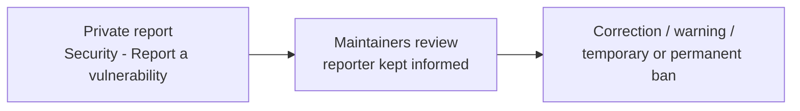

# Code of Conduct

## Our pledge

We as members, contributors, and leaders pledge to make participation in this project a
harassment-free experience for everyone, regardless of age, body size, visible or invisible
disability, ethnicity, sex characteristics, gender identity and expression, level of experience,
education, socio-economic status, nationality, personal appearance, race, caste, color, religion, or
sexual identity and orientation.

We pledge to act and interact in ways that contribute to an open, welcoming, diverse, inclusive, and
healthy community.

## Our standards

Examples of behavior that contributes to a positive environment:

- Demonstrating empathy and kindness toward other people.
- Being respectful of differing opinions, viewpoints, and experiences.
- Giving and gracefully accepting constructive feedback.
- Accepting responsibility and apologizing to those affected by our mistakes, and learning from the
  experience.
- Focusing on what is best not just for us as individuals, but for the overall community.

Examples of unacceptable behavior:

- The use of sexualized language or imagery, and sexual attention or advances of any kind.
- Trolling, insulting or derogatory comments, and personal or political attacks.
- Public or private harassment.
- Publishing others' private information, such as a physical or email address, without their
  explicit permission.
- Other conduct which could reasonably be considered inappropriate in a professional setting.

## A note for learners

This project is a beginner course, and questions that feel obvious are the point of it. "I don't
understand why the sign flips here" is a contribution to the material, not a failure. Nobody is
expected to arrive already knowing the vocabulary, and explaining a concept again — in different
words — is never a waste of a maintainer's time.

## Enforcement responsibilities

Maintainers are responsible for clarifying and enforcing these standards and will take appropriate
and fair corrective action in response to any behavior they deem inappropriate, threatening,
offensive, or harmful. Maintainers may remove, edit, or reject comments, commits, code, issues, and
other contributions that are not aligned with this Code of Conduct, and will communicate reasons for
moderation decisions when appropriate.

## Scope

This Code of Conduct applies within all project spaces — issues, pull requests, discussions, and
review comments — and also applies when an individual is officially representing the project in
public spaces.

## Reporting

**Report unacceptable behavior privately.** Open the repository's **Security** tab and choose
**Report a vulnerability** (GitHub private security advisories are also the private reporting channel
here); that report is visible only to the maintainers.

Do not open a public issue about a person's behavior. All reports will be reviewed and investigated
promptly and fairly, and the privacy and security of the reporter will be respected.

## Enforcement guidelines

Maintainers will follow these guidelines in determining consequences:

1. **Correction** — a private written warning, with clarity about the violation and why the behavior
   was inappropriate. A public apology may be requested.
2. **Warning** — a warning with consequences for continued behavior, including no interaction with
   the people involved for a specified period.
3. **Temporary ban** — a temporary ban from any interaction or public communication with the project.
4. **Permanent ban** — a permanent ban from any public interaction with the project.

## Attribution

This Code of Conduct is adapted from the [Contributor Covenant][homepage], version 2.1, available at
<https://www.contributor-covenant.org/version/2/1/code_of_conduct.html>.

Community Impact Guidelines were inspired by
[Mozilla's code of conduct enforcement ladder](https://github.com/mozilla/diversity).

[homepage]: https://www.contributor-covenant.org

For answers to common questions about this code of conduct, see the FAQ at
<https://www.contributor-covenant.org/faq>. Translations are available at
<https://www.contributor-covenant.org/translations>.
