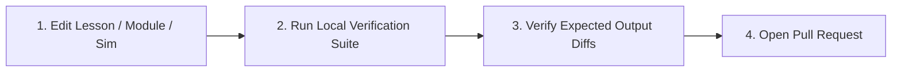

# Contributing to the MechaLab Mechatronics & Robotics Curriculum

Thank you for helping improve the MechaLab Open-Source Curriculum & Interactive Workbench! Every lesson, bridge module, and simulation lab in this repository is continuously verified in automated CI so learners never hit broken equations, dead links, or stale numerical outputs.



---

## 1. Reporting an Error in a Lesson or Module

Found a typo, a confusing explanation, a hardware rating discrepancy, or a numerical mismatch?
- Open an issue using the **[Report an Error in a Lesson or Module](.github/ISSUE_TEMPLATE/lesson-error.md)** template.
- Include the exact lesson/module ID (e.g., `Lesson 01.2`, `05-control.T1.05a`), the line or section heading, what the text currently says, and what you observed when running the code or checking the datasheet.
- If the failure is a *learner* failure rather than a typo, check [`docs/ERROR_EXPLAINER.md`](docs/ERROR_EXPLAINER.md) first; if your failure is missing from its fifteen entries, that is a gap worth an issue, because the entry needs the page that teaches it.

---

## 2. Pedagogical & Structural Rules for Beginner Lessons (`Track P`, `Stage 0`, `Tracks 00–08` Tier 1)

All beginner lessons are enforced by `scripts/lint_lessons.py` and `scripts/check_term_order.py`:
1. **Maximum 2 New Ideas per Lesson:** Declared in YAML front matter (`ideas:`) and matched against `### Idea 1` / `### Idea 2` and `### Bridge Notes`. Do not sneak undeclared third topics into Bridge Notes.
2. **Term Order Discipline:** Every bolded technical term must be defined in `resources/glossary.md` in or before the earliest lesson (in path order) that uses it (`python3 scripts/check_term_order.py`).
3. **Link-First, Self-Contained Exercises:**
   - Every idea links to a free, static primary resource with verified HTML section headings (or marks client-rendered SPAs with `[verify in-app]`).
   - Every lesson includes runnable **Starter Code**, a 3-step **Progressive Hint Ladder**, a **Full Solution** that prints deterministic output matching the **Expected Output** block character-for-character, and a 3-question **Check yourself** quiz with worked answers.
4. **Clean TeX Authoring:** Write standard, clean LaTeX (`$V_{\text{out}}$`, `$\tau = R C$`). Never insert `kern0pt` or raw `\_` underscore hacks inside math text groups; run `python3 scripts/clean_tex.py --check` and `node scripts/audit_math.mjs` to verify both GitHub MathJax and KaTeX rendering.
5. **Beginner evidence:** a claim that beginners can finish needs a beginner sitting. The protocol is [`docs/PILOT.md`](docs/PILOT.md), the aggregate sheet is [`docs/pilot-results.md`](docs/pilot-results.md), and until a pilot runs both say N = 0 — author-dogfood finds bugs but cannot measure beginner difficulty.

---

## 3. Running the Verification Suite Locally

Before submitting a Pull Request, run the verification scripts from the repository root. They need
**Python 3.12** — the version CI uses and `.python-version` pins. The macOS system `python3` is 3.9,
and `validate_modules.py` executes module code that uses 3.10+ syntax (`int | None`), so a 3.9
interpreter fails on a page you did not touch. Check with `python3 --version`; if it prints 3.9,
use `python3.12` or put Homebrew's `bin` first on `PATH`.

**The one command to run before a push:** `python3 scripts/check_all.py` runs every gate CI's
verification step runs, in CI's order, and takes about 12 s; `--full` adds the 48-package exercise
sweep and the unittest discovery, `--list` names the gates, and `--only <gate>` re-runs one after
you regenerate a file. It refuses to run on anything but Python 3.12. The script's gate table and
`.github/workflows/ci.yml` are kept equal by [`tests/test_check_all.py`](tests/test_check_all.py),
so a check CI gains is not silently missing locally.

```bash
# 1. Verify repository structure, links, Mermaid diagrams, and clean TeX math hygiene
python3 scripts/verify_repo.py
node scripts/audit_math.mjs

# 2. Verify all 72 modules, prerequisite DAG, index counts, and exact Expected Output stdout diffs
python3 scripts/validate_modules.py

# 3. Verify all beginner lessons (<=2 ideas, template sections, glossary term order, and exercise solutions)
python3 scripts/lint_lessons.py
python3 scripts/check_term_order.py

# Every suite in one run (add -v for the per-test list)
python3 -m unittest discover -s tests

# 4. Run all Python & C++20 reference labs (Labs 00–08)
python3 scripts/run_all_labs.py

# 5. Typecheck and build the interactive Vite workbench
npm run lint
npm run build

# 6. Smoke test, dev-server browser E2E and built-bundle browser E2E, all three at once:
#    one dev server, one served dist/, Chromium + Firefox. Needs `npx playwright-core install chromium firefox`.
#    Chromium grades every exercise package on the bundle; Firefox grades one per track plus both ends.
#    Each suite still runs alone as `npm run test:smoke`, `test:e2e` or `test:e2e:pages`.
npm run test:workbench
```

---

## 4. Community Standards

Participation is covered by the [`CODE_OF_CONDUCT.md`](CODE_OF_CONDUCT.md) (Contributor Covenant 2.1).
Report unacceptable behaviour privately through the repository's **Security → Report a vulnerability**
channel, not a public issue. Beginner questions belong in issues and Discussions and are never noise:
the course exists because those questions are hard.

---

## 5. Licensing of Contributions

By submitting a pull request or issue, you agree that your documentation contributions are licensed under **CC BY 4.0** and your code contributions are licensed under the **MIT License**, as detailed in [`LICENSE`](LICENSE).
