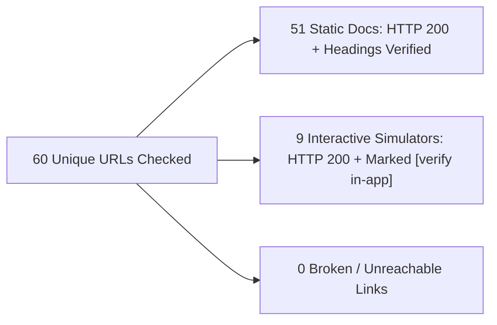

# Automated Link & Resource Verification Report (`LINK_REPORT.md`)

## Summary Counts

- **Total Unique External URLs Scanned (`Track P`, `Stage 0`, `Lesson 01.1`, `resources/`):** `60`
- **Static HTML Pages Opened & Verified (`HTTP 200` + exact `<title>` / section headings verified):** `51`
- **Interactive Browser Simulators Reachable (`HTTP 200`) & Marked `[verify in-app]`:** `9`
- **Broken / Non-200 Links:** `0`

---

## 1. Static HTML Documentation & Tutorials (`[HTTP 200 — Opened & Verified]`)

| URL | HTTP Status | Verified Page `<title>` | Referenced In |
| :--- | :---: | :--- | :--- |
| `http://hyperphysics.phy-astr.gsu.edu/hbase/torq.html` | `200` | Torque and Equilibrium | `track-p/P.7-forces-torque-and-rotational-motion.md`, `track-p/P.M-track-p-milestone.md` |
| `https://betterexplained.com/articles/intuitive-guide-to-angles-degrees-and-radians/` | `200` | Intuitive Guide to Angles, Degrees and Radians &#8211; BetterExplained | `track-p/P.5-algebra-and-trigonometry-for-robotics.md` |
| `https://cs50.harvard.edu/python/2022/notes/0/` | `200` | Lecture 0 - CS50's Introduction to Programming with Python | `track-p/P.1-variables-types-and-arithmetic.md`, `track-p/P.3-functions-assert-and-import.md` |
| `https://cs50.harvard.edu/python/2022/notes/1/` | `200` | Lecture 1 - CS50's Introduction to Programming with Python | `track-p/P.2-decisions-loops-and-lists.md` |
| `https://cs50.harvard.edu/python/2022/notes/2/` | `200` | Lecture 2 - CS50's Introduction to Programming with Python | `track-p/P.3-functions-assert-and-import.md`, `track-p/P.M-track-p-milestone.md` |
| `https://cs50.harvard.edu/python/2022/notes/4/` | `200` | Lecture 4 - CS50's Introduction to Programming with Python | `track-p/P.3-functions-assert-and-import.md` |
| `https://docs.python.org/3/tutorial/controlflow.html` | `200` | 4. More Control Flow Tools &#8212; Python 3.15.0 documentation | `track-p/P.2-decisions-loops-and-lists.md`, `track-p/P.3-functions-assert-and-import.md` |
| `https://docs.python.org/3/tutorial/introduction.html` | `200` | 3. An Informal Introduction to Python &#8212; Python 3.15.0 documentation | `track-p/P.1-variables-types-and-arithmetic.md` |
| `https://docs.wokwi.com/guides/logic-analyzer` | `200` | Logic Analyzer Guide | Wokwi Docs | `stage-0/S0.7-pwm-duty-cycle-and-analog-write.md` |
| `https://docs.wokwi.com/guides/serial-monitor` | `200` | The Serial Monitor | Wokwi Docs | `stage-0/S0.6-adc-analog-read-and-serial-monitor.md`, `stage-0/S0.M-stage-0-milestone.md` |
| `https://docs.wokwi.com/parts/wokwi-arduino-uno` | `200` | wokwi-arduino-uno Reference | Wokwi Docs | `stage-0/S0.5-arduino-uno-digital-io-and-pullups.md`, `stage-0/S0.6-adc-analog-read-and-serial-monitor.md`, `stage-0/S0.7-pwm-duty-cycle-and-analog-write.md`, `stage-0/S0.M-stage-0-milestone.md` |
| `https://docs.wokwi.com/parts/wokwi-led` | `200` | wokwi-led Reference | Wokwi Docs | `stage-0/S0.5-arduino-uno-digital-io-and-pullups.md`, `stage-0/S0.7-pwm-duty-cycle-and-analog-write.md` |
| `https://docs.wokwi.com/parts/wokwi-potentiometer` | `200` | wokwi-potentiometer Reference | Wokwi Docs | `stage-0/S0.3-series-parallel-and-voltage-dividers.md`, `stage-0/S0.6-adc-analog-read-and-serial-monitor.md`, `stage-0/S0.M-stage-0-milestone.md` |
| `https://docs.wokwi.com/parts/wokwi-pushbutton` | `200` | wokwi-pushbutton Reference | Wokwi Docs | `stage-0/S0.5-arduino-uno-digital-io-and-pullups.md` |
| `https://docs.wokwi.com/parts/wokwi-resistor` | `200` | wokwi-resistor Reference | Wokwi Docs | `stage-0/S0.2-breadboards-multimeter-and-short-circuits.md` |
| `https://en.wikipedia.org/wiki/Flyback_diode` | `200` | Flyback diode - Wikipedia | `01-electronics-and-power/01.1-mosfet-inductor-flyback.md` |
| `https://en.wikipedia.org/wiki/Torque` | `200` | Torque - Wikipedia | `track-p/P.7-forces-torque-and-rotational-motion.md` |
| `https://github.com/alexmojaki/futurecoder/blob/main/core/chapters/c05_if_statements.py` | `200` | futurecoder/core/chapters/c05_if_statements.py at main · alexmojaki/futurecoder · GitHub | `track-p/P.2-decisions-loops-and-lists.md` |
| `https://github.com/alexmojaki/futurecoder/blob/main/core/chapters/c09_functions.py` | `200` | futurecoder/core/chapters/c09_functions.py at main · alexmojaki/futurecoder · GitHub | `track-p/P.3-functions-assert-and-import.md` |
| `https://github.com/alexmojaki/futurecoder/tree/main/core/chapters` | `200` | futurecoder/core/chapters at main · alexmojaki/futurecoder · GitHub | `track-p/P.1-variables-types-and-arithmetic.md`, `track-p/P.2-decisions-loops-and-lists.md` |
| `https://learn.adafruit.com/multimeters/continuity` | `200` | Continuity | Multimeters | Adafruit Learning System | `stage-0/S0.2-breadboards-multimeter-and-short-circuits.md` |
| `https://learn.adafruit.com/multimeters/current` | `200` | Current | Multimeters | Adafruit Learning System | `stage-0/S0.2-breadboards-multimeter-and-short-circuits.md` |
| `https://learn.adafruit.com/multimeters/voltage` | `200` | Voltage | Multimeters | Adafruit Learning System | `stage-0/S0.2-breadboards-multimeter-and-short-circuits.md` |
| `https://learn.sparkfun.com/tutorials/analog-to-digital-conversion` | `200` | Analog to Digital Conversion - SparkFun Learn | `stage-0/S0.6-adc-analog-read-and-serial-monitor.md` |
| `https://learn.sparkfun.com/tutorials/binary` | `200` | Binary - SparkFun Learn | `track-p/P.4-units-prefixes-binary-and-frequency.md` |
| `https://learn.sparkfun.com/tutorials/capacitors` | `200` | Capacitors - SparkFun Learn | `stage-0/S0.4-capacitors-and-power-rail-decoupling.md` |
| `https://learn.sparkfun.com/tutorials/diodes` | `200` | Diodes - SparkFun Learn | `01-electronics-and-power/01.1-mosfet-inductor-flyback.md` |
| `https://learn.sparkfun.com/tutorials/how-to-use-a-breadboard` | `200` | How to Use a Breadboard - SparkFun Learn | `stage-0/S0.2-breadboards-multimeter-and-short-circuits.md` |
| `https://learn.sparkfun.com/tutorials/light-emitting-diodes-leds` | `200` | Light-Emitting Diodes (LEDs) - SparkFun Learn | `stage-0/S0.1-voltage-current-resistance-and-ohms-law.md` |
| `https://learn.sparkfun.com/tutorials/metric-prefixes-and-si-units` | `200` | Metric Prefixes and SI Units - SparkFun Learn | `track-p/P.4-units-prefixes-binary-and-frequency.md` |
| `https://learn.sparkfun.com/tutorials/motors-and-selecting-the-right-one` | `200` | Motors and Selecting the Right One - SparkFun Learn | `01-electronics-and-power/01.1-mosfet-inductor-flyback.md` |
| `https://learn.sparkfun.com/tutorials/pull-up-resistors` | `200` | Pull-up Resistors - SparkFun Learn | `stage-0/S0.5-arduino-uno-digital-io-and-pullups.md` |
| `https://learn.sparkfun.com/tutorials/pulse-width-modulation` | `200` | Pulse Width Modulation - SparkFun Learn | `stage-0/S0.7-pwm-duty-cycle-and-analog-write.md` |
| `https://learn.sparkfun.com/tutorials/series-and-parallel-circuits` | `200` | Series and Parallel Circuits - SparkFun Learn | `stage-0/S0.3-series-parallel-and-voltage-dividers.md` |
| `https://learn.sparkfun.com/tutorials/transistors` | `200` | Transistors - SparkFun Learn | `01-electronics-and-power/01.1-mosfet-inductor-flyback.md` |
| `https://learn.sparkfun.com/tutorials/voltage-current-resistance-and-ohms-law` | `200` | Voltage, Current, Resistance, and Ohm&#039;s Law - SparkFun Learn | `stage-0/S0.1-voltage-current-resistance-and-ohms-law.md` |
| `https://learn.sparkfun.com/tutorials/voltage-dividers` | `200` | Voltage Dividers - SparkFun Learn | `stage-0/S0.3-series-parallel-and-voltage-dividers.md` |
| `https://learn.sparkfun.com/tutorials/what-is-a-circuit` | `200` | What is a Circuit? - SparkFun Learn | `stage-0/S0.1-voltage-current-resistance-and-ohms-law.md`, `stage-0/S0.2-breadboards-multimeter-and-short-circuits.md` |
| `https://www.mathsisfun.com/algebra/equation-formula.html` | `200` | Equations and Formulas | `track-p/P.5-algebra-and-trigonometry-for-robotics.md` |
| `https://www.mathsisfun.com/algebra/linear-equations.html` | `200` | Linear Equations | `track-p/P.5-algebra-and-trigonometry-for-robotics.md` |
| `https://www.mathsisfun.com/binary-number-system.html` | `200` | Binary Number System | `track-p/P.4-units-prefixes-binary-and-frequency.md` |
| `https://www.mathsisfun.com/geometry/radians.html` | `200` | Radians | `track-p/P.5-algebra-and-trigonometry-for-robotics.md` |
| `https://www.mathsisfun.com/measure/metric-system.html` | `200` | Metric System of Measurement | `track-p/P.4-units-prefixes-binary-and-frequency.md` |
| `https://www.mathsisfun.com/operation-order-pemdas.html` | `200` | Order of Operations - PEMDAS | `track-p/P.1-variables-types-and-arithmetic.md` |
| `https://www.mathsisfun.com/physics/force.html` | `200` | Force | `track-p/P.7-forces-torque-and-rotational-motion.md` |
| `https://www.mathsisfun.com/sine-cosine-tangent.html` | `200` | Sine, Cosine, Tangent | `track-p/P.5-algebra-and-trigonometry-for-robotics.md` |
| `https://www.physicsclassroom.com/class/1DKin/Lesson-3/Meaning-of-Slope-for-a-p-t-Graph` | `200` | Physics Tutorial - 1D Kinematics - Position Time Graphs - Meaning of Slope for a p-t Graph | `track-p/P.6-reading-time-series-graphs.md` |
| `https://www.physicsclassroom.com/class/1DKin/Lesson-4/Determining-the-Area-on-a-v-t-Graph` | `200` | Physics Tutorial - 1D Kinematics - Velocity Time Graphs - Determining the Area on a v-t Graph | `track-p/P.6-reading-time-series-graphs.md`, `track-p/P.M-track-p-milestone.md` |
| `https://www.physicsclassroom.com/class/1DKin/Lesson-4/Determining-the-Slope-on-a-v-t-Graph` | `200` | Physics Tutorial - 1D Kinematics - Velocity Time Graphs - Determining the Slope on a v-t Graph | `track-p/P.6-reading-time-series-graphs.md` |
| `https://www.physicsclassroom.com/class/1DKin/Lesson-4/Meaning-of-Shape-for-a-v-t-Graph` | `200` | Physics Tutorial - 1D Kinematics - Velocity Time Graphs - Meaning of Shape for a v-t Graph | `track-p/P.6-reading-time-series-graphs.md` |
| `https://www.physicsclassroom.com/class/newtlaws/Lesson-3/Newton-s-Second-Law` | `200` | Physics Tutorial - Newton&#x27;s Laws - Newton&#x27;s Second Law - Newton&#x27;s Second Law | `track-p/P.7-forces-torque-and-rotational-motion.md` |

---

## 2. Interactive Browser Simulators & Menu Paths (`[verify in-app]`)

These URLs return `HTTP 200` at their entry point, but their internal menus, circuit presets, or interactive chapters are rendered client-side by JavaScript and must be verified inside a live browser session:

| URL | HTTP Status | Verification Tag & Notes | Referenced In |
| :--- | :---: | :--- | :--- |
| `https://futurecoder.io/course/` | `200` | `[verify in-app]` (futurecoder) | `track-p/P.1-variables-types-and-arithmetic.md`, `track-p/P.2-decisions-loops-and-lists.md`, `track-p/P.3-functions-assert-and-import.md`, `track-p/P.4-units-prefixes-binary-and-frequency.md`, `track-p/P.5-algebra-and-trigonometry-for-robotics.md`, `track-p/P.6-reading-time-series-graphs.md`, `track-p/P.7-forces-torque-and-rotational-motion.md`, `track-p/P.M-track-p-milestone.md` |
| `https://futurecoder.io/course/#toc` | `200` | `[verify in-app]` (futurecoder) | `track-p/P.1-variables-types-and-arithmetic.md`, `track-p/P.2-decisions-loops-and-lists.md`, `track-p/P.3-functions-assert-and-import.md` |
| `https://phet.colorado.edu/en/simulations/balancing-act` | `200` | `[verify in-app]` (Balancing Act | Torque • Rotational Equilibrium • Lever Arm | PhET Simulations) | `track-p/P.7-forces-torque-and-rotational-motion.md` |
| `https://phet.colorado.edu/en/simulations/capacitor-lab-basics` | `200` | `[verify in-app]` (Capacitor Lab: Basics | Circuits • RC Circuit • Capacitance | PhET Simulations) | `stage-0/S0.4-capacitors-and-power-rail-decoupling.md` |
| `https://phet.colorado.edu/en/simulations/moving-man` | `200` | `[verify in-app]` (The Moving Man | Velocity • Acceleration • Position | PhET Simulations) | `track-p/P.6-reading-time-series-graphs.md` |
| `https://phet.colorado.edu/en/simulations/ohms-law` | `200` | `[verify in-app]` (Ohm&#x27;s Law | Circuits • Current • Voltage | PhET Simulations) | `stage-0/S0.1-voltage-current-resistance-and-ohms-law.md` |
| `https://phet.colorado.edu/en/simulations/trig-tour` | `200` | `[verify in-app]` (Trig Tour | Sines • Cosines • Trigonometry | PhET Simulations) | `track-p/P.5-algebra-and-trigonometry-for-robotics.md` |
| `https://wokwi.com/projects/new/arduino-uno` | `200` | `[verify in-app]` (New Arduino Uno Project - Wokwi Simulator) | `stage-0/S0.5-arduino-uno-digital-io-and-pullups.md`, `stage-0/S0.6-adc-analog-read-and-serial-monitor.md`, `stage-0/S0.7-pwm-duty-cycle-and-analog-write.md`, `stage-0/S0.M-stage-0-milestone.md` |
| `https://www.falstad.com/circuit/circuitjs.html` | `200` | `[verify in-app]` () | `stage-0/S0.1-voltage-current-resistance-and-ohms-law.md`, `stage-0/S0.2-breadboards-multimeter-and-short-circuits.md`, `stage-0/S0.3-series-parallel-and-voltage-dividers.md`, `stage-0/S0.4-capacitors-and-power-rail-decoupling.md`, `stage-0/S0.7-pwm-duty-cycle-and-analog-write.md`, `01-electronics-and-power/01.1-mosfet-inductor-flyback.md`, `resources/safety.md` |
