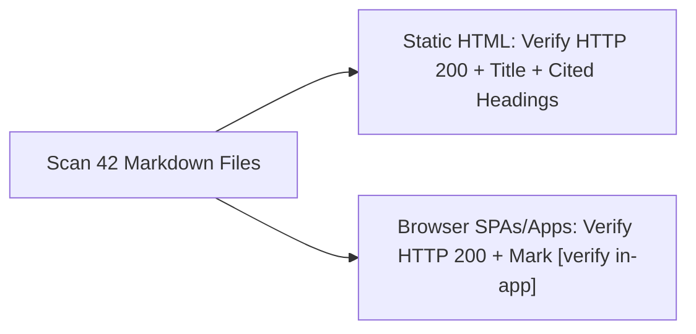

# Automated Link & Static-Page Heading Verification Report (`LINK_REPORT.md`)

Generated by `python3 scripts/check_links.py --write-report`.

## How Verification Works
- **Static HTML pages (SparkFun, Physics Classroom, CS50 Notes, MathsIsFun, HyperPhysics, Wikipedia, Wokwi Docs, Python Docs, Electronics-Tutorials, BetterExplained, MyPhysicsLab):** `scripts/check_links.py` performs an HTTP GET (reading up to 1.5 MB), extracts `<title>`, and verifies that every `**`Heading`**` cited in `Primary resource` / `What to read` / `Alternative resource` (including multi-URL bullets segmented per URL and parent `Primary resource` -> child `What to read` bullets) actually appears in the fetched HTML body.
- **Interactive Browser SPAs & Simulators (`futurecoder.io`, `falstad.com`, `phet.colorado.edu`, `wokwi.com/projects/...`):** Because chapter lists and circuit menus are rendered client-side in JavaScript/WebAssembly, HTTP GET only verifies that the application entry URL returns `HTTP 200`; all internal chapter and menu names are marked **`[verify in-app]`**.

- **Total Markdown Files Scanned:** `42`
- **Total Unique External URLs Checked:** `76`
- **Broken Relative File Links:** `0`
- **Missing Static-Page Headings:** `0`

| Status | HTTP | Verification Class | URL | Page `<title>` & Per-URL Heading Check Results | Referenced In |
| :--- | :--- | :--- | :--- | :--- | :--- |
| PASS | `200` | Static HTML + Heading Check | http://hyperphysics.phy-astr.gsu.edu/hbase/mi.html | Moment of Inertia Headings: `Moment of Inertia`: **FOUND in HTML**; `Rotational-Linear Parallels`: **FOUND in HTML** | `02-mechanics-kinematics-dynamics/02.4-rotational-inertia-and-gear-ratios.md` |
| PASS | `200` | Static HTML + Heading Check | http://hyperphysics.phy-astr.gsu.edu/hbase/torq.html | Torque and Equilibrium Headings: `Torque = Force applied x lever arm`: **FOUND in HTML** | `00-foundations/00.3-modeling-discipline-and-sanity-checks.md`, `track-p/P.12-forces-and-lever-torque.md`, `track-p/P.M-track-p-milestone.md` |
| PASS | `200` | Static HTML + Heading Check | http://hyperphysics.phy-astr.gsu.edu/hbase/work.html | Work, Energy and Power Headings: `Energy`: **FOUND in HTML**; `Power`: **FOUND in HTML**; `Work`: **FOUND in HTML** | `00-foundations/00.1-effort-flow-and-first-order-lag.md` |
| PASS | `200` | Static HTML + Heading Check | https://betterexplained.com/articles/intuitive-guide-to-angles-degrees-and-radians/ | Intuitive Guide to Angles, Degrees and Radians – BetterExplained Headings: `Radians Rule, Degrees Drool`: **FOUND in HTML**; `Radians: The Unselfish Choice`: **FOUND in HTML**; `Using Radians`: **FOUND in HTML** | `track-p/P.10-radians-and-right-triangle-trig.md` |
| PASS | `200` | Static HTML + Heading Check | https://cs50.harvard.edu/python/2022/notes/0/ | Lecture 0 - CS50's Introduction to Programming with Python Headings: `Comments`: **FOUND in HTML**; `Def`: **FOUND in HTML**; `Float Basics`: **FOUND in HTML**; `Formatting Strings`: **FOUND in HTML**; `Integers or int`: **FOUND in HTML**; `Variables`: **FOUND in HTML** | `track-p/P.1-variables-and-data-types.md`, `track-p/P.2-arithmetic-and-order-of-operations.md`, `track-p/P.5-functions-and-while-loops.md` |
| PASS | `200` | Static HTML + Heading Check | https://cs50.harvard.edu/python/2022/notes/1/ | Lecture 1 - CS50's Introduction to Programming with Python Headings: `Conditionals`: **FOUND in HTML**; `Control Flow, elif, and else`: **FOUND in HTML**; `and`: **FOUND in HTML**; `if Statements`: **FOUND in HTML**; `or`: **FOUND in HTML** | `track-p/P.3-decisions-and-clamping.md` |
| PASS | `200` | Static HTML + Heading Check | https://cs50.harvard.edu/python/2022/notes/2/ | Lecture 2 - CS50's Introduction to Programming with Python Headings: `For Loops`: **FOUND in HTML**; `Length`: **FOUND in HTML**; `More About Lists`: **FOUND in HTML**; `While Loops`: **FOUND in HTML** | `track-p/P.4-lists-and-for-loops.md`, `track-p/P.5-functions-and-while-loops.md` |
| PASS | `200` | Static HTML + Heading Check | https://cs50.harvard.edu/python/2022/notes/4/ | Lecture 4 - CS50's Introduction to Programming with Python Headings: `Libraries`: **FOUND in HTML**; `Random`: **FOUND in HTML** | `track-p/P.6-modules-and-automated-asserts.md` |
| PASS | `200` | Static HTML + Heading Check | https://cs50.harvard.edu/python/2022/notes/5/ | Lecture 5 - CS50's Introduction to Programming with Python Headings: `Unit Tests`: **FOUND in HTML**; `assert`: **FOUND in HTML** | `track-p/P.6-modules-and-automated-asserts.md` |
| PASS | `200` | Static HTML + Heading Check | https://docs.python.org/3/library/math.html | math — Mathematical functions — Python 3.15.0 documentation Headings: `math — Mathematical functions`: **FOUND in HTML** | `02-mechanics-kinematics-dynamics/02.3-2link-planar-inverse-kinematics.md` |
| PASS | `200` | Static HTML + Heading Check | https://docs.python.org/3/tutorial/introduction.html | 3. An Informal Introduction to Python — Python 3.15.0 documentation Headings: `3.1. Using Python as a Calculator`: **FOUND in HTML**; `3.1.1. Numbers`: **FOUND in HTML**; `3.1.3. Lists`: **FOUND in HTML** | `track-p/P.2-arithmetic-and-order-of-operations.md`, `track-p/P.4-lists-and-for-loops.md` |
| PASS | `200` | Static HTML + Heading Check | https://docs.wokwi.com/guides/serial-monitor | The Serial Monitor \| Wokwi Docs Headings: `Arduino Uno and Mega`: **FOUND in HTML**; `Configuring the Serial Monitor`: **FOUND in HTML**; `The Serial Monitor`: **FOUND in HTML** | `stage-0/S0.8-adc-analog-read-and-serial-monitor.md` |
| PASS | `200` | Static HTML + Heading Check | https://docs.wokwi.com/parts/wokwi-arduino-uno | wokwi-arduino-uno Reference \| Wokwi Docs Headings: `Pin names`: **FOUND in HTML**; `Simulation features`: **FOUND in HTML**; `Simulator examples`: **FOUND in HTML** | `stage-0/S0.7-arduino-uno-digital-io-and-pullups.md`, `stage-0/S0.9-pwm-duty-cycle-and-analog-write.md`, `stage-0/S0.M-stage-0-milestone.md` |
| PASS | `200` | Static HTML + Heading Check | https://docs.wokwi.com/parts/wokwi-potentiometer | wokwi-potentiometer Reference \| Wokwi Docs Headings: `Pin names`: **FOUND in HTML** | `stage-0/S0.M-stage-0-milestone.md` |
| PASS | `200` | Static HTML + Heading Check | https://docs.wokwi.com/parts/wokwi-pushbutton | wokwi-pushbutton Reference \| Wokwi Docs Headings: `Examples`: **FOUND in HTML**; `Pin names`: **FOUND in HTML** | `stage-0/S0.7-arduino-uno-digital-io-and-pullups.md` |
| PASS | `200` | Static HTML + Heading Check | https://en.wikipedia.org/wiki/Ball_bearing | Ball bearing - Wikipedia Headings: `Ball bearing`: **FOUND in HTML**; `Common designs`: **FOUND in HTML**; `Deep-groove`: **FOUND in HTML** | `02-mechanics-kinematics-dynamics/02.5-bearings-belts-and-3d-printing.md` |
| PASS | `200` | Static HTML + Heading Check | https://en.wikipedia.org/wiki/Buck_converter | Buck converter - Wikipedia Headings: `Buck converter`: **FOUND in HTML**; `Idealised case`: **FOUND in HTML**; `Theory`: **FOUND in HTML** | `01-electronics-and-power/01.3-power-regulators-and-power-budget.md` |
| PASS | `200` | Static HTML + Heading Check | https://en.wikipedia.org/wiki/Counter-electromotive_force | Counter-electromotive force - Wikipedia Headings: `Counter-electromotive force`: **FOUND in HTML**; `Details`: **FOUND in HTML** | `01-electronics-and-power/01.2-h-bridge-and-stall-current.md` |
| PASS | `200` | Static HTML + Heading Check | https://en.wikipedia.org/wiki/Damping | Damping - Wikipedia Headings: `Damping`: **FOUND in HTML**; `Damping ratio`: **FOUND in HTML**; `Oscillation cases`: **FOUND in HTML** | `00-foundations/00.2-mass-spring-damper-oscillations.md` |
| PASS | `200` | Static HTML + Heading Check | https://en.wikipedia.org/wiki/Fused_filament_fabrication | Fused filament fabrication - Wikipedia Headings: `Fused filament fabrication`: **FOUND in HTML**; `Process`: **FOUND in HTML** | `02-mechanics-kinematics-dynamics/02.5-bearings-belts-and-3d-printing.md` |
| PASS | `200` | Static HTML + Heading Check | https://en.wikipedia.org/wiki/Gear_train | Gear train - Wikipedia Headings: `Gear ratio`: **FOUND in HTML**; `Gear train`: **FOUND in HTML**; `Mechanical advantage`: **FOUND in HTML** | `02-mechanics-kinematics-dynamics/02.4-rotational-inertia-and-gear-ratios.md` |
| PASS | `200` | Static HTML + Heading Check | https://en.wikipedia.org/wiki/Ground_loop_%28electricity%29 | Ground loop (electricity) - Wikipedia Headings: `Description`: **FOUND in HTML**; `Ground currents on signal cables`: **FOUND in HTML**; `Solutions`: **FOUND in HTML** | `01-electronics-and-power/01.4-grounding-and-rc-lowpass-filters.md` |
| PASS | `200` | Static HTML + Heading Check | https://en.wikipedia.org/wiki/H-bridge | H-bridge - Wikipedia Headings: `DC motor driver`: **FOUND in HTML**; `General`: **FOUND in HTML**; `H-bridge`: **FOUND in HTML** | `01-electronics-and-power/01.2-h-bridge-and-stall-current.md` |
| PASS | `200` | Static HTML + Heading Check | https://en.wikipedia.org/wiki/Inverse_kinematics | Inverse kinematics - Wikipedia Headings: `Analytical solutions to inverse kinematics`: **FOUND in HTML**; `Inverse kinematics`: **FOUND in HTML**; `Robotics`: **FOUND in HTML** | `02-mechanics-kinematics-dynamics/02.3-2link-planar-inverse-kinematics.md` |
| PASS | `200` | Static HTML + Heading Check | https://en.wikipedia.org/wiki/Low-pass_filter | Low-pass filter - Wikipedia Headings: `Examples`: **FOUND in HTML**; `Low-pass filter`: **FOUND in HTML**; `Time response`: **FOUND in HTML** | `01-electronics-and-power/01.4-grounding-and-rc-lowpass-filters.md` |
| PASS | `200` | Static HTML + Heading Check | https://en.wikipedia.org/wiki/Toothed_belt | Toothed belt - Wikipedia Headings: `Design and application`: **FOUND in HTML**; `Toothed belt`: **FOUND in HTML** | `02-mechanics-kinematics-dynamics/02.5-bearings-belts-and-3d-printing.md` |
| PASS | `200` | SPA/App (`[verify in-app]`) | https://futurecoder.io/course/ | futurecoder Headings: SPA/App headings (`f-strings`): **verify in-app only** | `README.md`, `track-p/P.1-variables-and-data-types.md`, `track-p/P.10-radians-and-right-triangle-trig.md`, `track-p/P.11-reading-time-series-graphs.md`, `track-p/P.12-forces-and-lever-torque.md`, `track-p/P.2-arithmetic-and-order-of-operations.md`, `track-p/P.3-decisions-and-clamping.md`, `track-p/P.4-lists-and-for-loops.md`, `track-p/P.5-functions-and-while-loops.md`, `track-p/P.6-modules-and-automated-asserts.md`, `track-p/P.7-si-units-and-metric-prefixes.md`, `track-p/P.8-frequency-and-binary-bits.md`, `track-p/P.9-rearranging-formulas-and-scaling.md`, `track-p/P.M-track-p-milestone.md`, `track-p/README.md` |
| PASS | `200` | Static HTML + Heading Check | https://learn.sparkfun.com/tutorials/analog-to-digital-conversion | Analog to Digital Conversion - SparkFun Learn Headings: `Arduino ADC Example`: **FOUND in HTML**; `Relating ADC Value to Voltage`: **FOUND in HTML**; `The Analog World`: **FOUND in HTML**; `What is the ADC?`: **FOUND in HTML** | `stage-0/S0.8-adc-analog-read-and-serial-monitor.md` |
| PASS | `200` | Static HTML + Heading Check | https://learn.sparkfun.com/tutorials/binary | Binary - SparkFun Learn Headings: `Converting binary to decimal`: **FOUND in HTML**; `Counting in binary`: **FOUND in HTML**; `Why Binary?`: **FOUND in HTML** | `track-p/P.8-frequency-and-binary-bits.md` |
| PASS | `200` | Static HTML + Heading Check | https://learn.sparkfun.com/tutorials/capacitors | Capacitors - SparkFun Learn Headings: `Application Examples`: **FOUND in HTML**; `Capacitor Theory`: **FOUND in HTML**; `Capacitor Types`: **FOUND in HTML**; `Charging and Discharging`: **FOUND in HTML**; `Decoupling (Bypass) Capacitors`: **FOUND in HTML**; `Introduction`: **FOUND in HTML**; `Power Supply Filtering`: **FOUND in HTML**; `Symbols and Units`: **FOUND in HTML** | `00-foundations/00.1-effort-flow-and-first-order-lag.md`, `stage-0/S0.6-capacitors-and-decoupling.md` |
| PASS | `200` | Static HTML + Heading Check | https://learn.sparkfun.com/tutorials/diodes | Diodes - SparkFun Learn Headings: `Flyback Diodes and Voltage Spike Suppression`: **FOUND in HTML**; `Forward Voltage`: **FOUND in HTML**; `Ideal Diodes`: **FOUND in HTML** | `01-electronics-and-power/01.1-mosfet-inductor-flyback.md` |
| PASS | `200` | Static HTML + Heading Check | https://learn.sparkfun.com/tutorials/electric-power | Electric Power - SparkFun Learn Headings: `Calculating Power`: **FOUND in HTML**; `Power Ratings`: **FOUND in HTML**; `What is Electric Power?`: **FOUND in HTML** | `01-electronics-and-power/01.3-power-regulators-and-power-budget.md`, `stage-0/S0.4-leds-and-resistor-power.md` |
| PASS | `200` | Static HTML + Heading Check | https://learn.sparkfun.com/tutorials/how-to-power-a-project | How to Power a Project - SparkFun Learn Headings: `Overview`: **FOUND in HTML**; `Variable DC Benchtop Power Supply`: **FOUND in HTML** | `01-electronics-and-power/01.3-power-regulators-and-power-budget.md`, `stage-0/S0.5-multimeters-and-current-limited-supplies.md` |
| PASS | `200` | Static HTML + Heading Check | https://learn.sparkfun.com/tutorials/how-to-read-a-schematic | How to Read a Schematic - SparkFun Learn Headings: `Nets, Nodes and Labels`: **FOUND in HTML**; `Overview`: **FOUND in HTML**; `Reading Schematics`: **FOUND in HTML**; `Schematic Symbols (Part 1)`: **FOUND in HTML** | `stage-0/S0.3-breadboards-and-short-circuits.md` |
| PASS | `200` | Static HTML + Heading Check | https://learn.sparkfun.com/tutorials/how-to-use-a-breadboard | How to Use a Breadboard - SparkFun Learn Headings: `Anatomy of a Breadboard`: **FOUND in HTML**; `Building Your First Breadboard Circuit`: **FOUND in HTML** | `stage-0/S0.3-breadboards-and-short-circuits.md` |
| PASS | `200` | Static HTML + Heading Check | https://learn.sparkfun.com/tutorials/how-to-use-a-multimeter | How to Use a Multimeter - SparkFun Learn Headings: `Continuity`: **FOUND in HTML**; `Measuring Current`: **FOUND in HTML**; `Measuring Resistance`: **FOUND in HTML**; `Measuring Voltage`: **FOUND in HTML** | `stage-0/S0.5-multimeters-and-current-limited-supplies.md` |
| PASS | `200` | Static HTML + Heading Check | https://learn.sparkfun.com/tutorials/light-emitting-diodes-leds | Light-Emitting Diodes (LEDs) - SparkFun Learn Headings: `1) Polarity Matters`: **FOUND in HTML**; `Calculating Current Limiting Resistors`: **FOUND in HTML**; `How to Use Them`: **FOUND in HTML**; `Introduction`: **FOUND in HTML** | `stage-0/S0.4-leds-and-resistor-power.md` |
| PASS | `200` | Static HTML + Heading Check | https://learn.sparkfun.com/tutorials/motors-and-selecting-the-right-one | Motors and Selecting the Right One - SparkFun Learn Headings: `DC Brush Motors - The Classic`: **FOUND in HTML**; `What Makes A Motor Move?`: **FOUND in HTML** | `01-electronics-and-power/01.1-mosfet-inductor-flyback.md`, `01-electronics-and-power/01.2-h-bridge-and-stall-current.md` |
| PASS | `200` | Static HTML + Heading Check | https://learn.sparkfun.com/tutorials/pull-up-resistors | Pull-up Resistors - SparkFun Learn Headings: `Calculating a Pull-up Resistor Value`: **FOUND in HTML**; `What is a Pull-up Resistor`: **FOUND in HTML** | `stage-0/S0.7-arduino-uno-digital-io-and-pullups.md` |
| PASS | `200` | Static HTML + Heading Check | https://learn.sparkfun.com/tutorials/pulse-width-modulation | Pulse Width Modulation - SparkFun Learn Headings: `Duty Cycle`: **FOUND in HTML**; `Examples`: **FOUND in HTML**; `What is Pulse-width Modulation?`: **FOUND in HTML** | `stage-0/S0.9-pwm-duty-cycle-and-analog-write.md` |
| PASS | `200` | Static HTML + Heading Check | https://learn.sparkfun.com/tutorials/series-and-parallel-circuits | Series and Parallel Circuits - SparkFun Learn Headings: `Calculating Equivalent Resistance`: **FOUND in HTML**; `Parallel Circuits`: **FOUND in HTML**; `Series Circuits`: **FOUND in HTML** | `stage-0/S0.2-series-parallel-and-voltage-dividers.md` |
| PASS | `200` | Static HTML + Heading Check | https://learn.sparkfun.com/tutorials/transistors | Transistors - SparkFun Learn Headings: `Applications I: Switches`: **FOUND in HTML**; `Introduction`: **FOUND in HTML**; `Transistor Switch`: **FOUND in HTML** | `01-electronics-and-power/01.1-mosfet-inductor-flyback.md` |
| PASS | `200` | Static HTML + Heading Check | https://learn.sparkfun.com/tutorials/voltage-current-resistance-and-ohms-law | Voltage, Current, Resistance, and Ohm's Law - SparkFun Learn Headings: `An Ohm's Law Experiment`: **FOUND in HTML**; `Current`: **FOUND in HTML**; `Electrical Charge`: **FOUND in HTML**; `Electricity Basics`: **FOUND in HTML**; `Ohm's Law`: **FOUND in HTML**; `Resistance`: **FOUND in HTML**; `Voltage`: **FOUND in HTML** | `stage-0/S0.1-closed-circuits-and-ohms-law.md` |
| PASS | `200` | Static HTML + Heading Check | https://learn.sparkfun.com/tutorials/voltage-dividers | Voltage Dividers - SparkFun Learn Headings: `Applications`: **FOUND in HTML**; `Ideal Voltage Divider`: **FOUND in HTML**; `Voltage Divider Equation`: **FOUND in HTML** | `stage-0/S0.2-series-parallel-and-voltage-dividers.md` |
| PASS | `200` | Static HTML + Heading Check | https://learn.sparkfun.com/tutorials/what-is-a-circuit | What is a Circuit? - SparkFun Learn Headings: `Circuit Basics`: **FOUND in HTML**; `Short and Open Circuits`: **FOUND in HTML**; `Voltage and How it Works`: **FOUND in HTML** | `stage-0/S0.1-closed-circuits-and-ohms-law.md`, `stage-0/S0.3-breadboards-and-short-circuits.md` |
| PASS | `200` | SPA/App (`[verify in-app]`) | https://phet.colorado.edu/en/simulations/capacitor-lab-basics | Capacitor Lab: Basics \| Circuits • RC Circuit • Capacitance \| PhET Simulations Headings: Page `<title>` verified | `stage-0/S0.6-capacitors-and-decoupling.md` |
| PASS | `200` | SPA/App (`[verify in-app]`) | https://phet.colorado.edu/en/simulations/masses-and-springs-basics | Masses and Springs: Basics \| Hooke's Law • Measurement • Periodic Motion \| PhET  Headings: SPA/App headings (`Bounce`, `Damping`, `Lab`): **verify in-app only** | `00-foundations/00.2-mass-spring-damper-oscillations.md` |
| PASS | `200` | SPA/App (`[verify in-app]`) | https://phet.colorado.edu/en/simulations/ohms-law | Ohm's Law \| Circuits • Current • Voltage \| PhET Simulations Headings: Page `<title>` verified | `stage-0/S0.1-closed-circuits-and-ohms-law.md` |
| PASS | `200` | SPA/App (`[verify in-app]`) | https://phet.colorado.edu/en/simulations/torque | Torque \| Rotation • Torque • Moment of Inertia \| PhET Simulations Headings: SPA/App headings (`Moment of Inertia`): **verify in-app only** | `02-mechanics-kinematics-dynamics/02.4-rotational-inertia-and-gear-ratios.md`, `track-p/P.12-forces-and-lever-torque.md` |
| PASS | `200` | SPA/App (`[verify in-app]`) | https://phet.colorado.edu/en/simulations/trig-tour | Trig Tour \| Sines • Cosines • Trigonometry \| PhET Simulations Headings: Page `<title>` verified | `02-mechanics-kinematics-dynamics/02.1-1d-link-fk-and-coord-frames.md`, `track-p/P.10-radians-and-right-triangle-trig.md` |
| PASS | `200` | SPA/App (`[verify in-app]`) | https://wokwi.com/projects/new/arduino-uno | New Arduino Uno Project - Wokwi Simulator Headings: Page `<title>` verified | `01-electronics-and-power/01.2-h-bridge-and-stall-current.md`, `README.md`, `stage-0/S0.7-arduino-uno-digital-io-and-pullups.md`, `stage-0/S0.8-adc-analog-read-and-serial-monitor.md`, `stage-0/S0.9-pwm-duty-cycle-and-analog-write.md`, `stage-0/S0.M-stage-0-milestone.md` |
| PASS | `200` | SPA/App (`[verify in-app]`) | https://www.falstad.com/circuit/circuitjs.html |  Headings: SPA/App headings (`Resistance`): **verify in-app only** | `01-electronics-and-power/01.1-mosfet-inductor-flyback.md`, `01-electronics-and-power/01.2-h-bridge-and-stall-current.md`, `01-electronics-and-power/01.3-power-regulators-and-power-budget.md`, `01-electronics-and-power/01.4-grounding-and-rc-lowpass-filters.md`, `README.md`, `stage-0/S0.1-closed-circuits-and-ohms-law.md`, `stage-0/S0.2-series-parallel-and-voltage-dividers.md`, `stage-0/S0.3-breadboards-and-short-circuits.md`, `stage-0/S0.4-leds-and-resistor-power.md`, `stage-0/S0.5-multimeters-and-current-limited-supplies.md`, `stage-0/S0.6-capacitors-and-decoupling.md`, `stage-0/S0.9-pwm-duty-cycle-and-analog-write.md` |
| PASS | `200` | Static HTML + Heading Check | https://www.mathsisfun.com/algebra/introduction-multiply.html | Algebra Introduction: Multiplication Headings: `Balance`: **FOUND in HTML**; `Solve It`: **FOUND in HTML** | `track-p/P.9-rearranging-formulas-and-scaling.md` |
| PASS | `200` | Static HTML + Heading Check | https://www.mathsisfun.com/algebra/proportions.html | Proportions Headings: `Proportions`: **FOUND in HTML**; `Using Proportions to Solve Percents`: **FOUND in HTML**; `Working With Proportions`: **FOUND in HTML** | `track-p/P.9-rearranging-formulas-and-scaling.md` |
| PASS | `200` | Static HTML + Heading Check | https://www.mathsisfun.com/algebra/trig-cosine-law.html | The Law of Cosines Headings: `Easier Version For Angles`: **FOUND in HTML**; `The Law of Cosines`: **FOUND in HTML**; `When to Use`: **FOUND in HTML** | `02-mechanics-kinematics-dynamics/02.3-2link-planar-inverse-kinematics.md` |
| PASS | `200` | Static HTML + Heading Check | https://www.mathsisfun.com/algebra/vectors.html | Vectors Headings: `Adding Vectors`: **FOUND in HTML**; `Notation`: **FOUND in HTML**; `Vectors`: **FOUND in HTML** | `02-mechanics-kinematics-dynamics/02.2-2link-planar-forward-kinematics.md` |
| PASS | `200` | Static HTML + Heading Check | https://www.mathsisfun.com/angles.html | Angles - Acute, Obtuse, Straight and Right Headings: `Names of Angles`: **FOUND in HTML**; `Positive and Negative Angles`: **FOUND in HTML** | `02-mechanics-kinematics-dynamics/02.2-2link-planar-forward-kinematics.md` |
| PASS | `200` | Static HTML + Heading Check | https://www.mathsisfun.com/binary-number-system.html | Binary Number System Headings: `How do we Count using Binary?`: **FOUND in HTML**; `Position`: **FOUND in HTML** | `track-p/P.8-frequency-and-binary-bits.md` |
| PASS | `200` | Static HTML + Heading Check | https://www.mathsisfun.com/data/cartesian-coordinates.html | Cartesian Coordinates Headings: `Cartesian Coordinates`: **FOUND in HTML**; `Four Quadrants`: **FOUND in HTML**; `Writing Coordinates`: **FOUND in HTML**; `X and Y Axis`: **FOUND in HTML** | `02-mechanics-kinematics-dynamics/02.1-1d-link-fk-and-coord-frames.md` |
| PASS | `200` | Static HTML + Heading Check | https://www.mathsisfun.com/geometry/radians.html | Radians Headings: `Radians`: **FOUND in HTML**; `Radians and Degrees`: **FOUND in HTML** | `track-p/P.10-radians-and-right-triangle-trig.md` |
| PASS | `200` | Static HTML + Heading Check | https://www.mathsisfun.com/measure/metric-system.html | Metric System of Measurement Headings: `Kilogram`: **FOUND in HTML**; `Meter`: **FOUND in HTML**; `Metric System of Measurement`: **FOUND in HTML**; `Second`: **FOUND in HTML** | `00-foundations/00.3-modeling-discipline-and-sanity-checks.md`, `track-p/P.7-si-units-and-metric-prefixes.md` |
| PASS | `200` | Static HTML + Heading Check | https://www.mathsisfun.com/metric-numbers.html | Metric Numbers Headings: `Common Big and Small Numbers`: **FOUND in HTML**; `Metric Numbers`: **FOUND in HTML**; `Much Bigger and Smaller`: **FOUND in HTML** | `track-p/P.7-si-units-and-metric-prefixes.md` |
| PASS | `200` | Static HTML + Heading Check | https://www.mathsisfun.com/operation-order-pemdas.html | Order of Operations - PEMDAS Headings: `How Do I Remember It All ... ?`: **FOUND in HTML**; `Order of Operations`: **FOUND in HTML** | `track-p/P.2-arithmetic-and-order-of-operations.md` |
| PASS | `200` | Static HTML + Heading Check | https://www.mathsisfun.com/physics/force.html | Force Headings: `Calculations`: **FOUND in HTML**; `Force`: **FOUND in HTML**; `Newtons`: **FOUND in HTML**; `Unbalanced`: **FOUND in HTML** | `track-p/P.12-forces-and-lever-torque.md` |
| PASS | `200` | Static HTML + Heading Check | https://www.mathsisfun.com/physics/power.html | Power Headings: `Power`: **FOUND in HTML**; `Power Formulas`: **FOUND in HTML** | `00-foundations/00.1-effort-flow-and-first-order-lag.md` |
| PASS | `200` | Static HTML + Heading Check | https://www.mathsisfun.com/sine-cosine-tangent.html | Sine, Cosine, Tangent Headings: `Right Triangle`: **FOUND in HTML**; `Sine, Cosine and Tangent`: **FOUND in HTML**; `Sohcahtoa`: **FOUND in HTML** | `02-mechanics-kinematics-dynamics/02.1-1d-link-fk-and-coord-frames.md`, `track-p/P.10-radians-and-right-triangle-trig.md` |
| PASS | `200` | Static HTML + Heading Check | https://www.myphysicslab.com/springs/single-spring-en.html | myPhysicsLab Single Spring Headings: `Physics`: **FOUND in HTML**; `Single Spring`: **FOUND in HTML** | `00-foundations/00.2-mass-spring-damper-oscillations.md` |
| PASS | `200` | Static HTML + Heading Check | https://www.physicsclassroom.com/class/1DKin/Lesson-3/Determining-the-Slope-on-a-p-t-Graph | Physics Tutorial - 1D Kinematics - Position Time Graphs - Determining the Slope  Headings: `Using the Slope Equation`: **FOUND in HTML** | `track-p/P.11-reading-time-series-graphs.md` |
| PASS | `200` | Static HTML + Heading Check | https://www.physicsclassroom.com/class/1DKin/Lesson-3/Meaning-of-Slope-for-a-p-t-Graph | Physics Tutorial - 1D Kinematics - Position Time Graphs - Meaning of Slope for a Headings: `Meaning of Slope for a p-t Graph`: **FOUND in HTML** | `track-p/P.11-reading-time-series-graphs.md` |
| PASS | `200` | Static HTML + Heading Check | https://www.physicsclassroom.com/class/1DKin/Lesson-4/Determining-the-Area-on-a-v-t-Graph | Physics Tutorial - 1D Kinematics - Velocity Time Graphs - Determining the Area o Headings: `Calculating the Area of a Rectangle`: **FOUND in HTML**; `Determining the Area on a v-t Graph`: **FOUND in HTML** | `track-p/P.11-reading-time-series-graphs.md`, `track-p/P.M-track-p-milestone.md` |
| PASS | `200` | Static HTML + Heading Check | https://www.physicsclassroom.com/class/1DKin/Lesson-4/Meaning-of-Shape-for-a-v-t-Graph | Physics Tutorial - 1D Kinematics - Velocity Time Graphs - Meaning of Shape for a Headings: `Positive Velocity versus Negative Velocity`: **FOUND in HTML**; `The Importance of Slope`: **FOUND in HTML** | `track-p/P.11-reading-time-series-graphs.md` |
| PASS | `200` | Static HTML + Heading Check | https://www.physicsclassroom.com/class/energy/Lesson-1/Power | Physics Tutorial - Work and Energy - Forms of Energy - Power Headings: `Another Formula for Power`: **FOUND in HTML**; `Power`: **FOUND in HTML** | `00-foundations/00.1-effort-flow-and-first-order-lag.md` |
| PASS | `200` | Static HTML + Heading Check | https://www.physicsclassroom.com/class/newtlaws/Lesson-2/Drawing-Free-Body-Diagrams | Physics Tutorial - Newton's Laws - Forces and Its Representation - Drawing Free- Headings: `Drawing Free-Body Diagrams`: **FOUND in HTML**; `Practice`: **FOUND in HTML** | `00-foundations/00.3-modeling-discipline-and-sanity-checks.md` |
| PASS | `200` | Static HTML + Heading Check | https://www.physicsclassroom.com/class/newtlaws/Lesson-3/Newton-s-Second-Law | Physics Tutorial - Newton's Laws - Newton's Second Law - Newton's Second Law Headings: `Newton's Second Law`: **FOUND in HTML**; `The BIG Equation`: **FOUND in HTML** | `track-p/P.12-forces-and-lever-torque.md` |
| PASS | `200` | Static HTML + Heading Check | https://www.physicsclassroom.com/class/waves/Lesson-0/Motion-of-a-Mass-on-a-Spring | Physics Tutorial - Vibrations and Waves - Vibrations - Motion of a Mass on a Spr Headings: `Force Analysis of a Mass on a Spring`: **FOUND in HTML**; `Hooke's Law`: **FOUND in HTML**; `Motion of a Mass on a Spring`: **FOUND in HTML** | `00-foundations/00.2-mass-spring-damper-oscillations.md` |
| PASS | `200` | Static HTML + Heading Check | https://www.physicsclassroom.com/class/waves/Lesson-2/Frequency-and-Period-of-a-Wave | Physics Tutorial - Vibrations and Waves - Properties of a Wave - Frequency and P Headings: `Frequency and Period of a Wave`: **FOUND in HTML** | `track-p/P.8-frequency-and-binary-bits.md` |
