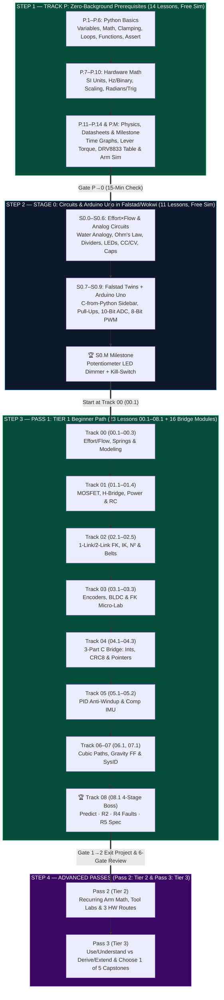

# ⚡ MechaLab — Beginner-First Mechatronics & Robotics Roadmap

[](https://github.com/TLE47/Mechatronics-Roadmap/actions/workflows/ci.yml)
[](https://github.com/TLE47/Mechatronics-Roadmap/actions/workflows/link-check.yml)
[](https://tle47.github.io/Mechatronics-Roadmap/)
[](track-p/README.md)
[_%2B_MIT_(Code)-fbbf24)](LICENSE)
[](https://github.com/TLE47/Mechatronics-Roadmap/stargazers)
[](https://github.com/TLE47/Mechatronics-Roadmap/commits/main)

> **Welcome! Never studied electronics, mechanics, or control before? Only know basic school math? You are in the right place.**
>
> Every lesson in our **Beginner Path (`Track P` $\to$ `Stage 0` $\to$ `Pass 1: Track 00 → Track 08`)** introduces **at most 2 new ideas** (enforced in CI by `scripts/lint_lessons.py`), includes runnable starter code with a 3-step hint ladder and behavioral test grading, and runs **first in 100% free browser simulators** (**\$0 hardware required**).
>
> 🚀 **[Open the Live MechaLab Browser Workbench (`tle47.github.io/Mechatronics-Roadmap`)](https://tle47.github.io/Mechatronics-Roadmap/)** — Launches directly in **Beginner View** with plain-English navigation, a Web-Worker isolated **In-Browser Python 3.12 Runner (Pyodide)** for all 36 Python lessons, an interactive **Prerequisite Placement Quiz (`Gate P→0`) + School-Math Diagnostic + Tier 1 Exit Review (`Gate 1→2`)**, persistent progress tracking, and **1-click Markdown Portfolio Export**.

<details>
<summary><b>🔍 Before vs. After MechaLab: From Fragile Hobby Code to Deterministic 1 kHz Control (Click to expand)</b></summary>

```python
# ❌ BEFORE (Fragile Hobby Loop): Blocking delay, unclamped windup, no gravity compensation
#    - delay(10) freezes the CPU and ruins derivative timing when Serial prints are added
#    - Unclamped integral_sum winds up during saturation, causing violent 37.2% overshoot!
error = target_rad - measured_rad
integral_sum += error * 0.010
pwm_cmd = Kp * error + Ki * integral_sum + Kd * (error - prev_error) / 0.010

# ✅ AFTER PASS 1 (Lessons 04.1, 05.1, 06.1): 1 kHz Timer ISR + Anti-Windup + Gravity Feedforward
#    - Derivative acts on measurement (-Kd * q_dot) to eliminate setpoint derivative kick
#    - Clamping anti-windup freezes integrator under saturation (overshoot drops 37.2% -> 4.7%)
tau_grav = m * g * L_com * math.cos(q_rad)
u_raw = tau_grav + Kp * (q_des - q_rad) - Kd * q_dot + i_term
u_cmd = max(-u_max, min(u_max, u_raw))
```

</details>

---

## 1. What "Complete" Means: Three Learner Completion Routes

Self-guided simulation and engineering design are achievable self-study goals across all three tiers; **independent physical commissioning of high-power production hardware ($24\text{ V}/15\text{ A}$ servos or $48\text{ V}/30\text{ A}$ inverters) is not a beginner self-study promise.** Choose the route that fits your goals at each tier:

| Route | What "Complete" Means | Expected Help & Safety Boundary |
| :--- | :--- | :--- |
| **Route 1: Learn & Simulate (\$0)** | Complete lessons, behavioral code tests, interactive simulator labs, planted-fault diagnostics, and capstones in the browser or supplied software tools (`Pyodide`, `Falstad`, `Wokwi`, `MuJoCo`, `ROS 2`). | **Self-guided:** Built-in 3-step hints, school-math refreshers, and tool first-run labs are designed to be sufficient. |
| **Route 2: Build (Optional Low-Voltage Bench)** | Assemble, measure, and test optional low-voltage ($\le 12\text{ V}$) hardware (`Arduino Uno`, `DRV8833`/`TB6612FNG`, `AS5600` encoder, 2-DOF desktop arm) or run Tier 2 firmware on a known-good reference board. | **Occasional help is reasonable**, especially for first-time breadboarding, soldering, and current-limited (`CC/CV`) bring-up. |
| **Route 3: Production Practice (Supervised Hardware)** | Complete full schematic/PCB design reviews, SIL/HIL fault injection, and commissioning of custom Tier 2 ($24\text{ V}/15\text{ A}$) or Tier 3 ($48\text{ V}/30\text{ A}$) hardware. | **Requires experienced engineering review & pre-bring-up safety sign-off;** never energize high-energy hardware alone as a beginner. |

---

## 2. How to Use This Roadmap & Reconciled Provisional Time Estimates

> **Note on Provisional Time Estimates:** All hour figures below and in **[`docs/SYLLABUS.md`](docs/SYLLABUS.md)** are **provisional author targets** pending beginner pilot validation. The syllabus's **`324.5 hours`** (`~41 weeks` at $8\text{ hrs/week}$) covers the **70 formal modules** across Passes 1–3 (`84.0 h` Tier 1 + `122.5 h` Tier 2 + `118.0 h` Tier 3). Including the optional zero-background entry ramp (**`Track P` + `Stage 0`**, unmeasured target: `~19–25 hours` across 25 lessons), the full zero-to-Tier-3 provisional estimate is **`~343.5–349.5 hours`**. Please log your real completion times via **[`beginner-timing-log.md`](.github/ISSUE_TEMPLATE/beginner-timing-log.md)**!

1. **[Step 1 — Track P: Zero-Background Prerequisites (`track-p/`, 14 Lessons — Unmeasured target: ~45–60 min/lesson, ~10.5–14 hrs total, help us calibrate!)](track-p/README.md):** Starts with a **no-penalty 6-topic School-Math Diagnostic** (*"I know this"*, *"Show me a refresher"*, or *"Teach it from scratch"*) and a **Computer-Tooling Orientation**, then teaches only the exact Python (`variables`, `if/else`, `for/while`, `def`, `assert`), SI prefixes (`M`, `k`, `m`, `µ`), binary bits ($2^N$), linear scaling, radians/trig (`cos`, `sin`, `atan2`), time-series graphs, lever torque ($\tau = m g L \cos\theta$), and **datasheet table reading (`P.14`: `DRV8833` $2.7\text{–}10.8\text{ V}$ vs. $11.8\text{ V}$ abs max)**—finishing with the 15-minute **Gate P→0** check.
2. **[Step 2 — Stage 0: Circuit & Arduino Uno Foundations (`stage-0/`, 11 Lessons — Unmeasured target: ~45–60 min/lesson, ~8.5–11 hrs total, help us calibrate!)](stage-0/README.md):** Pre-teaches **`Effort × Flow` water-pipe analogies (`S0.0`)** before touching Falstad, pairs every Arduino Uno lesson (`S0.7–S0.M`) with a **5-minute Falstad "see it without code" twin** and a **4-row C-from-Python sidebar (`S0.7`)**, and follows an 8-step **`Simulate → Predict → Measure → Build → Diagnose Fault`** sequence culminating in the `S0.M` dimmer + kill-switch milestone.
3. **[Step 3 — Pass 1: Tier 1 Beginner Roadmap (`Track 00` → `Track 08`, 23 Beginner Lessons + 16 Tier 1 Bridge Modules · `84.0 hrs` provisional)](#6-pass-1-tier-1-linear-roadmap-track-00-to-track-08):** Progress linearly from **[Track 00 Lesson 00.1](00-foundations/00.1-effort-flow-and-first-order-lag.md)** through **Track 08 (`08.1`)**, including the **Track 02+03 Integration Micro-Lab (`03.3`)**, the **3-part Python→C Bridge (`04.1` ints/overflow, `04.2` bitwise/CRC-8, `04.3` structs/pointers as labeled boxes)**, the **4-Stage `08.1` 2-DOF Arm Capstone** (*Predict → R2 Retarget → R4 3 Broken Versions → R5 Spec*), and the **Gate 1→2 ("Tier 1 Exit")** self-administered position-loop project ($\pm 2\%$ overshoot, $<0.5\text{ s}$ settling).
4. **[Step 4 — Pass 2 (Tier 2 · `122.5 hrs` provisional) & Pass 3 (Tier 3 · `118.0 hrs` provisional)](#3-one-recurring-project-spine-across-all-tracks--tiers):** Level up the *same* robot joint/arm through Tier 2 (using the recurring motor/arm math ladder, standalone first-run labs for `KiCad`, `CAD/URDF`, `ROS 2`, and `RTOS`, and 3 hardware evidence routes) and Tier 3 (*Use & Understand* vs. *Derive & Extend* two-level tracks, with **Step 3.8 requiring 1 chosen capstone out of Capstones I–V**).

---

## 3. One Recurring Project Spine Across All Tracks & Tiers

Instead of starting from zero with unrelated examples in every track, you evolve **one familiar robot joint and 2-DOF arm** across all three passes, using a consistent **8-Step Teaching Ladder** (*1. Recall → 2. See it → 3. Predict → 4. Work through → 5. Practice with support → 6. Break it on purpose → 7. Transfer → 8. Integrate*):

| Track | Tier 1: Understand & Build (`Pass 1`) | Tier 2: Model & Apply (`Pass 2`) | Tier 3: Optimize & Validate (`Pass 3`) | Recurring Robot Arm Spine Integration Task |
| :--- | :--- | :--- | :--- | :--- |
| **00: Foundations** | Scalar effort/flow power, 1st-order lag ($\tau$), 2nd-order spring-damper ($\omega_n, \zeta$) | Numerical deriv/integral, state-space $\dot{x}=Ax+Bu$, Bode plots & Tustin biquads on the *same* joint | Lie groups $SO(3)/SE(3)$, matrix exponentials & Port-Hamiltonian energy | Model 1 joint's step response (T1) $\to$ discretize its state matrix & notch filter (T2) $\to$ 3D spatial pose (T3) |
| **01: Electronics** | MOSFET flyback, H-bridge (`DRV8833`/`TB6612FNG`), LDO/Buck budget & RC filter | 4-layer KiCad stackup, Kelvin shunt (`INA240`) & gate drivers *(Sim / Ref-Board / Custom PCB routes)* | 6-layer $<2\text{ nH}$ $48\text{ V}/30\text{ A}$ inverter, Bessel AFE & SAR charge buckets *(Design review only)* | Switch the joint motor & budget battery current (T1) $\to$ sense phase current (T2) $\to$ verify switching loop inductance (T3) |
| **02: Mechanics** | 1-link FK $\to$ 2-link FK $\to$ Law-of-Cosines IK, $N^2$ reflected inertia & `GT2` belts | Exact constraint, `CadQuery` First-Run Lab, URDF/MuJoCo export & $6\times n$ Jacobians | Screw theory PoE, `Ti-6Al-4V` notch flexures & Featherstone $O(n)$ RNEA | Compute 2-link reach & gearbox inertia (T1) $\to$ map joint torques via $J^T F$ (T2) $\to$ recursive multi-body dynamics (T3) |
| **03: Sensors** | $4\times$ quadrature & `AS5600` magnetic encoder counts, $N_p\theta_m$ electrical angle | Clarke/Park transforms (with phase-swap & offset diagnosis), Type-II PLL & Allan variance | $25\text{–}40\text{ kHz}$ decoupled $d$-$q$ FOC, min-max SVPWM & encoder harmonic LUT | Feed quantized encoder angles into the joint model (T1) $\to$ extract ripple-free velocity & $i_q$ (T2/T3) |
| **04: Embedded** | Fixed-width C types (`uint16_t` rollover), `volatile` $1\text{ kHz}$ timer ISR & packed `CRC-8` | RTOS First-Run Lab, DMA ping-pong buffers, FreeRTOS/Zephyr scheduling & CAN-FD (`MIT Mode`) | Bare-metal `TIM1`$\to$`ADC` midpoint trigger, Q1.31 CORDIC & C++20 `WaitFreeSeqLock` | Replace blocking `delay()` with a $1\text{ kHz}$ ISR & verify 8N1 UART bandwidth (T1) $\to$ RTOS + CAN-FD joint node (T2/T3) |
| **05: Control** | PID virtual spring-damper, clamping anti-windup & complementary IMU fusion | Bode loop shaping, sensitivity waterbed ($S+T=1$), Luenberger observer & Bryson LQR | Joseph-form manifold ESKF, embedded MPC (`TinyMPC`) & Control Barrier QPs (`CBF-QP`) | Track a step target under gravity & sensor noise (T1) $\to$ optimal state feedback (T2) $\to$ safety-constrained QP (T3) |
| **06: Robotics** | Cubic spline trajectories ($C^1$ zero-jerk endpoints) & gravity feedforward ($\tau_{ff}$) | ROS 2 First-Run Lab (`rosbag2` replay + single topic), `ros2_control` & Jacobian compliance | Khatib operational-space WBC & Embodied AI (`LeRobot` ACT/Diffusion policy with safety wrapper) | Smooth the 2-DOF arm path with gravity cancellation (T1) $\to$ ROS 2 node graph (T2) $\to$ learned/WBC policy (T3) |
| **07–08: Systems & Capstone** | 10-step current-limited bring-up, sine-sweep SysID, Practice Boss & **08.1 2-DOF Arm Boss** | Regen shunt chopper, CAN-FD watchdog & **Tier 2 Boss** *(completable in Sim, Ref-Board, or Custom PCB)* | Schroeder SysID, $<1\ \mu\text{s}$ STO design & **Step 3.8 Capstone** *(Choose 1 of 5 Capstones I–V)* | Diagnose planted faults & pass a modified-parameter transfer gate in the 2-DOF Figure-8 Boss Capstone |

---

## 4. Transparent Cost Tiers (\$0 Simulator Path vs. Optional Hardware)

All **48 beginner lessons** (`14 Track P` + `11 Stage 0` + `23 Tracks 00–08 Tier 1`) have a **100% free simulator path**. Physical hardware is completely optional and broken into three transparent tiers in **[`resources/lab-workbench-bom.md`](resources/lab-workbench-bom.md)**:

| Hardware Tier | Cost | What You Need & What It Covers |
| :--- | :--- | :--- |
| **Tier 0: 100% Simulator Path (`Learn & Simulate`)** | **\$0** | Browser + Python 3 (or in-app **Pyodide Runner**), [Falstad](https://www.falstad.com/circuit/circuitjs.html), [Wokwi](https://wokwi.com/projects/new/arduino-uno), and the 10-tab MechaLab Workbench. Covers **100% of Track P, Stage 0, Pass 1 (`00.1–08.1`), and Tier 2/3 simulation routes**. |
| **Tier 0+: Optional Breadboard Starter Kit (`Build`)** | **\$15–\$25** | Basic `Arduino Uno R3` / `ESP32` clone + breadboard + LEDs + resistors + $10\text{ k}\Omega$ potentiometer + pushbuttons. Covers physical breadboarding for **Stage 0 (`S0.1–S0.M`)** and low-voltage logic tests. |
| **Tier 1: Physical Closed-Loop Motor Bench (`Build`)** | **~\$150** | Adds a $0\text{–}30\text{ V}$ `CC/CV` bench power supply, multimeter, USB logic analyzer, $6\text{–}9\text{ V}$ DC motor + **`DRV8833`** ($2.7\text{–}10.8\text{ V}$ operating, $11.8\text{ V}$ abs max) or $12\text{ V}$ motor + **`TB6612FNG`** ($4.5\text{–}13.5\text{ V}$), `SimpleFOCMini` + gimbal BLDC + `AS5600` magnetic encoder. Required **only** if you choose to build the physical Pass 1 motor labs and 2-DOF desktop robot arm. |

---

## 5. Visual Progression Architecture



---

## 6. Pass 1 (Tier 1) Linear Roadmap (Track 00 to Track 08)

Every Pass 1 step below pairs **self-contained Beginner Lessons ($\le 2$ new ideas per file, \$0 in Python/Falstad/Wokwi)** with **Bridge Modules (`modules/`)** and **Recurring Arm Spine Integration Tasks**:

| Step | Track & Single-Source Curriculum Guide | Beginner Lessons ($\le 2$ ideas/lesson) | Tier 1 Bridge Ladder (`modules/`) | Simulator vs. Hardware Mode |
| :--- | :--- | :--- | :--- | :--- |
| **Step 1.1** | **[Track 00: Foundations](00-foundations/README.md#tier-1-beginner--intuitive)** | **[00.1](00-foundations/00.1-effort-flow-and-first-order-lag.md)** (Effort/Flow & $\tau$), **[00.2](00-foundations/00.2-mass-spring-damper-oscillations.md)** ($\omega_n, \zeta$), **[00.3](00-foundations/00.3-modeling-discipline-and-sanity-checks.md)** (4-Step Modeling) | [`T1.00a`](modules/00-foundations.T1.00a.md) → [`T1.00b`](modules/00-foundations.T1.00b.md) → [`T1.00c`](modules/00-foundations.T1.00c.md) → [`T1.00d`](modules/00-foundations.T1.00d.md) → [`T1.00e`](modules/00-foundations.T1.00e.md) | **`[Sim: Free]`** Python / In-Browser Runner |
| **Step 1.2** | **[Track 01: Electronics & Power](01-electronics-and-power/README.md#tier-1-beginner--intuitive)** | **[01.1](01-electronics-and-power/01.1-mosfet-inductor-flyback.md)** (MOSFET & Flyback), **[01.2](01-electronics-and-power/01.2-h-bridge-and-stall-current.md)** (`DRV8833`/`TB6612FNG` & Stall), **[01.3](01-electronics-and-power/01.3-power-regulators-and-power-budget.md)** (LDO vs. Buck), **[01.4](01-electronics-and-power/01.4-grounding-and-rc-lowpass-filters.md)** (RC & Nyquist) | [`T1.01a`](modules/01-electronics.T1.01a.md) → [`T1.01c`](modules/01-electronics.T1.01c.md) → [`T1.01d`](modules/01-electronics.T1.01d.md) → [`T1.01b`](modules/01-electronics.T1.01b.md) | **`[Sim: Free]`** Falstad + Wokwi + Python<br>**`[HW: Optional]`** Breadboard `DRV8833` ($6\text{–}9\text{ V}$) / `TB6612FNG` ($12\text{ V}$) |
| **Step 1.3** | **[Track 02: Mechanics & Dynamics](02-mechanics-kinematics-dynamics/README.md#tier-1-beginner--intuitive)** | **[02.1](02-mechanics-kinematics-dynamics/02.1-1d-link-fk-and-coord-frames.md)** (1-Link FK), **[02.2](02-mechanics-kinematics-dynamics/02.2-2link-planar-forward-kinematics.md)** (2-Link FK), **[02.3](02-mechanics-kinematics-dynamics/02.3-2link-planar-inverse-kinematics.md)** (Law-of-Cosines IK), **[02.4](02-mechanics-kinematics-dynamics/02.4-rotational-inertia-and-gear-ratios.md)** ($N^2$ Inertia), **[02.5](02-mechanics-kinematics-dynamics/02.5-bearings-belts-and-3d-printing.md)** (Double-Shear & `GT2`) | [`T1.02a`](modules/02-mechanics.T1.02a.md) | **`[Sim: Free]`** Python + Workbench Tab 5<br>**`[HW: Optional]`** 3D-Printed `608` Bearing Joint |
| **Step 1.4** | **[Track 03: Sensors & Actuators](03-sensors-and-actuators/README.md#tier-1-beginner--intuitive)** | **[03.1](03-sensors-and-actuators/03.1-quadrature-and-magnetic-encoders.md)** ($4\times$ Quadrature & `AS5600`), **[03.2](03-sensors-and-actuators/03.2-three-phase-bldc-and-electrical-angle.md)** ($N_p\theta_m$ & $90^\circ$ BLDC Lead), **[03.3](03-sensors-and-actuators/03.3-encoder-to-fk-integration-microlab.md)** (Track 02+03 Dual-Encoder FK Micro-Lab) | [`T1.03a`](modules/03-sensors.T1.03a.md) | **`[Sim: Free]`** Python + Workbench Tab 3<br>**`[HW: Optional]`** `AS5600` + `SimpleFOCMini` |
| **Step 1.5** | **[Track 04: Embedded & Real-Time](04-embedded-and-realtime/README.md#tier-1-beginner--intuitive)** | **[04.1](04-embedded-and-realtime/04.1-c-types-and-hardware-timer-isr.md)** (`uint16_t`, `uint8_t` Wrap R4 & $1\text{ kHz}$ ISR), **[04.2](04-embedded-and-realtime/04.2-packed-structs-and-crc8-telemetry.md)** (Packed Structs, `CRC-8` & UART Budget), **[04.3](04-embedded-and-realtime/04.3-structs-and-pointers-labeled-boxes.md)** (Structs as Labeled Boxes & Pointers `&`/`*`/`->`) | [`T1.04a`](modules/04-embedded.T1.04a.md) *(Python-to-C++ Bridge)* → [`T1.04b`](modules/04-embedded.T1.04b.md) | **`[Sim: Free]`** Python + Wokwi Timer Sim<br>**`[HW: Optional]`** `ESP32`/`STM32` + Logic Analyzer |
| **Step 1.6** | **[Track 05: Control & Estimation](05-control-and-estimation/README.md#tier-1-beginner--intuitive)** | **[05.1](05-control-and-estimation/05.1-pid-virtual-spring-damper-and-anti-windup.md)** (PID Spring-Damper & Anti-Windup), **[05.2](05-control-and-estimation/05.2-complementary-imu-sensor-fusion.md)** (`atan2` & Complementary IMU) | [`T1.05a`](modules/05-control.T1.05a.md) | **`[Sim: Free]`** Python + Workbench Tab 4<br>**`[HW: Optional]`** `MPU6050` Breakout |
| **Step 1.7** | **[Track 06: Robotics](06-robotics-and-autonomy/README.md#tier-1-beginner--intuitive)** & **[Track 07: Systems/Safety](07-systems-hil-and-production/README.md#tier-1-beginner--intuitive)** | **[06.1](06-robotics-and-autonomy/06.1-cubic-trajectories-and-compliant-joints.md)** (Cubic Splines & Gravity FF), **[07.1](07-systems-hil-and-production/07.1-safe-bringup-and-sine-sweep-sysid.md)** (10-Step Bring-Up & Sine-Sweep SysID) | [`T1.06a`](modules/06-robotics.T1.06a.md), [`T1.07a`](modules/07-systems.T1.07a.md) | **`[Sim: Free]`** Python + Workbench Tab 7<br>**`[HW: Optional]`** Current-Limited `CC/CV` Bring-Up |
| **Step 1.8** | **[Track 08: Boss Capstone](08-capstone-projects/README.md#tier-1-capstone-builds-beginner--breakout-pass)** | **[08.1](08-capstone-projects/08.1-tier1-2dof-compliant-arm-capstone.md)** (4-Stage 2-DOF Boss: 1. Predict → 2. R2 Retarget → 3. R4 3 Broken Versions → 4. R5 Trajectory Spec) | [`T1.07a`](modules/07-systems.T1.07a.md) | **`[Sim: Free]`** Full 2-DOF Python Sim<br>**`[HW: Optional]`** Breakout 2-DOF Desktop Arm |

---

## 7. Master Multi-Pass Navigation Matrix (Tracks 00-08 x Tiers 1-3)

The curriculum spans **70 formal modules** (**24 legacy** modules and **46 bridge** modules across **25 ladders**, verified by `scripts/validate_modules.py` from `modules/_index.yaml`) plus **48 beginner-first lessons** (`14 Track P` + `11 Stage 0` + `23 Tracks 00–08 Tier 1`). Each Track's `README.md` is the single source of truth for its exercises, resource links, and knowledge checks:

| Track Folder | Pass 1: Tier 1 (Beginner / Intuitive) | Pass 2: Tier 2 (Intermediate / Applied) | Pass 3: Tier 3 (Advanced / Production) | Bridge Concept (Maker $\to$ Custom) |
| :--- | :--- | :--- | :--- | :--- |
| **[Track P: Prerequisites](track-p/README.md)** | [Lessons P.1–P.14 & P.M: Python, SI Units, Binary, Trig, Graphs, Torque & Datasheets](track-p/README.md) | — | — | Zero-Background Entry Ramp + `Gate P→0` |
| **[Stage 0: Circuit & MCU](stage-0/README.md)** | [Lessons S0.0–S0.M: Effort×Flow, Ohm's Law, Dividers, CC/CV, Falstad Twins & Arduino Uno](stage-0/README.md) | — | — | Falstad & Wokwi On-Ramp |
| **[Maths Ramp: Gate 1→2](ramp/README.md)** | [Lessons R.1–R.2: Rate of Change & Accumulation](ramp/README.md) | — | — | [`docs/TIER1_EXIT_CHECK.md`](docs/TIER1_EXIT_CHECK.md): 10 items, each mapped to R.1 or R.2 |
| **[Track 00: Foundations](00-foundations/README.md)** | [Lessons 00.1–00.3 + `T1.00a–e`: Effort/Flow, Springs & Modeling](00-foundations/README.md#tier-1-beginner--intuitive) | [State-Space Matrices, Quaternions & Tustin Biquads](00-foundations/README.md#tier-2-intermediate--applied) | [Lie Groups SO(3)/SE(3) & Symplectic Port-Hamiltonian](00-foundations/README.md#tier-3-advanced--production) | [Moving Average → Pre-Warped TDF-II Biquad Notch](00-foundations/README.md#bridging-the-gap-maker-to-custom) |
| **[Track 01: Electronics & Power](01-electronics-and-power/README.md)** | [Lessons 01.1–01.4 + `T1.01a–d`: MOSFETs, H-Bridges & RC Filters](01-electronics-and-power/README.md#tier-1-beginner--intuitive) | [4-Layer KiCad PCBs, Gate Drivers & Kelvin Shunts](01-electronics-and-power/README.md#tier-2-intermediate--applied) | [6-Layer <2 nH 48 V/30 A Inverter & SAR Charge Buckets](01-electronics-and-power/README.md#tier-3-advanced--production) | [`DRV8833`/`INA219` Breakouts → `DRV8353` + `INA240` Kelvin PCB](01-electronics-and-power/README.md#bridging-the-gap-maker-to-custom) |
| **[Track 02: Mechanics & Dynamics](02-mechanics-kinematics-dynamics/README.md)** | [Lessons 02.1–02.5 + `T1.02a`: 2-Link FK/IK, N² Inertia & Belts](02-mechanics-kinematics-dynamics/README.md#tier-1-beginner--intuitive) | [Maxwell Exact Constraint, `CadQuery` & URDF/MuJoCo](02-mechanics-kinematics-dynamics/README.md#tier-2-intermediate--applied) | [Screw PoE, `Ti-6Al-4V` Flexures & Featherstone O(n) RNEA](02-mechanics-kinematics-dynamics/README.md#tier-3-advanced--production) | [200:1 Hobby Servos → 8:1 Backdrivable QDD Planetary Actuator](02-mechanics-kinematics-dynamics/README.md#bridging-the-gap-maker-to-custom) |
| **[Track 03: Sensors & Actuators](03-sensors-and-actuators/README.md)** | [Lessons 03.1–03.3 + `T1.03a`: Encoders, 3-Phase BLDC & FK Micro-Lab](03-sensors-and-actuators/README.md#tier-1-beginner--intuitive) | [Clarke/Park Transforms, Type-II PLLs & Allan Variance](03-sensors-and-actuators/README.md#tier-2-intermediate--applied) | [25–40 kHz Decoupled d-q FOC, SVPWM & Harmonic LUT](03-sensors-and-actuators/README.md#tier-3-advanced--production) | [Hobby ESC / Voltage Mode → Center-Aligned ADC Current FOC](03-sensors-and-actuators/README.md#bridging-the-gap-maker-to-custom) |
| **[Track 04: Embedded & Real-Time](04-embedded-and-realtime/README.md)** | [Lessons 04.1–04.3 + `T1.04a–b`: 3-Part C Bridge (Ints, CRC8 & Struct Pointers)](04-embedded-and-realtime/README.md#tier-1-beginner--intuitive) | [FreeRTOS Scheduling (RTA), DMA Buffers & CAN-FD (`MIT Mode`)](04-embedded-and-realtime/README.md#tier-2-intermediate--applied) | [Bare-Metal `TIM1`→`ADC`, CORDIC & C++20 `WaitFreeSeqLock`](04-embedded-and-realtime/README.md#tier-3-advanced--production) | [Global Structs / `mutex` → DMA Pipelines & `WaitFreeSeqLock`](04-embedded-and-realtime/README.md#bridging-the-gap-maker-to-custom) |
| **[Track 05: Control & Estimation](05-control-and-estimation/README.md)** | [Lessons 05.1–05.2 + `T1.05a`: PID Anti-Windup & Complementary IMU](05-control-and-estimation/README.md#tier-1-beginner--intuitive) | [Bode Loop Shaping, Gang of Four, Swing-Up LQR & Linear KF](05-control-and-estimation/README.md#tier-2-intermediate--applied) | [Joseph-Form Manifold ESKF, MPC & Control Barrier QPs](05-control-and-estimation/README.md#tier-3-advanced--production) | [Trial-and-Error PID / `if` Limits → LQR + Predictive CBF-QP](05-control-and-estimation/README.md#bridging-the-gap-maker-to-custom) |
| **[Track 06: Robotics & Autonomy](06-robotics-and-autonomy/README.md)** | [Lesson 06.1 + `T1.06a`: Cubic Trajectories & Compliant Gravity FF](06-robotics-and-autonomy/README.md#tier-1-beginner--intuitive) | [Jacobian Transpose, `Ruckig`, ROS 2 (`T2.06a–b`) & Gazebo](06-robotics-and-autonomy/README.md#tier-2-intermediate--applied) | [Khatib Operational WBC, Embodied AI (`LeRobot`/VLA) & GPU Sim](06-robotics-and-autonomy/README.md#tier-3-advanced--production) | [Rigid `servo.write()` Stepping → 1 kHz Torque/Impedance Control](06-robotics-and-autonomy/README.md#bridging-the-gap-maker-to-custom) |
| **[Track 07: Systems, HIL & Safety](07-systems-hil-and-production/README.md)** | [Lesson 07.1 + `T1.07a`: 10-Step Safe Bring-Up & Sine-Sweep SysID](07-systems-hil-and-production/README.md#tier-1-beginner--intuitive) | [Regen Braking Clamps, `OPC UA`, CRC Watchdogs & HIL Faults](07-systems-hil-and-production/README.md#tier-2-intermediate--applied) | [Schroeder Multisine SysID, <1 μs Hardware STO & Digital Twins](07-systems-hil-and-production/README.md#tier-3-advanced--production) | [Software `if(fault) pwm=0` → Dual-Channel Hardware STO Cutoff](07-systems-hil-and-production/README.md#bridging-the-gap-maker-to-custom) |
| **[Track 08: Capstone Projects](08-capstone-projects/README.md)** | [Lesson 08.1 + `T1.08`: Tier 1 Boss 2-DOF Compliant Robot Arm](08-capstone-projects/README.md#tier-1-capstone-builds-beginner--breakout-pass) | [Tier 2 Boss: Custom 4-Layer CAN Servo + LQR/MuJoCo](08-capstone-projects/README.md#tier-2-capstone-builds-intermediate--applied-pass) | [Tier 3 Boss: Capstones I–V (`48V` FOC, Furuta, 6-DOF, Hopper, AMR)](08-capstone-projects/README.md#tier-3-capstone-builds-advanced--production-pass) | [Progressive 3-Pass Hardware/Software Capstone Evolution](08-capstone-projects/README.md#bridging-the-gap-maker-to-custom) |

---

## 8. Reference Guides, Interactive Workbench & Open-Source Attribution

* **Always-At-Hand Guides:** **[Beginner Glossary (`resources/glossary.md`)](resources/glossary.md)** · **[Safety Guide (`resources/safety.md`)](resources/safety.md)** · **[Troubleshooting Guide (`resources/troubleshooting.md`)](resources/troubleshooting.md)** · **[Full Academic Syllabus (`docs/SYLLABUS.md`)](docs/SYLLABUS.md)** · **[Beginner Lesson Plan (`docs/PLAN-batch-1.md`)](docs/PLAN-batch-1.md)**
* **Engineering Reference Library:** **[Lab Workbench BOM (`resources/lab-workbench-bom.md`)](resources/lab-workbench-bom.md)** · **[1-Page Cheat Sheet (`resources/mechatronics-cheatsheet.md`)](resources/mechatronics-cheatsheet.md)** · **[Open-Source Toolchains (`resources/open-source-toolchains.md`)](resources/open-source-toolchains.md)** · **[Textbooks & Papers (`resources/textbooks-and-papers.md`)](resources/textbooks-and-papers.md)**
* **Interactive Browser Workbench (10 Tabs + Pyodide Runner + Placement Quiz):** Run `npm ci && npm run dev` (`http://localhost:3000`) or open [tle47.github.io/Mechatronics-Roadmap](https://tle47.github.io/Mechatronics-Roadmap/) to use the 8 real-time engineering simulators, **Tab 9: In-Browser Python Lesson Runner (Pyodide)**, and **Tab 10: Interactive Prerequisite Placement Quiz, School-Math Diagnostic & Tier 1 Exit Review**.
* **Validation & CI:** Run `python3 scripts/verify_repo.py`, `python3 scripts/validate_modules.py`, `python3 scripts/lint_lessons.py`, `python3 scripts/check_ramp_lessons.py`, `python3 scripts/audit_step_size.py --check`, `python3 scripts/legacy_crosswalk.py --check`, `python3 scripts/mentions_audit.py --check`, `python3 scripts/check_term_order.py`, `python3 scripts/clean_tex.py --check`, `python3 scripts/run_all_labs.py`, `python3 tests/test_exercises.py`, `npm run test:smoke`, and `npm run test:e2e`. See **[`CONTRIBUTING.md`](CONTRIBUTING.md)** and **[`CHANGELOG.md`](CHANGELOG.md)**.
* **License & Attribution:** Dual-licensed under **[CC BY 4.0](https://creativecommons.org/licenses/by/4.0/)** for curriculum documentation and **[MIT](LICENSE)** for all code, simulators, and scripts (see [`LICENSE`](LICENSE)). Portions of the external resource links in `resources/` incorporate curated references from **[`engyasin/awesome-mechatronics`](https://github.com/engyasin/awesome-mechatronics)** by Yasin (`engyasin`) and contributors.
